# Linker Hand L30 (Tendon-Driven) Product Manual

### LINKERBOT Linker Hand L30 21-DOF Tendon-Driven Dexterous Robotic Hand



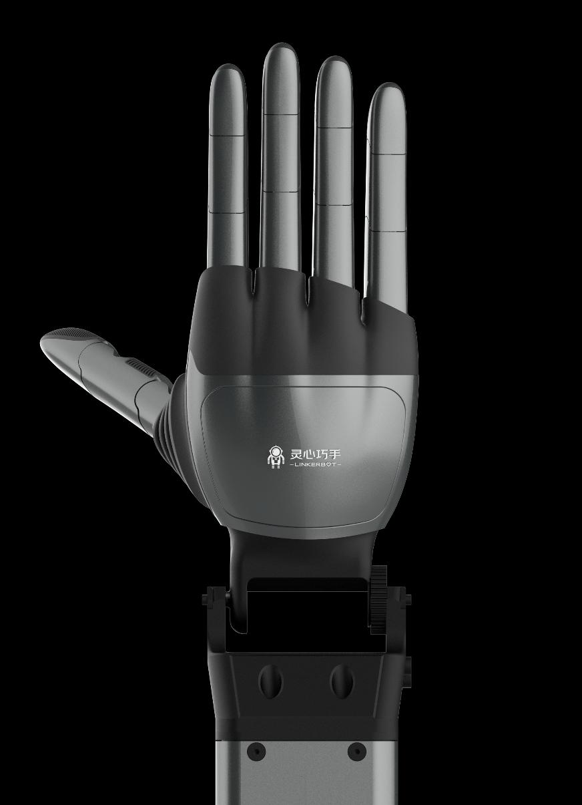

### Revision History

| Version | Date       | Description                                         |
| ------- | ---------- | --------------------------------------------------- |
| v1.0    | 2025-08-02 | Initial edition                                     |
| v1.1    | 2025-08-20 | First edition of the Linker Hand L30 Product Manual |
| v1.2    | 2025-08-29 | Content revised                                     |
| v1.3    | 2025-10-27 | Product images updated                              |

### Product Overview

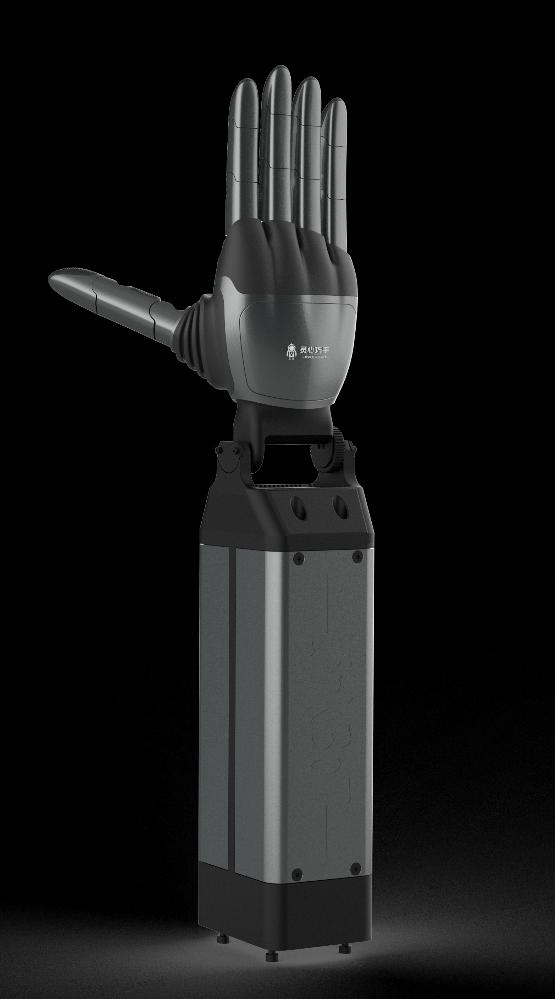

The Linker Hand L30 is a new-generation modular humanoid manipulator developed by Lingxin Qiaoshou. As a tendon-driven robotic end effector, it combines the team's work in motion control, bionic design, and electromechanical integration.

The hand is designed to reproduce the fine motor capabilities of a human hand. Its multi-degree-of-freedom bionic structure follows human-hand movement principles, while high-precision control and real-time sensing combine flexible motion with precise operation. The hand can perform complex actions such as pinching, gripping, and twisting. Its design targets motion flexibility, millimetre-level operating precision, and dependable operation under demanding conditions, providing an adaptable end-effector solution for industrial automation, medical-assistance research, and scientific experimentation.

#### Bionic Drive Architecture

The tendon-driven transmission uses ultra-high-molecular-weight polyethylene tendons and PTFE tubes. A distal motor assembly coordinates five fingers through 17 active degrees of freedom and 21 joints in total, including one wrist degree of freedom. The compact structure is designed around adult palm dimensions and reproduces coordinated multi-joint hand motion while using space efficiently.

#### High-Precision Force Control

A high-resolution encoder, tendon-tension control, and adaptive PID control provide real-time adjustment. Repeatability is specified as ±0.20 mm, supporting precision tasks such as screw tightening and picking thin sheets.

#### Load Capacity and Adaptability

The opposed-thumb layout and independent force control for the four fingers provide up to 10 N of precise gripping force in the product overview. A high-sensitivity tactile array at the fingertips detects contact, allowing the hand to adapt its grasp to irregular objects without manual intervention. The detailed mechanical-performance table later in this manual separately specifies a maximum gripping force of 12 N for each finger.

#### Fast Response

Core motions—including four-finger flexion and lateral thumb motion—can exceed 400°/s. The specified hand opening and closing time is 0.2 seconds, supporting high-speed operations such as industrial assembly.

#### Control and Integration

The hand provides Mini-USB and CAN FD interfaces and supports a communication frequency of 500 Hz. These interfaces allow integration with industrial automation equipment and service-robot platforms while providing millisecond-level control response.

### Product Functions

#### Position Control

Position control manages the overall hand position and individual finger joints so that the hand can follow preset trajectories smoothly. This supports both whole-hand motion and fine joint-level adjustment for tasks such as precision assembly and path-guided operation.

#### Speed Control

Finger speed can be adjusted to suit the task. High-speed operation improves throughput, while low-speed operation supports safer precision work.

#### Tactile Feedback and Force Control

Fingertip sensors detect the force applied by the fingers in real time. The controller can adjust output force to avoid damaging fragile objects or losing an object because of insufficient grip.

#### Online Firmware Upgrade

The dexterous-hand firmware can be updated from the host computer, allowing functional updates and performance-parameter optimization over the service life of the product.

### Dimensions, Joints, and Motion Range

#### External Dimensions

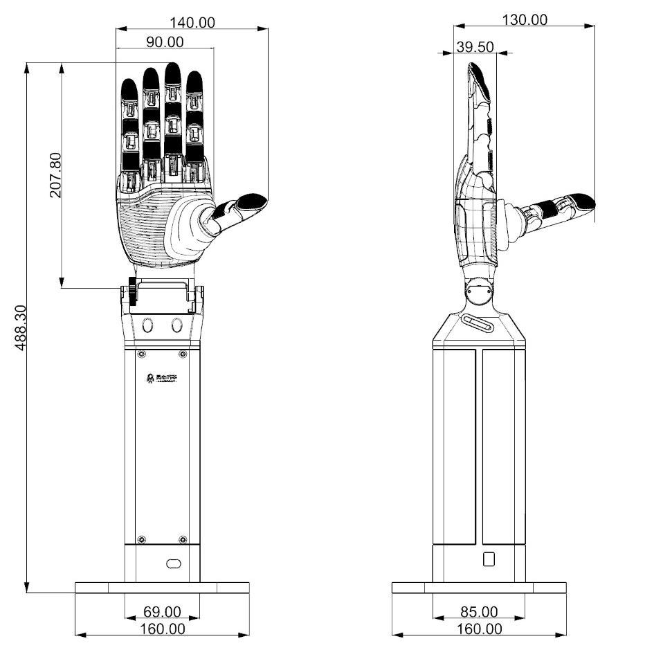

All dimensions in the diagram are in millimetres.

#### Degrees of Freedom

The Linker Hand L30 has 17 active degrees of freedom and 21 joints in total: 17 active joints and 4 passive joints. High-precision actuators control the active joints, while bionic elastic structures in the passive joints adapt to contact forces, cushion impacts, and reduce energy consumption.

The diagrams below show the maximum mechanical ranges. The actual commanded range may be limited by the controller to prevent structural impact.

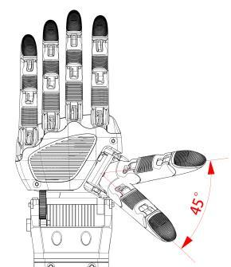

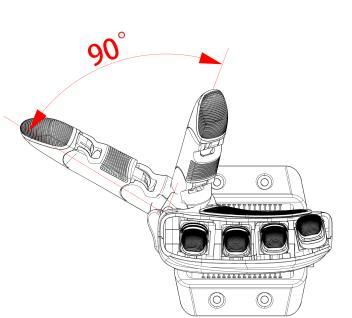

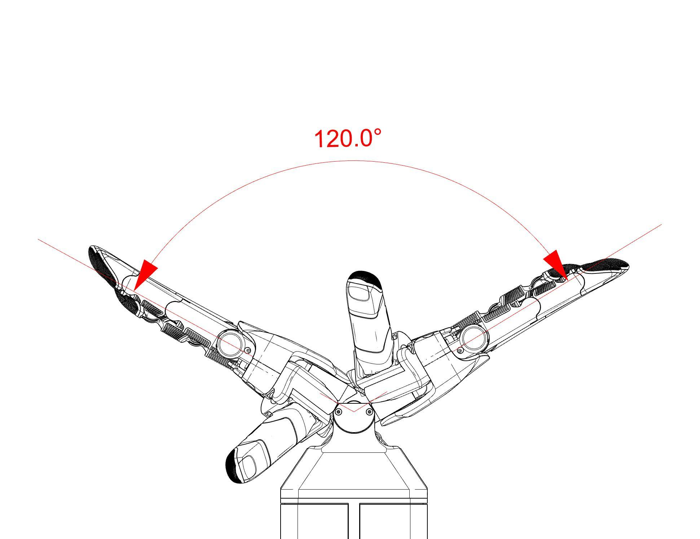

#### Controlled Motion Range and Speed

| Muscle group                                  | Maximum angle range | Maximum speed |
| --------------------------------------------- | ------------------: | ------------: |
| Wrist swing                                   |               44.7° |      171.9°/s |
| Dorsal thumb swing                            |               44.7° |      406.3°/s |
| Thumb rotation                                |               75.8° |      315.8°/s |
| Dorsal thumb base                             |               91.9° |      437.6°/s |
| Thumb tip                                     |               85.4° |      406.6°/s |
| Metacarpal-root flexion of all four fingers   |               84.3° |      443.6°/s |
| Fingertip flexion of all four fingers         |                 90° |        450°/s |
| Passive fingertip flexion of the four fingers |               82.5° |             — |
| Index-finger lateral swing                    |                 21° |      190.9°/s |
| Middle-finger lateral swing                   |               20.6° |      187.2°/s |
| Ring-finger lateral swing                     |               19.3° |      241.2°/s |
| Little-finger lateral swing                   |               15.1° |        302°/s |

### Technical Specifications

#### Basic Parameters

| Parameter                     | Specification                    |
| ----------------------------- | -------------------------------- |
| Model                         | Left-hand L30 (Standard Edition) |
| Active degrees of freedom     | 17                               |
| Joint count                   | 17 active + 4 passive            |
| Drive                         | Tendon-style bionic actuation    |
| Control interface             | CAN FD                           |
| Communication rate            | 500 kbps                         |
| Weight                        | Approximately 1,400 g            |
| Maximum load                  | 5 kg                             |
| Working voltage               | 24 V DC                          |
| Quiescent current             | 0.45 A                           |
| Average no-load motor current | 0.63 A                           |
| Maximum current               | 2.3 A                            |
| Repeatability                 | ±0.20 mm                         |
| Opening and closing time      | 0.2 s                            |

#### Mechanical Performance

| Performance item                                    | Specification |
| --------------------------------------------------- | ------------: |
| Maximum thumb-fingertip force                       |           8 N |
| Maximum fingertip force of each of the four fingers |           7 N |
| Maximum gripping force of each finger               |          12 N |

### Sensor System

The Linker Hand L30 can be equipped with an optional pressure-sensitive sensor.

| Parameter                | Specification  |
| ------------------------ | -------------- |
| Piezoresistive array     | 6 × 12         |
| Force-sensitive area     | 9.6 × 14.4 mm  |
| Touch-force threshold    | 5 g            |
| Measurement range        | 20 N           |
| Service life             | 100,000 cycles |
| Communication frame rate | 200 FPS        |

### Installation and Commissioning

#### Accessory List

Before installing the dexterous hand, confirm that all accessories are present.

| No. | Item                          | Quantity |
| --: | ----------------------------- | -------: |
|   1 | USB-to-CAN FD debugging cable |        1 |
|   2 | USB cable                     |        1 |
|   3 | XT30 (2+2) plug-in cable      |        1 |
|   4 | Power adapter                 |        1 |
|   5 | Power cable                   |        1 |

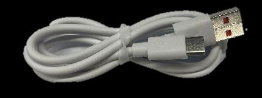

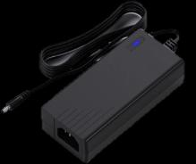

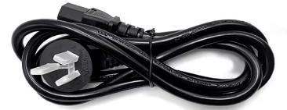

#### Mechanical Installation

Use M4 screws for installation. Select the screw length according to the thickness of the mounting component.

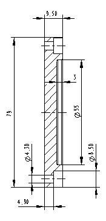

#### Electrical Connection

The dexterous hand uses an XT30 (2+2) connector.

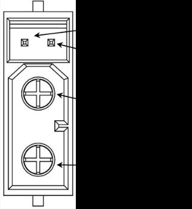

| Pin | Signal |
| --: | ------ |
|   1 | CAN L  |
|   2 | CAN H  |
|   3 | GND    |
|   4 | 24 V   |

### Software Debugging

#### Connect the Debugging Cable

1. Connect the dexterous hand to the debugging computer with the USB-to-CAN FD debugging cable.
2. Connect the power cable to the power adapter.
3. Connect the adapter to the power input of the USB-to-CAN FD debugging cable.
4. Connect the other end of the power cable to a 220 V AC outlet.

#### Start the Host-Computer Software

1. Extract the supplied software archive.
2. Run `dexterous_hand_controller.exe`.
3. In **Device Control**, select **Connect Device**. The software connects automatically and displays the product model and serial number after a successful connection.
4. In **Global Control**, set the global speed and torque as required.

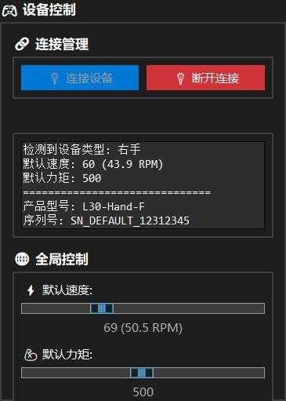

#### Control Individual Joints

In **Joint Status and Control**, move the slider for a joint or enter a target position to rotate that joint.

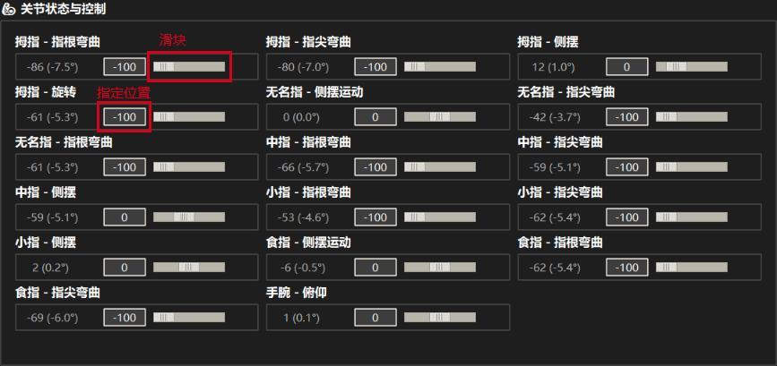

#### Create and Run Action Sequences

The **Action Sequence Editor** shows the loaded action sequences. Select joint data to edit it.

The **Position Operation** controls provide the following functions:

* **Read Slider Values:** Read the current joint-angle data from the device into the sliders.
* **Save to Sequence:** Save the current dexterous-hand joint positions as an action sequence.
* **Execute:** Execute the selected action sequence.

The **Sequence Control** controls provide the following functions:

* **Start:** Run the action-sequence list using the settings in **Operation Parameters**.
* **Stop:** Stop the sequence currently running.

The **File Operations** controls provide the following functions:

* **Save:** Save the current action-sequence list to a file.
* **Read:** Load an action-sequence file into the host-computer software.

The **Operation Parameters** provide the following settings:

* **Interval (seconds):** After the current sequence finishes, wait for this interval before starting the next sequence.
* **Loop:** Set the number of times the complete action-sequence list runs.
* **Delete:** Delete the selected action sequence.
* **Clear:** Remove all action sequences.

To create a two-step repeating motion:

1. Move the joints to the first pose and select **Save to Sequence** to create Sequence 1.
2. Move the joints to the second pose and select **Save to Sequence** to create Sequence 2.
3. Select **Start**. The software executes Sequence 1 and Sequence 2 cyclically according to the configured operation parameters.

### Warranty and Service

1. The product is covered by a 12-month limited warranty from the date of purchase.
2. During the warranty period, failures caused by manufacturing or material defects are eligible for free repair or component replacement.
3. The warranty does not cover:
   * Surface wear caused by normal use.
   * Damage caused by improper operation, accidents, unauthorized disassembly, or failure to follow the manual.
4. Returns or exchanges are not accepted when the issue is not a product-quality problem.
5. If the product malfunctions, contact official after-sales support immediately. Do not disassemble the product yourself.
6. Repair services outside the warranty period are chargeable.

### SDK and Technical Support

* SDK: [Linker Hand ROS SDK](https://github.com/linker-bot/linkerhand-ros-sdk)
* Technical support: [support@linkerbot.cn](mailto:support@linkerbot.cn)
* Official website: [linkerbot.cn](https://linkerbot.cn)


