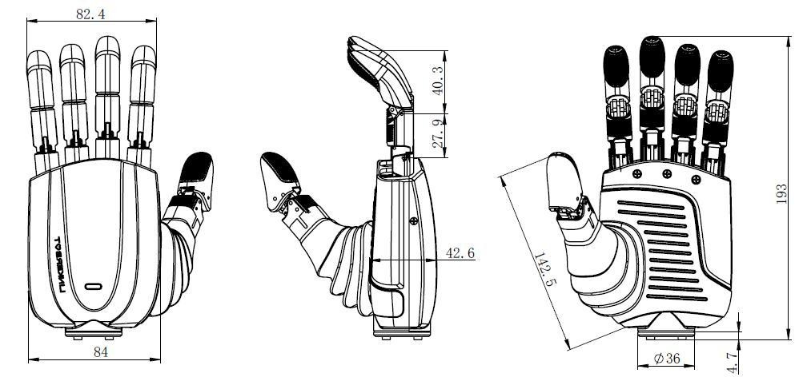
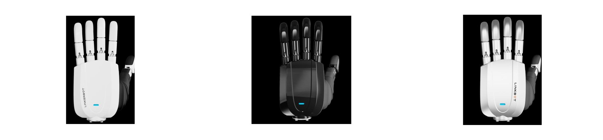
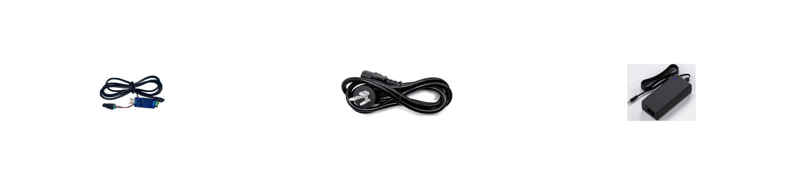
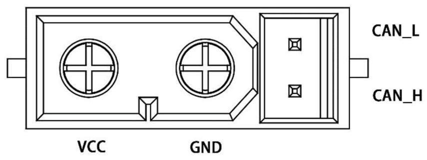

# Linker Hand L6 Product Manual


[**View LINKERBOT L6 on OpenELAB**](https://openelab.io/products/linker-hand-linkerbot-l6-11)

**Model:** L6 · **SKU:** `Linker-Hand-L6-1 (left, RS485; other hand/interface variants have different SKUs)` · **Manual:** V1.4 (2026-05-18)


[**Complete supplied L6 manual — 15 PDF pages and downloads**](source-library/complete-l6.md) · [All seven complete manuals](source-library/)

[LINKERBOT family index](linkerbot-dexterous-hands-developer-guide/) · **Complete manufacturer manual and diagrams below**

## Product overview

**L6** has **6 controlled; 11 total (6 active, 5 passive)**. Its supplied manufacturer product manual is revision **V1.4 (2026-05-18)**. This page describes the exact model; any other Linkerbot hand with a similar number may have a different joint array, mounting flange, sensor option, adapter voltage or bus protocol. **Identity:** Linker-Hand-L6-1 (left, RS485; other hand/interface variants have different SKUs).

## Applications

* Model-specific end-effector integration into research manipulators and humanoid platforms.
* Safe device identification, position/state logging, and supervised dexterous control research.
* Tactile and closed-loop grasp studies **only when installed sensors and controls are verified**.

## Specifications

| Parameter                                  | Source-backed value                                                          |
| ------------------------------------------ | ---------------------------------------------------------------------------- |
| Controlled DoF and physical joints         | 6 controlled; 11 total (6 active, 5 passive)                                 |
| Power                                      | **24 VDC ±10%**                                                              |
| Bus / variant                              | CAN or RS485, according to purchased variant                                 |
| Manufacturer-reported mass                 | 607 g                                                                        |
| Manufacturer maximum load                  | 28 kg maximum load per OEM table (not universal host-arm payload)            |
| Manufacturer-reported opening/closing time | 0.35 s                                                                       |
| Tactile/sensing                            | Piezoresistive 6×12 at fingertips; manufacturer lists 20 N range and 200 fps |
| Manual revision                            | V1.4 (2026-05-18)                                                            |

**Evidence:** exact attached product manual and corresponding connected product catalog where available. These are device-level figures, not automatically rated full-arm payload or production contact performance.

## Complete supplied-manual reference

The following details supplement the original guide using **V1.4 · 2026-05-18**. Every supplied page, including diagrams, revision history, controls and service clauses, is available in the [Complete supplied L6 manual — 15 PDF pages and downloads](source-library/complete-l6.md).

### Detailed electrical, mechanical and sensor parameters

| Parameter                   | Manufacturer source entry                                                                                        |
| --------------------------- | ---------------------------------------------------------------------------------------------------------------- |
| DC input and current        | 24 V ±10%; 0.2 A quiescent, 0.6 A no-load motor average, 5.6 A maximum                                           |
| Mechanical force            | Thumb fingertip 12 N; other fingertips 15 N; each-finger maximum gripping force 50 N                             |
| Repeatability and mechanism | < ±0.2 mm; linkage transmission; 607 g                                                                           |
| Nominal geometry            | Fingertip-to-palm-base 193 mm; palm width 84 mm; thumb-tip-to-base 142.5 mm; wrist height 4.7 mm, diameter 36 mm |
| Tactile sensor              | 6×12 piezoresistive array; 9.6×14.4 mm active area; 5 g touch-force entry; 20 N range; 200 fps; 0–4095 scale     |
| Reported life and load      | 100,000 sensor cycles; manufacturer maximum-load table 28 kg; closing time 0.35 s                                |

Sources: [PDF page 10](source-library/complete-l6.md#pdf-page-10) and the chapter map below. Maximum-load, maximum-force and cycle entries are manufacturer figures; the manual does not establish that they can be reached simultaneously or safely in a complete robot.

### Joint ranges and source interpretation

| Joint / motion label                 | Source angle range (degrees) | Source speed entry (°/s unless noted) |
| ------------------------------------ | ---------------------------- | ------------------------------------- |
| Thumb base                           | 43.2                         | 127.06                                |
| Index / middle / ring / little roots | 66.9 / 65.2 / 66.5 / 67      | 179.84 / 180.61 / 183.7 / 185.08      |
| Thumb tip                            | 34.8                         | 102.35                                |
| Index / middle / ring / little tips  | 60.6 / 58.6 / 58.1 / 59.5    | 162.9 / 162.33 / 160.5 / 164.36       |
| Thumb lateral swing                  | 72.6                         | 177.51                                |

Source: [PDF page 9](source-library/complete-l6.md#pdf-page-9). Physical/passive joint labels are not an independent command-vector definition.

The motion table labels its speed column **m/s**, while its angular values and magnitudes do not establish a reliable linear-speed interpretation. The original label is retained in the complete reader; the values above are source entries, not converted command units or a safe speed setting. V1.4 adds the integrated LED. Green means normal; flashing yellow identifies motor offline/failure; steady yellow sensor communication abnormal; red main-control program failure. These are diagnostic indications, not a safety interlock.

### Mounting, supplied items and model-specific operation

The accessory list contains one USB-to-CAN debug cable, power cord and adapter. Use the actual CAN-side XT30 diagram on PDF page 13; it is not an RS485 wiring specification. For long storage, the manual specifies indoor, dust-free conditions away from flammable/explosive/corrosive substances, **−10 to 50 °C, ≤80% humidity without condensation**, preferably in the original box. Those are storage conditions, not an operating-temperature approval.

### Complete chapter and drawing map

| Original PDF page                                        | Topic                                         |
| -------------------------------------------------------- | --------------------------------------------- |
| [PDF page 2](source-library/complete-l6.md#pdf-page-2)   | Revision changes through V1.4                 |
| [PDF page 5](source-library/complete-l6.md#pdf-page-5)   | LED states and dimension drawing              |
| [PDF page 6](source-library/complete-l6.md#pdf-page-6)   | Dimension definitions and optional colors     |
| [PDF page 7](source-library/complete-l6.md#pdf-page-7)   | Six active / five passive joint explanation   |
| [PDF page 8](source-library/complete-l6.md#pdf-page-8)   | Four-finger structural diagrams               |
| [PDF page 9](source-library/complete-l6.md#pdf-page-9)   | Thumb diagrams and performance table          |
| [PDF page 10](source-library/complete-l6.md#pdf-page-10) | Power/current/forces                          |
| [PDF page 11](source-library/complete-l6.md#pdf-page-11) | Position, speed, tactile control and upgrades |
| [PDF page 12](source-library/complete-l6.md#pdf-page-12) | Accessories and end flange                    |
| [PDF page 13](source-library/complete-l6.md#pdf-page-13) | Connector, storage and warranty               |
| [PDF page 15](source-library/complete-l6.md#pdf-page-15) | SDK and support appendix                      |

### Service, recovery and development records

The source provides a **12-month limited warranty from purchase** for manufacturing/material defects, excludes normal wear and improper operation, impact/accidents, unauthorized disassembly or use contrary to instructions, and describes paid out-of-warranty service. The original return/exchange exclusions remain in the complete reference; use the actual sales agreement for an order. If a fault occurs, stop operation and contact manufacturer support rather than dismantling the hand. Preserve model/side, serial, firmware/PCB revision, supply label, adapter, SDK commit, LED/error state and logs with the service request. Manufacturer support is `support@linkerbot.cn`; this wiki review does not send a support request.

The manuals describe firmware-upgrade capability, but do not include every model-specific firmware image, recovery package, binary protocol, CAD/URDF model or installer. Original drawings and screenshots are included; obtain the exact missing package from the manufacturer. Do not flash a related model or create pin mappings from an image’s appearance.

For current software, read the [pinned L6 feature guide](https://github.com/linker-bot/linkerbot-hand-ros2-sdk/blob/8d56b3355d2cfcd90e4e3c6b377ebceb7a5c09ac/linkerbot_hand_ros/docs/l6.md) and [model/capability definitions](https://github.com/linker-bot/linkerbot-hand-ros2-sdk/blob/8d56b3355d2cfcd90e4e3c6b377ebceb7a5c09ac/linkerbot_hand_ros/docs/models.md). The current ROS 2 stack and its `linkerbot-hand-python-sdk` dependency differ from the older `linkerhand-python-sdk` appendix. Check actual bus, joint names, validity masks and raw-unit metadata; cached configuration values are not live torque/current measurements. Current source reviewed at `8d56b3355d2c` on 22 November 2026. Software build and hardware operation were **not run**.

## Hardware and connections

1. Inspect the model, serial, left/right label and selected store interface; do not rely only on a family nickname.
2. Confirm the supplied adapter, supported cable, correct keyed connector and the mounting drawing **before** connecting DC power.
3. Use a stable fixture, keep fingers and cables away from moving linkages and make the operator's stop/disconnect method accessible.

### Model-specific mechanical mounting

Circular flange drawing and Ø36 mm wrist; hole layout, screw depth and orientation must be taken from **L6 V1.4 page 12** (manufacturer drawing).

### Electrical bus and connector

XT30 (2+2) carries power and CAN L/H on the CAN version, with a manufacturer side-view diagram on **L6 V1.4 page 13**. The PDF doesn't supply an independent RS485 pin table; use the RS485-specific cable supplied with the variant.

**Manufacturer-model note:** An integrated status indicator was added in revision V1.4: **green** normal, **flashing yellow** motor offline/failure, **solid yellow** sensor communication abnormal, and **red** main-control program failure. Record its real color before debugging.

## Software and development resources

| Resource                                                                                                                              | Verified purpose                                                                        |
| ------------------------------------------------------------------------------------------------------------------------------------- | --------------------------------------------------------------------------------------- |
| [Current seven-model Linkerbot ROS 2 driver](https://github.com/linker-bot/linkerbot-hand-ros2-sdk)                                   | ROS 2 Humble/Jazzy driver and read-only state topics; **native CAN/CAN FD** model entry |
| [ROS 2 model compatibility matrix](https://github.com/linker-bot/linkerbot-hand-ros2-sdk/blob/main/linkerbot_hand_ros/docs/models.md) | Confirms active joint count, bus and per-model capability differences                   |
| [LinkerHand Python SDK](https://github.com/linker-bot/linkerhand-python-sdk)                                                          | Firmware/adapter-specific Python examples; verify variant and driver before using       |
| [Preserved L6 OEM manual in OpenELAB Wiki](linker-hand-l6-product-manual.md)                                                          | Exact manual hardware, mechanical dimensions, connector and installation source         |

**Version constraint:** a current GitHub model entry does not certify a purchased RS485 variant for a CAN-only launch. Check model/device capabilities, firmware and the installed transport. Never run sample code that writes angles or torque as the first device check.

## Getting started

### Prerequisites

Physical hand and variant labeling; correct original or manufacturer-approved adapter; matching CAN/CAN FD/RS485 interface; secure fixture; model manual. For first read-only software use, a compatible Windows host utility or ROS 2 environment must be available as appropriate.

### First working result

1. Install/mount only after matching the exact left/right hand and cable. With the approved adapter and CAN variant connected to a compatible host and the manufacturer ROS 2 SDK built, launch its **model-discovery driver** and subscribe to `/linkerbot_hand/capabilities` or `/linkerbot_hand/state/angles` read-only. Record six active joint names and whether sample metadata is valid/stale. The indicator should be interpreted with the V1.4 table.
2. Record current model, side, revision, bus, installed host utility/SDK commit and relevant status values. Do **not** command finger positions, resets, gains or torque until identity and safety are confirmed.

**Expected result:** A verified L6 model identity, six **active** joint states and a documented LED status, not commanded movement.

**If the check fails:** If the indicator is blinking yellow, investigate motor offline/failure; solid yellow indicates sensor communications; red means main controller failure. Do not drive the fingers to clear a diagnostic state.

### Next safe experiment

With device and software explicitly approved, log a sequence of **read-only** state observations and compare expected joint count/units, metadata validity and sample freshness. Motion/grasping is a separate supervised step after confirming range, direction, force and stop behavior.

## Troubleshooting and FAQs

**A device appears but the reported joint count differs.** Confirm the exact model, model discovery, loaded SDK feature definition and **active DoF versus passive mechanical joints**. Do not pad/trim a control vector to guess joint mapping.

**The device does not connect or respond.** If the indicator is blinking yellow, investigate motor offline/failure; solid yellow indicates sensor communications; red means main controller failure. Do not drive the fingers to clear a diagnostic state.

**Can I use another Linkerbot model's power cable or protocol?** No. This model's documented electrical interface is **CAN or RS485, according to purchased variant**; use its own labeled cable, supply and OEM connector drawing.

**Can I assume tactile data is present?** Piezoresistive 6×12 at fingertips; manufacturer lists 20 N range and 200 fps Validate sensor options and returned data before relying on tactile feedback.

## Downloads and technical documents

| Resource                        | Scope and link                                                                                                                               |
| ------------------------------- | -------------------------------------------------------------------------------------------------------------------------------------------- |
| Original product manual         | [Preserved L6 OEM manual in OpenELAB Wiki](linker-hand-l6-product-manual.md)                                                                 |
| Manufacturer ROS 2 model matrix | [Model definitions and control semantics](https://github.com/linker-bot/linkerbot-hand-ros2-sdk/blob/main/linkerbot_hand_ros/docs/models.md) |
| Manufacturer current ROS 2 SDK  | [Installation and examples](https://github.com/linker-bot/linkerbot-hand-ros2-sdk)                                                           |
| Manufacturer Python SDK         | [Source and model examples](https://github.com/linker-bot/linkerhand-python-sdk)                                                             |
| OpenELAB product/SKU            | [Matched model and selectable variants](https://openelab.io/products/linker-hand-linkerbot-l6-11)                                            |

**Physical drawings:** preserve the flange/connector images in the existing manual; do not recreate dimensioned pinout diagrams from photos.

## References and validation

* LINKERBOT / Lingxin Qiaoshou, _L6 Product Manual_, **V1.4 (2026-05-18)**, provided upload, reviewed 2026-11-21.
* [Current official Linkerbot ROS 2 model matrix](https://github.com/linker-bot/linkerbot-hand-ros2-sdk/blob/main/linkerbot_hand_ros/docs/models.md), reviewed 2026-11-21.
* [OpenELAB exact model listing](https://openelab.io/products/linker-hand-linkerbot-l6-11), matched to catalog variant on 2026-11-21.

**Documentation review:** completed for provided revision; **software execution:** not run; **hardware test:** not run. Check the actual shipped interface and firmware before any actuator operation.

## Original LINKERBOT L6 Manufacturer Manual and Diagrams


The previously published manufacturer material and images below are retained. For the complete supplied revision **V1.4 · 2026-05-18**, use [Complete supplied L6 manual — 15 PDF pages and downloads](source-library/complete-l6.md). Earlier drawings/wording can differ; apply the revision and discrepancy notes above.


The following preserves the previously published OEM manual content, technical tables and hosted images. Engineering setup above is a structured companion; hardware diagrams below remain the original source reference.

### LINKERBOT Linker Hand L6 11-DOF Bionic Robotic Hand



### Revision History

| Version | Date       | Description                                                    |
| ------- | ---------- | -------------------------------------------------------------- |
| V1.0    | 2025-09-02 | Initial edition                                                |
| V1.1    | 2025-09-04 | Updated motion specifications, product display, and dimensions |
| V1.2    | 2025-10-30 | Updated motion parameters and flange interface                 |
| V1.3    | 2026-02-05 | Added optional colors                                          |
| V1.4    | 2026-05-18 | Added the integrated status-indicator behavior                 |

### Product Overview

The Linker Hand L6 is a high-precision bionic robotic hand with six active and five passive joints. Its self-developed joint modules and linkage transmission provide a rigid 607 g mechanism for precision assembly, irregular-object grasping, collaborative robots, and service robots.

The integrated status indicator reports the operating condition:

* **Green:** normal operation.
* **Flashing yellow:** motor offline or motor fault.
* **Steady yellow:** abnormal sensor communication.
* **Red:** the main motor-control program is not operating correctly.

**Main Characteristics**

* Compact 607 g construction.
* High-rigidity linkage transmission and ±0.2 mm repeatability.
* 0.35-second opening/closing response.
* Independent thumb control and synchronized four-finger motion.
* Position, speed, tactile-force, and online firmware controls.

### Dimensions, Colors, and Joints

| Dimension                     |    Value |
| ----------------------------- | -------: |
| Fingertip to palm-base length |   193 mm |
| Maximum palm width            |    84 mm |
| Thumb tip to palm-base length | 142.5 mm |
| Wrist height                  |   4.7 mm |
| Wrist diameter                |    36 mm |

Available colors are Pearl White, Obsidian Black, and Tech Silver.

The hand has 11 joints: six active and five passive. Active joints respond to control commands; the passive joints use elastic damping to conform to object contours, cushion contact, and reduce load on the drive system.

| Motion group       | Angle range | Maximum speed |
| ------------------ | ----------: | ------------: |
| Dorsal thumb base  |       43.2° |     127.06°/s |
| Index-finger root  |       66.9° |     179.84°/s |
| Middle-finger root |       65.2° |     180.61°/s |
| Ring-finger root   |       66.5° |      183.7°/s |
| Little-finger root |         67° |     185.08°/s |
| Thumb tip          |       34.8° |     102.35°/s |
| Index-finger tip   |       60.6° |      162.9°/s |
| Middle fingertip   |       58.6° |     162.33°/s |
| Ring-finger tip    |       58.1° |      160.5°/s |
| Little-finger tip  |       59.5° |     164.36°/s |
| Dorsal thumb swing |       72.6° |     177.51°/s |
| Closing time       |           — |        0.35 s |

### Technical Specifications

| Parameter                     | Specification            |
| ----------------------------- | ------------------------ |
| Model                         | Linker Hand L6           |
| Degrees of freedom            | 6                        |
| Joints                        | 11: 6 active + 5 passive |
| Drive                         | Linkage transmission     |
| Control interface             | CAN / RS-485             |
| Weight                        | 607 g                    |
| Maximum load                  | 28 kg                    |
| Working voltage               | 24 V DC ±10%             |
| Quiescent current             | 0.2 A                    |
| Average no-load motor current | 0.6 A                    |
| Maximum current               | 5.6 A                    |
| Repeatability                 | Better than ±0.2 mm      |

| Mechanical performance                              | Specification |
| --------------------------------------------------- | ------------: |
| Maximum thumb-fingertip force                       |          12 N |
| Maximum fingertip force of each of the four fingers |          15 N |
| Maximum gripping force of each finger               |          50 N |

### Control and Sensor Functions

* **Position control:** Controls the complete hand and individual joints along preset trajectories.
* **Speed control:** Adjusts finger movement speed to match the required precision and throughput.
* **Tactile feedback:** Fingertip sensing supports real-time force adjustment to protect fragile objects and prevent slipping.
* **Online upgrade:** The host computer can update firmware and optimize parameters.

| Sensor parameter         | Specification  |
| ------------------------ | -------------- |
| Piezoresistive array     | 6 × 12         |
| Force-sensitive area     | 9.6 × 14.4 mm  |
| Touch-force threshold    | 5 g            |
| Range                    | 20 N           |
| Service life             | 100,000 cycles |
| Communication frame rate | 200 FPS        |
| Scale                    | 0–4095         |

### Installation and Commissioning

**Accessories**

1. USB-to-CAN debugging cable × 1
2. Power cable × 1
3. Power adapter × 1

**Flange Interface**

Use the mounting-hole dimensions in the official flange drawing.

**Communication Connector**

The hand uses an XT30 (2+2) connector.

### Storage

If the product will remain unused for an extended period, return it to its original packaging. Store it indoors, away from dust and flammable, explosive, or corrosive gases and liquids. Keep the temperature between −10 and 50°C and relative humidity at or below 80%, without condensation.

### Warranty and Service

The product has a 12-month limited warranty from the purchase date. Manufacturing or material defects are eligible for repair or component replacement. Normal wear, improper operation, accidental impact, unauthorized disassembly or modification, and failure to follow the instructions are excluded. Non-quality issues are not eligible for return or exchange. Contact official support instead of disassembling a malfunctioning product. Out-of-warranty repair may incur charges.

### Development Resources

* [ROS SDK](https://github.com/linker-bot/linkerhand-ros-sdk)
* [ROS 2 SDK](https://github.com/linker-bot/linkerhand-ros2-sdk)
* [Python SDK](https://github.com/linker-bot/linkerhand-python-sdk)
* Technical support: `support@linkerbot.cn`
* [LINKERBOT official website](https://linkerbot.cn)
