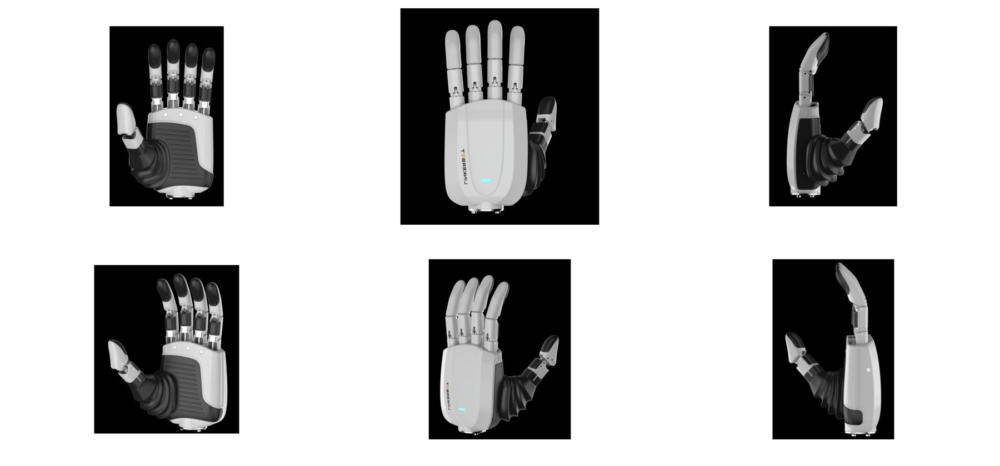
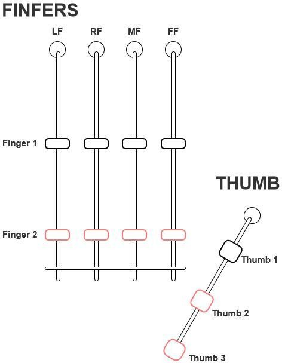
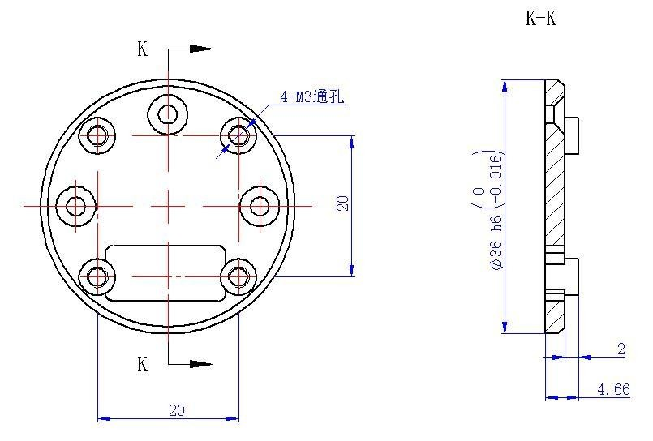

# Linker Hand L6 Product Manual

### LINKERBOT Linker Hand L6 11-DOF Bionic Robotic Hand



### Revision History

| Version | Date       | Description                                                    |
| ------- | ---------- | -------------------------------------------------------------- |
| V1.0    | 2025-09-02 | Initial edition                                                |
| V1.1    | 2025-09-04 | Updated motion specifications, product display, and dimensions |
| V1.2    | 2025-10-30 | Updated motion parameters and flange interface                 |
| V1.3    | 2026-02-05 | Added optional colors                                          |
| V1.4    | 2026-05-18 | Added the integrated status-indicator behavior                 |

### Product Overview

The Linker Hand L6 is a high-precision bionic robotic hand with six active and five passive joints. Its self-developed joint modules and linkage transmission provide a rigid 607 g mechanism for precision assembly, irregular-object grasping, collaborative robots, and service robots.

The integrated status indicator reports the operating condition:

* **Green:** normal operation.
* **Flashing yellow:** motor offline or motor fault.
* **Steady yellow:** abnormal sensor communication.
* **Red:** the main motor-control program is not operating correctly.

#### Main Characteristics

* Compact 607 g construction.
* High-rigidity linkage transmission and ±0.2 mm repeatability.
* 0.35-second opening/closing response.
* Independent thumb control and synchronized four-finger motion.
* Position, speed, tactile-force, and online firmware controls.

### Dimensions, Colors, and Joints

| Dimension                     |    Value |
| ----------------------------- | -------: |
| Fingertip to palm-base length |   193 mm |
| Maximum palm width            |    84 mm |
| Thumb tip to palm-base length | 142.5 mm |
| Wrist height                  |   4.7 mm |
| Wrist diameter                |    36 mm |

Available colors are Pearl White, Obsidian Black, and Tech Silver.

The hand has 11 joints: six active and five passive. Active joints respond to control commands; the passive joints use elastic damping to conform to object contours, cushion contact, and reduce load on the drive system.

| Motion group       | Angle range | Maximum speed |
| ------------------ | ----------: | ------------: |
| Dorsal thumb base  |       43.2° |     127.06°/s |
| Index-finger root  |       66.9° |     179.84°/s |
| Middle-finger root |       65.2° |     180.61°/s |
| Ring-finger root   |       66.5° |      183.7°/s |
| Little-finger root |         67° |     185.08°/s |
| Thumb tip          |       34.8° |     102.35°/s |
| Index-finger tip   |       60.6° |      162.9°/s |
| Middle fingertip   |       58.6° |     162.33°/s |
| Ring-finger tip    |       58.1° |      160.5°/s |
| Little-finger tip  |       59.5° |     164.36°/s |
| Dorsal thumb swing |       72.6° |     177.51°/s |
| Closing time       |           — |        0.35 s |

### Technical Specifications

| Parameter                     | Specification            |
| ----------------------------- | ------------------------ |
| Model                         | Linker Hand L6           |
| Degrees of freedom            | 6                        |
| Joints                        | 11: 6 active + 5 passive |
| Drive                         | Linkage transmission     |
| Control interface             | CAN / RS-485             |
| Weight                        | 607 g                    |
| Maximum load                  | 28 kg                    |
| Working voltage               | 24 V DC ±10%             |
| Quiescent current             | 0.2 A                    |
| Average no-load motor current | 0.6 A                    |
| Maximum current               | 5.6 A                    |
| Repeatability                 | Better than ±0.2 mm      |

| Mechanical performance                              | Specification |
| --------------------------------------------------- | ------------: |
| Maximum thumb-fingertip force                       |          12 N |
| Maximum fingertip force of each of the four fingers |          15 N |
| Maximum gripping force of each finger               |          50 N |

### Control and Sensor Functions

* **Position control:** Controls the complete hand and individual joints along preset trajectories.
* **Speed control:** Adjusts finger movement speed to match the required precision and throughput.
* **Tactile feedback:** Fingertip sensing supports real-time force adjustment to protect fragile objects and prevent slipping.
* **Online upgrade:** The host computer can update firmware and optimize parameters.

| Sensor parameter         | Specification  |
| ------------------------ | -------------- |
| Piezoresistive array     | 6 × 12         |
| Force-sensitive area     | 9.6 × 14.4 mm  |
| Touch-force threshold    | 5 g            |
| Range                    | 20 N           |
| Service life             | 100,000 cycles |
| Communication frame rate | 200 FPS        |
| Scale                    | 0–4095         |

### Installation and Commissioning

#### Accessories

1. USB-to-CAN debugging cable × 1
2. Power cable × 1
3. Power adapter × 1

#### Flange Interface

Use the mounting-hole dimensions in the official flange drawing.

#### Communication Connector

The hand uses an XT30 (2+2) connector.

### Storage

If the product will remain unused for an extended period, return it to its original packaging. Store it indoors, away from dust and flammable, explosive, or corrosive gases and liquids. Keep the temperature between −10 and 50°C and relative humidity at or below 80%, without condensation.

### Warranty and Service

The product has a 12-month limited warranty from the purchase date. Manufacturing or material defects are eligible for repair or component replacement. Normal wear, improper operation, accidental impact, unauthorized disassembly or modification, and failure to follow the instructions are excluded. Non-quality issues are not eligible for return or exchange. Contact official support instead of disassembling a malfunctioning product. Out-of-warranty repair may incur charges.

### Development Resources

* [ROS SDK](https://github.com/linker-bot/linkerhand-ros-sdk)
* [ROS 2 SDK](https://github.com/linker-bot/linkerhand-ros2-sdk)
* [Python SDK](https://github.com/linker-bot/linkerhand-python-sdk)
* Technical support: `support@linkerbot.cn`
* [LINKERBOT official website](https://linkerbot.cn)
