# Linker Hand O30 Product Manual


**No verified OpenELAB .io product page or SKU for LINKERBOT O30.** This is a **published manufacturer-manual reference**; do not assign a store variant or approve electrical commissioning from this page alone.

**Model:** O30 · **Manual:** V1.0 (2026-07-10)


[**Complete supplied O30 manual — 25 PDF pages and downloads**](source-library/complete-o30.md) · [All seven complete manuals](source-library/)

[LINKERBOT family index](linkerbot-dexterous-hands-developer-guide/) · **Complete manufacturer manual and diagrams below**

## Product overview

**O30** has **20 active; 20 total joints**. Its supplied manufacturer product manual is revision **V1.0 (2026-07-10)**. This page describes the exact model; any other Linkerbot hand with a similar number may have a different joint array, mounting flange, sensor option, adapter voltage or bus protocol. **Identity:** Not found in connected OpenELAB .io product catalog; OEM model identity only.

## Applications

* Model-specific end-effector integration into research manipulators and humanoid platforms.
* Safe device identification, position/state logging, and supervised dexterous control research.
* Tactile and closed-loop grasp studies **only when installed sensors and controls are verified**.

## Specifications

| Parameter                                  | Source-backed value                                                                                                 |
| ------------------------------------------ | ------------------------------------------------------------------------------------------------------------------- |
| Controlled DoF and physical joints         | 20 active; 20 total joints                                                                                          |
| Power                                      | **24–48 VDC per OEM manual, correct adapter/revision must be checked**                                              |
| Bus / variant                              | CAN / CAN FD; model-specific R20\_V3.0\_PAB20260529 connector                                                       |
| Manufacturer-reported mass                 | 730 g                                                                                                               |
| Manufacturer maximum load                  | 30 kg maximum load per OEM                                                                                          |
| Manufacturer-reported opening/closing time | 0.8 s                                                                                                               |
| Tactile/sensing                            | 6×11 pressure-sensitive array, 200 fps, 20 N/cm² reported sensing range; do not substitute O20 6×12/30 Hz encoding. |
| Manual revision                            | V1.0 (2026-07-10)                                                                                                   |

**Evidence:** exact attached product manual and corresponding connected product catalog where available. These are device-level figures, not automatically rated full-arm payload or production contact performance.

## Complete supplied-manual reference

The following details supplement the original guide using **V1.0 · 2026-07-10**. Every supplied page, including diagrams, revision history, controls and service clauses, is available in the [Complete supplied O30 manual — 25 PDF pages and downloads](source-library/complete-o30.md).

### Detailed electrical, mechanical and sensor parameters

| Parameter                      | Manufacturer source entry                                                                            |
| ------------------------------ | ---------------------------------------------------------------------------------------------------- |
| Joint configuration and mass   | 20 active joints; 730 g                                                                              |
| DC input and electrical demand | 24–48 V; 0.4 A quiescent and 1.1 A no-load motor average at 24 V; maximum power 150 W                |
| Bus and cycle                  | CAN / CAN FD in manual; 500 Hz communication entry; opening/closing 0.8 s                            |
| Mechanical force and load      | Thumb fingertip 24 N; other fingertips 30 N; each-finger maximum grip 70 N; maximum-load table 30 kg |
| Repeatability                  | 0.2 mm as printed                                                                                    |
| Piezoresistive sensor          | 6×11; 9.6×16.47 mm area; 50 g touch-force entry; **20 N/cm² pressure range**                         |
| Sensor rate and life           | 200 fps; 100,000 cycles; current SDK’s descriptor layout must be read from the device                |

Sources: [PDF page 10](source-library/complete-o30.md#pdf-page-10) and the chapter map below. Maximum-load, maximum-force and cycle entries are manufacturer figures; the manual does not establish that they can be reached simultaneously or safely in a complete robot.

### Joint ranges and source interpretation

| Joint / motion label                                          | Source angle range (degrees) | Source speed entry (°/s unless noted) |
| ------------------------------------------------------------- | ---------------------------- | ------------------------------------- |
| thumb\_ip / thumb\_mcp                                        | 95.4 / 90                    | Not specified                         |
| thumb\_cmc\_yaw / thumb\_cmc\_roll                            | 120 / 35                     | Not specified                         |
| Finger\_dip / Finger\_pip / Finger\_mac\_pitch (source label) | 90 / 93.2 / 101.2            | Not specified                         |
| index\_mcp\_roll / middle\_mcp\_roll                          | 26.8 / 36.8                  | Not specified                         |
| ring\_mcp\_roll / pinky\_mcp\_roll                            | 25.4 / 32                    | Not specified                         |

Source: [PDF page 9](source-library/complete-o30.md#pdf-page-9). Physical/passive joint labels are not an independent command-vector definition.

The source’s joint table spans original PDF pages 9–10 and provides angle values, without a complete speed column. Preserve the printed “Finger\_mac\_pitch” label when tracing the source, but use the SDK’s reported `joint_names` for vector ordering. The sensor range is pressure **20 N/cm²**, not the 20 N total-force range of other models. The exact connector name is **R20\_V3.0\_PAB20260529** despite this being an O30 manual; do not “correct” it to an invented O30 part number. The manual’s “Direct drive” table entry and worm-gear overview wording should be read in their original context. No OpenELAB product/SKU match is verified.

### Mounting, supplied items and model-specific operation

Use the O30 M3 flange drawing and original keyed connector orientation. The kit lists USB-to-CAN-FD, adapter and power line; its specific Windows adapter is described as driver-free. `O30_hand_ui.exe` shows CAN connection in green; Read Version Information returns PCB, structure, factory and embedded versions and device ID. A slider responds to drag, mouse wheel or arrow keys after focus—avoid accidental movement while inspecting the UI. The motion table has **22 columns: row number + 20 joints + interval**; whole-table mode uses **1000 ms** default intervals, with distinct table-loop and finger-dance stop controls. The ID setting accepts decimal **0–1022** and takes effect after a power cycle. Re-calibrate sends a calibration command; Read Calibration Status reads its result. Calibration is separate from version reading and must not be used to repair a missing CAN link.

The source connector diagram labels **pins 1 and 2 VCC, pin 3 CAN H, pin 4 CAN L, pins 5 and 6 GND**. Read its keyed connector/viewing orientation in [PDF page 12](source-library/complete-o30.md#pdf-page-12) before identifying a physical contact; identical signal names do not establish interchangeable mating hardware.

### Complete chapter and drawing map

| Original PDF page                                         | Topic                                 |
| --------------------------------------------------------- | ------------------------------------- |
| [PDF page 2](source-library/complete-o30.md#pdf-page-2)   | Revision history                      |
| [PDF page 3](source-library/complete-o30.md#pdf-page-3)   | Safety requirements                   |
| [PDF page 5](source-library/complete-o30.md#pdf-page-5)   | Overview and self-locking claim       |
| [PDF page 7](source-library/complete-o30.md#pdf-page-7)   | Dimensions and 20-joint topology      |
| [PDF page 8](source-library/complete-o30.md#pdf-page-8)   | Joint diagrams                        |
| [PDF page 9](source-library/complete-o30.md#pdf-page-9)   | Joint angles, continued on page 10    |
| [PDF page 10](source-library/complete-o30.md#pdf-page-10) | Electrical, force and load table      |
| [PDF page 11](source-library/complete-o30.md#pdf-page-11) | Pressure sensor and accessories       |
| [PDF page 12](source-library/complete-o30.md#pdf-page-12) | M3 flange, connector and CAN-FD setup |
| [PDF page 13](source-library/complete-o30.md#pdf-page-13) | O30 host program                      |
| [PDF page 16](source-library/complete-o30.md#pdf-page-16) | CAN connection                        |
| [PDF page 17](source-library/complete-o30.md#pdf-page-17) | Version fields and slider inputs      |
| [PDF page 18](source-library/complete-o30.md#pdf-page-18) | Version read and control buttons      |
| [PDF page 19](source-library/complete-o30.md#pdf-page-19) | 22-column sequence table              |
| [PDF page 20](source-library/complete-o30.md#pdf-page-20) | 1000 ms intervals and loops           |
| [PDF page 21](source-library/complete-o30.md#pdf-page-21) | Finger dance and queries              |
| [PDF page 22](source-library/complete-o30.md#pdf-page-22) | Actual/target curves and ID changes   |
| [PDF page 23](source-library/complete-o30.md#pdf-page-23) | Calibration and service               |
| [PDF page 25](source-library/complete-o30.md#pdf-page-25) | SDK appendix                          |

### Service, recovery and development records

The source provides a **12-month limited warranty from purchase** for manufacturing/material defects, excludes normal wear and improper operation, impact/accidents, unauthorized disassembly or use contrary to instructions, and describes paid out-of-warranty service. The original return/exchange exclusions remain in the complete reference; use the actual sales agreement for an order. If a fault occurs, stop operation and contact manufacturer support rather than dismantling the hand. Preserve model/side, serial, firmware/PCB revision, supply label, adapter, SDK commit, LED/error state and logs with the service request. Manufacturer support is `support@linkerbot.cn`; this wiki review does not send a support request.

The manuals describe firmware-upgrade capability, but do not include every model-specific firmware image, recovery package, binary protocol, CAD/URDF model or installer. Original drawings and screenshots are included; obtain the exact missing package from the manufacturer. Do not flash a related model or create pin mappings from an image’s appearance.

For current software, read the [pinned O30 feature guide](https://github.com/linker-bot/linkerbot-hand-ros2-sdk/blob/8d56b3355d2cfcd90e4e3c6b377ebceb7a5c09ac/linkerbot_hand_ros/docs/o30.md) and [model/capability definitions](https://github.com/linker-bot/linkerbot-hand-ros2-sdk/blob/8d56b3355d2cfcd90e4e3c6b377ebceb7a5c09ac/linkerbot_hand_ros/docs/models.md). The current ROS 2 stack and its `linkerbot-hand-python-sdk` dependency differ from the older `linkerhand-python-sdk` appendix. Check actual bus, joint names, validity masks and raw-unit metadata; cached configuration values are not live torque/current measurements. Current source reviewed at `8d56b3355d2c` on 22 November 2026. Software build and hardware operation were **not run**.

## Hardware and connections

1. Inspect the model, serial, left/right label and selected store interface; do not rely only on a family nickname.
2. Confirm the supplied adapter, supported cable, correct keyed connector and the mounting drawing **before** connecting DC power.
3. Use a stable fixture, keep fingers and cables away from moving linkages and make the operator's stop/disconnect method accessible.

### Model-specific mechanical mounting

M3 flange mounting, model-specific OEM drawing on page 12.

### Electrical bus and connector

**R20\_V3.0\_PAB20260529** multipin connector pictured on **O30 V1.0 page 12**, with dedicated VCC/CAN\_H/CAN\_L/GND. Do not copy the O20 or XT30 pinout; orientation is essential.

**Manufacturer-model note:** O30's **20 individually actuated joints** and tactile layout differ from O20. The OEM host utility is **`O30_hand_ui.exe`**, with a read-only CAN-connection and version information view plus motion-producing controls.

## Software and development resources

| Resource                                                                                                                              | Verified purpose                                                                        |
| ------------------------------------------------------------------------------------------------------------------------------------- | --------------------------------------------------------------------------------------- |
| [Current seven-model Linkerbot ROS 2 driver](https://github.com/linker-bot/linkerbot-hand-ros2-sdk)                                   | ROS 2 Humble/Jazzy driver and read-only state topics; **native CAN/CAN FD** model entry |
| [ROS 2 model compatibility matrix](https://github.com/linker-bot/linkerbot-hand-ros2-sdk/blob/main/linkerbot_hand_ros/docs/models.md) | Confirms active joint count, bus and per-model capability differences                   |
| [LinkerHand Python SDK](https://github.com/linker-bot/linkerhand-python-sdk)                                                          | Firmware/adapter-specific Python examples; verify variant and driver before using       |
| [Preserved O30 OEM manual in OpenELAB Wiki](linker-hand-o30-product-manual.md)                                                        | Exact manual hardware, mechanical dimensions, connector and installation source         |

**Version constraint:** a current GitHub model entry does not certify a purchased RS485 variant for a CAN-only launch. Check model/device capabilities, firmware and the installed transport. Never run sample code that writes angles or torque as the first device check.

## Getting started

### Prerequisites

Physical hand and variant labeling; correct original or manufacturer-approved adapter; matching CAN/CAN FD/RS485 interface; secure fixture; model manual. For first read-only software use, a compatible Windows host utility or ROS 2 environment must be available as appropriate.

### First working result

1. Confirm the exact O30 model, supplied adapter, side and unique connector with OEM pin diagram. Because no matched OpenELAB product SKU exists, hold electrical commissioning until the actual supply/cable provenance is verified. Then, on a validated Windows CAN-FD setup, run the delivered **`O30_hand_ui.exe`**, use the **CAN Connect** button, and select **Read Version Information** without moving sliders or activating finger-dance/table routines.
2. Record current model, side, revision, bus, installed host utility/SDK commit and relevant status values. Do **not** command finger positions, resets, gains or torque until identity and safety are confirmed.

**Expected result:** Device/version identification and online status, and later (if approved) 20 valid active joint observations.

**If the check fails:** If O30 status is missing, check the CAN-FD adapter, installed firmware, controller/device ID and connector orientation. Never use O20's 16-element action table or assume same sensor matrix.

### Next safe experiment

With device and software explicitly approved, log a sequence of **read-only** state observations and compare expected joint count/units, metadata validity and sample freshness. Motion/grasping is a separate supervised step after confirming range, direction, force and stop behavior.

## Troubleshooting and FAQs

**A device appears but the reported joint count differs.** Confirm the exact model, model discovery, loaded SDK feature definition and **active DoF versus passive mechanical joints**. Do not pad/trim a control vector to guess joint mapping.

**The device does not connect or respond.** If O30 status is missing, check the CAN-FD adapter, installed firmware, controller/device ID and connector orientation. Never use O20's 16-element action table or assume same sensor matrix.

**Can I use another Linkerbot model's power cable or protocol?** No. This model's documented electrical interface is **CAN / CAN FD; model-specific R20\_V3.0\_PAB20260529 connector**; use its own labeled cable, supply and OEM connector drawing.

**Can I assume tactile data is present?** 6×11 pressure-sensitive array, 200 fps, 20 N/cm² reported sensing range; do not substitute O20 6×12/30 Hz encoding. Validate sensor options and returned data before relying on tactile feedback.

## Downloads and technical documents

| Resource                        | Scope and link                                                                                                                               |
| ------------------------------- | -------------------------------------------------------------------------------------------------------------------------------------------- |
| Original product manual         | [Preserved O30 OEM manual in OpenELAB Wiki](linker-hand-o30-product-manual.md)                                                               |
| Manufacturer ROS 2 model matrix | [Model definitions and control semantics](https://github.com/linker-bot/linkerbot-hand-ros2-sdk/blob/main/linkerbot_hand_ros/docs/models.md) |
| Manufacturer current ROS 2 SDK  | [Installation and examples](https://github.com/linker-bot/linkerbot-hand-ros2-sdk)                                                           |
| Manufacturer Python SDK         | [Source and model examples](https://github.com/linker-bot/linkerhand-python-sdk)                                                             |
| OpenELAB product/SKU            | No matching .io catalog product verified; match pending                                                                                      |

**Physical drawings:** preserve the flange/connector images in the existing manual; do not recreate dimensioned pinout diagrams from photos.

## References and validation

* LINKERBOT / Lingxin Qiaoshou, _O30 Product Manual_, **V1.0 (2026-07-10)**, provided upload, reviewed 2026-11-21.
* [Current official Linkerbot ROS 2 model matrix](https://github.com/linker-bot/linkerbot-hand-ros2-sdk/blob/main/linkerbot_hand_ros/docs/models.md), reviewed 2026-11-21.
* OpenELAB .io product catalog search, 2026-11-21: **no product/SKU match** for this model.

**Documentation review:** completed for provided revision; **software execution:** not run; **hardware test:** not run. **Identity block:** store SKU and actual adapter/connector pairing unresolved—physical first result must await confirmation.

## Original LINKERBOT O30 Manufacturer Manual and Diagrams


The previously published manufacturer material and images below are retained. For the complete supplied revision **V1.0 · 2026-07-10**, use [Complete supplied O30 manual — 25 PDF pages and downloads](source-library/complete-o30.md). Earlier drawings/wording can differ; apply the revision and discrepancy notes above.


**Identity caution:** the OpenELAB .io SKU match is unresolved. Do not infer a store variant. The existing OEM manual text, figures, tables and installation illustrations are retained in this section for revision-specific reference.

### Linker Hand O30

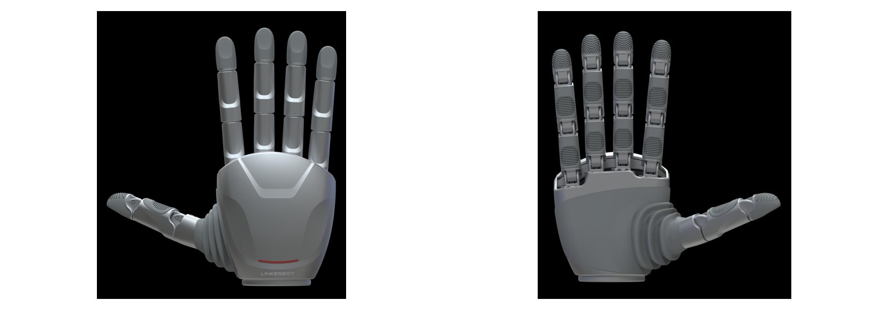

### Revision History

| Version | Date       | Description     |
| ------- | ---------- | --------------- |
| V1.0    | 2026-07-10 | Initial edition |

### Safety Instructions

Read this manual and all related documentation before installing or operating the hand.

1. Use only the matching or specified cables. Secure the hand as instructed, and never use a damaged power cable, damaged plug, or loose socket.
2. Keep the installation within the requirements in this manual. Operation outside the specified conditions can shorten service life and create serious safety hazards.
3. Extended high-power operation can raise the product temperature. Stop operation and allow the hand to cool if it becomes excessively hot.
4. Only trained personnel may operate the equipment. Do not open the enclosure, disassemble the hand, or attempt an unauthorized repair. Contact after-sales support if a fault occurs.
5. Illustrations may differ slightly from the purchased product, and specifications may change as the product is improved.

### Product Overview

The Linker Hand O30 is a 20-joint direct-drive robotic hand that combines high-performance brushless motors with precision worm gears. It is designed to reproduce human-hand motion for precise gripping and stable grasping. The worm-gear self-locking architecture can hold a grasp without continuous power consumption.

The hand supports applications such as high-precision automotive assembly, aerospace operations, sorting irregular logistics packages, and remote or automated work in hazardous environments.

**Main Characteristics**

* **High-precision bionic control:** Closed-loop position and torque control support precision assembly and fragile-object handling.
* **High power density:** The hand is rated for a maximum load of 30 kg and an opening/closing time of 0.8 seconds.
* **Efficient continuous operation:** Quiescent current is 0.4 A at 24 V. The product supports industrial 24 V supplies and continuous production-line operation.
* **Compact integration:** The 730 g design supports installation on industrial, collaborative, and service-robot platforms.

**Control Functions**

* **Position control:** Controls the whole hand and individual joints along preset trajectories.
* **Speed control:** Adjusts finger speed for high-throughput or low-speed precision work.
* **Tactile feedback:** Fingertip sensors measure contact pressure so the controller can reduce excessive force or prevent objects from slipping.
* **Online upgrade:** Firmware can be updated through the host computer.

### Dimensions, Joints, and Motion Range

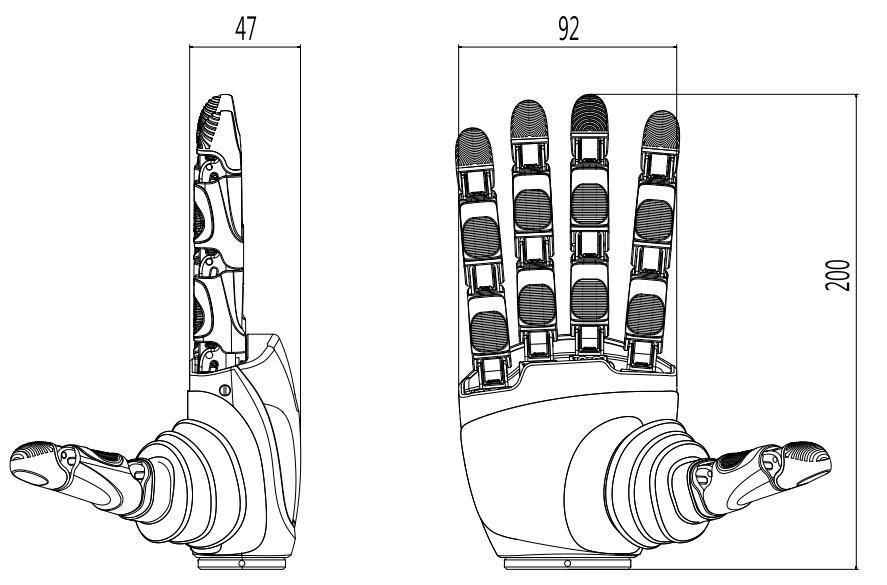

The O30 has 20 degrees of freedom and 20 active joints.

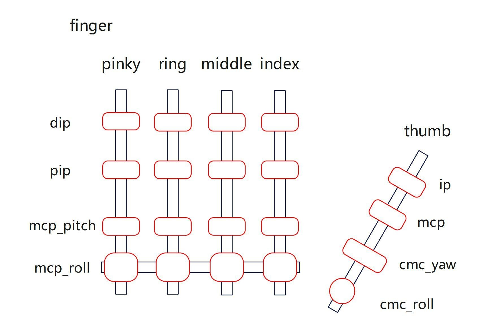

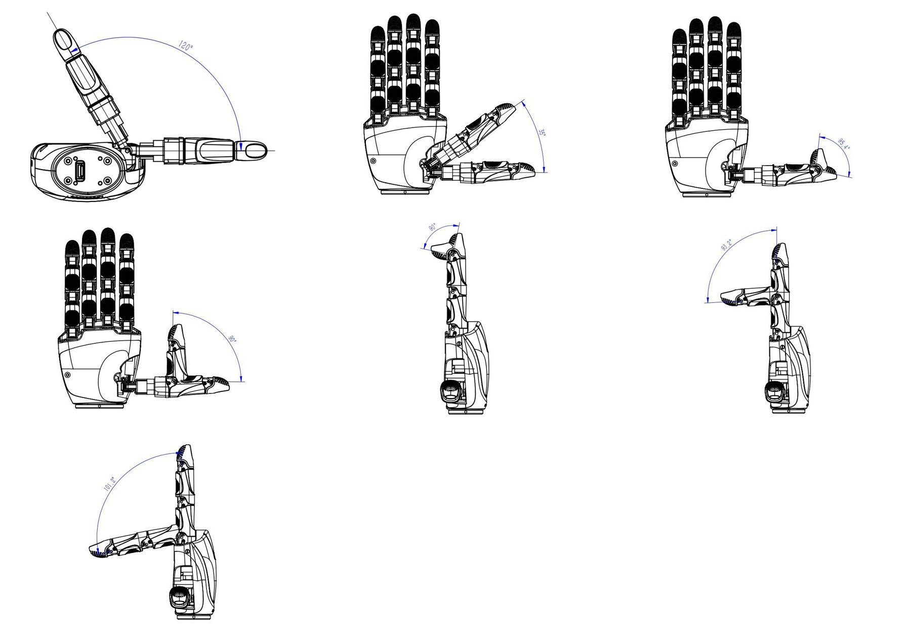

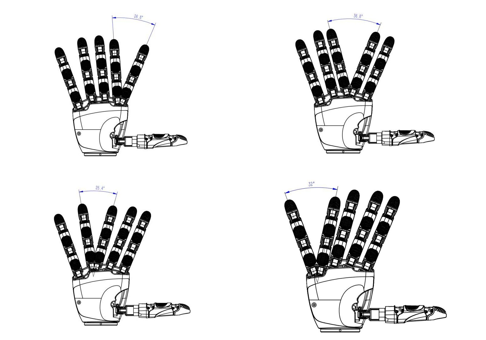

| Joint              | Maximum motion range |
| ------------------ | -------------------: |
| `thumb_ip`         |                95.4° |
| `thumb_mcp`        |                  90° |
| `thumb_cmc_yaw`    |                 120° |
| `thumb_cmc_roll`   |                  35° |
| `finger_dip`       |                  90° |
| `finger_pip`       |                93.2° |
| `finger_mcp_pitch` |               101.2° |
| `index_mcp_roll`   |                26.8° |
| `middle_mcp_roll`  |                36.8° |
| `ring_mcp_roll`    |                25.4° |
| `pinky_mcp_roll`   |                  32° |

### Technical Specifications

| Parameter                     | Specification    |
| ----------------------------- | ---------------- |
| Model                         | Linker Hand O30  |
| Degrees of freedom            | 20               |
| Joints                        | 20 active joints |
| Drive                         | Direct drive     |
| Control interface             | CAN / CAN FD     |
| Communication frequency       | 500 Hz           |
| Weight                        | 730 g            |
| Maximum load                  | 30 kg            |
| Working voltage               | 24–48 V DC       |
| Quiescent current             | 0.4 A at 24 V    |
| Average no-load motor current | 1.1 A at 24 V    |
| Maximum power                 | 150 W            |
| Repeatability                 | 0.2 mm           |
| Opening/closing time          | 0.8 s            |

**Mechanical Performance**

| Performance item                                    | Specification |
| --------------------------------------------------- | ------------: |
| Maximum thumb-fingertip force                       |          24 N |
| Maximum fingertip force of each of the four fingers |          30 N |
| Maximum gripping force of each finger               |          70 N |

### Pressure Sensor System

| Parameter                | Specification  |
| ------------------------ | -------------- |
| Piezoresistive array     | 6 × 11         |
| Force-sensitive area     | 9.6 × 16.47 mm |
| Touch-force threshold    | 50 g           |
| Measurement range        | 20 N/cm²       |
| Service life             | 100,000 cycles |
| Communication frame rate | 200 FPS        |

### Installation and Commissioning

**Accessories**

Confirm that the following accessories are present before installation:

1. USB-to-CAN FD debugging cable × 1
2. Power adapter × 1
3. Power cable × 1

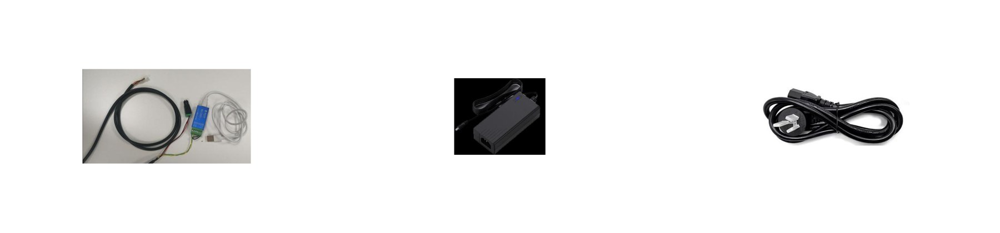

**Mechanical Installation**

Use M3 screws. Select the screw length according to the thickness of the mounting component.

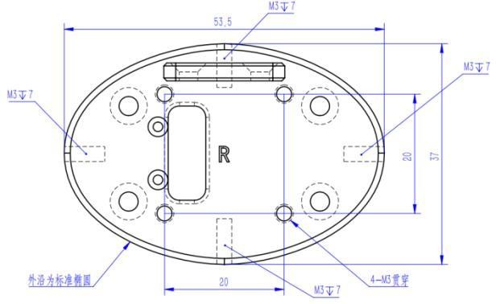

**Electrical Connection**

The hand uses connector model `R20_V3.0_PAB20260529`. Follow the pinout in the official connector diagram.

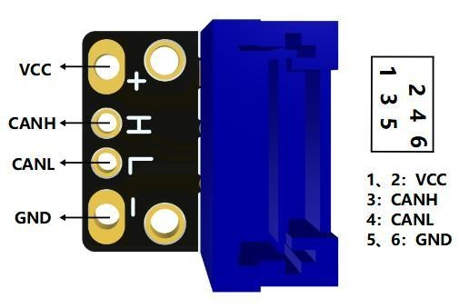

**Connect the Debugging Hardware**

1. Connect the hand to the debugging computer with the USB-to-CAN FD cable.
2. Connect the power cable to the power adapter.
3. Connect the adapter output to the power input on the debugging cable.
4. Connect the AC side to a 220 V AC outlet.

Windows uses driver-free installation for this USB-to-CAN FD interface.

### O30 Host-Computer Software

The O30 left-hand host application provides device control, parameter configuration, firmware upgrade functions, and separate temperature, position, and current curves.

**Start the Application and Display Curves**

1. Run `O30_hand_ui.exe`.
2. Use the **Temperature Curve**, **Position Curve**, and **Current Curve** checkboxes to show or hide the corresponding windows. The curve windows are hidden by default.

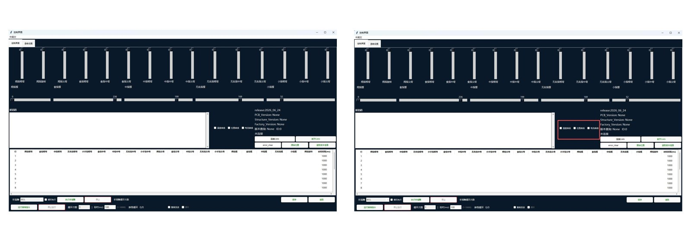

* The temperature curve shows motor temperature.
* The position curve shows both the returned motor position and the target position sent by the host application.
* The current curve shows motor current feedback.

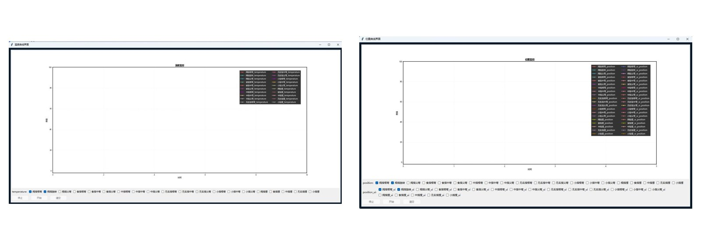

The main window contains the joint-control interface and the parameter-settings interface.

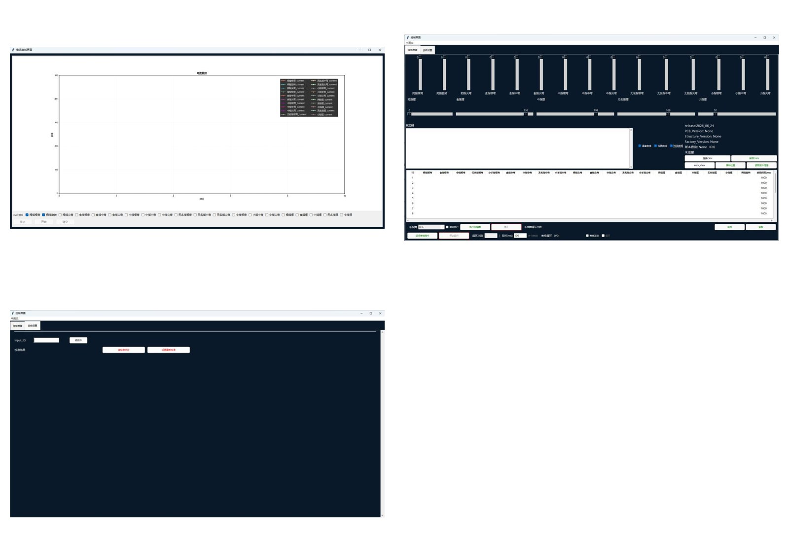

**Connect the CAN Device**

Select **CAN** to connect. When the connection succeeds, the CAN button text changes from black to green and the message area reports a successful connection to CAN device 0. Black means the button is enabled; green means it is connected and temporarily disabled.

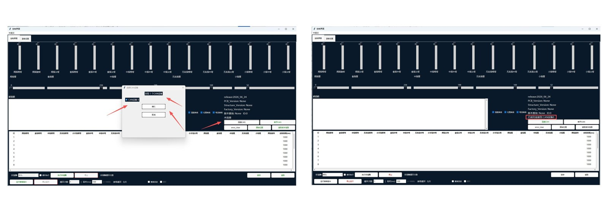

**Control Joint Sliders**

A slider can be moved by dragging it, using the mouse wheel, or using the keyboard arrow keys. Click the required slider before using the keyboard.

The information area reports:

* **Release:** host application release date.
* **PCB Version:** PCB version; `None` means no value has been read.
* **Structure Version:** mechanical structure version.
* **Factory Version:** factory serial number.
* **Version Query:** embedded-software version.
* **ID:** hand ID.

Select **Read Version Information** to retrieve the values.

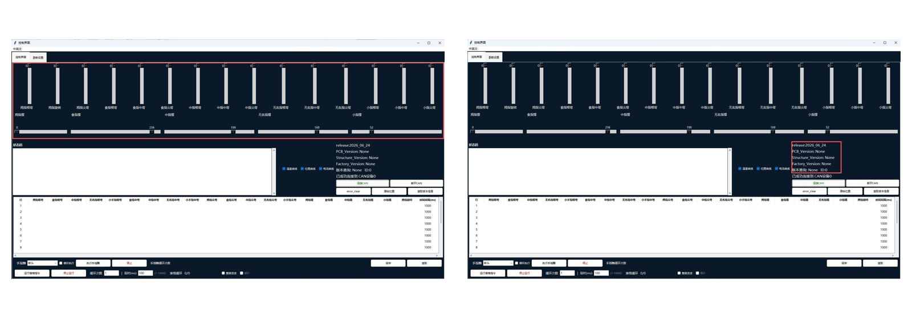

**Button Functions**

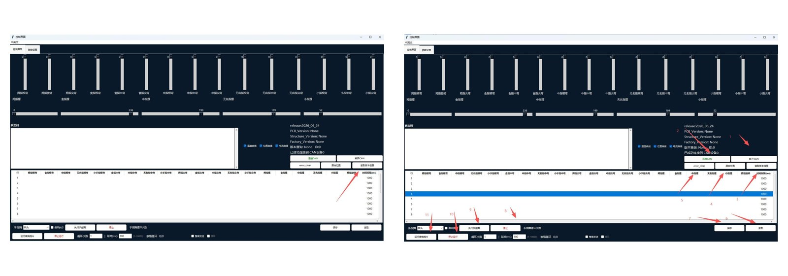

1. Disconnect from the CAN module.
2. Connect to the CAN module.
3. Read version information and the hand ID.
4. Return all joints to their original zero positions.
5. Clear the error-code display.
6. Read an action-sequence `.txt` file and display it in the table.
7. Save the action-sequence table as a `.txt` file.
8. Stop the running finger-dance action or cycle.
9. Run the finger dance selected in the dropdown menu.
10. Stop the running table sequence or table loop.
11. Run the table in the selected mode: one row, entire table, or repeated entire table.

**Action Sequence Table**

Each row represents one whole-hand pose. A row contains 22 columns: a row number, 20 joint values, and the interval before the next action. The table supports right-click editing and can display saved actions loaded from a file.

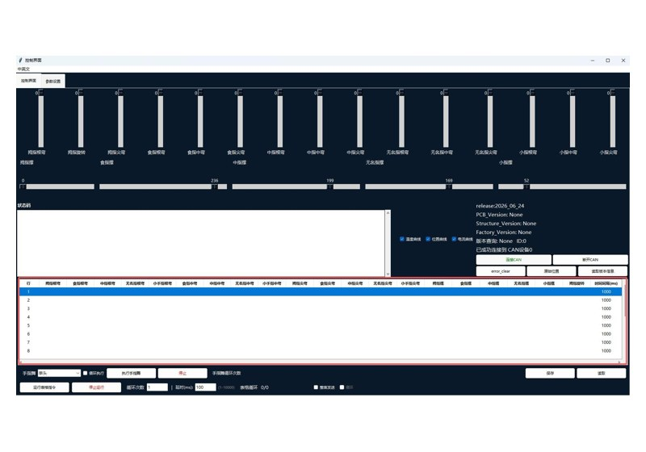

Three execution modes are available:

* **Single row:** Select a row and then select **Run Table Command**.
* **Entire table:** Enable **Send Entire Table**. Rows are transmitted in order using the interval in the last column; the default interval is 1,000 ms.
* **Table loop:** Enable both **Send Entire Table** and **Table Cycling**, then enter the required cycle count. The cycling option becomes available only after the entire-table option is enabled.

Use **Stop** whenever the hand must stop or a fault occurs.

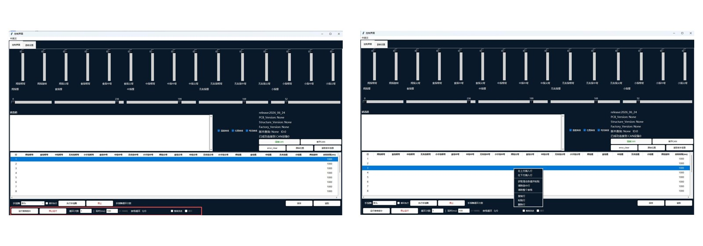

**Finger Dance and Sensor Data**

Finger Dance runs a predefined motion from the dropdown list. Enable **Loop Execution** and enter the cycle count to repeat it; use **Stop** to halt it.

The data chart displays tactile sensor values. Select finger checkboxes to show or hide individual curves; the thumb and index finger are shown by default. Use **Start** to begin query commands, **Stop** to stop them, and **Clear** to erase plotted data.

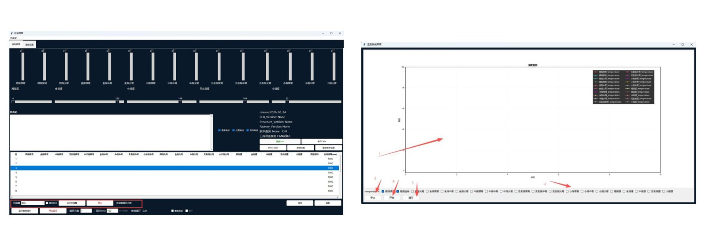

The same operating logic applies to the temperature, current, and pressure curves. The `position` field is the actual position returned by the motor, while `position_ui` is the target position sent by the host application.

**Change the Device ID**

Enter a decimal value from 0 to 1022 in `Input_ID`, then select **Modify ID**. Power-cycle the hand before using the new ID.

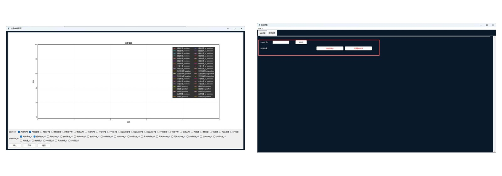

**Calibration and Language**

Open **Settings**, select **Re-calibrate**, and send the calibration command. Select **Read Calibration Status** to view the result. The software also provides a Chinese/English language switch.

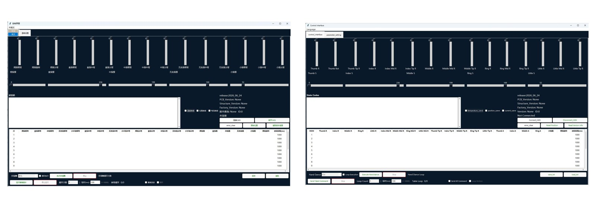

### Warranty and Service

The product has a 12-month limited warranty from the purchase date. Manufacturing or material defects are eligible for repair or component replacement during the warranty period.

The warranty does not cover normal surface wear, improper operation, accidents, unauthorized disassembly, modification, or failure to follow the operating instructions. Non-quality issues are not eligible for return or exchange. Contact official support if the product malfunctions; do not disassemble it. Repairs outside the warranty period may incur charges.

### Development Resources

* [ROS SDK](https://github.com/linker-bot/linkerhand-ros-sdk)
* [ROS 2 SDK](https://github.com/linker-bot/linkerhand-ros2-sdk)
* [Python SDK](https://github.com/linker-bot/linkerhand-python-sdk)
* Technical support: `support@linkerbot.cn`
* [LINKERBOT official website](https://linkerbot.cn)
