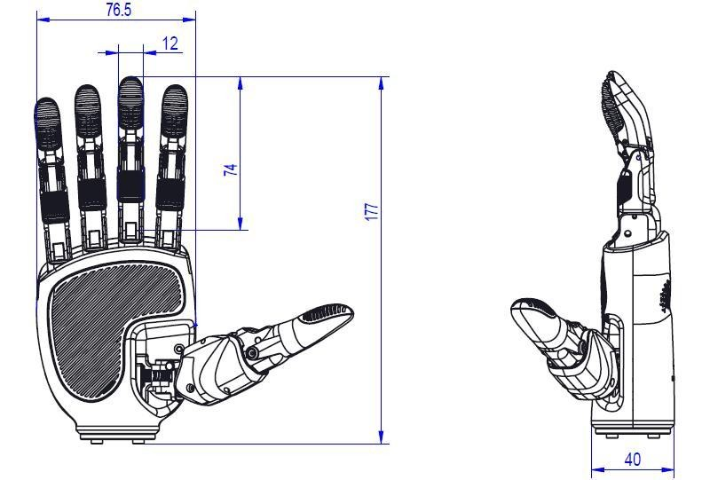
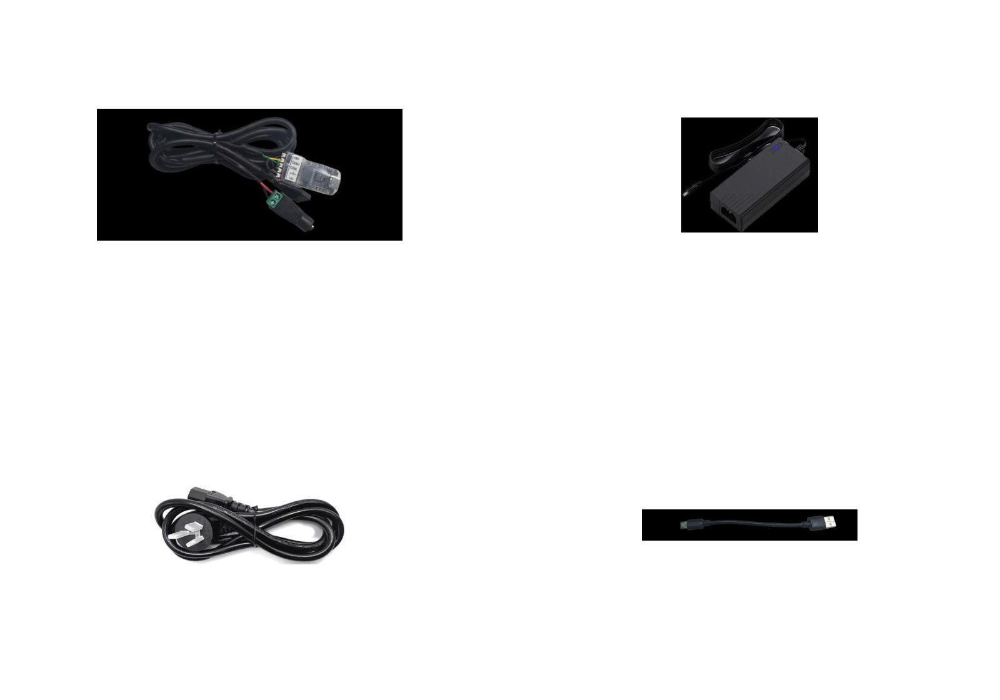

# Linker Hand O6 Product Manual


[**View LINKERBOT O6 on OpenELAB**](https://openelab.io/products/linker-hand-linkerbot-o6-11)

**Model:** O6 · **SKU:** `Linker-Hand-O6-1 (left, RS485, black; additional CAN/side/color options)` · **Manual:** V1.4 (2026-07-21)


[LINKERBOT family index](linkerbot-dexterous-hands-developer-guide/) · **Complete manufacturer manual and diagrams below**

### Product overview

**O6** has **6 controlled; 11 total (6 active, 5 passive)**. Its supplied manufacturer product manual is revision **V1.4 (2026-07-21)**. This page describes the exact model; any other Linkerbot hand with a similar number may have a different joint array, mounting flange, sensor option, adapter voltage or bus protocol. **Identity:** Linker-Hand-O6-1 (left, RS485, black; additional CAN/side/color options).

### Applications

* Model-specific end-effector integration into research manipulators and humanoid platforms.
* Safe device identification, position/state logging, and supervised dexterous control research.
* Tactile and closed-loop grasp studies **only when installed sensors and controls are verified**.

### Specifications

| Parameter                                  | Source-backed value                                                                                                         |
| ------------------------------------------ | --------------------------------------------------------------------------------------------------------------------------- |
| Controlled DoF and physical joints         | 6 controlled; 11 total (6 active, 5 passive)                                                                                |
| Power                                      | **24–48 VDC per OEM V1.4; select exact supplied adapter for variant**                                                       |
| Bus / variant                              | OEM lists CAN, CAN FD, RS485, EtherCAT; store currently offers CAN/RS485                                                    |
| Manufacturer-reported mass                 | 370 g                                                                                                                       |
| Manufacturer maximum load                  | 50 kg maximum load OEM (not a guarantee for mounted robot arm)                                                              |
| Manufacturer-reported opening/closing time | Not established as a close-time specification in provided V1.4                                                              |
| Tactile/sensing                            | **Optional** 4×10 piezoresistive array, 20 N range, up to 200 fps; the robot without this option has no valid tactile data. |
| Manual revision                            | V1.4 (2026-07-21)                                                                                                           |

**Evidence:** exact attached product manual and corresponding connected product catalog where available. These are device-level figures, not automatically rated full-arm payload or production contact performance.

### Hardware and connections

1. Inspect the model, serial, left/right label and selected store interface; do not rely only on a family nickname.
2. Confirm the supplied adapter, supported cable, correct keyed connector and the mounting drawing **before** connecting DC power.
3. Use a stable fixture, keep fingers and cables away from moving linkages and make the operator's stop/disconnect method accessible.

#### Model-specific mechanical mounting

M3 screws and an O6-specific **Ø36 mm flange drawing**, page 14; confirm side and model.

#### Electrical bus and connector

XT30 (2+2) for the documented CAN-type connection: pin 1 CAN L, 2 CAN H, 3 GND, 4 24–48 V. This does **not** establish EtherCAT or RS485 mapping.

**Manufacturer-model note:** O6 is the lighter 6-active-DoF hand. Its V1.4 revision added CAN FD/EtherCAT at the documentation level, but current observed OpenELAB order options were CAN/RS485; optional tactile cannot be assumed.

### Software and development resources

| Resource                                                                                                                              | Verified purpose                                                                        |
| ------------------------------------------------------------------------------------------------------------------------------------- | --------------------------------------------------------------------------------------- |
| [Current seven-model Linkerbot ROS 2 driver](https://github.com/linker-bot/linkerbot-hand-ros2-sdk)                                   | ROS 2 Humble/Jazzy driver and read-only state topics; **native CAN/CAN FD** model entry |
| [ROS 2 model compatibility matrix](https://github.com/linker-bot/linkerbot-hand-ros2-sdk/blob/main/linkerbot_hand_ros/docs/models.md) | Confirms active joint count, bus and per-model capability differences                   |
| [LinkerHand Python SDK](https://github.com/linker-bot/linkerhand-python-sdk)                                                          | Firmware/adapter-specific Python examples; verify variant and driver before using       |
| [Preserved O6 OEM manual in OpenELAB Wiki](linker-hand-o6-product-manual.md)                                                          | Exact manual hardware, mechanical dimensions, connector and installation source         |

**Version constraint:** a current GitHub model entry does not certify a purchased RS485 variant for a CAN-only launch. Check model/device capabilities, firmware and the installed transport. Never run sample code that writes angles or torque as the first device check.

### Getting started

#### Prerequisites

Physical hand and variant labeling; correct original or manufacturer-approved adapter; matching CAN/CAN FD/RS485 interface; secure fixture; model manual. For first read-only software use, a compatible Windows host utility or ROS 2 environment must be available as appropriate.

#### First working result

1. Identify the actual **O6 CAN version**, label and original adapter; use the vendor's O6 ROS 2 driver on the physically matching interface to discover the hand and read `/linkerbot_hand/state/angles` **without actuation**. Check six joint names and whether any tactile option was really installed before requesting tactile topics.
2. Record current model, side, revision, bus, installed host utility/SDK commit and relevant status values. Do **not** command finger positions, resets, gains or torque until identity and safety are confirmed.

**Expected result:** An O6 identity and six fresh joint states; tactile sample only if the optional sensor is present.

**If the check fails:** A missing tactile topic on a sensor-free O6 is not necessarily a fault. For CAN-FD/EtherCAT options, check actual controller SKU and compatible cable instead of trying CAN commands indiscriminately.

#### Next safe experiment

With device and software explicitly approved, log a sequence of **read-only** state observations and compare expected joint count/units, metadata validity and sample freshness. Motion/grasping is a separate supervised step after confirming range, direction, force and stop behavior.

### Troubleshooting and FAQs

**A device appears but the reported joint count differs.** Confirm the exact model, model discovery, loaded SDK feature definition and **active DoF versus passive mechanical joints**. Do not pad/trim a control vector to guess joint mapping.

**The device does not connect or respond.** A missing tactile topic on a sensor-free O6 is not necessarily a fault. For CAN-FD/EtherCAT options, check actual controller SKU and compatible cable instead of trying CAN commands indiscriminately.

**Can I use another Linkerbot model's power cable or protocol?** No. This model's documented electrical interface is **OEM lists CAN, CAN FD, RS485, EtherCAT; store currently offers CAN/RS485**; use its own labeled cable, supply and OEM connector drawing.

**Can I assume tactile data is present?** **Optional** 4×10 piezoresistive array, 20 N range, up to 200 fps; the robot without this option has no valid tactile data. Validate sensor options and returned data before relying on tactile feedback.

### Downloads and technical documents

| Resource                        | Scope and link                                                                                                                               |
| ------------------------------- | -------------------------------------------------------------------------------------------------------------------------------------------- |
| Original product manual         | [Preserved O6 OEM manual in OpenELAB Wiki](linker-hand-o6-product-manual.md)                                                                 |
| Manufacturer ROS 2 model matrix | [Model definitions and control semantics](https://github.com/linker-bot/linkerbot-hand-ros2-sdk/blob/main/linkerbot_hand_ros/docs/models.md) |
| Manufacturer current ROS 2 SDK  | [Installation and examples](https://github.com/linker-bot/linkerbot-hand-ros2-sdk)                                                           |
| Manufacturer Python SDK         | [Source and model examples](https://github.com/linker-bot/linkerhand-python-sdk)                                                             |
| OpenELAB product/SKU            | [Matched model and selectable variants](https://openelab.io/products/linker-hand-linkerbot-o6-11)                                            |

**Physical drawings:** preserve the flange/connector images in the existing manual; do not recreate dimensioned pinout diagrams from photos.

### References and validation

* LINKERBOT / Lingxin Qiaoshou, _O6 Product Manual_, **V1.4 (2026-07-21)**, provided upload, reviewed 2026-11-21.
* [Current official Linkerbot ROS 2 model matrix](https://github.com/linker-bot/linkerbot-hand-ros2-sdk/blob/main/linkerbot_hand_ros/docs/models.md), reviewed 2026-11-21.
* [OpenELAB exact model listing](https://openelab.io/products/linker-hand-linkerbot-o6-11), matched to catalog variant on 2026-11-21.

**Documentation review:** completed for provided revision; **software execution:** not run; **hardware test:** not run. Check the actual shipped interface and firmware before any actuator operation.

### Original LINKERBOT O6 Manufacturer Manual and Diagrams

The existing OEM manual text, figures, tables and installation illustrations are retained in this section for revision-specific reference.

#### LINKERBOT Linker Hand O6 11-DOF Bionic Robotic Hand



#### Revision History

| Version | Date       | Description                                                           |
| ------- | ---------- | --------------------------------------------------------------------- |
| V1.0    | 2025-09-03 | Initial edition                                                       |
| V1.1    | 2026-02-05 | Added optional colors                                                 |
| V1.2    | 2026-04-09 | Updated thumb-side swing and thumb-joint parameters                   |
| V1.3    | 2026-06-11 | Added sensor parameters                                               |
| V1.4    | 2026-07-21 | Added CAN FD and EtherCAT support and changed the manual to A5 format |

#### Safety Instructions

1. Read this manual and all related documentation before installation or operation.
2. Use the matching or specified cables, fasten the product securely, and never use damaged power cables, plugs, or loose sockets.
3. Keep the installation within the stated requirements. Operation outside those limits can shorten service life and create safety hazards.
4. Extended high-power operation can raise the product temperature. Stop and allow the hand to cool if it becomes excessively hot.
5. Only trained personnel may operate the product. Do not open, disassemble, or repair it without authorization; contact official support if a fault occurs.

#### Product Overview

The Linker Hand O6 is a compact, cost-effective bionic robotic hand with six active and five passive joints. A high-torque servo module and worm-gear transmission provide high gripping force and rigidity, while a high-precision rigid-linkage system and force-position control algorithm provide repeatability better than ±0.2 mm. The 370 g structure is designed for logistics handling, industrial assembly, irregular-object grasping, collaborative robots, and service robots.

**Control Functions**

* **Position control:** Controls the whole hand and individual finger joints along preset trajectories.
* **Speed control:** Adjusts finger speed for either high-throughput or low-speed precision work.
* **Optional tactile feedback:** Fingertip sensors support real-time contact-force adjustment.
* **Online upgrade:** Firmware can be updated through the host computer.

#### Dimensions, Colors, and Joints

Available colors are Pearl White, Obsidian Black, Tech Silver, Amber Orange, Aurora Blue, Golden Amber, and Xingyao Purple.

The O6 has six degrees of freedom and 11 joints: six active and five passive.

| Joint group                        | Maximum structural range |
| ---------------------------------- | -----------------------: |
| `LF2`, `RF2`, `MF2`, `FF2` flexion |                      90° |
| `LF1`, `RF1`, `MF1`, `FF1` flexion |                      80° |
| `THUMB1` flexion                   |                      60° |
| `THUMB2` flexion                   |                      30° |
| `THUMB3` lateral swing             |                      80° |

These are structural maximums. The controller should retain a safety margin, and the actual commanded range depends on the control implementation.

#### Technical Specifications

| Parameter          | Specification                    |
| ------------------ | -------------------------------- |
| Model              | Linker Hand O6                   |
| Degrees of freedom | 6                                |
| Joints             | 11: 6 active + 5 passive         |
| Drive              | Linkage transmission             |
| Control interface  | CAN / CAN FD / RS-485 / EtherCAT |
| Weight             | 370 g                            |
| Maximum load       | 50 kg                            |
| Working voltage    | 24–48 V DC                       |
| Repeatability      | Better than ±0.20 mm             |
| Tactile sensors    | Optional                         |

| Mechanical performance                              | Specification |
| --------------------------------------------------- | ------------: |
| Maximum thumb-fingertip force                       |          20 N |
| Maximum fingertip force of each of the four fingers |          25 N |
| Maximum gripping force of each finger               |          70 N |

**Optional Tactile Sensor**

| Parameter                | Specification  |
| ------------------------ | -------------- |
| Piezoresistive array     | 4 × 10         |
| Touch-force threshold    | 5 g            |
| Measurement range        | 20 N           |
| Service life             | 100,000 cycles |
| Communication frame rate | 200 FPS        |
| Scale                    | 0–4095         |

The manual's test remarks specify standard weights, no pad or a 1 mm rubber pad for the touch-force test, and a 1 mm, Shore A 50 rubber pad with a 100 g default load for the range and service-life test.

#### Installation and Commissioning

**Accessories**

1. USB-to-CAN debugging cable × 1
2. Power adapter × 1
3. Power cable × 1
4. USB-to-Type-C debugging cable × 1

**Mechanical Installation**

Use M3 screws and select the screw length according to the thickness of the mounting component.

**Electrical Connection**

The hand uses an XT30 (2+2) connector.

| Pin | Signal     |
| --: | ---------- |
|   1 | CAN L      |
|   2 | CAN H      |
|   3 | GND        |
|   4 | 24–48 V DC |

**Debugging Preparation**

1. Connect the hand to the debugging computer with the USB-to-CAN cable.
2. Connect the power cable and power adapter, then connect the adapter output to the debugging cable's power port.
3. Connect the AC side to a 220 V AC outlet.
4. On Windows, install the supplied `PEAK-System_Driver-Setup` package. Linux does not require this driver.
5. Follow the separate host-computer software instructions for application operation.

#### Warranty and Service

The product has a 12-month limited warranty from the purchase date. Manufacturing or material defects are eligible for repair or component replacement. Normal surface wear, improper operation, accidents, unauthorized disassembly, and failure to follow the instructions are excluded. Non-quality issues are not eligible for return or exchange. Contact official support if a malfunction occurs; do not disassemble the product. Out-of-warranty service may incur charges.

#### Development Resources

* [ROS SDK](https://github.com/linker-bot/linkerhand-ros-sdk)
* [ROS 2 SDK](https://github.com/linker-bot/linkerhand-ros2-sdk)
* [Python SDK](https://github.com/linker-bot/linkerhand-python-sdk)
* Technical support: `support@linkerbot.cn`
* [LINKERBOT official website](https://linkerbot.cn)
