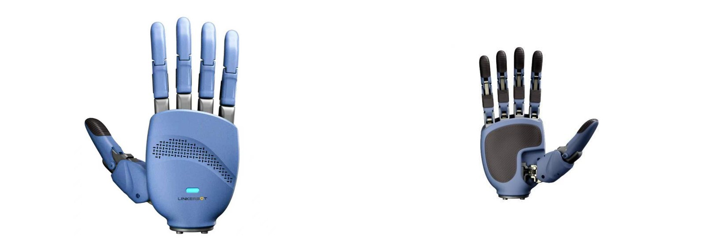
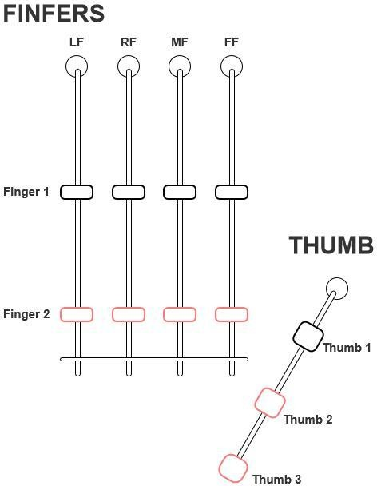
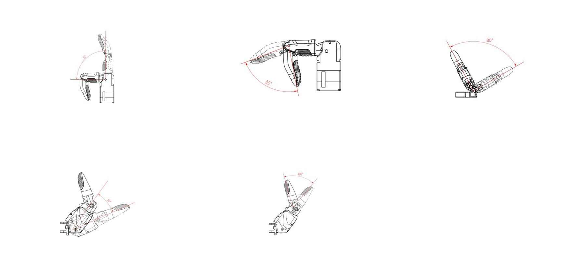
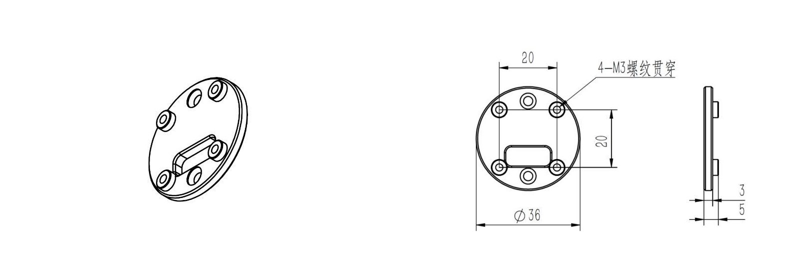
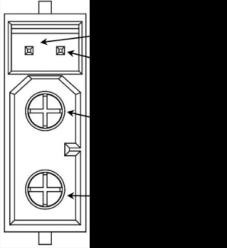

# Linker Hand O6 Product Manual

### LINKERBOT Linker Hand O6 11-DOF Bionic Robotic Hand



### Revision History

| Version | Date       | Description                                                           |
| ------- | ---------- | --------------------------------------------------------------------- |
| V1.0    | 2025-09-03 | Initial edition                                                       |
| V1.1    | 2026-02-05 | Added optional colors                                                 |
| V1.2    | 2026-04-09 | Updated thumb-side swing and thumb-joint parameters                   |
| V1.3    | 2026-06-11 | Added sensor parameters                                               |
| V1.4    | 2026-07-21 | Added CAN FD and EtherCAT support and changed the manual to A5 format |

### Safety Instructions

1. Read this manual and all related documentation before installation or operation.
2. Use the matching or specified cables, fasten the product securely, and never use damaged power cables, plugs, or loose sockets.
3. Keep the installation within the stated requirements. Operation outside those limits can shorten service life and create safety hazards.
4. Extended high-power operation can raise the product temperature. Stop and allow the hand to cool if it becomes excessively hot.
5. Only trained personnel may operate the product. Do not open, disassemble, or repair it without authorization; contact official support if a fault occurs.

### Product Overview

The Linker Hand O6 is a compact, cost-effective bionic robotic hand with six active and five passive joints. A high-torque servo module and worm-gear transmission provide high gripping force and rigidity, while a high-precision rigid-linkage system and force-position control algorithm provide repeatability better than ±0.2 mm. The 370 g structure is designed for logistics handling, industrial assembly, irregular-object grasping, collaborative robots, and service robots.

#### Control Functions

* **Position control:** Controls the whole hand and individual finger joints along preset trajectories.
* **Speed control:** Adjusts finger speed for either high-throughput or low-speed precision work.
* **Optional tactile feedback:** Fingertip sensors support real-time contact-force adjustment.
* **Online upgrade:** Firmware can be updated through the host computer.

### Dimensions, Colors, and Joints

Available colors are Pearl White, Obsidian Black, Tech Silver, Amber Orange, Aurora Blue, Golden Amber, and Xingyao Purple.

The O6 has six degrees of freedom and 11 joints: six active and five passive.

| Joint group                        | Maximum structural range |
| ---------------------------------- | -----------------------: |
| `LF2`, `RF2`, `MF2`, `FF2` flexion |                      90° |
| `LF1`, `RF1`, `MF1`, `FF1` flexion |                      80° |
| `THUMB1` flexion                   |                      60° |
| `THUMB2` flexion                   |                      30° |
| `THUMB3` lateral swing             |                      80° |

These are structural maximums. The controller should retain a safety margin, and the actual commanded range depends on the control implementation.

### Technical Specifications

| Parameter          | Specification                    |
| ------------------ | -------------------------------- |
| Model              | Linker Hand O6                   |
| Degrees of freedom | 6                                |
| Joints             | 11: 6 active + 5 passive         |
| Drive              | Linkage transmission             |
| Control interface  | CAN / CAN FD / RS-485 / EtherCAT |
| Weight             | 370 g                            |
| Maximum load       | 50 kg                            |
| Working voltage    | 24–48 V DC                       |
| Repeatability      | Better than ±0.20 mm             |
| Tactile sensors    | Optional                         |

| Mechanical performance                              | Specification |
| --------------------------------------------------- | ------------: |
| Maximum thumb-fingertip force                       |          20 N |
| Maximum fingertip force of each of the four fingers |          25 N |
| Maximum gripping force of each finger               |          70 N |

#### Optional Tactile Sensor

| Parameter                | Specification  |
| ------------------------ | -------------- |
| Piezoresistive array     | 4 × 10         |
| Touch-force threshold    | 5 g            |
| Measurement range        | 20 N           |
| Service life             | 100,000 cycles |
| Communication frame rate | 200 FPS        |
| Scale                    | 0–4095         |

The manual's test remarks specify standard weights, no pad or a 1 mm rubber pad for the touch-force test, and a 1 mm, Shore A 50 rubber pad with a 100 g default load for the range and service-life test.

### Installation and Commissioning

#### Accessories

1. USB-to-CAN debugging cable × 1
2. Power adapter × 1
3. Power cable × 1
4. USB-to-Type-C debugging cable × 1

#### Mechanical Installation

Use M3 screws and select the screw length according to the thickness of the mounting component.

#### Electrical Connection

The hand uses an XT30 (2+2) connector.

| Pin | Signal     |
| --: | ---------- |
|   1 | CAN L      |
|   2 | CAN H      |
|   3 | GND        |
|   4 | 24–48 V DC |

#### Debugging Preparation

1. Connect the hand to the debugging computer with the USB-to-CAN cable.
2. Connect the power cable and power adapter, then connect the adapter output to the debugging cable's power port.
3. Connect the AC side to a 220 V AC outlet.
4. On Windows, install the supplied `PEAK-System_Driver-Setup` package. Linux does not require this driver.
5. Follow the separate host-computer software instructions for application operation.

### Warranty and Service

The product has a 12-month limited warranty from the purchase date. Manufacturing or material defects are eligible for repair or component replacement. Normal surface wear, improper operation, accidents, unauthorized disassembly, and failure to follow the instructions are excluded. Non-quality issues are not eligible for return or exchange. Contact official support if a malfunction occurs; do not disassemble the product. Out-of-warranty service may incur charges.

### Development Resources

* [ROS SDK](https://github.com/linker-bot/linkerhand-ros-sdk)
* [ROS 2 SDK](https://github.com/linker-bot/linkerhand-ros2-sdk)
* [Python SDK](https://github.com/linker-bot/linkerhand-python-sdk)
* Technical support: `support@linkerbot.cn`
* [LINKERBOT official website](https://linkerbot.cn)
