# Linker Hand O7 Product Manual

### LINKERBOT Linker Hand O7 17-DOF Bionic Robotic Hand



The manufacturer manual identifies this hardware revision as **Linker Hand O7B**.

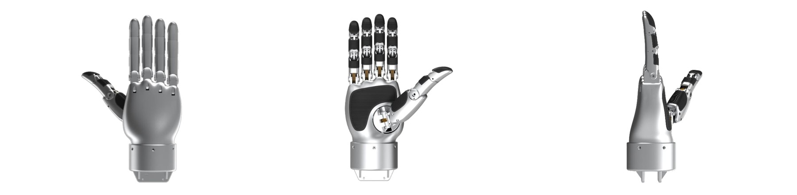

### Revision History

| Version | Date       | Description                                         |
| ------- | ---------- | --------------------------------------------------- |
| V1.0    | 2025-09-11 | First edition of the Linker Hand O7B product manual |

### Safety Instructions

Read this manual and all related documentation before installing or operating the product.

1. Connect the product only with the supplied or specified cables. Secure the hand correctly and do not use damaged power cords, damaged plugs, or loose sockets.
2. Follow the installation requirements in this manual. Operation outside the specified conditions can shorten the product's service life and create serious safety risks.
3. Extended high-power operation can increase the product temperature. Stop operation and allow the hand to cool if it becomes excessively hot.
4. Only trained personnel may operate this equipment. Do not open the housing, disassemble the product, or attempt unauthorized repairs. Contact official after-sales support if a fault occurs.
5. Illustrations and photographs are representative. Details may differ from the purchased product, and the manual may be revised when the product or its specifications change.

### Product Introduction

The Linker Hand O7B is a high-precision bionic dexterous hand driven by self-developed joint motor modules and a worm-gear transmission. It provides seven controlled degrees of freedom across 17 joints: seven active joints and ten passive joints. The design combines high load capacity, precise control, a compact structure, and efficient transmission.

#### Key Characteristics

* **High load capacity:** The five-finger gripping force reaches 60 N, while the maximum fingertip force is 14 N for the thumb and 14 N for the four fingers. The worm-gear transmission provides high output torque and self-locking performance under load.
* **Precise control:** Repeat positioning accuracy is better than ±0.2 mm. CAN and RS-485 interfaces support command transmission and real-time response at communication rates up to 1 MHz.
* **Compact transmission:** The hand weighs 634.5 g. Seven active and ten passive joints support complex motion and adaptive grasping while limiting control complexity.

#### Product Functions

* **Position control:** Controls the complete hand or individual finger joints and executes preset motion trajectories.
* **Speed control:** Adjusts finger speed for either high-throughput operation or slower precision tasks.
* **Tactile feedback and force control:** Fingertip sensors support real-time force sensing and dynamic output adjustment to protect fragile objects and reduce slipping.
* **Online upgrade:** System firmware can be upgraded through the host computer.

### Appearance and Motion

#### External Dimensions

All dimensions in the following drawing are in millimetres.

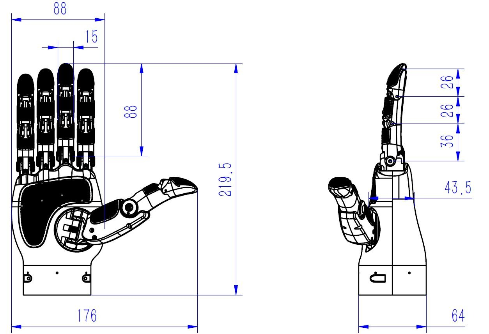

#### Degrees of Freedom

The hand has seven active degrees of freedom and 17 joints in total: seven active joints and ten passive joints.

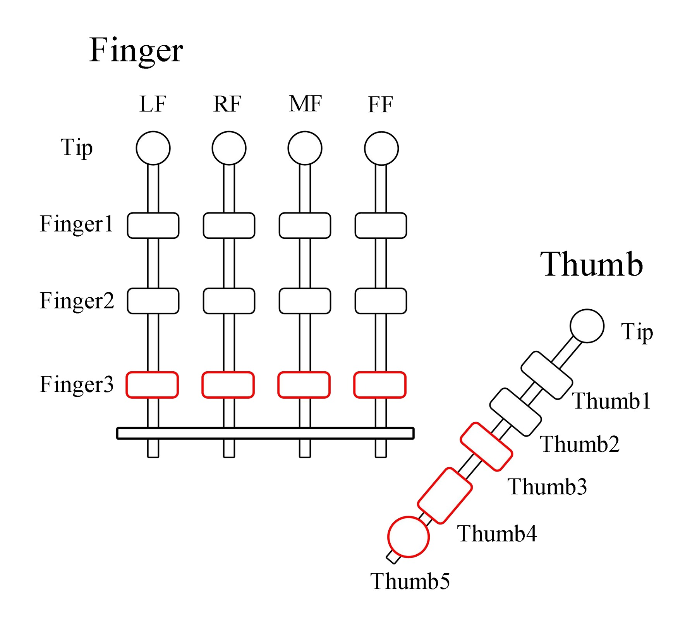

#### Motion Range

The illustrated angles are structural limits. The controller restricts the commanded range to prevent collisions, so the usable range may be smaller.

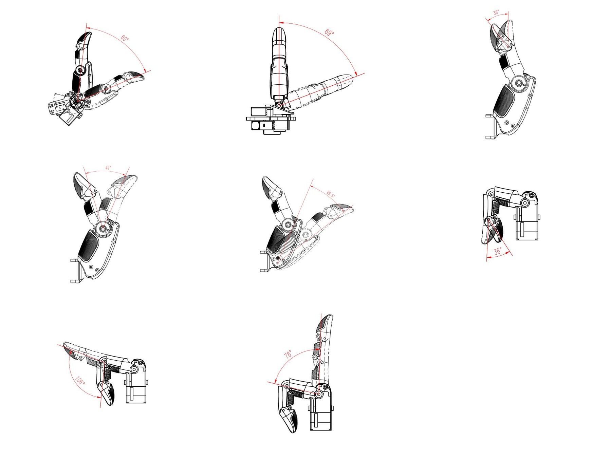

| Joint                              | Maximum controlled angle | Maximum controlled speed |
| ---------------------------------- | -----------------------: | -----------------------: |
| `THUMB1` flexion                   |                    37.9° |                  36.8°/s |
| `THUMB2` flexion                   |                    38.4° |                 37.28°/s |
| `THUMB3` flexion                   |                    27.9° |                 27.09°/s |
| `THUMB4` lateral swing             |                      69° |                 61.61°/s |
| `THUMB5` rotation                  |                      60° |                  62.5°/s |
| `LF3`, `RF3`, `MF3`, `FF3` flexion |                    34.7° |                 28.92°/s |
| `LF2`, `RF2`, `MF2`, `FF2` flexion |                   102.7° |                 85.58°/s |
| `LF1`, `RF1`, `MF1`, `FF1` flexion |                    76.1° |                 63.42°/s |

### Technical Specifications

#### Basic Parameters

| Parameter                      | Specification             |
| ------------------------------ | ------------------------- |
| Model                          | Linker Hand O7B           |
| Controlled degrees of freedom  | 7                         |
| Joint count                    | 17: 7 active + 10 passive |
| Transmission                   | Worm-gear transmission    |
| Control interface              | CAN / RS-485              |
| Weight                         | 634.5 g                   |
| Maximum load                   | 25 kg                     |
| Operating voltage              | 24 V DC ±10%              |
| Static current                 | 0.2 A                     |
| Average no-load motion current | 0.7 A                     |
| Maximum current                | 2.6 A                     |
| Repeat positioning accuracy    | Better than ±0.2 mm       |
| Opening and closing time       | 1.25 s                    |

#### Force Performance

| Parameter                                   | Specification |
| ------------------------------------------- | ------------: |
| Maximum thumb fingertip force               |          14 N |
| Maximum fingertip force of the four fingers |          14 N |
| Maximum five-finger gripping force          |          60 N |

### Sensor System

The O7B uses fingertip sensors to detect object presence and distance. During contact, the sensors support three-dimensional force measurement and detection of surface-texture and temperature changes.

#### Piezoresistive Sensor

| Parameter                | Specification  |
| ------------------------ | -------------- |
| Sensor array             | 6 × 12         |
| Force-bearing area       | 9.6 × 14.4 mm  |
| Trigger force            | 5 g            |
| Measurement range        | 20 N           |
| Service life             | 100,000 cycles |
| Communication frame rate | 200 FPS        |

#### Optional Capacitive Sensor

| Parameter              | Specification                      |
| ---------------------- | ---------------------------------- |
| Sampling frequency     | At least 50 Hz                     |
| Measurement range      | 0-30 N                             |
| Overload limit         | 60 N                               |
| Pressure sensitivity   | 0.1 N                              |
| Measurement resolution | 0.5% FS                            |
| Measurement accuracy   | 2% FS                              |
| Pressure resolution    | 0.25 N                             |
| Directional resolution | 45°                                |
| Detection distance     | 1 cm for metals and the human body |

#### Optional Visual-Tactile Perception

The visual-tactile option combines visual sensing with a trained deep-learning model. Micro binocular cameras record the deformation of a flexible surface under load, and the model maps this deformation to object-depth information and motion trends.

### Installation and Commissioning

#### Package Contents

Check that all accessories are present before installation.

| Item                       | Quantity |
| -------------------------- | -------: |
| USB-to-CAN debugging cable |        1 |
| XT30 connector cable (2+2) |        1 |
| Power adapter              |        1 |
| Power cable                |        1 |

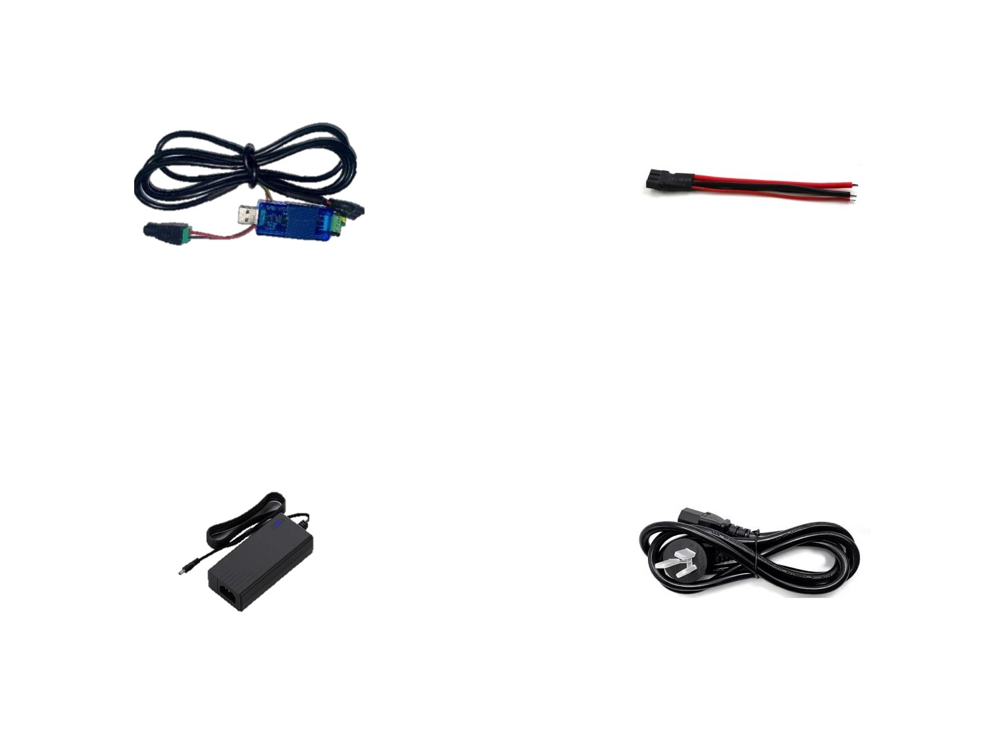

#### Mechanical Installation

Use M3 screws. Select the screw length according to the thickness of the mounting component.

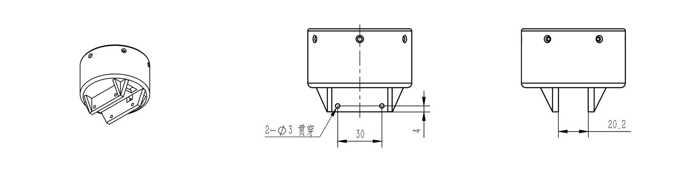

#### Electrical Connection

The hand uses an XT30 connector (2+2).

| Pin | Signal  |
| --: | ------- |
|   1 | CAN L   |
|   2 | CAN H   |
|   3 | GND     |
|   4 | 24 V DC |

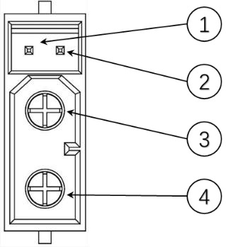

### Software Debugging

#### Connect the Hardware

1. Connect the hand to the debugging computer with the USB-to-CAN debugging cable.
2. Connect the power cable to the power adapter.
3. Connect the adapter output to the power port on the USB-to-CAN debugging cable.
4. Connect the AC side of the power adapter to a 220 V AC outlet.

#### Install the USB-to-CAN Driver

On Windows, open `PEAK-System_Driver-Setup` and follow the installer. The driver does not need to be reinstalled for subsequent use. The manual states that Linux does not require this driver.

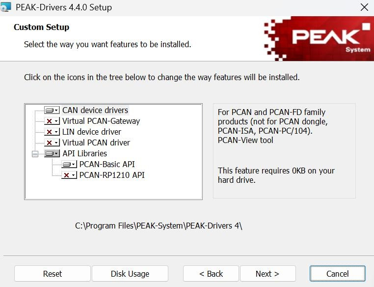

#### Configure the CAN Interfaces

Before launching the host software on Windows, open the `can_bridge_dashboard` directory and edit `config.toml`. Set `can_interface` to match the number and names of connected CAN devices.

For one device:

```toml
can_interface = ["can1"]
```

For two devices:

```toml
can_interface = ["can1", "can2"]
```

Save the file after editing.

#### Start CAN Bridge

1. Double-click `can_bridge.exe`.
2. Confirm that the service displays its running address.
3. If the service fails, review `can_bridge.log` and provide the log to official after-sales support.
4. When a CAN device is connected or disconnected on Windows, close the existing CAN Bridge process and restart it.

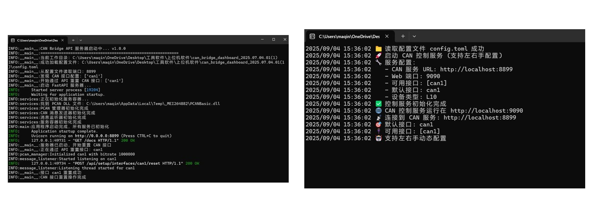

#### Start the Dashboard

1. Run the `dashboard.exe` file corresponding to the O7B model.
2. Wait until the console startup completes.
3. Open `http://localhost:9090` in a browser.

#### Host-Computer Software Functions

The host-computer software provides hand configuration, global control, joint control, preset actions, and status monitoring.

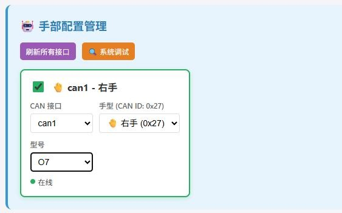

* **Hand configuration:** Select the CAN port, hand side, and model, and check whether the hand is online.
* **Global control:** Send all joint poses, palm poses, and joint speeds; reset hand components; and stop animations.
* **Joint control:** Set joint position, palm position, global speed, and global torque.
* **Preset actions:** Run or configure actions such as fist, open hand, pinch, number gestures, and animations.
* **Status monitoring:** View device logs, hand status, and sensor data in real time.

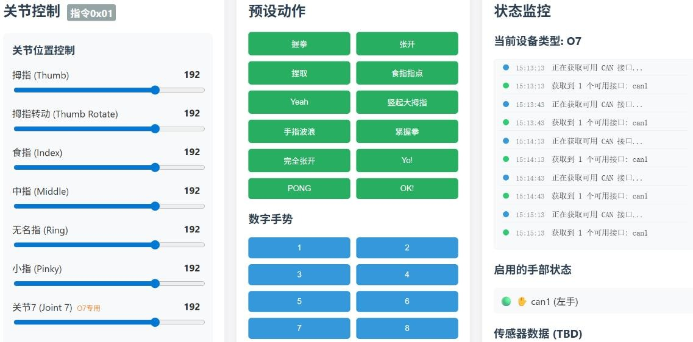

### Warranty and Service

1. The product has a 12-month limited warranty from the purchase date.
2. Manufacturing or material defects are eligible for repair or component replacement during the warranty period.
3. Normal cosmetic wear, improper operation, accidents, unauthorized disassembly, and failure to follow the instructions are excluded from warranty coverage.
4. Non-quality issues are not eligible for return or exchange.
5. Contact official after-sales support if the product malfunctions. Do not disassemble it yourself.
6. Out-of-warranty repairs may incur charges.

### Development Resources and Support

* [Official ROS SDK](https://github.com/linker-bot/linkerhand-ros-sdk)
* [LINKERBOT official website](https://linkerbot.cn)
* Technical support: `support@linkerbot.cn`
