# L20 Lite — Complete Manufacturer Manual

Complete supplied manufacturer reference for **LINKERBOT L20 Lite**, **V1.0 · 2025-09-11**. All **19 original PDF pages** appear below with their diagrams and native-text transcripts.

[Canonical L20 Lite engineering guide](../linker-hand-l20-lite-product-manual.md) · [Complete manual library](./)


Match model, side, connector and hardware/firmware revision before using any procedure. The canonical guide identifies source conflicts and commissioning limits. Manufacturer maximum-load claims are not a host arm payload or a safe suspended-load rating. Calibration, sliders, zero/reset and sequence execution can move the fingers.


## Original PDF reading parts

These downloads retain the original PDF page contents. Read the parts in order; the range labels use original PDF page numbers.

* [Download original PDF pages 1–8](../../../.gitbook/assets/linkerbot-l20_lite-manual-pages-001-008.pdf)
* [Download original PDF pages 9–19](../../../.gitbook/assets/linkerbot-l20_lite-manual-pages-009-019.pdf)

## Page and chapter index

| Original PDF page                      | Content                                             |
| -------------------------------------- | --------------------------------------------------- |
| [1](complete-l20-lite.md#pdf-page-1)   | Cover                                               |
| [2](complete-l20-lite.md#pdf-page-2)   | Revision history                                    |
| [3](complete-l20-lite.md#pdf-page-3)   | Safety instructions                                 |
| [4](complete-l20-lite.md#pdf-page-4)   | Contents                                            |
| [5](complete-l20-lite.md#pdf-page-5)   | Overview and transmission                           |
| [6](complete-l20-lite.md#pdf-page-6)   | Functions and control                               |
| [7](complete-l20-lite.md#pdf-page-7)   | Dimensions and joint configuration                  |
| [8](complete-l20-lite.md#pdf-page-8)   | Structural motion diagrams                          |
| [9](complete-l20-lite.md#pdf-page-9)   | Actual motion and speed table                       |
| [10](complete-l20-lite.md#pdf-page-10) | Electrical, force and piezoresistive specifications |
| [11](complete-l20-lite.md#pdf-page-11) | Optional capacitive and visual-tactile sensing      |
| [12](complete-l20-lite.md#pdf-page-12) | Accessories                                         |
| [13](complete-l20-lite.md#pdf-page-13) | M3 flange, connector and setup                      |
| [14](complete-l20-lite.md#pdf-page-14) | PEAK driver, config.toml and CAN Bridge             |
| [15](complete-l20-lite.md#pdf-page-15) | Bridge log, Dashboard and localhost                 |
| [16](complete-l20-lite.md#pdf-page-16) | Dashboard connection screenshots                    |
| [17](complete-l20-lite.md#pdf-page-17) | Hand configuration and controls                     |
| [18](complete-l20-lite.md#pdf-page-18) | Presets, monitoring and service                     |
| [19](complete-l20-lite.md#pdf-page-19) | SDK and support                                     |

## Source and interpretation

Source: LINKERBOT / Lingxin Qiaoshou (Beijing) Technology Co., Ltd., supplied **Linker Hand L20 Lite Product Manual.pdf**. The internal revision history, rather than the filename, identifies this edition. Page images are authoritative for spatial layout and symbols; transcripts are the native PDF text, including translation quirks and original inconsistencies. Numerical ranges and motion limits must be checked against the actual controller and unit. The original SDK appendix is retained; current development guidance is in the linked model guide.

## PDF page 1

**Cover** · original PDF page 1 of 19.

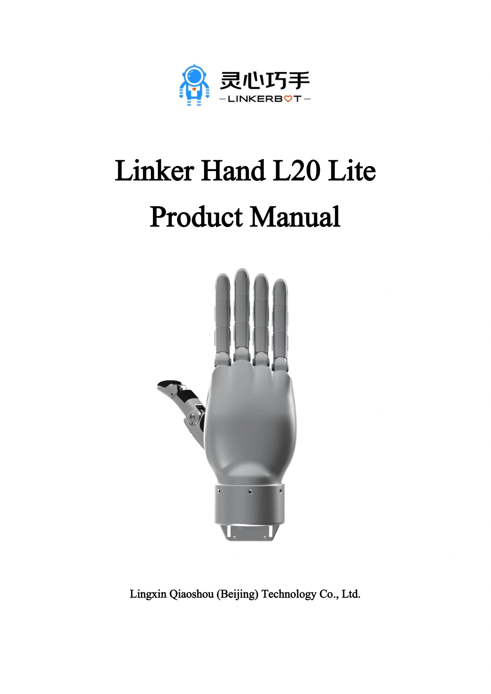

**Native-text transcript**

```
Linker Hand L20 Lite
Product Manual
Lingxin Qiaoshou (Beijing) Technology Co., Ltd.
```

## PDF page 2

**Revision history** · original PDF page 2 of 19.


**Native-text transcript**

```
Linker Hand L20 Lite Product
Manual
I
Version Revision History
Version nu-
mber
Date of Change
Change Description
V1.0
2025.09.11
Linker Hand L20 Lite First Edition
```

## PDF page 3

**Safety instructions** · original PDF page 3 of 19.

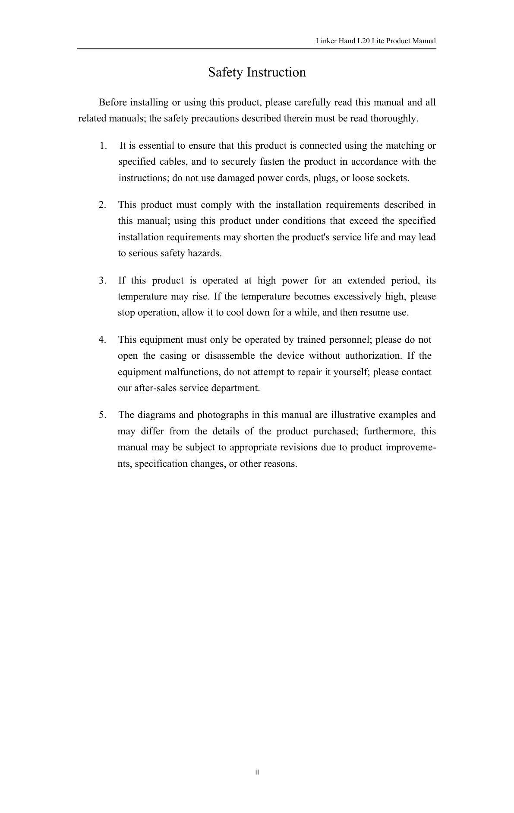

**Native-text transcript**

```
Linker Hand L20 Lite Product Manual
II
Safety Instruction
Before installing or using this product, please carefully read this manual and all
related manuals; the safety precautions described therein must be read thoroughly.
1.
It is essential to ensure that this product is connected using the matching or
specified cables, and to securely fasten the product in accordance with the
instructions; do not use damaged power cords, plugs, or loose sockets.
2.
This product must comply with the installation requirements described in
this manual; using this product under conditions that exceed the specified
installation requirements may shorten the product's service life and may lead
to serious safety hazards.
3.
If this product is operated at high power for an extended period, its
temperature may rise. If the temperature becomes excessively high, please
stop operation, allow it to cool down for a while, and then resume use.
4.
This equipment must only be operated by trained personnel; please do not
open the casing or disassemble the device without authorization. If the
equipment malfunctions, do not attempt to repair it yourself; please contact
our after-sales service department.
5.
The diagrams and photographs in this manual are illustrative examples and
may differ from the details of the product purchased; furthermore, this
manual may be subject to appropriate revisions due to product improveme-
nts, specification changes, or other reasons.
```

## PDF page 4

**Contents** · original PDF page 4 of 19.

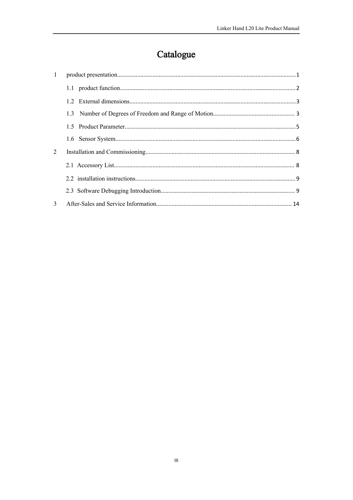

**Native-text transcript**

```
Linker Hand L20 Lite Product Manual
III
Catalogue
1
product presentation....................................................................................................................1
1.1 product function..................................................................................................................2
1.2 External dimensions............................................................................................................3
1.3
Number of Degrees of Freedom and Range of Motion..................................................... 3
1.5 Product Parameter...............................................................................................................5
1.6 Sensor System.....................................................................................................................6
2
Installation and Commissioning................................................................................................. 8
2.1 Accessory List..................................................................................................................... 8
2.2 installation instructions........................................................................................................9
2.3 Software Debugging Introduction....................................................................................... 9
3
After-Sales and Service Information........................................................................................ 14
```

## PDF page 5

**Overview and transmission** · original PDF page 5 of 19.

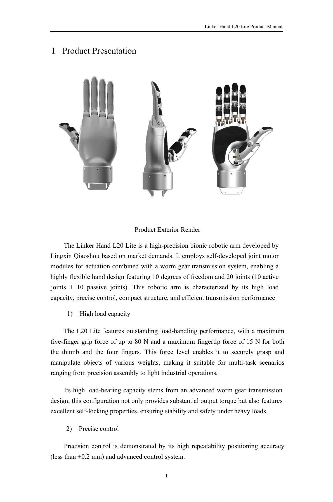

**Native-text transcript**

```
Linker Hand L20 Lite Product Manual
1
1 Product Presentation
The Linker Hand L20 Lite is a high-precision bionic robotic arm developed by
Lingxin Qiaoshou based on market demands. It employs self-developed joint motor
modules for actuation combined with a worm gear transmission system, enabling a
highly flexible hand design featuring 10 degrees of freedom and 20 joints (10 active
joints + 10 passive joints). This robotic arm is characterized by its high load
capacity, precise control, compact structure, and efficient transmission performance.
1)
High load capacity
The L20 Lite features outstanding load-handling performance, with a maximum
five-finger grip force of up to 80 N and a maximum fingertip force of 15 N for both
the thumb and the four fingers. This force level enables it to securely grasp and
manipulate objects of various weights, making it suitable for multi-task scenarios
ranging from precision assembly to light industrial operations.
Its high load-bearing capacity stems from an advanced worm gear transmission
design; this configuration not only provides substantial output torque but also features
excellent self-locking properties, ensuring stability and safety under heavy loads.
2)
Precise control
Precision control is demonstrated by its high repeatability positioning accuracy
(less than ±0.2 mm) and advanced control system.
Product Exterior Render
```

## PDF page 6

**Functions and control** · original PDF page 6 of 19.

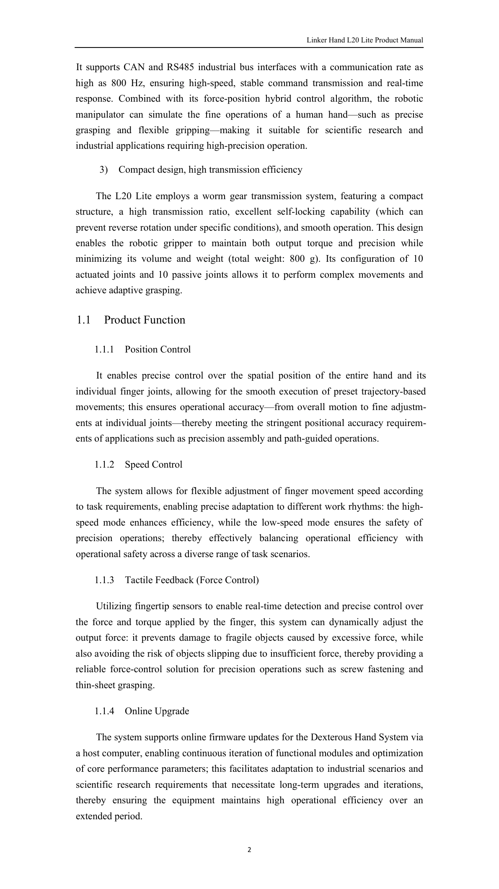

**Native-text transcript**

```
Linker Hand L20 Lite Product Manual
2
It supports CAN and RS485 industrial bus interfaces with a communication rate as
high as 800 Hz, ensuring high-speed, stable command transmission and real-time
response. Combined with its force-position hybrid control algorithm, the robotic
manipulator can simulate the fine operations of a human hand—such as precise
grasping and flexible gripping—making it suitable for scientific research and
industrial applications requiring high-precision operation.
3)
Compact design, high transmission efficiency
The L20 Lite employs a worm gear transmission system, featuring a compact
structure, a high transmission ratio, excellent self-locking capability (which can
prevent reverse rotation under specific conditions), and smooth operation. This design
enables the robotic gripper to maintain both output torque and precision while
minimizing its volume and weight (total weight: 800 g). Its configuration of 10
actuated joints and 10 passive joints allows it to perform complex movements and
achieve adaptive grasping.
1.1
Product Function
1.1.1
Position Control
It enables precise control over the spatial position of the entire hand and its
individual finger joints, allowing for the smooth execution of preset trajectory-based
movements; this ensures operational accuracy—from overall motion to fine adjustm-
ents at individual joints—thereby meeting the stringent positional accuracy requirem-
ents of applications such as precision assembly and path-guided operations.
1.1.2
Speed Control
The system allows for flexible adjustment of finger movement speed according
to task requirements, enabling precise adaptation to different work rhythms: the high-
speed mode enhances efficiency, while the low-speed mode ensures the safety of
precision operations; thereby effectively balancing operational efficiency with
operational safety across a diverse range of task scenarios.
1.1.3
Tactile Feedback (Force Control)
Utilizing fingertip sensors to enable real-time detection and precise control over
the force and torque applied by the finger, this system can dynamically adjust the
output force: it prevents damage to fragile objects caused by excessive force, while
also avoiding the risk of objects slipping due to insufficient force, thereby providing a
reliable force-control solution for precision operations such as screw fastening and
thin-sheet grasping.
1.1.4
Online Upgrade
The system supports online firmware updates for the Dexterous Hand System via
a host computer, enabling continuous iteration of functional modules and optimization
of core performance parameters; this facilitates adaptation to industrial scenarios and
scientific research requirements that necessitate long-term upgrades and iterations,
thereby ensuring the equipment maintains high operational efficiency over an
extended period.
```

## PDF page 7

**Dimensions and joint configuration** · original PDF page 7 of 19.

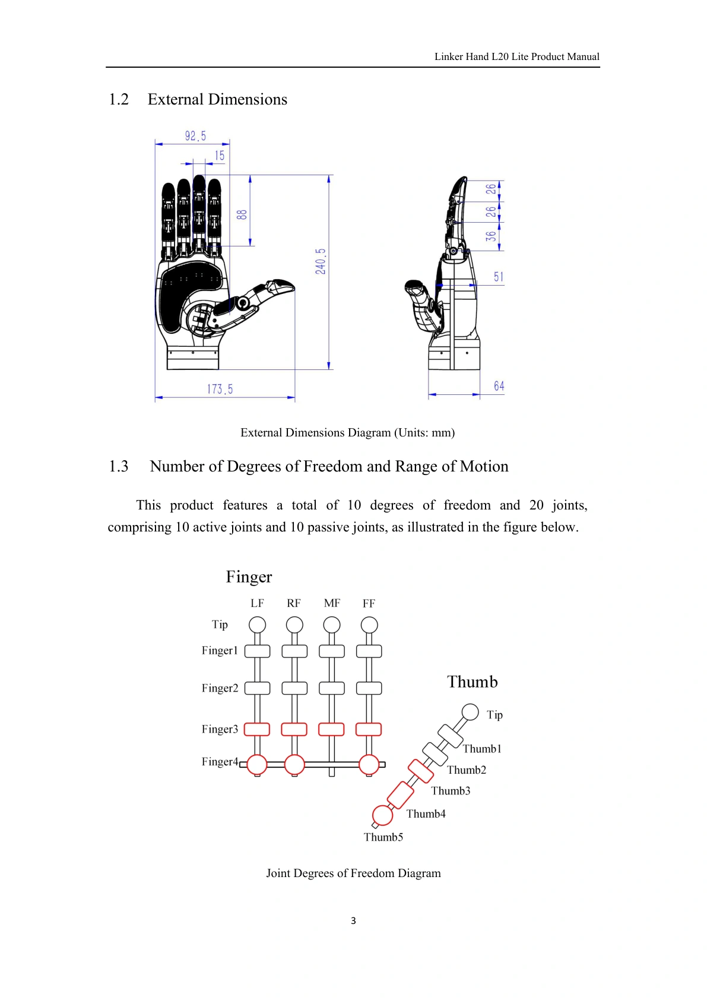

**Native-text transcript**

```
Linker Hand L20 Lite Product Manual
3
1.2
External Dimensions
External Dimensions Diagram (Units: mm)
1.3
Number of Degrees of Freedom and Range of Motion
This product features a total of 10 degrees of freedom and 20 joints,
comprising 10 active joints and 10 passive joints, as illustrated in the figure below.
Joint Degrees of Freedom Diagram
```

## PDF page 8

**Structural motion diagrams** · original PDF page 8 of 19.

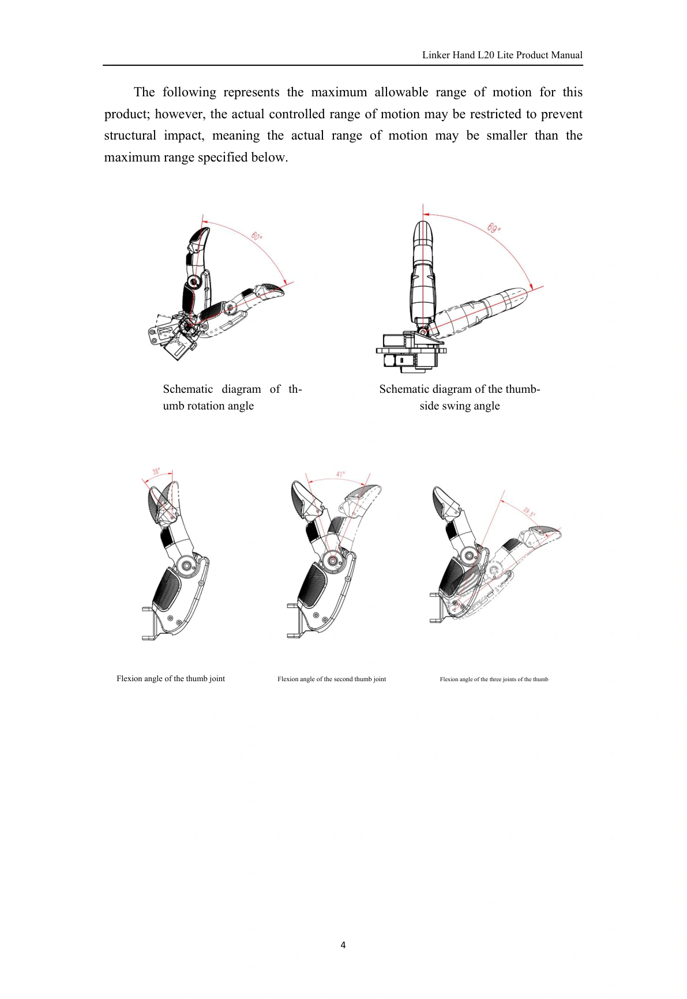

**Native-text transcript**

```
Linker Hand L20 Lite Product Manual
4
The following represents the maximum allowable range of motion for this
product; however, the actual controlled range of motion may be restricted to prevent
structural impact, meaning the actual range of motion may be smaller than the
maximum range specified below.
Schematic diagram of th-
umb rotation angle
Schematic diagram of the thumb-
side swing angle
Flexion angle of the thumb joint
Flexion angle of the second thumb joint
Flexion angle of the three joints of the thumb
```

## PDF page 9

**Actual motion and speed table** · original PDF page 9 of 19.

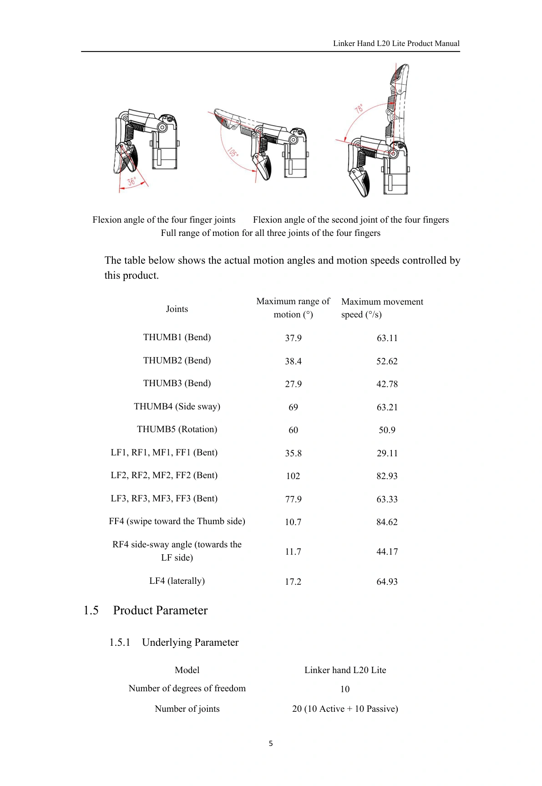

**Native-text transcript**

```
Linker Hand L20 Lite Product Manual
5
The table below shows the actual motion angles and motion speeds controlled by
this product.
Joints
Maximum range of
motion (°)
Maximum movement
speed (°/s)
THUMB1 (Bend)
37.9
63.11
THUMB2 (Bend)
38.4
52.62
THUMB3 (Bend)
27.9
42.78
THUMB4 (Side sway)
69
63.21
THUMB5 (Rotation)
60
50.9
LF1, RF1, MF1, FF1 (Bent)
35.8
29.11
LF2, RF2, MF2, FF2 (Bent)
102
82.93
LF3, RF3, MF3, FF3 (Bent)
77.9
63.33
FF4 (swipe toward the Thumb side)
10.7
84.62
RF4 side-sway angle (towards the
LF side)
11.7
44.17
LF4 (laterally)
17.2
64.93
1.5
Product Parameter
1.5.1
Underlying Parameter
Model
Linker hand L20 Lite
Number of degrees of freedom
10
Number of joints
20 (10 Active + 10 Passive)
Flexion angle of the four finger joints
Flexion angle of the second joint of the four fingers
Full range of motion for all three joints of the four fingers
```

## PDF page 10

**Electrical, force and piezoresistive specifications** · original PDF page 10 of 19.

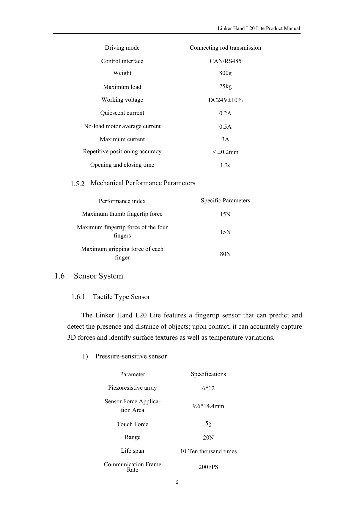

**Native-text transcript**

```
Linker Hand L20 Lite Product Manual
6
Driving mode
Connecting rod transmission
Control interface
CAN/RS485
Weight
800g
Maximum load
25kg
Working voltage
DC24V±10%
Quiescent current
0.2A
No-load motor average current
0.5A
Maximum current
3A
Repetitive positioning accuracy
< ±0.2mm
Opening and closing time
1.2s
1.5.2
Mechanical Performance Parameters
Performance index
Specific Parameters
Maximum thumb fingertip force
15N
Maximum fingertip force of the four
fingers
15N
Maximum gripping force of each
finger
80N
1.6
Sensor System
1.6.1
Tactile Type Sensor
The Linker Hand L20 Lite features a fingertip sensor that can predict and
detect the presence and distance of objects; upon contact, it can accurately capture
3D forces and identify surface textures as well as temperature variations.
1)
Pressure-sensitive sensor
Parameter
Specifications
Piezoresistive array
6*12
Sensor Force Applica-
tion Area
9.6*14.4mm
Touch Force
5g
Range
20N
Life span
10 Ten thousand times
Communication Frame
Rate
200FPS
```

## PDF page 11

**Optional capacitive and visual-tactile sensing** · original PDF page 11 of 19.

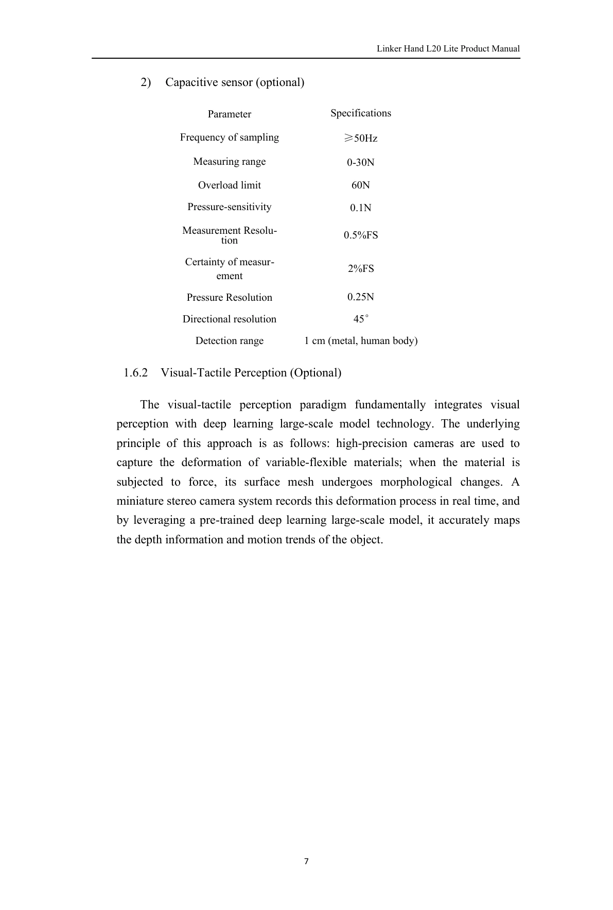

**Native-text transcript**

```
Linker Hand L20 Lite Product Manual
7
2)
Capacitive sensor (optional)
Parameter
Specifications
Frequency of sampling
≥50Hz
Measuring range
0-30N
Overload limit
60N
Pressure-sensitivity
0.1N
Measurement Resolu-
tion
0.5%FS
Certainty of measur-
ement
2%FS
Pressure Resolution
0.25N
Directional resolution
45°
Detection range
1 cm (metal, human body)
1.6.2
Visual-Tactile Perception (Optional)
The visual-tactile perception paradigm fundamentally integrates visual
perception with deep learning large-scale model technology. The underlying
principle of this approach is as follows: high-precision cameras are used to
capture the deformation of variable-flexible materials; when the material is
subjected to force, its surface mesh undergoes morphological changes. A
miniature stereo camera system records this deformation process in real time, and
by leveraging a pre-trained deep learning large-scale model, it accurately maps
the depth information and motion trends of the object.
```

## PDF page 12

**Accessories** · original PDF page 12 of 19.

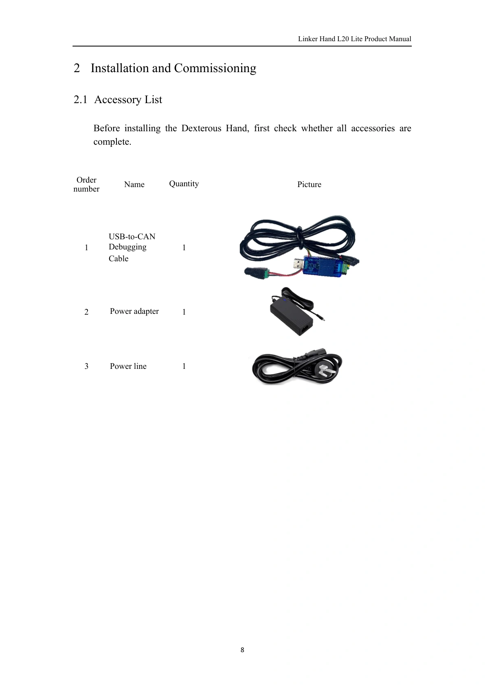

**Native-text transcript**

```
Linker Hand L20 Lite Product Manual
8
2
Installation and Commissioning
2.1 Accessory List
Before installing the Dexterous Hand, first check whether all accessories are
complete.
Order
number
Name
Quantity
Picture
1
USB-to-CAN
Debugging
Cable
1
2
Power adapter
1
3
Power line
1
```

## PDF page 13

**M3 flange, connector and setup** · original PDF page 13 of 19.

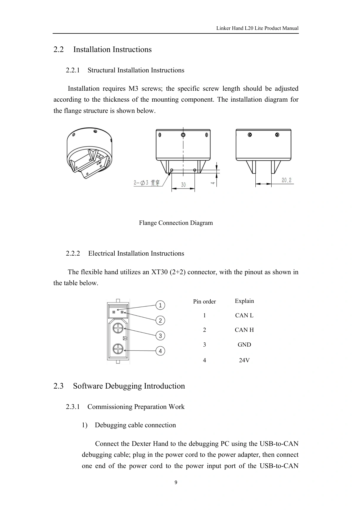

**Native-text transcript**

```
Linker Hand L20 Lite Product Manual
9
2.2
Installation Instructions
2.2.1
Structural Installation Instructions
Installation requires M3 screws; the specific screw length should be adjusted
according to the thickness of the mounting component. The installation diagram for
the flange structure is shown below.
Flange Connection Diagram
2.2.2
Electrical Installation Instructions
The flexible hand utilizes an XT30 (2+2) connector, with the pinout as shown in
the table below.
Pin order
Explain
1
CAN L
2
CAN H
3
GND
4
24V
2.3
Software Debugging Introduction
2.3.1
Commissioning Preparation Work
1)
Debugging cable connection
Connect the Dexter Hand to the debugging PC using the USB-to-CAN
debugging cable; plug in the power cord to the power adapter, then connect
one end of the power cord to the power input port of the USB-to-CAN
```

## PDF page 14

**PEAK driver, config.toml and CAN Bridge** · original PDF page 14 of 19.

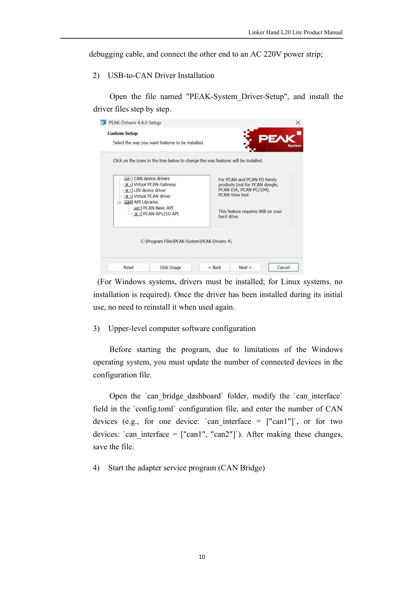

**Native-text transcript**

```
Linker Hand L20 Lite Product Manual
10
2)
USB-to-CAN Driver Installation
Open the file named "PEAK-System_Driver-Setup", and install the
driver files step by step.
(For Windows systems, drivers must be installed; for Linux systems, no
installation is required). Once the driver has been installed during its initial
use, no need to reinstall it when used again.
3)
Upper-level computer software configuration
Before starting the program, due to limitations of the Windows
operating system, you must update the number of connected devices in the
configuration file.
debugging cable, and connect the other end to an AC 220V power strip;
Open the `can_bridge_dashboard` folder, modify the `can_interface`
field in the `config.toml` configuration file, and enter the number of CAN
devices (e.g., for one device: `can_interface = ["can1"]`, or for two
devices: `can_interface = ["can1", "can2"]`). After making these changes,
save the file.
4)
Start the adapter service program (CAN Bridge)
```

## PDF page 15

**Bridge log, Dashboard and localhost** · original PDF page 15 of 19.

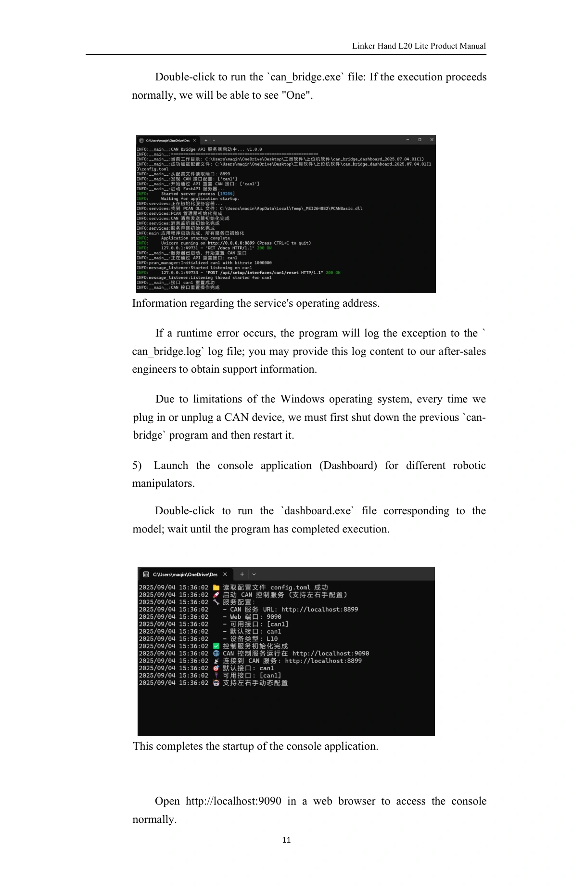

**Native-text transcript**

```
Linker Hand L20 Lite Product Manual
11
Double-click to run the `can_bridge.exe` file: If the execution proceeds
normally, we will be able to see "One".
Information regarding the service's operating address.
If a runtime error occurs, the program will log the exception to the `
can_bridge.log` log file; you may provide this log content to our after-sales
engineers to obtain support information.
Due to limitations of the Windows operating system, every time we
plug in or unplug a CAN device, we must first shut down the previous `can-
bridge` program and then restart it.
5)
Launch the console application (Dashboard) for different robotic
manipulators.
Double-click to run the `dashboard.exe` file corresponding to the
model; wait until the program has completed execution.
This completes the startup of the console application.
http://localhost:9090
Open
in a web browser to access the console
normally.
```

## PDF page 16

**Dashboard connection screenshots** · original PDF page 16 of 19.


**Native-text transcript**

```
Linker Hand L20 Lite Product Manual
12
Control the Dexterous Hand.
```

## PDF page 17

**Hand configuration and controls** · original PDF page 17 of 19.

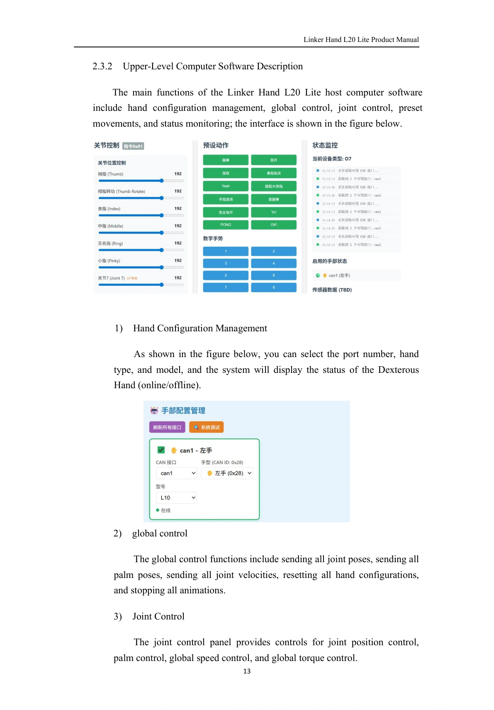

**Native-text transcript**

```
Linker Hand L20 Lite Product Manual
13
2.3.2
Upper-Level Computer Software Description
The main functions of the Linker Hand L20 Lite host computer software
include hand configuration management, global control, joint control, preset
movements, and status monitoring; the interface is shown in the figure below.
1)
Hand Configuration Management
As shown in the figure below, you can select the port number, hand
type, and model, and the system will display the status of the Dexterous
Hand (online/offline).
2)
global control
The global control functions include sending all joint poses, sending all
palm poses, sending all joint velocities, resetting all hand configurations,
and stopping all animations.
3)
Joint Control
The joint control panel provides controls for joint position control,
palm control, global speed control, and global torque control.
```

## PDF page 18

**Presets, monitoring and service** · original PDF page 18 of 19.

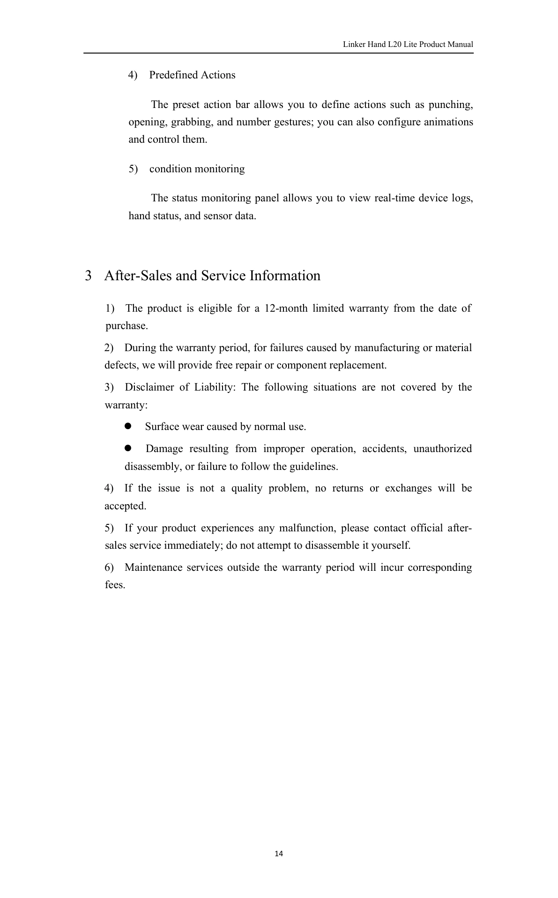

**Native-text transcript**

```
Linker Hand L20 Lite Product Manual
14
4)
Predefined Actions
The preset action bar allows you to define actions such as punching,
opening, grabbing, and number gestures; you can also configure animations
and control them.
5)
condition monitoring
The status monitoring panel allows you to view real-time device logs,
hand status, and sensor data.
3 After-Sales and Service Information
1)
The product is eligible for a 12-month limited warranty from the date of
purchase.
2)
During the warranty period, for failures caused by manufacturing or material
defects, we will provide free repair or component replacement.
3)
Disclaimer of Liability: The following situations are not covered by the
warranty:

Surface wear caused by normal use.

Damage resulting from improper operation, accidents, unauthorized
disassembly, or failure to follow the guidelines.
4)
If the issue is not a quality problem, no returns or exchanges will be
accepted.
5)
If your product experiences any malfunction, please contact official after-
sales service immediately; do not attempt to disassemble it yourself.
6)
Maintenance services outside the warranty period will incur corresponding
fees.
```

## PDF page 19

**SDK and support** · original PDF page 19 of 19.


**Native-text transcript**

```
Linker Hand L20 Lite Product Manual
Appendix
ROS_SDK:
https://github.com/linker-bot/linkerhand-ros-sdk
ROS2_SDK:
https://github.com/linker-bot/linkerhand-ros2-sdk
Python_SDK:
https://github.com/linker-bot/linkerhand-python-sdk
support@linkerbot.c
Technical Support Email:
n
If you need more product information, please visit our official
website:https://linkerbot.cn
```

[Original PDF external link](https://linkerbot.cn)
