# L20 — Complete Manufacturer Manual

Complete supplied manufacturer reference for **LINKERBOT L20**, **V1.3 · 2026-08-04**. All **14 original PDF pages** appear below with their diagrams and native-text transcripts.

[Canonical L20 engineering guide](../linker-hand-l20-product-manual.md) · [Complete manual library](./)


Match model, side, connector and hardware/firmware revision before using any procedure. The canonical guide identifies source conflicts and commissioning limits. Manufacturer maximum-load claims are not a host arm payload or a safe suspended-load rating. Calibration, sliders, zero/reset and sequence execution can move the fingers.


## Original PDF reading parts

These downloads retain the original PDF page contents. Read the parts in order; the range labels use original PDF page numbers.

* [Download original PDF pages 1–11](../../../.gitbook/assets/linkerbot-l20-manual-pages-001-011.pdf)
* [Download original PDF pages 12–14](../../../.gitbook/assets/linkerbot-l20-manual-pages-012-014.pdf)

## Page and chapter index

| Original PDF page                 | Content                                          |
| --------------------------------- | ------------------------------------------------ |
| [1](complete-l20.md#pdf-page-1)   | Cover                                            |
| [2](complete-l20.md#pdf-page-2)   | Revision history                                 |
| [3](complete-l20.md#pdf-page-3)   | Safety instructions                              |
| [4](complete-l20.md#pdf-page-4)   | Contents                                         |
| [5](complete-l20.md#pdf-page-5)   | Overview and drive architecture                  |
| [6](complete-l20.md#pdf-page-6)   | Functions and control                            |
| [7](complete-l20.md#pdf-page-7)   | Dimensions and joint configuration               |
| [8](complete-l20.md#pdf-page-8)   | Joint motion diagrams                            |
| [9](complete-l20.md#pdf-page-9)   | Actual motion and speed table                    |
| [10](complete-l20.md#pdf-page-10) | Electrical, mechanical and sensor specifications |
| [11](complete-l20.md#pdf-page-11) | Accessories                                      |
| [12](complete-l20.md#pdf-page-12) | M3 flange and XT30 connector                     |
| [13](complete-l20.md#pdf-page-13) | Debug connection and service                     |
| [14](complete-l20.md#pdf-page-14) | SDK and support                                  |

## Source and interpretation

Source: LINKERBOT / Lingxin Qiaoshou (Beijing) Technology Co., Ltd., supplied **Linker Hand L20 V10 Product Manual.pdf**. The internal revision history, rather than the filename, identifies this edition. Page images are authoritative for spatial layout and symbols; transcripts are the native PDF text, including translation quirks and original inconsistencies. Numerical ranges and motion limits must be checked against the actual controller and unit. The original SDK appendix is retained; current development guidance is in the linked model guide.

## PDF page 1

**Cover** · original PDF page 1 of 14.

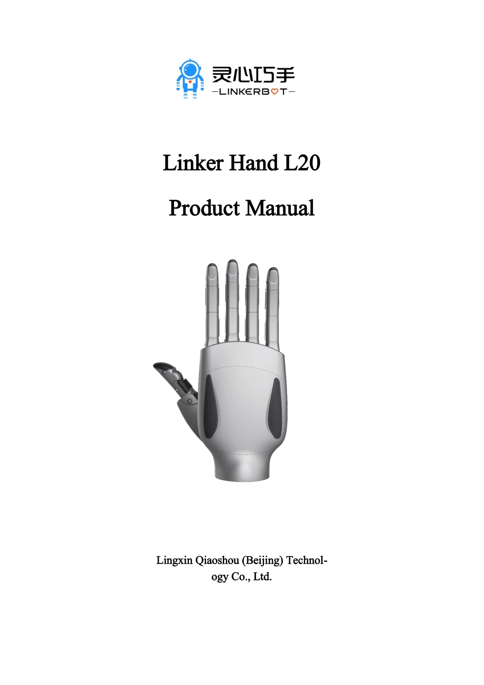

**Native-text transcript**

```
Linker Hand L20
Product Manual
Lingxin Qiaoshou (Beijing) Technol-
ogy Co., Ltd.
```

## PDF page 2

**Revision history** · original PDF page 2 of 14.

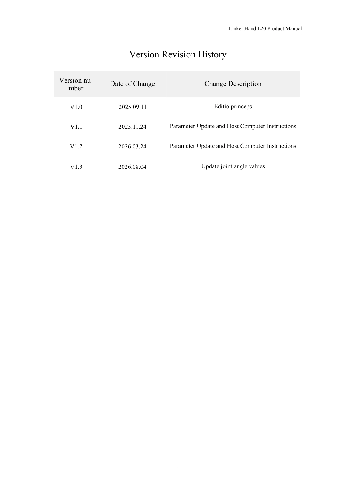

**Native-text transcript**

```
Linker Hand L20 Product Manual
I
Version Revision History
Version nu-
mber
Date of Change
Change Description
V1.0
2025.09.11
Editio princeps
V1.1
2025.11.24
Parameter Update and Host Computer Instructions
V1.2
2026.03.24
Parameter Update and Host Computer Instructions
V1.3
2026.08.04
Update joint angle values
```

## PDF page 3

**Safety instructions** · original PDF page 3 of 14.

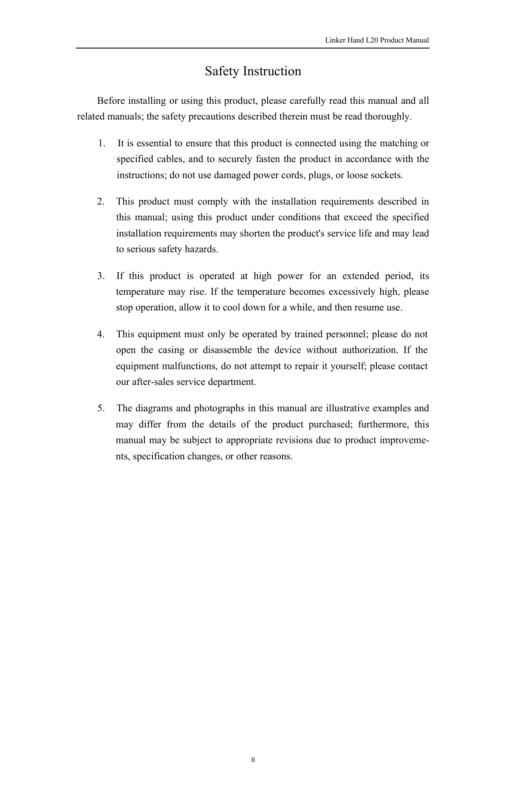

**Native-text transcript**

```
Linker Hand L20 Product Manual
II
Safety Instruction
Before installing or using this product, please carefully read this manual and all
related manuals; the safety precautions described therein must be read thoroughly.
1.
It is essential to ensure that this product is connected using the matching or
specified cables, and to securely fasten the product in accordance with the
instructions; do not use damaged power cords, plugs, or loose sockets.
2.
This product must comply with the installation requirements described in
this manual; using this product under conditions that exceed the specified
installation requirements may shorten the product's service life and may lead
to serious safety hazards.
3.
If this product is operated at high power for an extended period, its
temperature may rise. If the temperature becomes excessively high, please
stop operation, allow it to cool down for a while, and then resume use.
4.
This equipment must only be operated by trained personnel; please do not
open the casing or disassemble the device without authorization. If the
equipment malfunctions, do not attempt to repair it yourself; please contact
our after-sales service department.
5.
The diagrams and photographs in this manual are illustrative examples and
may differ from the details of the product purchased; furthermore, this
manual may be subject to appropriate revisions due to product improveme-
nts, specification changes, or other reasons.
```

## PDF page 4

**Contents** · original PDF page 4 of 14.

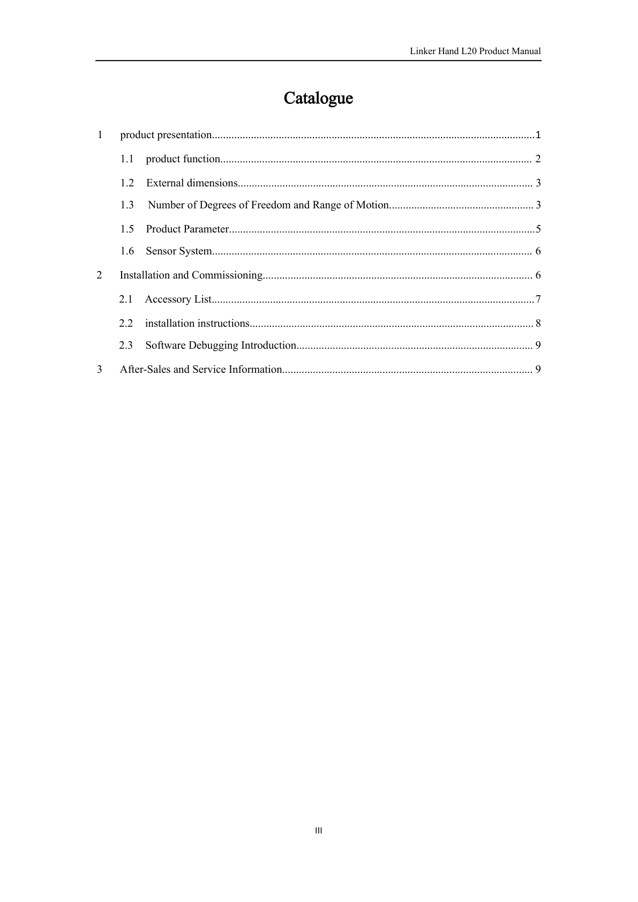

**Native-text transcript**

```
Linker Hand L20 Product Manual
III
Catalogue
1
product presentation....................................................................................................................1
1.1
product function................................................................................................................ 2
1.2
External dimensions.......................................................................................................... 3
1.3
Number of Degrees of Freedom and Range of Motion.................................................... 3
1.5
Product Parameter..............................................................................................................5
1.6
Sensor System................................................................................................................... 6
2
Installation and Commissioning................................................................................................. 6
2.1
Accessory List....................................................................................................................7
2.2
installation instructions...................................................................................................... 8
2.3
Software Debugging Introduction..................................................................................... 9
3
After-Sales and Service Information.......................................................................................... 9
```

## PDF page 5

**Overview and drive architecture** · original PDF page 5 of 14.

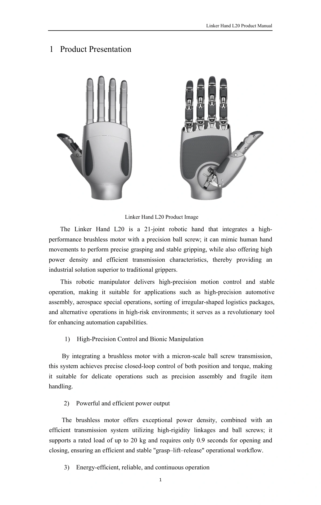

**Native-text transcript**

```
Linker Hand L20 Product Manual
1
1 Product Presentation
Linker Hand L20 Product Image
The Linker Hand L20 is a 21-joint robotic hand that integrates a high-
performance brushless motor with a precision ball screw; it can mimic human hand
movements to perform precise grasping and stable gripping, while also offering high
power density and efficient transmission characteristics, thereby providing an
industrial solution superior to traditional grippers.
This robotic manipulator delivers high-precision motion control and stable
operation, making it suitable for applications such as high-precision automotive
assembly, aerospace special operations, sorting of irregular-shaped logistics packages,
and alternative operations in high-risk environments; it serves as a revolutionary tool
for enhancing automation capabilities.
1)
High-Precision Control and Bionic Manipulation
By integrating a brushless motor with a micron-scale ball screw transmission,
this system achieves precise closed-loop control of both position and torque, making
it suitable for delicate operations such as precision assembly and fragile item
handling.
2)
Powerful and efficient power output
The brushless motor offers exceptional power density, combined with an
efficient transmission system utilizing high-rigidity linkages and ball screws; it
supports a rated load of up to 20 kg and requires only 0.9 seconds for opening and
closing, ensuring an efficient and stable "grasp–lift–release" operational workflow.
3)
Energy-efficient, reliable, and continuous operation
```

## PDF page 6

**Functions and control** · original PDF page 6 of 14.

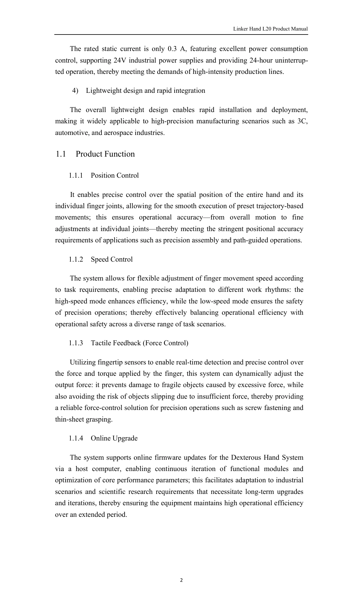

**Native-text transcript**

```
Linker Hand L20 Product Manual
2
The rated static current is only 0.3 A, featuring excellent power consumption
control, supporting 24V industrial power supplies and providing 24-hour uninterrup-
ted operation, thereby meeting the demands of high-intensity production lines.
4)
Lightweight design and rapid integration
The overall lightweight design enables rapid installation and deployment,
making it widely applicable to high-precision manufacturing scenarios such as 3C,
automotive, and aerospace industries.
1.1
Product Function
1.1.1
Position Control
It enables precise control over the spatial position of the entire hand and its
individual finger joints, allowing for the smooth execution of preset trajectory-based
movements; this ensures operational accuracy—from overall motion to fine
adjustments at individual joints—thereby meeting the stringent positional accuracy
requirements of applications such as precision assembly and path-guided operations.
1.1.2
Speed Control
The system allows for flexible adjustment of finger movement speed according
to task requirements, enabling precise adaptation to different work rhythms: the
high-speed mode enhances efficiency, while the low-speed mode ensures the safety
of precision operations; thereby effectively balancing operational efficiency with
operational safety across a diverse range of task scenarios.
1.1.3
Tactile Feedback (Force Control)
Utilizing fingertip sensors to enable real-time detection and precise control over
the force and torque applied by the finger, this system can dynamically adjust the
output force: it prevents damage to fragile objects caused by excessive force, while
also avoiding the risk of objects slipping due to insufficient force, thereby providing
a reliable force-control solution for precision operations such as screw fastening and
thin-sheet grasping.
1.1.4
Online Upgrade
The system supports online firmware updates for the Dexterous Hand System
via a host computer, enabling continuous iteration of functional modules and
optimization of core performance parameters; this facilitates adaptation to industrial
scenarios and scientific research requirements that necessitate long-term upgrades
and iterations, thereby ensuring the equipment maintains high operational efficiency
over an extended period.
```

## PDF page 7

**Dimensions and joint configuration** · original PDF page 7 of 14.

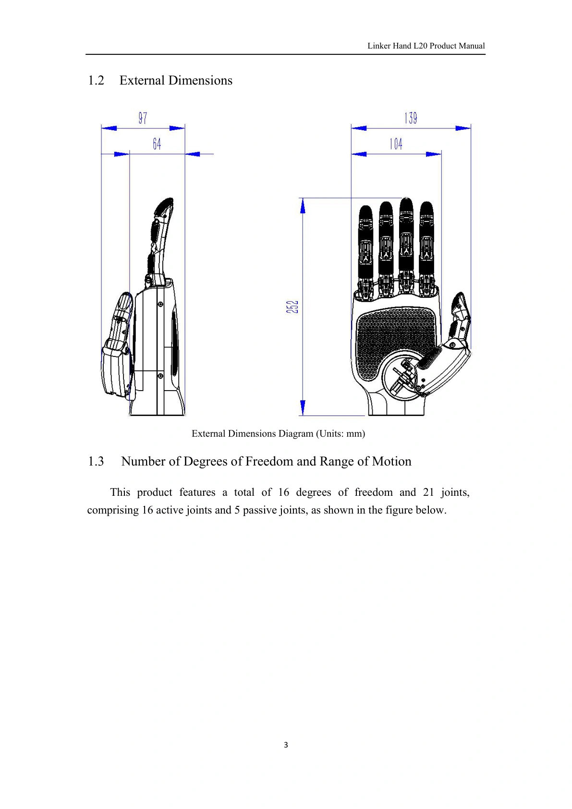

**Native-text transcript**

```
Linker Hand L20 Product Manual
3
1.2
External Dimensions
External Dimensions Diagram (Units: mm)
1.3
Number of Degrees of Freedom and Range of Motion
This product features a total of 16 degrees of freedom and 21 joints,
comprising 16 active joints and 5 passive joints, as shown in the figure below.
```

## PDF page 8

**Joint motion diagrams** · original PDF page 8 of 14.

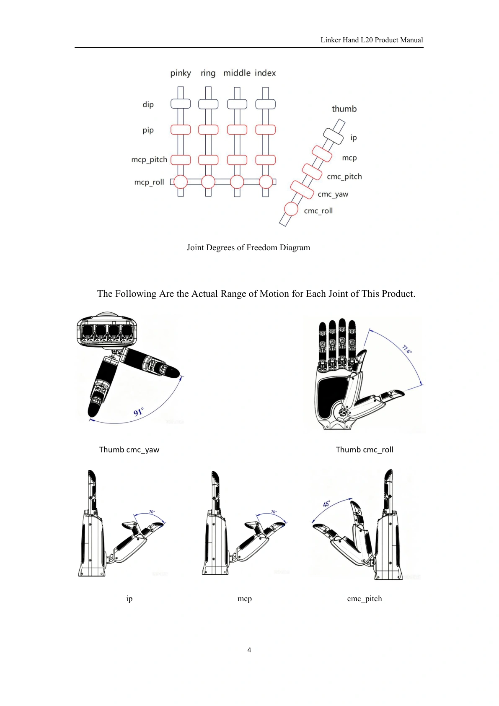

**Native-text transcript**

```
Linker Hand L20 Product Manual
4
The Following Are the Actual Range of Motion for Each Joint of This Product.
Thumb cmc_yaw
Thumb cmc_roll
ip
mcp
cmc_pitch
Joint Degrees of Freedom Diagram
```

## PDF page 9

**Actual motion and speed table** · original PDF page 9 of 14.

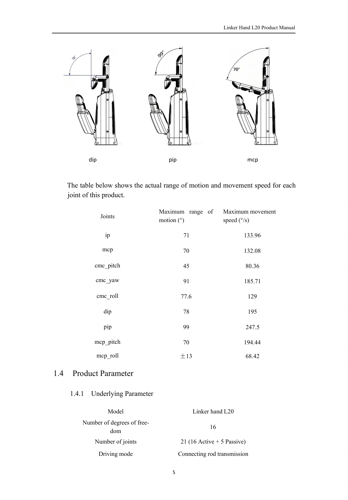

**Native-text transcript**

```
Linker Hand L20 Product Manual
5
The table below shows the actual range of motion and movement speed for each
joint of this product.
Joints
Maximum
range
of
motion (°)
Maximum movement
speed (°/s)
ip
71
133.96
mcp
70
132.08
cmc_pitch
45
80.36
cmc_yaw
91
185.71
cmc_roll
77.6
129
dip
78
195
pip
99
247.5
mcp_pitch
70
194.44
mcp_roll
±13
68.42
1.4
Product Parameter
1.4.1
Underlying Parameter
Model
Linker hand L20
Number of degrees of free-
dom
16
Number of joints
21 (16 Active + 5 Passive)
Driving mode
Connecting rod transmission
dip
pip
mcp
```

## PDF page 10

**Electrical, mechanical and sensor specifications** · original PDF page 10 of 14.

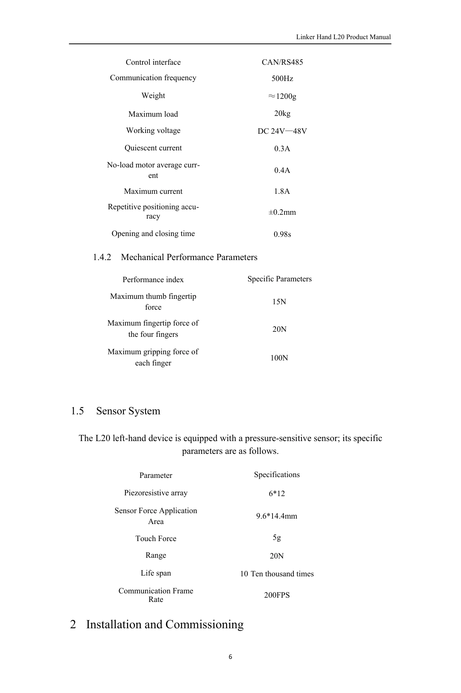

**Native-text transcript**

```
Linker Hand L20 Product Manual
6
Control interface
CAN/RS485
Communication frequency
500Hz
Weight
≈1200g
Maximum load
20kg
Working voltage
DC 24V—48V
Quiescent current
0.3A
No-load motor average curr-
ent
0.4A
Maximum current
1.8A
Repetitive positioning accu-
racy
±0.2mm
Opening and closing time
0.98s
1.4.2
Mechanical Performance Parameters
Performance index
Specific Parameters
Maximum thumb fingertip
force
15N
Maximum fingertip force of
the four fingers
20N
Maximum gripping force of
each finger
100N
1.5
Sensor System
The L20 left-hand device is equipped with a pressure-sensitive sensor; its specific
parameters are as follows.
Parameter
Specifications
Piezoresistive array
6*12
Sensor Force Application
Area
9.6*14.4mm
Touch Force
5g
Range
20N
Life span
10 Ten thousand times
Communication Frame
Rate
200FPS
2
Installation and Commissioning
```

## PDF page 11

**Accessories** · original PDF page 11 of 14.

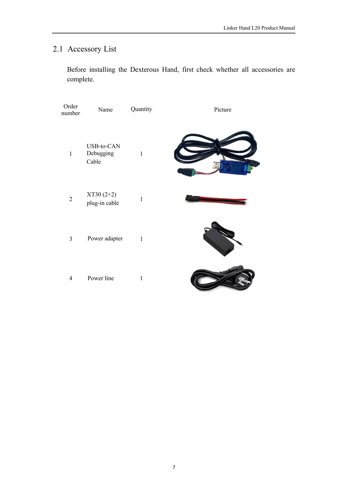

**Native-text transcript**

```
Linker Hand L20 Product Manual
7
2.1 Accessory List
Before installing the Dexterous Hand, first check whether all accessories are
complete.
Order
number
Name
Quantity
Picture
1
USB-to-CAN
Debugging
Cable
1
2
XT30 (2+2)
plug-in cable
1
3
Power adapter
1
4
Power line
1
```

## PDF page 12

**M3 flange and XT30 connector** · original PDF page 12 of 14.

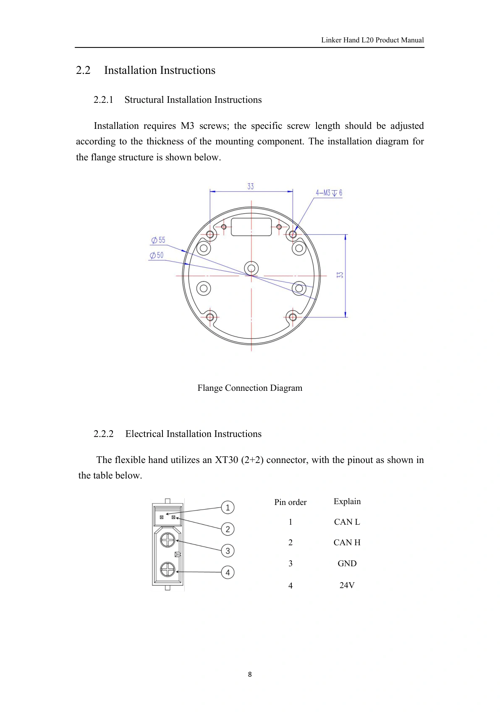

**Native-text transcript**

```
Linker Hand L20 Product Manual
8
2.2
Installation Instructions
2.2.1
Structural Installation Instructions
Installation requires M3 screws; the specific screw length should be adjusted
according to the thickness of the mounting component. The installation diagram for
the flange structure is shown below.
Flange Connection Diagram
2.2.2
Electrical Installation Instructions
The flexible hand utilizes an XT30 (2+2) connector, with the pinout as shown in
the table below.
Pin order
Explain
1
CAN L
2
CAN H
3
GND
4
24V
```

## PDF page 13

**Debug connection and service** · original PDF page 13 of 14.

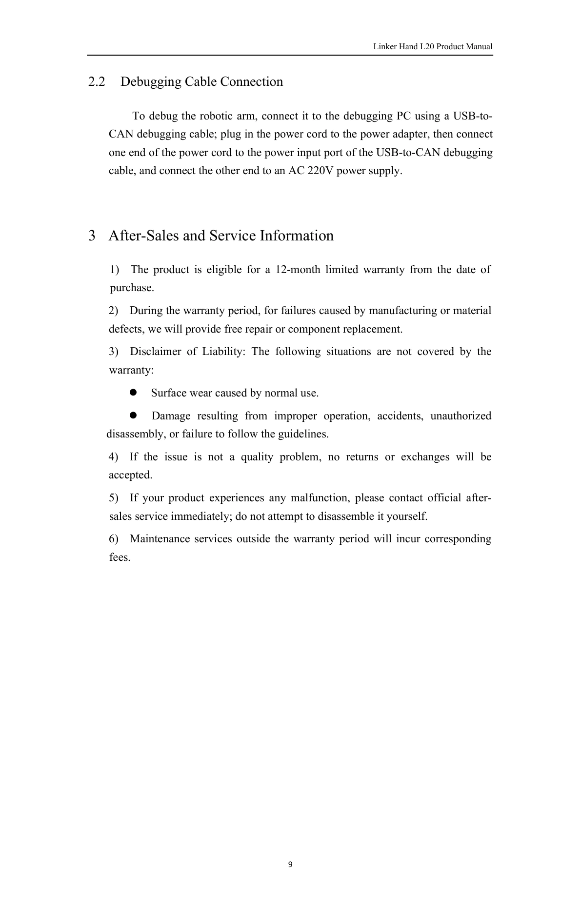

**Native-text transcript**

```
Linker Hand L20 Product Manual
9
2.2
Debugging Cable Connection
To debug the robotic arm, connect it to the debugging PC using a USB-to-
CAN debugging cable; plug in the power cord to the power adapter, then connect
one end of the power cord to the power input port of the USB-to-CAN debugging
cable, and connect the other end to an AC 220V power supply.
3 After-Sales and Service Information
1)
The product is eligible for a 12-month limited warranty from the date of
purchase.
2)
During the warranty period, for failures caused by manufacturing or material
defects, we will provide free repair or component replacement.
3)
Disclaimer of Liability: The following situations are not covered by the
warranty:

Surface wear caused by normal use.

Damage resulting from improper operation, accidents, unauthorized
disassembly, or failure to follow the guidelines.
4)
If the issue is not a quality problem, no returns or exchanges will be
accepted.
5)
If your product experiences any malfunction, please contact official after-
sales service immediately; do not attempt to disassemble it yourself.
6)
Maintenance services outside the warranty period will incur corresponding
fees.
```

## PDF page 14

**SDK and support** · original PDF page 14 of 14.


**Native-text transcript**

```
Linker Hand L20 Product Manual
Appendix
https://github.com/linker-bot/linkerhand-ros-
sd
ROS SDK download URL:
k
https://github.com/linker-bot/linkerhand-ros
2-sdk
https://github.com/linker-bot/linkerhand-python-sd
ROS2 SDK download URL:
; Python SDK:
k
support@linkerbot.c
Technical Support Email:
n
If you need more product information, please visit our official website:
https://linkerbot.cn
```

[Original PDF external link](https://linkerbot.cn)
