# L30 Standard (tendon-driven) — Complete Manufacturer Manual

Complete supplied manufacturer reference for **LINKERBOT L30 Standard (tendon-driven)**, **V1.3 · 2025-10-27**. All **17 original PDF pages** appear below with their diagrams and native-text transcripts.

[Canonical L30 Standard (tendon-driven) engineering guide](../linker-hand-l30-standard-edition-product-manual.md) · [Complete manual library](./)


Match model, side, connector and hardware/firmware revision before using any procedure. The canonical guide identifies source conflicts and commissioning limits. Manufacturer maximum-load claims are not a host arm payload or a safe suspended-load rating. Calibration, sliders, zero/reset and sequence execution can move the fingers.


## Original PDF reading parts

These downloads retain the original PDF page contents. Read the parts in order; the range labels use original PDF page numbers.

* [Download original PDF pages 1–7](../../../.gitbook/assets/linkerbot-l30-manual-pages-001-007.pdf)
* [Download original PDF pages 8–9](../../../.gitbook/assets/linkerbot-l30-manual-pages-008-009.pdf)
* [Download original PDF pages 10–17](../../../.gitbook/assets/linkerbot-l30-manual-pages-010-017.pdf)

## Page and chapter index

| Original PDF page                 | Content                                                   |
| --------------------------------- | --------------------------------------------------------- |
| [1](complete-l30.md#pdf-page-1)   | Cover                                                     |
| [2](complete-l30.md#pdf-page-2)   | Revision history                                          |
| [3](complete-l30.md#pdf-page-3)   | Contents                                                  |
| [4](complete-l30.md#pdf-page-4)   | Overview                                                  |
| [5](complete-l30.md#pdf-page-5)   | Tendon drive, wrist and control characteristics           |
| [6](complete-l30.md#pdf-page-6)   | Control functions                                         |
| [7](complete-l30.md#pdf-page-7)   | Dimensions and joint configuration                        |
| [8](complete-l30.md#pdf-page-8)   | Structural motion diagrams                                |
| [9](complete-l30.md#pdf-page-9)   | Actual joint ranges and speeds                            |
| [10](complete-l30.md#pdf-page-10) | Electrical, mechanical and optional sensor specifications |
| [11](complete-l30.md#pdf-page-11) | Sensor continuation and accessories                       |
| [12](complete-l30.md#pdf-page-12) | M4 end flange                                             |
| [13](complete-l30.md#pdf-page-13) | Mounting seat and XT30 connector                          |
| [14](complete-l30.md#pdf-page-14) | Host connection and controller software                   |
| [15](complete-l30.md#pdf-page-15) | Joint controls and sequence editor                        |
| [16](complete-l30.md#pdf-page-16) | Sequence continuation and service                         |
| [17](complete-l30.md#pdf-page-17) | SDK and support                                           |

## Source and interpretation

Source: LINKERBOT / Lingxin Qiaoshou (Beijing) Technology Co., Ltd., supplied **LinkerHandL30-Product Manual.pdf**. The internal revision history, rather than the filename, identifies this edition. Page images are authoritative for spatial layout and symbols; transcripts are the native PDF text, including translation quirks and original inconsistencies. Numerical ranges and motion limits must be checked against the actual controller and unit. The original SDK appendix is retained; current development guidance is in the linked model guide.

## PDF page 1

**Cover** · original PDF page 1 of 17.

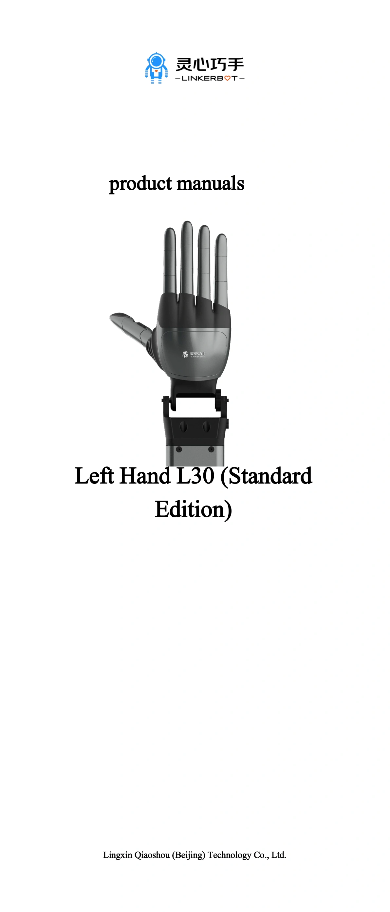

**Native-text transcript**

```
Left Hand L30 (Standard
Edition)
product manuals
Lingxin Qiaoshou (Beijing) Technology Co., Ltd.
```

## PDF page 2

**Revision history** · original PDF page 2 of 17.

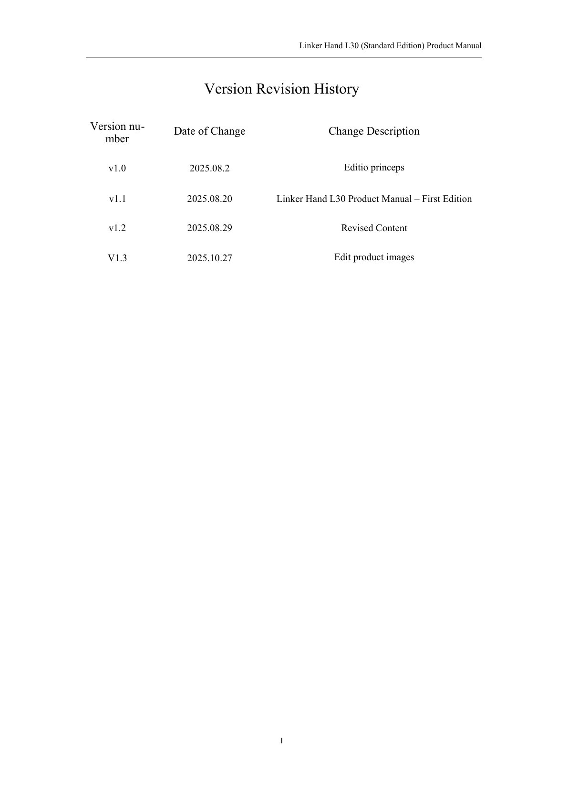

**Native-text transcript**

```
Linker Hand L30 (Standard Edition) Product Manual
I
Version Revision History
Version nu-
mber
Date of Change
Change Description
v1.0
2025.08.2
Editio princeps
v1.1
2025.08.20
Linker Hand L30 Product Manual – First Edition
v1.2
2025.08.29
Revised Content
V1.3
2025.10.27
Edit product images
```

## PDF page 3

**Contents** · original PDF page 3 of 17.

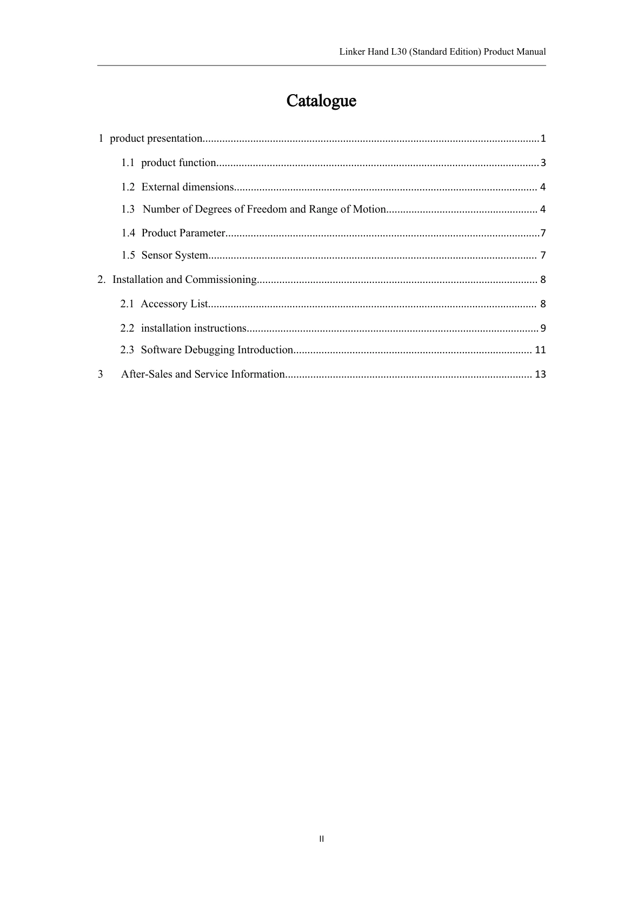

**Native-text transcript**

```
Linker Hand L30 (Standard Edition) Product Manual
II
Catalogue
1 product presentation........................................................................................................................1
1.1 product function...................................................................................................................3
1.2 External dimensions............................................................................................................ 4
1.3 Number of Degrees of Freedom and Range of Motion...................................................... 4
1.4 Product Parameter................................................................................................................7
1.5 Sensor System..................................................................................................................... 7
2. Installation and Commissioning.................................................................................................... 8
2.1 Accessory List..................................................................................................................... 8
2.2 installation instructions........................................................................................................9
2.3 Software Debugging Introduction..................................................................................... 11
3
After-Sales and Service Information........................................................................................ 13
```

## PDF page 4

**Overview** · original PDF page 4 of 17.

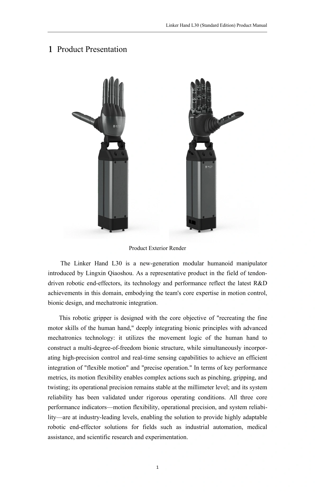

**Native-text transcript**

```
Linker Hand L30 (Standard Edition) Product Manual
1
1 Product Presentation
Product Exterior Render
The Linker Hand L30 is a new-generation modular humanoid manipulator
introduced by Lingxin Qiaoshou. As a representative product in the field of tendon-
driven robotic end-effectors, its technology and performance reflect the latest R&D
achievements in this domain, embodying the team's core expertise in motion control,
bionic design, and mechatronic integration.
This robotic gripper is designed with the core objective of "recreating the fine
motor skills of the human hand," deeply integrating bionic principles with advanced
mechatronics technology: it utilizes the movement logic of the human hand to
construct a multi-degree-of-freedom bionic structure, while simultaneously incorpor-
ating high-precision control and real-time sensing capabilities to achieve an efficient
integration of "flexible motion" and "precise operation." In terms of key performance
metrics, its motion flexibility enables complex actions such as pinching, gripping, and
twisting; its operational precision remains stable at the millimeter level; and its system
reliability has been validated under rigorous operating conditions. All three core
performance indicators—motion flexibility, operational precision, and system reliabi-
lity—are at industry-leading levels, enabling the solution to provide highly adaptable
robotic end-effector solutions for fields such as industrial automation, medical
assistance, and scientific research and experimentation.
```

## PDF page 5

**Tendon drive, wrist and control characteristics** · original PDF page 5 of 17.

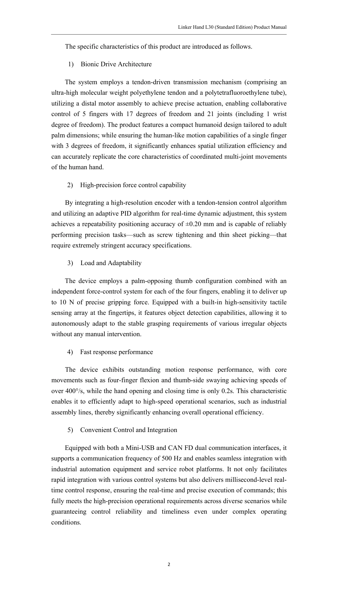

**Native-text transcript**

```
Linker Hand L30 (Standard Edition) Product Manual
2
The specific characteristics of this product are introduced as follows.
1)
Bionic Drive Architecture
The system employs a tendon-driven transmission mechanism (comprising an
ultra-high molecular weight polyethylene tendon and a polytetrafluoroethylene tube),
utilizing a distal motor assembly to achieve precise actuation, enabling collaborative
control of 5 fingers with 17 degrees of freedom and 21 joints (including 1 wrist
degree of freedom). The product features a compact humanoid design tailored to adult
palm dimensions; while ensuring the human-like motion capabilities of a single finger
with 3 degrees of freedom, it significantly enhances spatial utilization efficiency and
can accurately replicate the core characteristics of coordinated multi-joint movements
of the human hand.
2)
High-precision force control capability
By integrating a high-resolution encoder with a tendon-tension control algorithm
and utilizing an adaptive PID algorithm for real-time dynamic adjustment, this system
achieves a repeatability positioning accuracy of ±0.20 mm and is capable of reliably
performing precision tasks—such as screw tightening and thin sheet picking—that
require extremely stringent accuracy specifications.
3)
Load and Adaptability
The device employs a palm-opposing thumb configuration combined with an
independent force-control system for each of the four fingers, enabling it to deliver up
to 10 N of precise gripping force. Equipped with a built-in high-sensitivity tactile
sensing array at the fingertips, it features object detection capabilities, allowing it to
autonomously adapt to the stable grasping requirements of various irregular objects
without any manual intervention.
4)
Fast response performance
The device exhibits outstanding motion response performance, with core
movements such as four-finger flexion and thumb-side swaying achieving speeds of
over 400°/s, while the hand opening and closing time is only 0.2s. This characteristic
enables it to efficiently adapt to high-speed operational scenarios, such as industrial
assembly lines, thereby significantly enhancing overall operational efficiency.
5)
Convenient Control and Integration
Equipped with both a Mini-USB and CAN FD dual communication interfaces, it
supports a communication frequency of 500 Hz and enables seamless integration with
industrial automation equipment and service robot platforms. It not only facilitates
rapid integration with various control systems but also delivers millisecond-level real-
time control response, ensuring the real-time and precise execution of commands; this
fully meets the high-precision operational requirements across diverse scenarios while
guaranteeing control reliability and timeliness even under complex operating
conditions.
```

## PDF page 6

**Control functions** · original PDF page 6 of 17.

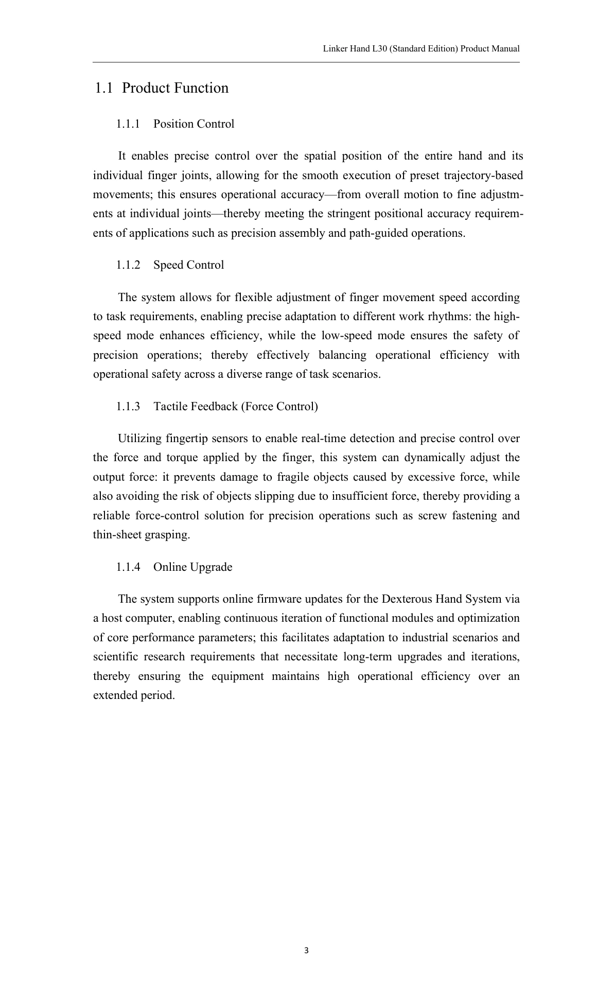

**Native-text transcript**

```
Linker Hand L30 (Standard Edition) Product Manual
3
1.1 Product Function
1.1.1
Position Control
It enables precise control over the spatial position of the entire hand and its
individual finger joints, allowing for the smooth execution of preset trajectory-based
movements; this ensures operational accuracy—from overall motion to fine adjustm-
ents at individual joints—thereby meeting the stringent positional accuracy requirem-
ents of applications such as precision assembly and path-guided operations.
1.1.2
Speed Control
The system allows for flexible adjustment of finger movement speed according
to task requirements, enabling precise adaptation to different work rhythms: the high-
speed mode enhances efficiency, while the low-speed mode ensures the safety of
precision operations; thereby effectively balancing operational efficiency with
operational safety across a diverse range of task scenarios.
1.1.3
Tactile Feedback (Force Control)
Utilizing fingertip sensors to enable real-time detection and precise control over
the force and torque applied by the finger, this system can dynamically adjust the
output force: it prevents damage to fragile objects caused by excessive force, while
also avoiding the risk of objects slipping due to insufficient force, thereby providing a
reliable force-control solution for precision operations such as screw fastening and
thin-sheet grasping.
1.1.4
Online Upgrade
The system supports online firmware updates for the Dexterous Hand System via
a host computer, enabling continuous iteration of functional modules and optimization
of core performance parameters; this facilitates adaptation to industrial scenarios and
scientific research requirements that necessitate long-term upgrades and iterations,
thereby ensuring the equipment maintains high operational efficiency over an
extended period.
```

## PDF page 7

**Dimensions and joint configuration** · original PDF page 7 of 17.

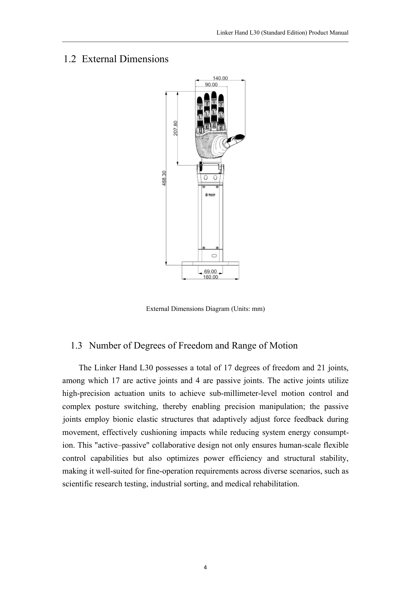

**Native-text transcript**

```
Linker Hand L30 (Standard Edition) Product Manual
4
1.2 External Dimensions
External Dimensions Diagram (Units: mm)
1.3 Number of Degrees of Freedom and Range of Motion
The Linker Hand L30 possesses a total of 17 degrees of freedom and 21 joints,
among which 17 are active joints and 4 are passive joints. The active joints utilize
high-precision actuation units to achieve sub-millimeter-level motion control and
complex posture switching, thereby enabling precision manipulation; the passive
joints employ bionic elastic structures that adaptively adjust force feedback during
movement, effectively cushioning impacts while reducing system energy consumpt-
ion. This "active–passive" collaborative design not only ensures human-scale flexible
control capabilities but also optimizes power efficiency and structural stability,
making it well-suited for fine-operation requirements across diverse scenarios, such as
scientific research testing, industrial sorting, and medical rehabilitation.
```

## PDF page 8

**Structural motion diagrams** · original PDF page 8 of 17.

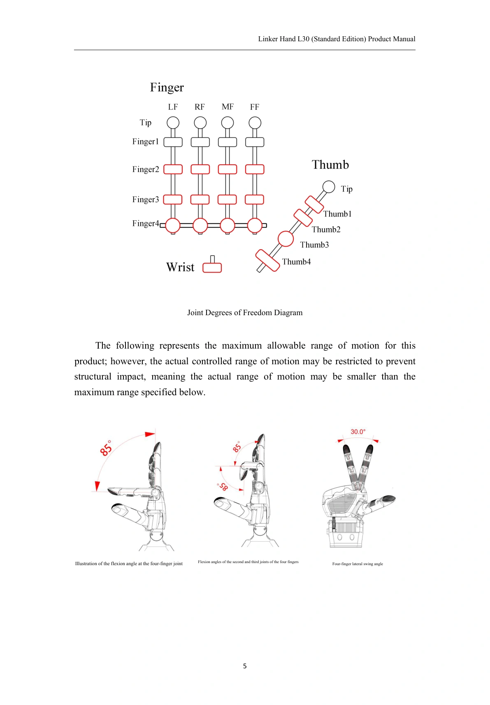

**Native-text transcript**

```
Linker Hand L30 (Standard Edition) Product Manual
5
Joint Degrees of Freedom Diagram
The following represents the maximum allowable range of motion for this
product; however, the actual controlled range of motion may be restricted to prevent
structural impact, meaning the actual range of motion may be smaller than the
maximum range specified below.
Illustration of the flexion angle at the four-finger joint
Flexion angles of the second and third joints of the four fingers
Four-finger lateral swing angle
```

## PDF page 9

**Actual joint ranges and speeds** · original PDF page 9 of 17.

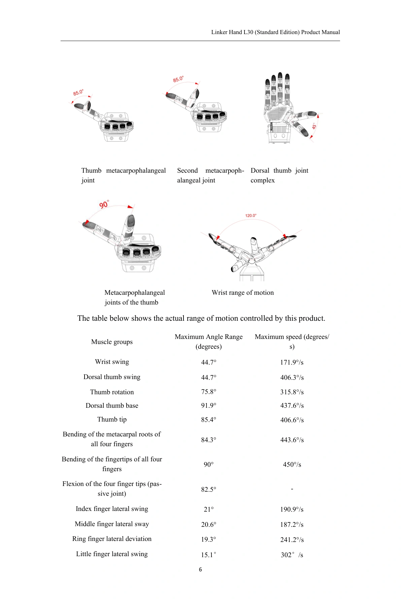

**Native-text transcript**

```
Linker Hand L30 (Standard Edition) Product Manual
6
Thumb metacarpophalangeal
joint
Second
metacarpoph-
alangeal joint
Dorsal thumb joint
complex
Metacarpophalangeal
joints of the thumb
Wrist range of motion
The table below shows the actual range of motion controlled by this product.
Muscle groups
Maximum Angle Range
(degrees)
Maximum speed (degrees/
s)
Wrist swing
44.7°
171.9°/s
Dorsal thumb swing
44.7°
406.3°/s
Thumb rotation
75.8°
315.8°/s
Dorsal thumb base
91.9°
437.6°/s
Thumb tip
85.4°
406.6°/s
Bending of the metacarpal roots of
all four fingers
84.3°
443.6°/s
Bending of the fingertips of all four
fingers
90°
450°/s
Flexion of the four finger tips (pas-
sive joint)
82.5°
-
Index finger lateral swing
21°
190.9°/s
Middle finger lateral sway
20.6°
187.2°/s
Ring finger lateral deviation
19.3°
241.2°/s
Little finger lateral swing
15.1°
302°/s
```

## PDF page 10

**Electrical, mechanical and optional sensor specifications** · original PDF page 10 of 17.

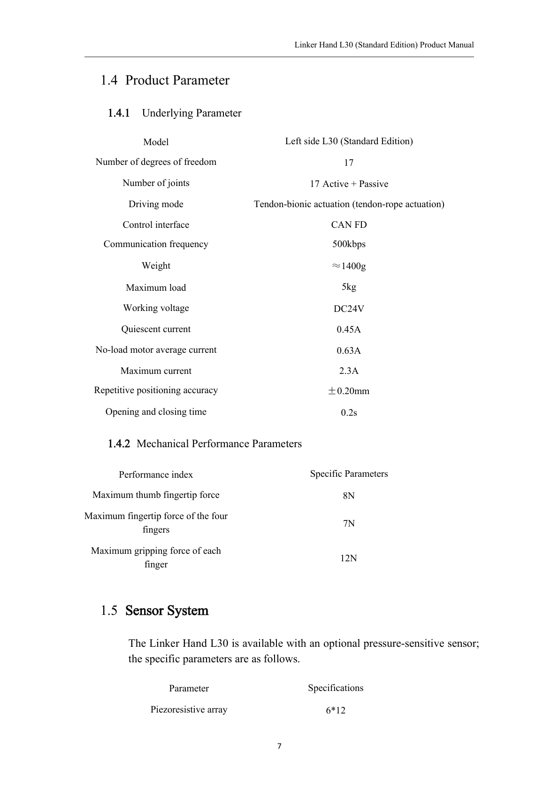

**Native-text transcript**

```
Linker Hand L30 (Standard Edition) Product Manual
7
1.4 Product Parameter
1.4.1
Underlying Parameter
Model
Left side L30 (Standard Edition)
Number of degrees of freedom
17
Number of joints
17 Active + Passive
Driving mode
Tendon-bionic actuation (tendon-rope actuation)
Control interface
CAN FD
Communication frequency
500kbps
Weight
≈1400g
Maximum load
5kg
Working voltage
DC24V
Quiescent current
0.45A
No-load motor average current
0.63A
Maximum current
2.3A
Repetitive positioning accuracy
±0.20mm
Opening and closing time
0.2s
1.4.2 Mechanical Performance Parameters
Performance index
Specific Parameters
Maximum thumb fingertip force
8N
Maximum fingertip force of the four
fingers
7N
Maximum gripping force of each
finger
12N
1.5 Sensor System
The Linker Hand L30 is available with an optional pressure-sensitive sensor;
the specific parameters are as follows.
Parameter
Specifications
Piezoresistive array
6*12
```

## PDF page 11

**Sensor continuation and accessories** · original PDF page 11 of 17.

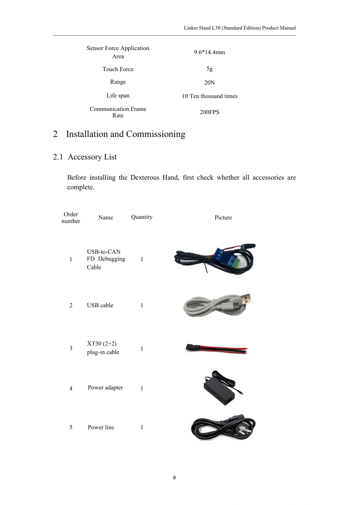

**Native-text transcript**

```
Linker Hand L30 (Standard Edition) Product Manual
8
Sensor Force Application
Area
9.6*14.4mm
Touch Force
5g
Range
20N
Life span
10 Ten thousand times
Communication Frame
Rate
200FPS
2
Installation and Commissioning
2.1 Accessory List
Before installing the Dexterous Hand, first check whether all accessories are
complete.
Order
number
Name
Quantity
Picture
1
USB-to-CAN
FD Debugging
Cable
1
2
USB cable
1
3
XT30 (2+2)
plug-in cable
1
4
Power adapter
1
5
Power line
1
```

## PDF page 12

**M4 end flange** · original PDF page 12 of 17.

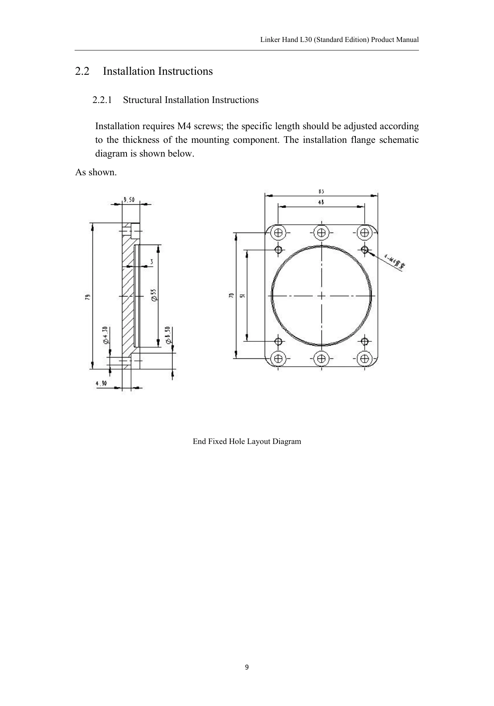

**Native-text transcript**

```
Linker Hand L30 (Standard Edition) Product Manual
9
2.2
Installation Instructions
2.2.1
Structural Installation Instructions
Installation requires M4 screws; the specific length should be adjusted according
to the thickness of the mounting component. The installation flange schematic
diagram is shown below.
As shown.
End Fixed Hole Layout Diagram
```

## PDF page 13

**Mounting seat and XT30 connector** · original PDF page 13 of 17.

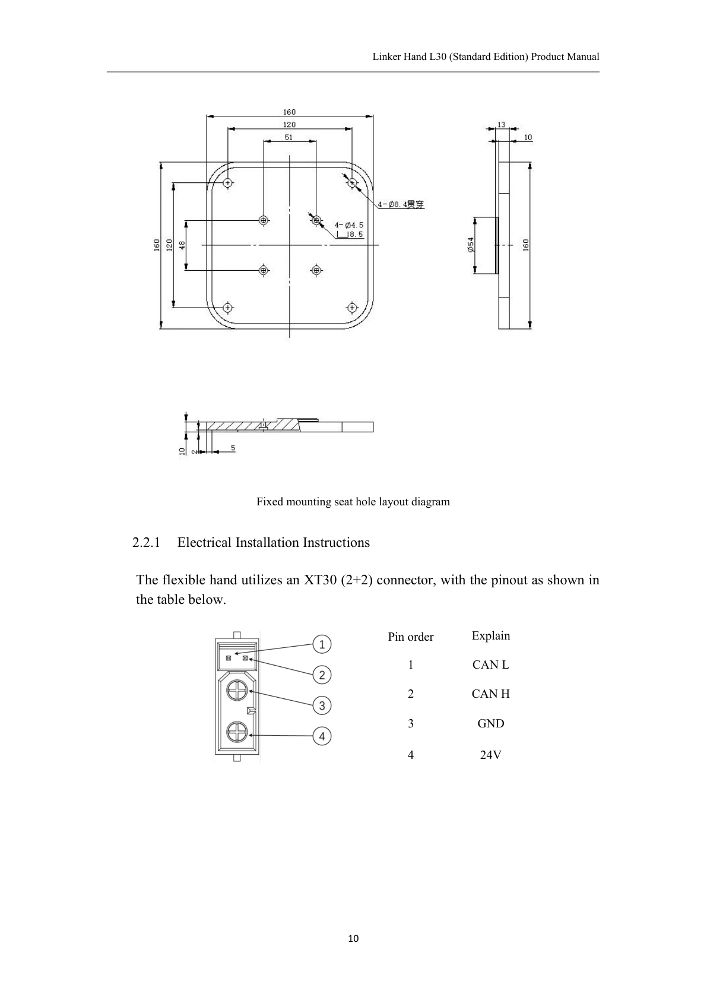

**Native-text transcript**

```
Linker Hand L30 (Standard Edition) Product Manual
10
Fixed mounting seat hole layout diagram
2.2.1
Electrical Installation Instructions
The flexible hand utilizes an XT30 (2+2) connector, with the pinout as shown in
the table below.
Pin order
Explain
1
CAN L
2
CAN H
3
GND
4
24V
```

## PDF page 14

**Host connection and controller software** · original PDF page 14 of 17.

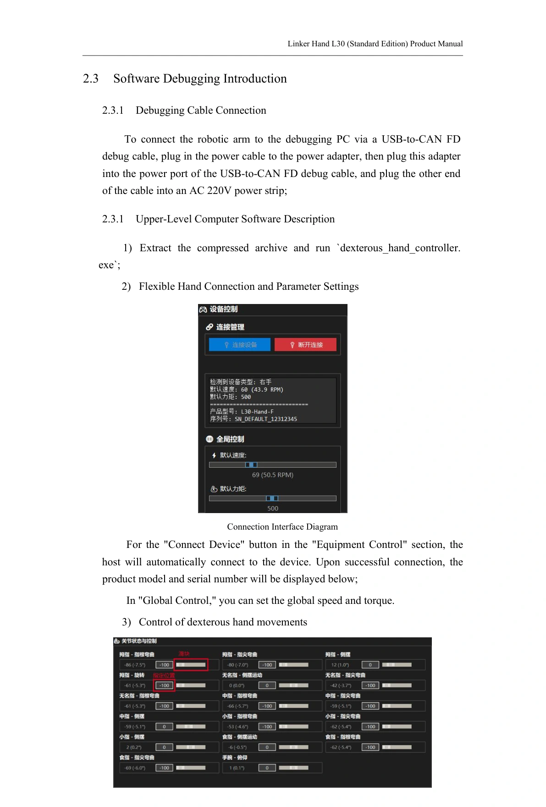

**Native-text transcript**

```
Linker Hand L30 (Standard Edition) Product Manual
2.3
Software Debugging Introduction
2.3.1
Debugging Cable Connection
To connect the robotic arm to the debugging PC via a USB-to-CAN FD
debug cable, plug in the power cable to the power adapter, then plug this adapter
into the power port of the USB-to-CAN FD debug cable, and plug the other end
of the cable into an AC 220V power strip;
2.3.1
Upper-Level Computer Software Description
1) Extract the compressed archive and run `dexterous_hand_controller.
exe`;
2) Flexible Hand Connection and Parameter Settings
Connection Interface Diagram
For the "Connect Device" button in the "Equipment Control" section, the
host will automatically connect to the device. Upon successful connection, the
product model and serial number will be displayed below;
In "Global Control," you can set the global speed and torque.
3) Control of dexterous hand movements
```

## PDF page 15

**Joint controls and sequence editor** · original PDF page 15 of 17.

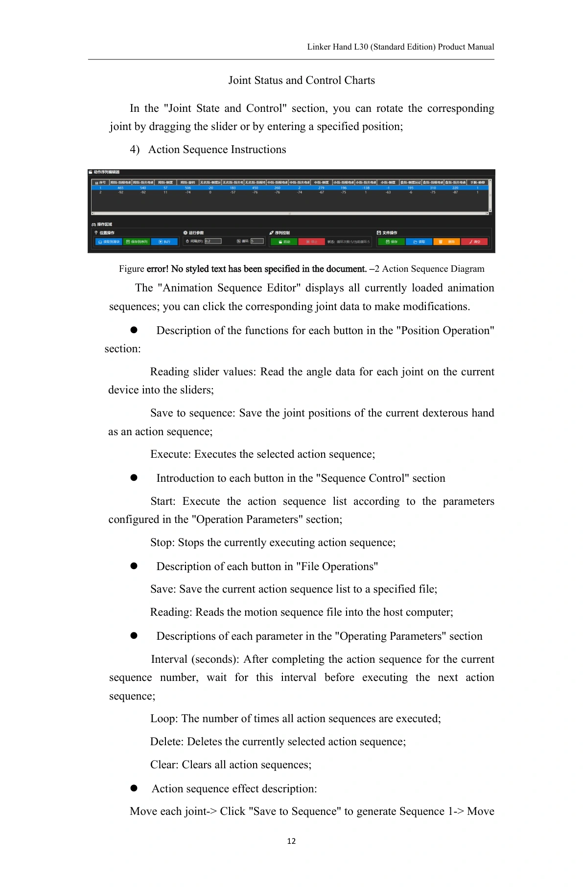

**Native-text transcript**

```
Linker Hand L30 (Standard Edition) Product Manual
12
Joint Status and Control Charts
In the "Joint State and Control" section, you can rotate the corresponding
joint by dragging the slider or by entering a specified position;
4) Action Sequence Instructions
Figure error! No styled text has been specified in the document. –2 Action Sequence Diagram
The "Animation Sequence Editor" displays all currently loaded animation
sequences; you can click the corresponding joint data to make modifications.

Description of the functions for each button in the "Position Operation"
section:
Reading slider values: Read the angle data for each joint on the current
device into the sliders;
Save to sequence: Save the joint positions of the current dexterous hand
as an action sequence;
Execute: Executes the selected action sequence;

Introduction to each button in the "Sequence Control" section
Start: Execute the action sequence list according to the parameters
configured in the "Operation Parameters" section;
Stop: Stops the currently executing action sequence;

Description of each button in "File Operations"
Save: Save the current action sequence list to a specified file;
Reading: Reads the motion sequence file into the host computer;

Descriptions of each parameter in the "Operating Parameters" section
Interval (seconds): After completing the action sequence for the current
sequence number, wait for this interval before executing the next action
sequence;
Loop: The number of times all action sequences are executed;
Delete: Deletes the currently selected action sequence;
Clear: Clears all action sequences;

Action sequence effect description:
Move each joint-> Click "Save to Sequence" to generate Sequence 1-> Move
```

## PDF page 16

**Sequence continuation and service** · original PDF page 16 of 17.

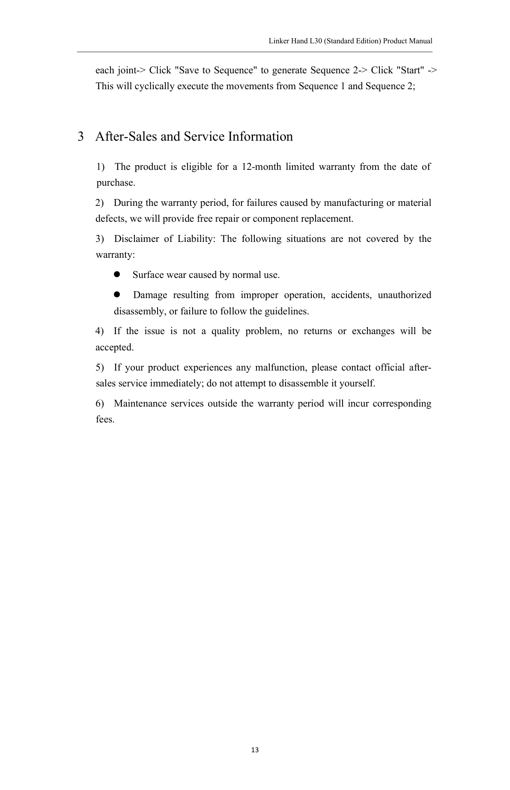

**Native-text transcript**

```
Linker Hand L30 (Standard Edition) Product Manual
13
3 After-Sales and Service Information
1)
The product is eligible for a 12-month limited warranty from the date of
purchase.
2)
During the warranty period, for failures caused by manufacturing or material
defects, we will provide free repair or component replacement.
3)
Disclaimer of Liability: The following situations are not covered by the
warranty:

Surface wear caused by normal use.

Damage resulting from improper operation, accidents, unauthorized
disassembly, or failure to follow the guidelines.
4)
If the issue is not a quality problem, no returns or exchanges will be
accepted.
5)
If your product experiences any malfunction, please contact official after-
sales service immediately; do not attempt to disassemble it yourself.
6)
Maintenance services outside the warranty period will incur corresponding
fees.
each joint-> Click "Save to Sequence" to generate Sequence 2-> Click "Start" ->
This will cyclically execute the movements from Sequence 1 and Sequence 2;
```

## PDF page 17

**SDK and support** · original PDF page 17 of 17.


**Native-text transcript**

```
Linker Hand L30 (Standard Edition) Product Manual
Appendix
https://github.com/linker-bot/linkerhand-ros-sd
SDK download URL:
k
support@linkerbot.c
Technical Support Email:
n
If you need more product information, please visit our official website:https://
linkerbot.cn
```

[Original PDF external link](https://linkerbot.cn)
