# L6 — Complete Manufacturer Manual

Complete supplied manufacturer reference for **LINKERBOT L6**, **V1.4 · 2026-05-18**. All **15 original PDF pages** appear below with their diagrams and native-text transcripts.

[Canonical L6 engineering guide](../linker-hand-l6-product-manual.md) · [Complete manual library](./)


Match model, side, connector and hardware/firmware revision before using any procedure. The canonical guide identifies source conflicts and commissioning limits. Manufacturer maximum-load claims are not a host arm payload or a safe suspended-load rating. Calibration, sliders, zero/reset and sequence execution can move the fingers.


## Original PDF reading parts

These downloads retain the original PDF page contents. Read the parts in order; the range labels use original PDF page numbers.

* [Download original PDF pages 1–5](../../../.gitbook/assets/linkerbot-l6-manual-pages-001-005.pdf)
* [Download original PDF pages 6–15](../../../.gitbook/assets/linkerbot-l6-manual-pages-006-015.pdf)

## Page and chapter index

| Original PDF page                | Content                               |
| -------------------------------- | ------------------------------------- |
| [1](complete-l6.md#pdf-page-1)   | Cover                                 |
| [2](complete-l6.md#pdf-page-2)   | Revision history                      |
| [3](complete-l6.md#pdf-page-3)   | Contents                              |
| [4](complete-l6.md#pdf-page-4)   | Overview and product views            |
| [5](complete-l6.md#pdf-page-5)   | Status indicator and dimensions       |
| [6](complete-l6.md#pdf-page-6)   | Dimensions, features and colors       |
| [7](complete-l6.md#pdf-page-7)   | Joint configuration                   |
| [8](complete-l6.md#pdf-page-8)   | Joint and four-finger diagrams        |
| [9](complete-l6.md#pdf-page-9)   | Thumb motion and performance table    |
| [10](complete-l6.md#pdf-page-10) | Electrical and force specifications   |
| [11](complete-l6.md#pdf-page-11) | Control functions and tactile sensor  |
| [12](complete-l6.md#pdf-page-12) | Tactile scale, accessories and flange |
| [13](complete-l6.md#pdf-page-13) | Connector, storage and service        |
| [14](complete-l6.md#pdf-page-14) | Service continuation                  |
| [15](complete-l6.md#pdf-page-15) | SDK and manufacturer support          |

## Source and interpretation

Source: LINKERBOT / Lingxin Qiaoshou (Beijing) Technology Co., Ltd., supplied **Linker Hand L6 Product Manual.pdf**. The internal revision history, rather than the filename, identifies this edition. Page images are authoritative for spatial layout and symbols; transcripts are the native PDF text, including translation quirks and original inconsistencies. Numerical ranges and motion limits must be checked against the actual controller and unit. The original SDK appendix is retained; current development guidance is in the linked model guide.

## PDF page 1

**Cover** · original PDF page 1 of 15.


**Native-text transcript**

```
L6 Left Hand Product
Manual
Lingxin Qiaoshou (Beijing) Technol-
ogy Co., Ltd.
```

## PDF page 2

**Revision history** · original PDF page 2 of 15.

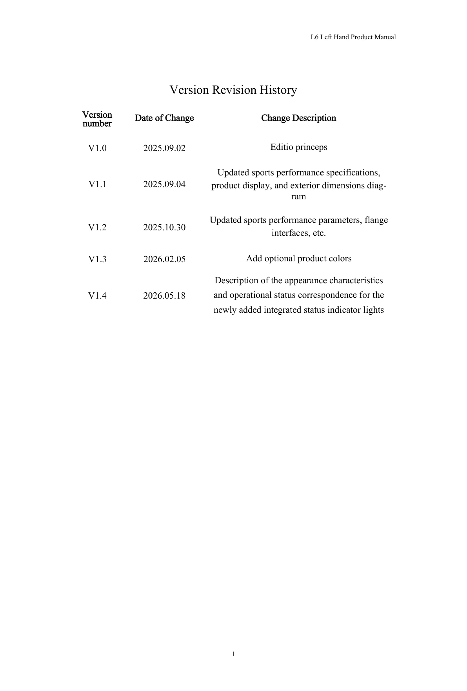

**Native-text transcript**

```
L6 Left Hand Product Manual
I
Version Revision History
Version
number
Date of Change
Change Description
V1.0
2025.09.02
Editio princeps
V1.1
2025.09.04
Updated sports performance specifications,
product display, and exterior dimensions diag-
ram
V1.2
2025.10.30
Updated sports performance parameters, flange
interfaces, etc.
V1.3
2026.02.05
Add optional product colors
V1.4
2026.05.18
Description of the appearance characteristics
and operational status correspondence for the
newly added integrated status indicator lights
```

## PDF page 3

**Contents** · original PDF page 3 of 15.

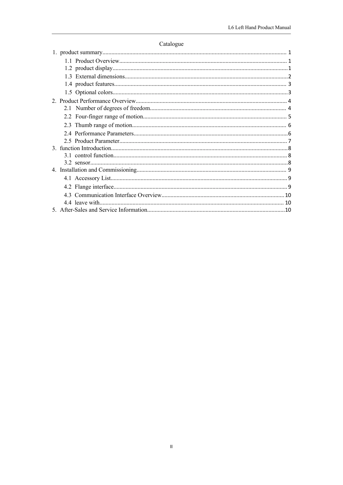

**Native-text transcript**

```
L6 Left Hand Product Manual
II
Catalogue
1. product summary........................................................................................................................... 1
1.1 Product Overview................................................................................................................ 1
1.2 product display.....................................................................................................................1
1.3 External dimensions.............................................................................................................2
1.4 product features................................................................................................................... 3
1.5 Optional colors.....................................................................................................................3
2. Product Performance Overview..................................................................................................... 4
2.1 Number of degrees of freedom........................................................................................... 4
2.2 Four-finger range of motion................................................................................................ 5
2.3 Thumb range of motion....................................................................................................... 6
2.4 Performance Parameters.......................................................................................................6
2.5 Product Parameter................................................................................................................ 7
3. function Introduction......................................................................................................................8
3.1 control function.................................................................................................................... 8
3.2 sensor....................................................................................................................................8
4. Installation and Commissioning.................................................................................................... 9
4.1 Accessory List......................................................................................................................9
4.2 Flange interface....................................................................................................................9
4.3 Communication Interface Overview..................................................................................10
4.4 leave with........................................................................................................................... 10
5. After-Sales and Service Information............................................................................................10
```

## PDF page 4

**Overview and product views** · original PDF page 4 of 15.

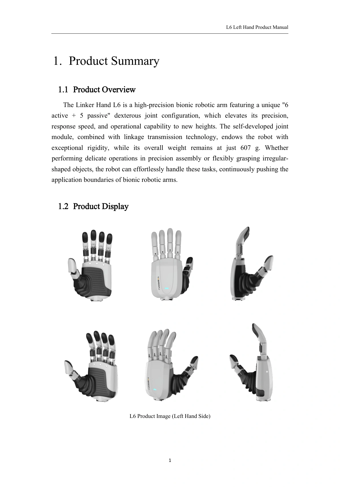

**Native-text transcript**

```
L6 Left Hand Product Manual
1
1. Product Summary
1.1 Product Overview
The Linker Hand L6 is a high-precision bionic robotic arm featuring a unique "6
active + 5 passive" dexterous joint configuration, which elevates its precision,
response speed, and operational capability to new heights. The self-developed joint
module, combined with linkage transmission technology, endows the robot with
exceptional rigidity, while its overall weight remains at just 607 g. Whether
performing delicate operations in precision assembly or flexibly grasping irregular-
shaped objects, the robot can effortlessly handle these tasks, continuously pushing the
application boundaries of bionic robotic arms.
1.2 Product Display
L6 Product Image (Left Hand Side)
```

## PDF page 5

**Status indicator and dimensions** · original PDF page 5 of 15.

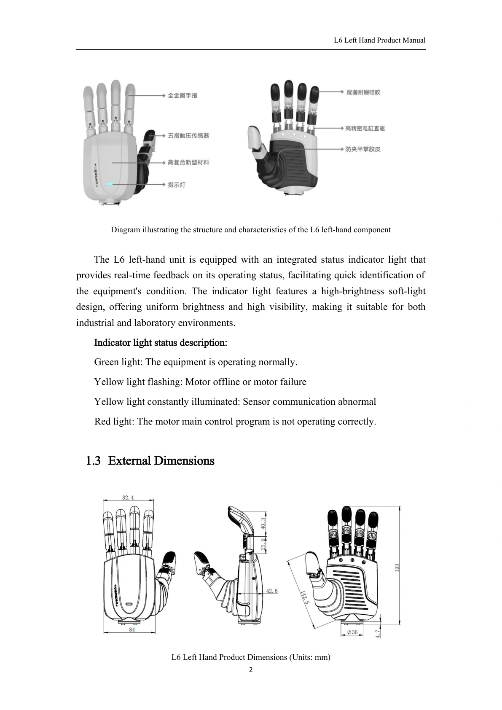

**Native-text transcript**

```
L6 Left Hand Product Manual
2
Diagram illustrating the structure and characteristics of the L6 left-hand component
The L6 left-hand unit is equipped with an integrated status indicator light that
provides real-time feedback on its operating status, facilitating quick identification of
the equipment's condition. The indicator light features a high-brightness soft-light
design, offering uniform brightness and high visibility, making it suitable for both
industrial and laboratory environments.
Indicator light status description:
Green light: The equipment is operating normally.
Yellow light flashing: Motor offline or motor failure
Yellow light constantly illuminated: Sensor communication abnormal
Red light: The motor main control program is not operating correctly.
1.3 External Dimensions
L6 Left Hand Product Dimensions (Units: mm)
```

## PDF page 6

**Dimensions, features and colors** · original PDF page 6 of 15.

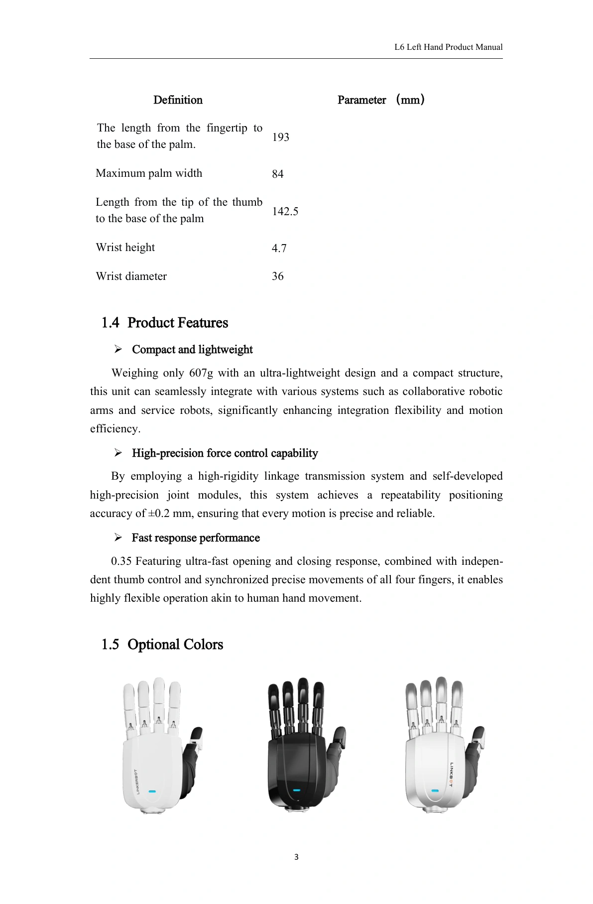

**Native-text transcript**

```
L6 Left Hand Product Manual
3
Definition
Parameter （mm）
The length from the fingertip to
the base of the palm.
193
Maximum palm width
84
Length from the tip of the thumb
to the base of the palm
142.5
Wrist height
4.7
Wrist diameter
36
1.4 Product Features
Compact and lightweight
Weighing only 607g with an ultra-lightweight design and a compact structure,
this unit can seamlessly integrate with various systems such as collaborative robotic
arms and service robots, significantly enhancing integration flexibility and motion
efficiency.
High-precision force control capability
By employing a high-rigidity linkage transmission system and self-developed
high-precision joint modules, this system achieves a repeatability positioning
accuracy of ±0.2 mm, ensuring that every motion is precise and reliable.
Fast response performance
0.35 Featuring ultra-fast opening and closing response, combined with indepen-
dent thumb control and synchronized precise movements of all four fingers, it enables
highly flexible operation akin to human hand movement.
1.5 Optional Colors
```

## PDF page 7

**Joint configuration** · original PDF page 7 of 15.

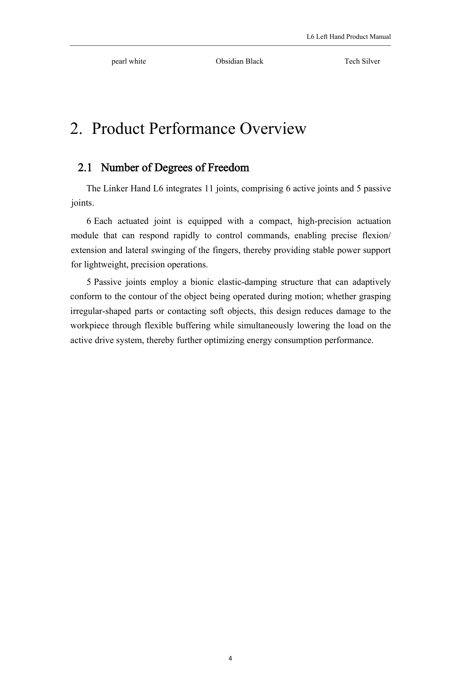

**Native-text transcript**

```
L6 Left Hand Product Manual
4
pearl white
Obsidian Black
Tech Silver
2. Product Performance Overview
2.1 Number of Degrees of Freedom
The Linker Hand L6 integrates 11 joints, comprising 6 active joints and 5 passive
joints.
6 Each actuated joint is equipped with a compact, high-precision actuation
module that can respond rapidly to control commands, enabling precise flexion/
extension and lateral swinging of the fingers, thereby providing stable power support
for lightweight, precision operations.
5 Passive joints employ a bionic elastic-damping structure that can adaptively
conform to the contour of the object being operated during motion; whether grasping
irregular-shaped parts or contacting soft objects, this design reduces damage to the
workpiece through flexible buffering while simultaneously lowering the load on the
active drive system, thereby further optimizing energy consumption performance.
```

## PDF page 8

**Joint and four-finger diagrams** · original PDF page 8 of 15.

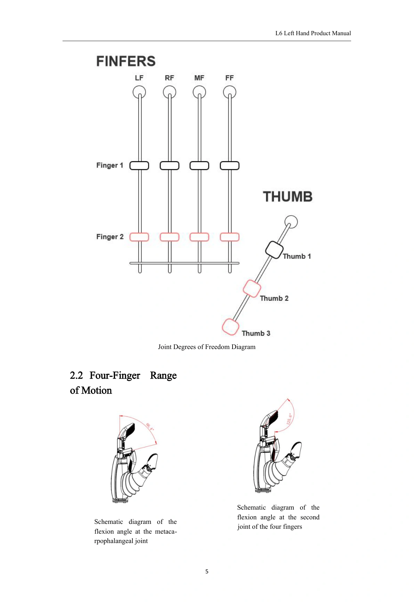

**Native-text transcript**

```
L6 Left Hand Product Manual
5
Joint Degrees of Freedom Diagram
2.2 Four-Finger
Range
of Motion
Schematic
diagram
of
the
flexion angle at the metaca-
rpophalangeal joint
Schematic
diagram
of
the
flexion angle at the second
joint of the four fingers
```

## PDF page 9

**Thumb motion and performance table** · original PDF page 9 of 15.

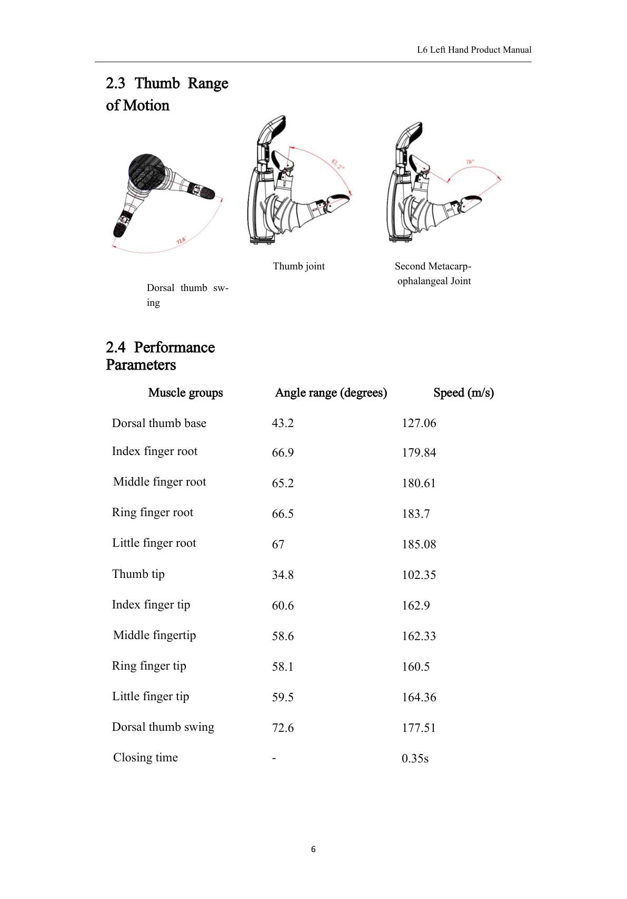

**Native-text transcript**

```
L6 Left Hand Product Manual
6
2.3 Thumb Range
of Motion
Dorsal thumb sw-
ing
Thumb joint
Second Metacarp-
ophalangeal Joint
2.4 Performance
Parameters
Muscle groups
Angle range (degrees)
Speed (m/s)
Dorsal thumb base
43.2
127.06
Index finger root
66.9
179.84
Middle finger root
65.2
180.61
Ring finger root
66.5
183.7
Little finger root
67
185.08
Thumb tip
34.8
102.35
Index finger tip
60.6
162.9
Middle fingertip
58.6
162.33
Ring finger tip
58.1
160.5
Little finger tip
59.5
164.36
Dorsal thumb swing
72.6
177.51
Closing time
-
0.35s
```

## PDF page 10

**Electrical and force specifications** · original PDF page 10 of 15.

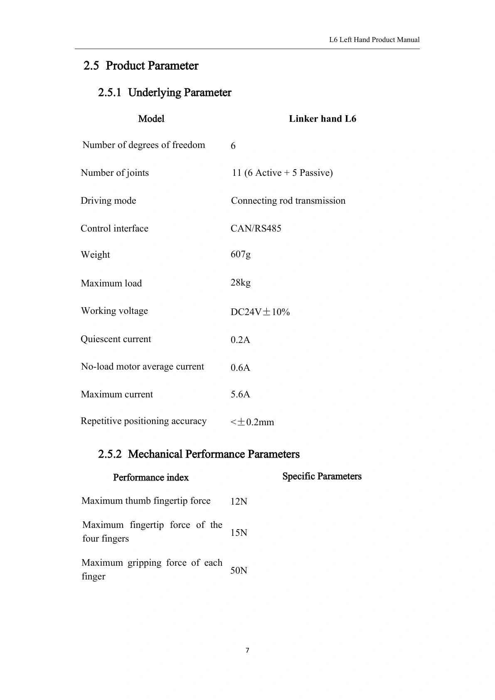

**Native-text transcript**

```
L6 Left Hand Product Manual
7
2.5 Product Parameter
2.5.1 Underlying Parameter
Model
Linker hand L6
Number of degrees of freedom
6
Number of joints
11 (6 Active + 5 Passive)
Driving mode
Connecting rod transmission
Control interface
CAN/RS485
Weight
607g
Maximum load
28kg
Working voltage
DC24V±10%
Quiescent current
0.2A
No-load motor average current
0.6A
Maximum current
5.6A
Repetitive positioning accuracy
<±0.2mm
2.5.2 Mechanical Performance Parameters
Performance index
Specific Parameters
Maximum thumb fingertip force
12N
Maximum fingertip force of the
four fingers
15N
Maximum gripping force of each
finger
50N
```

## PDF page 11

**Control functions and tactile sensor** · original PDF page 11 of 15.

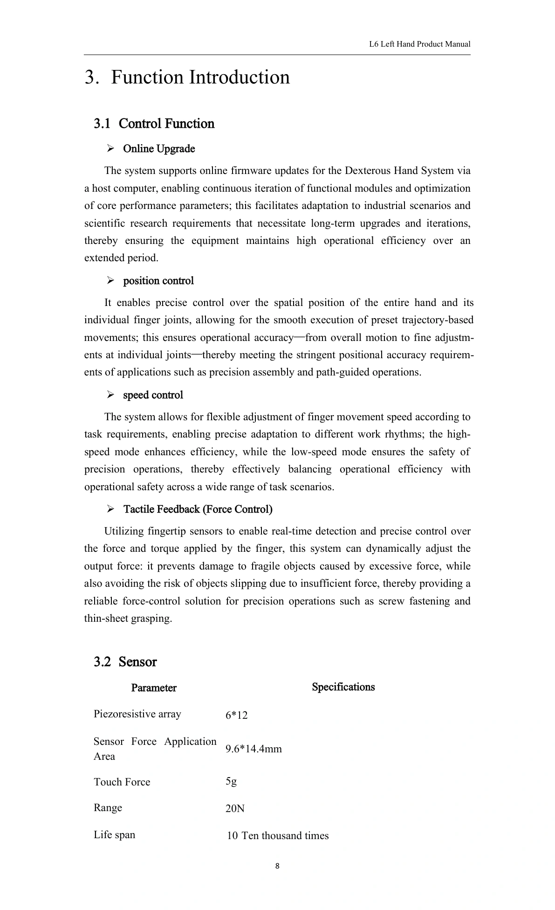

**Native-text transcript**

```
L6 Left Hand Product Manual
8
3. Function Introduction
3.1 Control Function
Online Upgrade
The system supports online firmware updates for the Dexterous Hand System via
a host computer, enabling continuous iteration of functional modules and optimization
of core performance parameters; this facilitates adaptation to industrial scenarios and
scientific research requirements that necessitate long-term upgrades and iterations,
thereby ensuring the equipment maintains high operational efficiency over an
extended period.
position control
It enables precise control over the spatial position of the entire hand and its
individual finger joints, allowing for the smooth execution of preset trajectory-based
movements; this ensures operational accuracy—from overall motion to fine adjustm-
ents at individual joints—thereby meeting the stringent positional accuracy requirem-
ents of applications such as precision assembly and path-guided operations.
speed control
The system allows for flexible adjustment of finger movement speed according to
task requirements, enabling precise adaptation to different work rhythms; the high-
speed mode enhances efficiency, while the low-speed mode ensures the safety of
precision operations, thereby effectively balancing operational efficiency with
operational safety across a wide range of task scenarios.
Tactile Feedback (Force Control)
Utilizing fingertip sensors to enable real-time detection and precise control over
the force and torque applied by the finger, this system can dynamically adjust the
output force: it prevents damage to fragile objects caused by excessive force, while
also avoiding the risk of objects slipping due to insufficient force, thereby providing a
reliable force-control solution for precision operations such as screw fastening and
thin-sheet grasping.
3.2 Sensor
Parameter
Specifications
Piezoresistive array
6*12
Sensor Force Application
Area
9.6*14.4mm
Touch Force
5g
Range
20N
Life span
10 Ten thousand times
```

## PDF page 12

**Tactile scale, accessories and flange** · original PDF page 12 of 15.

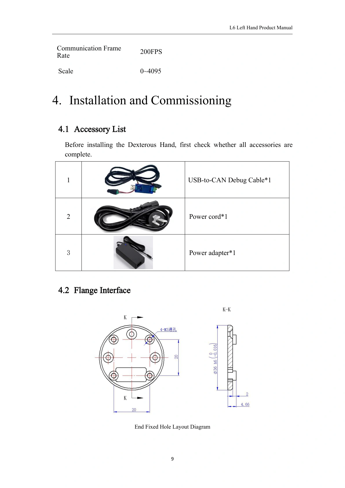

**Native-text transcript**

```
L6 Left Hand Product Manual
9
Communication Frame
Rate
200FPS
Scale
0~4095
4. Installation and Commissioning
4.1 Accessory List
Before installing the Dexterous Hand, first check whether all accessories are
complete.
1
USB-to-CAN Debug Cable*1
2
Power cord*1
3
Power adapter*1
4.2 Flange Interface
End Fixed Hole Layout Diagram
```

## PDF page 13

**Connector, storage and service** · original PDF page 13 of 15.

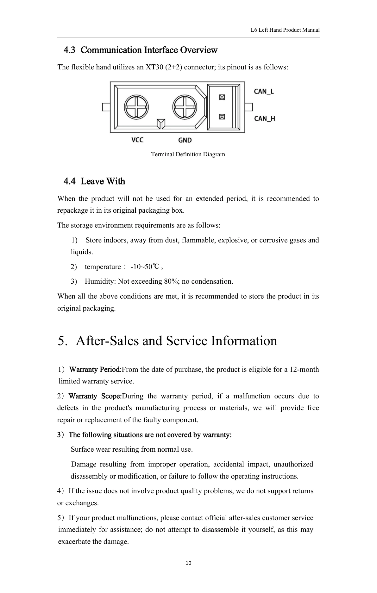

**Native-text transcript**

```
L6 Left Hand Product Manual
10
4.3 Communication Interface Overview
The flexible hand utilizes an XT30 (2+2) connector; its pinout is as follows:
Terminal Definition Diagram
4.4 Leave With
When the product will not be used for an extended period, it is recommended to
repackage it in its original packaging box.
The storage environment requirements are as follows:
1)
Store indoors, away from dust, flammable, explosive, or corrosive gases and
liquids.
2)
temperature ：-10~50℃。
3)
Humidity: Not exceeding 80%; no condensation.
When all the above conditions are met, it is recommended to store the product in its
original packaging.
5. After-Sales and Service Information
1）Warranty Period:From the date of purchase, the product is eligible for a 12-month
limited warranty service.
2）Warranty Scope:During the warranty period, if a malfunction occurs due to
defects in the product's manufacturing process or materials, we will provide free
repair or replacement of the faulty component.
3）The following situations are not covered by warranty:
Surface wear resulting from normal use.
Damage resulting from improper operation, accidental impact, unauthorized
disassembly or modification, or failure to follow the operating instructions.
4）If the issue does not involve product quality problems, we do not support returns
or exchanges.
5）If your product malfunctions, please contact official after-sales customer service
immediately for assistance; do not attempt to disassemble it yourself, as this may
exacerbate the damage.
```

## PDF page 14

**Service continuation** · original PDF page 14 of 15.


**Native-text transcript**

```
L6 Left Hand Product Manual
11
6）For Repair Services Provided After the Warranty Period Has Expired, Correspo-
nding Fees Will Be Charged Based on the Actual Repair Requirements.
```

## PDF page 15

**SDK and manufacturer support** · original PDF page 15 of 15.


**Native-text transcript**

```
L6 Left Hand Product Manual
Appendix
ROS_SDK:
https://github.com/linker-bot/linkerhand-ros-sdk
ROS2_SDK:
https://github.com/linker-bot/linkerhand-ros2-sdk
Python_SDK:
https://github.com/linker-bot/linkerhand-python-sdk
Technical Support Email:support@linkerbot.cn
If you require additional product information, please visit our
official website:https://linkerbot.cn
```

[Original PDF external link](mailto:support@linkerbot.cn)
