# O20 — Complete Manufacturer Manual

Complete supplied manufacturer reference for **LINKERBOT O20**, **V1.2 · 2026-06-05**. All **30 original PDF pages** appear below with their diagrams and native-text transcripts.

[Canonical O20 engineering guide](../linker-hand-o20-development-guide.md) · [Complete manual library](./)


Match model, side, connector and hardware/firmware revision before using any procedure. The canonical guide identifies source conflicts and commissioning limits. Manufacturer maximum-load claims are not a host arm payload or a safe suspended-load rating. Calibration, sliders, zero/reset and sequence execution can move the fingers.


## Original PDF reading parts

These downloads retain the original PDF page contents. Read the parts in order; the range labels use original PDF page numbers.

* [Download original PDF pages 1–7](../../../.gitbook/assets/linkerbot-o20-manual-pages-001-007.pdf)
* [Download original PDF pages 8–9](../../../.gitbook/assets/linkerbot-o20-manual-pages-008-009.pdf)
* [Download original PDF pages 10–14](../../../.gitbook/assets/linkerbot-o20-manual-pages-010-014.pdf)
* [Download original PDF pages 15–17](../../../.gitbook/assets/linkerbot-o20-manual-pages-015-017.pdf)
* [Download original PDF pages 18–19](../../../.gitbook/assets/linkerbot-o20-manual-pages-018-019.pdf)
* [Download original PDF pages 20–21](../../../.gitbook/assets/linkerbot-o20-manual-pages-020-021.pdf)
* [Download original PDF pages 22–25](../../../.gitbook/assets/linkerbot-o20-manual-pages-022-025.pdf)
* [Download original PDF pages 26–28](../../../.gitbook/assets/linkerbot-o20-manual-pages-026-028.pdf)
* [Download original PDF pages 29–30](../../../.gitbook/assets/linkerbot-o20-manual-pages-029-030.pdf)

## Page and chapter index

| Original PDF page                 | Content                                                   |
| --------------------------------- | --------------------------------------------------------- |
| [1](complete-o20.md#pdf-page-1)   | Cover                                                     |
| [2](complete-o20.md#pdf-page-2)   | Revision history                                          |
| [3](complete-o20.md#pdf-page-3)   | Safety instructions                                       |
| [4](complete-o20.md#pdf-page-4)   | Contents                                                  |
| [5](complete-o20.md#pdf-page-5)   | Overview and rated-load claim                             |
| [6](complete-o20.md#pdf-page-6)   | Control functions                                         |
| [7](complete-o20.md#pdf-page-7)   | Dimensions and joint configuration                        |
| [8](complete-o20.md#pdf-page-8)   | Joint motion diagrams                                     |
| [9](complete-o20.md#pdf-page-9)   | Joint range diagrams                                      |
| [10](complete-o20.md#pdf-page-10) | Actual joint ranges and speeds                            |
| [11](complete-o20.md#pdf-page-11) | Electrical, force and maximum-load table                  |
| [12](complete-o20.md#pdf-page-12) | Tactile specifications and accessories                    |
| [13](complete-o20.md#pdf-page-13) | M3 flange and unique connector                            |
| [14](complete-o20.md#pdf-page-14) | Connector pin diagram, CAN-FD setup and 020\_hand\_ui.exe |
| [15](complete-o20.md#pdf-page-15) | Curve windows and temperature                             |
| [16](complete-o20.md#pdf-page-16) | Position and current curves                               |
| [17](complete-o20.md#pdf-page-17) | Pressure and control windows                              |
| [18](complete-o20.md#pdf-page-18) | Parameter window                                          |
| [19](complete-o20.md#pdf-page-19) | CAN connection confirmation                               |
| [20](complete-o20.md#pdf-page-20) | Slider inputs and version fields                          |
| [21](complete-o20.md#pdf-page-21) | Version query and CAN controls                            |
| [22](complete-o20.md#pdf-page-22) | Eleven button functions                                   |
| [23](complete-o20.md#pdf-page-23) | 18-column motion table                                    |
| [24](complete-o20.md#pdf-page-24) | Table/loop/finger-dance controls                          |
| [25](complete-o20.md#pdf-page-25) | Curve data queries                                        |
| [26](complete-o20.md#pdf-page-26) | Actual versus commanded position and settings             |
| [27](complete-o20.md#pdf-page-27) | Deviation, overcurrent, calibration and language          |
| [28](complete-o20.md#pdf-page-28) | Warranty and service                                      |
| [29](complete-o20.md#pdf-page-29) | Warranty continuation                                     |
| [30](complete-o20.md#pdf-page-30) | SDK and support                                           |

## Source and interpretation

Source: LINKERBOT / Lingxin Qiaoshou (Beijing) Technology Co., Ltd., supplied **Linker Hand O20 V10 Product Manual.pdf**. The internal revision history, rather than the filename, identifies this edition. Page images are authoritative for spatial layout and symbols; transcripts are the native PDF text, including translation quirks and original inconsistencies. Numerical ranges and motion limits must be checked against the actual controller and unit. The original SDK appendix is retained; current development guidance is in the linked model guide.

## PDF page 1

**Cover** · original PDF page 1 of 30.


**Native-text transcript**

```
Linker Hand O20
Product Manual
Lingxin Qiaoshou (Beijing) Technol-
ogy Co., Ltd.
```

## PDF page 2

**Revision history** · original PDF page 2 of 30.

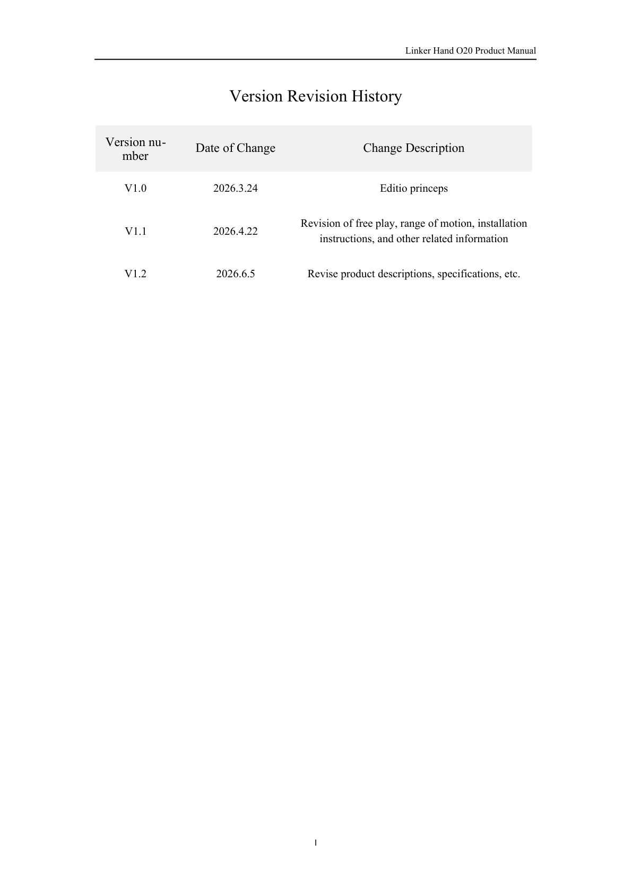

**Native-text transcript**

```
Linker Hand O20 Product Manual
I
Version Revision History
Version nu-
mber
Date of Change
Change Description
V1.0
2026.3.24
Editio princeps
V1.1
2026.4.22
Revision of free play, range of motion, installation
instructions, and other related information
V1.2
2026.6.5
Revise product descriptions, specifications, etc.
```

## PDF page 3

**Safety instructions** · original PDF page 3 of 30.

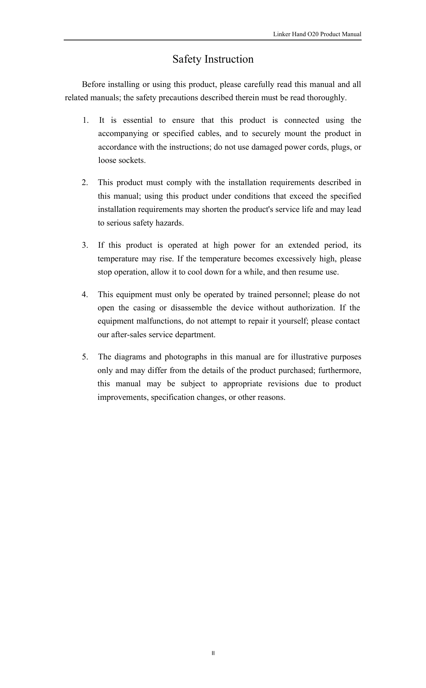

**Native-text transcript**

```
Linker Hand O20 Product Manual
II
Safety Instruction
Before installing or using this product, please carefully read this manual and all
related manuals; the safety precautions described therein must be read thoroughly.
1.
It is essential to ensure that this product is connected using the
accompanying or specified cables, and to securely mount the product in
accordance with the instructions; do not use damaged power cords, plugs, or
loose sockets.
2.
This product must comply with the installation requirements described in
this manual; using this product under conditions that exceed the specified
installation requirements may shorten the product's service life and may lead
to serious safety hazards.
3.
If this product is operated at high power for an extended period, its
temperature may rise. If the temperature becomes excessively high, please
stop operation, allow it to cool down for a while, and then resume use.
4.
This equipment must only be operated by trained personnel; please do not
open the casing or disassemble the device without authorization. If the
equipment malfunctions, do not attempt to repair it yourself; please contact
our after-sales service department.
5.
The diagrams and photographs in this manual are for illustrative purposes
only and may differ from the details of the product purchased; furthermore,
this manual may be subject to appropriate revisions due to product
improvements, specification changes, or other reasons.
```

## PDF page 4

**Contents** · original PDF page 4 of 30.

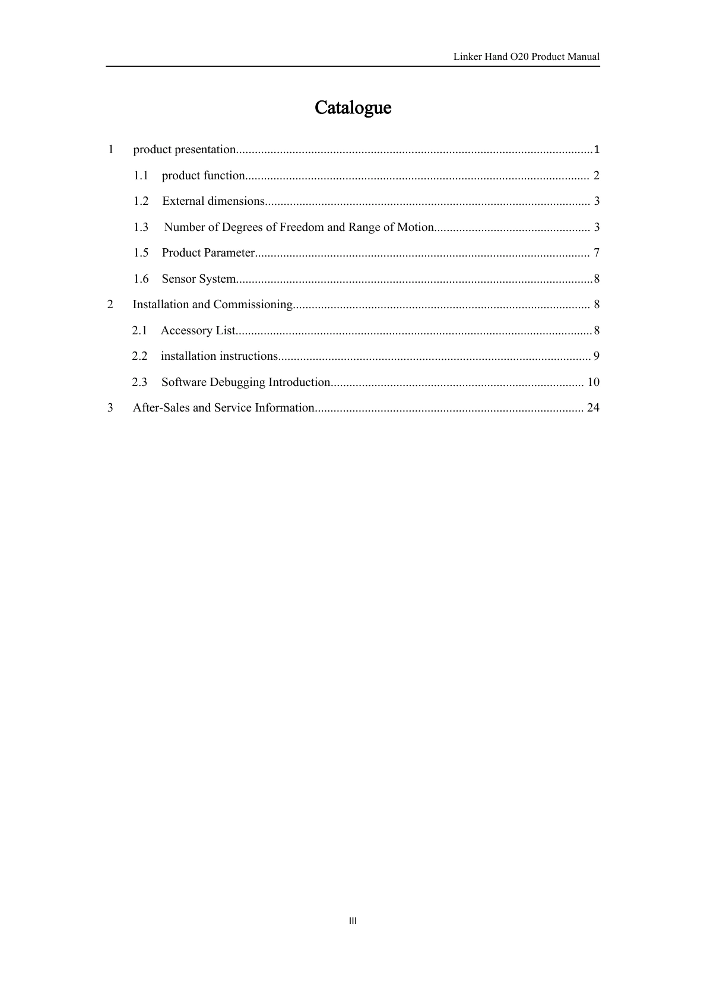

**Native-text transcript**

```
Linker Hand O20 Product Manual
III
Catalogue
1
product presentation..................................................................................................................1
1.1
product function.............................................................................................................. 2
1.2
External dimensions........................................................................................................ 3
1.3
Number of Degrees of Freedom and Range of Motion.................................................. 3
1.5
Product Parameter........................................................................................................... 7
1.6
Sensor System..................................................................................................................8
2
Installation and Commissioning............................................................................................... 8
2.1
Accessory List..................................................................................................................8
2.2
installation instructions.................................................................................................... 9
2.3
Software Debugging Introduction................................................................................. 10
3
After-Sales and Service Information...................................................................................... 24
```

## PDF page 5

**Overview and rated-load claim** · original PDF page 5 of 30.

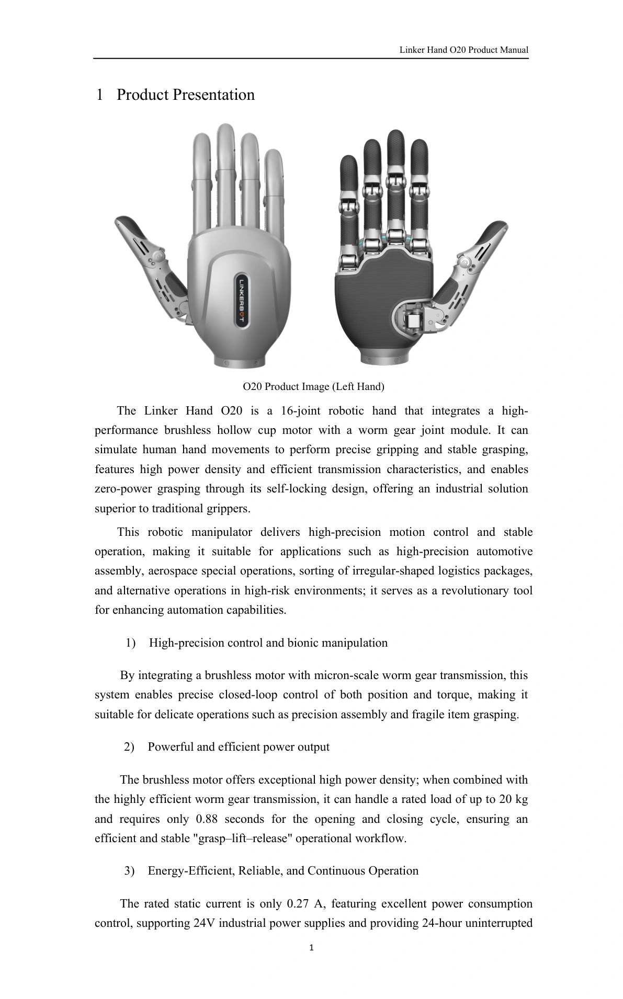

**Native-text transcript**

```
Linker Hand O20 Product Manual
1
1 Product Presentation
O20 Product Image (Left Hand)
The Linker Hand O20 is a 16-joint robotic hand that integrates a high-
performance brushless hollow cup motor with a worm gear joint module. It can
simulate human hand movements to perform precise gripping and stable grasping,
features high power density and efficient transmission characteristics, and enables
zero-power grasping through its self-locking design, offering an industrial solution
superior to traditional grippers.
This robotic manipulator delivers high-precision motion control and stable
operation, making it suitable for applications such as high-precision automotive
assembly, aerospace special operations, sorting of irregular-shaped logistics packages,
and alternative operations in high-risk environments; it serves as a revolutionary tool
for enhancing automation capabilities.
1)
High-precision control and bionic manipulation
By integrating a brushless motor with micron-scale worm gear transmission, this
system enables precise closed-loop control of both position and torque, making it
suitable for delicate operations such as precision assembly and fragile item grasping.
2)
Powerful and efficient power output
The brushless motor offers exceptional high power density; when combined with
the highly efficient worm gear transmission, it can handle a rated load of up to 20 kg
and requires only 0.88 seconds for the opening and closing cycle, ensuring an
efficient and stable "grasp–lift–release" operational workflow.
3)
Energy-Efficient, Reliable, and Continuous Operation
The rated static current is only 0.27 A, featuring excellent power consumption
control, supporting 24V industrial power supplies and providing 24-hour uninterrupted
```

## PDF page 6

**Control functions** · original PDF page 6 of 30.

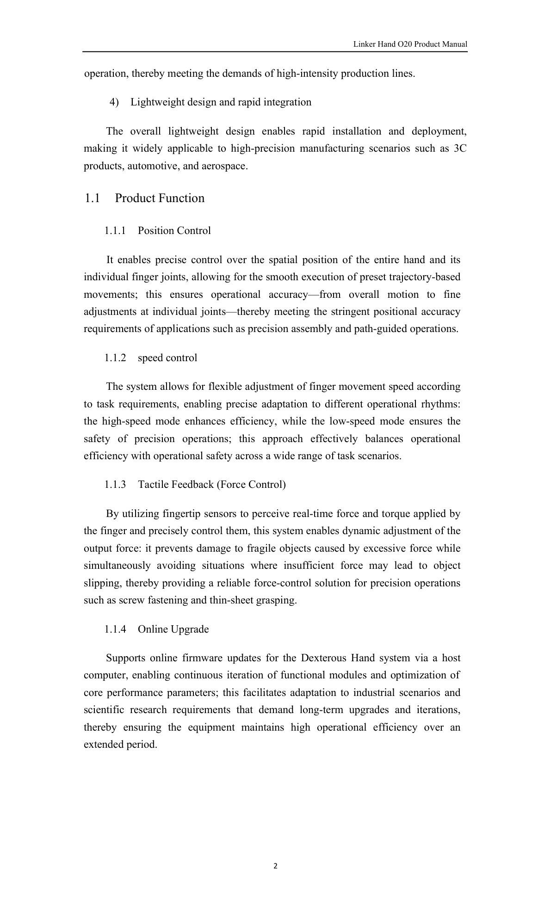

**Native-text transcript**

```
Linker Hand O20 Product Manual
2
4)
Lightweight design and rapid integration
The overall lightweight design enables rapid installation and deployment,
making it widely applicable to high-precision manufacturing scenarios such as 3C
products, automotive, and aerospace.
1.1
Product Function
1.1.1
Position Control
It enables precise control over the spatial position of the entire hand and its
individual finger joints, allowing for the smooth execution of preset trajectory-based
movements; this ensures operational accuracy—from overall motion to fine
adjustments at individual joints—thereby meeting the stringent positional accuracy
requirements of applications such as precision assembly and path-guided operations.
1.1.2
speed control
The system allows for flexible adjustment of finger movement speed according
to task requirements, enabling precise adaptation to different operational rhythms:
the high-speed mode enhances efficiency, while the low-speed mode ensures the
safety of precision operations; this approach effectively balances operational
efficiency with operational safety across a wide range of task scenarios.
1.1.3
Tactile Feedback (Force Control)
By utilizing fingertip sensors to perceive real-time force and torque applied by
the finger and precisely control them, this system enables dynamic adjustment of the
output force: it prevents damage to fragile objects caused by excessive force while
simultaneously avoiding situations where insufficient force may lead to object
slipping, thereby providing a reliable force-control solution for precision operations
such as screw fastening and thin-sheet grasping.
1.1.4
Online Upgrade
Supports online firmware updates for the Dexterous Hand system via a host
computer, enabling continuous iteration of functional modules and optimization of
core performance parameters; this facilitates adaptation to industrial scenarios and
scientific research requirements that demand long-term upgrades and iterations,
thereby ensuring the equipment maintains high operational efficiency over an
extended period.
operation, thereby meeting the demands of high-intensity production lines.
```

## PDF page 7

**Dimensions and joint configuration** · original PDF page 7 of 30.

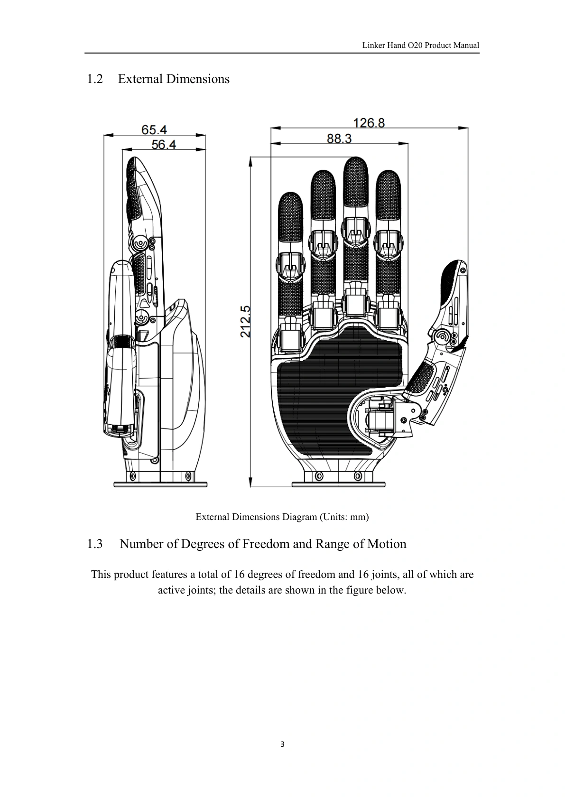

**Native-text transcript**

```
Linker Hand O20 Product Manual
3
1.2
External Dimensions
External Dimensions Diagram (Units: mm)
1.3
Number of Degrees of Freedom and Range of Motion
This product features a total of 16 degrees of freedom and 16 joints, all of which are
active joints; the details are shown in the figure below.
```

## PDF page 8

**Joint motion diagrams** · original PDF page 8 of 30.

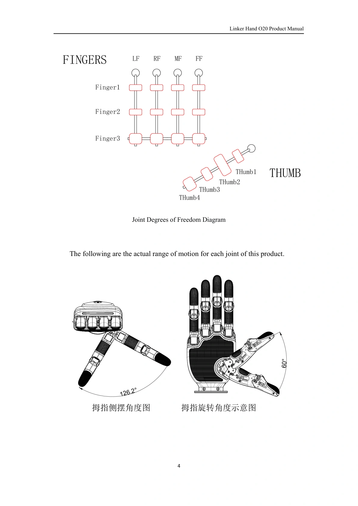

**Native-text transcript**

```
Linker Hand O20 Product Manual
4
Joint Degrees of Freedom Diagram
The following are the actual range of motion for each joint of this product.
```

## PDF page 9

**Joint range diagrams** · original PDF page 9 of 30.

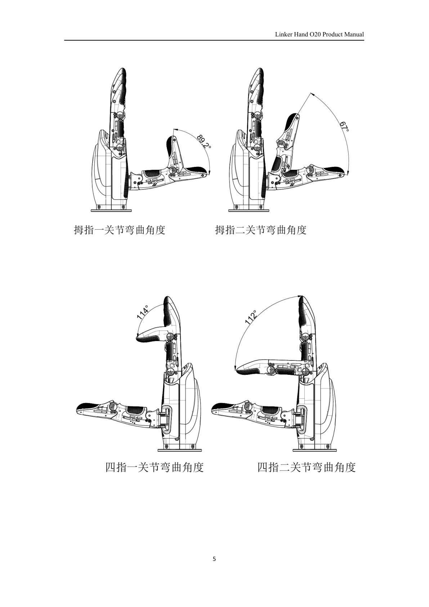

**Native-text transcript**

```
Linker Hand O20 Product Manual
5
```

## PDF page 10

**Actual joint ranges and speeds** · original PDF page 10 of 30.

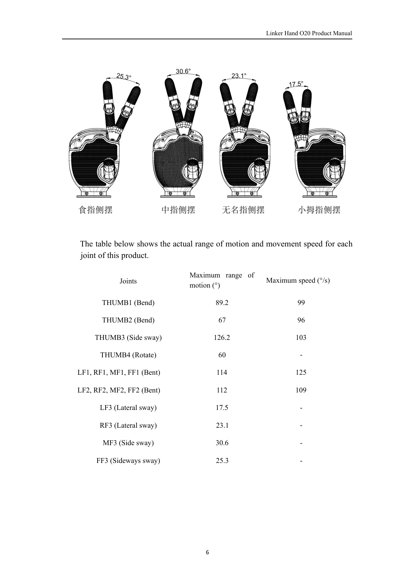

**Native-text transcript**

```
Linker Hand O20 Product Manual
6
The table below shows the actual range of motion and movement speed for each
joint of this product.
Joints
Maximum range of
motion (°)
Maximum speed (°/s)
THUMB1 (Bend)
89.2
99
THUMB2 (Bend)
67
96
THUMB3 (Side sway)
126.2
103
THUMB4 (Rotate)
60
-
LF1, RF1, MF1, FF1 (Bent)
114
125
LF2, RF2, MF2, FF2 (Bent)
112
109
LF3 (Lateral sway)
17.5
-
RF3 (Lateral sway)
23.1
-
MF3 (Side sway)
30.6
-
FF3 (Sideways sway)
25.3
-
```

## PDF page 11

**Electrical, force and maximum-load table** · original PDF page 11 of 30.

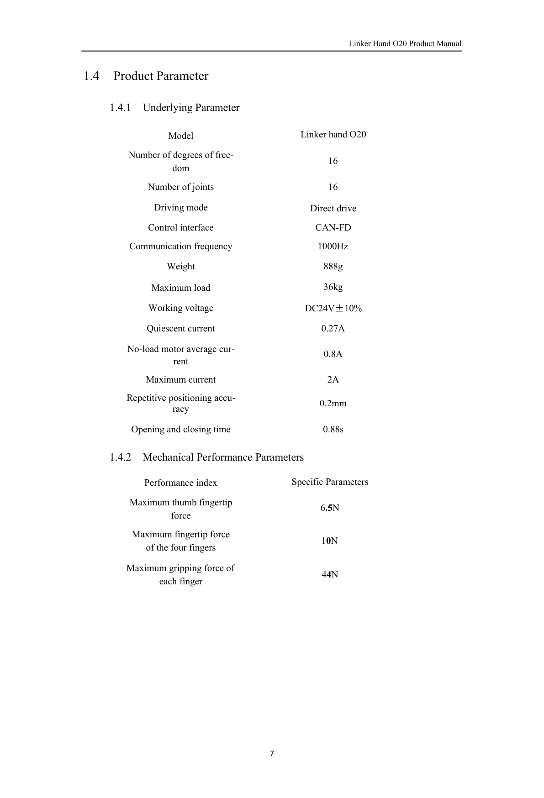

**Native-text transcript**

```
Linker Hand O20 Product Manual
7
1.4
Product Parameter
1.4.1
Underlying Parameter
Model
Linker hand O20
Number of degrees of free-
dom
16
Number of joints
16
Driving mode
Direct drive
Control interface
CAN-FD
Communication frequency
1000Hz
Weight
888g
Maximum load
36kg
Working voltage
DC24V±10%
Quiescent current
0.27A
No-load motor average cur-
rent
0.8A
Maximum current
2A
Repetitive positioning accu-
racy
0.2mm
Opening and closing time
0.88s
1.4.2
Mechanical Performance Parameters
Performance index
Specific Parameters
Maximum thumb fingertip
force
6.5N
Maximum fingertip force
of the four fingers
10N
Maximum gripping force of
each finger
44N
```

## PDF page 12

**Tactile specifications and accessories** · original PDF page 12 of 30.

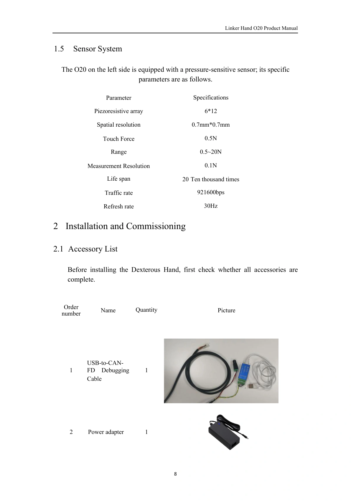

**Native-text transcript**

```
Linker Hand O20 Product Manual
8
1.5
Sensor System
The O20 on the left side is equipped with a pressure-sensitive sensor; its specific
parameters are as follows.
Parameter
Specifications
Piezoresistive array
6*12
Spatial resolution
0.7mm*0.7mm
Touch Force
0.5N
Range
0.5~20N
Measurement Resolution
0.1N
Life span
20 Ten thousand times
Traffic rate
921600bps
Refresh rate
30Hz
2
Installation and Commissioning
2.1 Accessory List
Before installing the Dexterous Hand, first check whether all accessories are
complete.
Order
number
Name
Quantity
Picture
1
USB-to-CAN-
FD
Debugging
Cable
1
2
Power adapter
1
```

## PDF page 13

**M3 flange and unique connector** · original PDF page 13 of 30.

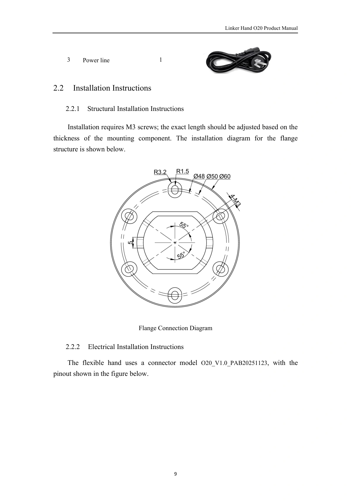

**Native-text transcript**

```
Linker Hand O20 Product Manual
9
2.2
Installation Instructions
2.2.1
Structural Installation Instructions
Installation requires M3 screws; the exact length should be adjusted based on the
thickness of the mounting component. The installation diagram for the flange
structure is shown below.
Flange Connection Diagram
2.2.2
Electrical Installation Instructions
The flexible hand uses a connector model O20_V1.0_PAB20251123, with the
pinout shown in the figure below.
3
Power line
1
```

## PDF page 14

**Connector pin diagram, CAN-FD setup and 020\_hand\_ui.exe** · original PDF page 14 of 30.

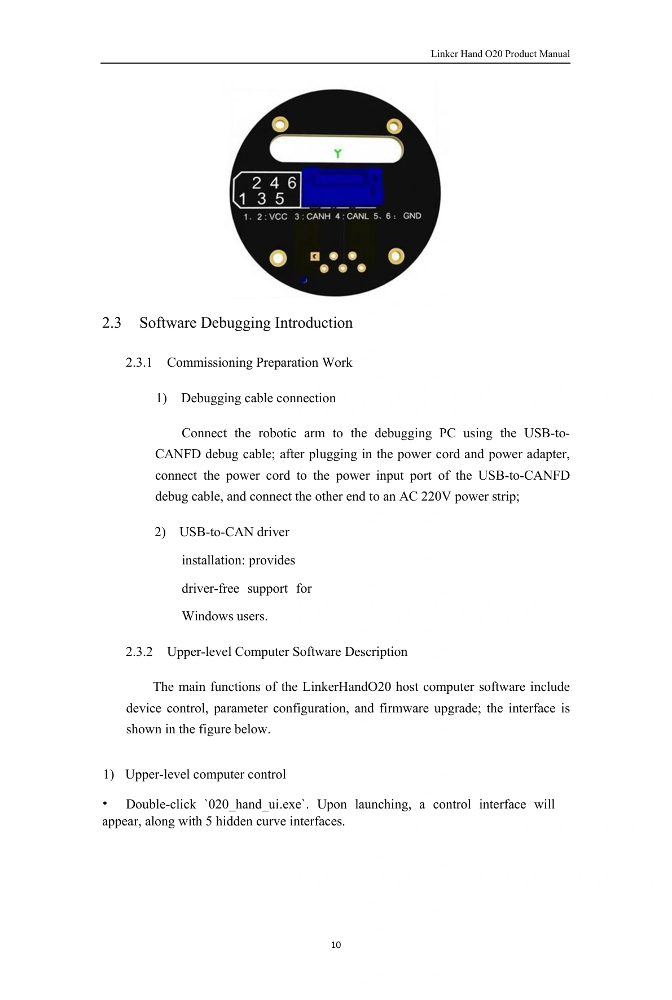

**Native-text transcript**

```
Linker Hand O20 Product Manual
10
2.3
Software Debugging Introduction
2.3.1
Commissioning Preparation Work
1)
Debugging cable connection
Connect the robotic arm to the debugging PC using the USB-to-
CANFD debug cable; after plugging in the power cord and power adapter,
connect the power cord to the power input port of the USB-to-CANFD
debug cable, and connect the other end to an AC 220V power strip;
2)
USB-to-CAN driver
installation: provides
driver-free support for
Windows users.
2.3.2
Upper-level Computer Software Description
The main functions of the LinkerHandO20 host computer software include
device control, parameter configuration, and firmware upgrade; the interface is
shown in the figure below.
1)
Upper-level computer control
•
Double-click `020_hand_ui.exe`. Upon launching, a control interface will
appear, along with 5 hidden curve interfaces.
```

## PDF page 15

**Curve windows and temperature** · original PDF page 15 of 30.

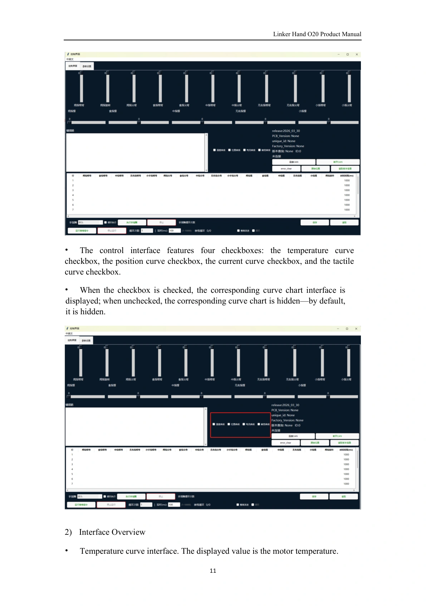

**Native-text transcript**

```
Linker Hand O20 Product Manual
11
•
The control interface features four checkboxes: the temperature curve
checkbox, the position curve checkbox, the current curve checkbox, and the tactile
curve checkbox.
•
When the checkbox is checked, the corresponding curve chart interface is
displayed; when unchecked, the corresponding curve chart is hidden—by default,
it is hidden.
2)
Interface Overview
•
Temperature curve interface. The displayed value is the motor temperature.
```

## PDF page 16

**Position and current curves** · original PDF page 16 of 30.

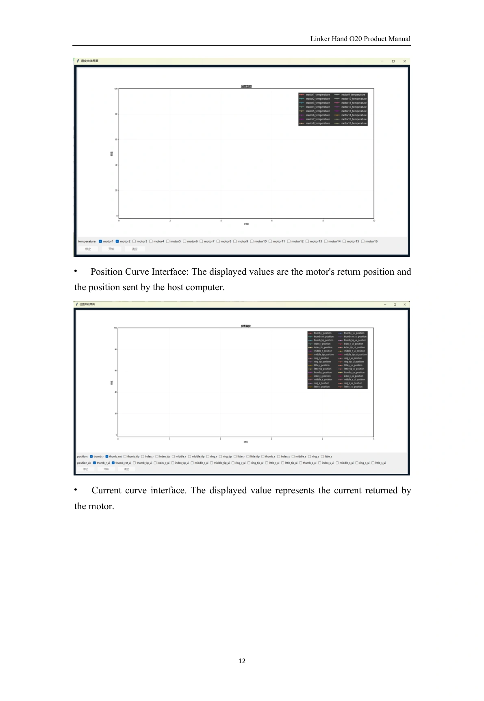

**Native-text transcript**

```
Linker Hand O20 Product Manual
12
•
Position Curve Interface: The displayed values are the motor's return position and
the position sent by the host computer.
•
Current curve interface. The displayed value represents the current returned by
the motor.
```

## PDF page 17

**Pressure and control windows** · original PDF page 17 of 30.

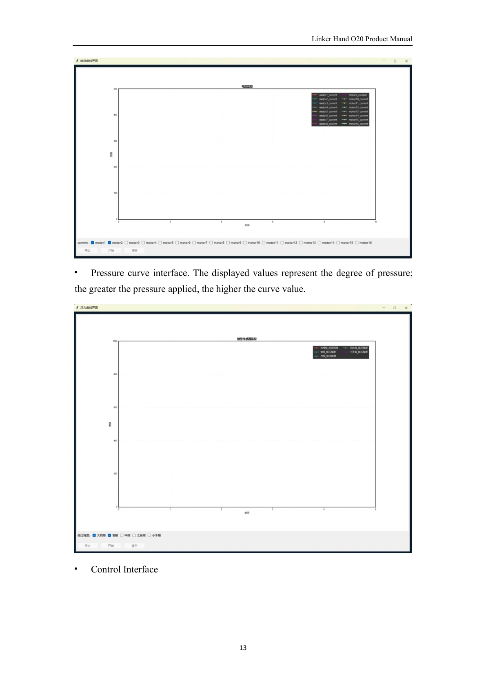

**Native-text transcript**

```
Linker Hand O20 Product Manual
13
•
Pressure curve interface. The displayed values represent the degree of pressure;
the greater the pressure applied, the higher the curve value.
•
Control Interface
```

## PDF page 18

**Parameter window** · original PDF page 18 of 30.

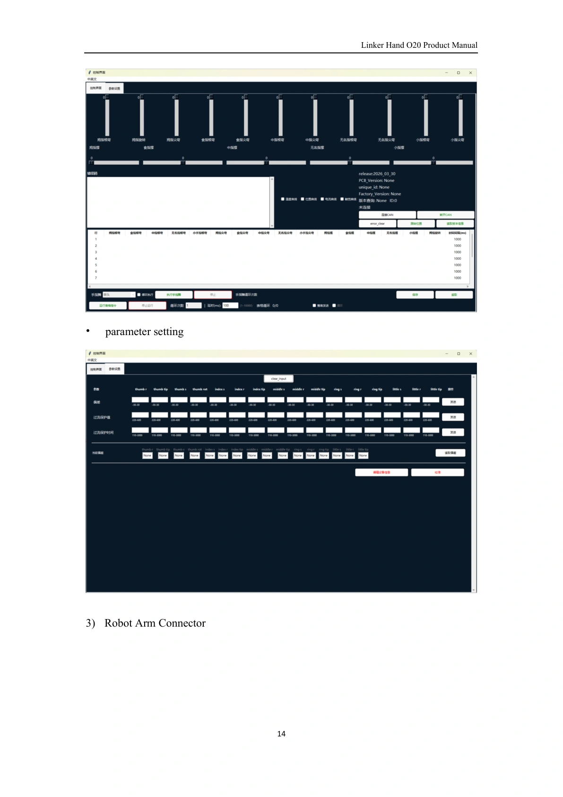

**Native-text transcript**

```
Linker Hand O20 Product Manual
14
•
parameter setting
3)
Robot Arm Connector
```

## PDF page 19

**CAN connection confirmation** · original PDF page 19 of 30.

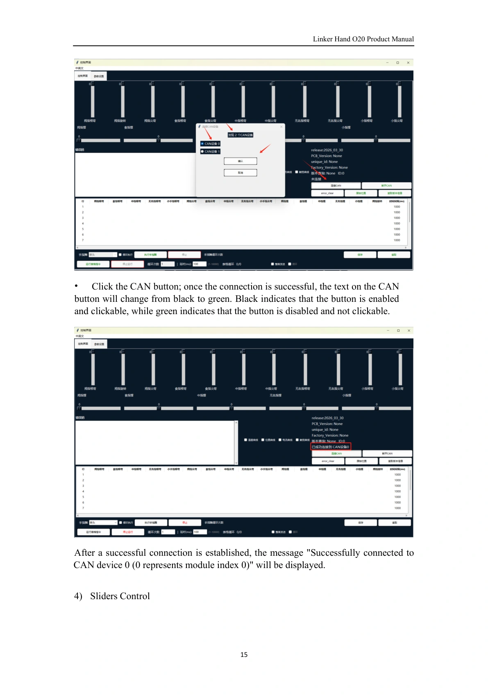

**Native-text transcript**

```
Linker Hand O20 Product Manual
15
•
Click the CAN button; once the connection is successful, the text on the CAN
button will change from black to green. Black indicates that the button is enabled
and clickable, while green indicates that the button is disabled and not clickable.
After a successful connection is established, the message "Successfully connected to
CAN device 0 (0 represents module index 0)" will be displayed.
4)
Sliders Control
```

## PDF page 20

**Slider inputs and version fields** · original PDF page 20 of 30.

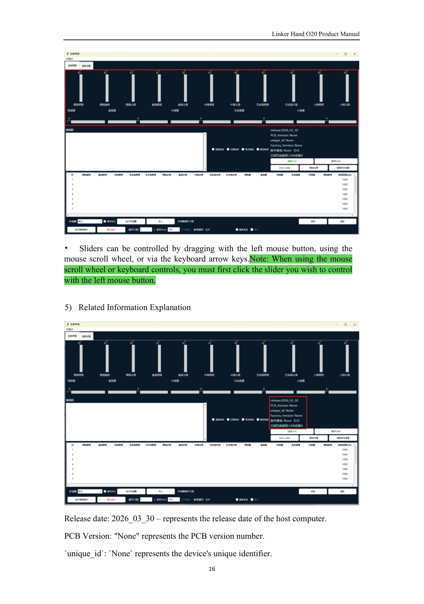

**Native-text transcript**

```
Linker Hand O20 Product Manual
16
•
Sliders can be controlled by dragging with the left mouse button, using the
mouse scroll wheel, or via the keyboard arrow keys.Note: When using the mouse
scroll wheel or keyboard controls, you must first click the slider you wish to control
with the left mouse button.
5)
Related Information Explanation
Release date: 2026_03_30 – represents the release date of the host computer.
PCB Version: "None" represents the PCB version number.
`unique_id`: `None` represents the device's unique identifier.
```

## PDF page 21

**Version query and CAN controls** · original PDF page 21 of 30.

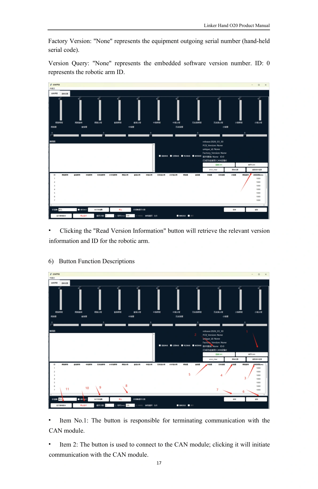

**Native-text transcript**

```
Linker Hand O20 Product Manual
17
Factory Version: "None" represents the equipment outgoing serial number (hand-held
serial code).
Version Query: "None" represents the embedded software version number. ID: 0
represents the robotic arm ID.
•
Clicking the "Read Version Information" button will retrieve the relevant version
information and ID for the robotic arm.
6)
Button Function Descriptions
•
Item No.1: The button is responsible for terminating communication with the
CAN module.
•
Item 2: The button is used to connect to the CAN module; clicking it will initiate
communication with the CAN module.
```

## PDF page 22

**Eleven button functions** · original PDF page 22 of 30.

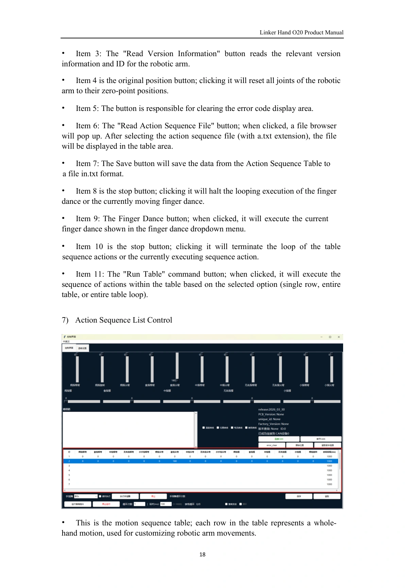

**Native-text transcript**

```
Linker Hand O20 Product Manual
18
•
Item 3: The "Read Version Information" button reads the relevant version
information and ID for the robotic arm.
•
Item 4 is the original position button; clicking it will reset all joints of the robotic
arm to their zero-point positions.
•
Item 5: The button is responsible for clearing the error code display area.
•
Item 6: The "Read Action Sequence File" button; when clicked, a file browser
will pop up. After selecting the action sequence file (with a.txt extension), the file
will be displayed in the table area.
•
Item 7: The Save button will save the data from the Action Sequence Table to
a file in.txt format.
•
Item 8 is the stop button; clicking it will halt the looping execution of the finger
dance or the currently moving finger dance.
•
Item 9: The Finger Dance button; when clicked, it will execute the current
finger dance shown in the finger dance dropdown menu.
•
Item 10 is the stop button; clicking it will terminate the loop of the table
sequence actions or the currently executing sequence action.
•
Item 11: The "Run Table" command button; when clicked, it will execute the
sequence of actions within the table based on the selected option (single row, entire
table, or entire table loop).
7)
Action Sequence List Control
•
This is the motion sequence table; each row in the table represents a whole-
hand motion, used for customizing robotic arm movements.
```

## PDF page 23

**18-column motion table** · original PDF page 23 of 30.

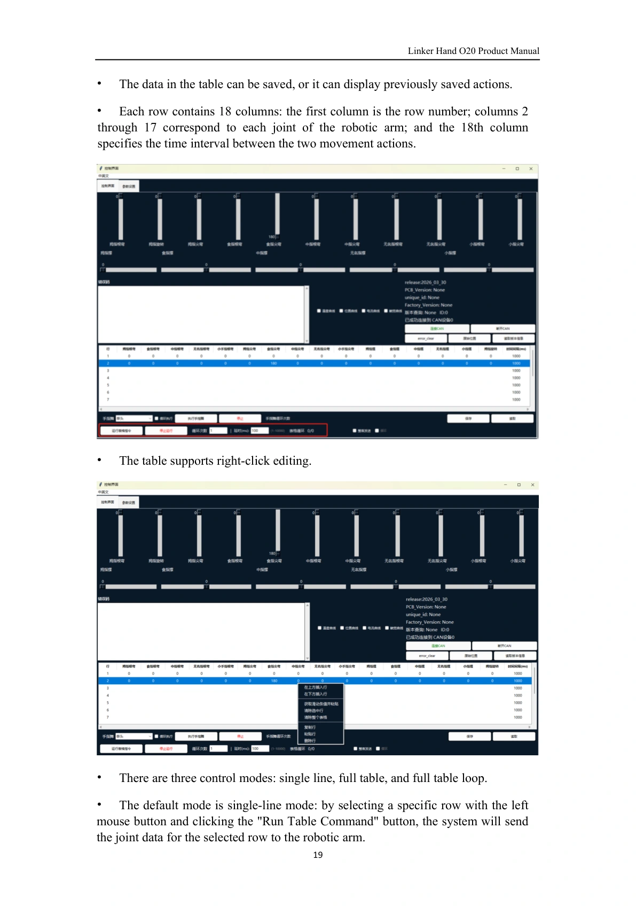

**Native-text transcript**

```
Linker Hand O20 Product Manual
19
•
The data in the table can be saved, or it can display previously saved actions.
•
Each row contains 18 columns: the first column is the row number; columns 2
through 17 correspond to each joint of the robotic arm; and the 18th column
specifies the time interval between the two movement actions.
•
The table supports right-click editing.
•
There are three control modes: single line, full table, and full table loop.
•
The default mode is single-line mode: by selecting a specific row with the left
mouse button and clicking the "Run Table Command" button, the system will send
the joint data for the selected row to the robotic arm.
```

## PDF page 24

**Table/loop/finger-dance controls** · original PDF page 24 of 30.

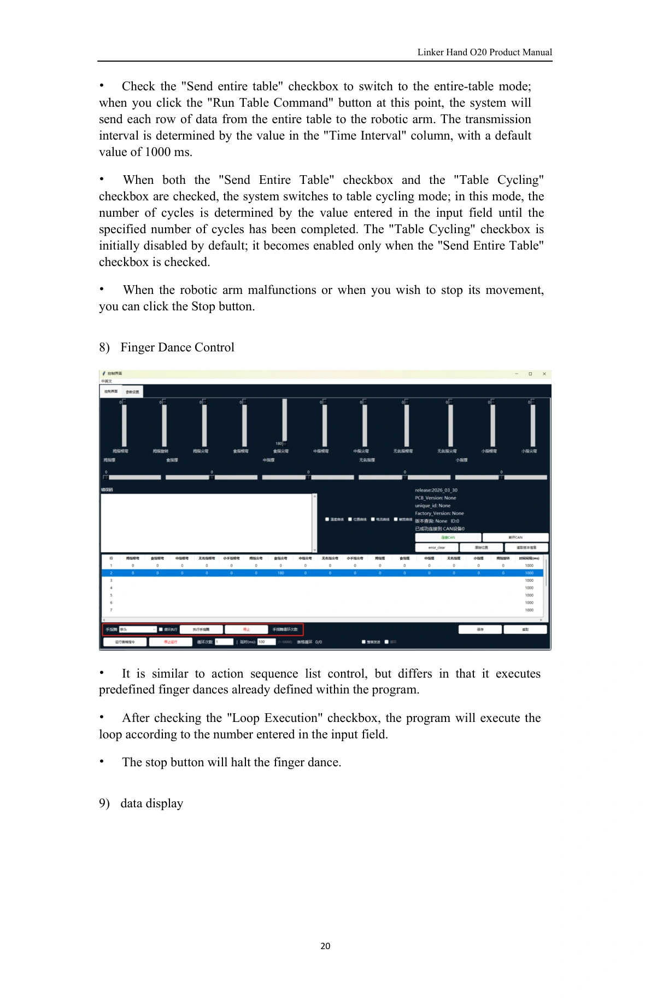

**Native-text transcript**

```
Linker Hand O20 Product Manual
20
•
Check the "Send entire table" checkbox to switch to the entire-table mode;
when you click the "Run Table Command" button at this point, the system will
send each row of data from the entire table to the robotic arm. The transmission
interval is determined by the value in the "Time Interval" column, with a default
value of 1000 ms.
•
When both the "Send Entire Table" checkbox and the "Table Cycling"
checkbox are checked, the system switches to table cycling mode; in this mode, the
number of cycles is determined by the value entered in the input field until the
specified number of cycles has been completed. The "Table Cycling" checkbox is
initially disabled by default; it becomes enabled only when the "Send Entire Table"
checkbox is checked.
•
When the robotic arm malfunctions or when you wish to stop its movement,
you can click the Stop button.
8)
Finger Dance Control
•
It is similar to action sequence list control, but differs in that it executes
predefined finger dances already defined within the program.
•
After checking the "Loop Execution" checkbox, the program will execute the
loop according to the number entered in the input field.
•
The stop button will halt the finger dance.
9)
data display
```

## PDF page 25

**Curve data queries** · original PDF page 25 of 30.

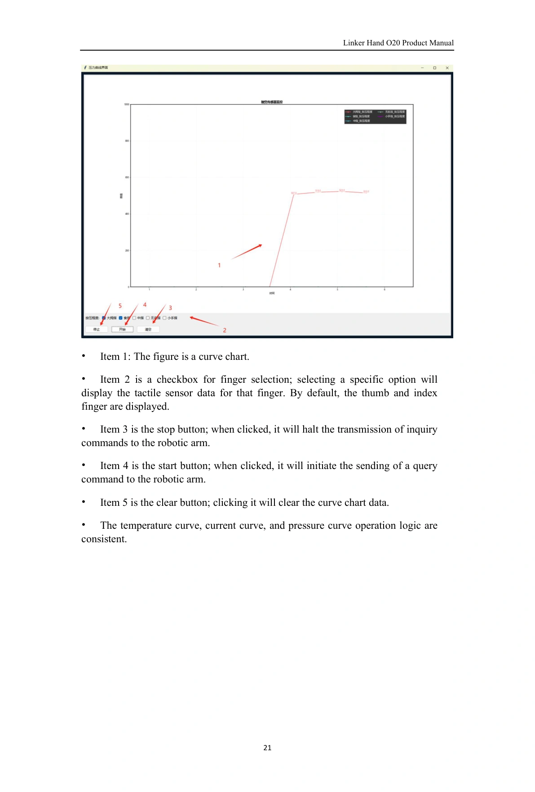

**Native-text transcript**

```
Linker Hand O20 Product Manual
21
•
Item 1: The figure is a curve chart.
•
Item 2 is a checkbox for finger selection; selecting a specific option will
display the tactile sensor data for that finger. By default, the thumb and index
finger are displayed.
•
Item 3 is the stop button; when clicked, it will halt the transmission of inquiry
commands to the robotic arm.
•
Item 4 is the start button; when clicked, it will initiate the sending of a query
command to the robotic arm.
•
Item 5 is the clear button; clicking it will clear the curve chart data.
•
The temperature curve, current curve, and pressure curve operation logic are
consistent.
```

## PDF page 26

**Actual versus commanded position and settings** · original PDF page 26 of 30.

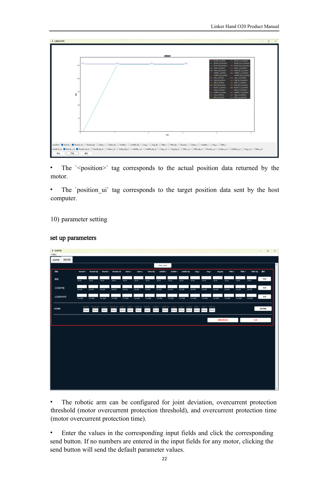

**Native-text transcript**

```
Linker Hand O20 Product Manual
22
•
The `<position>` tag corresponds to the actual position data returned by the
motor.
•
The `position_ui` tag corresponds to the target position data sent by the host
computer.
10) parameter setting
set up parameters
•
The robotic arm can be configured for joint deviation, overcurrent protection
threshold (motor overcurrent protection threshold), and overcurrent protection time
(motor overcurrent protection time).
•
Enter the values in the corresponding input fields and click the corresponding
send button. If no numbers are entered in the input fields for any motor, clicking the
send button will send the default parameter values.
```

## PDF page 27

**Deviation, overcurrent, calibration and language** · original PDF page 27 of 30.

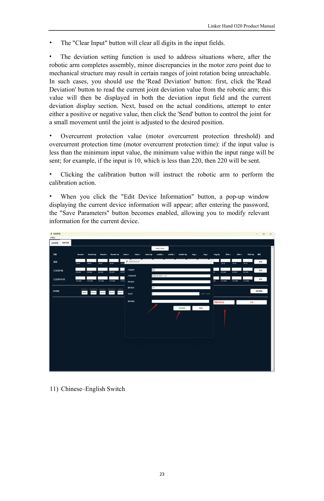

**Native-text transcript**

```
Linker Hand O20 Product Manual
23
•
The "Clear Input" button will clear all digits in the input fields.
•
The deviation setting function is used to address situations where, after the
robotic arm completes assembly, minor discrepancies in the motor zero point due to
mechanical structure may result in certain ranges of joint rotation being unreachable.
In such cases, you should use the 'Read Deviation' button: first, click the 'Read
Deviation' button to read the current joint deviation value from the robotic arm; this
value will then be displayed in both the deviation input field and the current
deviation display section. Next, based on the actual conditions, attempt to enter
either a positive or negative value, then click the 'Send' button to control the joint for
a small movement until the joint is adjusted to the desired position.
•
Overcurrent protection value (motor overcurrent protection threshold) and
overcurrent protection time (motor overcurrent protection time): if the input value is
less than the minimum input value, the minimum value within the input range will be
sent; for example, if the input is 10, which is less than 220, then 220 will be sent.
•
Clicking the calibration button will instruct the robotic arm to perform the
calibration action.
•
When you click the "Edit Device Information" button, a pop-up window
displaying the current device information will appear; after entering the password,
the "Save Parameters" button becomes enabled, allowing you to modify relevant
information for the current device.
11) Chinese–English Switch
```

## PDF page 28

**Warranty and service** · original PDF page 28 of 30.

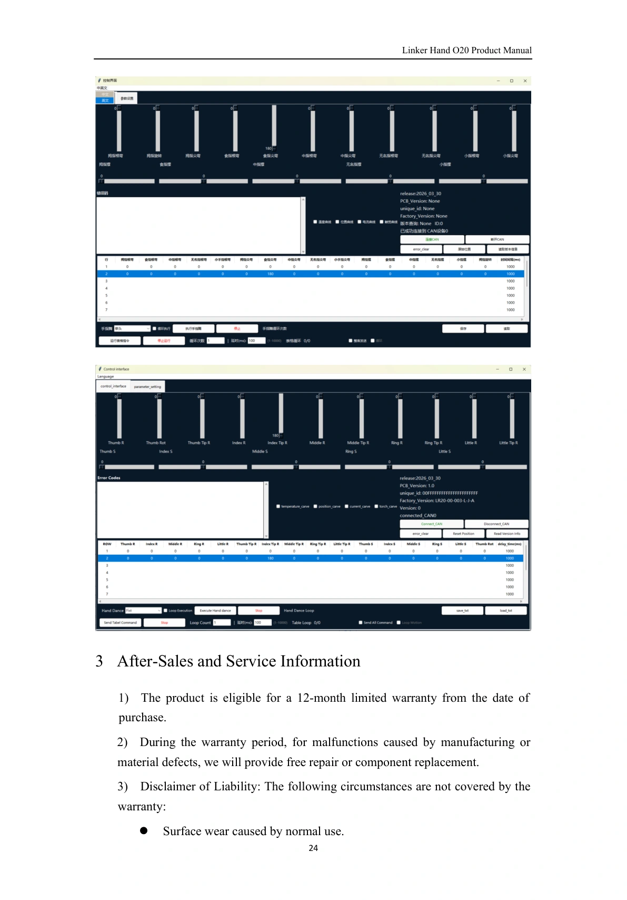

**Native-text transcript**

```
Linker Hand O20 Product Manual
24
3 After-Sales and Service Information
1)
The product is eligible for a 12-month limited warranty from the date of
purchase.
2)
During the warranty period, for malfunctions caused by manufacturing or
material defects, we will provide free repair or component replacement.
3)
Disclaimer of Liability: The following circumstances are not covered by the
warranty:
⚫
Surface wear caused by normal use.
```

## PDF page 29

**Warranty continuation** · original PDF page 29 of 30.


**Native-text transcript**

```
Linker Hand O20 Product Manual
25
⚫
Damage resulting from improper operation, accidents, unauthorized disassembly,
or failure to follow the instructions.
4)
If the issue is not a quality problem, no returns or exchanges will be
accepted.
5)
If any malfunction occurs with the product, please contact official after-sales
support immediately; do not attempt to disassemble it yourself.
6)
Maintenance services outside the warranty period will incur corresponding
fees.
```

## PDF page 30

**SDK and support** · original PDF page 30 of 30.


**Native-text transcript**

```
Linker Hand O20 Product Manual
Appendix
https://github.com/linker-bot/linkerhand-ros-
ROS SDK download URL:
sdk
https://github.com/linker-bot/linkerhand-ros
2-sdk
https://github.com/linker-bot/linkerhand-python-
ROS2 SDK download URL:
; Python SDK:
sdk
Technical Support Email:support@linkerbot.cn
If you require additional product information, please visit our official
website:https://linkerbot.cn
```

[Original PDF external link](https://linkerbot.cn/)
