# O30 — Complete Manufacturer Manual

Complete supplied manufacturer reference for **LINKERBOT O30**, **V1.0 · 2026-07-10**. All **25 original PDF pages** appear below with their diagrams and native-text transcripts.

[Canonical O30 engineering guide](../linker-hand-o30-product-manual.md) · [Complete manual library](./)


Match model, side, connector and hardware/firmware revision before using any procedure. The canonical guide identifies source conflicts and commissioning limits. Manufacturer maximum-load claims are not a host arm payload or a safe suspended-load rating. Calibration, sliders, zero/reset and sequence execution can move the fingers.


## Original PDF reading parts

These downloads retain the original PDF page contents. Read the parts in order; the range labels use original PDF page numbers.

* [Download original PDF pages 1–7](../../../.gitbook/assets/linkerbot-o30-manual-pages-001-007.pdf)
* [Download original PDF pages 8–12](../../../.gitbook/assets/linkerbot-o30-manual-pages-008-012.pdf)
* [Download original PDF pages 13–15](../../../.gitbook/assets/linkerbot-o30-manual-pages-013-015.pdf)
* [Download original PDF pages 16–16](../../../.gitbook/assets/linkerbot-o30-manual-pages-016-016.pdf)
* [Download original PDF pages 17–17](../../../.gitbook/assets/linkerbot-o30-manual-pages-017-017.pdf)
* [Download original PDF pages 18–19](../../../.gitbook/assets/linkerbot-o30-manual-pages-018-019.pdf)
* [Download original PDF pages 20–21](../../../.gitbook/assets/linkerbot-o30-manual-pages-020-021.pdf)
* [Download original PDF pages 22–25](../../../.gitbook/assets/linkerbot-o30-manual-pages-022-025.pdf)

## Page and chapter index

| Original PDF page                 | Content                                      |
| --------------------------------- | -------------------------------------------- |
| [1](complete-o30.md#pdf-page-1)   | Cover                                        |
| [2](complete-o30.md#pdf-page-2)   | Revision history                             |
| [3](complete-o30.md#pdf-page-3)   | Safety instructions                          |
| [4](complete-o30.md#pdf-page-4)   | Contents                                     |
| [5](complete-o30.md#pdf-page-5)   | Overview                                     |
| [6](complete-o30.md#pdf-page-6)   | Control functions                            |
| [7](complete-o30.md#pdf-page-7)   | Dimensions and joint configuration           |
| [8](complete-o30.md#pdf-page-8)   | Motion diagrams                              |
| [9](complete-o30.md#pdf-page-9)   | Actual joint range table                     |
| [10](complete-o30.md#pdf-page-10) | Electrical and force specifications          |
| [11](complete-o30.md#pdf-page-11) | Tactile specifications and accessories       |
| [12](complete-o30.md#pdf-page-12) | M3 flange, unique connector and CAN-FD setup |
| [13](complete-o30.md#pdf-page-13) | O30\_hand\_ui.exe and curve windows          |
| [14](complete-o30.md#pdf-page-14) | Temperature, position and current curves     |
| [15](complete-o30.md#pdf-page-15) | Control and parameter windows                |
| [16](complete-o30.md#pdf-page-16) | CAN connection and sliders                   |
| [17](complete-o30.md#pdf-page-17) | Slider inputs and version fields             |
| [18](complete-o30.md#pdf-page-18) | Version query and buttons                    |
| [19](complete-o30.md#pdf-page-19) | Buttons and 22-column sequence table         |
| [20](complete-o30.md#pdf-page-20) | Sequence execution, intervals and loops      |
| [21](complete-o30.md#pdf-page-21) | Finger dance and telemetry                   |
| [22](complete-o30.md#pdf-page-22) | Actual/target position and device ID         |
| [23](complete-o30.md#pdf-page-23) | Calibration, language and service            |
| [24](complete-o30.md#pdf-page-24) | Warranty continuation                        |
| [25](complete-o30.md#pdf-page-25) | SDK and support                              |

## Source and interpretation

Source: LINKERBOT / Lingxin Qiaoshou (Beijing) Technology Co., Ltd., supplied **Linker Hand O30 V1.0 Product Manual.pdf**. The internal revision history, rather than the filename, identifies this edition. Page images are authoritative for spatial layout and symbols; transcripts are the native PDF text, including translation quirks and original inconsistencies. Numerical ranges and motion limits must be checked against the actual controller and unit. The original SDK appendix is retained; current development guidance is in the linked model guide.

## PDF page 1

**Cover** · original PDF page 1 of 25.


**Native-text transcript**

```
Linker Hand O30 Product Manual
Lingxin Qiaoshou (Beijing) Technology Co., Ltd.
```

## PDF page 2

**Revision history** · original PDF page 2 of 25.


**Native-text transcript**

```
Linker Hand O30 Product Manual
I
Version Revision History
Version nu-
mber
Date of Change
Change Description
V1.0
2026.07.10
Editio princeps
```

## PDF page 3

**Safety instructions** · original PDF page 3 of 25.

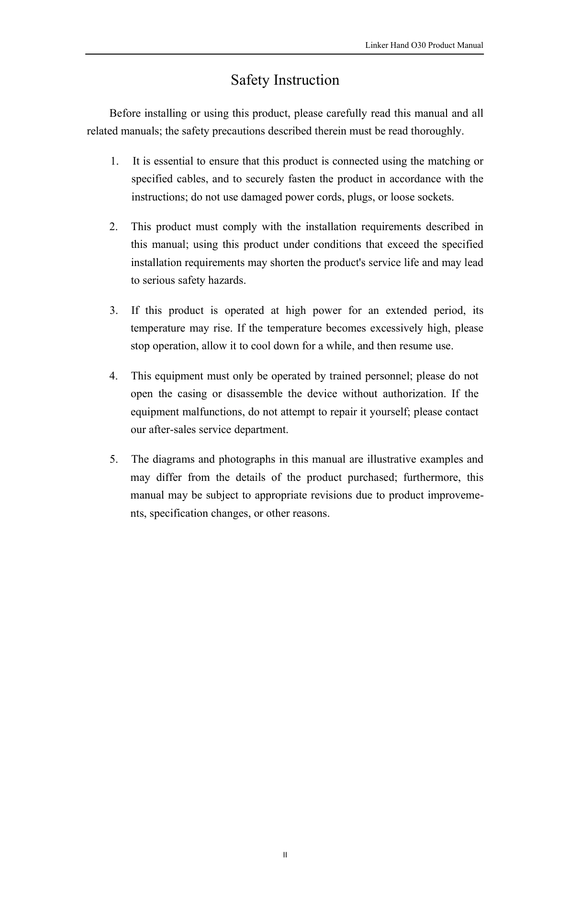

**Native-text transcript**

```
Linker Hand O30 Product Manual
II
Safety Instruction
Before installing or using this product, please carefully read this manual and all
related manuals; the safety precautions described therein must be read thoroughly.
1.
It is essential to ensure that this product is connected using the matching or
specified cables, and to securely fasten the product in accordance with the
instructions; do not use damaged power cords, plugs, or loose sockets.
2.
This product must comply with the installation requirements described in
this manual; using this product under conditions that exceed the specified
installation requirements may shorten the product's service life and may lead
to serious safety hazards.
3.
If this product is operated at high power for an extended period, its
temperature may rise. If the temperature becomes excessively high, please
stop operation, allow it to cool down for a while, and then resume use.
4.
This equipment must only be operated by trained personnel; please do not
open the casing or disassemble the device without authorization. If the
equipment malfunctions, do not attempt to repair it yourself; please contact
our after-sales service department.
5.
The diagrams and photographs in this manual are illustrative examples and
may differ from the details of the product purchased; furthermore, this
manual may be subject to appropriate revisions due to product improveme-
nts, specification changes, or other reasons.
```

## PDF page 4

**Contents** · original PDF page 4 of 25.

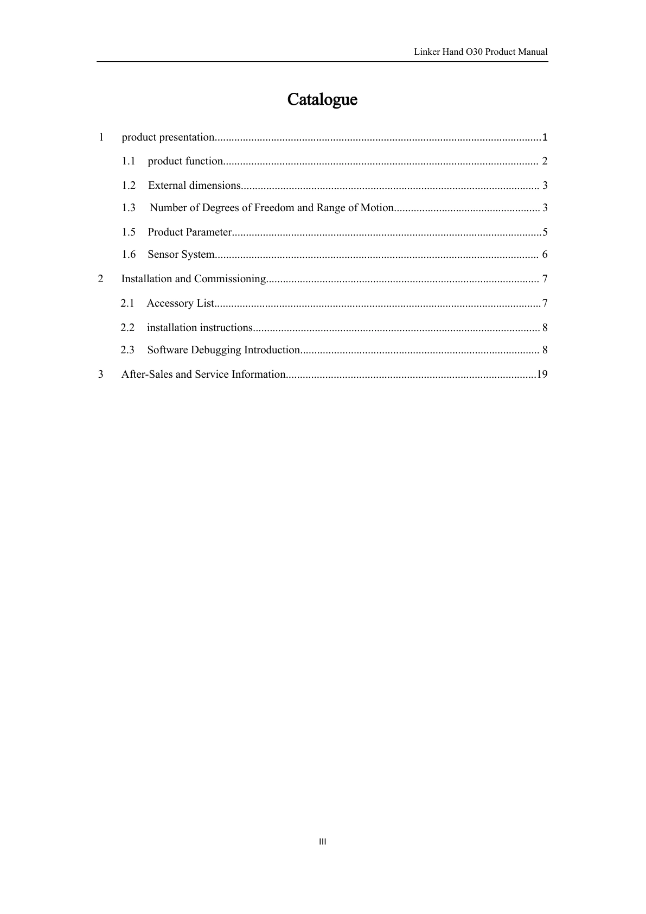

**Native-text transcript**

```
Linker Hand O30 Product Manual
III
Catalogue
1
product presentation....................................................................................................................1
1.1
product function................................................................................................................ 2
1.2
External dimensions.......................................................................................................... 3
1.3
Number of Degrees of Freedom and Range of Motion.................................................... 3
1.5
Product Parameter..............................................................................................................5
1.6
Sensor System................................................................................................................... 6
2
Installation and Commissioning................................................................................................. 7
2.1
Accessory List....................................................................................................................7
2.2
installation instructions...................................................................................................... 8
2.3
Software Debugging Introduction..................................................................................... 8
3
After-Sales and Service Information.........................................................................................19
```

## PDF page 5

**Overview** · original PDF page 5 of 25.


**Native-text transcript**

```
Linker Hand O30 Product Manual
1
1 Product Presentation
Linker Hand O30 Product Image
The Linker Hand O30 is a 20-joint robotic hand that integrates high-performance
brushless motors with precision worm gears; it can mimic human hand movements to
perform precise gripping and stable grasping, while offering high power density and
efficient transmission characteristics. Additionally, its self-locking design enables
zero-power consumption grasping, providing an industrial solution superior to
traditional grippers.
This robotic manipulator delivers high-precision motion control and stable
operation, making it suitable for applications such as high-precision automotive
assembly, aerospace special operations, sorting of irregular-shaped logistics packages,
and alternative operations in high-risk environments; it serves as a revolutionary tool
for enhancing automation capabilities.
1)
High-precision control and bionic manipulation
By integrating a brushless motor with micron-scale worm gear transmission, this
system achieves precise closed-loop control over both position and torque, making it
suitable for delicate operations such as precision assembly and fragile item grasping.
2)
Powerful and efficient power output
The brushless motor offers exceptional power density, combined with the high-
efficiency transmission of the worm gear system, enabling a rated load capacity of up
to 30 kg and an opening/closing time of only 0.8 seconds, thereby ensuring an
efficient and stable "grasp–lift–release" operational workflow.
3)
Energy-efficient, reliable, and continuous operation
The rated static current is only 0.4 A, featuring excellent power consumption
control, support for 24V industrial power supplies, and 24-hour uninterrupted
```

## PDF page 6

**Control functions** · original PDF page 6 of 25.

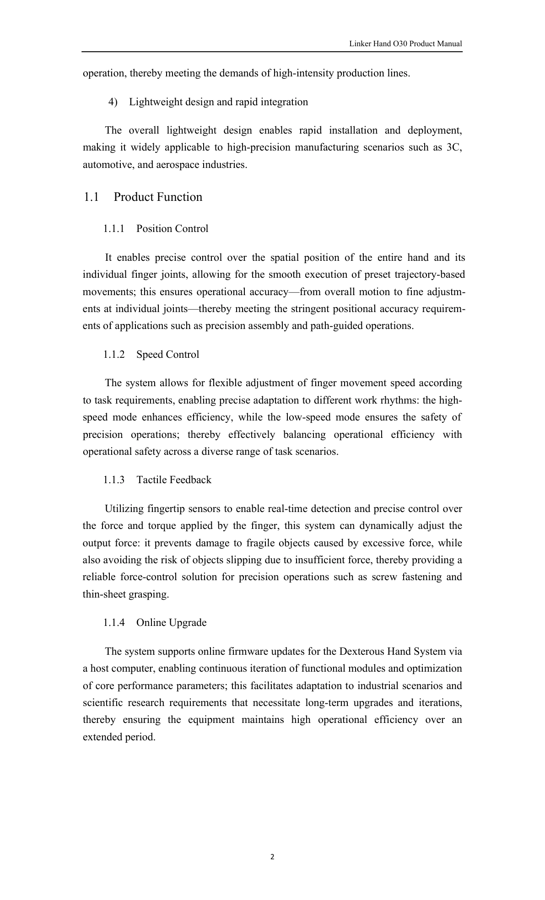

**Native-text transcript**

```
Linker Hand O30 Product Manual
2
4)
Lightweight design and rapid integration
The overall lightweight design enables rapid installation and deployment,
making it widely applicable to high-precision manufacturing scenarios such as 3C,
automotive, and aerospace industries.
1.1
Product Function
1.1.1
Position Control
It enables precise control over the spatial position of the entire hand and its
individual finger joints, allowing for the smooth execution of preset trajectory-based
movements; this ensures operational accuracy—from overall motion to fine adjustm-
ents at individual joints—thereby meeting the stringent positional accuracy requirem-
ents of applications such as precision assembly and path-guided operations.
1.1.2
Speed Control
The system allows for flexible adjustment of finger movement speed according
to task requirements, enabling precise adaptation to different work rhythms: the high-
speed mode enhances efficiency, while the low-speed mode ensures the safety of
precision operations; thereby effectively balancing operational efficiency with
operational safety across a diverse range of task scenarios.
1.1.3
Tactile Feedback
Utilizing fingertip sensors to enable real-time detection and precise control over
the force and torque applied by the finger, this system can dynamically adjust the
output force: it prevents damage to fragile objects caused by excessive force, while
also avoiding the risk of objects slipping due to insufficient force, thereby providing a
reliable force-control solution for precision operations such as screw fastening and
thin-sheet grasping.
1.1.4
Online Upgrade
operation, thereby meeting the demands of high-intensity production lines.
The system supports online firmware updates for the Dexterous Hand System via
a host computer, enabling continuous iteration of functional modules and optimization
of core performance parameters; this facilitates adaptation to industrial scenarios and
scientific research requirements that necessitate long-term upgrades and iterations,
thereby ensuring the equipment maintains high operational efficiency over an
extended period.
```

## PDF page 7

**Dimensions and joint configuration** · original PDF page 7 of 25.

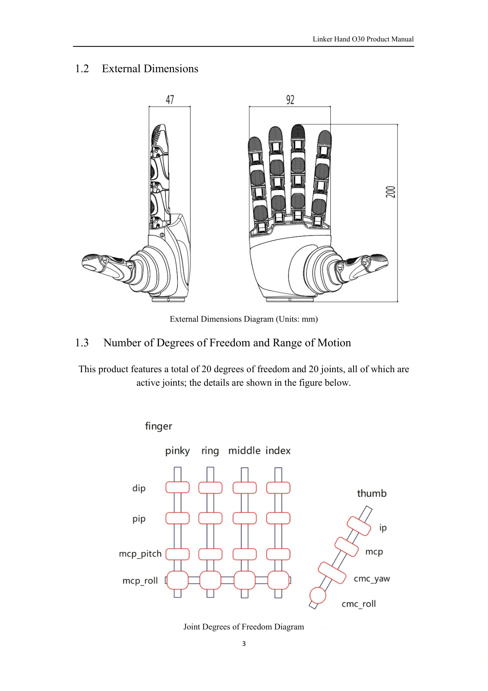

**Native-text transcript**

```
Linker Hand O30 Product Manual
3
1.2
External Dimensions
External Dimensions Diagram (Units: mm)
1.3
Number of Degrees of Freedom and Range of Motion
This product features a total of 20 degrees of freedom and 20 joints, all of which are
active joints; the details are shown in the figure below.
Joint Degrees of Freedom Diagram
```

## PDF page 8

**Motion diagrams** · original PDF page 8 of 25.

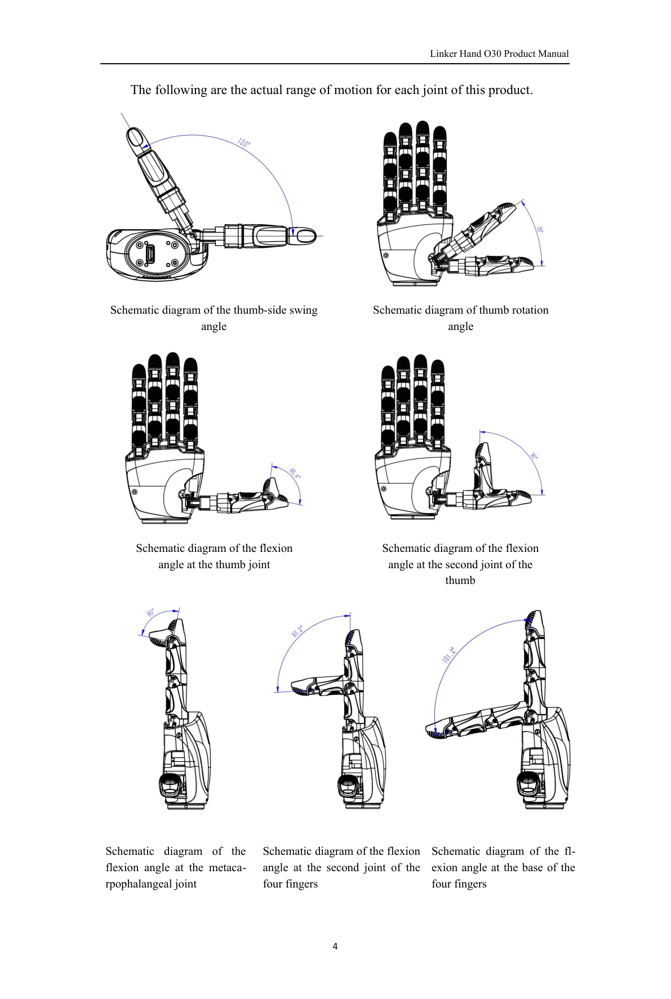

**Native-text transcript**

```
Linker Hand O30 Product Manual
4
The following are the actual range of motion for each joint of this product.
Schematic diagram of the thumb-side swing
angle
Schematic diagram of thumb rotation
angle
Schematic diagram of the flexion
angle at the thumb joint
Schematic diagram of the flexion
angle at the second joint of the
thumb
Schematic
diagram
of
the
flexion angle at the metaca-
rpophalangeal joint
Schematic diagram of the flexion
angle at the second joint of the
four fingers
Schematic diagram of the fl-
exion angle at the base of the
four fingers
```

## PDF page 9

**Actual joint range table** · original PDF page 9 of 25.

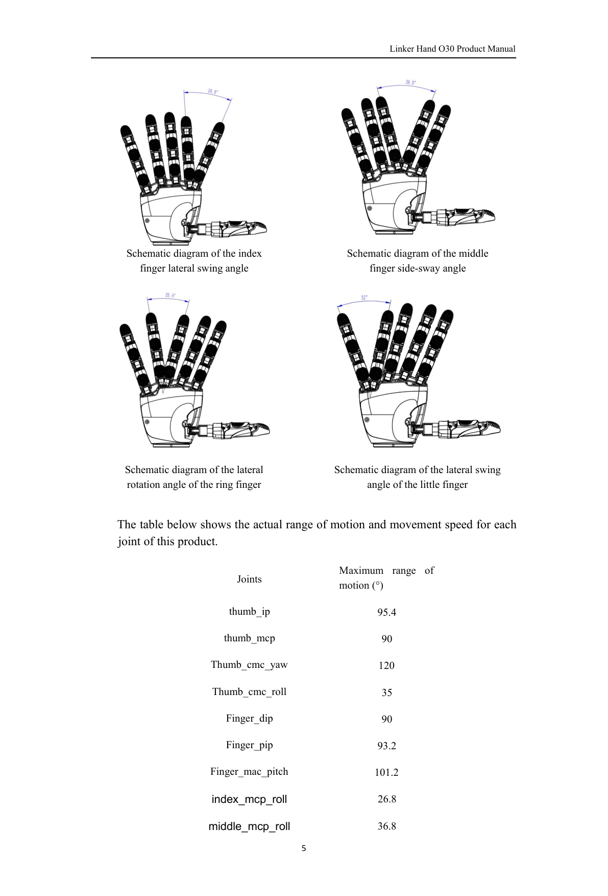

**Native-text transcript**

```
Linker Hand O30 Product Manual
5
Schematic diagram of the index
finger lateral swing angle
Schematic diagram of the middle
finger side-sway angle
Schematic diagram of the lateral
rotation angle of the ring finger
Schematic diagram of the lateral swing
angle of the little finger
The table below shows the actual range of motion and movement speed for each
joint of this product.
Joints
Maximum
range
of
motion (°)
thumb_ip
95.4
thumb_mcp
90
Thumb_cmc_yaw
120
Thumb_cmc_roll
35
Finger_dip
90
Finger_pip
93.2
Finger_mac_pitch
101.2
index_mcp_roll
26.8
middle_mcp_roll
36.8
```

## PDF page 10

**Electrical and force specifications** · original PDF page 10 of 25.

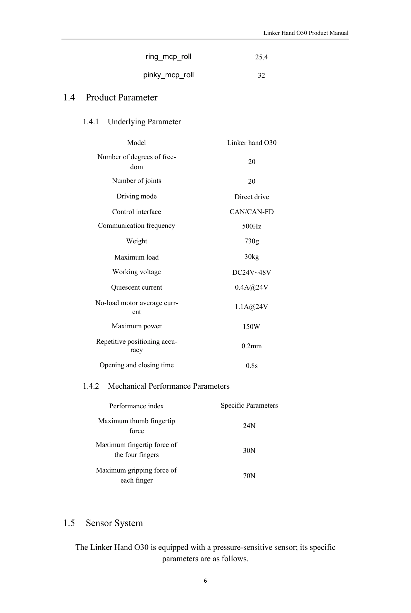

**Native-text transcript**

```
Linker Hand O30 Product Manual
6
ring_mcp_roll
25.4
pinky_mcp_roll
32
1.4
Product Parameter
1.4.1
Underlying Parameter
Model
Linker hand O30
Number of degrees of free-
dom
20
Number of joints
20
Driving mode
Direct drive
Control interface
CAN/CAN-FD
Communication frequency
500Hz
Weight
730g
Maximum load
30kg
Working voltage
DC24V~48V
Quiescent current
0.4A@24V
No-load motor average curr-
ent
1.1A@24V
Maximum power
150W
Repetitive positioning accu-
racy
0.2mm
Opening and closing time
0.8s
1.4.2
Mechanical Performance Parameters
Performance index
Specific Parameters
Maximum thumb fingertip
force
24N
Maximum fingertip force of
the four fingers
30N
Maximum gripping force of
each finger
70N
1.5
Sensor System
The Linker Hand O30 is equipped with a pressure-sensitive sensor; its specific
parameters are as follows.
```

## PDF page 11

**Tactile specifications and accessories** · original PDF page 11 of 25.

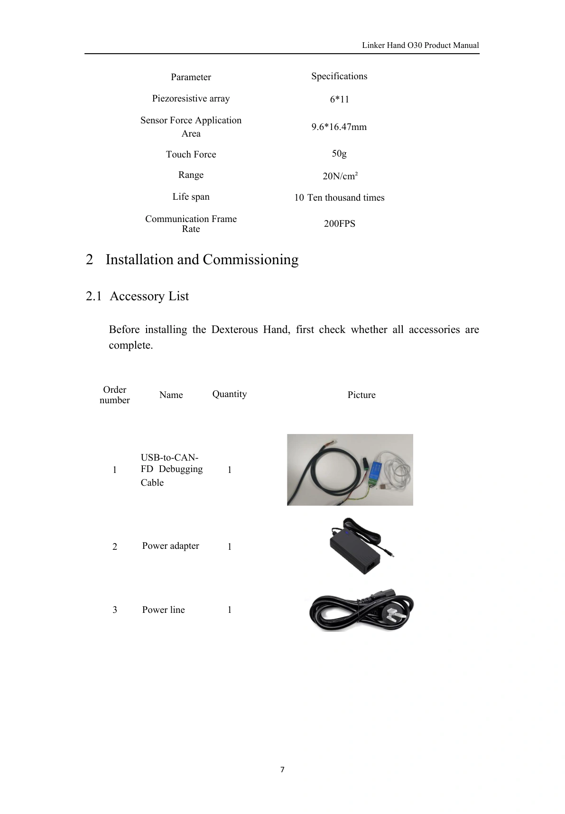

**Native-text transcript**

```
Linker Hand O30 Product Manual
7
Parameter
Specifications
Piezoresistive array
6*11
Sensor Force Application
Area
9.6*16.47mm
Touch Force
50g
Range
20N/cm²
Life span
10 Ten thousand times
Communication Frame
Rate
200FPS
2
Installation and Commissioning
2.1 Accessory List
Before installing the Dexterous Hand, first check whether all accessories are
complete.
Order
number
Name
Quantity
Picture
1
USB-to-CAN-
FD Debugging
Cable
1
2
Power adapter
1
3
Power line
1
```

## PDF page 12

**M3 flange, unique connector and CAN-FD setup** · original PDF page 12 of 25.

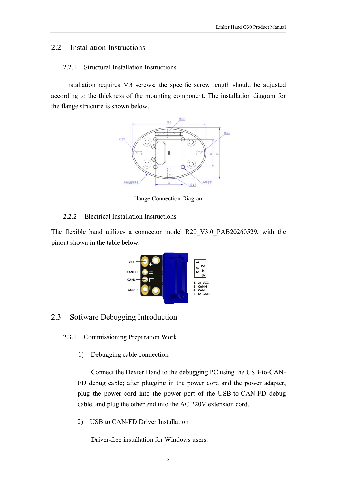

**Native-text transcript**

```
Linker Hand O30 Product Manual
8
2.2
Installation Instructions
2.2.1
Structural Installation Instructions
Installation requires M3 screws; the specific screw length should be adjusted
according to the thickness of the mounting component. The installation diagram for
the flange structure is shown below.
Flange Connection Diagram
2.2.2
Electrical Installation Instructions
The flexible hand utilizes a connector model R20_V3.0_PAB20260529, with the
pinout shown in the table below.
2.3
Software Debugging Introduction
2.3.1
Commissioning Preparation Work
1)
Debugging cable connection
Connect the Dexter Hand to the debugging PC using the USB-to-CAN-
FD debug cable; after plugging in the power cord and the power adapter,
plug the power cord into the power port of the USB-to-CAN-FD debug
cable, and plug the other end into the AC 220V extension cord.
2)
USB to CAN-FD Driver Installation
Driver-free installation for Windows users.
```

## PDF page 13

**O30\_hand\_ui.exe and curve windows** · original PDF page 13 of 25.

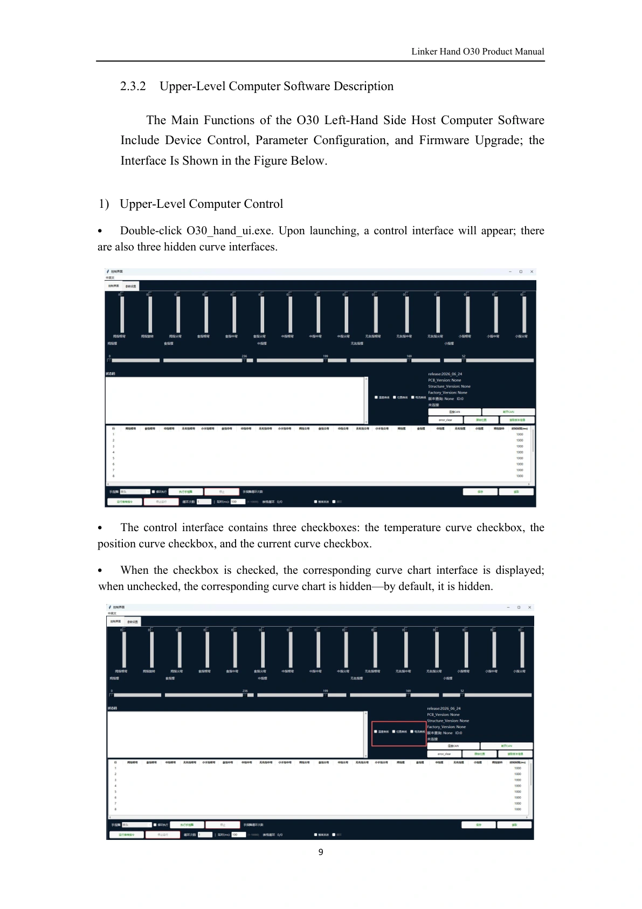

**Native-text transcript**

```
Linker Hand O30 Product Manual
9
2.3.2
Upper-Level Computer Software Description
The Main Functions of the O30 Left-Hand Side Host Computer Software
Include Device Control, Parameter Configuration, and Firmware Upgrade; the
Interface Is Shown in the Figure Below.
1)
Upper-Level Computer Control
•
Double-click O30_hand_ui.exe. Upon launching, a control interface will appear; there
are also three hidden curve interfaces.
•
The control interface contains three checkboxes: the temperature curve checkbox, the
position curve checkbox, and the current curve checkbox.
•
When the checkbox is checked, the corresponding curve chart interface is displayed;
when unchecked, the corresponding curve chart is hidden—by default, it is hidden.
```

## PDF page 14

**Temperature, position and current curves** · original PDF page 14 of 25.

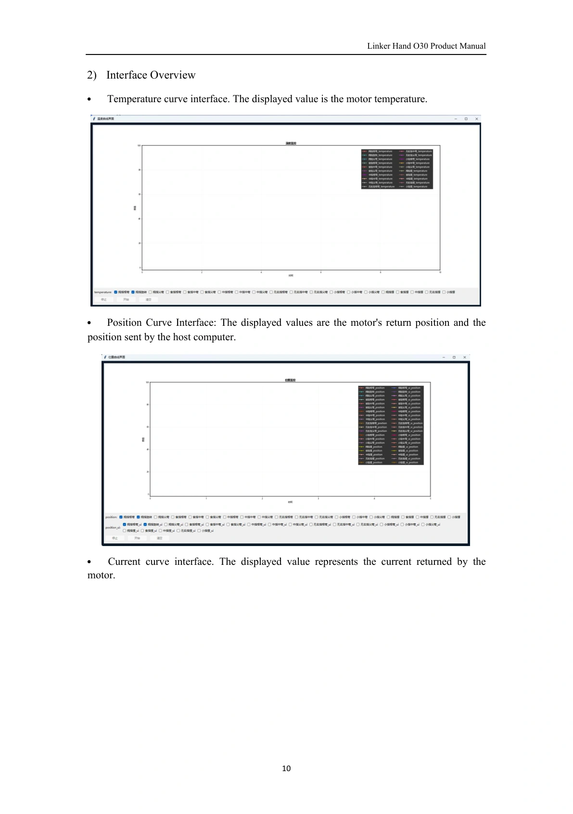

**Native-text transcript**

```
Linker Hand O30 Product Manual
10
2)
Interface Overview
•
Temperature curve interface. The displayed value is the motor temperature.
•
Position Curve Interface: The displayed values are the motor's return position and the
position sent by the host computer.
•
Current curve interface. The displayed value represents the current returned by the
motor.
```

## PDF page 15

**Control and parameter windows** · original PDF page 15 of 25.

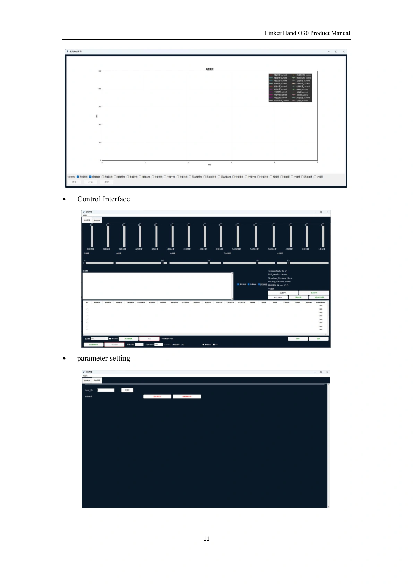

**Native-text transcript**

```
Linker Hand O30 Product Manual
11
•
Control Interface
•
parameter setting
```

## PDF page 16

**CAN connection and sliders** · original PDF page 16 of 25.

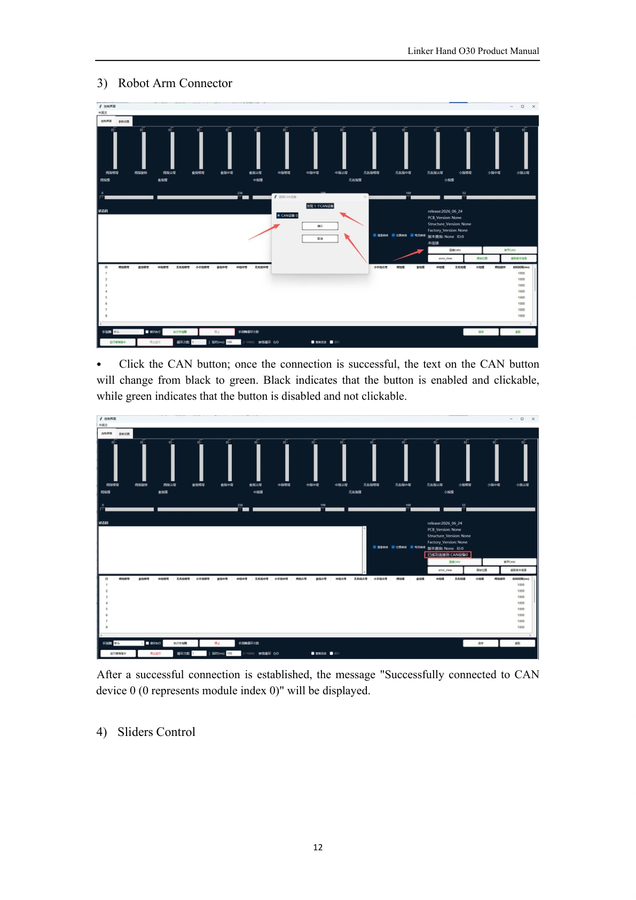

**Native-text transcript**

```
Linker Hand O30 Product Manual
12
3)
Robot Arm Connector
•
Click the CAN button; once the connection is successful, the text on the CAN button
will change from black to green. Black indicates that the button is enabled and clickable,
while green indicates that the button is disabled and not clickable.
After a successful connection is established, the message "Successfully connected to CAN
device 0 (0 represents module index 0)" will be displayed.
4)
Sliders Control
```

## PDF page 17

**Slider inputs and version fields** · original PDF page 17 of 25.

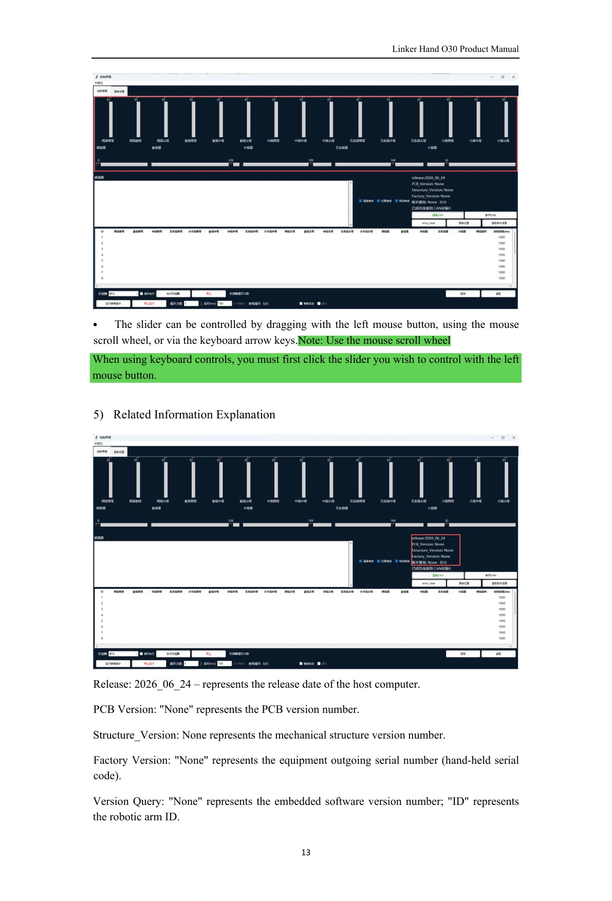

**Native-text transcript**

```
Linker Hand O30 Product Manual
13
•
The slider can be controlled by dragging with the left mouse button, using the mouse
scroll wheel, or via the keyboard arrow keys.Note: Use the mouse scroll wheel
When using keyboard controls, you must first click the slider you wish to control with the left
mouse button.
5)
Related Information Explanation
Release: 2026_06_24 – represents the release date of the host computer.
PCB Version: "None" represents the PCB version number.
Structure_Version: None represents the mechanical structure version number.
Factory Version: "None" represents the equipment outgoing serial number (hand-held serial
code).
Version Query: "None" represents the embedded software version number; "ID" represents
the robotic arm ID.
```

## PDF page 18

**Version query and buttons** · original PDF page 18 of 25.

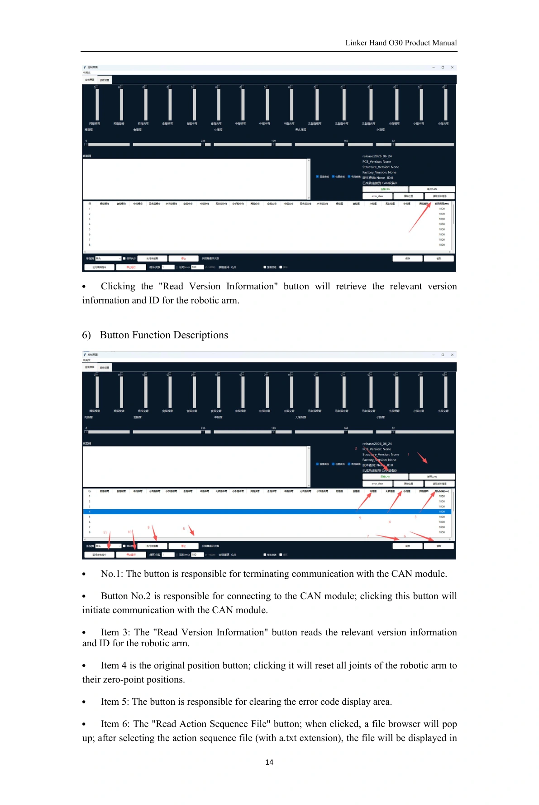

**Native-text transcript**

```
Linker Hand O30 Product Manual
14
•
Clicking the "Read Version Information" button will retrieve the relevant version
information and ID for the robotic arm.
6)
Button Function Descriptions
•
No.1: The button is responsible for terminating communication with the CAN module.
•
Button No.2 is responsible for connecting to the CAN module; clicking this button will
initiate communication with the CAN module.
•
Item 3: The "Read Version Information" button reads the relevant version information
and ID for the robotic arm.
•
Item 4 is the original position button; clicking it will reset all joints of the robotic arm to
their zero-point positions.
•
Item 5: The button is responsible for clearing the error code display area.
•
Item 6: The "Read Action Sequence File" button; when clicked, a file browser will pop
up; after selecting the action sequence file (with a.txt extension), the file will be displayed in
```

## PDF page 19

**Buttons and 22-column sequence table** · original PDF page 19 of 25.

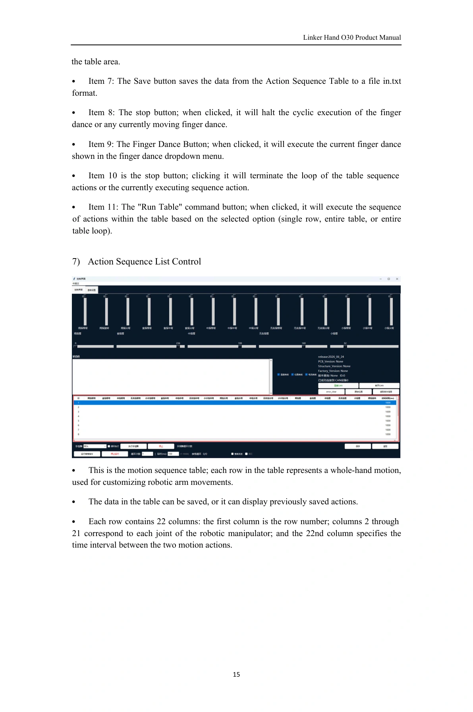

**Native-text transcript**

```
Linker Hand O30 Product Manual
15
•
Item 7: The Save button saves the data from the Action Sequence Table to a file in.txt
format.
•
Item 8: The stop button; when clicked, it will halt the cyclic execution of the finger
dance or any currently moving finger dance.
•
Item 9: The Finger Dance Button; when clicked, it will execute the current finger dance
shown in the finger dance dropdown menu.
•
Item 10 is the stop button; clicking it will terminate the loop of the table sequence
actions or the currently executing sequence action.
•
Item 11: The "Run Table" command button; when clicked, it will execute the sequence
of actions within the table based on the selected option (single row, entire table, or entire
table loop).
7)
Action Sequence List Control
•
the table area.
This is the motion sequence table; each row in the table represents a whole-hand motion,
used for customizing robotic arm movements.
•
The data in the table can be saved, or it can display previously saved actions.
•
Each row contains 22 columns: the first column is the row number; columns 2 through
21 correspond to each joint of the robotic manipulator; and the 22nd column specifies the
time interval between the two motion actions.
```

## PDF page 20

**Sequence execution, intervals and loops** · original PDF page 20 of 25.

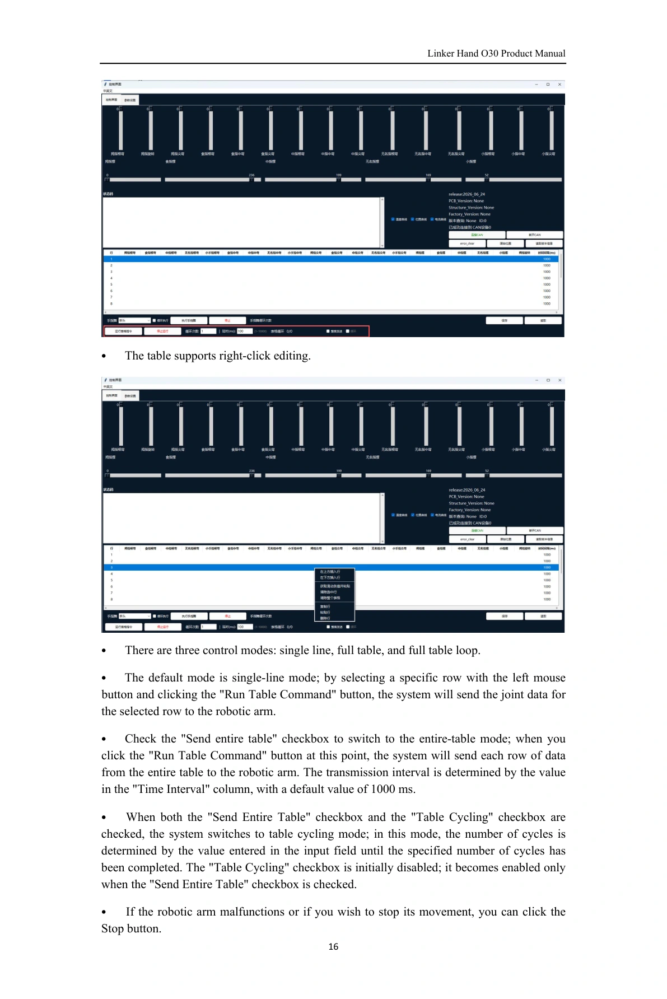

**Native-text transcript**

```
Linker Hand O30 Product Manual
16
•
The table supports right-click editing.
•
There are three control modes: single line, full table, and full table loop.
•
The default mode is single-line mode; by selecting a specific row with the left mouse
button and clicking the "Run Table Command" button, the system will send the joint data for
the selected row to the robotic arm.
•
Check the "Send entire table" checkbox to switch to the entire-table mode; when you
click the "Run Table Command" button at this point, the system will send each row of data
from the entire table to the robotic arm. The transmission interval is determined by the value
in the "Time Interval" column, with a default value of 1000 ms.
•
When both the "Send Entire Table" checkbox and the "Table Cycling" checkbox are
checked, the system switches to table cycling mode; in this mode, the number of cycles is
determined by the value entered in the input field until the specified number of cycles has
been completed. The "Table Cycling" checkbox is initially disabled; it becomes enabled only
when the "Send Entire Table" checkbox is checked.
•
If the robotic arm malfunctions or if you wish to stop its movement, you can click the
Stop button.
```

## PDF page 21

**Finger dance and telemetry** · original PDF page 21 of 25.

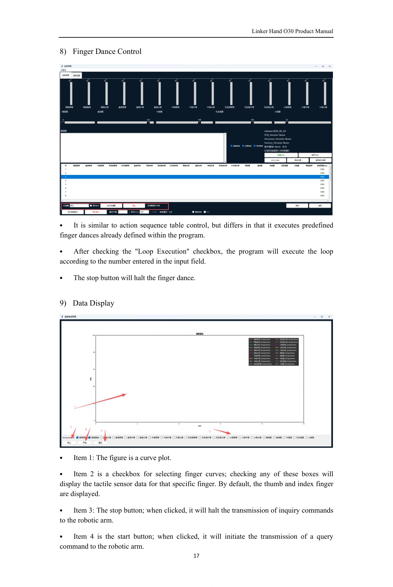

**Native-text transcript**

```
Linker Hand O30 Product Manual
17
8)
Finger Dance Control
•
It is similar to action sequence table control, but differs in that it executes predefined
finger dances already defined within the program.
•
After checking the "Loop Execution" checkbox, the program will execute the loop
according to the number entered in the input field.
•
The stop button will halt the finger dance.
9)
Data Display
•
Item 1: The figure is a curve plot.
•
Item 2 is a checkbox for selecting finger curves; checking any of these boxes will
display the tactile sensor data for that specific finger. By default, the thumb and index finger
are displayed.
•
Item 3: The stop button; when clicked, it will halt the transmission of inquiry commands
to the robotic arm.
•
Item 4 is the start button; when clicked, it will initiate the transmission of a query
command to the robotic arm.
```

## PDF page 22

**Actual/target position and device ID** · original PDF page 22 of 25.

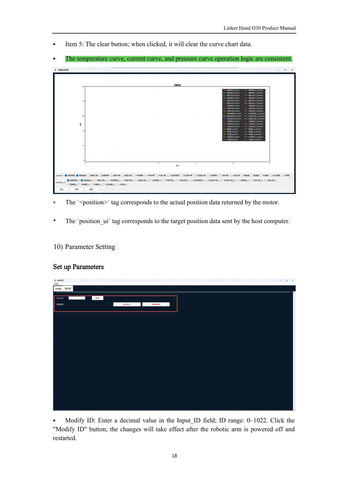

**Native-text transcript**

```
Linker Hand O30 Product Manual
18
•
Item 5: The clear button; when clicked, it will clear the curve chart data.
•
The temperature curve, current curve, and pressure curve operation logic are consistent.
•
The `<position>` tag corresponds to the actual position data returned by the motor.
•
The `position_ui` tag corresponds to the target position data sent by the host computer.
10) Parameter Setting
Set up Parameters
•
Modify ID: Enter a decimal value in the Input_ID field; ID range: 0–1022. Click the
"Modify ID" button; the changes will take effect after the robotic arm is powered off and
restarted.
```

## PDF page 23

**Calibration, language and service** · original PDF page 23 of 25.

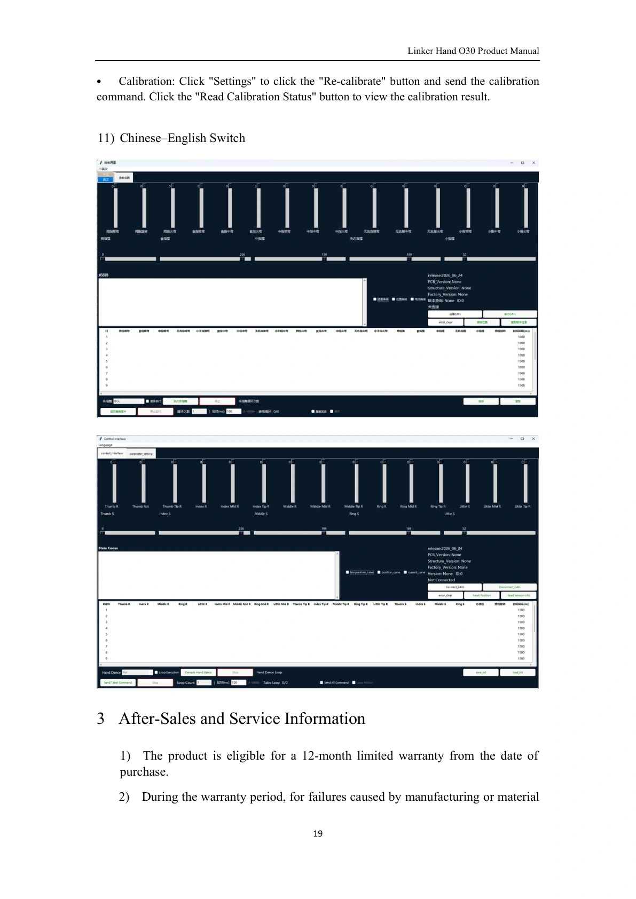

**Native-text transcript**

```
Linker Hand O30 Product Manual
19
•
Calibration: Click "Settings" to click the "Re-calibrate" button and send the calibration
command. Click the "Read Calibration Status" button to view the calibration result.
11) Chinese–English Switch
3 After-Sales and Service Information
1)
The product is eligible for a 12-month limited warranty from the date of
purchase.
2)
During the warranty period, for failures caused by manufacturing or material
```

## PDF page 24

**Warranty continuation** · original PDF page 24 of 25.


**Native-text transcript**

```
Linker Hand O30 Product Manual
20
3)
Disclaimer of Liability: The following situations are not covered by the
warranty:

Surface wear caused by normal use.

Damage resulting from improper operation, accidents, unauthorized
disassembly, or failure to follow the guidelines.
4)
If the issue is not a quality problem, no returns or exchanges will be
accepted.
5)
If your product experiences any malfunction, please contact official after-
sales service immediately; do not attempt to disassemble it yourself.
6)
defects, we will provide free repair or component replacement.
Maintenance services outside the warranty period will incur corresponding
fees.
```

## PDF page 25

**SDK and support** · original PDF page 25 of 25.


**Native-text transcript**

```
Linker Hand O30 Product Manual
Appendix
https://github.com/linker-bot/linkerhand-ros-
sd
ROS SDK download URL:
k
https://github.com/linker-bot/linkerhand-ros
2-sdk
https://github.com/linker-bot/linkerhand-python-sd
ROS2 SDK download URL:
; Python SDK:
k
support@linkerbot.c
Technical Support Email:
n
If you need more product information, please visit our official website:
https://linkerbot.cn
```

[Original PDF external link](https://linkerbot.cn)
