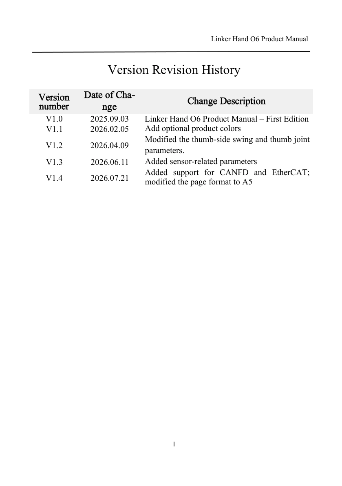
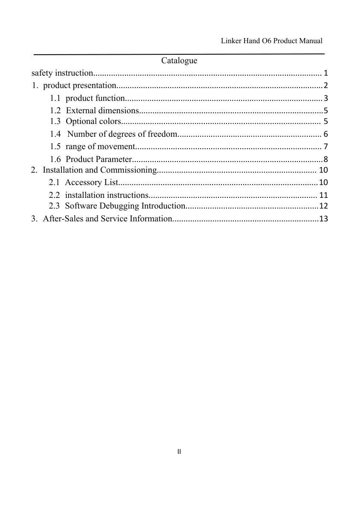
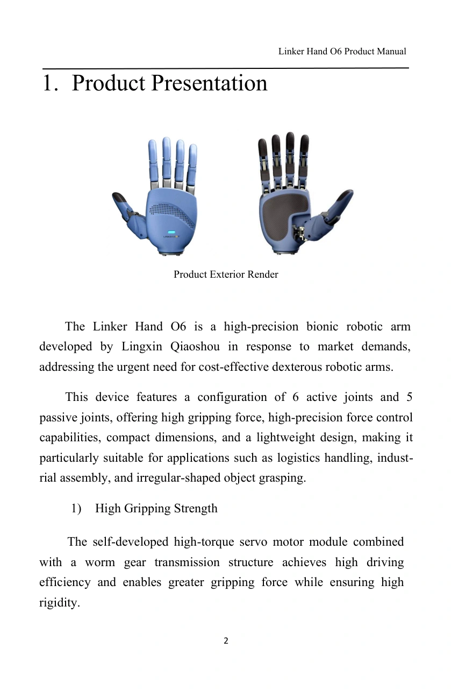
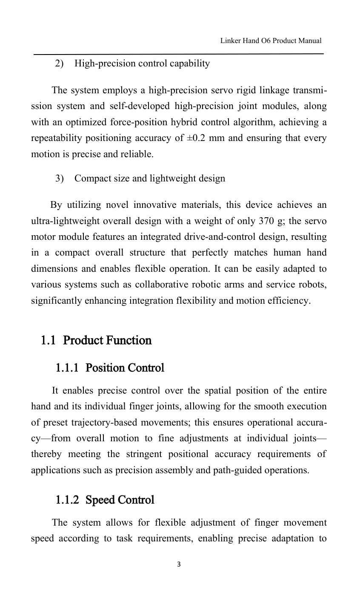
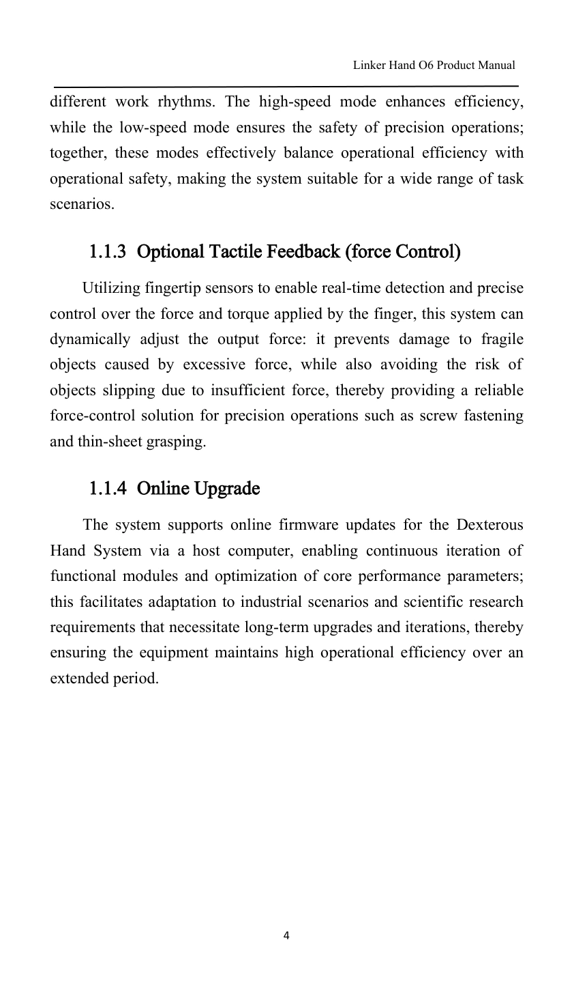
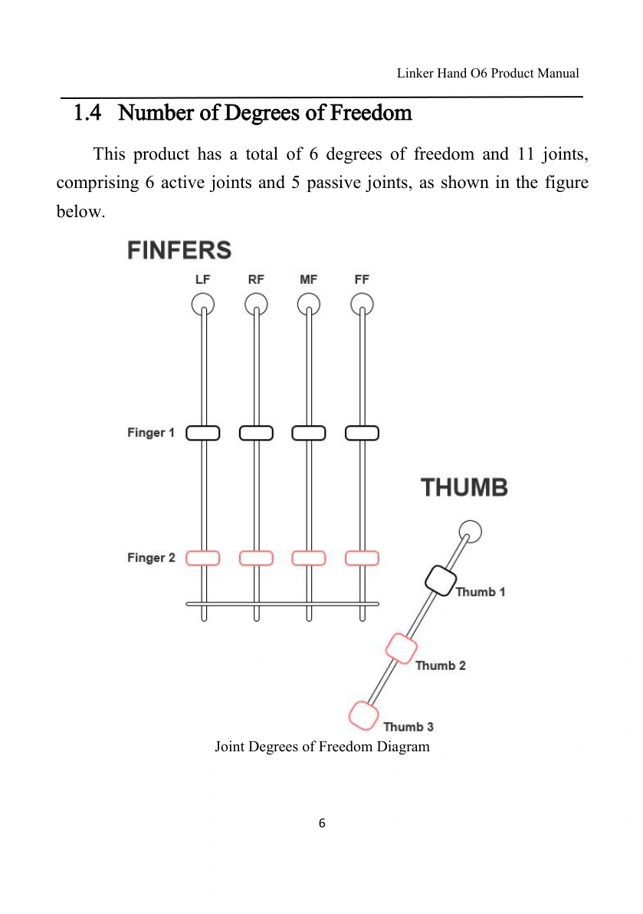
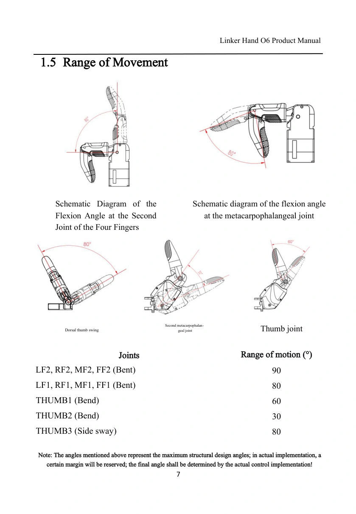
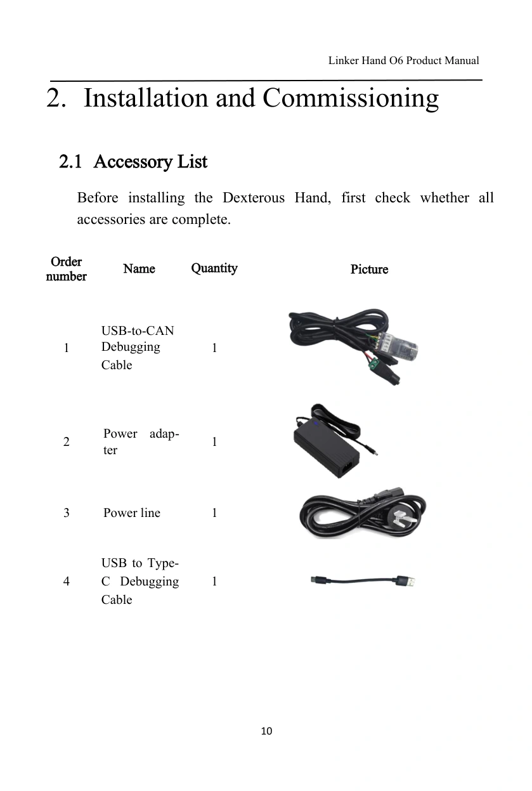

# O6 — Complete Manufacturer Manual

Complete supplied manufacturer reference for **LINKERBOT O6**, **V1.4 · 2026-07-21**. All **17 original PDF pages** appear below with their diagrams and native-text transcripts.

[Canonical O6 engineering guide](../linker-hand-o6-product-manual.md) · [Complete manual library](./)


Match model, side, connector and hardware/firmware revision before using any procedure. The canonical guide identifies source conflicts and commissioning limits. Manufacturer maximum-load claims are not a host arm payload or a safe suspended-load rating. Calibration, sliders, zero/reset and sequence execution can move the fingers.


## Original PDF reading parts

These downloads retain the original PDF page contents. Read the parts in order; the range labels use original PDF page numbers.

* [Download original PDF pages 1–17](../../../.gitbook/assets/linkerbot-o6-manual-pages-001-017.pdf)

## Page and chapter index

| Original PDF page                | Content                                    |
| -------------------------------- | ------------------------------------------ |
| [1](complete-o6.md#pdf-page-1)   | Cover                                      |
| [2](complete-o6.md#pdf-page-2)   | Revision history                           |
| [3](complete-o6.md#pdf-page-3)   | Contents                                   |
| [4](complete-o6.md#pdf-page-4)   | Safety instructions                        |
| [5](complete-o6.md#pdf-page-5)   | Overview                                   |
| [6](complete-o6.md#pdf-page-6)   | Precision, mass and position/speed control |
| [7](complete-o6.md#pdf-page-7)   | Optional tactile and online upgrades       |
| [8](complete-o6.md#pdf-page-8)   | Dimensions and color options               |
| [9](complete-o6.md#pdf-page-9)   | Joint configuration                        |
| [10](complete-o6.md#pdf-page-10) | Structural motion ranges                   |
| [11](complete-o6.md#pdf-page-11) | Electrical and force specifications        |
| [12](complete-o6.md#pdf-page-12) | Optional sensor conditions                 |
| [13](complete-o6.md#pdf-page-13) | Accessories                                |
| [14](complete-o6.md#pdf-page-14) | M3 flange and XT30 connector               |
| [15](complete-o6.md#pdf-page-15) | PEAK driver and commissioning              |
| [16](complete-o6.md#pdf-page-16) | Service and warranty                       |
| [17](complete-o6.md#pdf-page-17) | SDK and support                            |

## Source and interpretation

Source: LINKERBOT / Lingxin Qiaoshou (Beijing) Technology Co., Ltd., supplied **Linker Hand O6 Product Manual.pdf**. The internal revision history, rather than the filename, identifies this edition. Page images are authoritative for spatial layout and symbols; transcripts are the native PDF text, including translation quirks and original inconsistencies. Numerical ranges and motion limits must be checked against the actual controller and unit. The original SDK appendix is retained; current development guidance is in the linked model guide.

## PDF page 1

**Cover** · original PDF page 1 of 17.


**Native-text transcript**

```
Linker Hand O 6 Product
Manual
Lingxin Qiaoshou (Beijing) Technol-
ogy Co., Ltd.
```

## PDF page 2

**Revision history** · original PDF page 2 of 17.



**Native-text transcript**

```
Linker Hand O6 Product Manual
I
Version Revision History
Version
number
Date of Cha-
nge
Change Description
V1.0
2025.09.03
Linker Hand O6 Product Manual – First Edition
V1.1
2026.02.05
Add optional product colors
V1.2
2026.04.09
Modified the thumb-side swing and thumb joint
parameters.
V1.3
2026.06.11
Added sensor-related parameters
V1.4
2026.07.21
Added support for CANFD and EtherCAT;
modified the page format to A5
```

## PDF page 3

**Contents** · original PDF page 3 of 17.



**Native-text transcript**

```
Linker Hand O6 Product Manual
II
Catalogue
safety instruction....................................................................................................... 1
1. product presentation.............................................................................................2
1.1 product function.........................................................................................3
1.2 External dimensions...................................................................................5
1.3 Optional colors.......................................................................................... 5
1.4 Number of degrees of freedom................................................................. 6
1.5 range of movement.................................................................................... 7
1.6 Product Parameter......................................................................................8
2. Installation and Commissioning........................................................................ 10
2.1 Accessory List..........................................................................................10
2.2 installation instructions............................................................................ 11
2.3 Software Debugging Introduction............................................................12
3. After-Sales and Service Information..................................................................13
```

## PDF page 4

**Safety instructions** · original PDF page 4 of 17.


**Native-text transcript**

```
Linker Hand O6 Product Manual
1
Safety Instruction
Before installing or using this product, please carefully read this
manual and any related manuals. For all relevant safety precautions
described in these manuals, please be sure to read the corresponding
instructions carefully.
1.It is essential to ensure that this product is connected using the
matching or specified cables, and to securely fasten the product in
accordance with the instructions; do not use damaged power cords,
plugs, or loose sockets.
2. This product must comply with the installation requirements
described in this manual; using this product under conditions that
exceed the specified installation requirements may shorten the product's
service life and may lead to serious safety hazards.
3. If this product is operated at high power for an extended period, its
temperature may rise. If the temperature becomes excessively high,
please stop operation, allow it to cool down for a while, and then
resume use.
4. This equipment must only be operated by trained personnel; please
do not open the casing or disassemble the device without authorization.
If the equipment malfunctions, do not attempt to repair it yourself;
please contact our after-sales service department.
5. The diagrams and photographs in this manual are for illustrative
purposes only and may differ from the details of the product purchased;
additionally, this manual may be subject to appropriate revisions due to
product improvements, specification changes, or other reasons.
```

## PDF page 5

**Overview** · original PDF page 5 of 17.



**Native-text transcript**

```
Linker Hand O6 Product Manual
2
1. Product Presentation
The Linker Hand O6 is a high-precision bionic robotic arm
developed by Lingxin Qiaoshou in response to market demands,
addressing the urgent need for cost-effective dexterous robotic arms.
This device features a configuration of 6 active joints and 5
passive joints, offering high gripping force, high-precision force control
capabilities, compact dimensions, and a lightweight design, making it
particularly suitable for applications such as logistics handling, indust-
rial assembly, and irregular-shaped object grasping.
1)
High Gripping Strength
The self-developed high-torque servo motor module combined
with a worm gear transmission structure achieves high driving
efficiency and enables greater gripping force while ensuring high
rigidity.
Product Exterior Render
```

## PDF page 6

**Precision, mass and position/speed control** · original PDF page 6 of 17.



**Native-text transcript**

```
Linker Hand O6 Product Manual
3
2)
High-precision control capability
The system employs a high-precision servo rigid linkage transmi-
ssion system and self-developed high-precision joint modules, along
with an optimized force-position hybrid control algorithm, achieving a
repeatability positioning accuracy of ±0.2 mm and ensuring that every
motion is precise and reliable.
3)
Compact size and lightweight design
By utilizing novel innovative materials, this device achieves an
ultra-lightweight overall design with a weight of only 370 g; the servo
motor module features an integrated drive-and-control design, resulting
in a compact overall structure that perfectly matches human hand
dimensions and enables flexible operation. It can be easily adapted to
various systems such as collaborative robotic arms and service robots,
significantly enhancing integration flexibility and motion efficiency.
1.1 Product Function
1.1.1 Position Control
It enables precise control over the spatial position of the entire
hand and its individual finger joints, allowing for the smooth execution
of preset trajectory-based movements; this ensures operational accura-
cy—from overall motion to fine adjustments at individual joints—
thereby meeting the stringent positional accuracy requirements of
applications such as precision assembly and path-guided operations.
1.1.2 Speed Control
The system allows for flexible adjustment of finger movement
speed according to task requirements, enabling precise adaptation to
```

## PDF page 7

**Optional tactile and online upgrades** · original PDF page 7 of 17.



**Native-text transcript**

```
Linker Hand O6 Product Manual
4
1.1.3 Optional Tactile Feedback (force Control)
Utilizing fingertip sensors to enable real-time detection and precise
control over the force and torque applied by the finger, this system can
dynamically adjust the output force: it prevents damage to fragile
objects caused by excessive force, while also avoiding the risk of
objects slipping due to insufficient force, thereby providing a reliable
force-control solution for precision operations such as screw fastening
and thin-sheet grasping.
1.1.4 Online Upgrade
The system supports online firmware updates for the Dexterous
Hand System via a host computer, enabling continuous iteration of
functional modules and optimization of core performance parameters;
this facilitates adaptation to industrial scenarios and scientific research
requirements that necessitate long-term upgrades and iterations, thereby
ensuring the equipment maintains high operational efficiency over an
extended period.
different work rhythms. The high-speed mode enhances efficiency,
while the low-speed mode ensures the safety of precision operations;
together, these modes effectively balance operational efficiency with
operational safety, making the system suitable for a wide range of task
scenarios.
```

## PDF page 8

**Dimensions and color options** · original PDF page 8 of 17.


**Native-text transcript**

```
Linker Hand O6 Product Manual
5
1.2 External Dimensions
External Dimensions Diagram (Units: mm)
1.3 Optional Colors
Pearl white
Obsidian Black
Tech Silver
Amber Orange
Aurora Blue
Golden Amber
Xingyao Purple
```

## PDF page 9

**Joint configuration** · original PDF page 9 of 17.



**Native-text transcript**

```
Linker Hand O6 Product Manual
6
1.4 Number of Degrees of Freedom
This product has a total of 6 degrees of freedom and 11 joints,
comprising 6 active joints and 5 passive joints, as shown in the figure
below.
Joint Degrees of Freedom Diagram
```

## PDF page 10

**Structural motion ranges** · original PDF page 10 of 17.



**Native-text transcript**

```
Linker Hand O6 Product Manual
7
1.5 Range of Movement
Schematic Diagram of the
Flexion Angle at the Second
Joint of the Four Fingers
Schematic diagram of the flexion angle
at the metacarpophalangeal joint
Dorsal thumb swing
Second metacarpophalan-
geal joint
Thumb joint
Joints
Range of motion (°)
LF2, RF2, MF2, FF2 (Bent)
90
LF1, RF1, MF1, FF1 (Bent)
80
THUMB1 (Bend)
60
THUMB2 (Bend)
30
THUMB3 (Side sway)
80
Note: The angles mentioned above represent the maximum structural design angles; in actual implementation, a
certain margin will be reserved; the final angle shall be determined by the actual control implementation!
```

## PDF page 11

**Electrical and force specifications** · original PDF page 11 of 17.


**Native-text transcript**

```
Linker Hand O6 Product Manual
8
1.6 Product Parameter
1.6.1 Underlying Parameter
Model
Linker Hand O6
Number of degrees of freedom
6
Number of joints
11 (6 Active + 5 Passive)
Driving mode
Connecting rod transmission
Control interface
CAN/CANFD/RS485/EtherCAT
Weight
370g
Maximum load
50kg
Working voltage
24V~48V
Repetitive positioning accuracy
<±0.20mm
Tactile type sensor
Optional accessories
1.6.2 Mechanical Performance Parameters
Performance index
Specific Parameters
Maximum thumb fingertip force
20N
Maximum fingertip force of the four
fingers
25N
Maximum gripping force of each
finger
70N
```

## PDF page 12

**Optional sensor conditions** · original PDF page 12 of 17.


**Native-text transcript**

```
Linker Hand O6 Product Manual
9
1.6.3 Sensor Parameters (Tactile Sensors Are Optional)
Parameter
Parameter
declaration
Remarks
Piezoresistive ar-
ray
4*10
Touch Force
5g
Use standard weights for testing;
No rubber pad or use of a 1 mm rubber pad
Range
20N
Life span
10 Ten tho-
usand times
Use rubber with a Shore A hardness of 50 and a
thickness of 1 mm;
Default load: 100g
Communication
Frame Rate
200FPS
Scale
0~4095
Voltage value corresponding to the pressure
```

## PDF page 13

**Accessories** · original PDF page 13 of 17.



**Native-text transcript**

```
Linker Hand O6 Product Manual
10
2. Installation and Commissioning
2.1 Accessory List
Before installing the Dexterous Hand, first check whether all
accessories are complete.
Order
number
Name
Quantity
Picture
1
USB-to-CAN
Debugging
Cable
1
2
Power
adap-
ter
1
3
Power line
1
4
USB to Type-
C Debugging
Cable
1
```

## PDF page 14

**M3 flange and XT30 connector** · original PDF page 14 of 17.


**Native-text transcript**

```
Linker Hand O6 Product Manual
11
2.2 Installation Instructions
2.2.1 Structural Installation Instructions
Installation requires M3 screws; the specific screw length should
be adjusted according to the thickness of the mounting component. The
installation diagram for the flange structure is shown below.
Flange Connection Diagram
2.2.2 Electrical Installation Instructions
The flexible hand utilizes an XT30 (2+2) connector, with the
pinout as shown in the table below.
Pin order
Explain
1
CAN L
2
CAN H
3
GND
4
24V—48V
```

## PDF page 15

**PEAK driver and commissioning** · original PDF page 15 of 17.


**Native-text transcript**

```
Linker Hand O6 Product Manual
12
2.3 Software Debugging Introduction
2.3.1 Commissioning Preparation Work
1) Connect the Smart Hand to the debugging PC using the
USB-to-CAN debugging cable; after plugging in the power
cord and the power adapter, insert the power cord into the
power port of the USB-to-CAN debugging cable, and plug
the other end into the AC 220V extension cord.
2) Open the file"PEAK-System_Driver-Setup" and install the
driver files step by step (drivers must be installed on
Windows systems, but are not required on Linux systems);
2.3.2 Upper-Level Computer Software Description
For details, refer to the upper-level computer software operating
instructions.
```

## PDF page 16

**Service and warranty** · original PDF page 16 of 17.


**Native-text transcript**

```
Linker Hand O6 Product Manual
13
3. After-Sales and Service Informat-
ion
1)
The product is eligible for a 12-month limited warranty from
the date of purchase.
2)
During the warranty period, for failures caused by manufact-
uring or material defects, we will provide free repair or compon-
ent replacement.
3)
Disclaimer of Liability: The following circumstances are not
covered by the warranty:

Surface wear caused by normal use.

Damage resulting from improper operation, accidents,
unauthorized disassembly, or failure to follow the guidelines.
4)
If the issue is not a quality problem, no returns or exchanges
will be accepted.
5)
If your product experiences any malfunction, please contact
official after-sales service immediately; do not attempt to disass-
emble it yourself.
6)
Maintenance services outside the warranty period will incur
corresponding fees.
```

## PDF page 17

**SDK and support** · original PDF page 17 of 17.


**Native-text transcript**

```
Linker Hand O6 Product Manual
Appendix ：
ROS_SDK:
https://github.com/linker-bot/linkerhand-ros-sdk
ROS2_SDK:
https://github.com/linker-bot/linkerhand-ros2-sdk
Python_SDK:
https://github.com/linker-bot/linkerhand-python-sdk
support@linkerbot.c
Technical Support Email:
n
If you need more product information, please visit our official
website:https://linkerbot.cn
```

[Original PDF external link](https://github.com/linker-bot/linkerhand-python-sdk)

[Original PDF external link](https://linkerbot.cn)
