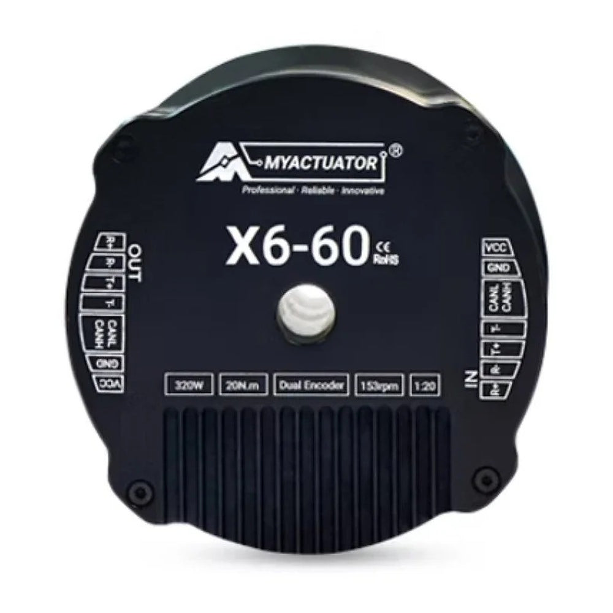

# MyActuator RMD-X6-P20 and RMD-X8-P20 Engineering Guide


[**View RMD-X6-P20-60-E on OpenELAB**](https://openelab.io/products/myactuator-rmd-x6-p20-actuator) · [**View RMD-X8-P20-120-E on OpenELAB**](https://openelab.io/products/myactuator-rmd-x8-p20-actuator)

**Models:** RMD-X6-P20-60-E and RMD-X8-P20-120-E · **SKUs:** `MyActuator-RMD-X6-P20-60-E`, `MyActuator-RMD-X8-P20-120-E` · **Scope:** dual-encoder E variants; match V4/V4.1 generation and firmware.


## Product overview

This shared guide covers the X6-60 and X8-120 integrated planetary actuators. The older single-encoder V2 models, different ratios and CAN-only suffixes need their own documentation. For the detailed X8 mechanical, electrical and commissioning reference, use the [dedicated X8-120 guide](rmd-x8-p20-120-e-development-guide.md).

The store listings separate motor-only and accessory-only variants. Select the complete motor SKU above before assuming a USB-CAN or RJ45 board is included.

## Applications

These actuators are starting points for research robot joints and rotary mechanisms. Choose between them using rated torque, speed, mass and thermal duty rather than the shared P20 name. Neither reference configuration includes a brake; independently support a load that could move when power is removed.

## Specifications

| Parameter                        | X6-P20-60-E       | X8-P20-120-E      |
| -------------------------------- | ----------------- | ----------------- |
| Actual reduction ratio           | 19.612:1          | 19.612:1          |
| Nominal supply / operating range | 48 V / 20–55 V DC | 48 V / 20–55 V DC |
| Rated / peak torque              | 20 / 60 N·m       | 43 / 120 N·m      |
| Rated / no-load output speed     | 153 / 176 rpm     | 127 / 158 rpm     |
| Rated output power               | 320 W             | 574 W             |
| Rated / peak phase current       | 9.5 / 29.1 Arms   | 17.6 / 43.8 Arms  |
| Input / output absolute encoders | 17-bit / 17-bit   | 17-bit / 17-bit   |
| Backlash                         | ≤15 arcmin        | ≤15 arcmin        |
| Bearing                          | Crossed roller    | Crossed roller    |
| Mass                             | 0.82 kg           | 1.40 kg           |
| Communication                    | CAN and EtherCAT  | CAN and EtherCAT  |
| Brake in reference configuration | None              | None              |

Sources: [X6-60 parameter sheet 260903 / model archive](https://www.myactuator.com/_files/archives/cab28a_4231acdf891b41f3a56bb690f4c1d312.zip) and [X8-120 parameter sheet 260903 / model archive](https://www.myactuator.com/_files/archives/cab28a_2f52d96407934978a1b0e6c98b33a928.zip).

Peak torque is not continuous holding torque, and phase RMS current is not DC supply current. P20 is a family designation; use 19.612 only where a motor-to-output conversion is actually required. Do not apply it twice to commands/feedback already in output-shaft units. The sheets cap operation at 55 V and state that above nominal voltage, speed must not exceed rated speed. Include regenerative energy when sizing the DC bus.

## Hardware and connections

Required equipment: a secured unloaded actuator, a 48 V DC nominal (20–55 V operating range) supply, suitable power wiring and isolation, one CAN interface with its supported host software, and the model-specific mating cables. Phase current in a motor table is not a substitute for calculating the DC supply requirement.

Use the exact [model drawing / parameter archive](https://www.myactuator.com/_files/archives/cab28a_4231acdf891b41f3a56bb690f4c1d312.zip) and [generation manual](https://www.myactuator.com/_files/archives/cab28a_a5b8b24b40ac4f6d87bae373b0de459a.zip) for connector orientation and screw depth. Connect the external supply to VCC/DC+ and GND/DC−; connect CAN\_H to CAN\_H and CAN\_L to CAN\_L with the documented common reference. Do not infer a pin number from a product photograph or use communication pins as power inputs.

For EtherCAT, distinguish the actuator's IN and OUT ports and preserve the T+/T− and R+/R− differential pairs. Use the matching cable/adapter and ESI. The RJ45 adapter is a connector interface, not a substitute for an EtherCAT master.

For a CAN bench connection, use a linear bus with 120 Ω termination at each physical end and a common reference as specified by the manufacturer. Count any built-in USB-CAN termination; do not add a resistor at every motor. With power off, two 120 Ω end resistors in parallel measure about 60 Ω between CAN\_H and CAN\_L. This resistance check is a wiring diagnostic, not proof of communication.

## Software and development resources

The [manufacturer setup-software page](https://www.myactuator.com/downloads-setupsoftware) is the source for the setup utility and its supported model list. The [X manual bundle](https://www.myactuator.com/_files/archives/cab28a_a5b8b24b40ac4f6d87bae373b0de459a.zip) includes CAN protocol V4.4-260425 and EtherCAT protocol V2.0-260425. Match the full model and firmware generation before changing parameters.

A compatible raw CAN frame utility is sufficient for the first result below. Install the driver that matches the actual USB-CAN hardware and host operating system; this guide does not assume that the adapter exposes Linux SocketCAN or a serial COM protocol. The manufacturer's [SDK downloads](https://www.myactuator.com/downloads-sdk) provide optional integration starting points. Their exact OS, dependency and model coverage must be checked in the selected release before building; no SDK build is required for this status-read procedure. Preserve calibration and parameter backups before any firmware change.

For EtherCAT integration, use the [official ESI downloads](https://www.myactuator.com/downloads-ethercatesi) and the protocol's object dictionary for the fitted firmware. Confirm slave identity and process-data mapping before enabling operation.

## Getting started

### First working result: read status over CAN

1. Record the label, controller/firmware revision and saved motor ID. Connect only one unloaded motor; secure it and leave motion disabled.
2. With power off, connect power and CAN as described above. Verify polarity, common reference and the two end terminations. Set the supply within the documented range; use nominal voltage for rated-condition work.
3. Install the interface's matching driver, open the CAN utility and select its channel. For the cited protocol, select **1 Mbit/s, standard 11-bit data frames, DLC 8**. If this motor has a previously changed bitrate, use that saved setting rather than writing a new one blindly.
4. Send one read-status command to arbitration ID **0x140 + motor ID**. For a motor confirmed as ID 1, enter transmit ID **0x141** and payload **9A 00 00 00 00 00 00 00**. ID 1 is an example, not a discovery result.
5. Inspect the reply at **0x240 + motor ID** (**0x241** for ID 1). The command byte should be 0x9A. Decode temperature, bus voltage and fault flags using the **Read Motor Status 1 and Error Flag** table in the [cited protocol package](https://www.myactuator.com/_files/archives/cab28a_a5b8b24b40ac4f6d87bae373b0de459a.zip); byte layouts can differ across firmware generations.
6. Repeat the read and record the actual voltage, temperature and fault state. Resolve any fault before a separate motion test. Only after confirming angle units, direction, current limits and stop behavior should a bounded, low-speed, unloaded movement be attempted.

**Expected result:** repeatable status replies from the intended ID, with plausible bus voltage/temperature and fault information that can be decoded for the recorded firmware. A status reply establishes communication, not motion or load qualification.

**If this check fails:** verify supply at the actuator, adapter enumeration, CAN\_H/CAN\_L and reference wiring, termination, saved bitrate and ID, then protocol/firmware pairing. Do not repeatedly send enable or motion commands to diagnose a missing reply.

## Troubleshooting and FAQs

**Can X12 parameters be imported?**

Do not transfer model-specific gains, limits or encoder calibration. X6 and X8 also have different torque, current, speed and thermal requirements despite their common actual ratio.

**CAN works but EtherCAT does not**

Check the exact interface variant, IN/OUT connection, master configuration and ESI/firmware pairing. The official ESI listing pairs MT-Device-260424.XML with firmware 26042402; do not choose by filename recency alone.

**Status is valid but direction or scaling is wrong**

Stop and check coordinate sign, zero offset, command units and motor-side versus output-side feedback before moving the mechanism. Preserve calibration and parameter backups.

**The motor becomes hot while holding**

Reduce holding demand and inspect current, temperature and duty cycle. Neither 60 N·m nor 120 N·m is a continuous holding specification.

## Downloads and technical documents

| Resource                                       | Purpose and revision                                                                                                | Link                                                                                                   |
| ---------------------------------------------- | ------------------------------------------------------------------------------------------------------------------- | ------------------------------------------------------------------------------------------------------ |
| Exact-model parameters and mechanical drawings | X6-60 parameter sheet 260903 and exact-model drawings; use supplied drawings/CAD rather than dimensions from images | [Official ZIP](https://www.myactuator.com/_files/archives/cab28a_4231acdf891b41f3a56bb690f4c1d312.zip) |
| Manuals and protocols                          | X V4 manual 261029, user manual V1.1, CAN V4.4-260425, EtherCAT V2.0-260425                                         | [Official ZIP](https://www.myactuator.com/_files/archives/cab28a_a5b8b24b40ac4f6d87bae373b0de459a.zip) |
| Model document center                          | Current revision listings and CAD packages                                                                          | [Manufacturer downloads](https://www.myactuator.com/downloads-xseries)                                 |
| Host setup utility                             | Select model/driver generation before installation                                                                  | [Setup software](https://www.myactuator.com/downloads-setupsoftware)                                   |
| Optional development SDK                       | Check release README, dependencies and licensing before use                                                         | [SDK downloads](https://www.myactuator.com/downloads-sdk)                                              |
| EtherCAT ESI                                   | Match actuator firmware/product identity                                                                            | [ESI downloads](https://www.myactuator.com/downloads-ethercatesi)                                      |

## References and validation

The X6 and X8 manufacturer parameter archives above establish the comparison; the X V4 manual bundle supplies wiring and protocol references. [X6 store listing](https://openelab.io/products/myactuator-rmd-x6-p20-actuator) and [X8 store listing](https://openelab.io/products/myactuator-rmd-x8-p20-actuator) identify the covered SKUs.

Reviewed 19 November 2026. Parameter PDFs were extracted and visually checked, and the CAN status-read procedure was checked against the protocol. Software compilation, driver installation and physical hardware tests were **not run**. Record the actual firmware, host environment, motor ID and results when reproducing the check.

[Dedicated X8-120 guide](rmd-x8-p20-120-e-development-guide.md) · [All MyActuator guides](./)
