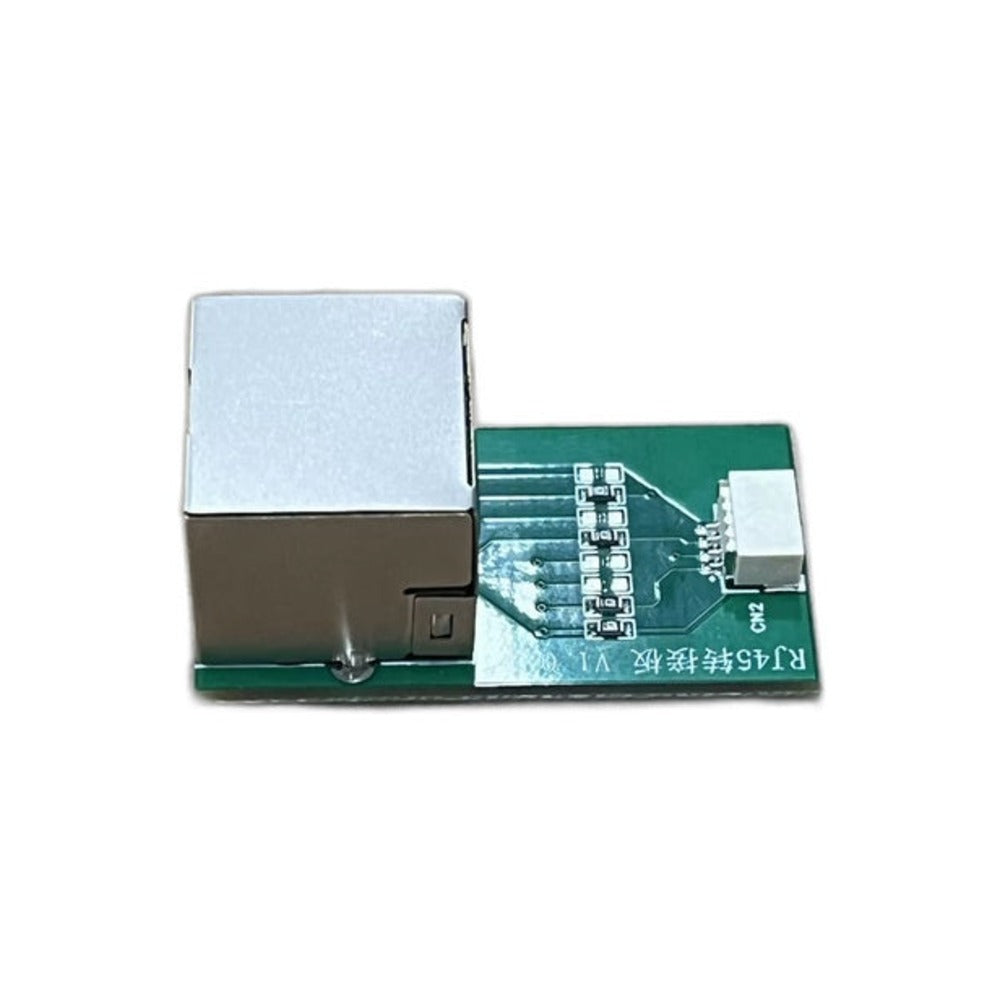

# MyActuator RJ45 Adapter Plate V1.0 Guide


[**View MyActuator RJ45 Adapter Plate V1.0 on OpenELAB**](https://openelab.io/products/myactuator-rj45-servo-network-adapter)

**Model:** RJ45 Adapter Plate V1.0 · **SKU:** `MyActuator-RJ45-Adapter` · **Revision / option:** RJ45 adapter plate V1.0; accessory only


## Product overview

This board adapts an RJ45 cable connection to the manufacturer's actuator-side EtherCAT wiring. It does not itself provide an EtherCAT master, motor power, or an Ethernet-to-CAN gateway. A familiar RJ45 connector alone does not establish compatibility with ordinary Ethernet peripherals or Power over Ethernet.

## Applications

Use it to connect a compatible MyActuator EtherCAT actuator to an EtherCAT master for slave discovery and motion-system integration. It is an interface accessory; the actuator, its matched cable, DC supply and master are separate requirements.

## Specifications

| Item                    | Value / scope                                                  |
| ----------------------- | -------------------------------------------------------------- |
| Store model             | RJ45-to-ETHERCAT                                               |
| Board version           | RJ45 adapter plate V1.0                                        |
| Listed mass             | 6.8 g                                                          |
| Network side            | RJ45 connector                                                 |
| Actuator side           | Manufacturer T+, T−, R+, R− signal pairs                       |
| Firmware / SDK on plate | No separate plate firmware or SDK is specified                 |
| Motor power             | Separate DC supply connected to the actuator's power terminals |

Sources: [OpenELAB listing](https://openelab.io/products/myactuator-rj45-servo-network-adapter) and [manufacturer RJ45 Adapter Plate V1.0 accessory diagram](https://www.myactuator.com/_files/archives/cab28a_bc732701dadf4512a0d917ecaab12747.zip). Compatibility is with the documented cable/actuator interface, not every socket carrying an RJ45 or four-pin connector.

## Hardware and connections

Use the **RJ45 Adapter Plate V1.0** drawing in the [RH-25 accessory sheet](https://www.myactuator.com/_files/archives/cab28a_bc732701dadf4512a0d917ecaab12747.zip) to identify the RJ45 side and the T+/T−, R+/R− terminals. Use the manufacturer's matched harness and follow the actuator's own IN/OUT diagram, including its viewing orientation. Do not invent RJ45 pin numbers from a photograph, reverse pair polarity, or swap the transmit/receive pairs.

Connect the master-side cable to the adapter and its matched harness to the actuator **EtherCAT IN** port. For a chain, connect that actuator's OUT to the next actuator's IN using the correct manufacturer harness. Wire motor DC power separately, with all connections made while unpowered. Do not apply motor DC or an improvised PoE feed to the adapter signal pins.

The board does not use the 120 Ω termination rule from CAN. Keep the EtherCAT link and optional CAN debugging bus electrically distinct.

## Software and development resources

The plate has no independent software stack to install. Configure the **EtherCAT master and actuator**. Download the matching [ESI description](https://www.myactuator.com/downloads-ethercatesi) for the actuator product/firmware and use [EtherCAT control protocol V2.0-260425](https://www.myactuator.com/_files/archives/cab28a_be98b58973d34f7aaa50bdf3f2aa12ed.zip) for its object dictionary and state machine.

The first check is slave identification, which can be done before motion is enabled. Host OS support, network-interface requirements and installation depend on the chosen EtherCAT master. The [manufacturer SDK downloads](https://www.myactuator.com/downloads-sdk) include an EtherCAT development route; inspect that release's platform/dependency documentation before using it. The adapter alone is not a guarantee of compatibility with a particular PLC or PC network card.

## Getting started

### Prerequisites

A compatible MyActuator EtherCAT actuator, this plate and matched harness, the actuator's external DC supply, a supported EtherCAT master/network interface, and the matching ESI file. Secure the motor and leave motion disabled.

1. Record the complete actuator model and firmware. Obtain its port diagram and the matching ESI; confirm that the motor has the EtherCAT interface.
2. With power off, connect the master interface through the RJ45 plate/harness to the motor's EtherCAT IN. Connect the motor power separately and check polarity.
3. Install/import the ESI into the chosen master's device-description catalog using that master's documented workflow. Select the dedicated EtherCAT interface.
4. Power the actuator, scan the EtherCAT bus and compare the discovered product identity/revision with the ESI and motor label. If there is a mismatch, resolve it before applying a process-data configuration.
5. Use the master's diagnostic view to verify stable communication and read slave information in the appropriate non-motion state. Configure process data and drive enable only as a separate step using the matching protocol and the mechanism's limits.

**Expected result:** the master discovers the intended actuator with the correct product identity and stable communication, without enabling motion. The adapter plate is not expected to appear as an independent motor/slave.

**If this check fails:** check motor power, master-interface selection, IN/OUT direction, harness orientation/pairs, link diagnostics and ESI/product revision, in that order.

## Troubleshooting and FAQs

**RJ45 is plugged into a router but the motor does not appear**

An ordinary network connection is not an EtherCAT master configuration. Use the master and topology required by the actuator, beginning with one direct bench connection.

**The master sees a slave but will not enter operational state**

Inspect ESI/product revision, process-data mapping and master diagnostics. Confirm the drive state separately from the EtherCAT communication state; do not force drive enable to fix a configuration error.

**CAN works but EtherCAT does not**

CAN communication does not prove the EtherCAT cable, IN/OUT connection, ESI or master setup. Test those separately. Retaining a correctly wired CAN diagnostics path can help inspect actuator faults.

**Can any four-pin cable replace the supplied harness?**

No. Confirm connector keying, pitch, pair mapping and orientation from the exact actuator diagram. A connector that physically fits is not sufficient evidence of electrical compatibility.

## Downloads and technical documents

| Resource                                | Use                                                                    | Link                                                                                                      |
| --------------------------------------- | ---------------------------------------------------------------------- | --------------------------------------------------------------------------------------------------------- |
| RJ45 plate / actuator interface diagram | Connector labels and matched EtherCAT harness, sheet 260805            | [RH-25 model ZIP](https://www.myactuator.com/_files/archives/cab28a_bc732701dadf4512a0d917ecaab12747.zip) |
| EtherCAT protocol                       | Object dictionary, communication states and drive control, V2.0-260425 | [RH manual ZIP](https://www.myactuator.com/_files/archives/cab28a_be98b58973d34f7aaa50bdf3f2aa12ed.zip)   |
| ESI files                               | Select exact actuator/firmware identity                                | [Official ESI downloads](https://www.myactuator.com/downloads-ethercatesi)                                |
| Optional EtherCAT SDK                   | Review master environment and build requirements                       | [Official SDK downloads](https://www.myactuator.com/downloads-sdk)                                        |

The reviewed sources provide the interface diagram but not a standalone plate schematic, firmware image or universal third-party compatibility matrix.

## References and validation

Sources: the [OpenELAB product listing](https://openelab.io/products/myactuator-rj45-servo-network-adapter), [RH-25 accessories/interface sheet 260805](https://www.myactuator.com/_files/archives/cab28a_bc732701dadf4512a0d917ecaab12747.zip) and [RH user manual V1.4 / CAN and EtherCAT protocols](https://www.myactuator.com/_files/archives/cab28a_be98b58973d34f7aaa50bdf3f2aa12ed.zip). The accessory sheet identifies the USB-CAN terminal labels/termination switch and RJ45 Adapter Plate V1.0. Model-specific supply and firmware limits belong to the connected actuator's documentation.

Reviewed 19 November 2026. Catalog identity, manufacturer diagrams and protocol documentation were reviewed. Driver installation, SDK compilation and physical hardware tests were **not run**. No universal OS-driver or cross-brand compatibility claim is made.

[All MyActuator product guides](./)
