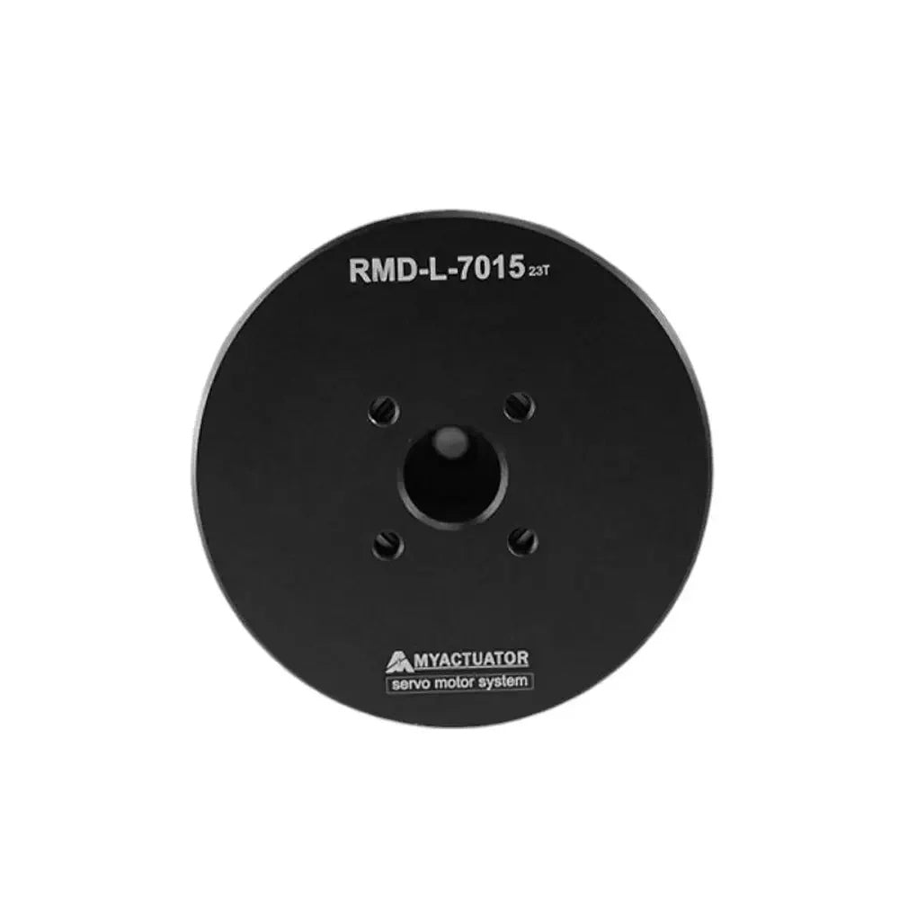

# MyActuator RMD-L-7015 CAN Development Guide


[**View MyActuator RMD-L-7015 CAN on OpenELAB**](https://openelab.io/products/myactuator-rmd-l-7015-23t-can)

**Model:** RMD-L-7015 CAN · **SKU:** `MyActuator-RMD-L-7015-CAN` · **Revision / option:** RMD-L-7015-200-C CAN; legacy store name L7015-23T


## Product overview

A compact direct-drive servo for a rotary axis that needs encoder feedback without gearbox reduction. The store's L7015-23T handle identifies the CAN product; the current manufacturer parameter sheet names it RMD-L-7015-200-C. Confirm the label and fitted controller before selecting protocol files. The separate RS485 (-R) version is outside this guide.

Product photograph: OpenELAB product listing. Check the ordered option for package contents; accessories shown in manufacturer packaging examples are not a guarantee that the selected motor-only variant includes them.

## Applications

Suitable starting points include direct-drive rotary experiments, small positioning fixtures and robot research joints whose continuous load fits the 1 N·m rating. High-speed motion needs a guarded, balanced fixture; 3.8 N·m is an instantaneous value.

## Specifications

| Parameter                    | Value / scope                           |
| ---------------------------- | --------------------------------------- |
| Drive type                   | Direct drive; no reduction gearbox      |
| Supply                       | 12–24 V DC                              |
| Rated / instantaneous torque | 1 / 3.8 N·m                             |
| Rated / maximum speed        | 580 / 805 rpm                           |
| Nominal current              | 3.62 A                                  |
| Feedback                     | Single 18-bit absolute encoder          |
| Mass                         | 360 g                                   |
| Envelope                     | Ø69 × 33.9 mm; use drawing for mounting |
| Matched driver               | MC200; 200 W is the driver designation  |
| Control                      | CAN, 1 Mbit/s; -C scope                 |

Source: [L-7015 parameter sheet 251029 and RMD-7015 drawing](https://www.myactuator.com/_files/archives/cab28a_da333fb383e74af4ac6e9e89d8dcba32.zip). Rated and peak figures are distinct operating points, not simultaneous maxima.

The 200 W MC200 label is a controller rating, not a claim that this motor continuously delivers 200 W at the listed torque and speed. The single-encoder direct-drive setup must not use an X-series gear-ratio configuration.

## Hardware and connections

Required equipment: a secured unloaded actuator, a 12–24 V DC supply, suitable power wiring and isolation, one CAN interface with its supported host software, and the model-specific mating cables. Phase current in a motor table is not a substitute for calculating the DC supply requirement.

Use the [RMD-7015 drawing and parameter package](https://www.myactuator.com/_files/archives/cab28a_da333fb383e74af4ac6e9e89d8dcba32.zip) with the [MC driver manual](https://www.myactuator.com/_files/archives/cab28a_8136b0f46af3455ea383921d5aa02ce5.zip) for connector orientation. Connect motor power only to the documented power terminals; match CAN\_H/CAN\_L and the controller signal reference. The CAN version is not an RS485 device. Do not apply motor supply to communication pins.

Fix the stationary housing to a rigid fixture, keep the rotating assembly clear and use the drawing's screw pattern/depth. Do not import a geared X-series configuration into this direct-drive motor.

For a CAN bench connection, use a linear bus with 120 Ω termination at each physical end and a common reference as specified by the manufacturer. Count any built-in USB-CAN termination; do not add a resistor at every motor. With power off, two 120 Ω end resistors in parallel measure about 60 Ω between CAN\_H and CAN\_L. This resistance check is a wiring diagnostic, not proof of communication.

## Software and development resources

The manufacturer's [setup-software page](https://www.myactuator.com/downloads-setupsoftware) lists L-7015 under the V3.0 family. The current [L-series package](https://www.myactuator.com/_files/archives/cab28a_8136b0f46af3455ea383921d5aa02ce5.zip) includes MC driver documentation and CAN protocol V4.2-250208. Keep the setup tool, protocol and actual controller generation aligned; a current download does not prove an older controller has been upgraded.

A compatible raw CAN frame utility is sufficient for the first result below. Install the driver that matches the actual USB-CAN hardware and host operating system; this guide does not assume that the adapter exposes Linux SocketCAN or a serial COM protocol. The manufacturer's [SDK downloads](https://www.myactuator.com/downloads-sdk) provide optional integration starting points. Their exact OS, dependency and model coverage must be checked in the selected release before building; no SDK build is required for this status-read procedure. Preserve calibration and parameter backups before any firmware change.

For EtherCAT integration, use the [official ESI downloads](https://www.myactuator.com/downloads-ethercatesi) and the protocol's object dictionary for the fitted firmware. Confirm slave identity and process-data mapping before enabling operation.

## Getting started

### First working result: read status over CAN

1. Record the label, controller/firmware revision and saved motor ID. Connect only one unloaded motor; secure it and leave motion disabled.
2. With power off, connect power and CAN as described above. Verify polarity, common reference and the two end terminations. Set the supply within the documented range; use nominal voltage for rated-condition work.
3. Install the interface's matching driver, open the CAN utility and select its channel. For the cited protocol, select **1 Mbit/s, standard 11-bit data frames, DLC 8**. If this motor has a previously changed bitrate, use that saved setting rather than writing a new one blindly.
4. Send one read-status command to arbitration ID **0x140 + motor ID**. For a motor confirmed as ID 1, enter transmit ID **0x141** and payload **9A 00 00 00 00 00 00 00**. ID 1 is an example, not a discovery result.
5. Inspect the reply at **0x240 + motor ID** (**0x241** for ID 1). The command byte should be 0x9A. Decode temperature, bus voltage and fault flags using the **Read Motor Status 1 and Error Flag** table in the [cited protocol package](https://www.myactuator.com/_files/archives/cab28a_8136b0f46af3455ea383921d5aa02ce5.zip); byte layouts can differ across firmware generations.
6. Repeat the read and record the actual voltage, temperature and fault state. Resolve any fault before a separate motion test. Only after confirming angle units, direction, current limits and stop behavior should a bounded, low-speed, unloaded movement be attempted.

**Expected result:** repeatable status replies from the intended ID, with plausible bus voltage/temperature and fault information that can be decoded for the recorded firmware. A status reply establishes communication, not motion or load qualification.

**If this check fails:** verify supply at the actuator, adapter enumeration, CAN\_H/CAN\_L and reference wiring, termination, saved bitrate and ID, then protocol/firmware pairing. Do not repeatedly send enable or motion commands to diagnose a missing reply.

## Troubleshooting and FAQs

**No reply from a motor sold as L7015-23T**

Confirm the controller generation and CAN (-C) interface, then its saved bitrate and ID. Use the protocol shipped for that controller; the current L-series download contains V4.2, while older MC hardware can differ.

**Position scaling is wrong**

Remove any planetary gear ratio in the host configuration. Check encoder and command units against the controller's protocol before movement.

**Cannot hold 3.8 N·m continuously**

That is the instantaneous rating. Re-evaluate continuous load against 1 N·m, supply stability, mounting and thermal behavior.

**EtherCAT cable is connected but the slave is absent**

Check motor power, IN/OUT direction, cable pair mapping and the master's active interface. Then verify ESI/product identity and inspect master diagnostics before changing drive parameters.

## Downloads and technical documents

| Resource                                       | Purpose and revision                                                                                             | Link                                                                                                   |
| ---------------------------------------------- | ---------------------------------------------------------------------------------------------------------------- | ------------------------------------------------------------------------------------------------------ |
| Exact-model parameters and mechanical drawings | L-7015 parameter sheet 251029 and RMD-7015 drawing; use supplied drawings/CAD rather than dimensions from images | [Official ZIP](https://www.myactuator.com/_files/archives/cab28a_da333fb383e74af4ac6e9e89d8dcba32.zip) |
| Manuals and protocols                          | L-series / MC controller, CAN V4.2-250208                                                                        | [Official ZIP](https://www.myactuator.com/_files/archives/cab28a_8136b0f46af3455ea383921d5aa02ce5.zip) |
| Model document center                          | Current revision listings and CAD packages                                                                       | [Manufacturer downloads](https://www.myactuator.com/downloads-lseries)                                 |
| Host setup utility                             | Select model/driver generation before installation                                                               | [Setup software](https://www.myactuator.com/downloads-setupsoftware)                                   |
| Optional development SDK                       | Check release README, dependencies and licensing before use                                                      | [SDK downloads](https://www.myactuator.com/downloads-sdk)                                              |

## References and validation

The specifications and procedure use the manufacturer packages linked above; the [OpenELAB listing](https://openelab.io/products/myactuator-rmd-l-7015-23t-can) identifies the sold model and options. Reviewed 19 November 2026. Manufacturer PDFs, relevant tables and interface documentation were inspected. The CAN procedure is a documentation-based first check; software compilation, adapter-driver installation and physical motor tests were **not run**. Keep the actual firmware, host environment, ID and measured results with the device.

[All MyActuator product guides](./)
