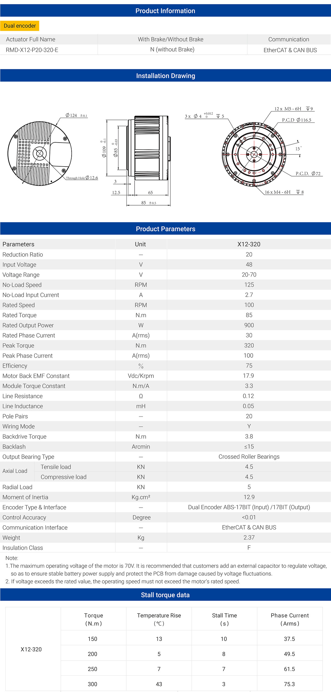

# MyActuator RMD-X12-P20-320-E Development Guide


[**View MYACTUATOR RMD-X12-P20-320-E on OpenELAB**](https://openelab.io/products/myactuator-rmd-x12-p20-actuator)

**Covered model:** MYACTUATOR RMD-X12-P20-320-E · **SKU:** `MyActuator-RMD-X12-P20-320-E`


_Manufacturer image: MYACTUATOR._ [_Image source_](https://static.wixstatic.com/media/cab28a_f3191a4b00c142a3aa1f33c9af6086d1~mv2.jpg/v1/crop/x_0,y_22,w_5001,h_10485/fill/w_1202,h_2520,al_c,q_90,usm_0.66_1.00_0.01,enc_avif,quality_auto/X12-320-V4-260901-02.jpg)_._

[Product at OpenELAB](https://openelab.io/products/myactuator-rmd-x12-p20-actuator) · [Manufacturer wiki hub](./)

## Identity and development scope

The **RMD-X12-P20-320-E** is a geared joint actuator for robotic arms, legged platforms and load-bearing mechanisms. This guide uses the manufacturer's **RMD-X V4** product documents and X12 parameter sheet distributed in September/October 2026. Verify the label and driver revision on the received actuator before selecting a protocol or firmware. An older X12 or a CAN-only `-C` model must not silently inherit the `-E` configuration.

The actuator integrates a motor, reduction gear, feedback and drive electronics. Integration still requires a suitable DC supply, mechanical support, a communication master and a system-level stop strategy. The 320 Nm figure is peak torque, not continuous holding capacity.

## Specifications from the X12 parameter sheet

| Parameter                            | Documented value                                               |
| ------------------------------------ | -------------------------------------------------------------- |
| Reduction                            | 20:1 planetary                                                 |
| Rated supply / range                 | 48 V / 20–70 V                                                 |
| Rated / peak output torque           | 85 Nm / 320 Nm                                                 |
| Rated / no-load speed                | 100 / 125 rpm                                                  |
| Rated / peak phase current           | 30 / 100 A RMS; these are not DC supply current ratings        |
| Encoders                             | Absolute dual encoder, 17 bit input / 17 bit output            |
| Interfaces on current `-E` reference | EtherCAT and CAN bus                                           |
| Mass                                 | 2.37 kg                                                        |
| Brake                                | Parameter sheet identifies this configuration as without brake |

The official parameter archive includes a dimensioned PDF and STEP file. Use those drawings for bolt circle, screw engagement and through-hole clearance. Do not size the supply, cables or duty cycle by peak torque alone; account for regenerative energy and the thermal/load conditions in the manual.

Sources: [X12 product page](https://www.myactuator.com/x12-320-details), [official X12 parameter/drawing archive](https://www.myactuator.com/_files/archives/cab28a_28d8574009064902a1f95668185d6121.zip?dn=X12-320%20Motor%20Parameter%20260920.zip).

## Software, protocol and wiring choices

Choose one bring-up path and use the corresponding manufacturer tools and protocol documents. For CAN, match driver generation, bus rate, frame format and node ID before issuing a command. For EtherCAT, obtain the model/revision's ESI/device description and use the documented object dictionary and drive state machine. Ethernet cable shape does not make an EtherCAT slave an ordinary TCP/IP device.

The [official V4 protocol/manual archive](https://www.myactuator.com/_files/archives/cab28a_a5b8b24b40ac4f6d87bae373b0de459a.zip?dn=\(X-V4\)%20Protocol%20and%20manual%20of%20V4%20261029.zip) includes the X-series user manual, CAN motion protocol and EtherCAT guide. Check their applicability headers against the actuator's driver. This page does not substitute a guessed pin assignment or universal CAN motion frame for those documents.

## Getting started: identify and read telemetry first

1. **Inspect before power.** Record model, driver version and serial label. Secure the actuator to a fixture; support any gravity-loaded link. Keep the output clear and connect no test load for initial communication.
2. **Prepare the power path.** Use the manual's connector/polarity drawing, a suitably protected current-limited supply and a physical means to remove drive power. Plan how the DC bus handles regenerated energy. Check all connections with power off.
3. **Prepare communication.** Connect the matching USB-CAN/master interface and manufacturer cable, or the EtherCAT master to the documented IN port. Configure termination and common reference as required by the manual. Do not guess CAN bitrate or node ID from another brand's actuator.
4. **Power and identify.** With motion disabled, use the official setup tool/master to discover the device and read its identity/version. Save the configured ID/rate and baseline settings before making changes.
5. **Read status.** Request status/temperature, voltage and position feedback using the exact revision's read-only commands or object dictionary. The first success criterion is stable, plausible telemetry without bus errors or commanded movement.
6. **Add motion deliberately.** Only after feedback and stop behavior are understood, follow the official low-speed/unloaded motion procedure. Establish mechanical limits and current/torque limits before closing a position loop around a larger robot.

No example motion packet is included because mixing protocol generations can produce unexpected behavior. A successful telemetry check is a stronger first checkpoint than sending an unverified torque command.

## Troubleshooting and FAQ

| Symptom                             | Check                                                                                                                    |
| ----------------------------------- | ------------------------------------------------------------------------------------------------------------------------ |
| Supply present, no communication    | Connector pinout, polarity, CAN rate/termination and node ID; or EtherCAT IN/OUT, ESI and master state.                  |
| Position changes unexpectedly       | Encoder/reference selection, gearing, angle units and zero-offset procedure; support the mechanism before recalibration. |
| Bus overvoltage during deceleration | Regeneration handling and supply absorption capability; do not repeatedly reset and retry the same motion.               |
| Output becomes hot at standstill    | Holding torque, phase current, duty cycle and cooling; peak capability is not a continuous rating.                       |
| A powered-off arm drops             | This reference is without brake. Provide mechanical support or a designed holding arrangement.                           |
| Can a V2/V3 example be reused?      | Only after checking the driver applicability, payload layout, units and response format against the current manual.      |

## Technical documents and software

| Resource                                                                                                                                                                       | Use                                             |
| ------------------------------------------------------------------------------------------------------------------------------------------------------------------------------ | ----------------------------------------------- |
| [Manufacturer X12 page](https://www.myactuator.com/x12-320-details)                                                                                                            | Current product and variant identification      |
| [X12 specifications, 2D PDF and STEP](https://www.myactuator.com/_files/archives/cab28a_28d8574009064902a1f95668185d6121.zip?dn=X12-320%20Motor%20Parameter%20260920.zip)      | Official mechanical and parameter archive       |
| [V4 protocol and manuals](https://www.myactuator.com/_files/archives/cab28a_a5b8b24b40ac4f6d87bae373b0de459a.zip?dn=\(X-V4\)%20Protocol%20and%20manual%20of%20V4%20261029.zip) | CAN, EtherCAT and installation reference        |
| [X-series download center](https://www.myactuator.com/downloads-xseries)                                                                                                       | Latest revision-specific software and documents |

**Review date:** 17 November 2026. **Validation:** official documentation and the cited software interfaces reviewed. Commands and examples have not been compiled or run on physical hardware by OpenELAB for this guide. Record your hardware revision, firmware, software versions and actual results when reproducing it.
