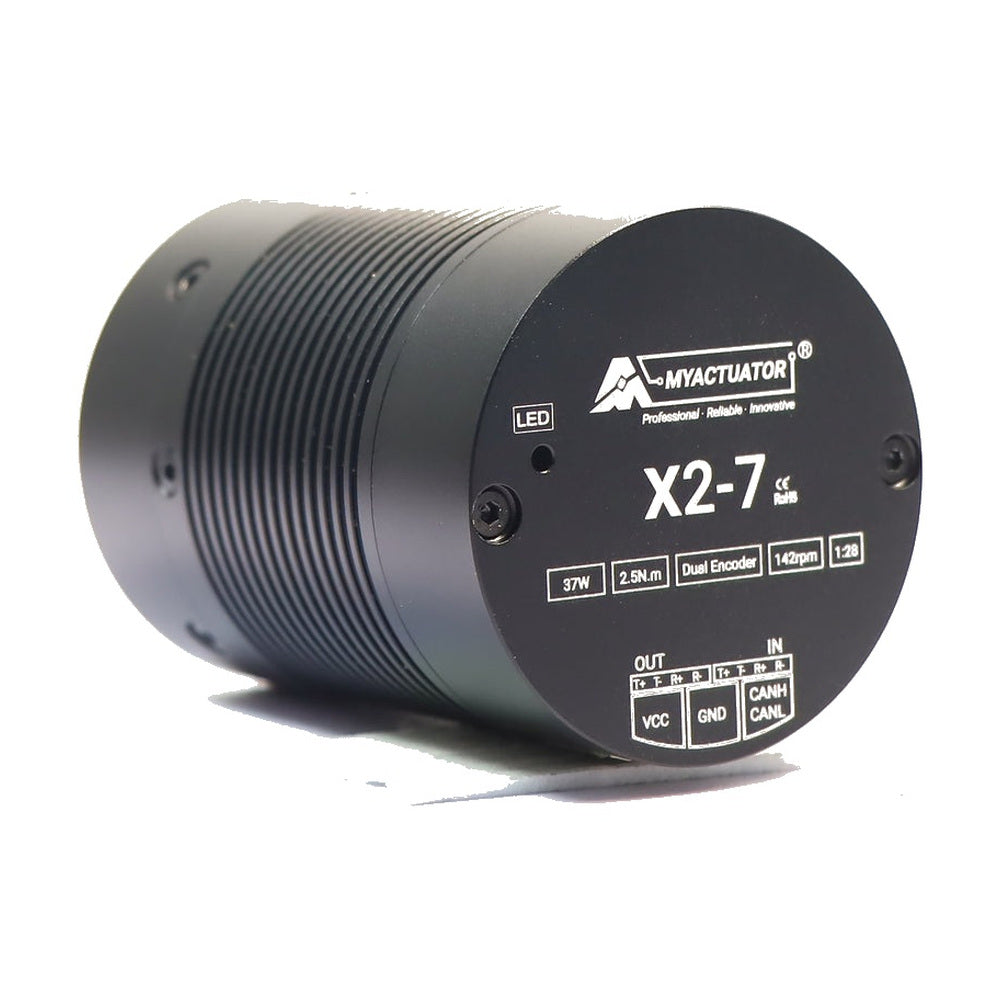

# MyActuator RMD-X2-P28-7-E Development Guide


[**View MyActuator RMD-X2-P28-7-E on OpenELAB**](https://openelab.io/products/myactuator-rmd-x2-p28-actuator)

**Model:** RMD-X2-P28-7-E · **SKU:** `MyActuator-RMD-X2-P28-7-E` · **Revision / option:** Dual-encoder E model; parameter sheet 260903


## Product overview

The X2-7 is a small integrated planetary actuator with dual encoder feedback and CAN/EtherCAT interfaces. This page covers the full E-suffix motor, rather than the accessory-only choices in the same product listing.

Product photograph: OpenELAB product listing. Check the ordered option for package contents; accessories shown in manufacturer packaging examples are not a guarantee that the selected motor-only variant includes them.

## Applications

Use it for small research joints, compact pan/tilt mechanisms and light positioning experiments. Design the sustained load around 2.5 N·m; 7 N·m describes peak output.

## Specifications

| Parameter                    | Value / scope                                 |
| ---------------------------- | --------------------------------------------- |
| Actual reduction ratio       | 28.17:1                                       |
| Nominal supply / range       | 24 V DC / 20–55 V                             |
| Rated / peak output torque   | 2.5 / 7 N·m                                   |
| Rated / no-load output speed | 142 / 178 rpm                                 |
| Rated output power           | 37 W                                          |
| Rated / peak current         | 3 / 8.1 A, as labeled in this parameter sheet |
| Input / output encoder       | 17-bit / 18-bit absolute                      |
| Backlash                     | ≤15 arcmin                                    |
| Output bearing / mass        | Deep-groove ball bearing / 0.26 kg            |
| Interface / brake            | CAN and EtherCAT / no brake                   |

Source: [RMD-X2-P28-7-E parameter sheet / drawings (Dual-encoder E model; parameter sheet 260903)](https://www.myactuator.com/_files/archives/cab28a_77b7670917e14f6b8256b4db4d912857.zip). Rated and peak figures are distinct operating points, not simultaneous maxima.

P28 is the model family designation; the documented reduction is 28.17:1. The current column in this sheet is labeled A, so it should not silently be relabeled Arms or used as the DC power-supply current requirement.

## Hardware and connections

Required equipment: a secured unloaded actuator, a 24 V DC nominal (20–55 V operating range) supply, suitable power wiring and isolation, one CAN interface with its supported host software, and the model-specific mating cables. Phase current in a motor table is not a substitute for calculating the DC supply requirement.

Use the exact [model drawing / parameter archive](https://www.myactuator.com/_files/archives/cab28a_77b7670917e14f6b8256b4db4d912857.zip) and [generation manual](https://www.myactuator.com/_files/archives/cab28a_a5b8b24b40ac4f6d87bae373b0de459a.zip) for connector orientation and screw depth. Connect the external supply to VCC/DC+ and GND/DC−; connect CAN\_H to CAN\_H and CAN\_L to CAN\_L with the documented common reference. Do not infer a pin number from a product photograph or use communication pins as power inputs.

For EtherCAT, distinguish the actuator's IN and OUT ports and preserve the T+/T− and R+/R− differential pairs. Use the matching cable/adapter and ESI. The RJ45 adapter is a connector interface, not a substitute for an EtherCAT master.

For a CAN bench connection, use a linear bus with 120 Ω termination at each physical end and a common reference as specified by the manufacturer. Count any built-in USB-CAN termination; do not add a resistor at every motor. With power off, two 120 Ω end resistors in parallel measure about 60 Ω between CAN\_H and CAN\_L. This resistance check is a wiring diagnostic, not proof of communication.

## Software and development resources

The [manufacturer setup-software page](https://www.myactuator.com/downloads-setupsoftware) is the source for the setup utility and its supported model list. The [X manual bundle](https://www.myactuator.com/_files/archives/cab28a_a5b8b24b40ac4f6d87bae373b0de459a.zip) includes CAN protocol V4.4-260425 and EtherCAT protocol V2.0-260425. Match the full model and firmware generation before changing parameters.

A compatible raw CAN frame utility is sufficient for the first result below. Install the driver that matches the actual USB-CAN hardware and host operating system; this guide does not assume that the adapter exposes Linux SocketCAN or a serial COM protocol. The manufacturer's [SDK downloads](https://www.myactuator.com/downloads-sdk) provide optional integration starting points. Their exact OS, dependency and model coverage must be checked in the selected release before building; no SDK build is required for this status-read procedure. Preserve calibration and parameter backups before any firmware change.

For EtherCAT integration, use the [official ESI downloads](https://www.myactuator.com/downloads-ethercatesi) and the protocol's object dictionary for the fitted firmware. Confirm slave identity and process-data mapping before enabling operation.

## Getting started

### First working result: read status over CAN

1. Record the label, controller/firmware revision and saved motor ID. Connect only one unloaded motor; secure it and leave motion disabled.
2. With power off, connect power and CAN as described above. Verify polarity, common reference and the two end terminations. Set the supply within the documented range; use nominal voltage for rated-condition work.
3. Install the interface's matching driver, open the CAN utility and select its channel. For the cited protocol, select **1 Mbit/s, standard 11-bit data frames, DLC 8**. If this motor has a previously changed bitrate, use that saved setting rather than writing a new one blindly.
4. Send one read-status command to arbitration ID **0x140 + motor ID**. For a motor confirmed as ID 1, enter transmit ID **0x141** and payload **9A 00 00 00 00 00 00 00**. ID 1 is an example, not a discovery result.
5. Inspect the reply at **0x240 + motor ID** (**0x241** for ID 1). The command byte should be 0x9A. Decode temperature, bus voltage and fault flags using the **Read Motor Status 1 and Error Flag** table in the [cited protocol package](https://www.myactuator.com/_files/archives/cab28a_a5b8b24b40ac4f6d87bae373b0de459a.zip); byte layouts can differ across firmware generations.
6. Repeat the read and record the actual voltage, temperature and fault state. Resolve any fault before a separate motion test. Only after confirming angle units, direction, current limits and stop behavior should a bounded, low-speed, unloaded movement be attempted.

**Expected result:** repeatable status replies from the intended ID, with plausible bus voltage/temperature and fault information that can be decoded for the recorded firmware. A status reply establishes communication, not motion or load qualification.

**If this check fails:** verify supply at the actuator, adapter enumeration, CAN\_H/CAN\_L and reference wiring, termination, saved bitrate and ID, then protocol/firmware pairing. Do not repeatedly send enable or motion commands to diagnose a missing reply.

## Troubleshooting and FAQs

**The host gives a slightly wrong output angle**

Check whether the protocol already reports output-shaft angle before applying any conversion. When a motor-side conversion is required, use 28.17:1 rather than rounding to 28.

**The joint cannot hold 7 N·m indefinitely**

Peak torque is not a continuous holding specification. Reduce load and check temperature against the manufacturer's limits.

**Motor did not arrive with the USB-CAN board**

The listing includes motor-only and accessory-only options. Check the purchased variant; an accessory row is not a complete motor kit.

**EtherCAT cable is connected but the slave is absent**

Check motor power, IN/OUT direction, cable pair mapping and the master's active interface. Then verify ESI/product identity and inspect master diagnostics before changing drive parameters.

## Downloads and technical documents

| Resource                                       | Purpose and revision                                                                                                                                   | Link                                                                                                   |
| ---------------------------------------------- | ------------------------------------------------------------------------------------------------------------------------------------------------------ | ------------------------------------------------------------------------------------------------------ |
| Exact-model parameters and mechanical drawings | RMD-X2-P28-7-E parameter sheet / drawings (Dual-encoder E model; parameter sheet 260903); use supplied drawings/CAD rather than dimensions from images | [Official ZIP](https://www.myactuator.com/_files/archives/cab28a_77b7670917e14f6b8256b4db4d912857.zip) |
| Manuals and protocols                          | X V4 manual 261029, user manual V1.1, CAN V4.4-260425, EtherCAT V2.0-260425                                                                            | [Official ZIP](https://www.myactuator.com/_files/archives/cab28a_a5b8b24b40ac4f6d87bae373b0de459a.zip) |
| Model document center                          | Current revision listings and CAD packages                                                                                                             | [Manufacturer downloads](https://www.myactuator.com/downloads-xseries)                                 |
| Host setup utility                             | Select model/driver generation before installation                                                                                                     | [Setup software](https://www.myactuator.com/downloads-setupsoftware)                                   |
| Optional development SDK                       | Check release README, dependencies and licensing before use                                                                                            | [SDK downloads](https://www.myactuator.com/downloads-sdk)                                              |
| EtherCAT ESI                                   | Match actuator firmware/product identity                                                                                                               | [ESI downloads](https://www.myactuator.com/downloads-ethercatesi)                                      |

## References and validation

The specifications and procedure use the manufacturer packages linked above; the [OpenELAB listing](https://openelab.io/products/myactuator-rmd-x2-p28-actuator) identifies the sold model and options. Reviewed 19 November 2026. Manufacturer PDFs, relevant tables and interface documentation were inspected. The CAN procedure is a documentation-based first check; software compilation, adapter-driver installation and physical motor tests were **not run**. Keep the actual firmware, host environment, ID and measured results with the device.

[All MyActuator product guides](./)
