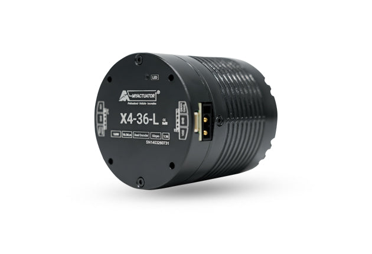

# MyActuator RMD-X4-P36-36-E-L Development Guide


[**View MyActuator RMD-X4-P36-36-E-L on OpenELAB**](https://openelab.io/products/myactuator-rmd-x4-p36-36-e-l)

**Model:** RMD-X4-P36-36-E-L · **SKU:** `MyActuator-RMD-X4-P36-36-E-L` · **Revision / option:** V4.1 X4-36-L; specification V1.0 and parameter sheet 260820


## Product overview

The -E-L is a distinct X4-36 variant. This guide keeps its V4.1 identity, 30 N·m peak rating and 36 N·m stall value separate from the standard X4-P36-36-E.

Product photograph: OpenELAB product listing. Check the ordered option for package contents; accessories shown in manufacturer packaging examples are not a guarantee that the selected motor-only variant includes them.

## Applications

Use it for compact articulated mechanisms and research joints after checking the application's duty cycle. The manufacturer's rated-data note is for robotics and specifically calls for reduced power in automation applications.

## Specifications

| Parameter                           | Value / scope            |
| ----------------------------------- | ------------------------ |
| Reduction ratio                     | 36:1                     |
| Nominal supply / range              | 24 V DC / 20–55 V        |
| Rated / peak / stall torque         | 10.5 / 30 / 36 N·m       |
| Rated / no-load speed               | 83 / 111 rpm             |
| Rated output power                  | 100 W                    |
| Rated phase current                 | 6.1 Arms / 8.6 A peak    |
| Stall phase current                 | 21.2 Arms                |
| Input / output encoder              | 17-bit / 18-bit absolute |
| Backlash / backdrive torque         | 15 arcmin / 0.2 N·m      |
| Absolute / repeat position accuracy | 0.4° / 0.3°              |
| Diameter × length / mass            | 55 × 61 mm / 0.36 kg     |
| Communication                       | CAN and EtherCAT         |

Source: [RMD-X4-P36-36-E-L parameter sheet / drawings (V4.1 X4-36-L; specification V1.0 and parameter sheet 260820)](https://www.myactuator.com/_files/archives/cab28a_8106ede9e38f497b8c12545bab3f95d5.zip). Rated and peak figures are distinct operating points, not simultaneous maxima.

The V1.0 specification defines rated torque near the optimal efficiency point during ±90° reciprocating motion with 5-second position holds at rated voltage/speed. Peak torque is measured at rated voltage and 10 rpm. These conditions do not establish unlimited static holding at 10.5 N·m. The setup-tool KT\_OUT convention uses peak phase current; do not mix it with RMS current.

## Hardware and connections

Required equipment: a secured unloaded actuator, a 24 V DC nominal (20–55 V operating range) supply, suitable power wiring and isolation, one CAN interface with its supported host software, and the model-specific mating cables. Phase current in a motor table is not a substitute for calculating the DC supply requirement.

Use the exact [model drawing / parameter archive](https://www.myactuator.com/_files/archives/cab28a_8106ede9e38f497b8c12545bab3f95d5.zip) and [generation manual](https://www.myactuator.com/_files/archives/cab28a_0316582549cf4af7942242e05309227c.zip) for connector orientation and screw depth. Connect the external supply to VCC/DC+ and GND/DC−; connect CAN\_H to CAN\_H and CAN\_L to CAN\_L with the documented common reference. Do not infer a pin number from a product photograph or use communication pins as power inputs.

For EtherCAT, distinguish the actuator's IN and OUT ports and preserve the T+/T− and R+/R− differential pairs. Use the matching cable/adapter and ESI. The RJ45 adapter is a connector interface, not a substitute for an EtherCAT master.

For a CAN bench connection, use a linear bus with 120 Ω termination at each physical end and a common reference as specified by the manufacturer. Count any built-in USB-CAN termination; do not add a resistor at every motor. With power off, two 120 Ω end resistors in parallel measure about 60 Ω between CAN\_H and CAN\_L. This resistance check is a wiring diagnostic, not proof of communication.

## Software and development resources

Use the manufacturer's [V4.1 download bundle](https://www.myactuator.com/_files/archives/cab28a_0316582549cf4af7942242e05309227c.zip), which includes CAN protocol V4.4-260425, EtherCAT protocol V2.0-260425 and the 261103 catalog, together with the model-specific V1.0 specification. Do not select an X4 preset merely because its name is similar. The read-only CAN frame below provides a first check without importing another model's tuning.

A compatible raw CAN frame utility is sufficient for the first result below. Install the driver that matches the actual USB-CAN hardware and host operating system; this guide does not assume that the adapter exposes Linux SocketCAN or a serial COM protocol. The manufacturer's [SDK downloads](https://www.myactuator.com/downloads-sdk) provide optional integration starting points. Their exact OS, dependency and model coverage must be checked in the selected release before building; no SDK build is required for this status-read procedure. Preserve calibration and parameter backups before any firmware change.

For EtherCAT integration, use the [official ESI downloads](https://www.myactuator.com/downloads-ethercatesi) and the protocol's object dictionary for the fitted firmware. Confirm slave identity and process-data mapping before enabling operation.

## Getting started

### First working result: read status over CAN

1. Record the label, controller/firmware revision and saved motor ID. Connect only one unloaded motor; secure it and leave motion disabled.
2. With power off, connect power and CAN as described above. Verify polarity, common reference and the two end terminations. Set the supply within the documented range; use nominal voltage for rated-condition work.
3. Install the interface's matching driver, open the CAN utility and select its channel. For the cited protocol, select **1 Mbit/s, standard 11-bit data frames, DLC 8**. If this motor has a previously changed bitrate, use that saved setting rather than writing a new one blindly.
4. Send one read-status command to arbitration ID **0x140 + motor ID**. For a motor confirmed as ID 1, enter transmit ID **0x141** and payload **9A 00 00 00 00 00 00 00**. ID 1 is an example, not a discovery result.
5. Inspect the reply at **0x240 + motor ID** (**0x241** for ID 1). The command byte should be 0x9A. Decode temperature, bus voltage and fault flags using the **Read Motor Status 1 and Error Flag** table in the [cited protocol package](https://www.myactuator.com/_files/archives/cab28a_0316582549cf4af7942242e05309227c.zip); byte layouts can differ across firmware generations.
6. Repeat the read and record the actual voltage, temperature and fault state. Resolve any fault before a separate motion test. Only after confirming angle units, direction, current limits and stop behavior should a bounded, low-speed, unloaded movement be attempted.

**Expected result:** repeatable status replies from the intended ID, with plausible bus voltage/temperature and fault information that can be decoded for the recorded firmware. A status reply establishes communication, not motion or load qualification.

**If this check fails:** verify supply at the actuator, adapter enumeration, CAN\_H/CAN\_L and reference wiring, termination, saved bitrate and ID, then protocol/firmware pairing. Do not repeatedly send enable or motion commands to diagnose a missing reply.

## Troubleshooting and FAQs

**Is 36 N·m the peak torque?**

For the -L version, 36 N·m is stall torque and 30 N·m is peak torque. Keep these separate from the standard E variant's 34 N·m peak specification.

**Why does calculated torque differ by roughly √2?**

Check whether phase current is RMS or peak and which convention the torque constant uses. The manufacturer explicitly describes KT\_OUT using peak phase current.

**Can it run an automation duty cycle at the robotics rating?**

The manufacturer asks users to reduce power for automation. Qualify temperature and continuous duty for the actual mechanism before adopting the rated point.

**EtherCAT cable is connected but the slave is absent**

Check motor power, IN/OUT direction, cable pair mapping and the master's active interface. Then verify ESI/product identity and inspect master diagnostics before changing drive parameters.

## Downloads and technical documents

| Resource                                       | Purpose and revision                                                                                                                                                     | Link                                                                                                   |
| ---------------------------------------------- | ------------------------------------------------------------------------------------------------------------------------------------------------------------------------ | ------------------------------------------------------------------------------------------------------ |
| Exact-model parameters and mechanical drawings | RMD-X4-P36-36-E-L parameter sheet / drawings (V4.1 X4-36-L; specification V1.0 and parameter sheet 260820); use supplied drawings/CAD rather than dimensions from images | [Official ZIP](https://www.myactuator.com/_files/archives/cab28a_8106ede9e38f497b8c12545bab3f95d5.zip) |
| Manuals and protocols                          | V4.1 bundle: catalog 261103, CAN V4.4-260425, EtherCAT V2.0-260425                                                                                                       | [Official ZIP](https://www.myactuator.com/_files/archives/cab28a_0316582549cf4af7942242e05309227c.zip) |
| Model document center                          | Current revision listings and CAD packages                                                                                                                               | [Manufacturer downloads](https://www.myactuator.com/downloads-xseries)                                 |
| Host setup utility                             | Select model/driver generation before installation                                                                                                                       | [Setup software](https://www.myactuator.com/downloads-setupsoftware)                                   |
| Optional development SDK                       | Check release README, dependencies and licensing before use                                                                                                              | [SDK downloads](https://www.myactuator.com/downloads-sdk)                                              |
| EtherCAT ESI                                   | Match actuator firmware/product identity                                                                                                                                 | [ESI downloads](https://www.myactuator.com/downloads-ethercatesi)                                      |

## References and validation

The specifications and procedure use the manufacturer packages linked above; the [OpenELAB listing](https://openelab.io/products/myactuator-rmd-x4-p36-36-e-l) identifies the sold model and options. Reviewed 19 November 2026. Manufacturer PDFs, relevant tables and interface documentation were inspected. The CAN procedure is a documentation-based first check; software compilation, adapter-driver installation and physical motor tests were **not run**. Keep the actual firmware, host environment, ID and measured results with the device.

[All MyActuator product guides](./)
