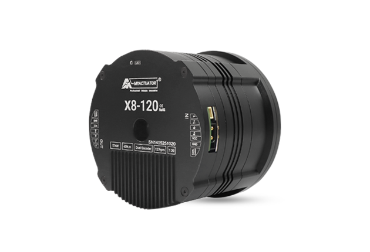

# MyActuator RMD-X8-P20-120-E Development Guide


[**View MYACTUATOR RMD-X8-P20-120-E on OpenELAB**](https://openelab.io/products/myactuator-rmd-x8-p20-actuator)

**Model:** RMD-X8-P20-120-E · **SKU:** `MyActuator-RMD-X8-P20-120-E` · **Option:** motor without USB-CAN/RJ45 Debug Board · **Reference generation:** RMD-X V4 dual-encoder `-E`, EtherCAT and CAN.


## Product overview <a href="#product-and-development-scope" id="product-and-development-scope"></a>

The RMD-X8-P20-120-E is an integrated geared actuator with dual absolute encoders and a drive for EtherCAT or CAN control. This guide establishes wiring and **read-only voltage, temperature, current, velocity and output-angle feedback** before a motion command. The 120 N·m value is peak torque; the model sheet rates output at 43 N·m under its documented conditions. [Exact parameter/drawing archive](https://www.myactuator.com/_files/archives/cab28a_2f52d96407934978a1b0e6c98b33a928.zip?dn=X8-120%20Motor%20Parameter%20260920.zip), [V4 manuals/protocol archive](https://www.myactuator.com/_files/archives/cab28a_a5b8b24b40ac4f6d87bae373b0de459a.zip?dn=%28X-V4%29%20Protocol%20and%20manual%20of%20V4%20261029.zip).



_Retained MYACTUATOR manufacturer artwork and native file references. The dated parameter PDF/STEP is the dimension and revision reference._

This is a motor-only option. The separately ordered USB-CAN communication module, RJ45 adapter plate, power source, master and mechanism are not established by a picture of a complete setup. Use the [MYACTUATOR hub](./) and the [USB-CAN interface guide](usb-can-communication-module-guide.md) to select the matching host path.

## Applications

Use RMD-X8-P20-120-E for a load-bearing robot joint, position-controlled fixture or torque-control research mechanism with a designed stop path. Select rated torque, bearing load, thermal duty and regenerative-energy handling together; peak stall torque alone cannot size a supply or prove a mechanism’s useful payload.

The parameter sheet identifies this option **without a brake**. Support a gravity-loaded link before shutdown. A stop that leaves a closed loop active, disabling the output and physically removing drive power are distinct operations. An encoder’s fine count resolution or a control-accuracy statement is not a complete arm-repeatability specification. [Exact model sheet](https://www.myactuator.com/_files/archives/cab28a_2f52d96407934978a1b0e6c98b33a928.zip?dn=X8-120%20Motor%20Parameter%20260920.zip), [installation/energy/encoder chapters](https://www.myactuator.com/_files/archives/cab28a_a5b8b24b40ac4f6d87bae373b0de459a.zip?dn=%28X-V4%29%20Protocol%20and%20manual%20of%20V4%20261029.zip).

## Specifications <a href="#technical-specifications" id="technical-specifications"></a>

| Integration parameter                                    | X8-120 dated-sheet value                                                       |
| -------------------------------------------------------- | ------------------------------------------------------------------------------ |
| Full model / nominal family                              | RMD-X8-P20-120-E, RMD-X V4 `-E`                                                |
| Reduction                                                | 19.612:1 actual sheet value; P20 nominal family                                |
| Rated voltage / stated range                             | 48 V / 20–55 V                                                                 |
| Rated / peak output torque                               | 43 /120 N·m; peak is not continuous                                            |
| Rated / no-load output speed                             | 127 /158 rpm                                                                   |
| Rated output power                                       | 574 W                                                                          |
| Rated / peak phase current                               | 17.6 /43.8 A RMS; different from DC bus current                                |
| Input / output encoder                                   | Absolute 17-bit /17-bit, 131072 nominal codes/revolution each                  |
| Communication                                            | EtherCAT and CAN bus; no RS485 support inferred from generic protocol sections |
| Output bearing / axial tensile, compressive, radial load | Crossed roller / 4 /1 /4.5 kN                                                  |
| Backdrive torque / inertia                               | 1.5 N·m /1.5 kg·cm²                                                            |
| Envelope / mass                                          | Ø96 mm class housing, 76 ± 0.5 mm length; 12.60 mm through hole /1.40 kg       |
| Brake / insulation                                       | Without brake /class F                                                         |

[September 2026 model sheet in the official archive](https://www.myactuator.com/_files/archives/cab28a_2f52d96407934978a1b0e6c98b33a928.zip?dn=X8-120%20Motor%20Parameter%20260920.zip); visually checked against the drawing and values. Do not confuse the 120 N·m X8 with the newer X8-P20-150-E, a single-encoder X8/RS485 model, or the X6-P20. The exact X8-120 sheet gives 43 N·m rated torque and 20–55 V, not the X12 voltage envelope. The generic installation manual uses 0–50 °C as its environment scope; verify any wider received-unit rating before use. A source’s stall-time samples are particular tests, not a repeated-duty recipe. Preserve RMS/peak and output/motor-shaft distinctions in every controller configuration.

## Hardware and connections <a href="#mechanical-and-electrical-preparation" id="mechanical-and-electrical-preparation"></a>

### Mechanical installation and power

Select the X8-P20 drawing and its pilot/bolt circle/thread depth; the housing and cable exit differ from X6 and X12. Check cable sweep as well as the static STEP envelope. Clean mating faces, avoid contact with rotating parts, and use an appropriate rigid fixture for the actuator’s torque reaction. Source tightening tables use **kgf·cm**, not N·m; do not enter those numbers unchanged into an N·m torque wrench. [Mechanical installation chapter 4 and exact drawing](https://www.myactuator.com/_files/archives/cab28a_a5b8b24b40ac4f6d87bae373b0de459a.zip?dn=%28X-V4%29%20Protocol%20and%20manual%20of%20V4%20261029.zip), [model STEP/dimension PDF](https://www.myactuator.com/_files/archives/cab28a_2f52d96407934978a1b0e6c98b33a928.zip?dn=X8-120%20Motor%20Parameter%20260920.zip).

Commission at 48 V with a protected supply and suitable current limit for the no-motion test. Verify polarity with power removed, then observe the DC bus during turn-on. The manufacturer discusses input-capacitor suppression and regeneration; capacitor voltage/ripple/energy rating, discharge circuitry and battery absorption require a system calculation. Do not connect an arbitrary battery in parallel with a bench supply or assume its BMS always accepts regenerative current. [Electrical installation and kinetic-energy chapters 5–7](https://www.myactuator.com/_files/archives/cab28a_a5b8b24b40ac4f6d87bae373b0de459a.zip?dn=%28X-V4%29%20Protocol%20and%20manual%20of%20V4%20261029.zip).

### CAN, power and EtherCAT connector faces

The exact connector diagram in the generic user manual is **Table 5-4 for X12/X15, Table 5-2 for X6, Table 5-3 for X8**. Use the model’s view, the actual VCC/GND and CAN-H/CAN-L markings, and cable continuity; a plug viewed from the wire side is mirrored. Power is VCC/GND, not the EtherCAT signal pair. Physical EtherCAT **IN** and **OUT** routing is directional; it is not an IP-network port and must not be attached to a PoE injector. [Interface chapter 5.2](https://www.myactuator.com/_files/archives/cab28a_a5b8b24b40ac4f6d87bae373b0de459a.zip?dn=%28X-V4%29%20Protocol%20and%20manual%20of%20V4%20261029.zip).

Use twisted, appropriately shielded CAN wiring, unique motor IDs and 120 Ω termination at the controller and far-end module as described in chapter 6. Verify the common-reference/ground design. Multiple supply branches must carry their own load current; a chained motor connector is not an unlimited-current distribution bus.

The generic encoder-backup circuit specifies a **2.7–3.6 V** battery for preserving multi-turn information. This is a separate low-voltage circuit, not an extra drive-power input; do not wire it unless the exact hardware supports the documented connection. Record zero offsets before any battery/encoder/firmware maintenance. [Encoder and installation chapters](https://www.myactuator.com/_files/archives/cab28a_a5b8b24b40ac4f6d87bae373b0de459a.zip?dn=%28X-V4%29%20Protocol%20and%20manual%20of%20V4%20261029.zip).

## Software and development resources

### Match V4 protocol generation before sending a frame <a href="#choose-a-communication-path" id="choose-a-communication-path"></a>

The audited download is the manufacturer’s `(X-V4) Protocol and manual of V4 261029.zip`. It contains CAN Motion Protocol **V4.4**, EtherCAT guide **V2.0**, the generic user manual **V1.1** and the October 2026 V4 product manual. The CAN PDF filename ends 260425 while the download-center label says 260520; retain the actual file/header, not just the web label. [Download center](https://www.myactuator.com/downloads-xseries), [read archive](https://www.myactuator.com/_files/archives/cab28a_a5b8b24b40ac4f6d87bae373b0de459a.zip?dn=%28X-V4%29%20Protocol%20and%20manual%20of%20V4%20261029.zip).

| Interface             | Reviewed contract                                                                  |
| --------------------- | ---------------------------------------------------------------------------------- |
| V4.4 CAN single motor | Classical CAN, 1 Mbit/s, 11-bit standard data frame, 8 bytes                       |
| Request / reply IDs   | `0x140 + ID` / **`0x240 + ID`**, motor ID1–32                                      |
| CAN multi-motor route | Separate `0x280` command and filtering rules; not used here                        |
| CAN motion-mode route | Separate `0x400 + ID`, packed big-endian fields/ranges; not a register-read packet |
| EtherCAT              | CiA402, SDO/PDO and exact device description; no generic TCP socket control        |

Older libraries often use a different response ID or angle payload width. Do not assume one protocol from the shared RMD name. The original code below deliberately checks the V4.4 response. Its read-only support comes from this protocol, not a claim that an unrelated SDK supports the actuator.

### Control and diagnostic topics in the official documents

The CAN manual covers PID RAM/ROM writes, acceleration, encoder raw/zero/multi-turn readings, angle/status queries, torque/speed/absolute/single-turn/incremental position, force-position and speed/torque feedforward. It also covers operating mode, software date/model reads, communication-timeout and bitrate settings, active replies, multi-motor control and fault/indicator codes. The generic RS485 chapters do not imply an RS485 port on this `-E` model. [CAN V4.4 contents and command definitions](https://www.myactuator.com/_files/archives/cab28a_a5b8b24b40ac4f6d87bae373b0de459a.zip?dn=%28X-V4%29%20Protocol%20and%20manual%20of%20V4%20261029.zip).

EtherCAT V2.0 separates `0x6040` control word from `0x6041` status, mode request `0x6060` from mode display `0x6061`, and target position/velocity/torque from actual feedback. Start by inspecting identity, status and `0x603F` error code in a non-enabled state. Before operation, verify the exact ESI/PDO map, units, scaling, following-error/software limits and mode. CSP 8, CSV 9, CST 10, PP 1, PV3, PVT/MIT5 and homing 6 are distinct state-machine workflows, not interchangeable packet examples. This guide supplies no automatic transition to Operation Enabled. [EtherCAT dictionary/PDO/mode chapters](https://www.myactuator.com/_files/archives/cab28a_a5b8b24b40ac4f6d87bae373b0de459a.zip?dn=%28X-V4%29%20Protocol%20and%20manual%20of%20V4%20261029.zip).

## Getting started <a href="#first-power-up-and-commissioning" id="first-power-up-and-commissioning"></a>

### First-result prerequisites and connection

1. Record the full motor, driver/firmware and encoder revision. Fixture one unloaded unit and keep the shaft clear. Support any link before torque can be disabled. Use a 48 V commissioning supply, the exact cable and accessible power isolation.
2. With drive power off, connect VCC/GND, the correctly identified CAN pair, reference and bus-end termination using the model-specific drawing. Attach a **SocketCAN-capable Linux adapter** for the example below. The manufacturer’s USB-CAN serial tool is a different transport unless it explicitly exposes a SocketCAN interface.
3. Identify the actual motor ID and interface from the existing configuration or matching setup tool. Use the documented 1 Mbit/s V4.4 bus. Configure only the host interface, replacing `can0` with the observed name:

```bash
ip -details -statistics link show can0
sudo ip link set can0 down
sudo ip link set can0 type can bitrate 1000000
sudo ip link set can0 up
ip -details -statistics link show can0
```

Do not use a node-ID write, encoder-zero command, firmware reset or a motion command to discover an unidentified device. Save the existing setup before any deliberate change. [Manual wiring and protocol chapter 1](https://www.myactuator.com/_files/archives/cab28a_a5b8b24b40ac4f6d87bae373b0de459a.zip?dn=%28X-V4%29%20Protocol%20and%20manual%20of%20V4%20261029.zip), [Linux SocketCAN](https://docs.kernel.org/networking/can.html).

### Original status-only Python reader

4. Save the following original program as `read_rmd_v44.py`. It uses Python 3 on Linux, no third-party motor SDK, and sends only **`0x9A`, `0x9C`, `0x92` read commands**. Replace the required node value with the observed ID; 1 below is only an example.

```python
import argparse
import socket
import struct
import time

p = argparse.ArgumentParser()
p.add_argument('--channel', default='can0')
p.add_argument('--node', type=int, required=True)
a = p.parse_args()
if not 1 <= a.node <= 32:
    raise SystemExit('The reviewed V4.4 single-motor path requires ID 1..32')
frame = struct.Struct('=IB3x8s')
with socket.socket(socket.PF_CAN, socket.SOCK_RAW, socket.CAN_RAW) as bus:
    bus.bind((a.channel,))
    bus.settimeout(0.1)
    for command in (0x9A, 0x9C, 0x92):
        request = bytes([command]) + bytes(7)
        bus.send(frame.pack(0x140 + a.node, 8, request))
        deadline = time.monotonic() + 1.0
        while time.monotonic() < deadline:
            try:
                raw = bus.recv(frame.size)
            except socket.timeout:
                continue
            if len(raw) != frame.size:
                continue
            ident, length, data = frame.unpack(raw)
            if ident != 0x240 + a.node or length != 8 or data[0] != command:
                continue
            if command == 0x9A:
                temp = struct.unpack_from('<b', data, 1)[0]
                voltage = struct.unpack_from('<H', data, 4)[0] * 0.1
                errors = struct.unpack_from('<H', data, 6)[0]
                print('STATUS1 temp_C=', temp, 'bus_V=', voltage,
                      'error_mask=', hex(errors), 'raw=', data.hex())
            elif command == 0x9C:
                current = struct.unpack_from('<h', data, 2)[0] * 0.01
                speed = struct.unpack_from('<h', data, 4)[0]
                print('STATUS2 iq_A=', current, 'speed_deg_s=', speed,
                      'raw=', data.hex())
            else:
                angle = struct.unpack_from('<i', data, 4)[0] * 0.01
                print('ANGLE output_deg=', angle, 'raw=', data.hex())
            break
        else:
            raise SystemExit(f'Timeout on read0x{command:02X}; retain bus trace')
```

```bash
python3 read_rmd_v44.py --channel can0 --node 1
```

**Expected result:** status lines containing temperature in °C, bus voltage in V, hexadecimal error mask, signed iq in A, speed in degrees/s and **output angle in degrees**, with raw bytes. The shaft should remain stationary. A timeout is a failure to establish this result, not permission to try a motion packet.

The decoder follows V4.4 exactly: status 1 voltage is unsigned little-endian bytes 4–5 × 0.1 V; error mask is bytes 6–7. Status 2 iq is signed little-endian bytes 2–3 × 0.01 A and speed bytes 4–5 is degrees/s. Multi-turn angle is signed **32-bit bytes 4–7 × 0.01°**, not an older 56-bit payload. The brake-status byte reports a command state; it cannot prove this no-brake model has a brake. [CAN chapters 2.11, 2.13, 2.14](https://www.myactuator.com/_files/archives/cab28a_a5b8b24b40ac4f6d87bae373b0de459a.zip?dn=%28X-V4%29%20Protocol%20and%20manual%20of%20V4%20261029.zip).

5. Repeat at rest and compare bus voltage with a meter and speed with the stationary output. Record raw frames, ID, firmware and sample time. For a fault mask, use the protocol’s exact bit table; separate automatically recoverable voltage conditions from persistent stall, encoder/calibration or protection faults.

**Expected result:** repeatable, plausible readings from the intended node without enabling output, altering zero or clearing a fault. A green LED and adapter enumeration do not establish all of these checks.

### Controlled motion and stop semantics

6. Only after wiring, state, zeros and protocol revision are verified, save parameters and choose the required motion mode. Set conservative limits, begin near the measured pose and command a small unloaded displacement through the matched manufacturer tool/master. Verify joint/sign before adding a link or policy.
7. Verify stop behavior and support the mechanism before disabling output. In this CAN document **`0x81` stops speed while keeping a closed loop active**, whereas **`0x80` disables output and clears the running state**. Neither is a guarantee that an unbraked gravity load remains supported. Physical emergency isolation is a separate system function.

**Expected result:** one small intended movement and a demonstrated stop/disable path. Encoder zero/ROM writes (`0x63/0x64`), brake commands, resets and bitrate changes remain outside the read-only example. [Control/stop definitions](https://www.myactuator.com/_files/archives/cab28a_a5b8b24b40ac4f6d87bae373b0de459a.zip?dn=%28X-V4%29%20Protocol%20and%20manual%20of%20V4%20261029.zip).

## Troubleshooting and FAQs <a href="#troubleshooting-and-faq" id="troubleshooting-and-faq"></a>

| Symptom                            | Ordered diagnosis / recovery                                                                                                                              |
| ---------------------------------- | --------------------------------------------------------------------------------------------------------------------------------------------------------- |
| CAN sent but no reply              | Check external power, node 1–32, 1 Mbit/s, standard frame, termination and **reply 0 x 240+ID** before replacing hardware.                                |
| Other RMD library decodes nonsense | Compare its protocol generation, status offsets, signedness and 32-bit angle. Do not divide output-angle feedback by the gearbox ratio again.             |
| Fault after deceleration           | Record bus voltage; evaluate regenerative-energy absorption/transients and braking design before increasing voltage limits.                               |
| Sudden motion when enabled         | Stop and support; inspect stale target, current pose, zero, mode and units before changing loop gains.                                                    |
| Stops but remains stiff            | Check whether `0x81` left closed-loop holding active; it is different from output shutdown.                                                               |
| EtherCAT link but no motion        | Inspect ESI/PDO mapping, CiA402 state, mode display, error code, units and limits; do not force enable before matching them.                              |
| Position lost after power-off      | Check actual multi-turn backup arrangement and zero record; dual absolute encoders alone do not prove unpowered turn retention.                           |
| Need firmware recovery             | Save current version/parameters; use the exact model/driver tool and maintained package. Do not flash V2 or V4.1 merely because it shares the RMD-X name. |

**Is 120 N·m a holding specification?** No; use the rated output and the actual cooling/duty/geometry. **Can an RJ45 cable power the motor?** Only the exact power wiring is valid; an RJ45- shaped connector and EtherCAT do not establish PoE. [Model sheet](https://www.myactuator.com/_files/archives/cab28a_2f52d96407934978a1b0e6c98b33a928.zip?dn=X8-120%20Motor%20Parameter%20260920.zip), [installation and protocol documents](https://www.myactuator.com/_files/archives/cab28a_a5b8b24b40ac4f6d87bae373b0de459a.zip?dn=%28X-V4%29%20Protocol%20and%20manual%20of%20V4%20261029.zip).

## Downloads and technical documents <a href="#official-technical-resources" id="official-technical-resources"></a>

| Resource                                                                                                                                                                            | Revision / use                                                                                  |
| ----------------------------------------------------------------------------------------------------------------------------------------------------------------------------------- | ----------------------------------------------------------------------------------------------- |
| [Exact X8-120 parameter, 2 D and STEP archive](https://www.myactuator.com/_files/archives/cab28a_2f52d96407934978a1b0e6c98b33a928.zip?dn=X8-120%20Motor%20Parameter%20260920.zip)   | Archive 260920, parameter sheet 260903; full model, electrical/mechanical tables and drawing    |
| [V4 protocol/manual archive](https://www.myactuator.com/_files/archives/cab28a_a5b8b24b40ac4f6d87bae373b0de459a.zip?dn=%28X-V4%29%20Protocol%20and%20manual%20of%20V4%20261029.zip) | CAN V4.4, EtherCAT V2.0, generic user V1.1 and October 2026 product tables                      |
| [Manufacturer X-series document center](https://www.myactuator.com/downloads-xseries)                                                                                               | Compare V2, V4, V4.1 and exact-model resources; do not silently upgrade the selected generation |
| [USB-CAN module guide](usb-can-communication-module-guide.md)                                                                                                                       | Separate purchased adapter and host transport                                                   |
| [RJ45 adapter guide](rj45-adapter-plate-v1-0-guide.md)                                                                                                                              | Cable/interface adaptation; confirm revision and signal assignment                              |

The ZIP includes the actual model STEP and dimension PDF, not a generic silhouette. Read the mounting view before machining; downloadable CAD is not a statement that it was fabricated or hardware-tested.

## Complete V4 technical reference

This technical reference applies to the [RMD-X12-P20-320-E guide](https://wiki.openelab.io/robotics/myactuator/rmd-x12-p20-320-e-development-guide), [RMD-X8-P20-120-E guide](https://wiki.openelab.io/robotics/myactuator/rmd-x8-p20-120-e-development-guide) and [RMD-X6/X8 P20 guide](https://wiki.openelab.io/robotics/myactuator/myactuator-rmd-x6-x8-p20-development-guide). It provides searchable field definitions and operating semantics alongside the model-specific first-feedback workflows. It is an original engineering synthesis of the OEM sources, not a transcript or a claim of device testing.

The scope is the dual-encoder RMD-X V4 **E** models, with exact parameter sheets for X6-P20-60-E, X8-P20-120-E and X12-P20-320-E. The E suffix identifies EtherCAT and CAN support; it does not establish an installed holding brake. All three exact sheets specify **without brake**. Serial protocol sections below document the additional transport in the shared protocol manual; they do not establish RS485 hardware on these E units.

### Source editions and how to read the tables

The [V4 source archive](https://www.myactuator.com/_files/archives/cab28a_a5b8b24b40ac4f6d87bae373b0de459a.zip?dn=%28X-V4%29%20Protocol%20and%20manual%20of%20V4%20261029.zip) contains four documents. References below use their short keys and **printed page numbers**; CAN printed p.1 is PDF page 9. EtherCAT printed Roman pages i–lvi correspond directly to PDF pages 1–56. The generic user manual's printed p.1 is PDF page 5. Product-manual PDF pages are two-page spreads with nonconsecutive printed numbering.

| Key     | Document actually read                                                                                                                                           | Edition and qualification                                                                                                                                                                                                |
| ------- | ---------------------------------------------------------------------------------------------------------------------------------------------------------------- | ------------------------------------------------------------------------------------------------------------------------------------------------------------------------------------------------------------------------ |
| CAN     | `CAN BUS Motor Motion Protocol V4.4 260425.pdf`, 185 PDF pages                                                                                                   | Cover says V4.4, 2025.09, applicable driver V3; final V4.4 revision entry says 25 March 2026. The live download listing calls it `V4.4-260520`; the ZIP member is still `260425`. Identify firmware, not just filenames. |
| EC      | `EtherCAT control protocol V2.0_260425.pdf`, 56 pages                                                                                                            | Internal title dated 14 April 2026. Device-specific CiA402 implementation, not a substitute for every CiA402 feature.                                                                                                    |
| USER    | `User Manual for X Series Products V1.1-250516.pdf`, 28 pages                                                                                                    | V1.1, May 2025. Shared installation and encoder guidance; older family specifications can differ from the exact sheets.                                                                                                  |
| PRODUCT | `X Series-V4 product manual- 261029 .pdf`, 10 spreads                                                                                                            | V4 family identification, parameter tables, installation drawings and stall data. Contains C and R models as well as E models.                                                                                           |
| ESI     | `MT-Device_260424.xml` from [260424 ESI archive](https://www.myactuator.com/_files/archives/cab28a_f94084d537ab4cbf87d90bd780e7120f.zip?dn=MT-Device_260424.zip) | Live OEM listing explicitly pairs it with firmware **26042402**. The eight PDO layouts were read from the XML and cross-checked against EC.                                                                              |

Unless a row states otherwise, `D0` means payload byte `DATA[0]`; byte ranges are inclusive. `i8/i16/i32` are signed two's-complement integers, `u8/u16/u32` unsigned, and `f32` IEEE-754 binary32. **LE** means least-significant byte first. A value such as `i32LE@4` occupies D4–D7. Reserved request bytes must be zero; reserved response bytes must not be decoded as extra telemetry. “Echo” means the eight payload bytes are returned unchanged at the command's response identifier. Persistence is stated only where the source establishes it.

### Exact X6-60, X8-120 and X12-320 specifications

The following values come separately from the three **260903 exact-model parameter sheets** in their **260920 model archives**. Phase-current ratings are Arms; they are not the DC supply input current. The torque constant is the sheet's module constant, not a license to equate rated Arms directly with every firmware `iq` convention. [X6 sheet](https://www.myactuator.com/_files/archives/cab28a_4231acdf891b41f3a56bb690f4c1d312.zip?dn=RMD-X6-P20-60%20260920.zip), [X8 sheet](https://www.myactuator.com/_files/archives/cab28a_2f52d96407934978a1b0e6c98b33a928.zip?dn=X8-120%20Motor%20Parameter%20260920.zip), [X12 sheet](https://www.myactuator.com/_files/archives/cab28a_28d8574009064902a1f95668185d6121.zip?dn=X12-320%20Motor%20Parameter%20260920.zip).

| Property                                  | RMD-X6-P20-60-E           | RMD-X8-P20-120-E          | RMD-X12-P20-320-E         |
| ----------------------------------------- | ------------------------- | ------------------------- | ------------------------- |
| Actual reduction ratio                    | 19.612                    | 19.612                    | 20                        |
| Rated DC input / documented voltage range | 48 V / **20–55 V**        | 48 V / **20–55 V**        | 48 V / **20–70 V**        |
| No-load speed / no-load input current     | 176 rpm / 0.9 A           | 158 rpm / 1.6 A           | 125 rpm / 2.7 A           |
| Rated output speed                        | 153 rpm                   | 127 rpm                   | 100 rpm                   |
| Rated output torque / power               | 20 N·m / 320 W            | 43 N·m / 574 W            | 85 N·m / 900 W            |
| Rated / peak phase current                | 9.5 / 29.1 Arms           | 17.6 / 43.8 Arms          | 30 / 100 Arms             |
| Peak output torque                        | 60 N·m                    | 120 N·m                   | 320 N·m                   |
| Efficiency                                | 72.7%                     | 79%                       | 75%                       |
| Back-EMF constant                         | 16 Vdc/krpm               | 19.2 Vdc/krpm             | 17.9 Vdc/krpm             |
| Module torque constant                    | 2.1 N·m/A                 | 2.4 N·m/A                 | 3.3 N·m/A                 |
| Line resistance / inductance              | 0.41 Ω / 0.51 mH          | 0.18 Ω / 0.31 mH          | 0.12 Ω / 0.05 mH          |
| Pole pairs / winding                      | 10 / Y                    | 10 / Y                    | 20 / Y                    |
| Backdrive torque                          | 1.6 N·m                   | 1.5 N·m                   | 3.8 N·m                   |
| Backlash                                  | ≤15 arcmin                | ≤15 arcmin                | ≤15 arcmin                |
| Output bearing                            | Crossed roller            | Crossed roller            | Crossed roller            |
| Axial tensile / compressive load          | 1.8 / 0.8 kN              | 4 / 1 kN                  | 4.5 / 4.5 kN              |
| Radial load                               | 2 kN                      | 4.5 kN                    | 5 kN                      |
| Moment of inertia                         | 0.66 kg·cm²               | 1.5 kg·cm²                | 12.9 kg·cm²               |
| Absolute input / output encoders          | 17 / 17 bit               | 17 / 17 bit               | 17 / 17 bit               |
| Sheet control accuracy                    | <0.01°                    | <0.01°                    | <0.01°                    |
| Weight / insulation                       | 0.82 kg / F               | 1.40 kg / F               | 2.37 kg / F               |
| Interface / brake option on sheet         | EtherCAT & CAN / no brake | EtherCAT & CAN / no brake | EtherCAT & CAN / no brake |

At a supply above rated voltage, all three sheets require operating speed to remain at or below rated speed. The USER manual's generic “48 V units withstand 55 V” statement does **not** replace the exact X12 sheet's 20–70 V range. Use 48 V for the guides' initial commissioning; a wider documented range is not an instruction to raise voltage. The 2025 shared table also labels the inertia-number row “Repeatability”; the exact 2026 sheets identify **0.66 / 1.5 / 12.9 as inertia in kg·cm²**, so these values must not be republished as angular accuracy.

#### Mechanical envelope and mounting interfaces

Dimensions below are millimetres, read from each archive's A0 drawing. They are selection facts, not a replacement for the dimensioned drawing and STEP solid when designing a mating part. Hole depths are engagement constraints; adding washer or plate thickness must not increase screw penetration into the actuator. [X6 drawing](https://www.myactuator.com/_files/archives/cab28a_4231acdf891b41f3a56bb690f4c1d312.zip?dn=RMD-X6-P20-60%20260920.zip), [X8 drawing](https://www.myactuator.com/_files/archives/cab28a_2f52d96407934978a1b0e6c98b33a928.zip?dn=X8-120%20Motor%20Parameter%20260920.zip), [X12 drawing](https://www.myactuator.com/_files/archives/cab28a_28d8574009064902a1f95668185d6121.zip?dn=X12-320%20Motor%20Parameter%20260920.zip).

| Feature                         | X6-P20-60                                              | X8-P20-120                                             | X12-P20-320                                           |
| ------------------------------- | ------------------------------------------------------ | ------------------------------------------------------ | ----------------------------------------------------- |
| Main outside diameter           | Ø80 ±0.1                                               | Ø96, +0/−0.1                                           | Ø124 ±0.1                                             |
| Axial envelope shown            | 67.5 ±0.5                                              | 76 ±0.5                                                | 85 ±0.5                                               |
| Through bore                    | Ø8.6                                                   | Ø12.6                                                  | Ø12.6                                                 |
| Locating diameter               | Ø53, +0/−0.03                                          | Ø64, +0/−0.03                                          | Ø85, +0/−0.03                                         |
| Outer mounting circle / threads | PCD Ø72.5; 12 × M4 depth 5                             | PCD Ø88; 12 × M4 depth 8                               | PCD Ø116.5; 12 × M5-6H depth 9                        |
| Inner mounting circle / threads | PCD Ø44; 10 × M3 depth 6 with Ø3.4 counterbore depth 3 | PCD Ø55; 10 × M3 depth 5 with Ø3.4 counterbore depth 5 | PCD Ø72; 16 × M4-6H depth 8                           |
| Locating holes called out       | 2 × Ø3 depth 8 / M3 depth 3                            | 2 × Ø4 +0.02/0 depth 4; 2 × Ø3 depth 7.5 / M3 depth 5  | 3 × Ø4 +0.012/0 depth 5                               |
| Additional drawing constraints  | Two Ø5 +0/−0.02 features; shaded recess depth 3.2      | Two Ø5 +0/−0.02 features; indicated recess depth 4     | Ø109 body +0/−0.1; 3, 12.5 and 65 axial subdimensions |

#### OEM stall observations, not allowable continuous duty

These are the exact sheets' individual test rows, in the order **torque N·m / temperature rise °C / stall duration s / phase current Arms**. They do not state a repeatable cooldown schedule or validate sustained operation at peak torque. The X8 sheet's last stall row is 129 N·m although its rated peak specification is 120 N·m; retain the distinction rather than advertising 129 N·m as the motor rating. [Exact sheets](https://www.myactuator.com/_files/archives/cab28a_4231acdf891b41f3a56bb690f4c1d312.zip?dn=RMD-X6-P20-60%20260920.zip), [X8](https://www.myactuator.com/_files/archives/cab28a_2f52d96407934978a1b0e6c98b33a928.zip?dn=X8-120%20Motor%20Parameter%20260920.zip), [X12](https://www.myactuator.com/_files/archives/cab28a_28d8574009064902a1f95668185d6121.zip?dn=X12-320%20Motor%20Parameter%20260920.zip).

| Model   | Observed rows                                                                         |
| ------- | ------------------------------------------------------------------------------------- |
| X6-60   | 30 / 17 / 15 / 12.7; 40 / 29 / 10 / 17.7; 50 / 37 / 8 / 22.6; 60 / 24 / 5 / 28.3      |
| X8-120  | 64.5 / 7 / 15 / 23.3; 86 / 10 / 10 / 31.1; 107.5 / 26 / 8 / 38.9; 129 / 30 / 5 / 43.8 |
| X12-320 | 150 / 13 / 10 / 37.5; 200 / 5 / 8 / 49.5; 250 / 7 / 7 / 61.5; 300 / 43 / 3 / 75.3     |

### Installation, power, connectors and encoder state

The USER manual describes an integrated motor, absolute encoders, servo drive and planetary reducer. Despite introductory legacy wording about a harmonic module, the V4 PRODUCT manual explicitly identifies this series as planetary. `P20` is a rounded naming ratio: the X6/X8 exact ratio is 19.612, while X12 is 20. The number after the ratio is the named peak torque; E is EtherCAT plus CAN. A C or R suffix is a different communication variant. [USER §3; PRODUCT PDF p.1](https://www.myactuator.com/_files/archives/cab28a_a5b8b24b40ac4f6d87bae373b0de459a.zip?dn=%28X-V4%29%20Protocol%20and%20manual%20of%20V4%20261029.zip).

#### Mechanical and electrical installation

1. Check the received nameplate, brake option, accessories, damage and moisture before installation. Clean mating faces of chips, dust and sealant; poor seating can create vibration and noise.
2. Apply consistent thread-locking adhesive to fixing screws. Seat them without final tightening, snug diagonally, then tighten diagonally with a torque wrench. Match the exact drawing's thread and depth.
3. Bond the housing and cable shields as designed. With power removed and the indicator extinguished, connect DC positive to VCC and negative to GND. The USER manual prohibits live power or communication plugging and live disassembly.
4. Use shielded twisted pairs for the bus. Give each CAN node a unique ID, keep the controller/module ground reference connected, and put **120 Ω across CAN\_H/CAN\_L at both ends of the bus**, as Figure 6-2 shows.
5. Route EtherCAT master → module IN, preceding OUT → following IN. The manual recommends retaining CAN access with known unique IDs for diagnostics. Do not infer a standard RJ45 pin number from these embedded-connector diagrams.
6. Set model-appropriate current, speed and position limits before an unloaded trial. Current limiting does not establish a mechanically safe torque for the attached mechanism. [USER §§1, 4–6, PDF pp.5–9, 17–24](https://www.myactuator.com/_files/archives/cab28a_a5b8b24b40ac4f6d87bae373b0de459a.zip?dn=%28X-V4%29%20Protocol%20and%20manual%20of%20V4%20261029.zip).

The USER screw-torque table is in **kgf·cm**, not N·m. For reference, its complete entries are M3×0.5: 17; M4×0.7: 40; M5×0.8: 81; M6×1.0: 138; M8×1.25: 334; M10×1.25: 663; M14×2.0: 1840; M16×2.0: 2870; M18×2.5: 3950; M20×2.5: 5600; M22×2.5: 7620; M24×3.0: 9680. Conversion is `N·m = kgf·cm × 0.0980665`; thus the listed M3/M4/M5 figures are approximately 1.67/3.92/7.94 N·m. The manual supplies no screw grade, adhesive grade or material-specific qualification for this table; verify the mating design rather than applying the largest table torque to a shallow tapped actuator hole. [USER §4, PDF p.18](https://www.myactuator.com/_files/archives/cab28a_a5b8b24b40ac4f6d87bae373b0de459a.zip?dn=%28X-V4%29%20Protocol%20and%20manual%20of%20V4%20261029.zip).

#### Connector orientation recorded from the OEM diagrams

These are **left-to-right labels in the manual's illustrated view**, not a cable-side mating view or numbered pin assignment. Confirm orientation on the physical unit. VCC/GND are the DC supply; CANH/CANL are bus signals; R± and T± are differential Ethernet pairs, not independent power pins. The original table's English per-wire “sends/reflects” descriptions are imprecise; treat each ± pair together. [USER Tables 5-1–5-4, PDF pp.20–21](https://www.myactuator.com/_files/archives/cab28a_a5b8b24b40ac4f6d87bae373b0de459a.zip?dn=%28X-V4%29%20Protocol%20and%20manual%20of%20V4%20261029.zip).

| Illustrated module                      | Label order and grouping                                                                                                                                        |
| --------------------------------------- | --------------------------------------------------------------------------------------------------------------------------------------------------------------- |
| X6-P20                                  | `R+`, `R−`, `T+`, `T−`, combined CAN block with **CANL above CANH**, `GND`, `VCC`                                                                               |
| X8-P20                                  | Combined CAN block with **CANL above CANH**, `GND`, `VCC`, `R+`, `R−`, `T+`, `T−`                                                                               |
| X12-P20 / X15-P20                       | Upper groups: `VCC`, CANL/CANH, `GND`, then `VCC`, CANL/CANH, `GND`. Lower **OUT** and **IN** each read `R+ R− T+ T−`.                                          |
| X2-P28 / X4-P36, family comparison only | Upper **OUT** and **IN** each read `T+ T− R+ R−`; lower supply blocks are `VCC`, `GND`, CAN block with **CANH above CANL**. This differs from the P20 diagrams. |

No connector manufacturer/part number, mating contact rating or battery-connector pin numbering is established by these drawings. These remain hardware-specific identification tasks; an Ethernet pair label is not a PoE power contract.

#### Supply transients and regeneration

Prefer separate supply runs for high-power modules: the USER manual distinguishes lower-loss individual feeds from a daisy-chain's accumulated wiring resistance and voltage drop, recommending chains for lower-power modules. Do not place unrelated loads electrically in series with the actuator supply. [USER §§5.1, 6.1, PDF pp.18–23](https://www.myactuator.com/_files/archives/cab28a_a5b8b24b40ac4f6d87bae373b0de459a.zip?dn=%28X-V4%29%20Protocol%20and%20manual%20of%20V4%20261029.zip).

Switching DC power can produce an input overshoot. The OEM illustrates a capacitor **after the supply switch and before the actuator**, across the DC input; its **1000 µF / 100 V** example is a reference requiring selection for the actual filtering result, not an included component or universal validated bill of materials. Deceleration returns mechanical energy to the DC bus. A supply unable to absorb it may rise into overvoltage. The manual illustrates three approaches: a controlled bleeder-resistor path, a supercapacitor energy buffer, or a battery able to accept recovered energy. It supplies no resistor wattage, switching threshold or capacitor/battery protection design. Its statement that a battery absorbs back-EMF presupposes an energy-accepting battery system; acceptance must be checked against the actual battery and protection electronics. Do not derive a regenerative-energy limit from motor peak torque alone. [USER §§5.1, 7, PDF pp.18–19, 24–26](https://www.myactuator.com/_files/archives/cab28a_a5b8b24b40ac4f6d87bae373b0de459a.zip?dn=%28X-V4%29%20Protocol%20and%20manual%20of%20V4%20261029.zip).

The setup-software path given for protection thresholds is **Advanced Parameters → Protection Parameters → overvoltage/undervoltage protection voltage**. Raising a threshold does not raise the hardware voltage rating. Generic USER values of 55 V for 48 V units and 90 V for 72 V units are older shared guidance; the exact sheets and current PRODUCT table have model-specific ranges, including X12 70 V and X15 80 V. [USER §5.1; PRODUCT PDF pp.9–10](https://www.myactuator.com/_files/archives/cab28a_a5b8b24b40ac4f6d87bae373b0de459a.zip?dn=%28X-V4%29%20Protocol%20and%20manual%20of%20V4%20261029.zip).

#### Encoders, zero and power-loss retention

For the three scoped E motors the sheets specify 17-bit input and 17-bit output absolute encoders. A 17-bit single turn has `2^17 = 131072` counts, numbered 0–131071. For the relevant encoder, `counts = angle_deg × 131072 / 360`; a signed multi-turn coordinate is `turn_count × 131072 + single_turn_count`. Forward wrap 131071→0 increments the turn count; reverse wrap 0→131071 decrements it. Encoder counts, output-shaft degrees, motor input turns and EtherCAT increments must be identified separately; never multiply every reported position by the ratio automatically. [USER §8, PDF pp.26–28; exact sheets](https://www.myactuator.com/_files/archives/cab28a_a5b8b24b40ac4f6d87bae373b0de459a.zip?dn=%28X-V4%29%20Protocol%20and%20manual%20of%20V4%20261029.zip).

Mechanical zero can be set from the setup software's basic parameters or CAN commands. `0x63` writes an explicit encoder offset; `0x64` records the present position; `0x20/01` clears multi-turn position and updates zero. These change the reference used by subsequent position commands. The CAN commands specify disabled-state persistence and restart requirements below. The USER manual describes a **2.7–3.6 V encoder backup battery** for multi-turn retention, but does not identify the battery connector on the three supplied model drawings. CAN `0x20/04` also provides a power-off save mode. Do not equate saving the last powered coordinate with detecting externally driven movement while main power is absent. The sources do not prove off-power tracking without a correctly fitted backup supply. [USER §§1, 8; CAN §§2.9–2.10, 2.36](https://www.myactuator.com/_files/archives/cab28a_a5b8b24b40ac4f6d87bae373b0de459a.zip?dn=%28X-V4%29%20Protocol%20and%20manual%20of%20V4%20261029.zip).

#### Environment, inspection and document-specific support terms

The USER manual specifies a **0–50 °C operating environment**, suggests suitable low-temperature grease when cold, and excludes dusty/corrosive/flammable-gas conditions. It advises avoiding long contact above 40 °C surface temperature and touching above 85 °C, avoiding impacts and self-disassembly, checking transport/storage protection, and extra inspection/protection when storage exceeds three months. It gives no quantified storage humidity or IP rating for the three exact motors. Maintain inspection records and dispose of the assembly as industrial waste. [USER §1, PDF pp.5–9](https://www.myactuator.com/_files/archives/cab28a_a5b8b24b40ac4f6d87bae373b0de459a.zip?dn=%28X-V4%29%20Protocol%20and%20manual%20of%20V4%20261029.zip).

For completeness, USER §2 describes the OEM's stated quality-service policy: quality-related return/exchange in seven days, quality-related exchange during days 7–15 after confirmation, and a one-year warranty from the day after receipt, with proof-of-purchase, complete-accessory and condition requirements. It excludes inappropriate wiring/settings/environment, impact/liquid damage, force majeure, unauthorized disassembly, expiry and missing proof. These are the document's statements; the applicable seller's current terms must be established separately. They are not a new OpenELAB warranty commitment. [USER §2, PDF pp.9–11](https://www.myactuator.com/_files/archives/cab28a_a5b8b24b40ac4f6d87bae373b0de459a.zip?dn=%28X-V4%29%20Protocol%20and%20manual%20of%20V4%20261029.zip).

### CAN V4.4 wire format and complete command reference

Classical CAN uses **standard 11-bit data frames, DLC 8**, nominal **1 Mbit/s**, node `N = 1…32`. Ordinary requests use `0x140 + N`; ordinary replies use `0x240 + N`. Thus node 1 uses 0x141/0x241. Multi-node broadcast is **identifier 0x280 with the ordinary command in D0**, not `0x280 + command` arithmetic despite the chapter title. Every responding node returns on its own 0x240+N ID; order is not guaranteed. The separate packed MIT transport uses 0x400+N and its example replies at 0x500+N. [CAN §§1.1, 3–4, printed pp.1, 148–158](https://www.myactuator.com/_files/archives/cab28a_a5b8b24b40ac4f6d87bae373b0de459a.zip?dn=%28X-V4%29%20Protocol%20and%20manual%20of%20V4%20261029.zip).

#### Shared ordinary-CAN layouts

| Layout                   | Complete eight-byte payload                                                                                                                                                      |
| ------------------------ | -------------------------------------------------------------------------------------------------------------------------------------------------------------------------------- |
| `Q(c)`                   | D0 = command c; D1–D7 = 0. Used for command-only requests.                                                                                                                       |
| `I(c,index)`             | D0 = c; D1 = u8 index; D2–D7 = 0.                                                                                                                                                |
| `V(c,index,value)`       | D0 = c; D1 = index (or 0 where unused); D2–D3 = 0; D4–D7 = LE 32-bit value, with the type specified per command.                                                                 |
| `S(c)` status reply      | D0 = c; D1 = i8 motor °C; D2–D3 = i16LE iq ×0.01 A; D4–D5 = i16LE **output** speed ×1 degree/s; D6–D7 = i16LE **output** angle ×1°. Source specifies ±32767° for the last field. |
| `P(c,b1,speed,position)` | D0 = c; D1 = command-specific u8/i8 or zero; D2–D3 = u16LE output speed limit ×1 degree/s; D4–D7 = i32LE target output angle ×0.01°.                                             |

`S` is the reply for 0x9C, 0xA1, 0xA2, 0xA4, 0xA8, 0xA9, 0x72 and 0x73. **0xA6 is an exception:** its last two response bytes are an unsigned encoder value, not the signed angle in `S`. Do not use the fine 0.01° command scale to decode the coarse 1° `S` response. [CAN §§2.14, 2.18–2.25](https://www.myactuator.com/_files/archives/cab28a_a5b8b24b40ac4f6d87bae373b0de459a.zip?dn=%28X-V4%29%20Protocol%20and%20manual%20of%20V4%20261029.zip).

#### PID and acceleration commands

| Command                     | Request           | Reply             | Effect and persistence                                                                       |
| --------------------------- | ----------------- | ----------------- | -------------------------------------------------------------------------------------------- |
| **0x30** read PID           | `I(30,index)`     | `V(30,index,f32)` | Reads one selected gain. Binary float bits are transmitted LE, not an integer approximation. |
| **0x31** write PID RAM      | `V(31,index,f32)` | Echo              | Takes a selected gain into RAM; lost at power-off. Avoid startup and motion-time writes.     |
| **0x32** write PID ROM      | `V(32,index,f32)` | Echo              | Persistent; successful ROM save requires motor disabled. Avoid startup/motion-time writes.   |
| **0x42** read acceleration  | `I(42,index)`     | `V(42,index,i32)` | Unit 1 degree/s²; source parameter range 100–60000.                                          |
| **0x43** write acceleration | `V(43,index,u32)` | Echo              | Writes RAM and ROM, same 100–60000 degree/s² range. ROM save requires disabled state.        |

PID indices are **01 current Kp, 02 current Ki, 04 speed Kp, 05 speed Ki, 07 position Kp, 08 position Ki, 09 position Kd**. Indices 03 and 06 are not assigned. The old six-gain packed-byte representation is not this revision's format. Acceleration indices are **00 position acceleration, 01 position deceleration, 02 speed acceleration (including direction changes), 03 speed deceleration in the same direction**. Although motion chapters describe zero acceleration as a mode selector, the 0x42/43 parameter chapters give 100–60000; zero must not be presented as a value accepted by 0x43 on all firmware. [CAN §§2.1–2.5, printed pp.3–23](https://www.myactuator.com/_files/archives/cab28a_a5b8b24b40ac4f6d87bae373b0de459a.zip?dn=%28X-V4%29%20Protocol%20and%20manual%20of%20V4%20261029.zip).

#### Encoder position and zero commands

| Command                                     | Request       | Reply         | Meaning / persistence                                                                                                                                                                                                                                                                                              |
| ------------------------------------------- | ------------- | ------------- | ------------------------------------------------------------------------------------------------------------------------------------------------------------------------------------------------------------------------------------------------------------------------------------------------------------------ |
| **0x60** offset-relative multi-turn encoder | `Q(60)`       | `V(60,0,i32)` | Encoder raw coordinate minus multi-turn zero offset, in encoder counts.                                                                                                                                                                                                                                            |
| **0x61** raw multi-turn encoder             | `Q(61)`       | `V(61,0,i32)` | Original encoder coordinate before zero subtraction.                                                                                                                                                                                                                                                               |
| **0x62** read zero offset                   | `Q(62)`       | `V(62,0,i32)` | The stored multi-turn encoder offset in counts.                                                                                                                                                                                                                                                                    |
| **0x63** write explicit zero offset         | `V(63,0,i32)` | Echo          | Stores the given offset in ROM only while disabled; restart to apply. Rebase later targets. The field table has erroneous repeated shift-by-8 expressions for D6/D7; the stated 32-bit layout and adjacent read/write layouts establish byte significance, but verify firmware before using this persistent write. |
| **0x64** set present coordinate as zero     | `Q(64)`       | `V(64,0,i32)` | Reply carries the chosen offset. Disabled-state ROM save; send 0x76/reset to apply the new reference.                                                                                                                                                                                                              |
| **0x92** multi-turn absolute angle          | `Q(92)`       | `V(92,0,i32)` | Output angle ×0.01°/LSB; four valid bytes at D4–D7. This revision is not the older seven-byte signed-angle format.                                                                                                                                                                                                 |
| **0x94** single-turn angle                  | `Q(94)`       | `V(94,0,i32)` | V4.4 uses **−180°…+180°, 0.01°/LSB**. The chapter describes it as the single-turn read for direct-drive motors; do not assume 0…359.99° simply because 0xA6 accepts that target range.                                                                                                                             |

[CAN §§2.6–2.12, printed pp.24–43, revision pp.176–177](https://www.myactuator.com/_files/archives/cab28a_a5b8b24b40ac4f6d87bae373b0de459a.zip?dn=%28X-V4%29%20Protocol%20and%20manual%20of%20V4%20261029.zip). Encoder resolution and offset-reference semantics must be known before converting 0x60/61/62 to a joint angle; 0x92 already reports an angle.

#### Status, errors, shutdown and braking

| Command                        | Request | Reply and effect                                                                                                                                                                                                       |
| ------------------------------ | ------- | ---------------------------------------------------------------------------------------------------------------------------------------------------------------------------------------------------------------------- |
| **0x9A** state 1 / errors      | `Q(9A)` | D0=9A; D1=i8 motor °C; D2=MOS temperature byte; D3=brake command state (1 released, 0 locked); D4–D5=u16LE ×0.1 V; D6–D7=u16LE error bitmask. MOS byte type/scale is not explicitly specified in the prose, unlike D1. |
| **0x9C** state 2               | `Q(9C)` | `S(9C)` current, output speed and output angle.                                                                                                                                                                        |
| **0x9D** state 3               | `Q(9D)` | D0=9D; D1=i8 °C; D2–3, D4–5, D6–7 each i16LE ×0.01 A, for phases A/B/C respectively.                                                                                                                                   |
| **0x80** shutdown              | `Q(80)` | Echo; output disabled, running state cleared, no active closed-loop mode.                                                                                                                                              |
| **0x81** stop                  | `Q(81)` | Echo; stops speed while retaining active closed-loop operation. Chinese text additionally says the motor holds still against force; do not treat it as output disable or a rated mechanical brake.                     |
| **0x76** system reset          | `Q(76)` | **No response**; program restarts. An absent acknowledgement is expected for this command.                                                                                                                             |
| **0x77** release holding brake | `Q(77)` | Echo; fitted brake opens and the mechanism can move. Does not prove that a brake exists or that the closed loop supports the load.                                                                                     |
| **0x78** lock holding brake    | `Q(78)` | Echo; fitted brake closes. The manual says a fitted brake is also locked with power off.                                                                                                                               |

The exact three E sheets are no-brake versions. D3 of 0x9A reports **the brake control command**, not an independently sensed mechanical engagement. Do not infer a holding-torque rating, certified emergency stop or safe-torque-off capability from 0x80/81/77/78. [CAN §§2.13–2.17, 2.27–2.29, printed pp.44–60, 122–124; exact sheets](https://www.myactuator.com/_files/archives/cab28a_a5b8b24b40ac4f6d87bae373b0de459a.zip?dn=%28X-V4%29%20Protocol%20and%20manual%20of%20V4%20261029.zip).

| Error mask in ordinary CAN 0x9A          | Condition and documented recovery                                                                                                                                              |
| ---------------------------------------- | ------------------------------------------------------------------------------------------------------------------------------------------------------------------------------ |
| 0x0002 stall                             | Current above configured Stall Current for longer than Stall Time; latched, no automatic recovery.                                                                             |
| 0x0004 undervoltage                      | Bus below configured undervoltage threshold; eligible to clear when above it, subject to 0x20/08 auto-recovery enable.                                                         |
| 0x0008 overvoltage                       | Bus above configured overvoltage threshold; eligible to clear when below it, subject to 0x20/08.                                                                               |
| 0x0010 phase overcurrent                 | Current exceeds configured Maximum Current; latched.                                                                                                                           |
| 0x0040 power overrun                     | Identified by the status table; LED table calls power overrun level 2. Numeric trigger/clear thresholds are not supplied here.                                                 |
| 0x0080 calibration-parameter write error | Status table wording; LED table calls a calibration-parameter read/write-loss fault level 1. Confirm the actual diagnostic rather than interpreting it as encoder temperature. |
| 0x0100 overspeed                         | **Motor input-side** speed exceeds configured maximum; eligible to clear below maximum, subject to 0x20/08.                                                                    |
| 0x0800 component overtemperature         | PCB >110 °C; clears below 90 °C. These are electronic fault thresholds, not permitted ambient/surface temperatures.                                                            |
| 0x1000 motor overtemperature             | Stator exceeds configured overtemperature protection; clears below configured recovery threshold.                                                                              |
| 0x2000 encoder calibration               | Failed calibration; latched.                                                                                                                                                   |
| 0x4000 encoder data                      | Abnormal encoder data; latched.                                                                                                                                                |

Masks combine with bitwise OR; decode all set bits. For example **0x010C = 0x0100 + 0x0008 + 0x0004** identifies overspeed, overvoltage and undervoltage bits, even if simultaneous voltage conditions would need investigation of latched/history behavior. No universal numerical stall/voltage/speed defaults are published by these chapters. Remove the cause before restart; a reset is not a repair. [CAN §2.13 and §7, printed pp.46–49, 168–170](https://www.myactuator.com/_files/archives/cab28a_a5b8b24b40ac4f6d87bae373b0de459a.zip?dn=%28X-V4%29%20Protocol%20and%20manual%20of%20V4%20261029.zip).

The indicator is steady green in normal operation, rapid-flashing for level 1 faults requiring investigation and restart, and slow-flashing for level 2 faults eligible for recovery. The LED fault classification lists hardware overcurrent, stall, phase overcurrent and calibration-parameter loss as level 1; under/overvoltage, power overrun and overspeed as level 2. It provides no flash frequency or numeric hardware-overcurrent bit in the 0x9A table. [CAN §7; USER §5.3](https://www.myactuator.com/_files/archives/cab28a_a5b8b24b40ac4f6d87bae373b0de459a.zip?dn=%28X-V4%29%20Protocol%20and%20manual%20of%20V4%20261029.zip).

#### Every ordinary-CAN motion command

These commands can start motion when the drive has no fault. Before using them, establish the zero reference, exact model/firmware, physical travel, load support, configured current/speed limits and a validated stop path. They are documented here for implementation; no motion packet was sent during preparation.

| Command                                     | Complete request fields                                                                                                                 | Response                                                                                  | Control semantics                                                                                                                                                                                                                           |
| ------------------------------------------- | --------------------------------------------------------------------------------------------------------------------------------------- | ----------------------------------------------------------------------------------------- | ------------------------------------------------------------------------------------------------------------------------------------------------------------------------------------------------------------------------------------------- |
| **0xA1** current/torque loop                | D0=A1; D1–3=0; D4–5=i16LE `iqControl` ×0.01 A; D6–7=0                                                                                   | `S(A1)`                                                                                   | Sets torque-producing current, not N·m. Does not directly release a fitted brake; 0x77 is required first on a brake unit.                                                                                                                   |
| **0xA2** speed                              | D0=A2; D1=u8 `maxTorque` (0…255, 1% rated current/LSB); D2–3=0; D4–7=i32LE output speed ×0.01 degree/s                                  | `S(A2)`                                                                                   | Current and acceleration also depend on configured limits. A zero torque-limit byte or a requested current above stall current disables the special force-limit behavior and falls back to the configured stall-current limit.              |
| **0xA4** absolute multi-turn position       | `P(A4,0,maxSpeed,angle)`                                                                                                                | `S(A4)`                                                                                   | Target angle ×0.01°, direction from target minus current; max speed ×1 degree/s.                                                                                                                                                            |
| **0xA6** directed single-turn position      | D0=A6; D1 direction **0 clockwise, 1 counterclockwise**; D2–3=u16LE max speed ×1 degree/s; D4–5=u16LE target **0…35999 ×0.01°**; D6–7=0 | D0=A6, D1=i8 °C, D2–3=i16LE ×0.01 A, D4–5=i16LE ×1 degree/s, **D6–7=u16LE encoder value** | Intended for single-turn mode after multi-turn save is disabled. Encoder range depends on encoder bits; source does not resolve truncation for a >16-bit encoder.                                                                           |
| **0xA8** relative multi-turn increment      | `P(A8,0,maxSpeed,increment)`                                                                                                            | `S(A8)`                                                                                   | Signed increment ×0.01°, relative to current position at command receipt; sign sets direction. Repeating a packet can request another increment; it is not an idempotent absolute target.                                                   |
| **0xA9** force-limited absolute position    | `P(A9,u8 maxTorque,maxSpeed,angle)`                                                                                                     | `S(A9)`                                                                                   | D1 is 0…255, 1% rated current/LSB. Above-stall requested current does not activate the special force mode; configured stall current limits output instead. Unlike 0xA2, this chapter does not explicitly define the zero-byte special case. |
| **0x72** SF position + velocity feedforward | `P(72,i8 speedFF,maxSpeed,angle)`                                                                                                       | `S(72)`                                                                                   | D1 −128…127, 1% rated output speed/LSB. Feedforward applies only when position-planning acceleration is zero. With nonzero acceleration it behaves as 0xA4.                                                                                 |
| **0x73** TF position + torque feedforward   | `P(73,i8 torqueFF,maxSpeed,angle)`                                                                                                      | `S(73)`                                                                                   | D1 −128…127, **1% rated current/LSB**. Distinguish signed feedforward from unsigned A9 current limit and from the A1 0.01 A scale.                                                                                                          |

[CAN §§2.18–2.25, printed pp.60–118](https://www.myactuator.com/_files/archives/cab28a_a5b8b24b40ac4f6d87bae373b0de459a.zip?dn=%28X-V4%29%20Protocol%20and%20manual%20of%20V4%20261029.zip). Several table right-hand formulas mistakenly say `DATA[2]` on the **D1** row for A2/A9/SF/TF. The row position, field description and worked packets establish D1; D2 remains the documented zero or speed-limit low byte. These are acknowledged source typos, not an alternative layout.

For A4/A9/SF/TF, **zero position-planning acceleration selects direct tracking**: position control generates a speed reference, speed control generates a current reference, and current control drives the motor. The speed limit lies between position and speed loops; position/speed/current feedback closes those loops. Nonzero acceleration selects an internally planned speed profile with acceleration/deceleration. A4 specifically says a **zero maxSpeed in direct tracking removes that limit** and leaves the controller's calculated output. The A2 chapter similarly says zero speed-loop acceleration leaves acceleration limited by available current. These zero settings must not be described as “no movement” or “zero torque.” The manuals' operational zero-acceleration discussion conflicts with 0x43's published 100–60000 range; validate the configuration route on the firmware. [CAN pp.67–68, 74, 95–96, 104, 112](https://www.myactuator.com/_files/archives/cab28a_a5b8b24b40ac4f6d87bae373b0de459a.zip?dn=%28X-V4%29%20Protocol%20and%20manual%20of%20V4%20261029.zip).

#### Identity, timeout, bitrate and autonomous reporting

| Command                        | Request                                                                                    | Reply / behavior / persistence                                                                                                                                                                                                                                                                                                   |
| ------------------------------ | ------------------------------------------------------------------------------------------ | -------------------------------------------------------------------------------------------------------------------------------------------------------------------------------------------------------------------------------------------------------------------------------------------------------------------------------- |
| **0x70** running mode          | `Q(70)`                                                                                    | D0=70, D1–6=0, D7=u8: **1 current, 2 speed, 3 position**. The chapter does not define other values as an enabled state.                                                                                                                                                                                                          |
| **0xB1** uptime                | `Q(B1)`                                                                                    | `V(B1,0,u32)` in ms. The response table repeats D0 labels on reserved rows; valid uptime is D4–7.                                                                                                                                                                                                                                |
| **0xB2** firmware date         | `Q(B2)`                                                                                    | `V(B2,0,u32)` date number; chapter describes YYYYMMDD. A version identifier such as the ESI's 26042402 is a separate release contract and must not be inferred by truncating a date.                                                                                                                                             |
| **0xB3** communication timeout | `V(B3,0,32-bit timeout_ms)`                                                                | Echo. If communication ceases longer than this value, output is cut and a fitted brake locks. Re-establish stable continuous communication before restarting. **0 disables this protection**. Signedness, default and power-cycle persistence are not specified in the chapter.                                                  |
| **0xB4** bitrate               | D0=B4; D1–6=0; D7=u8 selector                                                              | Stored in ROM only while disabled; changed rate applies after power-up/restart. Source calls reply content random/unneeded. Selector 00: CAN 1 Mbit/s, RS485 115200 bit/s; 01: CAN 500 kbit/s, RS485 **5 Mbit/s**; 02: table says CAN **250 kbit/s** but example says CAN invalid and RS485 1 Mbit/s. Selector 02 is unresolved. |
| **0xB5** model text            | D0=B5; D1=**01**; D2=index **1, 2 or 3**; D3–7=0                                           | D0=B5, D1=01, D2=index, D3–7=five character bytes. Indices read characters 1–5, 6–10, 11–15. Assemble index order; the field supports at most 15 characters, shorter than some full marketing model strings.                                                                                                                     |
| **0xB6** active telemetry      | D0=B6; D1=selected command; D2=0 disable /1 enable; **D3–4=u16LE interval ×10 ms**; D5–7=0 | No immediate reply on enable; selected telemetry is sent cyclically. Multiple enabled commands alternate. CAN only, not RS485. Persistence/default unspecified.                                                                                                                                                                  |

For B6, the detailed accepted-command line lists **60, 61, 62, 92, 9A, 9C, 9D, 9E**. A shorter line lists only 9A/9C/9D/9E; **0x9E has no payload-definition chapter** in this edition, so its telemetry cannot be decoded from these sources. The example with interval 1 contains both “20 ms” and “10 ms” prose; the formal unit is 10 ms. The manual says a motor with active reply configured will not reply after receiving a command; it does not precisely delimit which solicited replies are suppressed. Do not build a one-request/one-reply parser that assumes B6 has no effect on other traffic. [CAN §§2.26–2.35, printed pp.119–142](https://www.myactuator.com/_files/archives/cab28a_a5b8b24b40ac4f6d87bae373b0de459a.zip?dn=%28X-V4%29%20Protocol%20and%20manual%20of%20V4%20261029.zip).

#### 0x20 function-control index dictionary

All **0x20** requests use `V(20,index,32-bit value)` and echo the payload. The generic chapter says avoid startup/motion writes and that successful ROM saving requires disabled operation. It does **not** explicitly assign signedness or angle scaling to every index. Only the persistent effects stated below are established. [CAN §2.36, printed pp.142–148](https://www.myactuator.com/_files/archives/cab28a_a5b8b24b40ac4f6d87bae373b0de459a.zip?dn=%28X-V4%29%20Protocol%20and%20manual%20of%20V4%20261029.zip).

| Index  | Function and value                                | Application and persistence                                                                                                                                            |
| ------ | ------------------------------------------------- | ---------------------------------------------------------------------------------------------------------------------------------------------------------------------- |
| **01** | Clear multi-turn value, update zero and save      | Takes effect after restart. The description does not specify a meaningful scalar value; do not invent a magic value.                                                   |
| **02** | CAN-ID filter, 1 enable /0 disable                | Saved in Flash. Disable for 0x280 multi-motor reception; text also mentions 0x300, for which this edition gives no payload definition.                                 |
| **03** | Error-status transmission, 1 enable /0 disable    | While an error exists, proactively sends 0x9A every **100 ms**; stops when it disappears. Persistence unspecified.                                                     |
| **04** | Save multi-turn on power-off, 1 enable /0 disable | Disabled setting selects single-turn mode; restart required. Do not infer a physical backup battery from this flag.                                                    |
| **05** | Set CAN node ID                                   | Value is new ID; 1…32 follows bus address contract. Stored in ROM; effective after reboot. Reconfigure one uniquely addressed unit at a time.                          |
| **06** | Maximum positive position-operation angle         | Saves to ROM, effective immediately. Field unit/scale and explicit numeric range are not supplied in this index table; do not assume 0.01° from A4.                    |
| **07** | Maximum negative position-operation angle         | Saves to ROM, effective immediately; same unresolved scale/type detail as index 06.                                                                                    |
| **08** | Error auto-recovery, 1 enable /0 disable          | Controls only overvoltage, undervoltage and overspeed recovery after their conditions clear. Other errors retain their own semantics. Persistence/default unspecified. |

The V4.4 history removes legacy **0x90** single-turn encoder and **0x79** CAN-ID commands. Use the documented 0x94 and 0x20/05 contracts for this edition. Do not send undocumented 0x88 “enable,” 0x9B “clear error,” 0x300 group payloads or 0x9E decoders based solely on an older RMD library. [CAN revision pp.176–177](https://www.myactuator.com/_files/archives/cab28a_a5b8b24b40ac4f6d87bae373b0de459a.zip?dn=%28X-V4%29%20Protocol%20and%20manual%20of%20V4%20261029.zip).

The rest of the revision history explains why similarly named older libraries can differ. These are protocol revisions, not motor hardware generation numbers. [CAN §8, printed pp.171–177](https://www.myactuator.com/_files/archives/cab28a_a5b8b24b40ac4f6d87bae373b0de459a.zip?dn=%28X-V4%29%20Protocol%20and%20manual%20of%20V4%20261029.zip).

| Revision / stated date                               | Substantive change                                                                                                                                                                                                                       |
| ---------------------------------------------------- | ---------------------------------------------------------------------------------------------------------------------------------------------------------------------------------------------------------------------------------------- |
| 3.1 / 23 June 2022                                   | Corrected the motion-mode response layout.                                                                                                                                                                                               |
| 3.2 / 27 July 2022                                   | Added indicator descriptions.                                                                                                                                                                                                            |
| 3.3 / 31 July 2022                                   | Added 0x20 clear multi-turn and CAN filtering.                                                                                                                                                                                           |
| 3.4 / 17 August 2022                                 | Added legacy A3 tracking and four acceleration/deceleration categories under 43.                                                                                                                                                         |
| 3.5 / 5 September 2022                               | Added legacy A5 speed-limited tracking, error reporting, power-off multi-turn saving and B5 model read.                                                                                                                                  |
| 3.6 / 13 October 2022                                | Added CD RS485 broadcast.                                                                                                                                                                                                                |
| 3.7 / 26 November 2022                               | Removed A3, merged A5 into A4, added A6, 90 and 94.                                                                                                                                                                                      |
| 3.8 / 26 November 2022                               | Changed the serial 2 Mbit/s setting to 2.5 Mbit/s.                                                                                                                                                                                       |
| 3.9 / 11 March 2023                                  | Added serial framing settings, indexed 42 reads and B6 autonomous reporting.                                                                                                                                                             |
| 4.0 / 16 October 2023                                | Added 0x20 CAN-ID and positive/negative position-limit functions.                                                                                                                                                                        |
| 4.1 / 13 February 2024                               | Changed the then-current single-turn angle to u16. This is superseded by V4.4's i32 layout.                                                                                                                                              |
| 4.2 / 28 May 2024                                    | Indexed PID access replaces older layouts. Chinese history explicitly names 31/32; English also mentions 30. Current command definitions are authoritative for this appendix.                                                            |
| 4.3 / 12 May 2025 in Chinese, 12 May 2024 in English | Added A9, A2 force limiting, MIT updates and encoder-data fault. Date is internally inconsistent.                                                                                                                                        |
| 4.4 / 25 March 2026                                  | Added TF, refined A9, expanded MIT Kd/torque/position scales, changed 94 to i32 ±180°, detailed B5, added 0x20 auto-recovery, removed 90/79 and expanded fault conditions. Conflicting body/example scales remain noted above and below. |

#### Packed CAN MIT / hybrid motion mode

This transport uses an entire eight-byte **big-endian bit-packed** request at **0x400+N**; D0 is position data, not a command byte. The manual's node-1 example replies at **0x501**, supporting 0x500+N as the response family. The payload itself includes the node ID in reply D0. The chapter does not supply an additional enable/exit magic packet. Current reference is calculated as:

`IqRef = (Kp × (p_des − p_actual) + Kd × (v_des − v_actual) + torque_ff) / KT_OUT`

Positions and velocities in this mode are output/joint quantities in radians and rad/s; `KT_OUT` is the configured output torque coefficient. Confirm firmware-specific scaling and configured maximum torque before motion. [CAN §4, printed pp.153–158](https://www.myactuator.com/_files/archives/cab28a_a5b8b24b40ac4f6d87bae373b0de459a.zip?dn=%28X-V4%29%20Protocol%20and%20manual%20of%20V4%20261029.zip).

| Variable   | Unsigned encoded width | Physical range documented in this edition                                                                                                               |
| ---------- | ---------------------- | ------------------------------------------------------------------------------------------------------------------------------------------------------- |
| p          | 16 bits, 0…65535       | **−12.566…+12.566 rad** in current definition/history; examples still use ±12.5.                                                                        |
| v          | 12 bits, 0…4095        | **−45…+45 rad/s**. Encoding range is not the model's permissible speed.                                                                                 |
| Kp         | 12 bits                | **Chinese definition and example: 0…500; English definition: 0…1000. Unresolved.**                                                                      |
| Kd         | 12 bits                | **V4.4 change log and example: 0…50; definition text: 0…5.** Treat 50 as the stated V4.4 change, but confirm the running firmware.                      |
| torque\_ff | 12 bits                | **−Tmax…+Tmax N·m**, where Tmax is the drive's **Max Torque configuration**, not automatically a copied 24 N·m constant or the product's headline peak. |

For an n-bit field, `physical = min + raw × (max−min)/(2^n−1)`. Encoding is the inverse, with an explicitly selected quantization rule and bounds check. A raw field of zero is its **minimum**, not physical zero for bipolar variables. Odd full-scale denominators mean a bipolar zero lies between two integer codes.

| Request bytes               | Bit assignment                     |
| --------------------------- | ---------------------------------- |
| D0                          | p bits 15…8                        |
| D1                          | p bits 7…0                         |
| D2                          | v bits 11…4                        |
| D3 high nibble / low nibble | v bits 3…0 / Kp bits 11…8          |
| D4                          | Kp bits 7…0                        |
| D5                          | Kd bits 11…4                       |
| D6 high nibble / low nibble | Kd bits 3…0 / torque\_ff bits 11…8 |
| D7                          | torque\_ff bits 7…0                |

| Reply bytes                 | Bit assignment                |
| --------------------------- | ----------------------------- |
| D0                          | Node ID                       |
| D1, D2                      | p high byte, p low byte       |
| D3                          | v bits 11…4                   |
| D4 high nibble / low nibble | v bits 3…0 / torque bits 11…8 |
| D5                          | torque bits 7…0               |
| D6, D7                      | Reserved                      |

Reply velocity and torque use their corresponding 12-bit proportional scales. The example has a D2 hex-byte/transcription inconsistency as well as the old position range; use the defined extraction layout. Because the Kp source values conflict, this reference deliberately does not publish a model-ready MIT motion packet. The fields and ranges above remain sufficient to implement a decoder with explicit firmware-specific scale settings. [CAN §4 and V4.4 history](https://www.myactuator.com/_files/archives/cab28a_a5b8b24b40ac4f6d87bae373b0de459a.zip?dn=%28X-V4%29%20Protocol%20and%20manual%20of%20V4%20261029.zip).

#### RS485 material contained in the shared CAN manual

This subsection completes coverage of the shared protocol source; **the three E model sheets do not establish RS485 electrical support**. Do not connect a serial adapter to their EtherCAT pairs. [CAN §§1.2, 5–6](https://www.myactuator.com/_files/archives/cab28a_a5b8b24b40ac4f6d87bae373b0de459a.zip?dn=%28X-V4%29%20Protocol%20and%20manual%20of%20V4%20261029.zip).

Ordinary serial messages contain **13 bytes**: offset 0 header `3E`; offset 1 node ID 1…32; offset 2 payload length `08`; offsets 3–10 the same eight bytes as ordinary CAN; offsets 11–12 CRC16 low then high. Serial parameters are 8 data bits, 1 stop bit, no parity. The introductory rate list is 115200, 500k, 1M, 1.5M and 2.5M bit/s; B4's 5 Mbit/s selector conflicts with that list. The document does not specify enough CRC polynomial/initialization/coverage detail here to derive a verified implementation. Ordinary serial broadcast uses **ID CD**, with the same command payload and individual-ID responses whose order is unspecified. It is separate from the BB broadcast below.

The special serial motion transport uses **little-endian floats**, not CAN's packed integers. Its transmit layout uses the source's one-based byte positions; zero-based offsets below make the total unambiguous:

| Zero-based byte offset | Request, 28 bytes                            | Reply, source describes 24 bytes                                                                                  |
| ---------------------- | -------------------------------------------- | ----------------------------------------------------------------------------------------------------------------- |
| 0, 1                   | FE, EE headers                               | FE, EE headers                                                                                                    |
| 2                      | Motor ID **01, 02, 03 or BB** (BB broadcast) | Motor ID 01/02/03; no response for BB broadcast                                                                   |
| 3                      | Mode **00 stop, 0A closed-loop servo**       | Current mode                                                                                                      |
| 4–7                    | f32LE torque\_ff, N·m                        | Offset 4=i8 temperature °C; 5–6=u16LE error; 7 reserved                                                           |
| 8–11                   | f32LE desired velocity, rad/s                | f32LE actual output torque, N·m                                                                                   |
| 12–15                  | f32LE desired position, rad                  | f32LE actual velocity, rad/s                                                                                      |
| 16–19                  | f32LE Kp                                     | f32LE actual position, rad                                                                                        |
| 20–23                  | f32LE Kd                                     | CRC32 expected here from the stated field, but printed table labels only bytes 21–23; fourth CRC byte is omitted. |
| 24–27                  | CRC32                                        | —                                                                                                                 |

The special serial error list is 0002 stall, 0004 undervoltage, 0008 overvoltage, 0010 phase overcurrent, **0080 component overtemperature**, 1000 motor overtemperature and 2000 encoder calibration. Its 0080 label differs from ordinary CAN and EtherCAT (0080 calibration-parameter write, 0800 component overtemperature). Preserve a transport-specific decoder and seek OEM confirmation. CRC32 variant and coverage are not supplied; the missing final response-byte label also remains unresolved. These gaps block a source-only claim of a fully working RS485 driver, not documentation of the actual fields. [CAN printed pp.2–3, 159–168](https://www.myactuator.com/_files/archives/cab28a_a5b8b24b40ac4f6d87bae373b0de459a.zip?dn=%28X-V4%29%20Protocol%20and%20manual%20of%20V4%20261029.zip).

### EtherCAT V2.0 object dictionary and operating reference

PDOs carry cyclic process data; SDOs provide request/response parameter access. RxPDO means **master→drive**, TxPDO **drive→master**. EtherCAT network states PreOP/SafeOP/OP are distinct from the drive's CiA402 enabled/disabled/fault states. Configure assignments in **PreOP**, then reach the required network operation state and explicitly perform the drive enable sequence. Neither EtherCAT OP nor a nonzero mode command alone proves torque is enabled. [EC overview and §§0.4–0.7, 0.27–0.30](https://www.myactuator.com/_files/archives/cab28a_a5b8b24b40ac4f6d87bae373b0de459a.zip?dn=%28X-V4%29%20Protocol%20and%20manual%20of%20V4%20261029.zip).

#### CiA402 transitions, stop, reset and saving

The manual gives these representative status words; unrelated bits such as Target Reached and Following Error may vary. Its pseudocode uses low-bit state values 0x21/0x23/0x27 instead of full 0x231/0x233/0x237. Decode state bits rather than requiring whole-word equality. [EC pp.ix–xii, li–lii](https://www.myactuator.com/_files/archives/cab28a_a5b8b24b40ac4f6d87bae373b0de459a.zip?dn=%28X-V4%29%20Protocol%20and%20manual%20of%20V4%20261029.zip).

| Transition                              | Write 6040h            | Representative 6041h |
| --------------------------------------- | ---------------------- | -------------------- |
| Power-on initialization                 | Automatic              | 0000                 |
| Initialization → Switch On Disabled     | Automatic unless fault | 0250                 |
| Switch On Disabled → Ready To Switch On | **0006**               | **0231**             |
| Ready To Switch On → Switched On        | **0007**               | **0233**             |
| Switched On → Operation Enabled         | **000F**               | **0237**             |
| Operation Enabled → Switched On         | 0007                   | 0233                 |
| Switched On → Ready To Switch On        | 0006                   | 0231                 |
| Ready To Switch On → Switch On Disabled | 0000                   | 0250                 |

Select 6060h first, then write **0006→0007→000F**, waiting for each corresponding status transition. As an engineering state-decoding aid, `(status & 0x006F)` yields 0x21, 0x23 and 0x27 for the three representative enable states. This mask is derived from those state patterns; it is not an instruction to discard fault, warning or mode-specific bits from monitoring. The PDF does not actually print a complete 6040/6041 bit-definition table despite introducing one. It explicitly documents only the following special behaviors:

| Field / action                   | Device-specific meaning                                                                                                                                           |
| -------------------------------- | ----------------------------------------------------------------------------------------------------------------------------------------------------------------- |
| 6040 bit 4 rising edge           | New setpoint trigger in PP and, in this implementation, PV. Clear before another trigger.                                                                         |
| 6040 bit 7 rising edge, **0080** | Fault reset **restarts the system**; wait for initialization and reconfigure runtime parameters before enabling again.                                            |
| 6040 **0002**                    | Quick Stop from Operation Enabled. For **605A=0**, decelerate using 6085 and then enter Switch On Disabled.                                                       |
| 6040 save sequence               | While **disabled**, write **0 → 4096 (1000h) → 0**, with the final zero **within 3 seconds**. Confirms a Flash save. This is not a generic CiA402 enable command. |
| 6041 bit 10, mask 0400h          | Target Reached; PP position-window/dwell rule or PV target-speed tolerance.                                                                                       |
| 6041 bit 13, mask 2000h          | Following-error indication after 6065 window and 6066 duration.                                                                                                   |
| 6061=0 while 603F≠0              | Fault causes an invalid-mode echo; mode 0 alone is not a complete fault diagnosis.                                                                                |

[EC pp.xii, xvii–xviii, xx, xxv–xxvi, xlvi–l, liv–lvi](https://www.myactuator.com/_files/archives/cab28a_a5b8b24b40ac4f6d87bae373b0de459a.zip?dn=%28X-V4%29%20Protocol%20and%20manual%20of%20V4%20261029.zip). The complete behavior/allowed values of 605B/605C/605E, quick-stop alternatives to 605A=0, watchdog timing, a minimum network cycle time and global reset defaults are not supplied. Do not fill them from another drive's CiA402 manual.

#### Complete application-object dictionary from the EtherCAT PDF

Unless shown otherwise, application objects are subindex **00**. `R` = read-only, `RW` = read/write; `Rx`/`Tx` denotes PDO mappability stated by the source, not automatic membership in every mapping. The dictionary's named objects, including those listed without detailed semantics, are retained here. Defaults below are **manual values**, not values read from a motor. [EC pp.xiii–xxxii](https://www.myactuator.com/_files/archives/cab28a_a5b8b24b40ac4f6d87bae373b0de459a.zip?dn=%28X-V4%29%20Protocol%20and%20manual%20of%20V4%20261029.zip).

| Index       | Type / access                       | Units, purpose and defined defaults                                                                                                                       |
| ----------- | ----------------------------------- | --------------------------------------------------------------------------------------------------------------------------------------------------------- |
| **6040**    | u16 RW/Rx                           | Control word; default 0; transitions/save above.                                                                                                          |
| **6041**    | u16 R/Tx                            | Status word; default 0.                                                                                                                                   |
| **6060**    | i8 RW/Rx                            | Requested mode: 1 PP, 3 PV, 5 PVT/MIT, 6 homing, 8 CSP, 9 CSV, 10 CST; default 0.                                                                         |
| **6061**    | i8 R/Tx                             | Actual mode; returns 0 on fault.                                                                                                                          |
| **607A**    | i32 RW/Rx                           | Target position in pulses/increments; default 0. PP edge-triggered; CSP cyclic target plus 60B0; PVT desired position.                                    |
| **60FF**    | i32 RW/Rx                           | Target velocity in increments/s; default 0. PV planned; CSV direct; PVT desired velocity.                                                                 |
| **6071**    | i16 RW/Rx                           | Target torque, **per mille of rated-current basis**; default 0. Direct command in CST, feedforward in PVT.                                                |
| **6064**    | i32 R/Tx                            | Actual position in pulses.                                                                                                                                |
| **606C**    | i32 R/Tx                            | Actual velocity in encoder increments/s.                                                                                                                  |
| **6077**    | i16 R/Tx                            | Actual torque as per-mille current: `IqFilter ×1000 / rated_iq_current`.                                                                                  |
| **603F**    | u16 R/Tx                            | Fault code; 0 means none. Codes in next subsection.                                                                                                       |
| **6072**    | u16 RW/Rx                           | Maximum torque, per mille rated-current basis; current limit capped at configured stall current. **0 restores the stall-current limit**, not zero torque. |
| **6075**    | i32 RW                              | Rated-current reference in **mA**; default internal rated-iq current ×1000. Write updates the torque conversion reference, limited to stall current.      |
| **6081**    | u32 RW/Rx                           | PP maximum profile velocity, increments/s.                                                                                                                |
| **6083**    | u32 RW/Rx                           | PP/PV profile acceleration, increments/s².                                                                                                                |
| **6084**    | u32 RW/Rx                           | PP/PV profile deceleration, same format as 6083.                                                                                                          |
| **6085**    | u32 RW/Rx                           | Quick-stop deceleration, increments/s², used for 605A=0.                                                                                                  |
| **607D:01** | i32 RW                              | Software **minimum** position limit. Record subindex 02 below; PP target is limited to the interval.                                                      |
| **607D:02** | i32 RW                              | Software **maximum** position limit. No universal default values supplied.                                                                                |
| **6062**    | i32 R/Tx                            | Position Demand Value; listed and mapped, no further formula supplied.                                                                                    |
| **6065**    | u32 RW                              | Following-error window, increments; manual default **131072**. Its “one revolution” annotation is conditional on 17-bit scaling.                          |
| **6066**    | u16 RW                              | Following-error timeout **ms**, manual default **10**. Exceeding window longer than timeout sets status bit 13.                                           |
| **6067**    | u32 RW                              | Position window, increments; manual default **100**. Absolute position error ≤window qualifies; **0 disables reached detection**.                         |
| **6068**    | u16 RW                              | Position-window dwell **ms**, manual default **10**. In-window time must exceed this; **0 gives immediate reached detection**.                            |
| **60F4**    | i32 R/Tx                            | Actual following error; listed and mapped, no separate sign formula supplied.                                                                             |
| **605A**    | i16 RW                              | Quick Stop Option Code; only value 0 behavior described above.                                                                                            |
| **605B**    | i16 RW                              | Shutdown Option Code; listed, supported values/effects not further specified.                                                                             |
| **605C**    | i16 RW                              | Disable Operation Option Code; listed, values/effects not further specified.                                                                              |
| **605E**    | i16 RW                              | Fault Reaction Code; listed, values/effects not further specified.                                                                                        |
| **60B0**    | i32 RW/Rx                           | CSP position offset in position units: target=607A+60B0.                                                                                                  |
| **60B1**    | i32 RW/Rx                           | Velocity offset/feedforward for CSP/CSV, velocity units.                                                                                                  |
| **60B2**    | i16 RW/Rx                           | Torque offset/feedforward for CSP/CSV/CST, torque units.                                                                                                  |
| **6098**    | i8, access not explicitly tabulated | Homing Method; the documented mode 6 sets the current position to zero. No method-number enumeration or search-to-switch cycle is supplied.               |
| **2000**    | i32 RW/Rx                           | PVT\_KP: **actual Kp=raw×0.001**, default 0. Not the CAN MIT 12-bit range.                                                                                |
| **2001**    | i32 RW/Rx                           | PVT\_KD: **actual Kd=raw×0.001**, default 0.                                                                                                              |
| **2002**    | f32 RW/SDO                          | Current-loop Kp.                                                                                                                                          |
| **2003**    | f32 RW/SDO                          | Current-loop Ki.                                                                                                                                          |
| **2004**    | f32 RW/SDO                          | Speed-loop Kp.                                                                                                                                            |
| **2005**    | f32 RW/SDO                          | Speed-loop Ki.                                                                                                                                            |
| **2006**    | f32 RW/SDO                          | Position-loop Kp.                                                                                                                                         |
| **2007**    | f32 RW/SDO                          | Position-loop Ki.                                                                                                                                         |
| **2008**    | f32 RW/SDO                          | Position-loop Kd.                                                                                                                                         |
| **2009**    | i16 R/Tx                            | Motor temperature, whole °C.                                                                                                                              |
| **200A**    | u16 R/Tx                            | Bus voltage, **whole V**, rounded integer. Do not apply CAN 0x9A's ×0.1 V scale.                                                                          |
| **200B**    | i32 R/Tx                            | First encoder's AbsolutePos. Do not silently identify this as the same coordinate as 6064.                                                                |
| **200C**    | i16 R/Tx                            | Drive MOSFET temperature, whole °C.                                                                                                                       |
| **2FFD**    | i8 RW/Rx                            | Dummy Byte1, process-data padding.                                                                                                                        |
| **2FFE**    | i8 R/Tx                             | Dummy Byte2, process-data padding.                                                                                                                        |

SDO PID writes take effect immediately, require no restart, and start from the drive's configured values. Save with the disabled-state 6040 sequence if persistence is required. No global permission to save every runtime object is stated; read back the relevant configuration and do not assume every dictionary write is persistent. [EC pp.xxxi, liv](https://www.myactuator.com/_files/archives/cab28a_a5b8b24b40ac4f6d87bae373b0de459a.zip?dn=%28X-V4%29%20Protocol%20and%20manual%20of%20V4%20261029.zip).

#### Additional application objects declared by the 260424 ESI

The PDF table above contains its **48 named application objects**. The independently parsed 260424 XML declares these nine additional object indices. These declarations support discovery and typed parsing; they do not supply the missing runtime units, filter algorithms or homing behavior. `Tx` below is the XML mappability flag, not membership in one of the eight fixed PDO layouts. [Current ESI XML](https://www.myactuator.com/_files/archives/cab28a_f94084d537ab4cbf87d90bd780e7120f.zip?dn=MT-Device_260424.zip).

| Index | XML name and type / access                                                                                 | Established boundary                                                                                                                                 |
| ----- | ---------------------------------------------------------------------------------------------------------- | ---------------------------------------------------------------------------------------------------------------------------------------------------- |
| 200D  | Filtered Velocity Value; i32 R/Tx                                                                          | XML default 0; physical scale/filter semantics not defined by the reviewed PDF.                                                                      |
| 200E  | Velocity LPF Fc; f32 RW                                                                                    | XML default 0; cutoff units, range and persistence not established.                                                                                  |
| 200F  | Filtered Torque Value; i16 R/Tx                                                                            | XML default 0; do not assume the unfiltered 6077 scale without firmware confirmation.                                                                |
| 2010  | Torque LPF Fc; f32 RW                                                                                      | XML default 0; cutoff units, range and persistence unestablished.                                                                                    |
| 2011  | Fault LPF Fc; f32 RW                                                                                       | XML default 0; no documented fault-filter algorithm or protection guarantee.                                                                         |
| 606B  | Velocity Demand Value; i32 R/Tx                                                                            | XML default 0; demand-stage meaning and physical scale need firmware confirmation.                                                                   |
| 6074  | Torque Demand Value; i16 R/Tx                                                                              | XML default 0; do not substitute it for measured torque/current.                                                                                     |
| 6099  | Homing speeds record; subindex 00 u8 R count 2; 01 u16 RW switch-search speed; 02 u16 RW zero-search speed | XML values 0 for both speeds; units and an implemented search procedure are not established. Record bit offsets are 0, 16 and 32 in a 48-bit record. |
| 609A  | Homing acceleration; u16 RW                                                                                | XML default 0; units, allowed values and actual mode-6 use unestablished.                                                                            |

**Window defaults conflict across sources.** The PDF declares 6065=131072 increments, 6066=10 ms, 6067=100 increments and 6068=10 ms; the current ESI's `DefaultData` is **zero for all four**. XML metadata may be a template and is not a motor readback. Neither source proves the actual reset state. Read these objects after reset and explicitly establish the intended, firmware-supported error/reached windows; do not rely on an assumed default. In the PDF, 6067=0 disables reached detection and 6068=0 makes its dwell immediate. [EtherCAT PDF pp.25–26](https://www.myactuator.com/_files/archives/cab28a_a5b8b24b40ac4f6d87bae373b0de459a.zip?dn=%28X-V4%29%20Protocol%20and%20manual%20of%20V4%20261029.zip), [ESI object metadata](https://www.myactuator.com/_files/archives/cab28a_f94084d537ab4cbf87d90bd780e7120f.zip?dn=MT-Device_260424.zip).

#### EtherCAT scaling and fault codes

Let **R** be the configured counts per output revolution and **G** the actual gearbox ratio used by the firmware. With validated output-side scaling: `output_angle_rad = position ×2π/R`, `output_speed_rad_s = velocity ×2π/R`. The OEM's conversion to internal motor-side units is `profile_rpm = 6081/R ×G×60`, and `motor_accel_deg_s² = 6083×360/R×G` (6084 likewise). The manual's worked PP example uses R=131072 “for 17-bit”; confirm that configuration and coordinate origin on the actual firmware before using it. It does not justify replacing R with 131072×G for every dual-encoder unit. [EC pp.xxiv, xlviii, lii; USER §8](https://www.myactuator.com/_files/archives/cab28a_a5b8b24b40ac4f6d87bae373b0de459a.zip?dn=%28X-V4%29%20Protocol%20and%20manual%20of%20V4%20261029.zip).

With `I_rated = 6075/1000` A, requested current from 6071 is `6071×0.001×I_rated`; the same per-mille basis defines 6072's limiting current, capped by the configured stall limit. Hence `6071=500` means half the configured rated-current basis, not 500 N·m or CAN's 5 A. Converting that current to a mechanical torque additionally requires the actual torque coefficient and firmware current convention. [EC pp.xxi–xxiii, xxviii](https://www.myactuator.com/_files/archives/cab28a_a5b8b24b40ac4f6d87bae373b0de459a.zip?dn=%28X-V4%29%20Protocol%20and%20manual%20of%20V4%20261029.zip).

EC 603F lists **0002 stall, 0004 undervoltage, 0008 overvoltage, 0010 phase overcurrent, 0080 calibration-parameter write error, 0100 overspeed, 0800 component overtemperature, 1000 motor overtemperature, 2000 encoder calibration and 4000 encoder data**. Its table omits ordinary CAN's 0040 power overrun. Do not add an unsupported EC code by analogy. On a fault, read 603F, remove the cause, issue the 6040 bit-7 reset edge, wait for restart, restore runtime settings and then repeat the state-aware enable sequence. The manual explicitly says reset restores runtime parameters to defaults but does not enumerate all default values. [EC pp.xxiii, lv–lvi](https://www.myactuator.com/_files/archives/cab28a_a5b8b24b40ac4f6d87bae373b0de459a.zip?dn=%28X-V4%29%20Protocol%20and%20manual%20of%20V4%20261029.zip).

#### All RxPDO / TxPDO layouts with calculated offsets

The following byte offsets are **calculated from the OEM's ordered widths** and checked against the actual 260424 XML. No implicit C/C++ structure padding is included. Multi-byte application values are little-endian in the EtherCAT process image. All listed application subindices are 00. If multiple PDOs are assigned, concatenate their layouts in assignment order and add the preceding sizes to these **PDO-local** offsets. A 32-bit mapping descriptor is `(index <<16) | (subindex <<8) | bit_length`; for example 6040:00/16 bits is **60400010h**. [EC pp.xxxiii–xli; ESI](https://www.myactuator.com/_files/archives/cab28a_f94084d537ab4cbf87d90bd780e7120f.zip?dn=MT-Device_260424.zip).

| Mapping / size        | Subindex order → process-image byte offsets, object and type                                                                                                                                                             |
| --------------------- | ------------------------------------------------------------------------------------------------------------------------------------------------------------------------------------------------------------------------ |
| **1600 Rx**, 16 bytes | 1→0–1 **6040 u16**; 2→2–5 **607A i32**; 3→6–9 **60FF i32**; 4→10–11 **6071 i16**; 5→12–13 **6072 u16**; 6→14 **6060 i8**; 7→15 **2FFD i8 padding**.                                                                      |
| **1601 Rx**, 22 bytes | 1→0–1 **6040 u16**; 2→2–5 **607A i32**; 3→6–9 **60FF i32**; 4→10–11 **6071 i16**; 5→12–15 **2000 i32**; 6→16–19 **2001 i32**; 7→20 **6060 i8**; 8→21 **2FFD padding**. **6072 is absent**; configure a limit separately. |
| **1602 Rx**, 16 bytes | 1→0–3 **6081 u32**; 2→4–7 **6083 u32**; 3→8–11 **6084 u32**; 4→12–15 **6085 u32**.                                                                                                                                       |
| **1603 Rx**, 10 bytes | 1→0–3 **60B0 i32**; 2→4–7 **60B1 i32**; 3→8–9 **60B2 i16**. It supplements a control mapping; alone it contains no 6040/mode/target.                                                                                     |
| **1A00 Tx**, 16 bytes | 1→0–1 **6041 u16**; 2→2–5 **6064 i32**; 3→6–9 **606C i32**; 4→10–11 **6077 i16**; 5→12–13 **603F u16**; 6→14 **6061 i8**; 7→15 **2FFE padding**.                                                                         |
| **1A01 Tx**, 20 bytes | 1→0–1 **6041 u16**; 2→2–5 **6064 i32**; 3→6–9 **606C i32**; 4→10–11 **6077 i16**; 5→12–13 **603F u16**; 6→14–17 **200B i32**; 7→18 **6061 i8**; 8→19 **2FFE padding**.                                                   |
| **1A02 Tx**, 22 bytes | 1→0–1 **6041 u16**; 2→2–5 **6064 i32**; 3→6–9 **606C i32**; 4→10–11 **6077 i16**; 5→12–13 **603F u16**; 6→14–15 **2009 i16**; 7→16–17 **200C i16**; 8→18–19 **200A u16**; 9→20 **6061 i8**; 10→21 **2FFE padding**.      |
| **1A03 Tx**, 8 bytes  | 1→0–3 **6062 i32**; 2→4–7 **60F4 i32**.                                                                                                                                                                                  |

Rx assignment is **1C12**, Tx assignment **1C13**. Default active count is one: 1600 and 1A00 respectively. Available Rx mappings are 1600–1603, Tx 1A00–1A03. In PreOP, to select the PVT mapping: write `1C12:00=0`, `1C12:01=1601h`, then `1C12:00=1`. The PDF additionally describes writing multiple numbered assignments before restoring the count, with analogous Tx setup. **That combined-assignment recipe is not established by the supplied ESI:** its `DT1C12ARR` and `DT1C13ARR` are UINT arrays with lower bound 1 and **one element**, and the containing assignment records are 32 bits. A master using this XML may therefore expose or accept only one mapping per direction. Confirm the actual firmware/master capability before attempting simultaneous assignments; the XML does not by itself prove that firmware can never support them. The single-PDO PVT selection above is distinct from this unresolved multi-assignment case. Verify the master's final byte lengths and Sync Manager configuration before OP. Do not infer freely writable arbitrary remapping from the availability of these fixed layouts. [EC pp.xl–xli](https://www.myactuator.com/_files/archives/cab28a_a5b8b24b40ac4f6d87bae373b0de459a.zip?dn=%28X-V4%29%20Protocol%20and%20manual%20of%20V4%20261029.zip).

The inspected ESI identifies vendor **202008h**, advertises DC-Synchron with **AssignActivate=0300h** and SM-Synchron with **0**, and includes Sync0/Sync1 cycle-time elements with zero text and factor 1. Those XML entries do not establish a required 1 ms control period or validate a particular master/OS/NIC. Obtain the ESI matching the actual firmware: the live OEM pairing is 260424 XML for firmware 26042402, with an older 250702 XML separately listed. [ESI XML and OEM pairing listing](https://www.myactuator.com/downloads-ethercatesi).

#### Every documented EtherCAT mode and its procedure

Start with confirmed mapping, valid units, nonfaulted drive, bounded targets and an unloaded/supported mechanism. Read actual position before enabling a position loop and initialize the target to a compatible coordinate; this is an engineering step to avoid a discontinuous initial target, not a claimed hardware test. Use the 0006/0007/000F sequence with status checks, rather than writing all three words without waiting. [EC pp.xii, xlii–l](https://www.myactuator.com/_files/archives/cab28a_a5b8b24b40ac4f6d87bae373b0de459a.zip?dn=%28X-V4%29%20Protocol%20and%20manual%20of%20V4%20261029.zip).

| Mode            | Mapping/objects                                                                                     | Implementation sequence and result                                                                                                                                                                                                                                                                                                                                                                                   |
| --------------- | --------------------------------------------------------------------------------------------------- | -------------------------------------------------------------------------------------------------------------------------------------------------------------------------------------------------------------------------------------------------------------------------------------------------------------------------------------------------------------------------------------------------------------------- |
| **8 CSP**       | Default 1600+1A00 sufficient; optional 1603 feedforward                                             | Set 6060=8, enable, cyclically update 607A in increments. Master owns trajectory interpolation; drive follows position. Monitor 6064 and state/error feedback. 60B0 adds position offset; 60B1 and 60B2 add velocity/torque feedforward. The PDF proposes 1603 **alongside** a base control mapping, but this requires confirmation of the multi-assignment capability noted above.                                  |
| **9 CSV**       | Base mapping with 60FF/606C                                                                         | Set 6060=9, enable, write 60FF every cycle in increments/s; drive follows speed without internal trajectory planning. Monitor 606C. Optional 60B1/60B2 offsets.                                                                                                                                                                                                                                                      |
| **10 CST**      | Base mapping with 6071/6077, set 6072                                                               | Establish current limit first; set 6060=10, enable, cyclic 6071 per-mille target, observe 6077. The OEM says this mode has no speed/position protection; do not rely on PP position limits as a CST travel stop.                                                                                                                                                                                                     |
| **1 PP**        | PDF recommends 1600+1602, subject to the ESI assignment-capacity conflict; 607A/6081/6083/6084/607D | Set 6060=1; configure profile speed, acceleration/deceleration, software limits and reached/error windows; enable. Write target, then raise bit4 **000F→001F**. Drive plans trapezoidal motion. Status bit10 indicates the window/dwell condition; clear bit4 to 000F before the next target edge. Monitor 60F4/bit13 too.                                                                                           |
| **3 PV**        | Base target plus acceleration/deceleration parameters                                               | Set 6060=3, set 6083/6084, enable, write 60FF, then raise bit4 to trigger the planned speed ramp. This bit4 requirement is explicitly device-specific. Status bit10 indicates target speed reached with stated tolerance **±50 increments**; the mode context is speed, but the source's tolerance label omits “per second.”                                                                                         |
| **5 PVT / MIT** | **1601 required** for 2000/2001; base Tx appropriate to needed feedback                             | Assign 1601 in PreOP; set 6060=5; configure a current limit separately because 6072 is absent from 1601; enable. Every cycle write 607A position increments, 60FF increments/s, 6071 per-mille torque feedforward, 2000=Kp×1000 and 2001=Kd×1000. Internally position/velocity become radians/rad/s, and `τ=Kp(p_des−p_fb)+Kd(v_des−v_fb)+t_ff`. EtherCAT integer gain scaling differs from CAN's packed MIT fields. |
| **6 Homing**    | 6060=6; 6098 listed but no method table                                                             | Enable after selecting mode 6. This implementation automatically makes the **current position zero**, updates internal PosZero, then allows switching to another mode. It does not document an external-switch search, a generic CiA402 method 35 assumption or homing-specific completion bits. Persistence across power loss is not explicitly established in this chapter.                                        |

The manual's examples demonstrate these same control patterns and a PID SDO edit followed by the Flash-save sequence. Their example setpoints, profile numbers and gains are illustrations, not X6/X8/X12 factory defaults. No source here establishes a loss-of-EtherCAT watchdog interval, safe motion after master restart or compatibility of CAN B3 with EtherCAT traffic; those must be confirmed separately. [EC pp.li–lvi](https://www.myactuator.com/_files/archives/cab28a_a5b8b24b40ac4f6d87bae373b0de459a.zip?dn=%28X-V4%29%20Protocol%20and%20manual%20of%20V4%20261029.zip).

### Original worked decoding examples

These packets are **synthetic arithmetic fixtures**, designed for this appendix. They are not motor captures, motion instructions, SDK results or evidence of a commissioned device. Ordinary requests use node 7: request ID **147h**, response **247h**, DLC 8.

| Synthetic reply bytes D0…D7 | Independent decode                                                                                                                                                                                                                                                   |
| --------------------------- | -------------------------------------------------------------------------------------------------------------------------------------------------------------------------------------------------------------------------------------------------------------------- |
| `9A 25 2A 00 E0 01 08 00`   | Motor 0x25=37 °C; D2=0x2A is the MOS byte without claiming its unspecified scale; brake-command state 0; bus 0x01E0=480 ×0.1=**48.0 V**; error 0x0008=overvoltage. A numeric bus value and a latched/configured error can coexist; no default threshold is inferred. |
| `9C 25 06 FF 88 FF C4 09`   | iq 0xFF06 has unsigned value **65286**, so its signed value is **−250**, or **−2.50 A**. Speed 0xFF88=−120 degree/s; angle 0x09C4=2500°. The response angle scale is whole degrees.                                                                                  |
| `92 00 00 00 D2 E9 FF FF`   | D4–7 form 0xFFFFE9D2=−5678 as i32; angle **−56.78°**. D1–3 are reserved, not extra high angle bytes.                                                                                                                                                                 |
| `30 04 00 00 00 00 20 40`   | PID index 04 is speed Kp; f32 bits 40200000h represent **2.5**, not integer 1,075,838,976 as a gain.                                                                                                                                                                 |
| `B5 01 02 50 32 30 2D 31`   | Model chunk index 2 supplies ASCII `P20-1`; concatenate with chunks 1 and 3 rather than decoding these five bytes as a number.                                                                                                                                       |

An equivalent compact calculation for the second row is `unsigned = D2 + 256×D3 = 65286`; since bit15 is set, `signed = unsigned−65536 = −250`; multiply by 0.01 A. For the 0x92 row, signed 32-bit conversion gives `4294961618−4294967296=−5678`. For 17-bit EtherCAT scaling **only after R=131072 is established**, 32768 increments = 90°; 65536 increments/s = π rad/s. If a configured rated-iq reference were **8 A** (an illustrative value, not any scoped model's default), a 6071 value of 125 would request 1 A, and Kp raw 12500 at 2000 would mean Kp=12.5.

### Product-manual family context outside the three canonical models

These rows retain the other PRODUCT spreads' substantive selection facts without extending the three motor guides' identity or claiming every model is sold in the same option. Do not borrow their voltage, encoder or mounting facts for X6-60/X8-120/X12-320. Each tuple is **ratio; rated supply V; listed range V; no-load/rated rpm; no-load input A; rated/peak N·m; rated power W; rated/peak phase A; mass kg**. [PRODUCT PDF pp.2–5, 7, 10](https://www.myactuator.com/_files/archives/cab28a_a5b8b24b40ac4f6d87bae373b0de459a.zip?dn=%28X-V4%29%20Protocol%20and%20manual%20of%20V4%20261029.zip).

| Full model on PRODUCT spread | Selection tuple                                                                                                                                        |
| ---------------------------- | ------------------------------------------------------------------------------------------------------------------------------------------------------ |
| RMD-X2-P28-7-E               | 28.17; 24; 20–55; 178/142; 1; 2.5/7; 37; 3/8.1; 0.26                                                                                                   |
| RMD-X4-P12-10-E              | 12.5; 24; 20–55; 317/238; 1; 4/10; 100; 7.8/19.5; 0.33. USER instead names P12.5 and gives ratio 12.6/mass 0.26; do not merge those versions silently. |
| RMD-X4-P36-36-E              | 36; 24; 20–55; 111/83; 0.9; 10.5/**34 in table although name says 36**; 100; 6.1/21.5; 0.36                                                            |
| RMD-X6-P8-8-C                | 8; 48; range not specified; 387/310; 1.1; 4.5/8; 135; 3.6/7.2; 0.49. **CAN only**, different from X6-P20-60-E.                                         |
| RMD-X8-P9-32-R               | 9; 24; range not specified; 277/244; 0.9; 8/32; 204; 6.2/30; 0.55. **RS485, single 18-bit encoder**, different from X8-P20-120-E.                      |
| RMD-X15-P20-450-E            | 20.25; 72; 20–80; 108/98; 3.5; 145/450; 1480; 25/69.2; 3.50                                                                                            |

For these same rows, the remaining electrical/mechanical tuple is **efficiency %; back-EMF Vdc/krpm; module torque constant N·m/A; line/phase resistance Ω; inductance mH; pole pairs; winding; backdrive N·m; backlash arcmin; tensile/compressive/radial kN; inertia kg·cm²**. All PRODUCT rows state insulation F and control accuracy <0.01°; the E rows and X6-8 are dual absolute encoders, with input/output bits specified below. Backlash inequalities below were checked in the rendered source because text extraction corrupted the symbols.

| Model   | Remaining PRODUCT facts                                                                                                                                                                                                                                    |
| ------- | ---------------------------------------------------------------------------------------------------------------------------------------------------------------------------------------------------------------------------------------------------------- |
| X2-7    | 63; 4.3; 0.8; 0.61; 0.13; 13; Y; 0.4; ≤15; 0.25/0.25/1; 0.17. Deep-groove bearing; encoders 17/18 bit.                                                                                                                                                     |
| X4-10   | 69.5; 6; 0.8; 0.32; 0.14; 13; Y; 0.8; ≤15; 1.2/1.2/1.2; 0.25. Deep-groove bearing; encoders 17/18 bit.                                                                                                                                                     |
| X4-36   | 63.1; 6; 1.9; 0.39; 0.07; 11; Y; 1.14; ≤15; 1.3/1.3/1.5; 0.3. Crossed-roller bearing; encoders 17/18 bit. USER's older resistance/inductance/poles are 0.35/0.17/13.                                                                                       |
| X6-8    | 78; 19.4; 1.3; 1.1; 0.57; 14; Y; 0.8; 10; 0.85/0.775/1.04; 0.61. Deep-groove bearing; encoders 17/18 bit.                                                                                                                                                  |
| X8-32   | 82; 10.9; 1.3; 0.13; 0.08; 21; delta; 0.8; ≤10; 0.6/0.6/2; 1.43. Deep-groove bearing; single 18-bit encoder.                                                                                                                                               |
| X15-450 | 82.4; 29.9; 5.8; 0.08; 0.14; 20; Y; 4; ≤15; 5.4/5.4/6; 31.6. Crossed-roller bearing; encoders 17/17 bit. Below rated voltage PRODUCT requires proportionally reduced speed; torque remains rated with slightly higher current, subject to the model curve. |

All these PRODUCT options are marked **N (without brake)**. Additional stall rows, in torque/rise/time/current order, are X2: **3.75/20/15/4.3; 5/48/10/5.7; 6.25/31/8/7.4; 7.5/59/5/8.6**; X4-10: **5.2/41/10/7.8; 6/16/8/9.1; 7.2/26/5/11; 8/30/3/12.1**; X4-36: **17.25/30/15/9.2; 23/58/10/12.7; 28.75/41/5/16.3; 34.5/50/3/21.2**; X6-8: **6.75/30/10/7; 9/49/8/9.5; 11.25/31/5/11.3; 13.5/19/3/12.7**; X8-32: **15.6/6/10/18.4; 18/11/8/21.2; 24/36/5/29; 30/54/3/38.2**; X15: **217.5/15/15/31.1; 290/15/10/41; 362.5/20/8/51.6; 435/25/5/67.2**. Several test torques exceed a named peak; they remain test observations, not revised ratings. Unscoped mechanical drawings stay in the original PRODUCT spreads; no mating design is claimed for them here.

### Downloads, CAD, ESI and actual SDK contracts

The following live HTML download entries were rechecked on **24 November 2026**. Exact-model and V4 archives were already cached and their PDFs read. ESI and SDK archives were additionally inspected in memory; **no downloaded binary was executed**. A download name is not a device-support certification.

| Resource                                                                                                                                                                                    | Actual content / access / compatibility boundary                                                                                                                                                                                                                                                                                                                                                                                            |
| ------------------------------------------------------------------------------------------------------------------------------------------------------------------------------------------- | ------------------------------------------------------------------------------------------------------------------------------------------------------------------------------------------------------------------------------------------------------------------------------------------------------------------------------------------------------------------------------------------------------------------------------------------- |
| [V4 protocol and manuals ZIP](https://www.myactuator.com/_files/archives/cab28a_a5b8b24b40ac4f6d87bae373b0de459a.zip?dn=%28X-V4%29%20Protocol%20and%20manual%20of%20V4%20261029.zip)        | Four source PDFs listed at the beginning. OEM HTML's CAN filename label differs from the member actually read; retain both in a version record.                                                                                                                                                                                                                                                                                             |
| [X6-60 260920 ZIP](https://www.myactuator.com/_files/archives/cab28a_4231acdf891b41f3a56bb690f4c1d312.zip?dn=RMD-X6-P20-60%20260920.zip)                                                    | `X6-60 Motor Parameter 260903.pdf`; `RMD-X6-P20-60 2D-A0.PDF`; `RMD-X6-P20-60 外形图 260920.STEP`. PDFs read and drawings viewed; STEP membership confirmed, geometry not CAD-validated.                                                                                                                                                                                                                                                       |
| [X8-120 260920 ZIP](https://www.myactuator.com/_files/archives/cab28a_2f52d96407934978a1b0e6c98b33a928.zip?dn=X8-120%20Motor%20Parameter%20260920.zip)                                      | `X8-120 Motor Parameter 260903.pdf`; `RMD-X8-P20-120 2D -A0.pdf`; `RMD-X8-P20-120 外形图 260920.STEP`. Same inspection scope.                                                                                                                                                                                                                                                                                                                  |
| [X12-320 260920 ZIP](https://www.myactuator.com/_files/archives/cab28a_28d8574009064902a1f95668185d6121.zip?dn=X12-320%20Motor%20Parameter%20260920.zip)                                    | `X12-320 Motor Parameter 260903.pdf`; `RMD-X12-P20-320 2D-A0.pdf`; `RMD-X12-P20-320 外形图 260920.STEP`. Same inspection scope.                                                                                                                                                                                                                                                                                                                |
| [Setup Software V4.0 250704 ZIP](https://www.myactuator.com/_files/archives/cab28a_58f8ca7818394e2c947ff0d70c3b38e3.zip?dn=MYACTUATOR_Setup%20Software_V4.0_%2020250704.zip)                | OEM live support listing explicitly includes V4 X6-60, X8-120 and X12-320. Installer/contained setup manual and firmware not installed or executed in this task; OS, adapter driver, license and exact firmware support require package review before use. V3.0 is listed separately for different older models.                                                                                                                            |
| [MT-Device 260424 ESI ZIP](https://www.myactuator.com/_files/archives/cab28a_f94084d537ab4cbf87d90bd780e7120f.zip?dn=MT-Device_260424.zip)                                                  | XML actually read; PDOs agree with EC. OEM pairs with firmware **26042402**. Read actual slave revision/product identity before replacing an ESI.                                                                                                                                                                                                                                                                                           |
| [Older 250702 ESI ZIP](https://www.myactuator.com/_files/archives/cab28a_829a01643b674adbb84cc870fd772942.zip?dn=EtherCAT%20ESI-250702.zip)                                                 | Separately listed fallback edition; not read or validated against the scoped hardware. No license to interchange it with 260424 firmware.                                                                                                                                                                                                                                                                                                   |
| [TwinCAT setup/installation video ZIP](https://www.myactuator.com/_files/archives/cab28a_1feb5cdec17e4ed9b538b2acf4a306a1.zip?dn=TwinCAT%20setup%20%26%20installation%20video%20250702.zip) | OEM listed instructional package, not an actual TwinCAT installation performed here. No supported build number inferred.                                                                                                                                                                                                                                                                                                                    |
| [MyActuator\_IGH 260620 ZIP](https://www.myactuator.com/_files/archives/cab28a_4a8b19f72c4243d7804c402f724d9eaa.zip?dn=MyActuator_IGH%283%29%20260620.zip)                                  | Archive/source/CMake/instructions read. Linux EtherCAT example uses `ethercat` library, Threads, hardcoded `/home/orangepi/ethercat/include` and `/lib` search paths, and builds target spelled **`excutable`** from `main.cpp`, `motor_control.cpp`, `cmd_interface.cpp`. Bundles prebuilt objects/executable; those were not run. No license file found, exact X6/X8/X12 acceptance table or reproducible pinned IgH release established. |
| [SDK-240913 ZIP](https://www.myactuator.com/_files/archives/cab28a_ff037359c635421b87128c3bfb2059d2.zip?dn=SDK-240913.zip)                                                                  | Contains nested `myactuator_rmd-main.zip` and `myactuator_rmd_ros-main.zip`. These are the author-attributed Tobit Flatscher projects distributed by the OEM, not proof of new V4.4 support. ReadMes/package metadata identify MIT licensing. Source/library build contract below.                                                                                                                                                          |

The CAN SDK's inspected CMake requires **CMake ≥3.20, C++17** and a Linux/SocketCAN environment (its check rejects non-UNIX and its error text says Linux only). Optional `PYTHON_BINDINGS` requires Python interpreter/development components and pybind11. The package is version **0.0.1** in its metadata; no pinned upstream commit is encoded in the archive name. C++ library is `myactuator_rmd`; CMake consumer target is `myactuator_rmd::myactuator_rmd`. Optional tests require GTest/GMock and optionally Boost program\_options; a passing upstream badge is not a local result. Python import is `myactuator_rmd_py`, or the package-qualified module after an Ament installation. [Inspected OEM-distributed SDK](https://www.myactuator.com/_files/archives/cab28a_ff037359c635421b87128c3bfb2059d2.zip?dn=SDK-240913.zip).

Two concrete parser differences were found in the distributed CAN SDK's `src/protocol/responses.cpp`: `GetSingleTurnAngleResponse::getAngle()` reads **i16 at offset 6** with ×0.01, whereas V4.4 94 requires **i32 at offset 4**; `GetMotorModelResponse::getModel()` builds a **seven-character string from D1**, whereas V4.4 B5 requires the fixed flag, index and **five characters from D3**. The SDK also exposes the removed 90 single-turn-encoder response with i16 fields at offsets 2, 4 and 6. These observed legacy contracts prevent an unqualified claim that SDK-240913 implements every V4.4 command. [Inspected SDK response source](https://www.myactuator.com/_files/archives/cab28a_ff037359c635421b87128c3bfb2059d2.zip?dn=SDK-240913.zip).

The ROS companion supplies URDF/meshes, bringup and a `ros2_control` hardware plugin, with dependencies including the underlying CAN library, Ament, rclcpp, hardware\_interface and pluginlib. Its example model is **X8ProV2**, which does not establish exact V4 P20 geometry or electrical support. Hardware configuration needs `ifname`, `actuator_id` and `torque_constant`; optional `velocity_alpha`, `effort_alpha` and `cycle_time` settings belong to the host plugin. The documented 1 ms host-thread default is not a verified motor bus-cycle capability. Source examples can command motion, so inspect constructors/launch behavior and audit V4.4 packet compatibility before running them on a connected unit. [Inspected SDK ReadMes/package manifests](https://www.myactuator.com/_files/archives/cab28a_ff037359c635421b87128c3bfb2059d2.zip?dn=SDK-240913.zip).

The IgH example's text command contract is **`set <axis> <mode> <parameter> <value>`**, with CSP position and CSV velocity examples; its README's `MT/build` path does not match the shipped `MyActuator_IGH/` root. Treat paths and axis configuration as project-specific setup work. No universal “run this binary to read identity” claim is made. None of these packages supplies a reviewed electrical schematic or validated universal firmware flashing target for the three motors.

### Version conflicts and remaining commissioning gaps

| Issue                       | Evidence and usable boundary                                                                                                                                                                                                                                                                                                                                                                                                                                                                |
| --------------------------- | ------------------------------------------------------------------------------------------------------------------------------------------------------------------------------------------------------------------------------------------------------------------------------------------------------------------------------------------------------------------------------------------------------------------------------------------------------------------------------------------- |
| CAN hardware/version naming | Driver V3 on protocol cover, V4 on current product family/download section. Verify actual firmware/protocol support; document label mismatch does not make all V3/V4 devices interchangeable.                                                                                                                                                                                                                                                                                               |
| MIT Kp and Kd               | Kp Chinese/example 500 vs English 1000; Kd definition 5 vs V4.4 history/example 50. Payload bit layout is known; a model-ready numeric gain encoder requires firmware confirmation.                                                                                                                                                                                                                                                                                                         |
| CAN B4 selector 02          | Table CAN 250 kbit/s vs worked text CAN invalid. Do not silently choose one.                                                                                                                                                                                                                                                                                                                                                                                                                |
| RS485                       | Intro rate list vs B4 5 Mbit/s, unspecified CRC variants, omitted final response CRC byte label, special-transport 0080 error conflict. E units' serial hardware support unestablished.                                                                                                                                                                                                                                                                                                     |
| 0x20 limits                 | No explicit signedness/angle scale for indices 06/07. Configure through a verified model/firmware UI or obtain the missing contract before writing raw values.                                                                                                                                                                                                                                                                                                                              |
| B6 reporting                | 10 ms formal unit vs contradictory example; accepted 9E lacks payload definition; scope of solicited-reply suppression unclear.                                                                                                                                                                                                                                                                                                                                                             |
| EtherCAT                    | Exact configured resolution/coordinate origin, watchdog behavior, supported cycle period, nonzero quick-stop option behavior, complete control/status bit table, homing completion/persistence and defaults after reset are not fully documented. PDF multi-PDO recipes conflict with the one-entry ESI assignment arrays; PDF window defaults conflict with zero XML DefaultData. Nine ESI-only application indices are documented separately without invented units or firmware behavior. |
| CAD and connectors          | STEP files listed but not imported/checked; OEM diagrams do not establish mating part numbers, contact ratings or backup-battery pin numbers. No dimensioned wiring adapter is invented.                                                                                                                                                                                                                                                                                                    |
| SDK/software                | Native compilation, adapter setup, SDK install, ESI import, CAN traffic, EtherCAT master operation, flashing, hardware current/position and motion **not run**. Source review cannot establish a commissioned system.                                                                                                                                                                                                                                                                       |

### Source links and validation

This appendix covers every ordinary-CAN command chapter, both broadcast transports, packed CAN and float serial motion layouts, fault/LED and version history, the 48 PDF-named EtherCAT application objects plus nine additional ESI indices and all eight PDO mappings/modes, plus installation and exact-model parameter facts. Original OEM diagrams remain available in the linked downloads; critical connector, bus, control-loop and exact-model drawing views were visually inspected while preparing the textual interpretation. Full-document facsimiles, example-code replication and unrelated model commissioning are outside this supporting reference's role.

Validation performed: PDF text/content review; critical diagram review; live primary-HTML link verification; ESI XML mapping comparison; SDK archive/source/metadata inspection; offline synthetic arithmetic and PDO-length checks. Software installation/compilation, CAD import and all hardware/bus tests were **not run**.

### Related development guides

* [MyActuator RMD-X6-P20 and RMD-X8-P20 Engineering Guide](myactuator-rmd-x6-x8-p20-development-guide.md)

## References and validation

Reviewed **24 November 2026** against the live OpenELAB option, exact MYACTUATOR archive and actual downloaded PDF contents. Important parameter/connector drawings were visually inspected. Manufacturer documents retain their rights; this page paraphrases technical facts and adds original readback/diagnostic procedures.

**Validation:** source reviewed. Python syntax and synthetic packet fixtures were checked; SDK installation, actual CAN/SDO/PDO transactions, commissioning, firmware changes and motion were **not run**. Expected results are checkpoints, not a fabricated bench trace. The retained reference preserves existing native assets and useful source/navigation context.
