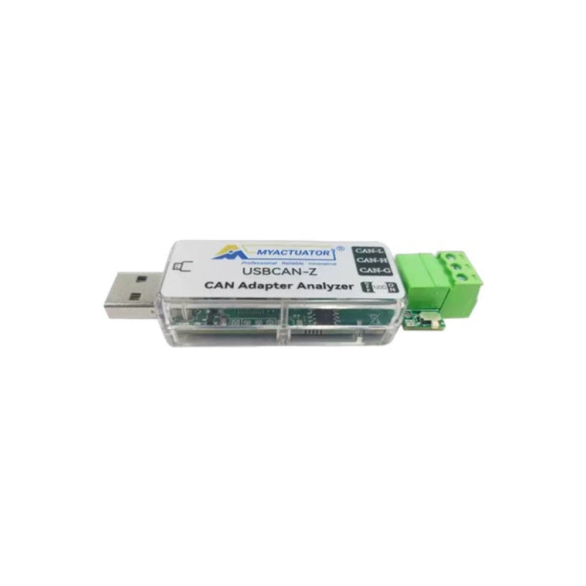

# MyActuator USB-CAN Communication Module Guide


[**View MyActuator USB-CAN Communication Module on OpenELAB**](https://openelab.io/products/myactuator-usb-can-motor-converter)

**Model:** USB-CAN Communication Module · **SKU:** `MyActuator-USB-CAN` · **Revision / option:** Store version USBCAN-Z; verify the received adapter/driver revision


## Product overview

This USB-to-CAN interface connects a host computer to a MyActuator motor's CAN bus. It is a communication accessory, not a servo motor or a motor power supply. Some motor listings offer it as an accessory-only option; the X2 listing also uses the SKU label `MyActuator-CAN-USB`. Match the received hardware before reusing a driver.

## Applications

Use it for first status reads, parameter inspection and development of a CAN-controlled actuator. It is useful for isolating one motor on a bench before a multi-axis bus is assembled. Compatibility depends on the host driver, adapter API and the motor's CAN protocol.

## Specifications

| Item                   | Value / scope                                                                   |
| ---------------------- | ------------------------------------------------------------------------------- |
| Store model / version  | USB-to-CAN / USBCAN-Z                                                           |
| Listed mass            | 15.7 g                                                                          |
| Host side              | USB                                                                             |
| Motor bus terminals    | CAN-L, CAN-H, CAN-G                                                             |
| Termination            | Manufacturer accessory diagram shows switchable 120 Ω, OFF/ON                   |
| Motor power            | Separate supply sized for the actuator                                          |
| First-test bus setting | 1 Mbit/s for the cited MyActuator CAN protocol; not a universal adapter default |

Sources: [OpenELAB listing](https://openelab.io/products/myactuator-usb-can-motor-converter) for version/mass, [manufacturer accessory diagram](https://www.myactuator.com/_files/archives/cab28a_bc732701dadf4512a0d917ecaab12747.zip) for terminal and switch labels. These sources do not establish CAN FD, galvanic isolation, universal Linux SocketCAN support or compatibility with every USB-CAN driver.

## Hardware and connections

With all equipment unpowered, connect **CAN-H → motor CAN\_H**, **CAN-L → motor CAN\_L**, and **CAN-G → the motor's documented CAN ground/reference**. Use the manufacturer's connector-view diagram for the actuator end. The motor needs its own supply; do not connect the motor's VCC to CAN-G, CAN-H or CAN-L.

A short one-adapter/one-motor bus has two physical ends. If the adapter sits at one end, its termination switch supplies that end's 120 Ω resistor; provide the other end's 120 Ω at the motor. Do not add a third resistor just because another motor is present. As an electrical check, two 120 Ω resistors in parallel normally measure about 60 Ω across CAN-H/CAN-L with the bus unpowered. Count built-in termination before adding external parts.

Use the matching USB data cable/connection, a rigid motor fixture and access to motor-power isolation. Verify the accessory's markings against the [RH-25 accessory sheet](https://www.myactuator.com/_files/archives/cab28a_bc732701dadf4512a0d917ecaab12747.zip) before assuming switch orientation.

## Software and development resources

Obtain the driver and tool for the **received adapter revision** from its supplied package or the manufacturer's [setup-software downloads](https://www.myactuator.com/downloads-setupsoftware). A USB-CAN device is not automatically a serial COM device or a SocketCAN interface. Select a host environment explicitly supported by that driver. Verify that the tool can choose a CAN channel, bitrate, standard data frame and eight-byte payload.

The actuator protocol is separate from the adapter's USB API. For the documented RH/X V4-family status read, use [CAN motion protocol V4.4](https://www.myactuator.com/_files/archives/cab28a_be98b58973d34f7aaa50bdf3f2aa12ed.zip); for an L-series controller, use its own supplied protocol. The [manufacturer SDK page](https://www.myactuator.com/downloads-sdk) is an optional development starting point, not proof of this adapter's OS compatibility.

## Getting started

### Prerequisites

One compatible, securely mounted and unloaded motor; its exact wiring diagram and known ID/bitrate; suitable motor power; this adapter; and an installed compatible driver/raw CAN utility.

1. Connect CAN-H, CAN-L and reference ground while power is off, and configure termination at the two ends.
2. Connect USB and confirm that the adapter enumerates without a driver error. Open the matching CAN utility and select the detected device and channel.
3. Apply the motor's documented supply. For a motor using the cited V4.4 protocol at its documented setting, choose **1 Mbit/s**, **standard 11-bit data frame**, **DLC 8**.
4. Read status without enabling motion: transmit to **0x140 + motor ID**, data **9A 00 00 00 00 00 00 00**. For an ID confirmed as 1, the transmit ID is **0x141** and expected response ID is **0x241**.
5. Inspect repeated replies, command byte 0x9A and the voltage/temperature/fault fields using the motor firmware's protocol table. Save the actual adapter/driver version, bitrate and motor ID.

**Expected result:** the host sees the adapter and receives repeatable, decodable status frames from the intended motor. USB detection alone does not establish a working motor bus.

**If this check fails:** first separate host-driver failure from CAN-bus failure. Then check motor power, swapped H/L, common reference, termination, bitrate, ID and firmware/protocol pairing in that order.

## Troubleshooting and FAQs

**USB is detected but no CAN frames return**

Check the selected channel and bus settings, then measure power at the motor. A powered USB adapter does not power the actuator. Confirm receive filters permit the response ID.

**Replies disappear after another motor is attached**

Check duplicate IDs and excess termination. Keep a linear bus with termination only at its ends, and bring up additional motors one at a time.

**A CAN utility expects a different USB-CAN brand**

Driver/API compatibility matters even when the connector and CAN bitrate match. Use the documented driver/API for this module; do not select a similar device name just to make the tool connect.

**Does the module generate EtherCAT traffic?**

No such conversion capability is documented here. EtherCAT uses a separate master and the appropriate actuator interface.

## Downloads and technical documents

| Resource            | Use                                                                     | Link                                                                                                         |
| ------------------- | ----------------------------------------------------------------------- | ------------------------------------------------------------------------------------------------------------ |
| Accessory drawing   | CAN-L/H/G and 120 Ω switch, RH-25 accessory sheet 260805                | [Official model ZIP](https://www.myactuator.com/_files/archives/cab28a_bc732701dadf4512a0d917ecaab12747.zip) |
| CAN protocol        | V4.4-260520 status-read framing and reply fields; select firmware match | [RH manual ZIP](https://www.myactuator.com/_files/archives/cab28a_be98b58973d34f7aaa50bdf3f2aa12ed.zip)      |
| Host setup software | Model/driver selection and supplied instructions                        | [Official downloads](https://www.myactuator.com/downloads-setupsoftware)                                     |
| Optional SDK        | Review adapter backend and platform requirements before use             | [Official SDK](https://www.myactuator.com/downloads-sdk)                                                     |

A separate board schematic, universal OS support matrix and standalone adapter firmware procedure were not established by the reviewed sources. Use the documented module interfaces; do not flash an unrelated USB-CAN firmware.

## References and validation

Sources: the [OpenELAB product listing](https://openelab.io/products/myactuator-usb-can-motor-converter), [RH-25 accessories/interface sheet 260805](https://www.myactuator.com/_files/archives/cab28a_bc732701dadf4512a0d917ecaab12747.zip) and [RH user manual V1.4 / CAN and EtherCAT protocols](https://www.myactuator.com/_files/archives/cab28a_be98b58973d34f7aaa50bdf3f2aa12ed.zip). The accessory sheet identifies the USB-CAN terminal labels/termination switch and RJ45 Adapter Plate V1.0. Model-specific supply and firmware limits belong to the connected actuator's documentation.

Reviewed 19 November 2026. Catalog identity, manufacturer diagrams and protocol documentation were reviewed. Driver installation, SDK compilation and physical hardware tests were **not run**. No universal OS-driver or cross-brand compatibility claim is made.

[All MyActuator product guides](./)
