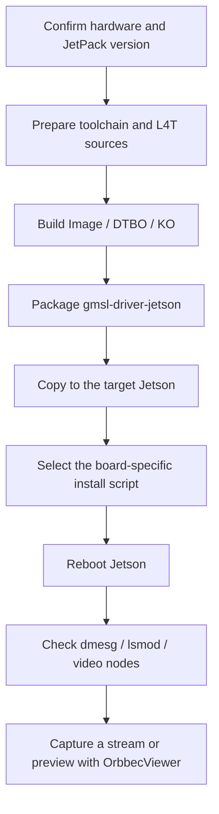
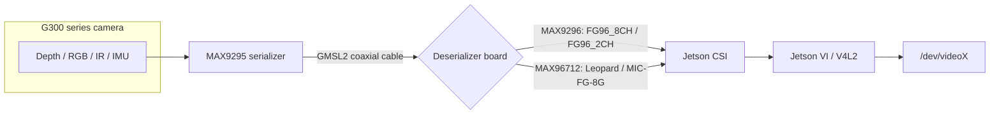
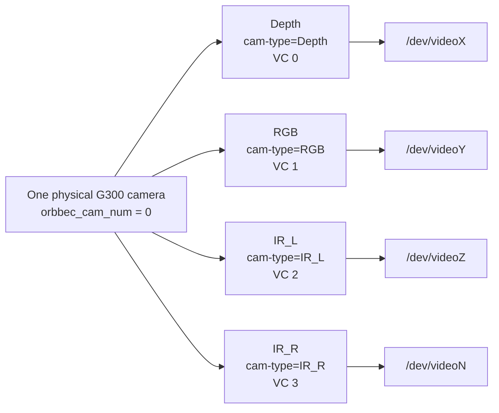
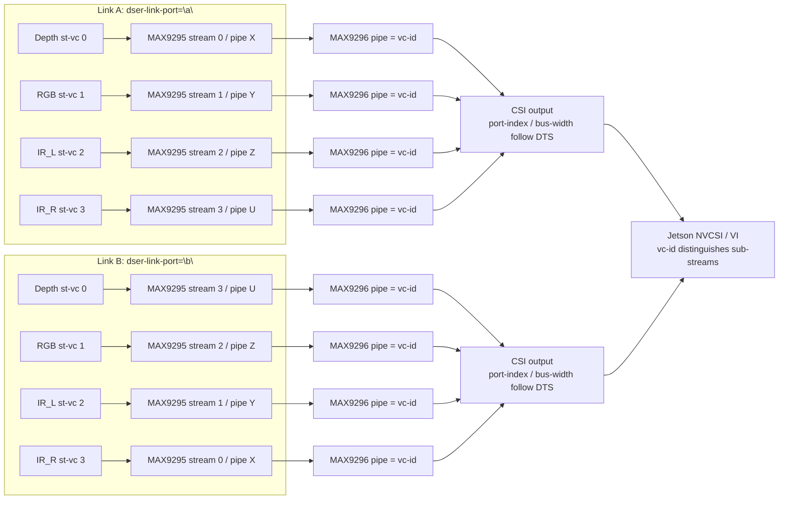
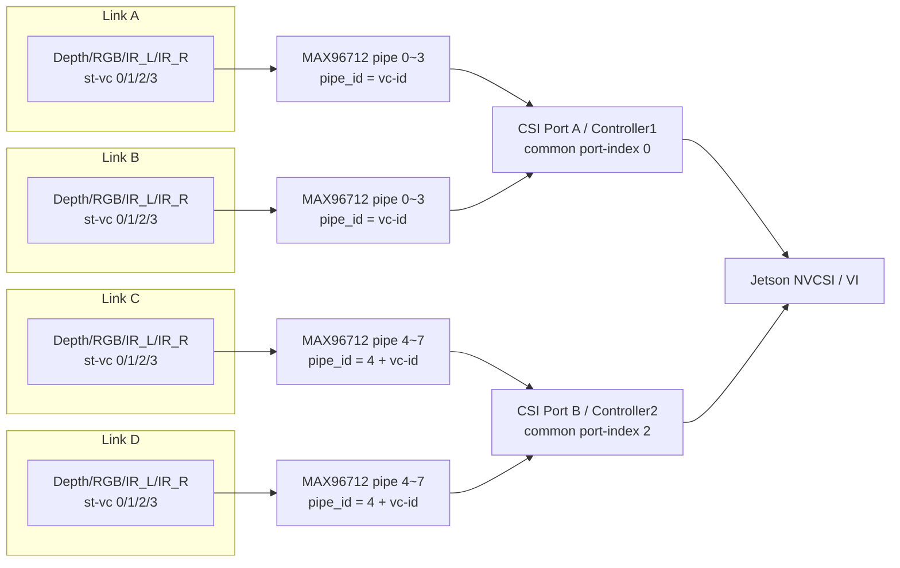
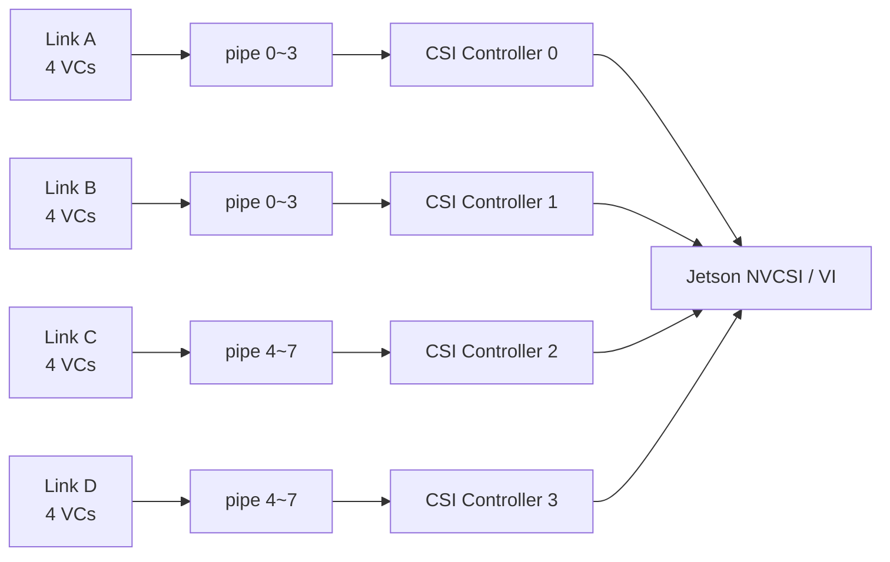
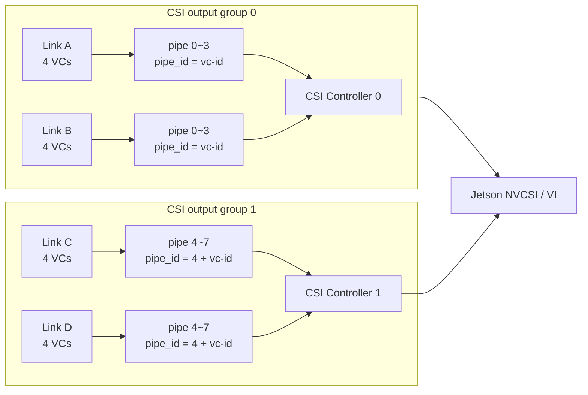

# Orbbec Gemini 345Lg User Manual

### Orbbec Gemini 345Lg Rugged Stereo Vision Camera for Outdoor Robotics



.jpg>)

.jpg>)

.jpg>)

.jpg>)

.jpg>)

.jpg>)

### Gemini 345Lg

### 0 Glossary

Terms Descriptions ASIC Application-specific Integrated Circuit Baseline The distance between the optical centers of the two cameras used for depth calculation D2C Depth to Color maps each pixel on a depth map to the corresponding color image according to the intrinsic and extrinsic parameters of the depth camera and color camera Depth Depth video streams are similar to color video streams except each pixel has a value representing the distance away from the sensor instead of color information Depth Camera Includes depth imaging module and external interface, of which the former is generally composed of an infrared projector, infrared camera, and depth computing processor FOV Field of View describes the angular extent of a given scene that is captured by a camera, which can be measured in the horizontal, vertical, and diagonal I2C Refers to a simple bi-directional two-wire synchronous serial bus developed by Philips IMU Inertial measurement unit. IR Light in the infrared spectrum, which ranges from 700 nm and above IR Camera A camera capable of seeing light in the IR spectrum ISP Image signal processor, which is used for image post-processing LDM Laser Diode Module MIPI Mobile Industry Processor Interface (MIPI) Alliance. MIPI is an open standard and specification formulated by the MIPI Alliance for mobile application processors PCBA PCBA (Printed Circuit Board Assembly) refers to a fully assembled printed circuit board (PCB) that includes all the electronic components mounted and soldered onto it. Point Cloud A discrete set of data points in space RGBM/RGB Module Color Camera

ROI Region of Interest(ROI) in image processing refers to a specific area selected from the entire image SBC A Single Board Computer (SBC) is a microcomputer where all the logic circuits, timing circuits, internal memory, and external interfaces are integrated onto a single printed circuit board. A typical example is the Raspberry Pi SoC System on Chip, an integrated circuit (IC) that integrates all components of a computing system UVC USB Video Class (UVC) is a protocol standard defined for USB video capture devices and has become one of the USB.org standards VCSEL Vertical-Cavity Surface-Emitting Laser (VCSEL) is a type of semiconductor laser where the laser light is emitted perpendicular to the surface of the device DoF Degree of Freedom, In an Inertial Measurement Unit(IMU), 6DoF means the device can measure all six degrees of freedom. TBD To Be Determined. Information will be provided in a later revision.

### 1 Product Brief

Orbbec Gemini 345Lg is a highly reliable product designed for various outdoor scenarios, based on active and passive stereo vision technology. Equipped with Orbbec MX6800 ASIC, the 3D camera delivers a high-reliability system solution specifically developed for outdoor scenarios. The camera produces accurate depth images with a wide field of view (FOV), integrates a wide dynamic range RGB color module and a high-performance color image processor to output high-quality color images, and includes a built-in high-precision inertial measurement unit (IMU) that provides various types of motion attitude information. In addition, the camera performs hardware-based depth image computation and depth-to-color image spatial alignment conversion, ensuring long-term accurate output while reducing the computational demands on the host system. It also enables unified hardware timestamp marking for all sensor data streams and the host system, along with a flexible frame synchronization mechanism. This ensures time alignment between depth and color images, as well as multi-camera time alignment, greatly simplifying system application complexity in multi-device usage scenarios and offering high scalability. The camera is available with either USB or GMSL2 FAKRA interfaces. Both versions feature an IP67 rating for dust and water resistance. The USB Type-C interface supports power delivery and data transmission, enabling plug-and-play operation. It can be easily configured and controlled via the Orbbec SDK, making it suitable for

image evaluation, debugging, production, and upgrade stages. The GMSL2 FAKRA (C-Code) interface, configured for 6Gbps, is ideal for applications demanding high stability and long-distance transmission. When using GMSL transmission, the host platform must be equipped with a GMSL2 deserializer. The camera supports Maxim Integrated’s GMSL serializer driver and is compatible with Orbbec’s camera driver, allowing image data acquisition and control through the Orbbec SDK. Gemini 345Lg is designed for flexible use across various product stages and offers the following features:

* Active/Passive Stereo Vision, ensuring reliable performance in dynamic

environments

* Wide Depth FOV: H 104° x V 87°
* Depth Accuracy: ±3% at 3 meters
* Wide Color FOV: H 137° x V 71°
* Color Wide Dynamic Range up to 100dB
* Frame synchronization across multiple sensors
* Hardware timestamp for system and camera module time synchronization
* Multi-device synchronization support
* Broad temperature adaptation range and strong adaptability in motion scenarios
* Long-distance stable data transmission via GMSL2 FAKRA interface
* IP67 rating

### 2 Product Specifications

Parameter Gemini 345Lg Use Environment Indoor & Outdoor Technology Active & Passive Stereo Baseline 88mm LDM Wavelength 850 ± 6nm Operating Range\[1] Wide: 0.19 – 10m Standard: 0.22 – 10m Ideal Range 0.3 - 6m Mini-Z Wide: 0.19m Standard: 0.22m Depth Accuracy \[2] Wide: TBC Standard: ± 3% (3m & 90% x 90% ROI) ± 6% (6m & 80% x 80% ROI) Temporal Precision \[2] Wide: TBC Standard:0.6% @ 3m Spatial Precision \[2] Wide: TBC Standard: ≤ 1.2% (1280 x 960 @ 3m & 90% x 90% ROI) ≤ 3% (1280 x 960 @ 6m & 80% x 80% ROI) Fill Rate ≥ 99% (1m & 90% x 90% ROI) Depth Resolution @ Frame Rate Up to 1280 x 960 @ 30fps Depth FOV Wide: H104° x V87° ± 3° @ 2m Standard: H91° x V78° ± 3° @ 2m Depth Filter All-Pass Sensor Type IR: Global Shutter Color: Rolling Shutter RGBM Resolution @ Frame Rate Up to 1920 x 1080 @ 30fps RGB Module FOV Aspect Ratio 16:9 H137° x V71° ± 3° Aspect Ratio 4:3 96° x 71° ± 3° IMU 6 Dof Depth Processing MX6800 ASIC Data Connection GMSL2 / USB 3.0 Interface \[3] FAKRA – C Code; USB - C ESD Class A

Contact discharge: ±8kV, Air discharge: ±15kV RE ≥6 dB Typepical Average Power Consumption \[4] 3.6W @ GMSL; 2.8W @ USB Max Average Power Consumption \[4] 3.6W @ GMSL; 3.5W @ USB Peak Power Consumption \[4] 5W @ GMSL; 6.7W @ USB Power Supply GMSL: ≥600mA @ 12V USB: 1.5A @ 5V Operating Voltage Range \[5] GMSL: 9 – 15V (Typical: 12V) USB: 4.75 – 5.25V (Typical: 5V) Operating Environment -20℃ - 65℃; <95% RH (non-condensing) Storage Environment -40℃ - 85℃; <95% RH (non-condensing) Protection \[6] IP67 Supported Functions Hardware Spatial Alignment of Depth to Color Hardware Timestamps Multi-camera Sync Dimensions(W x H x D) 124 x 29 x 43.95mm Weight 223g Installation Back :4x M3, Max Torque: 6.5kgf.cm Notes: \[1] When the measured object’s reflectivity is greater than 10%, the camera can provide reliable depth data at up to 10 meters. The theoretical maximum ranging distance is 65 meters, though actual accuracy varies with distance and target surface properties. \[2] The region of interest (ROI) is shown in the figure below. All depth performance metrics listed above are validated on the production line for each 3D camera before shipment and represent its performance under typical usage conditions.It should be noted that throughout the operational life of the 3D camera, external environmental factors may significantly affect its depth performance. \[3] The USB interface of this product is primarily intended for development and debugging purposes. For final product deployment, the use of the GMSL2 FAKRA interface (C-Code) is recommended, which supports a data rate of 6 Gbps. To maintain the IP67 rating, the USB protective seal must remain in place when the USB port is not in use. \[4] Laser power level low

Depth 640 x 480 @ 30 fps Y16 RGB 1920 x 1080 @ 30 fps YUYV Left IR 1280 x 960 @ 30 fps Y8 Right IR 1280 x 960 @ 30 fps Y8 IMU ODR (output data rate) 200Hz \[5] The product supports a wide voltage input range. However, if significant load is present on the board or cables, causing excessive voltage drop, operational issues may occur. \[6] The camera is equipped with both a GMSL2 FAKRA interface and a USB interface. When properly connected, the system meets IP67 dust and water resistance standards. To maintain this protection level when using the GMSL2 FAKRA interface, a waterproof connector must be used after wiring, and the factory-installed protective seal must remain intact. When using the USB interface, a waterproof USB cable is required to ensure compliance with the dust and water resistance rating.

### 3 Product Information

#### 3.1 Product Pictures

Table 3-1-1 Product pictures for Gemini 345Lg Front View BACK View TOP View Botto m View Left View Right View Front -45° View Back- 45° View

#### 3.2 Product Drawings

**3.2.1 Product Drawings**

Table 3-2-1 Product drawings for Gemini 345Lg Name Gemini 345Lg Front View Rear View Top View Bottom View Side View

**3.2.2 Product Dimensions & Weight**

Table 3-2-3 Product dimensions & weight for Gemini 345Lg Name Gemini 345Lg Width/mm 124 ± 0.3 Height/mm 29 ± 0.3 Depth/mm 43.95 ± 0.3 N.W/g 223 ± 3

#### 3.3 Product Interfaces

The Gemini345Lg camera is equipped with both USB and GMSL2 FAKRA interfaces, delivering integrated functionality for power supply, high-speed data transmission, and multi-camera synchronization. The GMSL2 FAKRA interface complies with the GMSL2 standard, supporting a data rate of 6 Gbps. When the GMSL2 FAKRA interface is in use, the USB port must remain securely sealed. For initial development, testing, and production validation phases, the USB interface is recommended to facilitate rapid prototyping and verification. For mass production and end-product deployment, the use of the GMSL2 FAKRA interface is advised

**3.3.1 GMSL2 FAKRA**

The following diagram illustrates the GMSL2 FAKRA interface and its supported features. Table 3-3-1 GMSL Hardware Interface Schematic Interface GMSL2 FAKRA Schematic Table 3-3-2 GMSL Interface Functional Definition Pin Name I/O Definition Function Description Deserializer Requirement Priority MFP0 O SPI\_CLK SPI clock, with The serializer IC acts as the master and the camera ASIC acts as the slave. Level III — Used when SPI data transmission is required MFP1 O SPI\_MOSI Master output，slave input. The serializer IC acts as the master, while the camera ASIC acts as the slave. Level III — Used when SPI data transmission is required MFP2 I SPI\_MISO Slave output，master input. The serializer IC acts as the master, while the camera ASIC acts as the slave. Level III — Used when SPI data transmission is required MFP3 O WAKE Camera enters sleep mode and wakes up when the high level is active. Level II — Used when low-power operation is required MFP4 I CFG0 Configuration of the working mode of The serializer IC. / MFP5 I CFG1 Configuration of the working mode of The serializer IC. / MFP6 O SYNC\_IN Multi-machine synchronization SYNC\_IN, The serializer IC outputs to the ASIC, high pulse valid, pulse width ≥ 1ms. Level II — Used when multi-camera synchronization operation is required.

MFP7 O PPS GPS second pulse signal, high pulse valid, pulse width ≥ 1ms. Level II — Used when GPS timing synchronization operation is required. MFP8 O RESTART Camera power switch control: Low level turns on the camera power, high level turns off the camera power. Power-on defaults to turning on the camera. Level II — Used when module power reset operation is required. MFP9 I SYNC\_OUT Multi-machine synchronization SYNC\_OUT,The ASIC outputs to The serializer IC,high pulse valid, pulse width ≥ 1ms. Level II — Used when multi-camera synchronization operation is required. MFP10 O SPI\_CS SPI chip select. The serializer IC acts as the master, while the ASIC acts as the slave. Level III — Used when SPI data transmission is required MFP11 I Timer\_OUT Timestamp reset Timer\_OUT, The serializer IC outputs to The ASIC. Level IV — Used when timestamp reset operation is required. MFP12 O Timer\_in Timestamp reset Timer\_IN, The ASIC outputs to The serializer IC. Level IV — Used when timestamp reset operation is required. MFP13 / / / / MFP14 / / / / MFP15 O/I I2C\_SDA I2C\_SDA(Master) Level I — Mandatory for use. MFP16 O I2C\_SCL I2C\_SCL(Master) Level I — Mandatory for use. Different functions are assigned distinct priority levels based on product design. The appropriate interface can be selected according to specific functional requirements to achieve targeted implementation. The host controller requires a matching deserialization circuit to ensure proper data reception and parsing

**3.3.2 USB Type-C**

Below is the description of the Gemini345Lg USB interface. Table 3-3-3 USB Hardware Interface Schematic Interface USB Schematic Table 3-3-4 USB Interface Definition Pin Name Definition Pin Name Definition A1 GND Ground B1 GND Ground A2 TX1+ High-speed Differential Signaling#1, TX, Positive B2 TX2+ High-speed Differential Signaling#2, TX, Positive A3 TX1- High-speed Differential Signaling#1 TX Negative B3 TX2- High-speed Differential Signaling#2 TX Negative A4 VBUS Power B4 VBUS Power A5 CC1 Port configuration B5 CC2 Power configuration A6 D+ USB2.0 Differential Signaling#1, Positive B6 D+ USB2.0 Differential Signaling#2, Positive A7 D- USB2.0 Differential Signaling#1, Negative B7 D- USB2.0 Differential Signaling#2 ,Negative A8 SBU1 Sideband use,3.3V,PPS (Default) B8 SBU2 Sidebanduse,3.3V,SYNC\_IN (Default) A9 VBUS Power B9 VBUS Power A10 RX2- High-speed Differential Signaling#2 RX Negative B10 RX1- High-speed Differential Signaling#1 RX Positive

A11 RX2+ High-speed Differential Signaling#2 RX Positive B11 RX1+ High-speed Differential Signaling#1 RX Negative A12 GND Ground B12 GND Ground

#### 3.4 Product Components

**3.4.1 Overview of Product Components**

Table 3-4-1 Overview of product components for Gemini 345Lg Gemini 345Lg IR Module IR Module RGB Module LDM

**3.4.2 Laser Diode Module**

The laser module (LDM), also known as the laser emitting module, consists of a vertical-cavity surface-emitting laser array and other optic components. It projects a static infrared pattern onto the scene to enhance the texture of low-texture scenes and improves the ability of the 3D camera system to detect depth information. Under normal circumstances, the Gemini 345Lg laser module comply with Class 1 laser safety. Table 3-4-2 LDM parameters LDM Gemini 345Lg Type Infrared Component Vertical Cavity Surface Laser Emitter(VCSEL) + Optics Laser Controller Pulse Wavelength 850nm ± 6nm Laser Compliance\* Class 1 Laser Power-down Temperature\* 80℃ Horizontal FOV 108° Vertical FOV 78° FOV tolerance ±3.0°

> Note: \* LDM is considered Class 1 when integrated into Orbbec‘s 3D Cameras.

* LDM will power down while the module tested temperature is ≥80℃.

**3.4.3 Infrared Module**

Table 3-4-3 Infrared module parameters IR Module Gemini 345Lg Filter Type Visible + NIR-pass Filter Active Pixels 1280 x 960 Sensor Aspect Ratio 4:3 Focus Type Fixed

Shutter Type Global Shutter Horizontal FOV 130° Vertical FOV 95° Diagonal FOV 170° FOV tolerance ±3.0°

**3.4.4 RGB Module**

Table 3-4-4 RGB module parameters RGB Module Gemini 345Lg Active Pixels 1920 x 1080 Sensor Aspect Ratio 16:9 Focus Type Fixed Shutter Type Rolling Shutter HDR 100dB Horizontal FOV 137° Vertical FOV 71° Diagonal FOV 174° FOV tolerance ±3.0°

**3.4.5 IMU**

Table 3-4-5 Gemini 345Lg IMU Specifications IMU Parameters Specifications Timestamp Unit us (Same source hardware timestamp is used for IMU, IR, RGB and Depth stream) Transmittance Protocol I2C X/Y/Z Axis The X, Y, and Z axis point right, downward, and forward relative to the camera front Gyroscope Format 3 x 32-bit float Range ±4.36rad/s (250dps); ±17.44rad/s (1000dps) Frequency (Hz) 100/200/400/800 Accelerometer Format 3 x 32-bit float

### 4 Functional Specifications

#### 4.1 Vendor Identifier (VID) and Product Identifier (PID)

Table 4-1-1 VID & PID table Name Model PID VID Gemini 345Lg G40075-272 0x2BC5 0x0813

#### 4.2 Platform and System Requirements

Gemini 345Lg connect to the host computer using USB/GMSL2 FAKRA, which is compatible with various platforms and system requirements. Table 4-2-1 Gemini 345Recommended Platforms and Systems Chip x86/x64 ARM OS Windows 10/11 Ubuntu 20.04 / 22.04 Ubuntu 20.04 / 22.04 USB USB 3.0 USB 3.0 USB 3.0 / GMSL2 CPU Quad-core, 2.9GHz and above Quad-core, 2.9GHz and above Cortex-A53 Quad-core, 1.8GHz and above Reference model Intel i7 10700 / Intel i5 8400 Intel i7 10700 / Intel i5 8400 NVIDIA Jetson Orin / Orin NX / Orin Nano RAM 8GB RAM and above 8GB RAM and above 4GB RAM and above Range ± 29.4m/s² (3g); ± 58.8m/s² (6g) Frequency (Hz) 100/200/400/800 Temperature Format 1 x 32-bit float Range -40 - 85℃ Frequency (Hz) Follows the gyroscope and accelerometer frequency

#### 4.3 Camera system Framework

Figure 4-3-1 Gemini 345Lg System Framework Diagram

#### 4.4 Image Data Stream

The Gemini 345Lg provide high-quality, multi-resolution depth stream data, as well as high-definition color stream data. The camera outputs depth stream data in Y16 format. The color stream data output by the camera is in MJPEG/YUYV format. Of these formats, MJPEG contributes significantly to reducing data transmission bandwidth and minimizes the risk of frame drops. For instance, at a resolution of 1280\*720 and a frame rate of 15 fps, an RGB data stream in MJPEG format requires approximately 20 Mbps of bandwidth (the exact value may vary depending on the target image). Under the same configuration, YUYV format output requires approximately 211 Mbps. However, the MJPEG format is only supported for USB interface output, while GMSL only supports YUYV format output.

Table 4-4-1 Output data streams (USB3.0)-Gemini 345Lg Gemini 345Lg Data Format Aspect Ratio Resolution Frame Rate Depth Y16 4:3 1280 x 960 10, 15, 20, 30 640 x 480 10, 15, 20, 30 IR Y8 4:3 1280 x 960 10, 15, 20, 30 640 x 480 10, 15, 20, 30 RGB MJPEG & YUYV 16:9 1920 x 1080 10, 15, 20, 30 1280 x 720 10, 15, 20, 30 640 x 360 10, 15, 20, 30 4:3 1280 x 960 10, 15, 20, 30 640 x 480 10, 15, 20, 30 Table 4-4-2 Output data streams (GMSL2)-Gemini 345Lg Gemini 345Lg Data Format Aspect Ratio Resolution Frame Rate Depth Y16 4:3 1280 x 960 10, 15, 20, 30 640 x 480 10, 15, 20, 30 IR Y8 4:3 1280 x 960 10, 15, 20, 30 640 x 480 10, 15, 20, 30 RGB YUYV 16:9 1920 x 1080 10, 15, 20, 30 1280 x 720 10, 15, 20, 30 640 x 360 10, 15, 20, 30 :3 640 x 480 10, 15, 20, 30

#### 4.5 Field of View

**4.5.1 Definition of Depth Field of View**

The image below shows the depth field of view (FOV). For a better understanding, we illustrate the angles that the depth and IR cameras "see". Figure 4-5-1 Depth Field of View to Depth Map illustration Depth Field of View (Depth FOV) at any depth (Z) can be calculated using the following equation: Table 4-5-1 Depth FOV calculation formulas Calculation Formulas Definitions fx cxwidth Z B fx cx        1arctanarctanFOVHDepth 1. cx = X-direction image coordinate of the principle point of the depth image 2. fx = Depth camera focal length in pixels of x-axis 3. cy = Y-direction image coordinate of the principle point of the depth image 4. fy = Depth camera focal length fx cxwidth fx cx  1arctanarctanFoVH ActiveDepth )tan(\*2 B FOVH ActiveDepth Z 

5. width = Depth image width 6. height = Depth image height 7. Depth active H-FOV = Left IR H-FOV fy -cyheight- fy c 1arctanyarctanFOV-VDepth      

> Note:

1. Depth intrinsics, including cx, cy, fx, fy, width and height, are obtained through SDK APIs, and these parameters may vary across different units. 2. At different depth values, the depth FOV is non-constant. The farther the depth, the greater the depth FOV.

**4.5.2 Typical Depth Intrinsics**

Table 4-5-2 Typical Depth Intrinsics of Gemini 345Lg Mode Baseline /mm Resolution：Width x Height cx/pixel cy /pixel Fx & fy/pixel Width/pixel Height/pixel Wide 88 1280 960 640 480 510.0 & 510.0 640 480 320 240 255.0 & 255.0 Standard 88 1280 960 640 480 600.0 & 600.0 640 480 320 240 300.0 & 300.0

**4.5.3 Overview of Stream FOV**

Table 4-5-3 Stream FOV for Gemini 345Lg FOV Aspect Ratio Gemini 345Lg Depth FOV @ 2m 4:3 Wide: H 104° x V 87° Standard: H 91° x V 78° IR FOV 4:3 H 130° x V 95° RGB FOV 16:9 H 137° x V 71° 4:3 H 96° x V 71° D2C FOV @ 2m 16:9 Wide: H 104° x V 71° Standard: H 91° x V 71°

4:3 Wide: H 96° x V 71° Standard: H 91° x V 71°

**4.5.4 FOV Illustrations**

Table 4-5-4 Depth FOV of Gemini 345Lg (Wide) Aspect ratio Depth FoV 4:3 Table 4-5-5 Depth FOV of Gemini 345Lg (Standard) Aspect ratio Depth FoV 4:3

#### 4.6 Depth to Color Alignment

Gemini 345Lg support spatially and temporally aligned output of D2C (Depth To Color) depth and color images. D2C (Depth To Color) refers to mapping each pixel point on the depth map to the corresponding position on the color map according to the internal and external parameters of the depth camera and the color camera, so as to obtain the RGBD map. Hardware depth-color alignment implemented via the ASIC significantly reduces host resource consumption; software depth-color alignment requires host resources but supports higher resolutions and frame rates.

**4.6.1 Depth to Color by Software**

Table 4-6-1 Depth to Color Alignment by Software Depth Image before D2C Color Image Depth Image After D2C Aspect Ratio 1280 x 960 / 640 x 480 1920 x 1080 1920 x 1080 16:91280 x 720 1280 x 720 640 x 360 640 x 360 1280 x 960 / 640 x 480 1280 x 960 1280 x 960 4:3 640 x 480 640 x 480 Table 4-6-2 Depth to Color FOV of Gemini 345Lg(Wide) Aspect Ratio D2C FOV 4:3

16:9 Table 4-6-3 Depth to Color FOV of Gemini 345Lg(Standard) Aspect Ratio D2C FOV 4:3 / 16:9

**4.6.2 Depth to Color by Hardware**

Table 4-6-4 Depth to Color Alignment by Hardware Depth Image before D2C Color Image Depth Image After D2C Aspec t Ratio 1280 x 960 / 640 x 480 640 x 480 640 x 480 4:3 1280 x 960 / 640 x 480 640 x 360 640 x 360 16:9 1. Depth-color hardware resolution supports RGB resolutions only up to 640 x 480 or lower. 2. The frame rates of the two data streams must be identical for depth-color registration.

Table 4-6-5 Depth to Color FOV of Gemini 345Lg(Wide) Aspect Ratio D2C FOV 4:3 16:9 Table 4-6-6 Depth to Color FOV of Gemini 345Lg(Standard) Aspect Ratio D2C FOV 4:3 / 16:9

#### 4.7 Minimum-Z Depth

The Minimum-Z Depth is the minimum distance from the depth camera to the scene. Table 4-7-1 Minimum-Z Depth for Gemini 345Lg Mode FOV Resolution Minimum-Z Wide H 104° x V 87° 1280 x 960 0.19m 640 x 480 Standard H 91° x V 78° 1280 x 960 0.22m 640 x 480

#### 4.8 Coordinate System

For the Gemini 345Lg 3D camera, the plane where the 1/4 screw hole is located is defined as the bottom side, the glass cover surface is the front side, and the RGB module is positioned to the left of the LDM module. The origin of the IMU coordinate system is situated at the physical sensor center point. The accelerometer and gyroscope coordinate systems are located at the back of the left IR. The positive X-axis of the coordinate system points to the right, the positive Y-axis points downwards, and the positive Z-axis points forwards. The origin of the depth image coordinate system is at the optical center of the left IR module, while the origin of the color image coordinate system is at the optical center of the RGB module. The direction of the coordinate systems is the same: the positive X-axis points to the right, the positive Y-axis points downward, and the positive Z-axis points forward. The depth camera coordinate system origin is the default origin of the 3D camera, with coordinates (0,0,0). The reference positions of the depth origin, color origin, and IMU origin in the 3D camera coordinate system are shown in the chart below:

Table 4-8-1 Gemini 345Lg Coordinate System Position Reference Coordinate System Position in the 3D camera coordinate system X（mm） Y（mm） Z(mm) Depth 0 0 0 Color 36 0 -0.91 IMU 24.09 2.23 -25.33 Table 4-8-2 Gemini 345Lg Coordinate System Schematic Gemini 345Lg IMU Depth

RGB

#### 4.9 Camera Start Point Reference

The depth starting point or ground zero reference can be described as the starting point or plane where the depth equals 0. For Gemini 345Lg, the distance from the depth zero point to the front surface of the module is 4.42 mm. Table 4-9-1 Camera Start Point Illustrations Camera Gemini 345Lg Depth (Z’) 4.42mm

#### 4.10 Streaming Mode

The Gemini 345Lg offers users flexible methods for acquiring IR, Depth, and RGB image data, with the most common being the specific frame rate streaming mode. In this mode, users set a target frame rate, resolution, and image format for each type of

data, and then activate the corresponding data streams in sequence. The camera captures and outputs image data at the user-defined target frame rate, resolution, and image format. The user can select a specific frame rate for the current scene from predefined fixed frame rate values of 10fps, 15fps, 20fps, 30fps. The IMU output data stream rate is 100Hz, 200Hz, 400Hz, and 800Hz.

#### 4.11 Multi-Camera Synchronization

**4.11.1 Multi-camera Synchronization**

The Gemini 345Lg is designed with a synchronization feature. In scenarios utilizing multiple cameras, it enables hardware synchronization among them. For a multi-camera use case, one camera can be initialized as primary, and the rest configured as secondary\_synced. Advantages of multi-camera setup:

* Increase camera coverage in a given space and fill in the occlusions where a

single camera may have blind spots

* Capture multiple images of the same scene and scan objects from different

angles

* Increase the effective frame rate to greater than 30 FPS

Using an USB/GMSL connector and matching cable, it is necessary to forward the synchronization signal through the device or host system.(Please follow the instructions in the SDK). Multi-camera synchronization includes depth image synchronization and RGB image synchronization (time difference ≤ 5ms, when auto exposure off), using the

multi-camera synchronization function. Table 4-11-1 Topologies schematic diagram Star Topology

**4.11.2 Description of multi-machine synchronization interface**

Table 4-11-2 USB Synchronization Interfaces of Gemini 345Lg Pin Name Description A8 SBU1 Input Voltage Level: 3.3V VIH: ≥2.48V (VCCI × 0.75), VIL: ≤1.15V (VCCI × 0.35) Input Current: ≥4mA (may be appropriately increased based on actual line length requirements) Trigger Method ：Rising Edge (Single Pulse) B8 SBU2 Input Voltage Level: 3.3V VIH: ≥2.48V (VCCI × 0.75), VIL: ≤1.15V (VCCI × 0.35) Input Current: ≥4mA (may be appropriately increased based on actual line length requirements) Trigger Method ：Rising Edge (Single Pulse) Table 4-11-3 GMSL Synchronization Interfaces of Gemini 345Lg Pin Definitions Description MFP9 SYNC\_OUT\* Output Voltage Level: 1.8V\* Active High Pulse Pulse Width ≥ 1 ms MFP6 SYNC\_IN Output Voltage Level: 1.8V\* Active High Pulse Pulse Width ≥ 1 ms · In GMSL interface mode, the module does not yet support operating as a host. · This level has no specific voltage requirement for the deserializer module design.

#### 4.12 Time Synchronization

The camera's internal ASIC supports adding timestamps to each data stream and is compatible with hardware time synchronization. This enables the host system and the camera module to maintain an identical time reference. Hardware synchronization follows the multi-camera synchronization hardware interface, as defined by the MFP7 signal in the GMSL interface. For detailed implementation and operational guidelines regarding time synchronization, please refer to the document: TBC.

#### 4.13 Camera Functions

**4.13.1 Depth Camera Functions**

The camera supports configuration of parameters such as data stream type, resolution, frame rate, and exposure through the SDK, Wrapper API, or the OrbbecViewer tool. The key configurable parameters and their adjustable ranges are listed in the table below: Table 4-13-1 Device Control Control Description Setting Device Preset The camera supports Standard and Wide FOV operating modes. Standard / Wide Synchronization Mode For single-device and multi-camera synchronization modes. Free Run / Standalone / Primary /Secondary- /IR IMU Sync Timestamp Synchronization For host and module time synchronization Sync Immediately / Timed Sync Table 4-13-2 Depth camera control Control Description Settings Mirror Inverting images or data horizontally. Disable, Enable

Flip Inverting images or data vertically. Disable, Enable Rotate Turning an image by a specific angle. 0°,90°,180°,270° Auto Exposure Auto Exposure Mode. When Auto Exposure is enabled, Exposure and Gain are set based on the environment condition. Disable, Enable AE Max Exposure(us) AE Max Exposure 0 - 255 Manual Exposure(1) (us) Sets the absolute exposure time when auto-exposure is disabled 1 - 18000 Gain(Gain 1.0=16) Control sensor digital gain 1 - 244 Depth Unit(millimeter) Depth Measurement Standard Units 0.001 - 10 Metadata MIPI metadata. Disable, Enable

> Note: (1) Not supported in Auto Exposure Mode

Table 4-13-3 IR control Control Description Setting Laser Control Laser on / off control On / Off Laser Power\* Laser energy level control 0 - 1 High Temperature Protect - Disable, Enable Low Exposure Control - Disable, Enable \*When using the USB interface, the laser power can be set to either low or high level. The GMSL interface only supports the low-power level. Table 4-13-4 Depth camera anvanced control Control Description Setting Disparity To Depth Disparity-to-Depth Calculation Disable / Hardware / Software Hardware Noise Removal Noise filtering is performed through the ASIC. 0 - 1 Noise Removal Filter Minimum depth difference 1 - 10000 Maximum size of depth cluster 1 - 1000 Post Processing Software Filtering Processing Disable, Enable Table 4-13-5 IR camera control Control Description Settings

Mirror Inverting images or data horizontally. Disable, Enable Flip Inverting images or data vertically. Disable, Enable Rotate Turning an image by a specific angle. 0°,90°,180°,270° Auto Exposure Auto Exposure Mode. When Auto Exposure is enabled, Exposure and Gain are set based on the environment condition. Disable, Enable AE Max Exposure(us) AE Max Exposure 0 - 255 Manual Exposure(1) (us) Sets the absolute exposure time when auto-exposure is disabled 1 - 18000 Gain(Gain 1.0=16) Control sensor digital gain 1 - 244 Table 4-13-6 Color camera control Control Description Settings Auto Exposure Automatically sets the exposure time and gain for the frame Disable, Enable Manual Exposure(1) (100us) Sets the absolute exposure time when auto-exposure is disabled 10 - 318 Gain Sets the amount of gain applied to the frame if auto-exposure is disabled 1 – 43 Brightness Sets the amount of brightness applied when auto-exposure is enabled -50 – 50 Sharpness Sets the amount of sharpening adjustment applied to the frame 0 – 100 Saturation Sets the amount of saturation adjustment applied to the frame 0 - 100 Contrast Sets the amount of contrast based on the brightness of the scene 0 - 100 Hue Sets the amount of hue adjustment applied to the frame -64 – 63 Backlight Compensation Sets a weighting amount based on brightness to the frame Disable, Enable Powerline Frequency Specified based on the local power line frequency for flicker avoidance Auto, 50, 60, Disabled

> Note: (1) Not supported in Auto Exposure Mode

### 5 Performance

#### 5.1 Depth Performance

**5.1.1 Depth Quality Assessment**

Calculation of Depth Accuracy (Z-accuracy): Depth accuracy (Z-accuracy) measures the per-pixel depth accuracy relative to the GT in a single frame depth image, excluding errors due to camera placement. GT is obtained by measuring the distance from depth origin to the reference target. Depth accuracy can be calculated using the following formula: Depth\_accuracy\_Signed = Median (CP\_Length – GT + PP\_Dist) where CP\_Length represents the actual length between the depth origin and a fitted plane along the GT measuring direction, and PP\_Dist denotes the per-pixel distance of the point cloud to the fitted plane. Calculation of Spatial Precision: The spatial precision is calculated as the percentage of the root mean square error (RMS Error) between each valid pixel and the optimal fitting plane compared to the true value (GT). Calculation of Temporal Precision: The temporal precision measures the variation in depth values over time within a ROI. The quality of a depth image can be assessed based on its temporal consistency, high-quality

depth images should exhibit smooth and stable over time. This method is defined as the STD of depth values across a specific number of frames (for example, 30). The quantification of temporal noise is carried out on a per-pixel basis, followed by calculating the STD of each pixel over a specified time. Depth Fill Rate Calculation: The fill rate is used to calculate the proportion of valid pixels to total pixels within the target area (ROI region), primarily used to measure the completeness of depth.

**5.1.2 Typical depth performance for Gemini 345Lg**

Typical depth performance for Gemini 345Lg is shown in the table below: Table 5-1-1 Typical Depth Performance Depth Performance Gemini 345Lg Depth Accuracy Wide:TBC Standard: ≤±3% (1280 x 960 @ 3 m & 90% x 90% ROI) ≤±6% (1280 x 960 @ 6 m & 80% x 80% ROI) Spatial Precision Wide:TBC Standard: ≤±1.2% (1280 x 960 @ 3 m & 90% x 90% ROI) ≤±3% (1280 x 960 @ 6 m & 80% x 80% ROI) Temporal Precision Wide: TBC Standard: ≤ 0.6% @3m Fill Rate ≥99% (1280 x 960 @ 1 m & 90% x 90% ROI)

> Note:

1. The actual working range and accuracy may vary with the ambient illumination and the objects being measured. 2. The test object is a reflectivity > 80% plane, and the reference range is 81% FOV (81% FOV is the remaining center 81% of the depth map area after cropping 5% from the top, bottom, left and right of the depth map) or 64% FOV (64% = 80% x 80% and of a similar definition).
2. The depth performance of each 3D camera is validated at the production line before shipping to customers. The metrics reflect the depth performance under typical conditions. External impact factors over 3D cameras’ whole lifespan may have significant impacts on their depth performance.

#### 5.2 Electrical Performance

**5.2.1 Power Supply**

The Gemini 345Lg camera utilizes different power supply methods depending on the interface used. It can be powered either via the GMSL2 FAKRA interface or the USB interface. The power requirements are as follows: Table 5-2-1 Power Supply Requirements for Gemini 345Lg Interface Requirements GMSL2 FAKRA\* ≥600mA@12V USB ≥1.5A@5V \* GMSL2 FAKRA Power Supply voltage: 9-15V (Typical 12V)

**5.2.2 Power Consumption**

Power consumption varies depending on the selected working mode. Table 5-2-2 Gemini 345Lg typical configuration & tested power consumption Reference Name GMSL2 FAKRA USB Typical configuration Laser power level: low Disparity search range: 256 D2C：off Depth：640 x 480 @ 30 fps Y16 AE On RGB: 1920 x 1080 @ 30 fps YUYV AE On IR: 640 x 480 @ 30 fps Y8 AE On IMU ODR (output data rate): 200Hz Laser power level: low Disparity search range：256 D2C：off Depth：640 x 480 @ 30 fps Y16 AE On RGB: 1920 x 1080 @ 30 fps YUYV AE On IR: 640 x 480 @ 30 fps Y8 AE On IMU ODR (output data rate): 200Hz Average power consumption

#### 3.6 W 2.8W

Peak power consumption 5W 3.8W

Table 5-2-3 Gemini 345Lg Max Power Configuration & tested power consumption Reference Name GMSL2 FAKRA USB Max Power Configuration Laser power level: low Disparity search range：256 D2C：off Depth: 640 x 480 @ 30 fps Y16 AE On RGB: 1920 x 1080 @ 30 fps YUYV AE On IR: 640 x 480 @ 30 fps Y8 AE On IMU ODR (output data rate): 200Hz Laser power level: High Disparity search range：256 D2C：off Depth: 640 x 480 @ 30 fps Y16 AE On RGB: 1920 x 1080 @ 30 fps YUYV AE On IR: 640 x 480 @ 30 fps Y8 AE On IMU ODR (output data rate): 200Hz Average power consumption

#### 3.6 W 3.5 W

Peak power consumption 5W 6.7W \*Note: The data in the above table are laboratory measurements and are for design reference only.

**5.2.3 Storage and Powered Conditions**

Table 5-2-4 Gemini 345Lg Storage and Powered Conditions Condition Description Min Max Unit Storage (Ambient), Not Powered Long term storage -40 85 ℃ Humidity ＜95%RH(Non-condensing) Ambient, Powered The camera ambient temperature when powered. -20 65 ℃ LDM Protect Temperature The LDM temperature when powered N/A 80 ℃

**5.2.4 ESD Performance**

Table 5-2-5 Gemini 345Lg ESD Performance Conditions Powered-On Powered-Off Certification Standards Contact Discharge ±8KV Class A ±8KV Class A EN 61000-6-2 Air Discharge ±15KV Class A ±15KV Class A

#### 5.3 Physical Performance

**5.3.1 Ingress Protection**

Ingress Protection Information IP Rating Power Supply Protection Ability Conditions IP67 GMSL2 FAKRA ①Completely prevents dust from entering the camera; ②Completely prevents water up to 1m deep from entering the camera interior for 30 minutes. ①Use an IP67 cable and make sure the GMSL2 FAKRA connector is connected well ②Ensure that the USB connector cover is locked at the same time USB ①Use an USB power cables that meet IP67 requirements;

6. Firmware

#### 6.1 Firmware Update & Cautions

Gemini 345Lg supports update the firmware via online or location, you can upgrade or downgrade as needed. To get the firmware and changelog: TBC Please note the following considerations:

* You can update the firmware in any working mode or preset;
* All data streams must be closed when update the firmware;
* During the firmware update, please ensure that the power supply and data

transmission cable connections are stable;

* The camera will automatically restart after the firmware update is completed. You

can also re-plug the cable after completion and restart it manually;

#### 6.2 How to Update Firmware

The simplest way to update the firmware is through the Orbbec Viewer tool, which supports both manual updates and online updates. For detailed instructions, please refer to the documentation: TBC

#### 6.3 Recovery

Ensure the stability of cable during the update process to avoid upgrade failure. If the update process fails, disconnect the cable, re-insert it, and burn the product again. If re-burning is unsuccessful, the product may be damaged. Orbbec assumes no liability for any damages or losses resulting from the use of this product.

7. SDK Orbbec SDK is a flexible and modular platform for easy camera setup and runs on multiple platforms with a rich set of APIs. It supports camera access, device setup and configuration, data stream reading, processing, and viewing, RGB-D registration, and frame synchronization. Its functions include:

* Access and control of camera devices
* Control of frame synchronization and alignment
* Acquisition of point cloud data
* Orbbec Viewer for camera testing and evaluation

Please visit Orbbec SDK for the latest SDK.

#### 7.1 Temperature Sensor and Recording

The temperature of camera core components can be obtained, including laser temperature, IR sensor temperature, and IMU sensor temperature, through API commands.

#### 7.2 Driving Instructions

When the product uses a GMSL2 FAKRA interface, the host controller must be designed with a GMSL2 compliant deserializer circuit and implement the required functions based on the pin interface configuration. The precompiled GMSL driver can be downloaded from Github.

8. Use Guidance

#### 8.1 Packing List

Table 8-1-1 Gemini 345Lg Package List Package Type Package List Gemini 345Lg Notes Bulk Camera Minimum batch packaging quantity: 50 pcs Box Camera Minimum batch packaging quantity: 20pcs 1x USB Cable(1m) 1x Quick Start Guide TBC

#### 8.2 Initialization and Operation

* Connect Gemini 345Lg via the USB cable to the host PC
* Download Orbbec SDK from Orbbec SDK
* Use Orbbec Viewer to validate that images can be streamed from all sensors

with the following settings: o Depth stream: 640 x 480(default configuration) o Color stream: 1280 x 720(default configuration) o IMU enabled

The detailed quick start guide refers to the documentation: TBC

* If for any reason that the camera is not responding or not being detected,

please unplug all cables from the camera and replug the cable into the host PC for resetting the camera state.

9. Regulatory Compliance These products are certified as follows:

#### 9.1 Laser Safety certification

Class 1 Laser Product under the EN/IEC 60825-1:2014 U.S. FDA Accession Number: 2521540-000

#### 9.2 EMC Regulatory Compliance

CE-Declaration FCC part 15 Declaration of Conformity

#### 9.3 Environment Regulatory Compliance

RoHS 2.0, REACH, WEEE, ASTM F963-23, CPSIA, CP65, TPCH, 94/62/EC RoHS REACH ASTM F963-23 WEEE TSCA CP65

PASS CPSIA TPCH 94/62/EC PASS PASS PASS

#### 9.4 Reliability Verification

No. Standards ISO 16750-4 ： 2010 Road vehicles — Environmental conditions and testing for electrical and electronic equipment Part 4: Climatic loads ISO 16750-4 Environmental conditions and testing for electrical and electronic equipment Part 4: Climatic loads GB/T2423.50-2012 Environmental testing - Part 2: Test methods - Test Cy: Damp heat，steady state ISO\_16750-3 Road vehicles — Environmental conditions and testing for electrical and electronic equipment Part 3: Mechanical loads 5 IEC 60068-2-11 Environmental testing - Part 2-11: Tests - Test Ka: Salt mist 6 SAEJ2527 Standard Xenon Aging ISO\_20567-1 Paints and varnishes - Determination of stone-chip resistance of coatings - Part 1: Multi-impact testing

10. System Integration Guide Use outside of the specified conditions could cause the device to fail and/or function incorrectly. These conditions are applicable for the environment immediately around the device under all operational conditions. When used with an external enclosure, active temperature control and/or other cooling solutions are recommended to ensure the device is maintained within these ranges.

#### 10.1 Installation Recommendations

1.When using external housing around the camera for dust proofing, use foam inserts or rubber gaskets between the front of the camera and the external housing. 2.Avoid external forces applied to the camera chassis during installation process. 3.Disassembling chassis will void the warranty. 4.For the detailed installation reference solution, please refer to Document: TBC

#### 10.2 Heat Dissipation

1.Avoid direct heat source around the camera. 2.Maximizing the space inside the external housing may help lower operating temperature.

#### 10.3 Cable Design Guide

1. If using a USB interface, it is recommended to use a screw-locking USB 3.0 cable assembly. 2. If using a GMSL2 FAKRA interface, it is recommended to use a cable assembly made

with the same brand and model of terminals. For Gemini 345Lg, the FAKRA terminals used are Amphenol C-Code terminals.

11. Cautions 1. Follow the instructions carefully when operating the camera. Improper handling may lead to damage to the internal components. 2. Do not drop the camera or expose the camera to mechanical stress. 3. Do not attempt to modify the camera as such modifications may cause permanent damage or performance degradation. 4. The temperature of the camera may rise during long periods of use. 5. Do not touch the lens. Fingerprints on the lens may affect image quality. 6. Keep the product beyond the reach of children or animals to avoid accidents. 7. If the computer does not recognize the camera, verify that the cable meets the power and data transfer requirements, then replug it into the USB port to reconnect. 8. This product is classified as a Class 1 Laser Product under the international standard EN/IEC 60825-1, Edition 3 (2014). Using controls, adjustments, or procedures other than those specified herein may result in hazardous radiation exposure. Safety and Handling Instructions: ●Avoid powering on the product if any external damage was observed. ●Do not attempt to open any portion of this product. There are no user serviceable parts. ●Be cautious of invisible laser radiation. Avoid direct exposure to the beam. ●To maintain compliance and safety standards, do not modify or service the product. Unauthorized modifications or servicing could result in emissions surpassing the Class 1 safety level. ●Only update the camera firmware with official releases that match the specific module SKU and revision to ensure proper functionality and safety.

Appendix A Gemini 345Lg 2D Mechanical Diagram

### GMSL Camera Driver Quick Start Guide

#### Orbbec G300 Series GMSL Camera Driver Quick Start Guide

Supported cameras:

* Gemini 335Lg
* Gemini 345Lg
* Gemini 305g
* Gemini 301g
* Dabai AL

Typical supported hardware combinations:

* Jetson AGX Orin + FG96\_8CH\_GMSL
* Jetson AGX Orin + Leopard LI-JAG-ADP-GMSL2-8CH
* Jetson AGX Orin + MIC-FG-8G
* Jetson AGX Orin + FG12-16CH (JetPack 7.2)
* Jetson Orin NX + FG96\_2CH
* Jetson Thor (D317) + D317 GM (JetPack 7.2)
* Jetson Thor (MIC-742 / MIC-743) + MIC-FG-8G (JetPack 7.2)

Deserializer mapping:

| Deserializer board           | Deserializer driver | Notes                                                          |
| ---------------------------- | ------------------- | -------------------------------------------------------------- |
| FG96\_8CH\_GMSL              | `obc_max9296.ko`    | Common 8-channel board for AGX Orin                            |
| FG96\_2CH                    | `obc_max9296.ko`    | Common 2-channel board for Orin NX                             |
| Leopard LI-JAG-ADP-GMSL2-8CH | `obc_max96712.ko`   | Leopard 8-channel board                                        |
| MIC-FG-8G                    | `obc_max96712.ko`   | Advantech MIC-FG-8G board                                      |
| FG12-16CH                    | `obc_max96712.ko`   | 16-channel multi-deserializer board for AGX Orin (JetPack 7.2) |
| D317 GM                      | `obc_max96712.ko`   | Thor (D317) deserializer board (JetPack 7.2)                   |

Driver modules:

* `g300.ko`: G300 camera driver
* `obc_max9296.ko`: MAX9296 deserializer driver
* `obc_max96712.ko`: MAX96712 deserializer driver
* `obc_cam_sync.ko`: camera synchronization driver
* `obcam.ko`: thin V4L2 subdevice driver used by the obcam-thin path, where userspace owns SerDes/G300 stream configuration

Reading roadmap:



Typical hardware link:



#### 0. Understand the Two Machines

The following steps refer to two machines:

* Build host: usually an x86 Ubuntu PC used to download sources and build the kernel and drivers.
* Target Jetson: the Jetson device that is connected to the GMSL adapter board and G300 camera.

You can build directly on Jetson if its performance is sufficient, but cross-compiling on an x86 Ubuntu PC is recommended.

#### 1. Prepare Hardware

1.  Prepare a Jetson device.

    AGX Orin and Orin NX are supported.
2.  Prepare a GMSL deserializer board.

    Select one according to your hardware:

    * FG96\_8CH\_GMSL: common 8-channel AGX Orin board using MAX9296.
    * FG96\_2CH: common 2-channel Orin NX board using MAX9296.
    * LI-JAG-ADP-GMSL2-8CH: Leopard 8-channel board using MAX96712.
    * MIC-FG-8G: Advantech MIC-FG-8G board using MAX96712.
3. Prepare an Orbbec G300 series GMSL camera.
4. Connect the hardware.
   * Power off first.
   * Connect the deserializer board to Jetson.
   * Connect the GMSL coaxial cable to the deserializer board and camera.
   * Make sure the camera power, GMSL cable, and board connectors are secure.
   * Power on Jetson.

#### 2. Confirm the Jetson System Version

Run on the target Jetson:

```bash
cat /etc/nv_tegra_release
uname -r
```

Common mappings:

* JetPack 7.2: kernel `6.8.12-1021-tegra`
* JetPack 6.2: kernel `5.15.148-tegra`
* JetPack 6.0: kernel `5.15.136-tegra`

This guide uses JetPack 6.2 as the default example. See the next section for JetPack 6.0, 6.2, and 7.2 differences.

#### 2.1 JetPack 6.0, 6.2, and 7.2 Differences

The overall flow is the same: prepare sources and toolchain, build, package, copy to Jetson, run the target install script, reboot, and verify. The version numbers, source URLs, toolchain, module directories, and packaging paths are different. JetPack 7.2 also introduces a new kernel series, a new toolchain layout, the Thor platform, and an OOT-only install (it does not replace the kernel `Image`).

| Item                    | JetPack 7.2                                                              | JetPack 6.2                                                                          | JetPack 6.0                                                |
| ----------------------- | ------------------------------------------------------------------------ | ------------------------------------------------------------------------------------ | ---------------------------------------------------------- |
| `build_all.sh` argument | `./build_all.sh 7.2 Linux_for_Tegra/source`                              | `./build_all.sh 6.2 Linux_for_Tegra/source`                                          | `./build_all.sh 6.0 Linux_for_Tegra/source`                |
| L4T tag                 | `jetson_39.2`                                                            | `jetson_36.4.3`                                                                      | `jetson_36.3`                                              |
| Kernel module directory | `6.8.12-1021-tegra`                                                      | `5.15.148-tegra`                                                                     | `5.15.136-tegra`                                           |
| Kernel source dir       | `kernel/kernel-noble`                                                    | `kernel/kernel-jammy-src`                                                            | `kernel/kernel-jammy-src`                                  |
| Toolchain directory     | `l4t-gcc/7.2` (`x-tools/aarch64-none-linux-gnu`)                         | `l4t-gcc/6.2` (`bin/aarch64-buildroot-linux-gnu`)                                    | `l4t-gcc/6.0` (`bin/aarch64-buildroot-linux-gnu`)          |
| Source package URL      | `r39_release_v2.0/sources/public_sources.tbz2`                           | `r36_release_v4.3/sources/public_sources.tbz2`                                       | `r36_release_v3.0/sources/public_sources.tbz2`             |
| Extra build deps        | adds `libssl-dev zstd`                                                   | `build-essential bc flex bison`                                                      | `build-essential bc flex bison`                            |
| DTBO output path        | `source/build/nvidia-public/devicetree/generic-dtbs`                     | `source/kernel-devicetree/generic-dts/dtbs`                                          | `source/nvidia-oot/device-tree/platform/generic-dts/dtbs`  |
| NVCsi module            | `nvhost-nvcsi.ko`                                                        | `nvhost-nvcsi-t194.ko`                                                               | `nvhost-nvcsi-t194.ko`                                     |
| Install approach        | OOT modules + DTBO only (no `Image` replacement); kernel version checked | Replaces `Image` + modules + DTBO                                                    | Replaces `Image` + modules + DTBO                          |
| Supported platforms     | AGX Orin / Orin NX / Thor (D317 / MIC-742 / MIC-743)                     | AGX Orin / Orin NX                                                                   | AGX Orin / Orin NX                                         |
| Recommended packaging   | `./copy_to_jetson_ssh.sh 7.2`                                            | Use the JP6.2 `copy_to_jetson_ssh.sh`, or package manually as described in section 7 | Use the JP6.0 `copy_to_jetson_ssh.sh`, or package manually |

For JetPack 6.0, replace these values in the guide:

```bash
6.2 -> 6.0
5.15.148-tegra -> 5.15.136-tegra
r36_release_v4.3 -> r36_release_v3.0
```

For JetPack 7.2, the flow diverges more (different toolchain, sources, and install scripts). Follow the dedicated "JetPack 7.2" notes in sections 4, 5, 6, 7, and 9.

Before using `copy_to_jetson_ssh.sh`, make sure the paths inside the script match your JetPack version. JP7.2 uses `images/7.2` and `6.8.12-1021-tegra`; JP6.2 should use `images/6.2` and `5.15.148-tegra`; JP6.0 should use `images/6.0` and `5.15.136-tegra`.

#### 3. Install Dependencies on the Build Host

Run on the build host:

```bash
sudo apt update
sudo apt install -y build-essential bc flex bison libssl-dev libelf-dev git wget rsync
```

If you need to transfer files with `scp`, also install:

```bash
sudo apt install -y openssh-client
```

#### 4. Prepare the Cross-Compile Toolchain

Run from the repository root on the build host. This guide assumes the repository path is:

```bash
cd /home/yanxiao/agx_orin
```

Create the toolchain directory:

```bash
mkdir -p l4t-gcc/6.2
cd l4t-gcc/6.2
```

Download and extract the NVIDIA Bootlin aarch64 toolchain:

```bash
wget https://developer.nvidia.com/downloads/embedded/l4t/r36_release_v3.0/toolchain/aarch64--glibc--stable-2022.08-1.tar.bz2 -O aarch64--glibc--stable-final.tar.bz2
tar xf aarch64--glibc--stable-final.tar.bz2 --strip-components 1
cd ../..
```

Check the toolchain:

```bash
ls l4t-gcc/6.2/bin/aarch64-buildroot-linux-gnu-gcc
```

For JetPack 6.0, use `l4t-gcc/6.0` instead:

```bash
mkdir -p l4t-gcc/6.0
cd l4t-gcc/6.0
wget https://developer.nvidia.com/downloads/embedded/l4t/r36_release_v3.0/toolchain/aarch64--glibc--stable-2022.08-1.tar.bz2 -O aarch64--glibc--stable-final.tar.bz2
tar xf aarch64--glibc--stable-final.tar.bz2 --strip-components 1
cd ../..
ls l4t-gcc/6.0/bin/aarch64-buildroot-linux-gnu-gcc
```

For JetPack 7.2, the toolchain is a different package (`x-tools.tbz2`) and extracts into `x-tools/aarch64-none-linux-gnu` (no `--strip-components`):

```bash
mkdir -p l4t-gcc/7.2
cd l4t-gcc/7.2
wget https://developer.nvidia.com/downloads/embedded/L4T/r38_Release_v2.0/release/x-tools.tbz2
tar xf x-tools.tbz2
cd ../..
ls l4t-gcc/7.2/x-tools/aarch64-none-linux-gnu/bin/aarch64-none-linux-gnu-gcc
```

#### 5. Prepare NVIDIA L4T Sources

Run from the repository root on the build host:

```bash
mkdir -p Linux_for_Tegra
cd Linux_for_Tegra
wget https://developer.nvidia.com/downloads/embedded/l4t/r36_release_v4.3/sources/public_sources.tbz2
tar xjf public_sources.tbz2
cd source
tar xjf kernel_src.tbz2
tar xjf kernel_oot_modules_src.tbz2
tar xjf nvidia_kernel_display_driver_source.tbz2
cd ../..
```

If `Linux_for_Tegra/source/kernel/kernel-jammy-src` and `Linux_for_Tegra/source/nvidia-oot` already exist in your repository, you can skip this step.

Check the source directories:

```bash
ls Linux_for_Tegra/source/kernel/kernel-jammy-src
ls Linux_for_Tegra/source/nvidia-oot
```

For JetPack 6.0, use the JP6.0 source package:

```bash
mkdir -p Linux_for_Tegra
cd Linux_for_Tegra
wget https://developer.nvidia.com/downloads/embedded/l4t/r36_release_v3.0/sources/public_sources.tbz2
tar xjf public_sources.tbz2
cd source
tar xjf kernel_src.tbz2
tar xjf kernel_oot_modules_src.tbz2
tar xjf nvidia_kernel_display_driver_source.tbz2
cd ../..
```

For JetPack 7.2, use the `r39` source package and extract one additional tarball (`nvidia_unified_gpu_display_driver_source.tbz2`):

```bash
mkdir -p Linux_for_Tegra
cd Linux_for_Tegra
wget https://developer.nvidia.com/downloads/embedded/L4T/r39_Release_v2.0/sources/public_sources.tbz2
tar xjf public_sources.tbz2
cd source
tar xf kernel_src.tbz2
tar xf kernel_oot_modules_src.tbz2
tar xf nvidia_kernel_display_driver_source.tbz2
tar xf nvidia_unified_gpu_display_driver_source.tbz2
cd ../..
```

#### 6. Build the Kernel, DTB, and G300 Driver

Run from the repository root on the build host:

```bash
cd /home/yanxiao/agx_orin
./build_all.sh 6.2 Linux_for_Tegra/source
```

Without arguments, the script also defaults to JetPack 6.2:

```bash
./build_all.sh
```

The build takes some time. A successful build generates:

```bash
images/6.2/rootfs/boot/Image
images/6.2/rootfs/boot/*.dtbo
images/6.2/rootfs/lib/modules/5.15.148-tegra/updates/
```

Check key outputs:

```bash
ls images/6.2/rootfs/boot/Image
ls images/6.2/rootfs/boot/tegra234-p3737-camera-g300-fg96-overlay.dtbo
ls images/6.2/rootfs/boot/tegra234-p3737-camera-g300-nomtd-fg96-overlay.dtbo
ls images/6.2/rootfs/boot/tegra234-p3737-camera-g300-leopard-overlay.dtbo
ls images/6.2/rootfs/boot/tegra234-p3737-camera-g300-nomtd-leopard-overlay.dtbo
ls images/6.2/rootfs/boot/tegra234-p3737-camera-g300-mic-fg-8g-overlay.dtbo
ls images/6.2/rootfs/boot/tegra234-p3767-camera-p3768-g300-fg96-overlay.dtbo
ls images/6.2/rootfs/boot/tegra234-p3767-camera-p3768-g300-nomtd-fg96-overlay.dtbo
ls images/6.2/rootfs/lib/modules/5.15.148-tegra/updates/drivers/media/i2c/g300.ko
ls images/6.2/rootfs/lib/modules/5.15.148-tegra/updates/drivers/media/i2c/obc_max9296.ko
ls images/6.2/rootfs/lib/modules/5.15.148-tegra/updates/drivers/media/i2c/obc_max96712.ko
```

For JetPack 6.0:

```bash
./build_all.sh 6.0 Linux_for_Tegra/source
ls images/6.0/rootfs/boot/Image
ls images/6.0/rootfs/boot/tegra234-p3737-camera-g300-fg96-overlay.dtbo
ls images/6.0/rootfs/boot/tegra234-p3737-camera-g300-nomtd-fg96-overlay.dtbo
ls images/6.0/rootfs/boot/tegra234-p3737-camera-g300-leopard-overlay.dtbo
ls images/6.0/rootfs/boot/tegra234-p3737-camera-g300-nomtd-leopard-overlay.dtbo
ls images/6.0/rootfs/boot/tegra234-p3737-camera-g300-mic-fg-8g-overlay.dtbo
ls images/6.0/rootfs/boot/tegra234-p3767-camera-p3768-g300-fg96-overlay.dtbo
ls images/6.0/rootfs/boot/tegra234-p3767-camera-p3768-g300-nomtd-fg96-overlay.dtbo
ls images/6.0/rootfs/lib/modules/5.15.136-tegra/updates/drivers/media/i2c/g300.ko
ls images/6.0/rootfs/lib/modules/5.15.136-tegra/updates/drivers/media/i2c/obc_max9296.ko
ls images/6.0/rootfs/lib/modules/5.15.136-tegra/updates/drivers/media/i2c/obc_max96712.ko
```

For JetPack 7.2, apply the 7.2 patch, install the extra build dependencies, and build:

```bash
### Apply the JetPack 7.2 G300 patch
git apply jetson_jp7.2_g300_driver_v1.2.21.patch

### install dependencies (7.2 adds libssl-dev and zstd)
sudo apt install build-essential bc flex bison libssl-dev zstd

### build kernel, dtb and G300 driver
./build_all.sh 7.2 Linux_for_Tegra/source
```

Check key outputs (7.2 uses the `6.8.12-1021-tegra` kernel and a different DTBO output path):

```bash
ls images/7.2/rootfs/lib/modules/6.8.12-1021-tegra/updates/drivers/media/i2c/g300.ko
ls images/7.2/rootfs/lib/modules/6.8.12-1021-tegra/updates/drivers/media/i2c/obc_max9296.ko
ls images/7.2/rootfs/lib/modules/6.8.12-1021-tegra/updates/drivers/media/i2c/obc_max96712.ko
ls images/7.2/rootfs/lib/modules/6.8.12-1021-tegra/updates/drivers/media/i2c/obcam.ko
ls Linux_for_Tegra/source/build/nvidia-public/devicetree/generic-dtbs/tegra234-p3737-camera-g300-fg96-overlay.dtbo
ls Linux_for_Tegra/source/build/nvidia-public/devicetree/generic-dtbs/tegra234-p3737-camera-g300-fg12-overlay.dtbo
ls Linux_for_Tegra/source/build/nvidia-public/devicetree/generic-dtbs/tegra264-p4071-camera-g300-d317-gm-overlay.dtbo
```

#### 7. Package Files for Jetson

Prefer the `copy_to_jetson_ssh.sh` script that matches your JetPack version.

Before using it, check the version paths:

```bash
grep -n "images/6\\.|5.15.*-tegra" copy_to_jetson_ssh.sh
```

For JetPack 6.2, the script should contain `images/6.2` and `5.15.148-tegra`. For JetPack 6.0, it should contain `images/6.0` and `5.15.136-tegra`.

If the version matches, run:

```bash
sh copy_to_jetson_ssh.sh
```

The script copies the products from `images/<JetPack version>` into `gmsl-driver-jetson`.

For JetPack 7.2, pass the version explicitly. The 7.2 package is OOT-only: it does not include the kernel `Image` or `capture-ivc.ko`, uses `nvhost-nvcsi.ko` (not `nvhost-nvcsi-t194.ko`), and includes `obcam.ko` for the obcam-thin path.

```bash
sh copy_to_jetson_ssh.sh 7.2
```

If the script version does not match your build version, use the script from the matching JetPack directory or package manually as follows.

Manual packaging from the repository root:

```bash
rm -rf gmsl-driver-jetson
mkdir -p gmsl-driver-jetson
cp images/6.2/rootfs/boot/Image gmsl-driver-jetson/
cp images/6.2/rootfs/boot/tegra234-*-g300-*.dtbo gmsl-driver-jetson/
cp images/6.2/rootfs/lib/modules/5.15.148-tegra/updates/drivers/media/platform/tegra/camera/tegra-camera.ko gmsl-driver-jetson/
cp images/6.2/rootfs/lib/modules/5.15.148-tegra/updates/drivers/media/i2c/obc_max9296.ko gmsl-driver-jetson/
cp images/6.2/rootfs/lib/modules/5.15.148-tegra/updates/drivers/media/i2c/obc_max96712.ko gmsl-driver-jetson/
cp images/6.2/rootfs/lib/modules/5.15.148-tegra/updates/drivers/media/i2c/g300.ko gmsl-driver-jetson/
cp images/6.2/rootfs/lib/modules/5.15.148-tegra/updates/drivers/misc/obc_cam_sync.ko gmsl-driver-jetson/
cp images/6.2/rootfs/lib/modules/5.15.148-tegra/updates/drivers/platform/tegra/rtcpu/capture-ivc.ko gmsl-driver-jetson/
cp images/6.2/rootfs/lib/modules/5.15.148-tegra/updates/drivers/video/tegra/host/nvcsi/nvhost-nvcsi-t194.ko gmsl-driver-jetson/
cp images/6.2/rootfs/lib/modules/5.15.148-tegra/kernel/drivers/media/v4l2-core/videodev.ko gmsl-driver-jetson/
cp copy_to_target_agx_orin_fg96.sh gmsl-driver-jetson/
cp copy_to_target_agx_orin_nomtd_fg96.sh gmsl-driver-jetson/
cp copy_to_target_agx_orin_leopard.sh gmsl-driver-jetson/
cp copy_to_target_agx_orin_nomtd_leopard.sh gmsl-driver-jetson/
cp copy_to_target_agx_orin_mic_fg_8g.sh gmsl-driver-jetson/
cp copy_to_target_agx_orin_leopard_obcam.sh gmsl-driver-jetson/
cp copy_to_target_orin_nx_fg96.sh gmsl-driver-jetson/
cp copy_to_target_orin_nx_nomtd_fg96.sh gmsl-driver-jetson/
cp reconnect.sh gmsl-driver-jetson/
ls gmsl-driver-jetson
```

The package should contain at least:

```
Image
g300.ko
obc_max9296.ko
obc_max96712.ko
obc_cam_sync.ko
tegra-camera.ko
videodev.ko
capture-ivc.ko
nvhost-nvcsi-t194.ko
copy_to_target_*.sh
tegra234-*-g300-*.dtbo
```

#### 8. Copy Files to the Target Jetson

Check the IP address on the target Jetson:

```bash
ip addr
```

Assume the Jetson user is `nvidia` and the IP address is `192.168.1.100`.

Run on the build host:

```bash
scp -r gmsl-driver-jetson nvidia@192.168.1.100:~/
```

After transfer, log in to Jetson:

```bash
ssh nvidia@192.168.1.100
```

#### 9. Select the Correct Install Script on Jetson

Run on the target Jetson:

```bash
cd ~/gmsl-driver-jetson
ls
```

Select one script according to your hardware.

#### 9.1 AGX Orin + FG96\_8CH\_GMSL (MAX9296)

Regular installation:

```bash
sh copy_to_target_agx_orin_fg96.sh
```

If your camera uses metadata embedded in the first image row:

```bash
sh copy_to_target_agx_orin_nomtd_fg96.sh
```

#### 9.2 AGX Orin + Leopard LI-JAG-ADP-GMSL2-8CH (MAX96712)

Regular installation:

```bash
sh copy_to_target_agx_orin_leopard.sh
```

If your camera uses metadata embedded in the first image row:

```bash
sh copy_to_target_agx_orin_nomtd_leopard.sh
```

If you explicitly need the `obcam.ko` solution:

```bash
sh copy_to_target_agx_orin_leopard_obcam.sh
```

#### 9.3 AGX Orin + MIC-FG-8G (MAX96712)

```bash
sh copy_to_target_agx_orin_mic_fg_8g.sh
```

#### 9.4 Orin NX + FG96\_2CH (MAX9296)

Regular installation:

```bash
sh copy_to_target_orin_nx_fg96.sh
```

If your camera uses metadata embedded in the first image row:

```bash
sh copy_to_target_orin_nx_nomtd_fg96.sh
```

#### 9.5 JetPack 7.2 additional install scripts

JetPack 7.2 adds the following board combinations. The 7.2 install scripts also verify that the running kernel is `6.8.12-1021-tegra` and refuse to install otherwise, so they cannot be mixed with JP6.0/6.2 packages.

AGX Orin + FG12-16CH (MAX96712, 16-channel multi-deserializer board):

```bash
sh copy_to_target_agx_orin_fg12.sh
```

AGX Orin + FG96 obcam-thin (userspace-controlled SerDes):

```bash
sh copy_to_target_agx_orin_fg96_obcam.sh
```

Thor (D317) + D317 GM (MAX96712):

```bash
sh copy_to_target_thor_dm317.sh
```

Thor (MIC-742 / MIC-743) + MIC-FG-8G (MAX96712):

```bash
sh copy_to_target_thor_mic_fg_8g.sh
```

The install scripts:

* Back up the original `/boot/Image`
* Back up original kernel modules
* Copy the new `Image`
* Copy new `.dtbo` files
* Copy new `.ko` files
* Enable the Orbbec Camera device tree overlay through Jetson IO
* Run `depmod`

On JetPack 7.2 the install scripts are OOT-only: they do **not** back up or replace `/boot/Image`. They back up and replace `tegra-camera.ko`, `videodev.ko`, and `nvhost-nvcsi.ko`, copy the G300/deserializer/`obcam.ko` modules, install the DTBO, and run Jetson IO (`config-by-hardware.py -n 2="Jetson Orbbec Camera G300"` for Orin, `-n 1=...` for Thor, `-n 2="Jetson Orbbec Camera G300 obcam thin"` for obcam-thin). To uninstall, run `./remove_g300.sh` in the `gmsl-driver-jetson` directory; it restores the `.orig` backups and removes the G300 modules.

#### 10. Reboot Jetson

Reboot after installation:

```bash
sudo reboot
```

Log in to Jetson again after reboot.

#### 11. Check Whether Drivers Are Loaded

Run on the target Jetson:

```bash
lsmod | grep -E "g300|obc_max9296|obc_max96712|obc_cam_sync"
```

Check kernel logs:

```bash
dmesg | grep -i g300
dmesg | grep -i orbbec
dmesg | grep -i max9296   # If using a MAX9296 deserializer
dmesg | grep -i max96712  # If using a MAX96712 deserializer
```

Normally you should see logs similar to:

```
Orbbec gmsl camera driver version
```

If there are no G300, Orbbec, MAX9296, or MAX96712 logs, check:

* Whether the wrong install script was selected.
* Whether Jetson was actually rebooted.
* Whether the `.dtbo` was enabled by Jetson IO.
* Whether `lsmod | grep -E "g300|obc_max9296|obc_max96712|obc_cam_sync"` shows that the drivers are loaded.

Check board-specific deserializer logs:

* FG96\_8CH\_GMSL / FG96\_2CH: focus on `max9296`.
* Leopard / MIC-FG-8G: focus on `max96712`.

#### 12. Check Video Nodes

Install tools on the target Jetson:

```bash
sudo apt update
sudo apt install -y v4l-utils
```

List video devices:

```bash
v4l2-ctl --list-devices
ls /dev/video*
```

List formats supported by one node:

```bash
v4l2-ctl -d /dev/video0 --list-formats-ext
```

If `/dev/video*` does not exist, the driver or device tree is not working correctly. See section 17.

#### 13. Capture One Frame for Verification

Select an existing video node, for example `/dev/video0`.

Run on the target Jetson:

```bash
v4l2-ctl -d /dev/video0 --stream-mmap --stream-count=30 --stream-to=test.raw
```

If the command completes and creates `test.raw`, the basic video stream is working.

Check the file size:

```bash
ls -lh test.raw
```

If the file size is 0, no valid image was captured.

#### 14. Preview with OrbbecViewer

Download and extract OrbbecViewer.

Download URL: https://github.com/orbbec/OrbbecSDK\_v2/releases/

In the Jetson GUI, enter the extracted directory and run:

```bash
./OrbbecViewer
```

If you log in through SSH without a graphical environment, OrbbecViewer may not open a window. In that case, first use the `v4l2-ctl` stream capture command in section 13 to verify basic output.

#### 15. Reload the G300 Driver

If you only want to reinitialize the link without rebooting the whole system, run from `~/gmsl-driver-jetson` on the target Jetson:

```bash
sh reconnect.sh
```

The script unloads and reloads:

* `obc_max9296.ko`
* `obc_max96712.ko`
* `g300.ko`

If the camera is being used by an application, unloading modules may fail. Close the camera application first.

#### 16. Adapting the Device Tree for Non-Reference Hardware

If you are not using the reference hardware in this guide, such as a custom carrier board, custom GMSL deserializer board, different I2C routing, different CSI interface, different reset GPIO, or only 1, 2, or 4 connected cameras, update the device tree according to the real hardware.

Device tree adaptation tells the driver four things:

* Which I2C bus and I2C address the deserializer uses.
* Which deserializer GMSL link each G300 camera is connected to.
* Which Jetson CSI port the deserializer output connects to, how many lanes are used, and how VC is mapped.
* How reset, synchronization, power, and other control signals are connected.

Important fields read by the G300 driver:

| Field                                  | Node                          | Purpose                                                  |
| -------------------------------------- | ----------------------------- | -------------------------------------------------------- |
| `compatible`                           | Deserializer node             | Selects `obc_max9296` or `obc_max96712`                  |
| `reg`                                  | Deserializer/camera node      | 7-bit I2C address                                        |
| `nvidia,gmsl-dser-device`              | G300 camera node              | References the deserializer node, for example `<&dser0>` |
| `dser-link-port`                       | G300 camera node              | Deserializer link `a/b/c/d`                              |
| `st-vc`                                | G300 camera node              | Source VC output by the camera                           |
| `vc-id`                                | G300 camera node and endpoint | Target VC received by Jetson VI/CSI                      |
| `orbbec_cam_num`                       | G300 camera node              | Physical G300 camera index, usually starting from 0      |
| `cam-type`                             | G300 camera node              | Sub-stream type: `Depth/RGB/IR_L/IR_R`                   |
| `port-index`                           | endpoint                      | Jetson CSI port index                                    |
| `bus-width`                            | endpoint                      | MIPI CSI lane count                                      |
| `remote-endpoint`                      | endpoint                      | Connects VI, NVCSI, and sensor endpoints                 |
| `link_mask`                            | Deserializer node             | GMSL links connected to Orbbec cameras                   |
| `seri-addr`                            | Deserializer node             | Start address for MAX9295 serializer I2C proxy addresses |
| `proxy-addr`                           | Deserializer node             | Start address for camera I2C proxy addresses             |
| `real-addr`                            | Deserializer node             | Real G300 camera I2C address, default `0x66`             |
| `reset-gpios`                          | Deserializer node             | Deserializer reset GPIO                                  |
| `csi-mode` / `num_lanes` / `mipi_rate` | Deserializer node             | Deserializer MIPI output configuration                   |

#### 16.1 Choose the Closest Reference Template

Do not write a DTS from scratch. Copy the closest reference overlay first.

| Your hardware is closer to                                                  | Recommended reference                                                                                |
| --------------------------------------------------------------------------- | ---------------------------------------------------------------------------------------------------- |
| MAX9296, 2-link deserializer, similar to FG96                               | `tegra234-p3737-camera-g300-fg96-overlay.dts` or `tegra234-p3767-camera-p3768-g300-fg96-overlay.dts` |
| MAX96712, 4-link deserializer, similar to Leopard                           | `tegra234-p3737-camera-g300-leopard-overlay.dts`                                                     |
| MAX96712, similar to MIC-FG-8G                                              | `tegra234-p3737-camera-g300-mic-fg-8g-overlay.dts`                                                   |
| Metadata embedded in the first image row                                    | Use a `nomtd` overlay as reference                                                                   |
| MAX96712, 16-channel multi-deserializer, similar to FG12-16CH (JetPack 7.2) | `tegra234-p3737-camera-g300-fg12-overlay.dts`                                                        |
| MAX96712, Thor (D317) deserializer board (JetPack 7.2)                      | `tegra264-p4071-camera-g300-d317-gm-overlay.dts`                                                     |
| Thor (MIC-742/743) + MIC-FG-8G (JetPack 7.2)                                | `tegra264-p4071-camera-g300-mic-fg-8g-overlay.dts`                                                   |

Example:

```bash
cd Linux_for_Tegra/source/hardware/nvidia/t23x/nv-public/overlay
cp tegra234-p3737-camera-g300-leopard-overlay.dts tegra234-p3737-camera-g300-custom-overlay.dts
```

If you want `build_all.sh` to copy the new `.dtbo` automatically, add the new overlay to the corresponding Makefile/build rule. Otherwise, manually build and copy the `.dtbo`.

#### 16.2 Create a Hardware Connection Table First

Before editing the device tree, write down the hardware connection table. Without it, link, VC, and CSI port mappings are easy to mix up.

| Item                       | Example                                                   | Confirm for your hardware                              |
| -------------------------- | --------------------------------------------------------- | ------------------------------------------------------ |
| Jetson platform            | AGX Orin / Orin NX                                        | Module and carrier                                     |
| Deserializer model         | MAX9296 / MAX96712                                        | Determines `compatible` and reference template         |
| Deserializer I2C bus       | `i2c@3180000` / `i2c@31e0000`                             | Schematic and `i2cdetect -l`                           |
| Deserializer I2C address   | MAX9296 often `0x48`, MAX96712 often `0x29`               | DTS `reg`                                              |
| I2C mux                    | FG96 uses `tca9546@70`                                    | Whether your board has a mux and which channel is used |
| Deserializer reset GPIO    | `CAM0_PWDN`                                               | GPIO number and polarity from schematic                |
| Deserializer CSI output    | `serial_a/c/e/g`                                          | Which Jetson CSI connector is used                     |
| MIPI lane count            | 2 lanes / 4 lanes                                         | `bus-width` and `num_lanes`                            |
| GMSL link wiring           | Link A/B/C/D                                              | `dser-link-port` and `link_mask`                       |
| Camera index               | 0/1/2/3...                                                | `orbbec_cam_num`                                       |
| Camera real I2C address    | Fixed `0x66`                                              | `real-addr`                                            |
| Serializer proxy addresses | MAX9296 default `0x50~0x51`, MAX96712 default `0x48~0x4B` | `seri-addr`, avoid conflicts                           |
| Camera proxy addresses     | MAX9296 default `0x1a~0x1b`, MAX96712 default `0x20~0x23` | `proxy-addr`, avoid conflicts                          |
| Sync signals               | FSYNC/PPS/MFP                                             | `fsync_mfp_index`, `pps_mfp_index`, `pps-gpios`        |

Useful Jetson commands:

```bash
i2cdetect -l
sudo i2cdetect -y <bus>
```

If the deserializer address is not detected, check power, reset GPIO, I2C bus number, I2C mux channel, and address before changing VI/CSI.

#### 16.3 Modify the Deserializer Node

The deserializer node is the first key point when adapting new hardware.

MAX9296 example:

```dts
dser0: max9296@48 {
    status = "okay";
    reg = <0x48>;
    compatible = "maxim,obc_max9296";
    index = <0>;
    csi-mode = "2x4";
    num_lanes = "4";
    mipi_rate = <15>;
    seri-addr = <0x50>;
    proxy-addr = <0x1a>;
    real-addr = <0x66>;
    reset-gpios = <&gpio CAM0_PWDN GPIO_ACTIVE_HIGH>;
    fsync_mfp_index = <6>;
    pps_mfp_index = <9>;
    link_mask = <0x03>;
    vdd_supply_1v2;
};
```

MAX96712 example:

```dts
dser0: max96712@29 {
    status = "okay";
    reg = <0x29>;
    compatible = "maxim,obc_max96712";
    index = <0>;
    csi-mode = "2x4";
    num_lanes = "4";
    mipi_rate = <15>;
    port_a_clk = "CKC";
    is_port_b_connected;
    seri-addr = <0x48>;
    proxy-addr = <0x20>;
    real-addr = <0x66>;
    reset-gpios = <&gpio CAM0_PWDN GPIO_ACTIVE_HIGH>;
    fsync_mfp_index = <2>;
    pps_mfp_index = <9>;
    link_mask = <0x0F>;
    vdd_supply_1v2;
};
```

Modification rules:

* `compatible`: use `"maxim,obc_max9296"` for MAX9296 and `"maxim,obc_max96712"` for MAX96712.
* `reg`: use the actual 7-bit I2C address. For example, 8-bit address `0x90` corresponds to 7-bit `0x48`.
* `index`: increment when multiple deserializers of the same type exist. Start from 0.
* `reset-gpios`: set the PWDNB GPIO and polarity according to the carrier schematic.
* `link_mask`: set according to the GMSL links that have Orbbec cameras connected.
* `seri-addr`: start address for serializer proxy addresses. The driver increments this value by link.
* `proxy-addr`: start address for camera proxy addresses. Avoid conflicts with serializer proxy addresses and other devices on the same I2C bus.
* `real-addr`: G300 default real address is `0x66` unless firmware or hardware changes it.
*   `csi-mode`: must match the deserializer-to-Jetson hardware. `2x4` means two CSI PHY outputs, each up to 4 data lanes; `4x2` means four CSI PHY outputs, each up to 2 data lanes.

    A common misunderstanding is that `2x4` always means that 4 data lanes are physically used. That is not correct. `2x4` describes the PHY output mode: each PHY can support up to 4 lanes, while the actual hardware can use 1, 2, 3, or 4 lanes. Common configurations use 2 lanes or 4 lanes.

    MAX96712 has 4 PHYs. If the hardware connection supports it, either `2x4` or `4x2` can be selected.

    2x4 lane mode:

    4x2 lane mode:

    MAX96712 CSI connection reference:

    MAX9296 has only 2 PHYs and 2 clock lanes, so it can only use `2x4` mode:
* `num_lanes`: data lane count per deserializer CSI port. `num_lanes = "4"` means 4 lanes.
* `mipi_rate`: deserializer MIPI output rate. `mipi_rate = <15>` means 1.5 Gbps/lane.
* `port_a_clk`: MAX96712-specific. Configure according to the schematic. For example, if Jetson CSI 0/1 is connected to MAX96712 Port A and the CSI 0 clock lane is connected to MAX96712 CKC, configure `port_a_clk = "CKC"`. If the CSI 0 clock lane is connected to MAX96712 CKA, configure `port_a_clk = "CKA"`. Note that if the CSI 0 clock lane is connected to CKA, `2x4` mode is usually the only available mode. The hardware can support both `2x4` and `4x2` only when the CSI 0 clock lane is connected to CKC and the CSI 1 clock lane is connected to CKA.
* `is_port_b_connected`: MAX96712-specific. Keep it if MAX96712 Port B is connected to Jetson CSI; otherwise comment it out or remove it.

Common `link_mask` values:

| Connected links    | `link_mask` |
| ------------------ | ----------- |
| Link A only        | `<0x01>`    |
| Link B only        | `<0x02>`    |
| Link A + B         | `<0x03>`    |
| Link A + B + C + D | `<0x0F>`    |

#### 16.4 Modify G300 Camera Nodes

Each physical G300 camera usually has multiple video sub-stream nodes, such as Depth, RGB, IR\_L, and IR\_R. They share the same `orbbec_cam_num`, but use different `cam-type`, `vc-id`, and `remote-endpoint` values.

Single G300 sub-stream example:



Typical G300 subnode:

```dts
g2m0_0: g2m0@66 {
    status = "okay";
    reg = <0x66>;
    compatible = "orbbec,g300";
    use_sensor_mode_id = "true";
    vcc-supply = <&vdd_1v8_ls>;
    cam-type = "Depth";
    dser-link-port = "a";
    st-vc = <0>;
    vc-id = <0>;
    orbbec_cam_num = <0>;
    nvidia,gmsl-dser-device = <&dser0>;

    ports {
        port@0 {
            reg = <0>;
            g2m0_0_out: endpoint {
                vc-id = <0>;
                port-index = <0>;
                bus-width = <4>;
                remote-endpoint = <&g300_csi_in0>;
            };
        };
    };

    mode0 {
        embedded_metadata_height = "1";
    };
};
```

Modification rules:

* `reg`: 7-bit address used by the camera node in the current device tree/I2C view.
* `cam-type`: use `Depth`, `RGB`, `IR_L`, or `IR_R`.
* `dser-link-port`: physical GMSL link. Use `"a"`, `"b"`, `"c"`, or `"d"`.
* `st-vc`: source VC from the camera. Depth/RGB/IR\_L/IR\_R are fixed to 0/1/2/3.
* `vc-id`: target VC after deserializer mapping. Keep it consistent with endpoints and VI.
* `orbbec_cam_num`: all sub-streams of one physical G300 must use the same number; different physical cameras should increment it.
* `nvidia,gmsl-dser-device`: reference the real deserializer node, such as `<&dser0>` or `<&dser1>`.
* `port-index`: Jetson CSI port. Update according to the actual MIPI connection.
* `bus-width`: CSI lane count. It must match the hardware lane count.
* `remote-endpoint`: must point to the paired CSI endpoint, and the CSI endpoint must point back.
* `embedded_metadata_height`: `"1"` means metadata is transmitted through a separate EMB8 channel; `"0"` means metadata is embedded in the first image row.

#### 16.5 Link / Pipe / CSI Data Flow

Each physical G300 camera can have up to four video sub-streams. The driver uses `cam-type` to select the internal camera stream, `st-vc` as the camera-side source VC, and `vc-id` as the target VC output by the deserializer to Jetson.

Default stream meanings:

| Sub-stream | `cam-type` | Camera source VC, `st-vc` | Serializer stream / pipe | Common target VC, `vc-id`                  |
| ---------- | ---------- | ------------------------- | ------------------------ | ------------------------------------------ |
| Depth      | `"Depth"`  | `<0>`                     | stream 0 / pipe X        | `<0>` or the Depth VC in the reference DTS |
| RGB        | `"RGB"`    | `<1>`                     | stream 1 / pipe Y        | `<1>` or the RGB VC in the reference DTS   |
| IR\_L      | `"IR_L"`   | `<2>`                     | stream 2 / pipe Z        | `<2>` or the IR\_L VC in the reference DTS |
| IR\_R      | `"IR_R"`   | `<3>`                     | stream 3 / pipe U        | `<3>` or the IR\_R VC in the reference DTS |

Pipe selection rules:

| Deserializer | Links        | Deserializer pipe selection                                                                                            | CSI output selection                                                                                                                    |
| ------------ | ------------ | ---------------------------------------------------------------------------------------------------------------------- | --------------------------------------------------------------------------------------------------------------------------------------- |
| MAX9296      | Link A/B     | `pipe_id = vc-id`, valid pipes 0-3                                                                                     | Determined by `csi-mode`/`num_lanes` and endpoint `port-index`                                                                          |
| MAX96712     | Link A/B/C/D | Link A/B use `pipe_id = vc-id`; Link C/D use `pipe_id = 4 + vc-id`; in 2x4 with one CSI port, 4-7 may fold back to 0-3 | In 2x4 with `is_port_b_connected`, Link A/B map to Port A and Link C/D map to Port B; in 4x2, links usually map to four CSI controllers |

`st-vc` is the source VC before the serializer/deserializer. `vc-id` is the target VC received by Jetson. The `vc-id` in sensor endpoints, NVCSI endpoints, and VI endpoints must be consistent, otherwise `/dev/video*` may exist but streaming can fail.

MAX9296 reference data flow, suitable for 2-link deserializers such as FG96/2CH:



In common MAX9296 reference overlays, the four sub-streams of the same link enter the same `port-index`, and `vc-id` distinguishes Depth/RGB/IR\_L/IR\_R. Different MAX9296 chips or different physical outputs are assigned to different `port-index` values. If only Link A is enabled, keeping Depth/RGB/IR\_L/IR\_R as `vc-id = 0/1/2/3` is usually the most intuitive configuration. For Link B, Depth/RGB/IR\_L/IR\_R are usually kept as `vc-id = 3/2/1/0`, so Link A and Link B can start Depth and RGB at the same time. If Link A and Link B share the same CSI output and one deserializer, two cameras cannot enable all four streams at the same time because a single Jetson CSI path has only VC0-VC3 and the deserializer pipe count is also insufficient.

MAX96712 reference data flow, suitable for 4-link deserializers such as Leopard/MIC-FG-8G:



When MAX96712 uses `csi-mode = "2x4"` and keeps `is_port_b_connected`, the driver maps Link A/B pipes to one CSI output and Link C/D pipes to another CSI output. A common Leopard overlay combination is Link A/B using `port-index = <0>` and Link C/D using `port-index = <2>`. If the board has a second MAX96712, later CSI ports such as `<4>` and `<6>` are used.

If MAX96712 uses `csi-mode = "4x2"` and keeps `is_port_b_connected`, the data flow can be understood as each link being closer to an independent CSI controller:



If MAX96712 uses `csi-mode = "4x2"` but `is_port_b_connected` is commented out or removed, the driver outputs through two CSI controller groups: Link A/B map to Controller0, and Link C/D map to Controller1. In this case, two links in the same group must be distinguished through `vc-id` and endpoint topology. Do not simply treat the four links as four independent CSI outputs.



The `vc-id` values of different links in the reference DTS are not necessarily written as 0/1/2/3 in Depth/RGB/IR\_L/IR\_R order. The reference templates reverse the target VC order of Link B or Link D so cameras on four links can start Depth and RGB at the same time. When adapting new hardware, do not check only `cam-type`; check `vc-id`, `port-index`, and `bus-width` together in the sensor endpoint, NVCSI input endpoint, and VI endpoint of the same sub-stream.

#### 16.6 Modify VI/CSI Topology

The G300 video path has three device tree segments:

```
G300 sensor endpoint -> NVCSI input endpoint -> NVCSI output endpoint -> VI endpoint
```

They are connected through `remote-endpoint`. For new hardware, make sure:

* The sensor endpoint points to the correct `g300_csi_inX`.
* `g300_csi_inX` points back to the sensor endpoint.
* `g300_csi_outX` points to `g300_vi_inX`.
* `g300_vi_inX` points back to `g300_csi_outX`.
* `vc-id`, `port-index`, and `bus-width` on the same link do not conflict.

If your hardware connects only one or two cameras, you can delete unused G300 sensor nodes, CSI/VI endpoints, and `tegra-camera-platform` module entries. Beginners should disable unused sensor nodes first and simplify later after the first successful stream.

Common reference mapping:

| `tegra_sinterface` | Common `port-index` |
| ------------------ | ------------------- |
| `serial_a`         | `<0>`               |
| `serial_c`         | `<2>`               |
| `serial_e`         | `<4>`               |
| `serial_g`         | `<6>`               |

This mapping is for reference boards only. For custom carriers, use the schematic and NVIDIA platform DTS as the source of truth.

#### 16.7 Modify `tegra-camera-platform`

`tegra-camera-platform` tells the NVIDIA camera framework which camera modules exist and where their sysfs paths are. If you change the I2C bus, mux, or camera address, update `sysfs-device-tree`.

FG96-style path:

```dts
sysfs-device-tree = "/sys/firmware/devicetree/base/bus@0/i2c@3180000/tca9546@70/i2c@0/g2m0@66";
```

Leopard/MIC-style path:

```dts
sysfs-device-tree = "/sys/firmware/devicetree/base/bus@0/i2c@31e0000/g2m0@66";
```

Rules:

* If there is an I2C mux, include the mux node and channel, such as `tca9546@70/i2c@0`.
* If there is no I2C mux, point directly to `i2c@.../g2m...@xx`.
* `@xx` must match the `reg` value of the G300 sensor node.
* `badge`, `position`, and `orientation` can be adjusted according to camera placement, but they do not affect basic probe.

#### 16.8 Modify Sync and Reset Signals

Common reference fields:

```dts
#define CAM0_PWDN TEGRA234_MAIN_GPIO(H, 6)

reset-gpios = <&gpio CAM0_PWDN GPIO_ACTIVE_HIGH>;
fsync_mfp_index = <2>;
pps_mfp_index = <9>;
```

For new hardware:

* Change `CAMx_PWDN` to the actual deserializer PWDNB GPIO.
* If reset polarity is reversed, change `GPIO_ACTIVE_HIGH` / `GPIO_ACTIVE_LOW`.
* Update `fsync_mfp_index` and `pps_mfp_index` according to deserializer MFP wiring.
* If sync signals are not connected, basic image output can still work. Keep the reference configuration first, verify basic output, and then tune sync.

#### 16.9 Build and Replace the New DTBO

Rebuild after modifying DTS:

```bash
./build_all.sh 6.2 Linux_for_Tegra/source
```

Common JP6.2 output path:

```bash
Linux_for_Tegra/source/kernel-devicetree/generic-dts/dtbs/*.dtbo
```

Common JP6.0 output path:

```bash
Linux_for_Tegra/source/nvidia-oot/device-tree/platform/generic-dts/dtbs/*.dtbo
```

Common JP7.2 output path:

```bash
Linux_for_Tegra/source/build/nvidia-public/devicetree/generic-dtbs/*.dtbo
```

After copying the new `.dtbo` to `gmsl-driver-jetson`, update the target install script to copy your new filename. Example:

```bash
sudo cp tegra234-p3737-camera-g300-custom-overlay.dtbo /boot/tegra234-p3737-camera-g300-overlay.dtbo
sudo /opt/nvidia/jetson-io/config-by-hardware.py -n 2="Jetson Orbbec Camera G335Lg"
sudo depmod
sudo reboot
```

If you change `overlay-name`, also update the name passed to `config-by-hardware.py -n`.

#### 16.10 Verification Order for New Hardware

Do not start with `/dev/video*`. Verify in this order:

1.  Check whether the deserializer I2C address can be detected.

    ```bash
    i2cdetect -l
    sudo i2cdetect -y <bus>
    ```
2.  Check whether the overlay is enabled.

    ```bash
    ls /boot | grep g300
    grep -n "FDTOVERLAYS" /boot/extlinux/extlinux.conf
    ```
3.  Check deserializer driver probe logs.

    ```bash
    dmesg | grep -i max9296
    dmesg | grep -i max96712
    ```
4.  Check G300 device tree parsing.

    ```bash
    dmesg | grep -i "g300 devicetree parse"
    dmesg | grep -i "orbbec gmsl"
    ```
5.  Check video nodes.

    ```bash
    v4l2-ctl --list-devices
    ls /dev/video*
    ```
6.  Verify streaming.

    ```bash
    v4l2-ctl -d /dev/video0 --stream-mmap
    ```

#### 16.11 Common Adaptation Errors

| Symptom                                      | Check first                                                                                               |
| -------------------------------------------- | --------------------------------------------------------------------------------------------------------- |
| `missing deserializer i2c client`            | The `dserX` referenced by `nvidia,gmsl-dser-device` does not exist or the deserializer node did not probe |
| `missing deserializer driver`                | Wrong `compatible`, or the corresponding `.ko` is not installed/loaded                                    |
| `No serdes-csi-link found`                   | G300 node misses `dser-link-port`                                                                         |
| `No vc-id info` / `No st-vc info`            | G300 node misses VC configuration                                                                         |
| `orbbec_cam_num not found`                   | G300 node misses `orbbec_cam_num`                                                                         |
| Deserializer probes, but camera has no image | `link_mask`, `dser-link-port`, cable link order, proxy address                                            |
| `/dev/video*` exists, but streaming fails    | `port-index`, `bus-width`, `vc-id`, `remote-endpoint`                                                     |
| Only some cameras output images              | Link-specific `link_mask`, GMSL cable, camera power, VC mapping                                           |
| Jetson IO cannot find overlay                | `overlay-name` does not match the install script's `config-by-hardware.py -n` name                        |

The safest adaptation strategy is to enable only one camera, one deserializer, and one CSI output first. After image output works, expand to multiple links, cameras, and deserializers.

#### 17. Troubleshooting

#### 17.1 Cross-Compiler Not Found During Build

Symptom:

```
aarch64-buildroot-linux-gnu-gcc: No such file or directory
```

Fix:

```bash
ls l4t-gcc/6.2/bin/aarch64-buildroot-linux-gnu-gcc
```

If it does not exist, download the toolchain again as described in section 4.

On JetPack 7.2 the compiler prefix is different. Check and download the `x-tools` toolchain instead:

```bash
ls l4t-gcc/7.2/x-tools/aarch64-none-linux-gnu/bin/aarch64-none-linux-gnu-gcc
```

#### 17.2 Install Script Cannot Find `.ko`

Symptom:

```
cp: cannot stat 'g300.ko': No such file or directory
```

Fix:

Make sure you are in the correct Jetson directory:

```bash
cd ~/gmsl-driver-jetson
ls g300.ko obc_max9296.ko obc_max96712.ko
```

If the files do not exist, package and transfer again as described in section 7.

#### 17.3 Install Script Reports `.dtb cannot stat`

Symptom:

```
cp: cannot stat 'tegra234-xxxx.dtb': No such file or directory
```

Fix:

If only `.dtb` is missing but `Image`, `.dtbo`, `g300.ko`, and the corresponding deserializer `.ko` files have been copied, installation can usually continue. Reboot and verify.

If there are no video nodes after reboot, check whether the base DTB also needs to be synchronized from the build output.

#### 17.4 No `/dev/video*` After Jetson Reboot

Check in order:

```bash
dmesg | grep -i orbbec
dmesg | grep -i g300
dmesg | grep -i max9296
dmesg | grep -i max96712
lsmod | grep g300
ls /boot | grep g300
```

Read `dmesg` errors to identify why video node registration failed.

Focus on:

* Whether the install script matches the board.
* Whether the deserializer board model matches the script.
* Whether the GMSL cable is loose. Check whether the deserializer `LOCKED` register is set and whether the LOCK pin is low.
* Whether camera power, including POC, is enabled.
* Whether the Gemini 335Lg DIP switch is set to the MIPI side.

#### 17.5 Video Node Opens, but No Image

Check first:

* Cable and power for the corresponding camera link.
* `dmesg` for I2C errors or other errors. If there is a timeout, continue with the checks below.
* Read MAX9295D pipe status registers for the active stream, PIPE X/Y/Z/U: `0x102/0x10A/0x112/0x11A`. Check bit 7 `PCLKDET`. If it is set, camera stream output is normal.
* Read deserializer pipe status registers for the active stream. MAX9296: `0x108/0x11A/0x12C/0x13E`; MAX96712: `0x102/0x10A/0x112/0x11A`. Check bit 6 `VID_LOCKED`.
* Check whether the active stream conflicts with another camera. Two cameras connected to the same MAX9296, MAX96712 Link A/B, or MAX96712 Link C/D have stream limitations:
  * Before driver v1.2.02, RGB from one camera could not stream together with right IR from another camera. After driver v1.2.02, RGB from one camera cannot stream together with left IR from another camera.
  * Before driver v1.2.02, DEPTH from one camera could not stream together with left IR from another camera. After driver v1.2.02, DEPTH from one camera cannot stream together with right IR from another camera.
  * The two cameras can enable at most four streams in total.
* Check whether the deserializer device tree node matches the schematic. For MAX96712, confirm whether the schematic supports the configured `csi-mode`; MAX9296 only supports 2x4 lane mode. Also confirm whether `num_lanes` matches the lane count of each CSI port.
* Check whether CSI lane polarity is reversed. If data lane polarity is reversed, configure `lane_polarity` in `mode0`; if clock lane polarity is reversed, update the deserializer MIPI PHY5/6 `phyx_pol_map` register configuration.
* Check whether the device tree path `G300 sensor endpoint -> NVCSI input endpoint -> NVCSI output endpoint -> VI endpoint` is correct.
* Check MIPI signal quality. You can lower the MIPI clock rate by changing the deserializer node `clk_rate` configuration and then test again.

#### 17.6 Restore the Original Kernel or Modules

The install scripts back up original files as `.orig`, for example:

```
/boot/Image.orig
/boot/dtb/kernel_*.dtb.orig
/lib/modules/$(uname -r)/updates/.../*.ko.orig
```

To restore, copy the `.orig` files back to the original names, then run:

```bash
sudo depmod
sudo reboot
```

Confirm paths and filenames before overwriting files.

#### 18. Recommended First-Time Adaptation Flow

If you are unsure what to choose, use this flow:

1. Confirm that Jetson is running JetPack 6.2.
2. Install dependencies on the build host.
3. Download the `l4t-gcc/6.2` toolchain.
4. Prepare `Linux_for_Tegra/source`.
5.  Build:

    ```bash
    ./build_all.sh 6.2 Linux_for_Tegra/source
    ```
6. Run the JP6.2 `copy_to_jetson_ssh.sh` to package `gmsl-driver-jetson`. If the script version does not match, package manually as described in section 7.
7. Copy the package to Jetson with `scp`.
8. Select the install script according to your hardware.
9. Run `sudo reboot`.
10. Check with `dmesg`, `lsmod`, and `v4l2-ctl`.
11. Verify frame capture with `v4l2-ctl --stream-mmap`.

For JetPack 6.0, replace `6.2` with `6.0`, check modules under `5.15.136-tegra`, and use the JP6.0 `copy_to_jetson_ssh.sh`.

For JetPack 7.2, prepare the `x-tools` toolchain and `r39` sources (with the extra `nvidia_unified_gpu_display_driver_source.tbz2`), build with `./build_all.sh 7.2 Linux_for_Tegra/source`, package with `./copy_to_jetson_ssh.sh 7.2`, and select a 7.2 install script. 7.2 also supports the Thor (D317 / MIC-742 / MIC-743) platform.

#### 19. Script Selection Quick Reference

| Jetson             | Deserializer board                     | Deserializer | Recommended script                         |
| ------------------ | -------------------------------------- | ------------ | ------------------------------------------ |
| AGX Orin           | FG96\_8CH\_GMSL                        | MAX9296      | `copy_to_target_agx_orin_fg96.sh`          |
| AGX Orin           | FG96\_8CH\_GMSL, metadata in first row | MAX9296      | `copy_to_target_agx_orin_nomtd_fg96.sh`    |
| AGX Orin           | Leopard LI-JAG-ADP-GMSL2-8CH           | MAX96712     | `copy_to_target_agx_orin_leopard.sh`       |
| AGX Orin           | Leopard, metadata in first row         | MAX96712     | `copy_to_target_agx_orin_nomtd_leopard.sh` |
| AGX Orin           | MIC-FG-8G                              | MAX96712     | `copy_to_target_agx_orin_mic_fg_8g.sh`     |
| Orin NX            | FG96\_2CH                              | MAX9296      | `copy_to_target_orin_nx_fg96.sh`           |
| Orin NX            | FG96\_2CH, metadata in first row       | MAX9296      | `copy_to_target_orin_nx_nomtd_fg96.sh`     |
| AGX Orin           | FG12-16CH (JetPack 7.2)                | MAX96712     | `copy_to_target_agx_orin_fg12.sh`          |
| AGX Orin           | FG96 obcam-thin (JetPack 7.2)          | MAX9296      | `copy_to_target_agx_orin_fg96_obcam.sh`    |
| AGX Orin           | Leopard obcam-thin                     | MAX96712     | `copy_to_target_agx_orin_leopard_obcam.sh` |
| Thor (D317)        | D317 GM (JetPack 7.2)                  | MAX96712     | `copy_to_target_thor_dm317.sh`             |
| Thor (MIC-742/743) | MIC-FG-8G (JetPack 7.2)                | MAX96712     | `copy_to_target_thor_mic_fg_8g.sh`         |

#### 20. Minimal Verification Command List

Run on the target Jetson:

```bash
uname -r
lsmod | grep -E "g300|obc_max9296|obc_max96712"
dmesg | grep -i orbbec
dmesg | grep -i g300
dmesg | grep -i max9296
dmesg | grep -i max96712
v4l2-ctl --list-devices
ls /dev/video*
v4l2-ctl -d /dev/video0 --list-formats-ext
v4l2-ctl -d /dev/video0 --stream-mmap
```

After all commands pass, driver installation and basic stream verification are complete.

### Development Resources

* [Orbbec SDK v2](https://github.com/orbbec/OrbbecSDK_v2)
* [Orbbec SDK v2 documentation](https://orbbec.github.io/OrbbecSDK_v2/)
* [Orbbec SDK ROS 2 wrapper](https://github.com/orbbec/OrbbecSDK_ROS2)
* [Orbbec SDK ROS 1 wrapper](https://github.com/orbbec/OrbbecSDK_ROS1)
* [Orbbec SDK Python wrapper](https://github.com/orbbec/pyorbbecsdk)
* [Orbbec MIPI camera platform driver](https://github.com/orbbec/MIPI_Camera_Platform_Driver)
* [G300 Series GMSL Camera Driver Quick Start Guide](https://github.com/orbbec/MIPI_Camera_Platform_Driver/blob/main/doc/Orbbec_G300_Series_GMSL_Camera_Driver_Quick_Start_Guide.md)
* [Official Gemini 345Lg datasheet](https://new-orbbec3d-s3.s3.amazonaws.com/wp-content/uploads/2026/01/05091746/Gemini-345Lg-Datasheet-V2.0.pdf)
