# Embodied Double-Arm Lifting Platform User Manual


[**View RMC-DA-LIII on OpenELAB**](https://openelab.io/products/realman-rmc-da-liii-dual)

**Model:** RMC-DA-LIII · **SKU:** `RealMan-RMC-AIDAL-III`


### Platform identity and commissioning boundary

This retained manual is for the **RMC-DA-LIII embodied dual-arm lifting platform**. The storefront SKU is `RealMan-RMC-AIDAL-III`. It is not [RealBot-S2](realbot-s2-guide.md) or [RealBot-L2](realbot-l2-guide.md); do not reuse their chassis, body-joint, battery or SDK contracts.

The source contains conflicting left/right arm labels and SSD capacities. Treat `169.254.128.18:8080` and `.19:8080` as controller endpoints whose physical arm mapping must be confirmed from the delivered unit before any motion. The malformed strings lacking the port separator have been corrected below. Do not infer left/right mapping from the example alone.

Do not release an emergency stop merely to make the robot power on. Stop command sources, inspect and resolve the cause, then follow the delivered recovery procedure. The retained manual's historical 10% lift example is not a validated safe first test for a different platform or load.

Reviewed 22 November 2026; documentation consolidation only. Software/hardware tests: **not run**.

### Preserved platform manual

#### RealMan RMC-DA-LIII Dual-Arm Lift Mobile Robot



#### Contents

#### System Access and Configuration Checks

Confirm the delivered hardware configuration and the label on each subsystem before commissioning or sending motion commands.

**Network Reference**

* Mobile chassis 169.254.128.2
* \- Main controller 169.254.128.20
* \- Arm controller addresses in the official manual 169.254.128.18:8080 and 169.254.128.19:8080
* \- Commissioning computer example 169.254.128.33. Use an unused address in the same subnet and do not duplicate any installed subsystem address.

The source text labels 169.254.128.18 as the left arm and 169.254.128.19 as the right arm but its later commissioning example calls 169.254.128.18 the right arm. Verify the physical arm label and controller address before enabling motion.

**Configuration Notes**

* Storage capacity the narrative specifies a Jetson AGX Orin 64 GB with a 1 TB SSD while the parameter table states 1G SSD. This is an inconsistency in the official source. Check the delivered bill of materials and the installed disk before planning storage.
* \- Figure references several instructions refer to the following figure number rather than the adjacent caption. For example the arm-control instruction refers to Fig. 14 while the corresponding caption is Fig. 13 and the lift-control instruction refers to Fig. 15 while the corresponding caption is Fig. 14. Follow the adjacent caption and the named interface control.
* \- Chassis mapping uses Woosh Mobile and Woosh Design on Windows. Development documents for other subsystems are supplied with the equipment on the USB drive obtain missing packages from the supplier rather than substituting unrelated downloads.
* \- Official RealMan online programming guide https://develop.realman-robotics.com/en/robot/teachingPendant/onlineCode/
* [Safety Information](embodied-double-arm-lifting-platform-user-manual.md#safety-information)
* [Product Overview and System Architecture](embodied-double-arm-lifting-platform-user-manual.md#product-overview-and-system-architecture)
* [Subsystem Components and Specifications](embodied-double-arm-lifting-platform-user-manual.md#subsystem-components-and-specifications)
* [Communication, Startup, Shutdown and Charging](embodied-double-arm-lifting-platform-user-manual.md#communication-startup-shutdown-and-charging)
* [Equipment Commissioning and Safe Operation](embodied-double-arm-lifting-platform-user-manual.md#equipment-commissioning-and-safe-operation)
* [Load Safety, Transportation, Storage and Unpacking](embodied-double-arm-lifting-platform-user-manual.md#load-safety-transportation-storage-and-unpacking)
* [Quick Troubleshooting Index](embodied-double-arm-lifting-platform-user-manual.md#quick-troubleshooting-index)

#### Safety Information

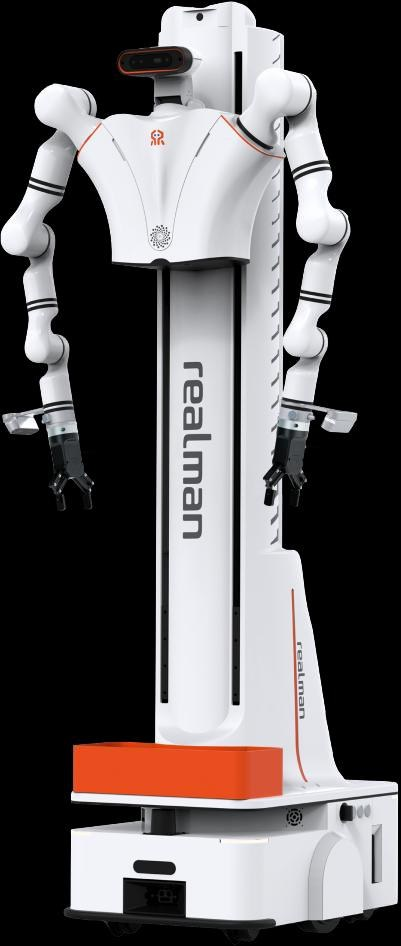

Safety Tips Thank you for purchasing the products from Realman Intelligent Technology (Beijing) Co., Ltd. After opening the package, please check all accessories against the equipment configuration list.

If you find any accessories damaged or missing, contact your dealer or our customer service promptly for assistance.

*  Please read the relevant instructions carefully before using the product.
*  To ensure your safety and that of the equipment, please confirm that the power supply voltage is correct before connecting the charger and charging pile to the power source.
*  Before starting the equipment, inspect the surrounding environment to ensure there are no obstacles, unstable ground, or other factors that may affect the safe operation of the equipment.
*  All operators should receive emergency stop training and understand how to quickly use the emergency stop button in case of an emergency to prevent accidents.
*  When moving the equipment, ensure that all moving parts are secured to prevent accidents during transportation.
*  Strictly observe the equipment's maximum load limit and avoid overloading to prevent equipment damage or safety incidents.
*  Operate the device strictly according to the instructions or under professional supervision. Do not operate in violation of guidelines.
*  This product contains moving parts. Do not wear jewelry while operating it, and tie up long hair to prevent entanglement and injury.
*  If any abnormal situation occurs during operation, please contact a qualified professional immediately.
*  After using the equipment, retract both arms and turn off the main power supply.

#### Product Overview and System Architecture

**1 Foreword**

As China's labor force continues to decline and labor costs rise, the replacement of humans with robots has become an inevitable trend for the future.

With the rapid advancement of technologies such as multimodal large models and robotic control, integrated robots featuring planning, mobility, perception, and manipulation as their primary functions are increasingly capable of replacing

humans in performing a wide range of complex tasks. To meet the growing demand for comprehensive manipulation capabilities across diverse scenarios and tasks, Realman has developed a dual-arm lifting robot.

The embodied dual-arm lifting platform is positioned as a general-purpose hardware development platform, equipped with a mobile chassis, lifting column, global and local depth vision systems, monitoring cameras, a dual-arm system utilizing

six-axis robotic arms, and a master control system powered by a high-performance AI edge computer.

Based on this hardware platform, users can develop functions such as autonomous navigation, movement, obstacle avoidance, target recognition, large-scale picking and handling operations, teleoperation control, video monitoring, and voice

interaction. This enables users to explore the deployment of robots as replacements for human labor in industrial, commercial, and domestic environments.

**2 Product Overview**

**2.1 Product Features**

Users can leverage the platform to develop data acquisition and model training solutions for wireless teleoperation and dual-arm manipulation.

The system enables autonomous planning and execution of inspection and operational tasks across a wide variety of scenarios, with extensive applications in industrial, commercial, domestic, and research environments.

The platform has the following features:

1. Complete coverage of the operating workspace: The flexible operating range encompasses the full spectrum of human operational space, with a maximum reach of up to 2.4 meters.
2. Robust operational capability: The dual arms and grippers offer a rated handling capacity of 8 kg, ensuring strong practicality.
3. Open-source ecosystem support: The platform features a well-developed technical ecosystem within an open-source environment, fostering scientific research and scenario exploration.
4. Multi-perspective intelligent recognition: Equipped with three depth cameras (D435) for precise 3D vision in object identification and manipulation, and two RGB cameras (USB) for color environmental monitoring, the system meets the demands of multitasking in complex scenarios.
5. Data acquisition & model training: The gripper's high real-time responsiveness facilitates efficient data collection and model training for dual-arm operations. Meanwhile, the trained model can also be deployed onto the embodied dual-arm lifting platform for inference and real-world training.

**2.2 Function Description**

The embodied dual-arm lifting platform is composed of a mobile chassis, main control system, lifting column, chest, dual arms, head, electronic control system, and other components.

The dual- arm lifting robot is charged via a charging pile. The system layout is shown in Fig. 1.

1. Main Control System: The main control system serves as the control center of the entire machine. The core main controller utilizes NVIDIA's AI supercomputer module designed for edge embedded computing in robotics and autonomous systems, specifically the Jetson AGX Orin 64G with 1TB solid-state drive.
2. Mobile Chassis: The mobile chassis features autonomous navigation, movement, and obstacle avoidance, providing mobility, power supply, support, and other functions for the entire system.
3. Lifting Column: The lifting column enables vertical movement and is mounted directly on the upper surface of the chassis. To ensure that the operating height of the robotic arm (i.e., the 5th axis) ranges from 0 to 2400mm, the lifting height is set to 600–1500mm, and the lifting stroke is approximately 900mm. The maximum lifting speed is no more than 150mm/s.
4. Chest: The chest is mounted on the installation base of the lifting platform, facing forward and aligned with the chassis orientation. The chest serves as the mounting support for both the dual-arm system and the head system.
5. Dual-arm System: The dual-arm system consists of modules including robotic arms, a binocular depth camera, and two-finger parallel grippers, used for operations such as local target recognition, grasping, sorting, and material handling.
6. Head: The head is composed of pitch joints, rotation joints, and a binocular depth camera.
7. Electronic Control System: The power switch is shared with the chassis: when the chassis power switch is activated, all

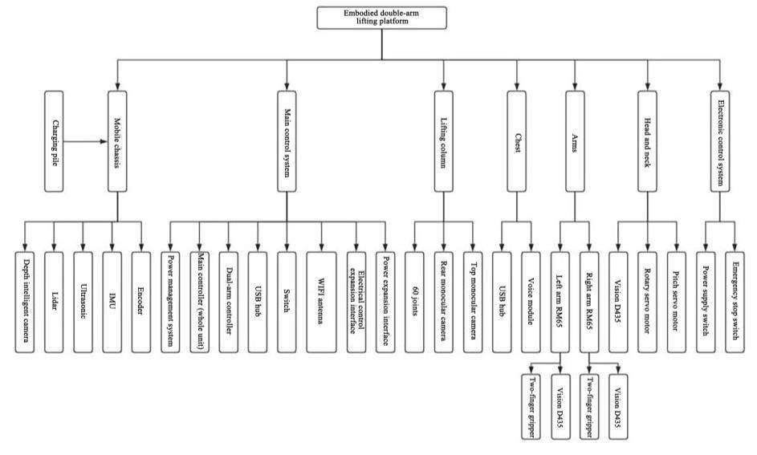

_Fig. 1 Schematic Diagram of Robot System Layout_

load systems on the chassis are automatically powered on or off. The emergency stop switch is installed at the top of the main control box for easy access and convenient wiring.

**2.3 System Communication Diagram**

The communications for each system are designed as shown in Fig. 2.

**3 Machine Parameters**

| Description                 | Parameter                                                                                                                                           |
| --------------------------- | --------------------------------------------------------------------------------------------------------------------------------------------------- |
| Dimensions                  | 640 × 450 × 1780mm (retracted), shoulder width 545mm                                                                                                |
| Total weight                | Approximately 157kg                                                                                                                                 |
| Operation range             | Vertical: 0-2400mm (fully extended) Lateral: 790mm beyond the chassis on each side Forward: 0-690mm                                                 |
| Movement speed              | ≤1.5m/s                                                                                                                                             |
| Climbing angle              | ≤5°                                                                                                                                                 |
| Step crossing               | 20mm                                                                                                                                                |
| Gap crossing                | 20mm                                                                                                                                                |
| Turning radius              | Turn in situ                                                                                                                                        |
| Lifting stroke              | 900mm                                                                                                                                               |
| Navigation method           | Autonomous navigation based on LiDAR                                                                                                                |
| Obstacle avoidance distance | The obstacle avoidance distance at the front, left, and right sides is consistent, with a maximum range of 3000 mm and adjustable distance settings |
| Positioning accuracy        | Global positioning accuracy: ±10mm/±3°; secondary positioning accuracy: ±5mm/±1°                                                                    |
| Working hours               | 3-4h                                                                                                                                                |
| Charging duration           | 2h                                                                                                                                                  |
| Wireless communication      | Wi-Fi                                                                                                                                               |
| Expansion interface         | Ethernet port, HDMI, USB 3.0 × 2                                                                                                                    |

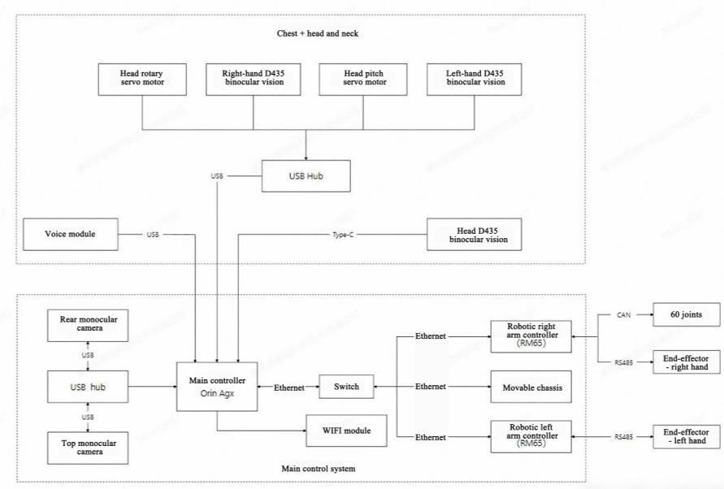

_Fig. 2 Schematic Diagram of Robot System_

#### Subsystem Components and Specifications

The dimensions of the embodied dual-arm lifting platform are shown in Fig. 3.

**4 Introduction to Subsystem**

**4.1 Structural Subsystem**

The structural subsystem of the embodied dual-arm lifting platform primarily consists of external components such as the torso and head, as well as internal structural parts and adapters required for integration and installation.

**4.2 Mobile chassis**

The mobile chassis features autonomous navigation, movement, and obstacle avoidance, providing mobility, power supply, support, and other functions for the entire system.

Users can access data from the chassis—such as LiDAR, depth camera, ultrasonic sensors, motor encoders, and IMU—via API and HTTP protocols, and adjust parameters as needed.

Navigation features can be utilized through interface calls, supporting navigation planning, dynamic obstacle avoidance, autonomous positioning, map creation, automatic charging, etc., enabling users to control and further develop the

chassis. The parameters are as follows.

| Description        | Parameter                    |
| ------------------ | ---------------------------- |
| Chassis dimensions | 640 × 450 × 250 (mm)         |
| Chassis mass       | 55kg                         |
| Vertical load      | 80kg                         |
| Drive mode         | Two-wheel differential drive |
| Speed              | 1.5m/s                       |
| Climbing angle     | 5°                           |
| Turning radius     | Turn in situ                 |

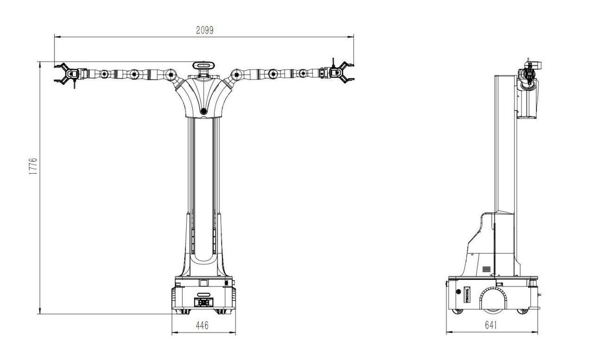

_Fig. 3 Platform Dimension Diagram_

| Step crossing                  | 20mm                                                                                                                                                |
| ------------------------------ | --------------------------------------------------------------------------------------------------------------------------------------------------- |
| Gap crossing                   | 20mm                                                                                                                                                |
| Global positioning accuracy    | ±10mm/±3°                                                                                                                                           |
| Secondary positioning accuracy | ±5mm/±1°                                                                                                                                            |
| Obstacle avoidance distance    | The obstacle avoidance distance at the front, left, and right sides is consistent, with a maximum range of 3000 mm and adjustable distance settings |
| Operating temperature          | 5-40℃                                                                                                                                               |
| Navigation system              | Intelligent depth camera × 1 set LiDAR × 1 set Safety edge contact × 1 set Ultrasonic sensor × 2 sets IMU + encoder × 1 set                         |

**4.3 Main control system**

The main control system serves as the control center of the entire machine.

The core controller utilizes NVIDIA's Jetson AGX Orin 64G module paired with a 1TB solid-state drive—an AI supercomputer module designed for edge embedded computing applications such as robotics and autonomous machines.

The specifications are as follows.

| Description        | Parameter                                                        |
| ------------------ | ---------------------------------------------------------------- |
| AI Performance     | 275TOPS                                                          |
| GPU                | 2048 NVIDIA CUDA cores NVIDIA Ampere architecture with 64 cores  |
| CPU                | 12-core Arm Cortex-A78AE v8.2 64-bit CPU (3MB L2 + 6MB L3 cache) |
| DL Accelerator     | 2xNVDLA V2.0                                                     |
| Vision Accelerator | PVA v2.0                                                         |
| Storage            | 64GB eMMC 5.1                                                    |
| Hard disk          | 1G SSD                                                           |

The power management system consists of a switching power supply and a regulated power supply. It draws power from the chassis to supply all upper-mounted loads of the robot. The robotic

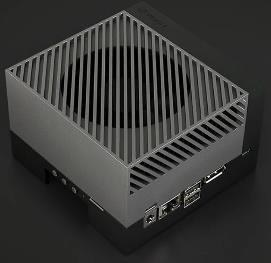

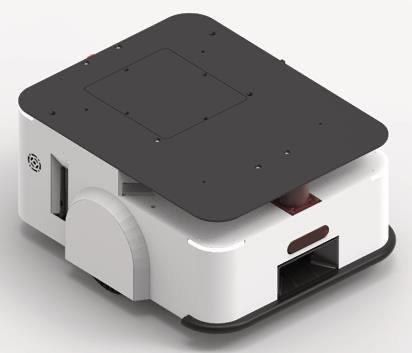

arm controller is the standard controller for the RM65-B robotic arm. The USB interface requirements in this project exceed the number available on the Orin AGX module.

To meet these needs and facilitate future expansion of additional USB devices by the customer, a USB expansion dock is provided, featuring USB 3.0 interfaces to ensure high data transfer rates.

The selected USB expansion dock model for the main control system is A173.

| Description                            | Parameter                             |
| -------------------------------------- | ------------------------------------- |
| Model                                  | A173                                  |
| Number of ports                        | 7 ports                               |
| Data transmission                      | USB3.0                                |
| Power supply                           | 12V3A                                 |
| Independent power supply for each port | 5V1A                                  |
| Dimensions                             | 125.&#x36;_&#x37;8.&#x38;_&#x32;7.3mm |

**4.4 Lifting column**

The lifting column is equipped with a lifting mechanism and is installed directly on the upper surface of the chassis.

To ensure the robotic arm's operating height (i.e., 5th axis) ranges from 0 to 2400 mm, the lifting height is set at 600-1500 mm, with a lifting stroke of approximately 900 mm. The maximum lifting speed is no more than 150mm/s.

A monocular camera is installed on the rear of the lifting column, positioned along the centerline at the back, approximately 1600 mm above the ground.

This camera is used for environmental observation and video surveillance when the robot is moving forward or backward. A monocular camera is mounted at the top of the lifting column.

The top monocular camera is primarily used for environmental observation and video monitoring during the robot's forward movement. The specifications of the monocular cameras on the rear and top are as follows.

| Description      | Parameter                       |
| ---------------- | ------------------------------- |
| Interface mode   | USB 2.0 (standard UVC protocol) |
| Pixel            | 200W                            |
| Mode of focusing | FF fixed focus                  |

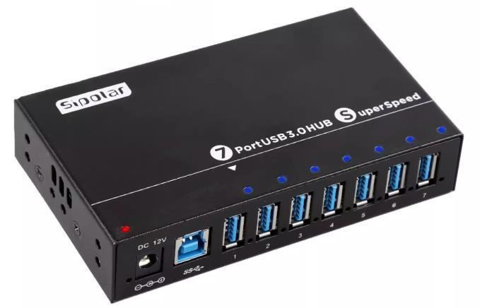

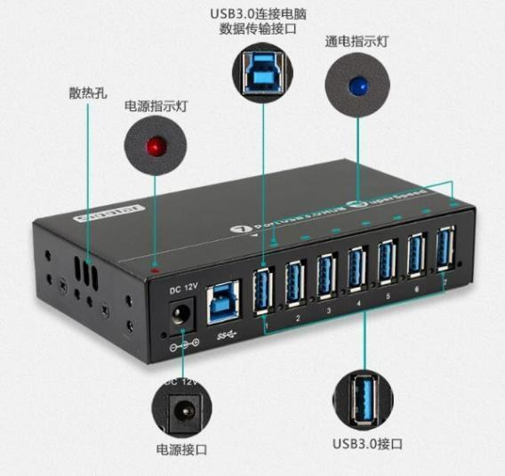

| Field of view     | 120°                   |
| ----------------- | ---------------------- |
| Supported systems | Win7/8/10 Linux Ubuntu |
| Frame rate        |                        |

**4.5 Chest**

The chest is mounted on the installation base of the lifting platform, facing forward and aligned with the chassis orientation. The chest provides mounting brackets for the dual-arm system and head system, and voice interaction.

**4.6 Dual-arm System**

The dual-arm system consists of modules including robotic arms, a binocular depth camera, and two-finger parallel grippers, used for operations such as local target recognition, grasping, sorting, and material handling.

1. Robotic arm: The robotic arm serves as the primary tool for the robot to perform operational tasks. Considering the required degrees of freedom and payload, the RM65-B-V model has been selected. The specifications are as follows.

| Description             | Parameter                                                          |
| ----------------------- | ------------------------------------------------------------------ |
| Degree of freedom (DOF) | 6                                                                  |
| Payload                 | 5kg                                                                |
| Repositioning accuracy  | ±0.05mm                                                            |
| Operating radius        | 610mm                                                              |
| Power consumption       | Maximum power consumption: 200 W; average power consumption: 100 W |
| Communication mode      | WiFi/Ethernet/Bluetooth/USB serial port/RS485                      |
| Joint range of motion   | J1±178°, J2±130°, J3±135°, J4±178°, J5±128°, J6±360°               |
| Maximum joint angle     | J1–J2: 180°/s, J3–J6: 225°/s                                       |

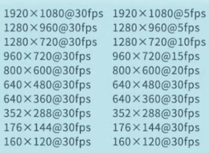

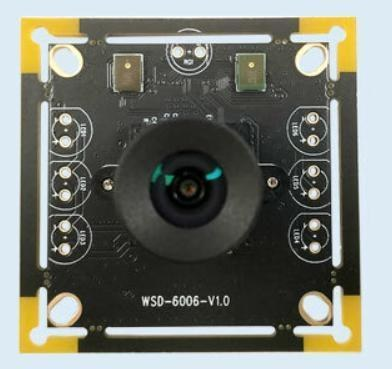

1. The binocular depth camera model is D435. To ensure effective target recognition, the camera's main field of view is aligned with the middle section of the gripper fingers. The parameters are as follows.

| Description            | Parameter                         |
| ---------------------- | --------------------------------- |
| Field of view          | 87° (horizontal) × 58° (vertical) |
| Ideal working distance | 0.3-3m                            |
| Depth accuracy         | ＜2% @2m                           |
| Depth resolution       | 1280×720@3 0fps                   |
| Camera principle       | Binocular structured light        |
| Connection type        | USB Type-C                        |

1. The two-finger parallel gripper is the primary actuator for operations, with parameters as follows.

| Description        | Parameter          |
| ------------------ | ------------------ |
| Overall dimensions | 222.5x150.6x45mm   |
| Dead weight        | 0.8kg              |
| Load               | Maximum load 1.4kg |
| Maximum stroke     | 90mm               |
| Communication      | Modbus RTU, I/O    |

**4.7 Head**

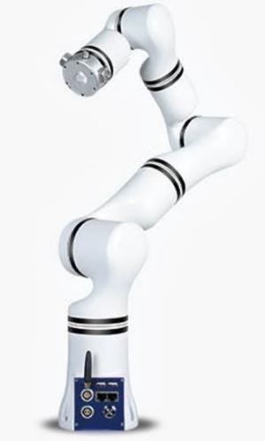

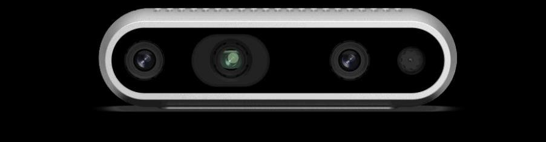

The head is composed of pitch joints, rotation joints, and a binocular depth camera. I. Head vision: The head provides a global view and is equipped with a D435 depth camera, enabling users to develop the following functions:

1. Global positioning enables the robot to accurately identify distant targets and key features, guiding it to move near the core target object and subsequently directing the robotic arm for target grasping;
2. During the robotic arm's gripping process, head vision can detect obstacles around the arm, assisting both the robot and the robotic arm in obstacle avoidance;
3. During the robot's movement, the head-mounted vision system can detect elevated obstacles, enabling obstacle avoidance throughout the movement process. II. Pitch rotation joint: To expand the overall field of view of the robot's head with minimal power consumption and operation complexity, the head is equipped with two degrees of freedom. Pitch motion is implemented using a servo motor, providing a pitch angle range of -60° to 60° and a pitch speed of 18°/s. To ensure the head does not interfere with the lifting column during pitch movements, the head should be designed with a forward offset. The specific dimensions depend on the design requirements. The rotation motion is implemented by a servo motor, with a rotation angle of ±80°. The rotation speed is 18°/s. The pitch rotation joint is not self-locking. With the field of view of the D435 binocular camera combined with the pitch and rotation joints, visual coverage can reach a pitch angle of -89° to 89°, and a rotation angle of -122° to 122°, ensuring the robotic arm is fully within the D435's field of view.

| Description                    | Parameter                             |
| ------------------------------ | ------------------------------------- |
| Model                          | LX-224HV High Voltage Bus Servo Motor |
| Operating voltage              | 9.6-12.6V                             |
| Rotation speed                 | 0.18sec/60°                           |
| Rotation range                 | 0\~240°                               |
| Servo motor accuracy           | 0.3°                                  |
| Torque                         | 20kg.cm                               |
| Control mode                   | UART serial port                      |
| Communication bit rate         | 115200                                |
| Dimensions                     | 4&#x30;_&#x35;1.&#x31;_&#x32;1.4mm    |
| Power-off self-locking feature | None                                  |

**4.8 Electrical System and Other Components**

Power Management System: The power management system draws a 48V power supply from the chassis and is installed in the main control box located at the back of the lifting column on the chassis.

It provides power to the robot's chest, head (including servo motors and vision components), and both arms (including grippers and vision components). The overall power supply configuration is illustrated in Fig. 4.

**5 Product Configuration**

| No. | Description                                  | Quantity |
| --- | -------------------------------------------- | -------- |
| 1   | Mobile chassis                               | 1        |
| 2   | Main Controller: AGX Orin                    | 1        |
| 3   | Lifting column                               | 1        |
| 4   | Monocular monitoring camera (front and rear) | 2        |
| 5   | Robotic Arm RM65-B-V                         | 2        |
| 6   | Two-finger parallel gripper                  | 2        |
| 7   | Head servo motor                             | 2        |
| 8   | Binocular Depth Camera D435 (Head)           | 1        |
| 9   | Voice module                                 | 1        |

**6 Operating Instructions**

Please refer to the following instructions for the operation of this embodied dual-arm lifting platform.

**6.1 Communication Connection**

The entire robot platform is interconnected via Ethernet and provides external interfaces. The

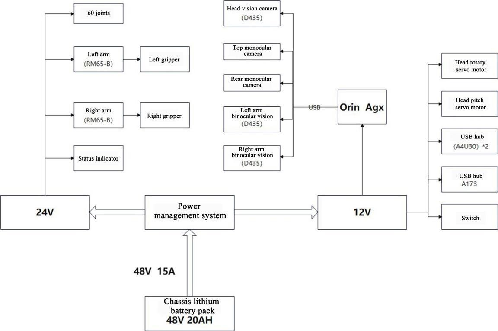

_Fig. 4 Schematic Diagram of Overall Power Supply_

#### Communication, Startup, Shutdown and Charging

IP addresses and default usernames and passwords for each module are configured as follows;

1. Mobile platform IP: 169.254.128.2
2. Main control module IP: 169.254.128.20
3. Mobile platform default username and password: woosh/wooshrobot
4. Mobile platform hotspot default password: woosh888
5. Main control module default username and password: rm/rm
6. Robotic arm teach pendant username and password: root/realman
7. Robotic arm (left): IP 169.254.128.18; port 8080
8. Robotic arm (right): IP 169.254.128.19; port 8080

**6.2 Equipment Start**

**Step 1: Turn on the robot's main power switch.**

The main power switch for the embodied dual-arm lifting platform is located on the mobile chassis (positioned above the right side of the mobile trolley).

Press and hold the switch until you hear a continuous sound from the mobile chassis, then release it. The location of the switch is shown in Fig. 5.

**Step 2: Power on the subsystems.**

Check if the emergency stop switch is in the normal (released) state. If it is pressed, rotate the button clockwise to release it, then press the power button on the back of the robot.

When the robot starts up normally, the status indicator on its back turns blue. The emergency stop switch and the switch/status indicator for the embodied dual-arm lifting platform are shown in Fig. 6.

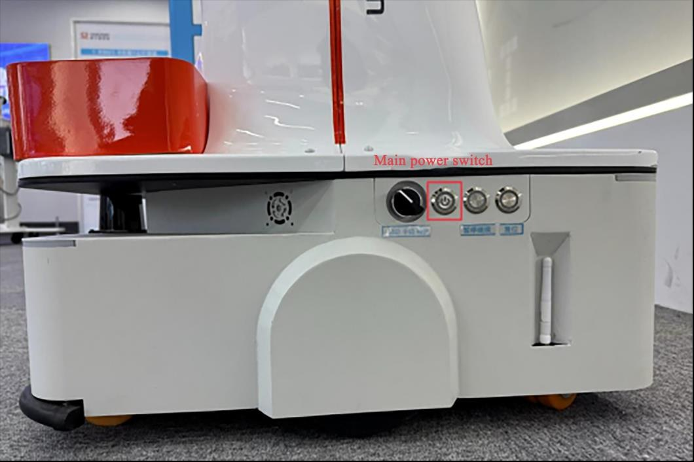

_Fig. 5 Main Power Switch of the Embodied Dual-arm Lifting Platform_

**Step 3: Power off the device.**

To power off the device, press and hold the main power button until you hear a continuous sound, then release it.

**Step 4: Charge the device.**

After connecting the charger to a power source, locate the right side of the charging port on the mobile chassis and insert the charging connector at the end of the charger into the port.

When the charger (or chassis charging port) displays a red light, it indicates that charging is underway. The charging port and charger are shown in Fig.s 7 and 8.

Note: During charging, the chassis cannot be operated via the chassis movement software. Additionally, the mobile chassis can be charged using a charging pile, as shown in Fig. 9.

The mobile chassis (below the camera) is equipped with an automatic charging port. Insert the black charging connector located at the base of the charging pile into this port.

When the charging pile displays a green light, it indicates that charging is in progress.

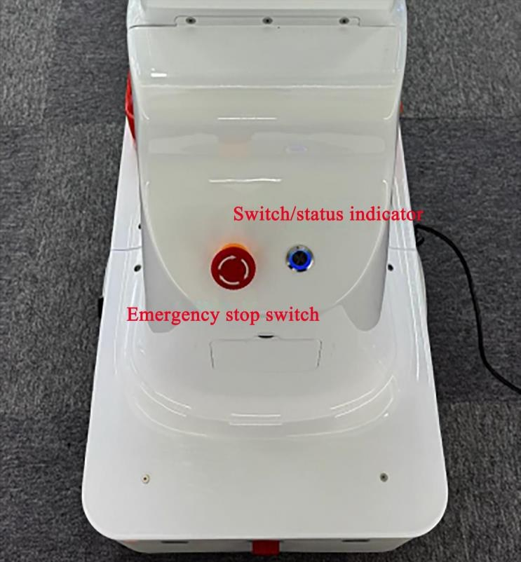

_Fig. 6 Emergency Stop Switch and Switch/status Indicator Light_

**6.3 Equipment Commissioning**

**Step 1: Open the external debugging interface.**

A debugging interface is located at the lower back of the robot. Before connecting, the cover of

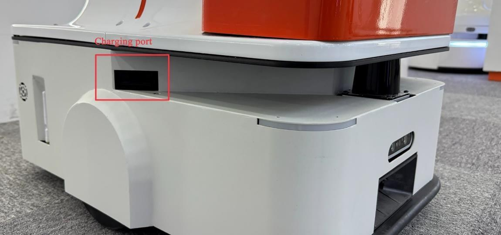

_Fig. 7 Mobile Chassis Charging Port_

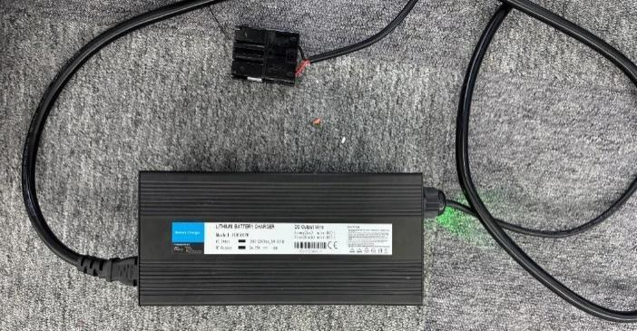

_Fig. 8 Charger_

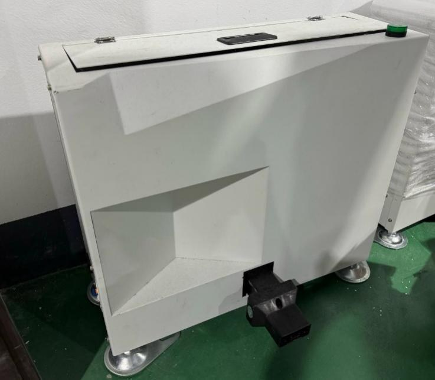

_Fig. 9 Charging pile_

#### Equipment Commissioning and Safe Operation

the debugging interface must be opened and removed, as shown in Fig. 10.

**Step 2: Connect the external debugging interface.**

The external debugging interface is shown in Fig. 11. There are 4 or 5 external communication ports located under the back of the robot. The socket functions are described as follows:

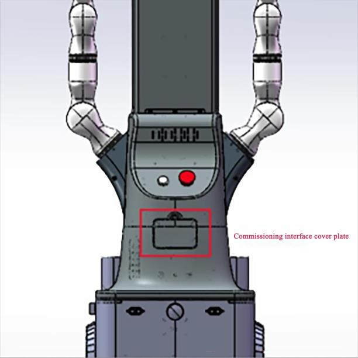

_Fig. 10 Commissioning interface cover plate_

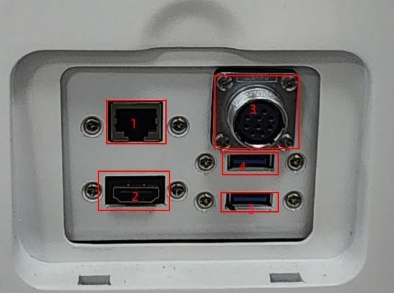

_Fig. 11 Debugging interface_

1. Ethernet port: connectable to the main control module, mobile chassis, and robotic arm
2. HDMI port: used to connect to a monitor
3. Ten-pin aviation connector for remote control (robots not equipped with a backpack teleoperation device do not have this connector)
4. The USB port connects to the main control module
5. The USB port connects to the main control module

> Note: The internal main control module of the robot is connected via interface ④ and interface

⑤, and comes pre-installed with the Ubuntu operating system. The robotic arm teach pendant software supports both Windows and Ubuntu operating systems.

To operate the robotic arm using the teach pendant software on Windows, use an external Windows computer and connect it to Ethernet interface ① with a network cable.

**Step 3: Parameter configuration (using the right robotic arm connection as an example below).**

Set the local computer port IP to 169.254.128.33 (any IP in the 10 segment except 10, 11, 18, and 19 is acceptable), as shown in Fig. 12.

**Step 4: Robotic arm control.**

Enter the IP address "169.254.128.18" in Google Chrome, press Enter to open the teach pendant software login page, then log in with the username "root" and password "realman".

In the teach pendant interface, select "Robotic Arm Teaching" from the left-side menu, then click the button shown in Fig. 14 to switch to "Real" mode. The robotic arm can now be controlled via the teach pendant.

For detailed operating instructions for the teach pendant, please refer to the user manual.

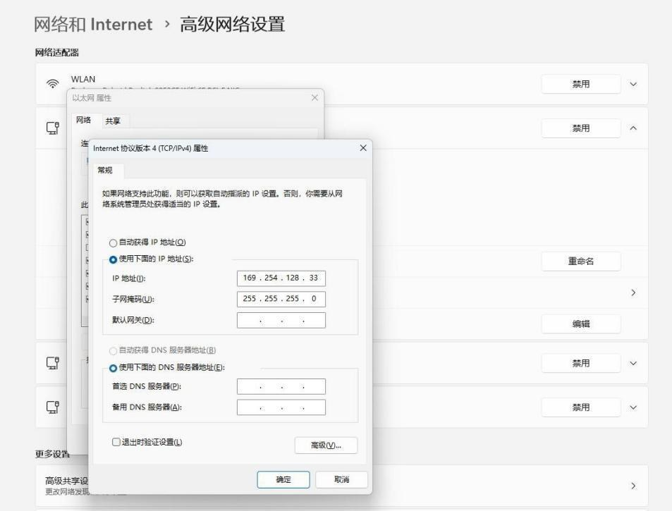

_Fig. 12 Computer IP Port Modification_

**Step 5: Lift control.**

After connecting the left arm of the robotic arm, select "Extension > Lift Control" from the menu on the left side of the teach pendant. The lift status will then indicate whether it is enabled and online, or display an error code.

Adjust the lift as required, as shown in Fig. 15.

> Note: When debugging the lift, it is recommended to reduce the speed to 10%. Increase the

speed only after you are familiar with the equipment to prevent accidents.

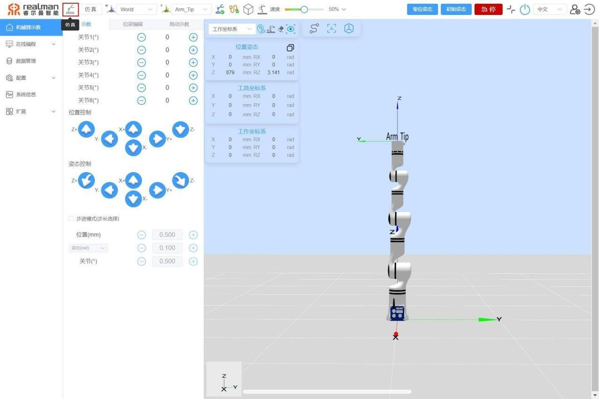

_Fig. 13 Robotic Arm Control_

**Step 6: Online programming.**

For the online programming functionality of the robotic arm and lift, please refer to the Getting Started Guide: Online Programming | Realman Intelligent Technology

**Step 7: Mobile chassis mapping**

Use Woosh Mobile software (Windows) and Woosh Design software (Windows) to perform environment mapping and map editing for the mobile chassis.

**Step 8: Debugging other subsystems.**

For the development and debugging of other subsystems, please refer to the relevant technical documentation contained in the USB flash drive provided with the equipment.

**6.4 Precautions for Safe Use**

6.4.1 Operations prone to accidents or injuries:

1. Three-Dimensional Spatial Clearance Operation description: When controlling the robotic arm (via online programming or drag teaching), or when operating the lift, the three-dimensional spatial clearance of the robot body and other objects should be considered. Otherwise, the robot housing or robotic arm may be bumped or scratched. Countermeasures: Before operation, actions should be anticipated to minimize dangerous maneuvers. If risks cannot be avoided, reduce the speed during initial setup to allow more reaction time; additionally, if a risk is anticipated, be ready to press the robot's emergency stop button to prevent accidents.

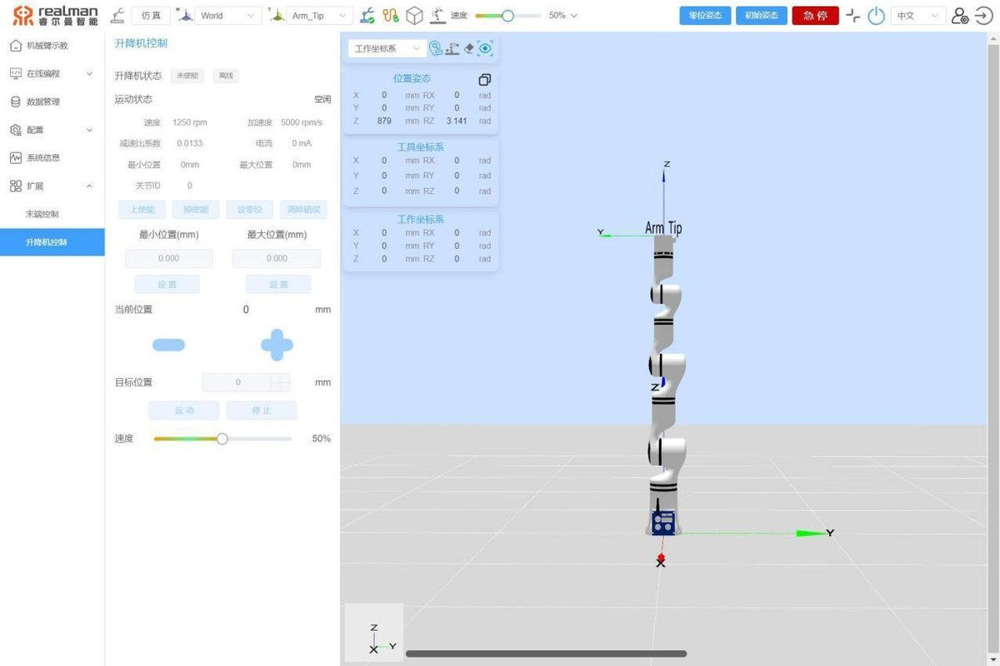

_Fig. 14 Lift Control_

#### Load Safety, Transportation, Storage and Unpacking

1. Load Range and Power-Off Condition Behavior description: When using a two-finger gripper to grasp an object, ensure a secure hold and be careful not to exceed the load limits of the robotic arm and the gripper. Additionally, since the 4th, 5th, and 6th axes of the robotic arm are not equipped with brakes, they may move due to external forces after power is cut off (such as when the chassis loses power or the emergency stop is activated). Appropriate measures must be taken after power loss to prevent accidents. Countermeasures: Comply with equipment requirements when gripping loads and ensure the end effector load is handled in the event of an intentional or accidental power outage. Take steps to prevent axes 4, 5, and 6 of the robotic arm from moving unintentionally under external forces to avoid accidents.

**7 Transportation, Storage, and Unpacking**

**7.1 Packing list**

| Description                                  | Quantity |
| -------------------------------------------- | -------- |
| Embodied dual-arm lifting platform main body | 1        |
| Two-finger parallel gripper                  | 2        |
| Charging pile                                | 1        |
| Material basket                              | 1        |
| Charger                                      | 1        |

**7.2 Packing Procedure**

The following describes the packing and transportation procedures; unpacking should be performed by reversing these steps.

**Step 1**

During transportation, the robot's posture should be adjusted using drag teaching to the position shown in Fig. 15.

Meanwhile, lower the lifting column to its lowest position and retract both arms to maintain the lowest possible center of gravity for the entire machine, thus minimizing impact on the motors during transport.

**Step 2**

Completely wrap the robot with packing foam and protective film. Additionally, use a wooden crate to protect the robot. Note: When manually moving the robot, always lift the chassis sheet metal casing.

Do not lift the robot by its arms or other covers to avoid damaging its internal structure.

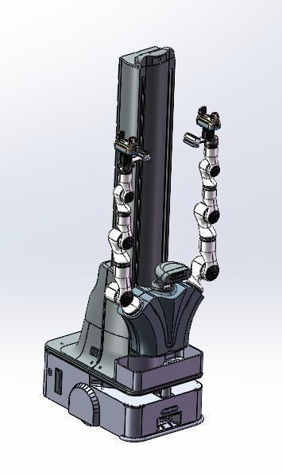

_Fig. 15 Packing Posture of Embodied Dual-Arm Lifting Platform_

#### Quick Troubleshooting Index

| Symptom                                         | Checks and corrective action                                                                                                                                                                                                                                           | Related section                                    |
| ----------------------------------------------- | ---------------------------------------------------------------------------------------------------------------------------------------------------------------------------------------------------------------------------------------------------------------------- | -------------------------------------------------- |
| A subsystem cannot be reached over Ethernet     | Use 169.254.128.2 for the mobile platform and 169.254.128.20 for the main controller. The left and right arms use 169.254.128.18:8080 and 169.254.128.19:8080.                                                                                                         | Communication, Startup, Shutdown and Charging      |
| The robot does not power on                     | First identify and eliminate the cause of the emergency stop with the trained on-site operator, stop all command sources and follow the delivered recovery procedure; only then restore main/subsystem power as directed. A normal subsystem status indicator is blue. | Communication, Startup, Shutdown and Charging      |
| The chassis cannot move while charging          | This is expected during wired charging. Disconnect the charger before attempting to control chassis motion.                                                                                                                                                            | Communication, Startup, Shutdown and Charging      |
| The lift is offline or reports an error         | Connect to the left arm, open Extension > Lift Control, check the displayed status or error code, and begin commissioning at 10% speed.                                                                                                                                | Equipment Commissioning and Safe Operation         |
| Axes move after an emergency stop or power loss | Axes 4, 5, and 6 have no brakes. Secure the payload and prevent external forces from moving these axes before cutting power or using emergency stop.                                                                                                                   | Load Safety, Transportation, Storage and Unpacking |
| The robot must be moved manually                | Lower the lifting column, retract both arms, and lift only the chassis sheet-metal enclosure. Never lift by the arms or covers.                                                                                                                                        | Load Safety, Transportation, Storage and Unpacking |
