# RealMan RM65 Series User Manual V1.2.0

### RealMan RM65-B 6-DOF Ultra-Lightweight Robot Arm



### RealMan RM65-6F Robot Arm With Six-Axis Force Sensor



### RealMan RM65-B-V Vision Robot Arm With Depth Camera



### Contents

* [Safety](realman-rm65-series-user-manual-v1.2.0.md#safety)
* [Product Quality Assurance](realman-rm65-series-user-manual-v1.2.0.md#product-quality-assurance)
* [Product Components](realman-rm65-series-user-manual-v1.2.0.md#product-components)
* [Installation, Wiring, and Startup](realman-rm65-series-user-manual-v1.2.0.md#installation-wiring-and-startup)
* [Teaching Pendant Connection and Drag Teaching](realman-rm65-series-user-manual-v1.2.0.md#teaching-pendant-connection-and-drag-teaching)
* [Hardware Interfaces](realman-rm65-series-user-manual-v1.2.0.md#hardware-interfaces)
* [RM65 Specifications and Robot Parameters](realman-rm65-series-user-manual-v1.2.0.md#rm65-specifications-and-robot-parameters)
* [Frequently Asked Questions](realman-rm65-series-user-manual-v1.2.0.md#frequently-asked-questions)
* [Handling and Transportation](realman-rm65-series-user-manual-v1.2.0.md#handling-and-transportation)
* [Maintenance, Repair, and Disposal](realman-rm65-series-user-manual-v1.2.0.md#maintenance-repair-and-disposal)
* [Additional Resources](realman-rm65-series-user-manual-v1.2.0.md#additional-resources)

### Safety

This section defines the safety principles and specifications that shall be followed when operating a robot or robot system. Integrators and users must carefully read this manual, especially the contents marked with warning signs, which must be mastered and strictly observed. Considering the complexity and hazards of robot systems, users must fully understand the hazards of the operations and strictly abide by the specifications and requirements in this manual. Integrators and users must have a high awareness of safety.

#### Safety warning signs

The safety signs used in this manual are explained as follows, which must be followed.

**Meanings of warning signs**

| Sign | Meaning                                                                                                                                                                                                                                             |
| ---- | --------------------------------------------------------------------------------------------------------------------------------------------------------------------------------------------------------------------------------------------------- |
|      | A hazardous electricity consumption situation, which, if not avoided, can lead to personal injury and death or severe equipment damage.                                                                                                             |
|      | A potentially hazardous hot surface, which, if touched, can lead to personal injury.                                                                                                                                                                |
|      | A hazardous situation, which, if not avoided, can lead to personal death or severe injury.                                                                                                                                                          |
|      | A potentially hazardous electricity consumption situation, which, if not avoided, can lead to personal injury or severe equipment damage.                                                                                                           |
|      | A potentially hazardous situation, which, if not avoided, can lead to personal injury or severe equipment damage. Matters marked with this sign may, depending on the actual situation, have the possibility to cause major consequences sometimes. |
|      | A situation, which, if not avoided, can lead to personal injury or equipment damage. Matters marked with this sign may, depending on the actual situation, have the possibility to cause major consequences sometimes.                              |

#### Safety precautions

This manual contains safety measures for protecting users and preventing equipment damage. Users are expected to read through this manual and get familiar with all safety precautions. We try to describe all potentially hazardous situations in this manual, but we cannot cover every such situation due to unpredictability.

When starting a robot or robot system for the first time, users shall understand and follow the basic information provided below. Additional safety-related information is presented in other sections of this manual. Notwithstanding that, it is impossible to cover every aspect. Additionally, in actual use, the specific issues need to be analyzed case by case.

**Notes on safety precautions**

| Sign | Meaning                                                                                                                                                                                                                                                                                                                                                                                                                                                                                                                                                                                                                                                                                                                                                                                                                                                                                                                                                                                                                                                                                                                                                                                                                                                                                                                                                                                                                                                                                                                                                                                                                                                                                                                                                                                                                                                                                                                             |
| ---- | ----------------------------------------------------------------------------------------------------------------------------------------------------------------------------------------------------------------------------------------------------------------------------------------------------------------------------------------------------------------------------------------------------------------------------------------------------------------------------------------------------------------------------------------------------------------------------------------------------------------------------------------------------------------------------------------------------------------------------------------------------------------------------------------------------------------------------------------------------------------------------------------------------------------------------------------------------------------------------------------------------------------------------------------------------------------------------------------------------------------------------------------------------------------------------------------------------------------------------------------------------------------------------------------------------------------------------------------------------------------------------------------------------------------------------------------------------------------------------------------------------------------------------------------------------------------------------------------------------------------------------------------------------------------------------------------------------------------------------------------------------------------------------------------------------------------------------------------------------------------------------------------------------------------------------------- |
|      | 1. The robot and all electrical equipment must be installed according to the requirements and specifications in this manual. 2. Before using the robot for the first time and putting it into production, it is required to carry out preliminary tests and inspections on the robot and its protection system. 3. Before starting the equipment for the first time, it is necessary to check its hardware, software, and appearance to ensure its normal use. In performing such inspection, reference to the national or regional work safety rules and regulations in force must be made, and all safety functions must be tested. 4. Users must check and ensure that all safety parameters and user programs are correct and that all safety functions are normal. All safety functions must be tested by personnel who are competent in operating robots. Only after the robot has been tested comprehensively and carefully in terms of its safety and reached the safety level can it be started. 5. The robot installation and commissioning shall be conducted by professional personnel according to installation standards. 6. Upon completion of installation and construction, the robot shall be subject to a comprehensive risk assessment again, and the assessment records shall be maintained. 7. Safety parameters are set and modified only by authorized personnel. Passwords or isolation measures shall be used to prevent the setting or modification of safety parameters by unauthorized personnel. After the safety parameters are modified, relevant safety functions shall be analyzed. 8. In case of an accident or abnormal operation, the robot can be stopped by pressing the emergency stop switch.                                                                                                                                                                                              |
|      | 1. The robot body and control cabinet will generate heat during operation. Therefore, it is not allowed to operate or touch the robot while it is working or has just stopped. 2. The robot will be cooled down 1 hour after being disconnected from the power supply. 3. Nobody shall extend their fingers to the hot point of the controller.                                                                                                                                                                                                                                                                                                                                                                                                                                                                                                                                                                                                                                                                                                                                                                                                                                                                                                                                                                                                                                                                                                                                                                                                                                                                                                                                                                                                                                                                                                                                                                                     |
|      | 1. Ensure that the arms and end effectors of the robot are correctly and safely installed in place. 2. Make sure that the robot arms have enough space to move freely. 3. Do not use the robot if it has been damaged. 4. Connect safety devices to safety interfaces instead of normal I/O interfaces. 5. Ensure the correct installation and settings (such as the installation angle of the robot body, end effector weight, TCP offset, and safety configuration). Save the installation file and load it into the program. 6. Make sure that tools and obstacles are free of sharp corners or twisting points. Keep nobody within the working arm span of the robot. 7. Pay attention to the movement direction of the robot when using the teach pendant. 8. Note that any impact will lead to the release of very high kinetic energy, which is much higher than that under the conditions of high speed and high payload. 9. Be aware that the connection of different machines may make hazards worse or introduce new hazards. Perform comprehensive risk assessment throughout the installation process. When different levels of safety and emergency stop performance are required, always choose the highest level. Keep reading and understanding the manuals of all equipment used during the installation. 10. Do not make any changes to the robot. Any change to the robot may bring about hazards unpredictable to integrators. The authorized restructuring of the robot shall be subject to the latest edition of all relevant service manuals. If the robot is changed or altered in any way, Realman Intelligent Technology (Beijing) Co., Ltd. will not assume any liability arising therefrom. 11. Prior to the transportation of the robot, check its insulation and protective measures. 12. When handling robots, observe the transportation requirements, and handle them with care to avoid bumping. |
|      | 1. It is strongly recommended that all the robot functions and the robot program be checked separately when the robot is connected with or working together with any machines that could cause damage to the robot. It is recommended that the robot program be tested at temporary waypoints outside the workspace of other machines. 2. Realman Intelligent Technology (Beijing) Co., Ltd. will assume no liability for the damage or personal injury resulting from robot program errors and operation errors for human reasons. 3. The robot is prevented from exposure to a permanent magnetic field for a long time. Otherwise, a strong magnetic field could cause damage to the robot.                                                                                                                                                                                                                                                                                                                                                                                                                                                                                                                                                                                                                                                                                                                                                                                                                                                                                                                                                                                                                                                                                                                                                                                                                                      |

#### Liabilities and specifications

As an incomplete structure, our robots are designed for combination with other equipment to construct complete ones. Therefore, this manual covers neither the comprehensive procedures for designing, installing, and operating a complete robot nor the possibilities of affecting the safety of peripheral equipment of this complete system. The installation safety of a complete robot depends on how the robot is integrated. Integrators shall design the complete system and assess its installation risks according to the national laws, regulations, safety codes, and standards of their respective countries. Risk assessment is one of the most important tasks for integrators. They can make reference to the following standards to carry out the risk assessment process. Risk assessment is one of the most important tasks for integrators. They can make reference to the following standards to carry out the risk assessment process.

* ISO 12100:2010 Safety of machinery - General principles for design - Risk assessment and risk reduction
* ISO 10218-2:2011 Robots and robotic devices - Safety requirements for industrial robots - Part 2: Robot systems and integration
* RIA TR R15.306-2014 Technical report for industrial robots and robot systems - Safety requirements - Task-based risk assessment methodology
* ANSI B11.0-2010 Safety of machinery - General requirements and risk assessment

Integrators of robots within our full range are obliged to perform (including but not limited to) the following responsibilities:

* perform comprehensive risk assessment of the complete robot system;
* ensure the correct design and installation of the complete system;
* provide training for users and workers;
* establish the complete system operating procedures and clarify the use process;
* establish appropriate safety measures;
* take appropriate actions to eliminate hazards or reduce all hazards to an acceptable level during final installation.

#### Hazard identification

The risk assessment shall consider all potential contact between the operator and the robot during normal use and any foreseeable misoperation. The operators shall not expose their necks, faces, and heads to avoid contact. Where the robot is used without any perimeter safeguards, the risk assessment shall be carried out first to determine whether related hazards will constitute an unacceptable risk, such as:

* potential hazards from the use of sharp end effectors or tool connectors;
* potential hazards from handling toxic or other hazardous substances;
* hazards that the operator's fingers are pinched by the robot base or joints;
* hazards of collision with the robot;
* hazards from the improper fixation of the robot or end effector;
* hazards from the impact between the robot's payload and a hard surface.

Integrators must identify these hazards and their risk levels through risk assessment, and determine and implement corresponding measures to reduce the risks to an acceptable level. Keep in mind that certain robots may present other significant hazards.

By combining the inherent safety measures applied to our full range of robots with the safety specifications or risk assessment implemented by integrators and users, the risks associated with the collaborative operation of our robots will be reduced to a reasonable and feasible level as far as possible. Any remaining risks presented by the robot before installation are communicated to integrators and users through this document. If, during risk assessment, the integrators identify any hazards existing in their specific applications that may pose unacceptable risks to users, the integrators must take appropriate risk reduction measures to eliminate the hazards or reduce the risks to an acceptable level. It will be unsafe to use the robot before taking appropriate risk reduction measures (if necessary).

In the case of non-collaborative installation of the robot (for example, when using hazardous tools), it may be deduced during risk assessment that the integrator needs to connect additional safety equipment (for example, safe startup equipment) during its programming to ensure the safety of personnel and equipment.

### Product Quality Assurance

#### Product quality warranty

Our full range of robots has a 12-month limited warranty period.

Within 12 months (or a maximum period of 15 months if the transportation time is included) after the new equipment and its components are put into service, if there are defects caused by poor manufacture or materials, Realman Intelligent Technology (Beijing) Co., Ltd. will provide necessary spare parts for replacement or repair the defective parts.

The ownership of the replaced or returned equipment or components vest in Realman Intelligent Technology (Beijing) Co., Ltd.

If the product is out of warranty, we will reserve the right to charge the customer for replacement or repair services.

If the equipment has any defects outside the warranty period, Realman Intelligent Technology (Beijing) Co., Ltd. will not be liable for any damage or losses that arise from the above defects, including production losses or damage to other production equipment.

#### Disclaimer

If any equipment defects are caused due to improper handling or failure to follow the relevant instructions in this manual, the product quality warranty will become invalid.

Faults resulting from the following circumstances are not covered under this warranty:

1. Failure to install, wire, or connect other control equipment as per this manual.
2. Use beyond the specifications or standards specified in this manual.
3. Use of the product for purposes other than those specified.
4. Storage method and operating environment beyond the specifications specified in this manual (such as contamination, salt damage, and condensation).
5. Product damage due to improper transportation.
6. Product damage due to accidents or collisions.
7. Use of non-original components and accessories.
8. Damage due to the modification, commissioning, or repair of original parts by a third party other than Realman Intelligent Technology (Beijing) Co., Ltd. or its designated integrators.
9. Natural disasters such as fires, earthquakes, tsunamis, lightning strikes, strong winds, and floods.
10. Failure to identify the production date or warranty start date.
11. Changes to software or internal data.
12. Failure to reproduce the fault or identify the fault by Realman Intelligent Technology (Beijing) Co., Ltd.
13. Use of the product in any radioactive equipment, biological test equipment, or any applications deemed hazardous by Realman Intelligent Technology (Beijing) Co., Ltd.
14. Faults caused for any other reasons outside the scope of liabilities of Realman Intelligent Technology (Beijing) Co., Ltd.

Warning

Users shall not disassemble the product without prior permission of Realman Intelligent Technology (Beijing) Co., Ltd.

According to the product quality warranty agreement, Realman Intelligent Technology (Beijing) Co., Ltd. only provides a warranty for defects and faults occurring on the product and its components sold to its distributors. Realman Intelligent Technology (Beijing) Co., Ltd. will not be held liable for any other express or implied warranties or liabilities, including but not limited to any implied warranties of merchantability or fitness for a particular purpose. Furthermore, Realman Intelligent Technology (Beijing) Co., Ltd. will not be held liable for indirect damages or consequences in any form arising from the relevant products.

In the event of a robot failure, users shall contact Realman Intelligent Technology (Beijing) Co., Ltd. as soon as possible to obtain a solution. Users shall not disassemble or maintain the robot by themselves for any reason; otherwise, the warranty service will be terminated.

### Product Components

A complete set of Realman collaborative robot comprises the following components:

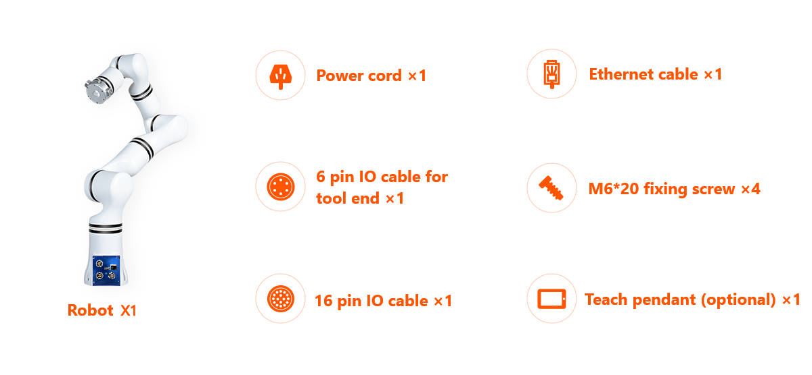

#### Explanation of the Electrical Indications

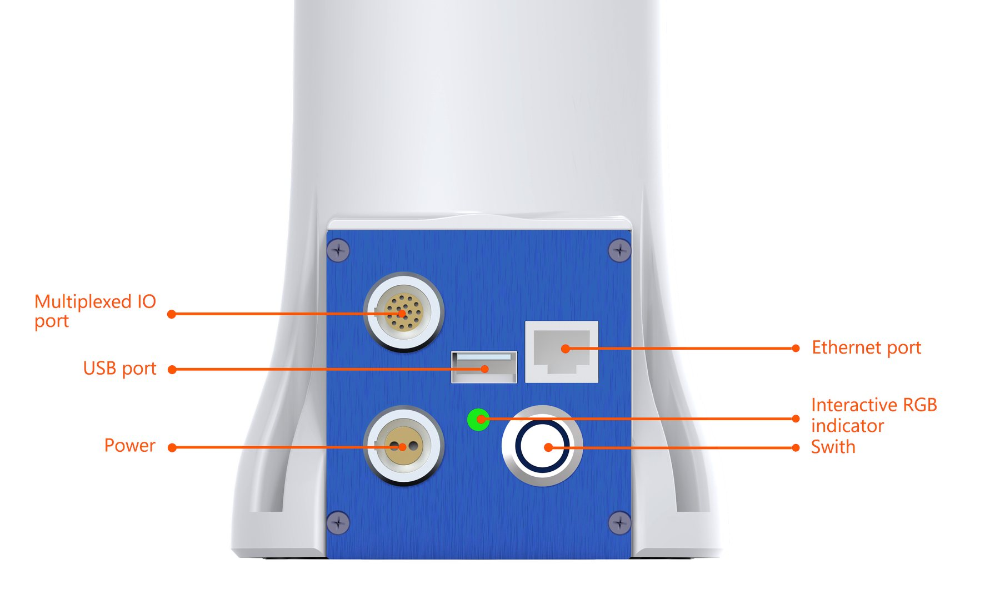

| No. | Interface                 | Function                                                                                                                                                                                                                                                                                                                                                                                                                                                                                                                                                                                                                                                                                                                                                                                                                                                                                                                                                       |
| --- | ------------------------- | -------------------------------------------------------------------------------------------------------------------------------------------------------------------------------------------------------------------------------------------------------------------------------------------------------------------------------------------------------------------------------------------------------------------------------------------------------------------------------------------------------------------------------------------------------------------------------------------------------------------------------------------------------------------------------------------------------------------------------------------------------------------------------------------------------------------------------------------------------------------------------------------------------------------------------------------------------------- |
| 1   | Switch                    | Control the power supply to the robot, and the blue indicator light is on after being turned on                                                                                                                                                                                                                                                                                                                                                                                                                                                                                                                                                                                                                                                                                                                                                                                                                                                                |
| 2   | Power                     | Insert the power cable                                                                                                                                                                                                                                                                                                                                                                                                                                                                                                                                                                                                                                                                                                                                                                                                                                                                                                                                         |
| 3   | Multiplexing IO interface | Lead out the RS485 and I/O interfaces, etc. For example, the external emergency stop button box. For detailed information, please refer to the External Emergency Stop Button Box .                                                                                                                                                                                                                                                                                                                                                                                                                                                                                                                                                                                                                                                                                                                                                                            |
| 4   | USB port                  | An extension interface, for connecting the bluetooth handle receiver                                                                                                                                                                                                                                                                                                                                                                                                                                                                                                                                                                                                                                                                                                                                                                                                                                                                                           |
| 5   | Ethernet port             | Wired communication network interface                                                                                                                                                                                                                                                                                                                                                                                                                                                                                                                                                                                                                                                                                                                                                                                                                                                                                                                          |
| 7   | Interactive RGB indicator | Change among white, blue, green, red, yellow, and Purple with the status of robotic arm ①White steady: During initialization, the LED shows a steady white light to indicate that the device is starting up; ② steady: Joint start and initialization. ③ flashing: When the controller is operating normally, the green light flashes, indicating that the system is running well; ④ flashing: A serious fault has occurred in the robotic arm and needs to be handled immediately; for example, if the communication module is offline from the ctrl or the online programming module, the red light will flash; ⑤ flashing: The robotic arm issues a warning message, which is a common fault that needs to be handled immediately. The status light will return to green flashing after the error is cleared; ⑥ flashing: When upgrading using a USB drive, the purple light flashes. When upgrading using a web browser, it remains in its original state. |

#### Beeper Sound Indications

* Continuous Intermittent Beeping After Upgrade Completion : After the software update is completed, the beeper emits a continuous sound until the controller restarts.
* Single Beep Upon Successful Handle Connection : When the handle is successfully paired with the system, the beeper emits a long beep.
* Three Short Beeps When Handle Switches to Joint Teaching Mode : When entering the joint teaching function, the beeper emits three rapid beeps.
* Single Beep When Handle Switches to Pose Teaching Mode : When switching to the pose teaching mode, the beeper emits a long beep.
* Continuous Intermittent Beeping During Severe Robotic Arm Fault : When a fault occurs in the robotic arm, the beeper emits a continuous sound until the error is resolved or the robotic arm restarts.

### Installation, Wiring, and Startup

#### Robot Installation

Realman's robotic arms are of ultra-lightweight type, which can be quickly installed by only one person. The RM65 series, for example, weighs only 7.2 kg, with a base of only 110 mm. The following will take the RM65-B robotic arm as an example to introduce how to install the base and end extension tools, which are similar for other series of robotic arms.

* Base installation
  1. Take the RM65 robot out of the packing box and install the base at a fixed position. The dimensions of the base are as follows.
  2. Prepare four M6 hexagon socket bolts and an M6 hex wrench.
* End installation The robotic arm provides standard flange interfaces. Six M4 threaded holes evenly distributed on the ⌀49 mm reference circle are reserved on the flange of the robotic arm. Users only need to fit the holes according to the installation dimensions, as shown in the figure below.

#### Wiring and Startup

1. Take out the 24 V DC cable of RM65 robot from the packing box.
2. Prepare a 24 V DC power supply and connect it to the power supply interface of the robotic arm. The power supply interface of the robotic arm is a 2-core aerial plug, which is located in the lower left corner of the controller panel. In the 2-core power cable, the brown wire is the power supply positive pole and the blue wire is the power supply negative pole. TIP The power voltage ranges from 20 V to 27 V, or even up to 30 V. It is recommended to use a switching power supply rated above 600 W with hiccup mode and constant current output of 1S.
3. Do not expose the robot to dust or a humid environment beyond the protection level of IP54. Pay close attention to the environment with conductive dust, for which special protection is required.
4. Connect the cables of the robot. If there are no external devices, just connect the power cable and network cable, as shown in the figure below: WARNING Check the following items before turning on the power supply: Check whether the power cable and power plug are properly connected. Check whether the power switch of the controller is off when it is not connected. Ensure that the robot will not touch any person or equipment around. Make sure that the power cable is connected to the 24 V DC power supply.
5. Press the power switch to start the robotic arm. TIP ① The background indicator light of the power switch turns blue, indicating that the robotic arm has been energized. ② Meanwhile, the indicator light of the robot controller turns White, indicating that the controller is starting. ③ The indicator light of the controller turns blue, indicating that the robot joints are being initialized. ④ The indicator light of the controller turns green and flashes, indicating that the robot has started and are ready for normal operation. This process takes approximately 50s.

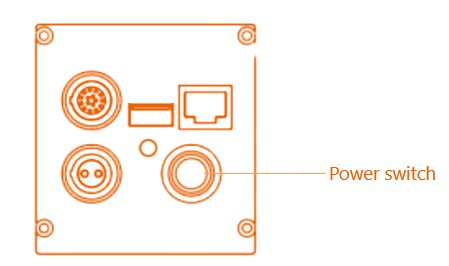

### Teaching Pendant Connection and Drag Teaching

#### Teaching Pendant Connection

The teach pendant software is web-end software. Users can log in to the software simply by entering the specified IP address in the browser (Google Browser is recommended). Through this human-machine interface, users can operate the robot body and controller, run and create robot programs, and read robot information.

The teach pendant supports platform-wide use, and different carriers can be selected according to the application scenarios, such as an Android pad, a Windows pad or computer, an Apple pad or computer, and a Linux computer.

The connection between the teaching pendant and the robotic arm currently only supports wired methods.

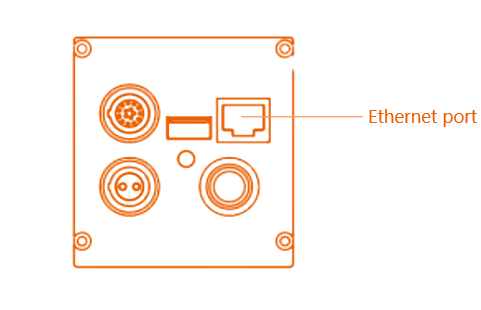

The Windows system is connected with the robotic arm by wired means through network interface.

* Before wired connection with the teach pendant, it is necessary to change the IP address of the computer to the 192.168.1.xx network segment, in which xx can be any IP address other than "18" in "192.168.1.18". It is recommended to configure the IP address to 192.168.1.100. The configuration method is as follows: (1) Right-click the WiFi icon in the bottom right corner of the computer to open "Network & Internet": TIP For Windows 11 system, click "Advanced network settings" to open "Ethernet". (2) In the dropdown menu of "Ethernet," click on "Edit" after selecting "More adapter options." (3) In the pop-up dialog box, select "Internet Protocol Version 4" first and then click the "Properties" button. (4) Configure the network IP address as shown in the figure below, and click "OK". Then the local network setting is completed.
* Open the teach pendant as follows: (1) Open a browser and enter the website "192.168.1.18". (2) Open the robotic arm teaching interface.

#### Teaching Pendant Interface

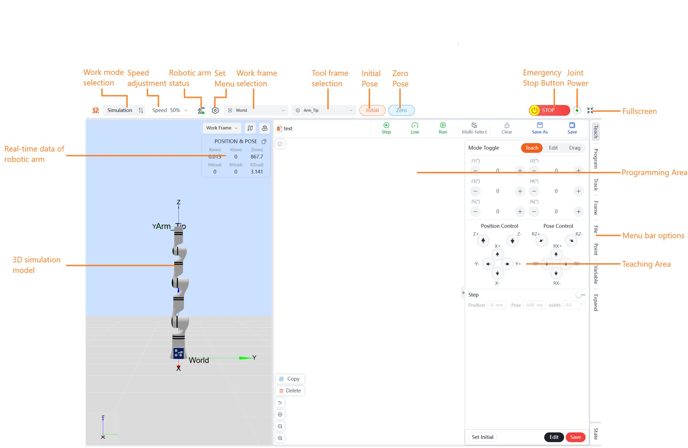

TIP

If the page is stuck when connecting the teach pendant for the first time or after program upgrade, you can refresh the page by pressing "Ctrl+F5".

#### Drag Teaching

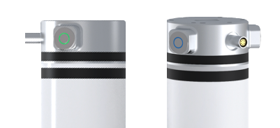

There are two buttons on the end flange housing of robotic arm, which are intended to control the drag teaching and trajectory reproduction respectively.

* By long pressing the green button at the end of robotic arm, the robotic arm will become draggable, and the trajectory will be recorded in real time automatically during the dragging process. Trajectory recording will be completed as long as the green button is released.
* By short pressing the blue button at the end of the robotic arm, the robotic arm will automatically return to the starting position of the trajectory and reproduce the trajectory once (the robotic arm reproduces only the finally recorded drag trajectory).
* By long pressing the blue button at the end of robotic arm, the robotic arm to start the arm moving to the initial position. Release to stop.

Here is just simple description of teaching motion control. For more details, refer to the [Guide to Use of Web Teach Pendant of Realman Robotic Arm](file:///4328135/teachingPendantfour/armTeching/) . For further secondary development, refer to the interface instructions open to users at the website.

#### Power-Off

1. Press the power switch to make it pop up and close.
2. Turn off the 24 V DC power supply to the robot.

For complete WEB teaching pendant operation, programming, configuration, and troubleshooting, see the [RealMan Robot WEB Teaching Pendant User Manual V1.5](file:///4328135/realman-robot-web-teaching-pendant-user-manual-v1.5/).

### Hardware Interfaces

Start Guide:

### Components of robotic arm

Realman's collaborative robot system is mainly composed of the robot body, controller (integrated in the robot base), and teach pendant touch pad (optional).

#### Controller

**16-Pin Aviation Connector Cable**

There is a 16-core connector on the robot controller panel, from which all I/Os of the robot are led out, as shown in the figure below.

WARNING

Hot plugging of an aerial plug is not allowed during wiring. When inserting the aerial plug, make sure that the pin is aligned with the hole position and check whether the pin is normal.

The definitions of wires are explained in the table below.

| No. | First-generation cable wiring sequence | Second-generation cable wiring sequence | Definition  | Description                              | Wire number (for second-generation cables only) | Remarks   |
| --- | -------------------------------------- | --------------------------------------- | ----------- | ---------------------------------------- | ----------------------------------------------- | --------- |
| 1   | Pink and brown                         | Black stripe brown/brown                | VOUT        | External output +                        | NO.1                                            | 12 V/24 V |
| 2   | Gray and purple                        | Gray/purple                             | P\_IO\_GND  | External output -                        | NO.2                                            |           |
| 3   | Yellow                                 | Yellow                                  | 485A        |                                          | NO.3                                            |           |
| 4   | Yellow and green                       | Black stripe yellow                     | 485B        |                                          | NO.4                                            |           |
| 5   | Purple and white                       | Black stripe white                      | IO1         | Multiplexible IO                         | NO.5                                            |           |
| 6   | Red and white                          | White stripe red                        | IO2         | Multiplexible IO                         | NO.6                                            |           |
| 7   | Green and white                        | Black stripe green                      | IO3         | Multiplexible IO                         | NO.7                                            |           |
| 8   | Yellow and white                       | White stripe black                      | IO4         | Multiplexible IO                         | NO.8                                            |           |
| 9   | Blue and white                         | Black stripe orange                     | OUT\_P\_IN  | Digital power supply for external input  | NO.9                                            | 0−24 V    |
| 10  | Light blue                             | Black stripe blue                       | OUT\_P\_OUT | Digital power supply for external output | NO.10                                           | 0−24 V    |
| 11  | Deep blue                              | Blue                                    | OUT\_P\_GND | External digital ground                  | NO.11                                           |           |
| 12  | Green                                  | Green                                   | FDCAN\_A    | CAN\_H                                   | NO.12                                           |           |
| 13  | Red                                    | Red                                     | FDCAN\_B    | CAN\_L                                   | NO.13                                           |           |
| 14  | White                                  | White                                   | E\_STOP     | Circuit-style IO emergency stop          | NO.14                                           |           |
| 15  | Black                                  | Black                                   | Blank       | Reserved                                 | NO.15                                           |           |
| 16  | Orange                                 | Orange                                  | Blank       | Reserved                                 | NO.16                                           |           |

WARNING

The voltage of digital I/O is determined based on the reference voltage connected, and the 16-core extension interface cable of robotic arm provides only 12 V and 24 V power supply voltages. If other output voltages are required for the digital I/O, then reference voltages need to be led in from the pins OUT\_P\_OUT+, OUT\_P\_IN+, and OUT\_P\_GND.

**Power output**

The 16-core cable of robot outputs 12 V/24 V power (in the case of 24 V output voltage, the actual output voltage is the same as the power voltage of the robot, and if the power voltage is unstable, the output voltage will be affected). The power output type is configured and controlled through the teach pendant or JSON protocol. The electrical characteristics are listed in the following table.

| Parameter     | Minimum | Typical | Maximum | Unit |
| ------------- | ------- | ------- | ------- | ---- |
| Power voltage | 0       | ——      | 24      | V    |
| Power current | ——      | 1,000   | 1,500   | mA   |

WARNING

When the controller power supply is used as the power supply to external devices, the current parameter limits specified in the above table must be followed to prevent overload and burning of the controller.

**Digital input**

The controller interface has four channels of digital inputs, and users need to connect the external input digital power channel (OUT\_P\_IN+) and the external digital ground channel (OUT\_P\_GND) to provide level reference for the digital inputs. The electrical characteristics are listed in the following table.

| Digital input    | Minimum | Typical | Maximum | Unit |
| ---------------- | ------- | ------- | ------- | ---- |
| Input power Vin  | 0       | —       | 24      | V    |
| Input voltage    | -0.5    |         | 24      | V    |
| Low logic level  |         |         | 1       | V    |
| High logic level | Vin-0.5 |         |         | V    |

**Digital output**

The controller interface has four channels of digital outputs, and users need to connect the external output digital power channel (OUT\_P\_OUT+) and the external digital ground channel (OUT\_P\_GND) to provide level reference for the digital outputs. The electrical characteristics are listed in the following table.

| Digital output  | Minimum | Typical | Maximum | Unit |
| --------------- | ------- | ------- | ------- | ---- |
| Input power Vin | 0       | —       | 24      | V    |
| Input current   | —       | —       | 2       | mA   |

When the digital output signal of robotic arm is connected with an external device, the power supply to the external device can be used as the reference level of the output end of robotic arm, which shall be no higher than 24 V.

TIP

The maximum output current of digital output signal is 2 mA, which can be amplified by installing field effect modules.

**IO multiplexing**

The I/O of 16-core cable supports the multiplexing function, which, through the program command or web-end teach pendant, can be switched to:

| NO. | Input (NPN type)                                                                                               |
| --- | -------------------------------------------------------------------------------------------------------------- |
| 1   | Output (with a maximum current of 2 mA)                                                                        |
| 2   | Input start function multiplexing mode                                                                         |
| 3   | Input suspension function multiplexing mode                                                                    |
| 4   | Input resumption function multiplexing mode                                                                    |
| 5   | Input emergency stop function multiplexing mode                                                                |
| 6   | Input into current loop drag mode                                                                              |
| 7   | Input into position-only drag mode (available for the six-axis force version)                                  |
| 8   | Input into orientation-only drag mode (available for the six-axis force version)                               |
| 9   | Input into combined position and orientation drag multiplexing mode (available for the six-axis force version) |
| 10  | Input external axis maximum soft limit multiplexing mode (available in the external axis mode)                 |
| 11  | Input external axis minimum soft limit multiplexing mode (available in the external axis mode)                 |

#### End extension

To make it easy for users to connect tools at the end of the robot, a mounting flange and a communication interface are reserved at the end. There are two buttons on the flange housing, which are used to control the drag teaching and trajectory reproduction, respectively. The following introduces the end dimensions and flange installation method:

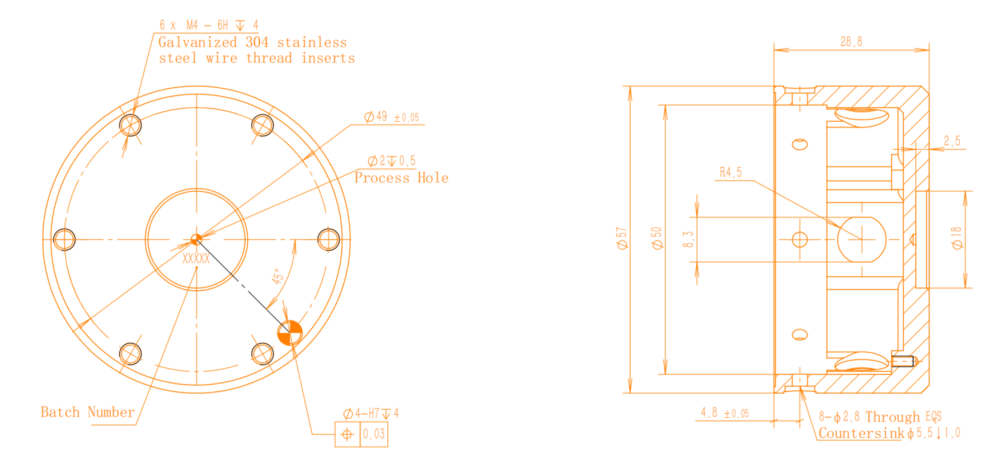

The communication end interface is a 6-core connector, which provides power and control signals for the various grippers and sensors connected to the robot.

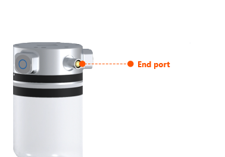

WARNING

When inserting and pulling out the aerial plug cable of end interface board, make sure that the power output at the end is turned off; otherwise, there is a risk of damage to the hardware. When inserting the aerial plug, make sure that the pin is aligned with the hole position and check whether the pin is normal.

The functional interfaces are listed in the table below.

| No. | Interface type                        | Quantity                            | Function                                                                                                                                                            |
| --- | ------------------------------------- | ----------------------------------- | ------------------------------------------------------------------------------------------------------------------------------------------------------------------- |
| 1   | Power output                          | One channel                         | 12 V/24 V available, on/off controlled                                                                                                                              |
| 2   | Digital output                        | A maximum of two channels supported | Reference level same as the power output, only 12 V/24 V supported                                                                                                  |
| 3   | Digital input                         | A maximum of two channels supported | Reference level same as the power output, only 12 V/24 V supported                                                                                                  |
| 4   | RS485                                 | One channel                         | Communicate with peripherals of RS485 interface                                                                                                                     |
| 5   | Drag teaching button (green)          | One channel                         | Press and hold the button, and the robot will enter the drag teaching mode                                                                                          |
| 6   | Trajectory reproduction button (blue) | One channel                         | Press the button, and the robot will reproduce the drag teaching trajectory Press and hold to start the robotic arm moving to the initial position. Release to stop |

**6-Pin Aviation Connector Cable**

The end tool interface connects external tools through a 6-core aerial plug. The pins and definitions of the aerial plug are as follows.

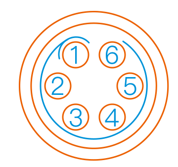

| Pin No. | Wire color | Function                                             |
| ------- | ---------- | ---------------------------------------------------- |
| 1       | Yellow     | RS485\_A                                             |
| 2       | White      | RS485\_B                                             |
| 3       | Red        | Digital interface 1 (DI1/DO1)                        |
| 4       | Black      | Digital interface 2 (DI2/DO2)                        |
| 5       | Green      | Power GND                                            |
| 6       | Blue       | Power output: 0 V/12 V/24 V, controllable by program |

WARNING

The multiplexing functions in the table above are switched by program commands. Pin 3 and pin 4 are digital input channels (DI1 and DI2) by default before delivery, and the power output of pin 6 is 0 V (programmed).

**Digital I/O input**

There are two digital input channels at the tool end, and the electrical characteristics are listed in the following table.

| Digital input    | Minimum | Typical | Maximum | Unit |
| ---------------- | ------- | ------- | ------- | ---- |
| Input power Vin  | 0       | ——      | 24      | V    |
| Input voltage    | -0.5    |         | 24      | V    |
| Low logic level  |         |         | 1       | V    |
| High logic level | Vin-0.5 |         |         | V    |

**Digital I/O output**

There are two digital output channels at the tool end, which is directly configured through the teach pendant or the controller based on the JSON protocol. The electrical characteristics are listed in the following table.

| Digital output  | Minimum | Typical | Maximum | Unit |
| --------------- | ------- | ------- | ------- | ---- |
| Input power Vin | 0       | ——      | 24      | V    |

**Power output**

The robot end outputs 12 V/24 V power (in the case of 24 V output voltage, the actual output voltage is the same as the power voltage of the robot, and if the power voltage is unstable, the output voltage will be affected). The power output type is configured and controlled through the teach pendant or JSON protocol. The electrical characteristics are listed in the following table.

| Parameter     | Minimum | Typical | Maximum | Unit |
| ------------- | ------- | ------- | ------- | ---- |
| Power voltage | 0       | ——      | 24      | V    |
| Power current | ——      | 1,000   | 1,500   | mA   |

WARNING

When the robot end power supply is used as the power supply to end effector, the current parameter limits specified in the above table must be followed to prevent overload and burning of the end interface board.

**Communication interface**

There is an RS485 communication interface respectively at the 16-core aerial plug of the controller and the 6-core aerial plug of the end interface board (The RS485 communication interface of the 6-pin terminal connector on the end-effector interface board is only used for the robot to control external devices, but not for external devices to control the robot's motion). The two RS485 interfaces can be configured to standard Modbus RTU mode through the JSON protocol (to ensure the communication stability of RS485 interfaces, the devices shall be connected to the GND of the robotic arm as practical as possible). Then the peripherals connected to the interface can be read or written through the JSON protocol.

### RM65 Specifications and Robot Parameters

### Basic Parameters

| Parameter Name                                                 | Parameter Value                                     |            |
| -------------------------------------------------------------- | --------------------------------------------------- | ---------- |
| Basic Parameters                                               | Degrees of Freedom                                  | 6          |
| Configuration                                                  | Humanoid Configuration                              |            |
| Joint Brake Type                                               | Joints 1 to 3: Hard Brake Joints 4 to 6: Soft Brake |            |
| Working Radius/mm                                              | Standard Version: 610 Six-Axis Force Version: 627   |            |
| Payload/kg                                                     | 5                                                   |            |
| Self-weight/kg                                                 | Standard Version: 7.2 Six-Axis Force Version: 7.3   |            |
| Repeatability/mm                                               | ±0.05                                               |            |
| TCP Line Speed/m/s                                             | ≤1.8                                                |            |
| Typical Power/W                                                | ≤150                                                |            |
| Peak Power/W                                                   | ≤900                                                |            |
| Installation Angle                                             | Any Angle                                           |            |
| Base Dimensions/mm                                             | φ107                                                |            |
| Material                                                       | Aluminum Alloy/ABS                                  |            |
| Environmental Adaptability                                     | Operating Temperature/℃                             | 0-45       |
| Operating Humidity                                             | 25\~85% Non-condensing                              |            |
| Motion Angle Range/°                                           | J1                                                  | -178\~+178 |
| J2                                                             | -130\~+130                                          |            |
| J3                                                             | -135\~+135                                          |            |
| J4                                                             | -178\~+178                                          |            |
| J5                                                             | -128\~+128                                          |            |
| J6                                                             | -360\~+360                                          |            |
| Maximum Angular Velocity/°/s                                   | J1                                                  | 180        |
| J2                                                             | 180                                                 |            |
| J3                                                             | 225                                                 |            |
| J4                                                             | 225                                                 |            |
| J5                                                             | 225                                                 |            |
| J6                                                             | 225                                                 |            |
| Force Control Specifications (Supported only by 6-DoF sensors) | Six-Axis Force Range                                | 200N/7N·m  |
| Six-Axis Force Accuracy                                        | ±0.5%FS                                             |            |

### Ontology Parameters

**MDH model frame:**

**MDH parameters of RM65 (modified D-H parameters):**

| joint\_id(i) | (mm) | (°) | (mm)  | / (°) |
| ------------ | ---- | --- | ----- | ----- |
| 1            | 0    | 0   | 240.5 | 0     |
| 2            | 0    | 90  | 0     | 90    |
| 3            | 256  | 0   | 0     | 90    |
| 4            | 0    | 90  | 210   | 0     |
| 5            | 0    | -90 | 0     | 0     |
| 6            | 0    | 90  |       | 0     |

* RM65-6F-V : mm
* RM65-B-V : mm
* RM65-B : mm
* RM65-6F : mm

Note: offset refers to the offset of the joint zero position from the model zero position, that is, `model angle = joint angle + offset` .

#### Kinetic parameters of RM65 robot link

| joint\_id(i) | 1        | 2         | 3        | 4       | 5        | 6       | -       | - |
| ------------ | -------- | --------- | -------- | ------- | -------- | ------- | ------- | - |
|              | 1.51     | 1.653     | 0.726    | 0.671   | 0.647    | 0.107   | 0.189   |   |
|              | 0.491    | 183.722   | 0.029    | 0.007   | 0.032    | -0.506  | -0.352  |   |
|              | 7.803    | 0.103     | -90.105  | -9.486  | -83.769  | 0.255   | -0.067  |   |
|              | -10.744  | -1.665    | 4.039    | -8.041  | 2.326    | -10.801 | -18.302 |   |
|              | 2928.466 | 1711.553  | 7259.884 | 794.014 | 5375.604 | 50.918  | 133.613 |   |
|              | -32.63   | -38.271   | 2.994    | -0.821  | 2.665    | -3.136  | 0.522   |   |
|              | -5.816   | 2314.91   | -0.314   | -0.655  | -0.304   | -0.699  | 1.623   |   |
|              | 2506.35  | 70514.722 | 371.872  | 596.235 | 285.265  | 47.42   | 130.260 |   |
|              | 47.925   | 6.507     | 44.451   | -34.785 | 14.235   | 0.388   | 0.531   |   |
|              | 1756.017 | 70036.186 | 7228.758 | 486.228 | 5359.769 | 60.35   | 89.503  |   |
| Remarks      |          |           |          |         |          | B       | 6F      |   |

Description:

* is the mass of the link,
* is the x-coordinate of the center of mass of link,
* is the y-coordinate of the center of mass of link,
* is the z-coordinate of the center of mass of link,
* , , , , , is the principal moment of inertia described in the link frame, ²
* B: standard version, 6F: Six-Axis Force version

Remarks:

* Source of data: CAD design values.
* If the inertial parameters in the center of mass frame are required, they can be calculated based on the parallel axis theorem, as stated below.

Assuming there is an output frame , the center of mass frame coinciding with this coordinate system is , and the coordinates of the center of mass in this frame are , then according to the parallel axis theorem:

Where,

#### Distribution and dimensions of joints

The RM65-B humanoid robotic arm has six rotating joints, each of which represents one degree of freedom. As shown in the figure below, robot joints include the shoulders (joint 1 and joint 2), elbow (joint 3), and wrists (joint 4, joint 5, and joint 6).

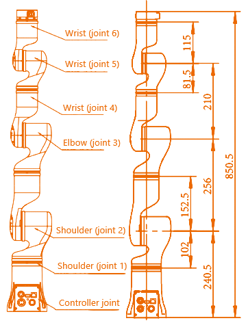

**Workspace**

The workspace of RM65-B is a sphere with a working radius of 610 mm, in addition to the cylindrical space directly above and below the base. When determining the installation position of the robot, due considerations must be given to the cylindrical space directly above and below the robot, to avoid moving tools to this cylindrical space as much as possible. Furthermore, in actual applications, the motion ranges of all joints are as follows: joint 1: ±178°; joint 2: ±130°; joint 3: ±135°; joint 4: ±178°; joint 5: ±128°; joint 6: ±360°.

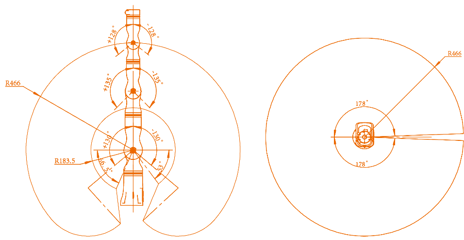

Seen from the cross-section of the workspace, the area with good maneuverability of the 6-axis robot is as indicated by the yellow dotted line in the following figure, an annular area in the workspace as a whole.

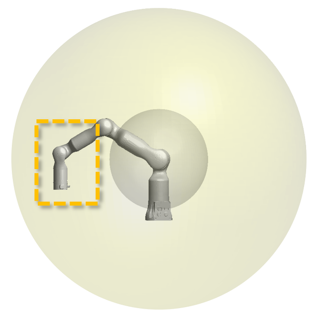

**Motion singularities**

**Singular Type 1: Shoulder singularity**

`When the intersection point of the axes of Joint 5 and Joint 6 lies on the plane that passes through the axis of Joint 1 and is parallel to the axis of Joint 2, a shoulder singularity occurs.`

The following figure is a schematic diagram of the shoulder singularity. The blue plane refers to the plane that passes through the axis of Joint 1 and is parallel to the axis of Joint 2.

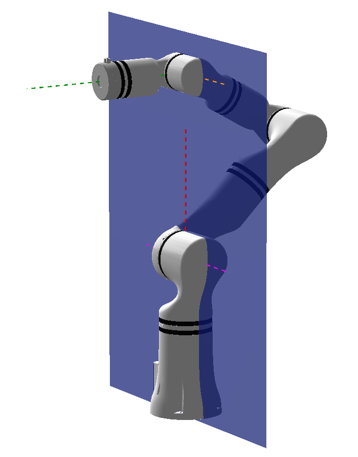

Example point 1: \[90,43.4,-105.7,0,-30,0], as shown in the figure below:

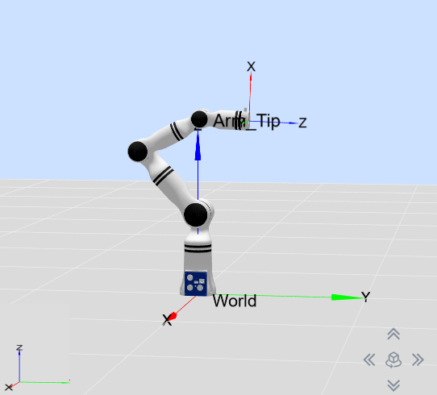

Example point 2: \[90,43.4,-105.7,0,62.3,0], as shown in the figure below:

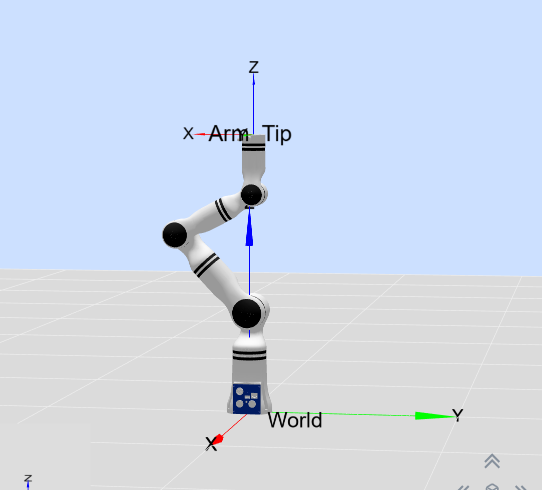

**Singular Type 2: Elbow singularity**

`When the intersection point of the axes of Joint 5 and Joint 6 lies on the plane formed by the axes of Joint 2 and Joint 3, and q3=0, i.e., the point format is [x,x,0,x,x,x], an elbow singularity occurs.`

Example point 1: \[-90,60,0,0,90,0], as shown in the figure below:

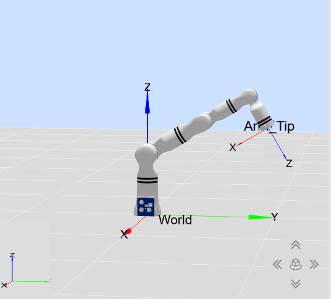

Example point 2: \[0,0,0,90,-60,0], as shown in the figure below:

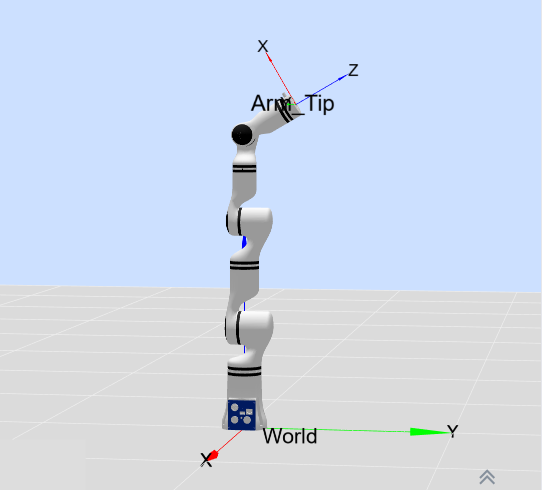

**Singular Type 3: Wrist singularity**

`When the axes of Joint 4 and Joint 6 are parallel, q5=0, i.e., the point format is [x,x,x,x,0,x], a wrist singularity occurs.`

Example point 1: \[0,60,30,0,0,0], as shown in the figure below:

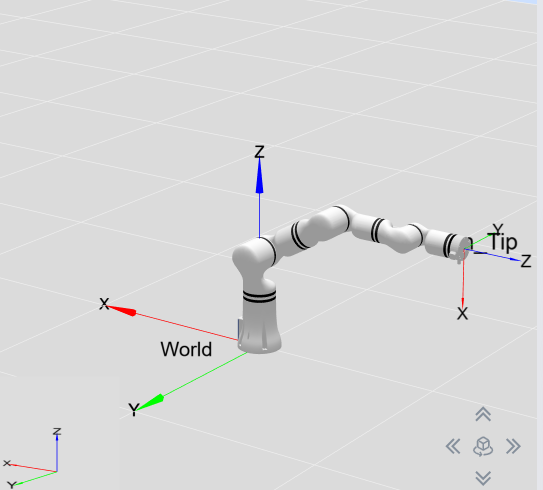

**Singular Type 4: Boundary singularity**

`When the robot end-effector reaches the farthest point, q3=0 and q5=0, i.e., the point format is [x,x,0,x,0,x], a boundary singularity occurs.`

Example point 1: \[0,0,0,0,0,0], as shown in the figure below:

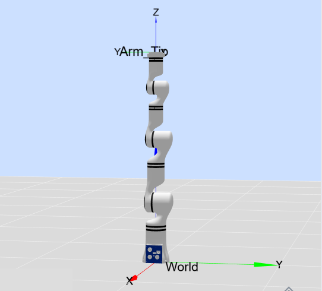

Example point 2: \[-90,90,0,0,0,0], as shown in the figure below:

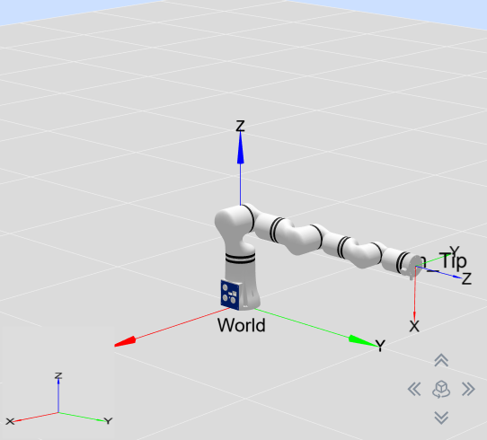

Example point 3: \[-90,45,0,0,0,0], as shown in the figure below:

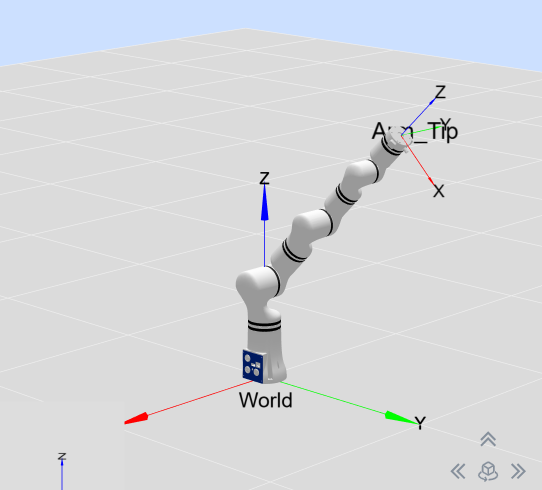

**Load curves**

Represent the curves of end load of RM65-B and RM65-6F, respectively. Where, L refers to the radial distance of the center of mass of end load against the plane of end flange, and Z refers to the normal distance of the center of mass of end load against the plane of end flange.

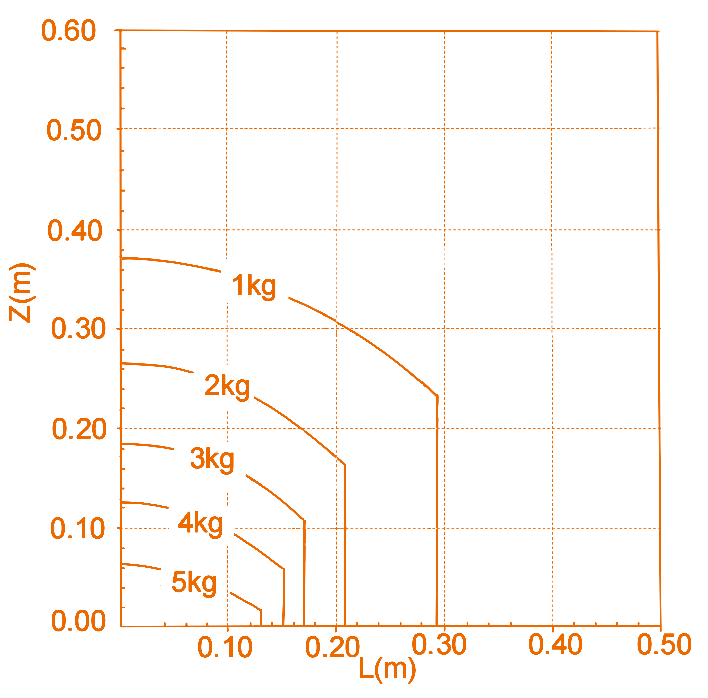

### Frequently Asked Questions

FAQ:

### FAQs about basic use

#### 1. What basic technical skills do users need to have if they want to carry out secondary development of control based on the robotic arm?

If users directly use our packaged API, they can only use C/C++/C#/Python to call it in Linux/Windows environment. If users use the JSON protocol, the flexibility will be much higher. There is no restriction on users' system and programming language, as long as a fixed string can be sent according to the protocol. The JSON protocol is often used in PLC, Android, IOS and other platforms.

#### 2. Can the robotic arm be controlled through the Android platform/PLC?

The robotic arm supports the Web teach pendant. It can be accessed by opening a browser after establishing a network connection, and can be accessed in Android, IOS, WIN and LINUX systems. The robotic arm can be controlled as long as it receives the string of JSON format. The string can be sent and received through the Ethernet port, and RS485. Using an Android device, PLC, single chip microcomputer, etc., users can control the robotic arm by directly sending strings of JSON format. Users can also use MODBUS-RTU/TCP to control the robotic arm.

#### 3. The system message interface prompts out-of-limit, and the error cannot be cleared. What should I do?

Solution: first drag the joint beyond the limit back to within the limit, and clear the joint error message. The specific steps are as follows:

* View the current joint angles in the robotic arm teaching interface;
* In Configuration - Security Config, select the corresponding joint and adjust the joint limits to be greater than the current angle;
* In the robotic arm state interface, clear the joint error and select the corresponding joint, then click the Enable button;
* In the robotic arm teaching interface, control the joint to return within the limits;
* In the robotic arm state interface, select the corresponding joint and click the Disable button;
* In Configuration - Security Config, select the corresponding joint, restore the limits to their initial values, and re-enable.

### FAQs about the robotic arm system

#### 1. Are the encoders of robotic arm single-coil ones or multi-coil ones?

Absolute dual encoders, each on the input end and output end, respectively. The encoder of the last joint is a multi-coil one, while others are single-coil encoders. The accuracy is 0.001°.

#### 2. What is pass-through? What is the cycle of pass-through? What is pass-through for?

Pass-through means that users plan the trajectory themselves on the upper computer, and then sends the joint angles directly to the controller, and each joint runs directly without the processing by the controller. The operation results of robotic arm directly depend on the level of users' trajectory planning.

**Pass-through cycle of Gen 4 controllers:** 5 ms achievable.

It is mainly used to verify users' algorithms, or combine the vision to make dynamic trajectory planning in unstructured environment to achieve grasping or obstacle avoidance.

#### 3. What's the difference between the RS485 interface of the robotic arm controller and the RS485 interface at the end?

The RS485 interface of the controller supports the control of the robotic arm. It can also, through command switching, support the standard MODBUS-RTU protocol, and control peripherals such as grippers and electric suckers. The RS485 interface at the end only supports external control and cannot control the robotic arm.

#### 4. What types of effectors can be connected to the end of the robotic arm?

The end of robotic arm can output 12 V/24 V voltage, and the maximum current of 1.5 A. The end has a RS485 communication interface, which supports the standard MODBUS-RTU protocol.

#### 5. What will be influenced by the setting of quality and center of mass parameters of tool frame?

Collision detection, and the feel of dragging the current loop.

#### 6. What are the I/O multiplexing functions of Gen 4 controller?

The I/O in the 16-core cable has multiplexing functions, which can be switched to: through program commands or Web teach pendant. The specific steps are as follows: click the drop-down list on the I/O configuration interface and select the corresponding multiplexing function.

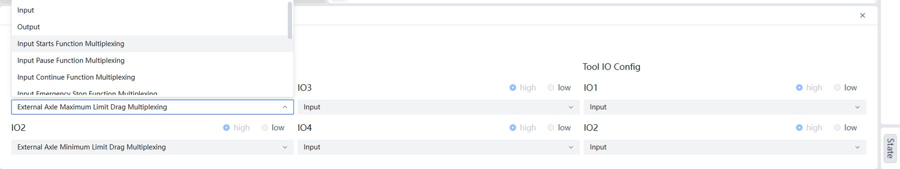

#### 7. What are the DH parameters of robotic arm?

The DH parameters generally include four parameters: X-axis rotation, generally expressed by α; X-axis translation, generally expressed by a; Z-axis rotation, generally expressed by θ; and Z-axis translation, generally expressed by d. According to the sequence of axes, the parameters are divided into standard DH parameters and enhanced DH parameters.

Standard DH parameters: the transformation of two connecting rod frames is to rotate and translate around the Z axis first, and then rotate and translate around the X axis. That is the X-Z sequence, i.e. rotation first and then translation.

Enhanced DH parameters: the transformation of two connecting rod frames is to rotate and translate around the X axis first, and then rotate and translate around the Z axis. That is the Z-X sequence, i.e. rotation first and then translation.

#### 8. What is the relationship between force control and current loop control?

There is no torque sensor inside the joints of robotic arm, and joint force control is realized through the current loop, that is, for our robotic arms, current loop control is equivalent to force control.

#### 9. What is the service life of RM series robotic arms?

The service life of a robotic arm that continuously runs under the payload is 50 thousand hours. So far, we have passed the MTBF certification by Shanghai National Robot Testing Center.

### FAQs about electrical connection

#### 1. What are the power supply voltage and current requirements of robotic arm?

The power supply voltage can range from 20 V to 27 V, or up to 30 V at maximum. It is recommended that a switching power supply rated above 600 W supporting hiccup mode and with a constant current output of 1s be used. The power supplies that we use internally are listed on our website, and you can purchase a power supply if needed.

[https://detail.tmall.com/item.htm](https://detail.tmall.com/item.htm?spm=a1z10.3-b-s.w401123472802678.25.3a213f86ri07Gh\&id=596551882593\&rn=f8a9c269b5f7a4790419fa1a9258f052\&abbucket=11\&skuId=4359660664596)

#### 2. How to deal with the situation where the externally connected relay does not respond when the robotic arm controls the output?

The digital output interface of the robotic arm controller has an output current of 2 mA, which is impossible to drive the relay and other loads. Therefore, the current needs to be converted through a module. To control high-power equipment, such as a motor, light bulb, relay, solenoid valve, etc., an FET module can be configured.

[https://item.taobao.com/item.htm](https://item.taobao.com/item.htm?spm=a21m98.27004841.0.0.2d6476b7Wy9VMp\&id=600304290465\&scm=20140619.rec.2882167263.600304290465)

#### 3. What are the types of external cables for the robotic arm? And what are the detailed specifications of each type?

The external cables include **2-core power cables** and **16-core cables** , with detailed specifications as follows:

| Cable Type         | Core Specification                         | Single Core Outer Diameter | Total Outer Diameter | Cable Length | Bending Radius |
| ------------------ | ------------------------------------------ | -------------------------- | -------------------- | ------------ | -------------- |
| 2-core Power Cable | 2.5mm² (approximately equivalent to AWG13) | 3.5mm                      | 8.5mm                | 2m (2000mm)  | 50mm           |
| 16-core Cable      | AWG26                                      | 1mm                        | 8.5mm                | 2m (2000mm)  | 50mm           |

### FAQs about communication configuration

#### 1. How to modify the device IP and device connection?

The default IP address is `192.168.1.18` , which can be modified by sending JSON protocol or through the teach pendant.

### Handling and Transportation

During the lifting of the robot, the moving parts shall have appropriate measures in place and be properly located, to prevent them from unintended movement and causing hazards. During packing for transportation, the robots shall be packed according to the packing standards, with any marks required printed on the exterior surface of the packing box.

During transportation, the robots must maintain stable at a fixed position.

When the robot is taken out from the packing material and moved to the installation position, it shall be held still until all the bolts of the robot base are fastened.

No brake is installed inside joints 4‒6 of the robot. When disconnected from the power supply, the robot shall be kept in a proper position in case the joints rotate under the action of gravity and cause collision. (In the vertical state, the robot shall be put in the zero position before power cut-off.)

After transportation, the original packing materials shall be kept in a dry place for potential future use for repacking and relocating the robot.

Warning

RM65 series robots have no mechanical brake inside joints 4–6.

### Maintenance, Repair, and Disposal

Maintenance and repair must be carried out in compliance with all safety instructions in this manual.

After any change to the control system and robot joints, it is necessary to re-calibrate the zero points of the robot and end effector on site. The parameter settings shall also be checked. If the parameters are backed up, the backed-up parameters can be imported directly. Otherwise, the parameters need to be reset.

Maintenance and repair must be carried out by an authorized system integrator or Realman Intelligent Technology (Beijing) Co., Ltd. To return any part to Realman Intelligent Technology (Beijing) Co., Ltd., the requirements in the service manual shall be followed.

The safety level specified for maintenance and repair must be guaranteed, the national or regional work safety regulations in effect must be observed, and all safety functions must be tested.

The purpose of maintenance and repair is to ensure the normal operation of the system or to restore the system to normal after it fails.

Repair includes fault diagnosis and actual repair.

The following safety procedures and warnings must be observed when operating the robotic arm or controller:

**Safety procedure:**

1. Remove the power input from the controller interface board to ensure complete power-off. Take necessary measures to eliminate the possibility that anyone may restore the power supply to the system during repair. After the power is cut off, check the system again to make sure it is disconnected from the power supply.
2. Observe the electrostatic discharge (ESD) regulations when disassembling the robotic arm or controller.
3. Prevent water or dust from flowing into the robotic arm or controller.

**Warnings:**

1. During repair, the defective parts shall be replaced with new ones with the same part number or replaced by Realman Intelligent Technology (Beijing) Co., Ltd.
2. After maintenance, all disabled safety measures shall be enabled immediately.
3. All repair operations shall be documented and kept in the technical documents related to the complete robot system.
4. No parts of the controller shall be repaired by the users themselves. For any maintenance or repair services, please contact your dealer or Realman Intelligent Technology (Beijing) Co., Ltd.

**Disposal:**

Our full range of robots must be disposed of in accordance with applicable national laws, regulations, and standards.

**Repair and maintenance:**

1. The safety functions of the robot must be tested at least once a year to ensure normal working.
2. On the end joint of a robotic arm, there is a battery to supply power to the encoder for saving the multi-coil counts of the joint. To prevent loss of encoder data, the robotic arm shall be started to charge the battery for at least 5−10 minutes every month. If the end joint is still abnormal after being charged, the robotic arm shall be restarted 5−10 minutes later. If the problem remains, please contact our after-sales service personnel.

Warning

Joint 6 of the RM65 series has a battery that supplies power to the encoder.

### Additional Resources

* [RealMan Robot WEB Teaching Pendant User Manual V1.5](file:///4328135/realman-robot-web-teaching-pendant-user-manual-v1.5/)
* [Official RealMan user-manual downloads](https://develop.realman-robotics.com/en/robot4th/download/manual/)
* [Official RealMan Gen 4 documentation](https://develop.realman-robotics.com/en/robot4th/summarize/)
