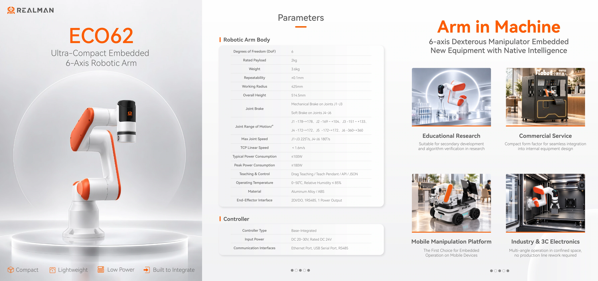
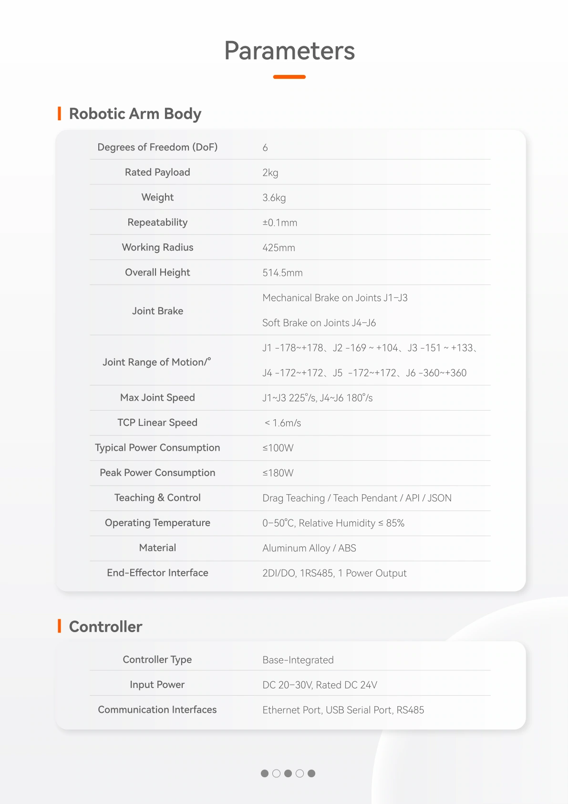

# ECO62 specification sheet — complete supplied document (4 pages)


**Complete supplied document:** ECO62 specs.pdf · **PDF pages:** 4. This reference preserves every source page, including tables, drawings, connector views, examples, revision notes, warranty text and appendices. [Return to the RealMan source library](./).


The **Original page** tab retains the exact visual layout. The **Searchable text** tab contains extracted text, or a visually checked transcription for the two image-only specification sheets. Native PDF text can have reading-order or character defects; use the original page for table column alignment, connector orientation, equations and code indentation.


This specification sheet is not a wiring or commissioning manual. Its electrical limits and joint data do not establish a connector pinout, firmware compatibility or an approved motion procedure.


## Document navigation

| Topic                                       | PDF pages                                           |
| ------------------------------------------- | --------------------------------------------------- |
| Composite flyer                             | [PDF 1](complete-eco62-specification.md#pdf-page-1) |
| Product overview                            | [PDF 2](complete-eco62-specification.md#pdf-page-2) |
| Complete arm/controller specification table | [PDF 3](complete-eco62-specification.md#pdf-page-3) |
| Application panels                          | [PDF 4](complete-eco62-specification.md#pdf-page-4) |

**Source attribution:** RealMan, supplied document named above. All original notices and technical statements remain visible in the source page images. Added navigation and discrepancy notes are OpenELAB editorial guidance. Software execution and hardware validation: **not run**.

## PDF page 1

[ECO62 specification sheet, original PDF page 1](https://1292444914-files.gitbook.io/~/files/v0/b/gitbook-x-prod.appspot.com/o/spaces%2FtgOfPnscWebs1eh82EKq%2Fuploads%2F6BseRa9Mm9s1um3su1du%2FECO62-pages-01-02.pdf?alt=media#page=1)








```
Composite flyer containing the cover, full parameters and application panels:

REALMAN
ECO62
Ultra-Compact Embedded 6-Axis Robotic Arm
Compact / Lightweight / Low Power / Built to Integrate

Parameters — Robotic Arm Body
Degrees of freedom: 6
Rated payload: 2 kg
Weight: 3.6 kg
Repeatability: ±0.1 mm
Working radius: 425 mm
Overall height: 514.5 mm
Joint brake: Mechanical brake on J1–J3; soft brake on J4–J6
Joint range (degrees): J1 -178 to +178; J2 -169 to +104; J3 -151 to +133; J4 -172 to +172; J5 -172 to +172; J6 -360 to +360
Max joint speed: J1–J3 225°/s; J4–J6 180°/s
TCP linear speed: <1.6 m/s
Typical power consumption: ≤100 W
Peak power consumption: ≤180 W
Teaching/control: Drag Teaching / Teach Pendant / API / JSON
Operating temperature: 0–50°C; relative humidity ≤85%
Material: Aluminum Alloy / ABS
End-effector interface: 2 DI/DO, 1 RS485, 1 power output
Controller: Base-integrated
Input power: DC 20–30 V; rated DC 24 V
Communication: Ethernet port, USB serial port, RS485

Arm in Machine
6-axis Dexterous Manipulator Embedded
New Equipment with Native Intelligence
Educational Research: Suitable for secondary development and algorithm verification in research.
Commercial Service: Compact form factor for seamless integration into internal equipment design.
Mobile Manipulation Platform: The First Choice for Embedded Operation on Mobile Devices.
Industry & 3C Electronics: Multi-angle operation in confined space, no production line rework required.
```




## PDF page 2

[ECO62 specification sheet, original PDF page 2](https://1292444914-files.gitbook.io/~/files/v0/b/gitbook-x-prod.appspot.com/o/spaces%2FtgOfPnscWebs1eh82EKq%2Fuploads%2F6BseRa9Mm9s1um3su1du%2FECO62-pages-01-02.pdf?alt=media#page=2)








```
REALMAN
ECO62
Ultra-Compact Embedded 6-Axis Robotic Arm
Compact / Lightweight / Low Power / Built to Integrate
```




## PDF page 3

[ECO62 specification sheet, original PDF page 3](https://1292444914-files.gitbook.io/~/files/v0/b/gitbook-x-prod.appspot.com/o/spaces%2FtgOfPnscWebs1eh82EKq%2Fuploads%2F1srRkXa1zq8uVpde6shc%2FECO62-pages-03-04.pdf?alt=media#page=1)








```
Parameters — Robotic Arm Body
Degrees of freedom: 6
Rated payload: 2 kg
Weight: 3.6 kg
Repeatability: ±0.1 mm
Working radius: 425 mm
Overall height: 514.5 mm
Joint brake: Mechanical brake on J1–J3; soft brake on J4–J6
Joint range (degrees): J1 -178 to +178; J2 -169 to +104; J3 -151 to +133; J4 -172 to +172; J5 -172 to +172; J6 -360 to +360
Max joint speed: J1–J3 225°/s; J4–J6 180°/s
TCP linear speed: <1.6 m/s
Typical power consumption: ≤100 W
Peak power consumption: ≤180 W
Teaching/control: Drag Teaching / Teach Pendant / API / JSON
Operating temperature: 0–50°C; relative humidity ≤85%
Material: Aluminum Alloy / ABS
End-effector interface: 2 DI/DO, 1 RS485, 1 power output
Controller: Base-integrated
Input power: DC 20–30 V; rated DC 24 V
Communication: Ethernet port, USB serial port, RS485
```




## PDF page 4

[ECO62 specification sheet, original PDF page 4](https://1292444914-files.gitbook.io/~/files/v0/b/gitbook-x-prod.appspot.com/o/spaces%2FtgOfPnscWebs1eh82EKq%2Fuploads%2F1srRkXa1zq8uVpde6shc%2FECO62-pages-03-04.pdf?alt=media#page=2)








```
Arm in Machine
6-axis Dexterous Manipulator Embedded
New Equipment with Native Intelligence
Educational Research: Suitable for secondary development and algorithm verification in research.
Commercial Service: Compact form factor for seamless integration into internal equipment design.
Mobile Manipulation Platform: The First Choice for Embedded Operation on Mobile Devices.
Industry & 3C Electronics: Multi-angle operation in confined space, no production line rework required.
```



