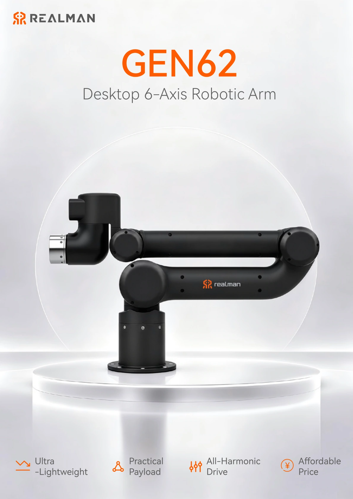
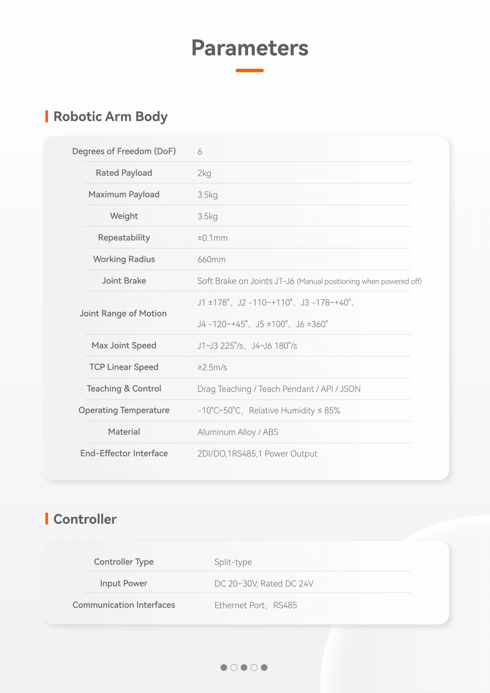

# GEN62 specification sheet — complete supplied document (3 pages)


**Complete supplied document:** GEN62英文参数页(1).pdf · **PDF pages:** 3. This reference preserves every source page, including tables, drawings, connector views, examples, revision notes, warranty text and appendices. [Return to the RealMan source library](./).


The **Original page** tab retains the exact visual layout. The **Searchable text** tab contains extracted text, or a visually checked transcription for the two image-only specification sheets. Native PDF text can have reading-order or character defects; use the original page for table column alignment, connector orientation, equations and code indentation.


This specification sheet is not a wiring or commissioning manual. It specifies soft brakes on all six joints and prints TCP linear speed as ≥2.5 m/s; retain that inequality as a brochure claim rather than turning it into a safe speed setting. GEN62 is not GEN72; a repository support entry for GEN72 does not verify GEN62 support.


## Document navigation

| Topic                                       | PDF pages                                           |
| ------------------------------------------- | --------------------------------------------------- |
| Product overview                            | [PDF 1](complete-gen62-specification.md#pdf-page-1) |
| Complete arm/controller specification table | [PDF 2](complete-gen62-specification.md#pdf-page-2) |
| Application panels                          | [PDF 3](complete-gen62-specification.md#pdf-page-3) |

**Source attribution:** RealMan, supplied document named above. All original notices and technical statements remain visible in the source page images. Added navigation and discrepancy notes are OpenELAB editorial guidance. Software execution and hardware validation: **not run**.

## PDF page 1

[GEN62 specification sheet, original PDF page 1](https://1292444914-files.gitbook.io/~/files/v0/b/gitbook-x-prod.appspot.com/o/spaces%2FtgOfPnscWebs1eh82EKq%2Fuploads%2F9gp7O09aJQPtAoxEQh69%2FGEN62-pages-01-02.pdf?alt=media#page=1)








```
REALMAN
GEN62
Desktop 6-Axis Robotic Arm
Ultra-Lightweight / Practical Payload / All-Harmonic Drive / Affordable Price
```




## PDF page 2

[GEN62 specification sheet, original PDF page 2](https://1292444914-files.gitbook.io/~/files/v0/b/gitbook-x-prod.appspot.com/o/spaces%2FtgOfPnscWebs1eh82EKq%2Fuploads%2F9gp7O09aJQPtAoxEQh69%2FGEN62-pages-01-02.pdf?alt=media#page=2)








```
Parameters — Robotic Arm Body
Degrees of freedom: 6
Rated payload: 2 kg
Maximum payload: 3.5 kg
Weight: 3.5 kg
Repeatability: ±0.1 mm
Working radius: 660 mm
Joint brake: Soft brake on J1–J6 (manual positioning when powered off)
Joint range: J1 ±178°; J2 -110 to +110°; J3 -178 to +40°; J4 -120 to +45°; J5 ±100°; J6 ±360°
Max joint speed: J1–J3 225°/s; J4–J6 180°/s
TCP linear speed: ≥2.5 m/s
Teaching/control: Drag Teaching / Teach Pendant / API / JSON
Operating temperature: -10°C to 50°C; relative humidity ≤85%
Material: Aluminum Alloy / ABS
End-effector interface: 2 DI/DO, 1 RS485, 1 power output
Controller: Split-type
Input power: DC 20–30 V; rated DC 24 V
Communication: Ethernet port, RS485
```




## PDF page 3

[GEN62 specification sheet, original PDF page 3](https://1292444914-files.gitbook.io/~/files/v0/b/gitbook-x-prod.appspot.com/o/spaces%2FtgOfPnscWebs1eh82EKq%2Fuploads%2FIAOO7mehwpCZHLSbuiaQ%2FGEN62-pages-03-03.pdf?alt=media#page=1)








```
Affordable Six-Axis Robot Arm for Real Work
Data Collection: Three-axis orthogonal wrist design for smooth, decoupled motion and cleaner data collection.
Education & Research: ±0.1 mm repeatability for reproducible results at lower setup costs.
Mobile Manipulation: Practical payload for picking, handling, and transferring small items.
Individual Developers: Ready-to-use kit with SDK, ROS 2 drivers, and URDF simulation model.
```



