# RealBot-L2 solution white paper V2+ — complete supplied document (26 pages)


**Complete supplied document:** 【EN】Realbot\_L2 Product solution white paper\_V2+.pdf · **PDF pages:** 26. This reference preserves every source page, including tables, drawings, connector views, examples, revision notes, warranty text and appendices. [Return to the RealMan source library](./).


The **Original page** tab retains the exact visual layout. The **Searchable text** tab contains extracted text, or a visually checked transcription for the two image-only specification sheets. Native PDF text can have reading-order or character defects; use the original page for table column alignment, connector orientation, equations and code indentation.


This is a V2+ solution white paper. Performance, equipment, autonomy and safety-feature descriptions are manufacturer/project claims, with the confirmed technical agreement governing delivery. They do not establish a commissioned safety function or a control protocol. RealBot-L2 is separate from S2 and the older RMC-DA-LIII platform.


## Document navigation

| Topic                                                             | PDF pages                                           |
| ----------------------------------------------------------------- | --------------------------------------------------- |
| Positioning, applications and value propositions                  | [PDF 1–7](complete-l2-white-paper.md#pdf-page-1)    |
| Architecture, modules and complete technical specification tables | [PDF 8–12](complete-l2-white-paper.md#pdf-page-8)   |
| Perception, computing, teleoperation software and hardware        | [PDF 12–20](complete-l2-white-paper.md#pdf-page-12) |
| Application scenarios, equipment list, deployment and service     | [PDF 21–26](complete-l2-white-paper.md#pdf-page-21) |

**Source attribution:** RealMan, supplied document named above. All original notices and technical statements remain visible in the source page images. Added navigation and discrepancy notes are OpenELAB editorial guidance. Software execution and hardware validation: **not run**.

## PDF page 1

[RealBot-L2 solution white paper V2+, original PDF page 1](https://1292444914-files.gitbook.io/~/files/v0/b/gitbook-x-prod.appspot.com/o/spaces%2FtgOfPnscWebs1eh82EKq%2Fuploads%2FtYx9rT32L8MjwvNrNaSy%2FL2-pages-01-21.pdf?alt=media#page=1)



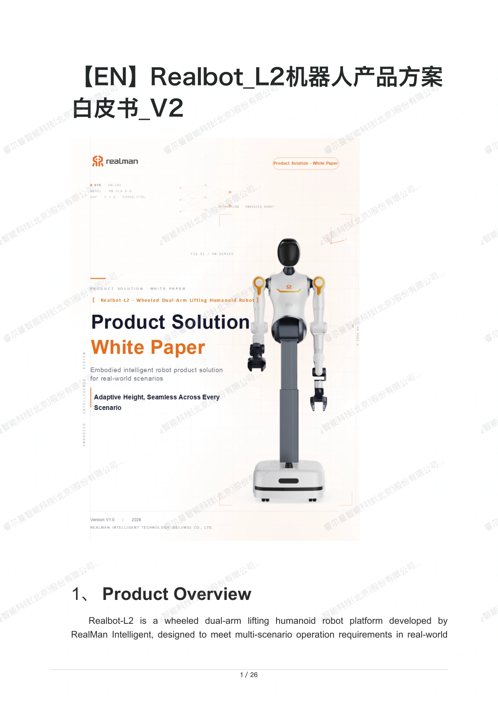




```
【EN】Realbot_L2机器人产品方案
白皮书_V2


1、Product Overview
Realbot-L2 is a wheeled dual-arm lifting humanoid robot platform developed by 
RealMan Intelligent, designed to meet multi-scenario operation requirements in real-world 
1 / 26
```




## PDF page 2

[RealBot-L2 solution white paper V2+, original PDF page 2](https://1292444914-files.gitbook.io/~/files/v0/b/gitbook-x-prod.appspot.com/o/spaces%2FtgOfPnscWebs1eh82EKq%2Fuploads%2FtYx9rT32L8MjwvNrNaSy%2FL2-pages-01-21.pdf?alt=media#page=2)



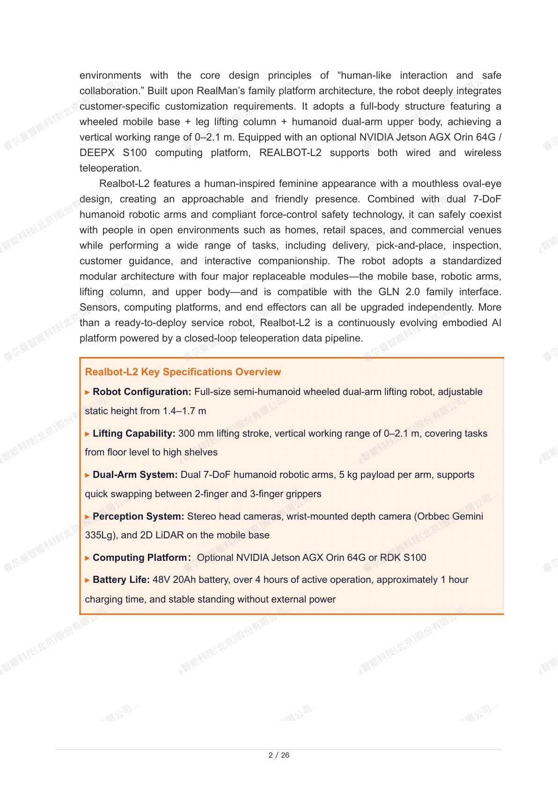




```
environments with the core design principles of “human-like interaction and safe 
collaboration.” Built upon RealMan’s family platform architecture, the robot deeply integrates 
customer-specific customization requirements. It adopts a full-body structure featuring a 
wheeled mobile base + leg lifting column + humanoid dual-arm upper body, achieving a 
vertical working range of 0–2.1 m. Equipped with an optional NVIDIA Jetson AGX Orin 64G / 
DEEPX S100 computing platform, REALBOT-L2 supports both wired and wireless 
teleoperation.
Realbot-L2 features a human-inspired feminine appearance with a mouthless oval-eye 
design, creating an approachable and friendly presence. Combined with dual 7-DoF 
humanoid robotic arms and compliant force-control safety technology, it can safely coexist 
with people in open environments such as homes, retail spaces, and commercial venues 
while performing a wide range of tasks, including delivery, pick-and-place, inspection, 
customer guidance, and interactive companionship. The robot adopts a standardized 
modular architecture with four major replaceable modules—the mobile base, robotic arms, 
lifting column, and upper body—and is compatible with the GLN 2.0 family interface. 
Sensors, computing platforms, and end effectors can all be upgraded independently. More 
than a ready-to-deploy service robot, Realbot-L2 is a continuously evolving embodied AI 
platform powered by a closed-loop teleoperation data pipeline.

Realbot-L2 Key Specifications Overview
▸ Robot Configuration: Full-size semi-humanoid wheeled dual-arm lifting robot, adjustable 
static height from 1.4–1.7 m
▸ Lifting Capability: 300 mm lifting stroke, vertical working range of 0–2.1 m, covering tasks 
from floor level to high shelves
▸ Dual-Arm System: Dual 7-DoF humanoid robotic arms, 5 kg payload per arm, supports 
quick swapping between 2-finger and 3-finger grippers
▸ Perception System: Stereo head cameras, wrist-mounted depth camera (Orbbec Gemini 
335Lg), and 2D LiDAR on the mobile base
▸ Computing Platform：Optional NVIDIA Jetson AGX Orin 64G or RDK S100
▸ Battery Life: 48V 20Ah battery, over 4 hours of active operation, approximately 1 hour 
charging time, and stable standing without external power
2 / 26
```




## PDF page 3

[RealBot-L2 solution white paper V2+, original PDF page 3](https://1292444914-files.gitbook.io/~/files/v0/b/gitbook-x-prod.appspot.com/o/spaces%2FtgOfPnscWebs1eh82EKq%2Fuploads%2FtYx9rT32L8MjwvNrNaSy%2FL2-pages-01-21.pdf?alt=media#page=3)



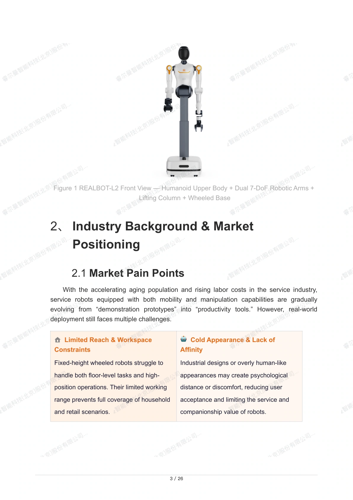




```
Figure 1 REALBOT-L2 Front View — Humanoid Upper Body + Dual 7-DoF Robotic Arms + 
Lifting Column + Wheeled Base
2、Industry Background & Market 
Positioning
2.1 Market Pain Points
With the accelerating aging population and rising labor costs in the service industry, 
service robots equipped with both mobility and manipulation capabilities are gradually 
evolving from “demonstration prototypes” into “productivity tools.” However, real-world 
deployment still faces multiple challenges.
🏠  Limited Reach & Workspace 
Constraints
Fixed-height wheeled robots struggle to 
handle both floor-level tasks and high-
position operations. Their limited working 
range prevents full coverage of household 
and retail scenarios.
🤖  Cold Appearance & Lack of 
Affinity
Industrial designs or overly human-like 
appearances may create psychological 
distance or discomfort, reducing user 
acceptance and limiting the service and 
companionship value of robots.
3 / 26
```




## PDF page 4

[RealBot-L2 solution white paper V2+, original PDF page 4](https://1292444914-files.gitbook.io/~/files/v0/b/gitbook-x-prod.appspot.com/o/spaces%2FtgOfPnscWebs1eh82EKq%2Fuploads%2FtYx9rT32L8MjwvNrNaSy%2FL2-pages-01-21.pdf?alt=media#page=4)



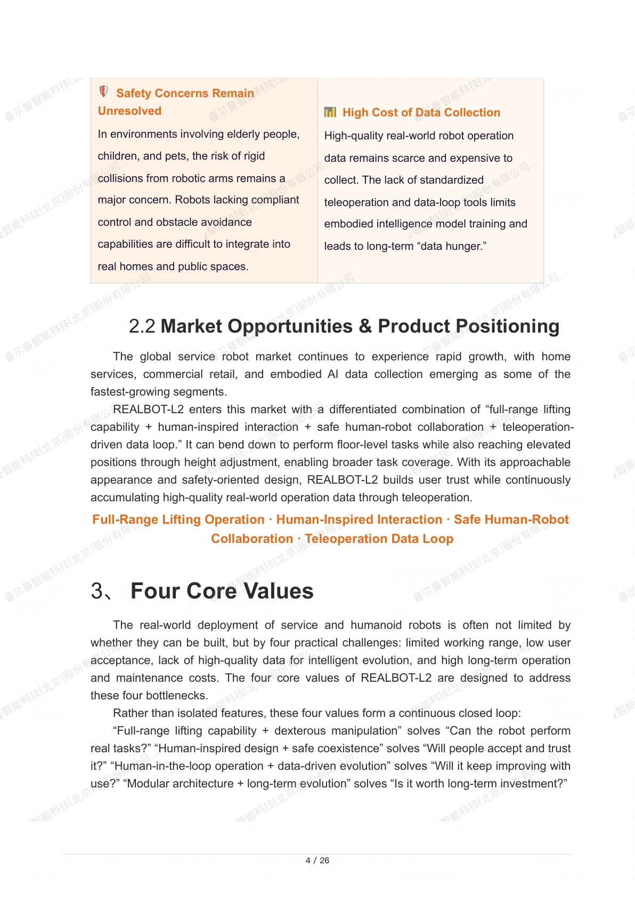




```
2.2 Market Opportunities & Product Positioning
The global service robot market continues to experience rapid growth, with home 
services, commercial retail, and embodied AI data collection emerging as some of the 
fastest-growing segments. 
REALBOT-L2 enters this market with a differentiated combination of “full-range lifting 
capability + human-inspired interaction + safe human-robot collaboration + teleoperation-
driven data loop.” It can bend down to perform floor-level tasks while also reaching elevated 
positions through height adjustment, enabling broader task coverage. With its approachable 
appearance and safety-oriented design, REALBOT-L2 builds user trust while continuously 
accumulating high-quality real-world operation data through teleoperation.
Full-Range Lifting Operation · Human-Inspired Interaction · Safe Human-Robot 
Collaboration · Teleoperation Data Loop
3、Four Core Values
The real-world deployment of service and humanoid robots is often not limited by 
whether they can be built, but by four practical challenges: limited working range, low user 
acceptance, lack of high-quality data for intelligent evolution, and high long-term operation 
and maintenance costs. The four core values of REALBOT-L2 are designed to address 
these four bottlenecks.
Rather than isolated features, these four values form a continuous closed loop:
“Full-range lifting capability + dexterous manipulation” solves “Can the robot perform 
real tasks?” “Human-inspired design + safe coexistence” solves “Will people accept and trust 
it?” “Human-in-the-loop operation + data-driven evolution” solves “Will it keep improving with 
use?” “Modular architecture + long-term evolution” solves “Is it worth long-term investment?” 
🛡️  Safety Concerns Remain 
Unresolved
In environments involving elderly people, 
children, and pets, the risk of rigid 
collisions from robotic arms remains a 
major concern. Robots lacking compliant 
control and obstacle avoidance 
capabilities are difficult to integrate into 
real homes and public spaces.
📊  High Cost of Data Collection
High-quality real-world robot operation 
data remains scarce and expensive to 
collect. The lack of standardized 
teleoperation and data-loop tools limits 
embodied intelligence model training and 
leads to long-term “data hunger.”
4 / 26
```




## PDF page 5

[RealBot-L2 solution white paper V2+, original PDF page 5](https://1292444914-files.gitbook.io/~/files/v0/b/gitbook-x-prod.appspot.com/o/spaces%2FtgOfPnscWebs1eh82EKq%2Fuploads%2FtYx9rT32L8MjwvNrNaSy%2FL2-pages-01-21.pdf?alt=media#page=5)



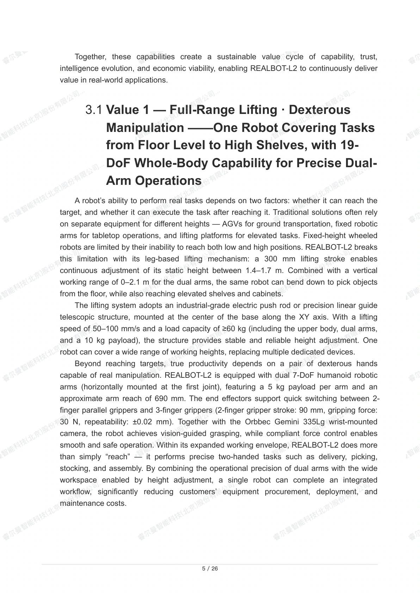




```
Together, these capabilities create a sustainable value cycle of capability, trust, 
intelligence evolution, and economic viability, enabling REALBOT-L2 to continuously deliver 
value in real-world applications.
3.1 Value 1 — Full-Range Lifting · Dexterous 
Manipulation ——One Robot Covering Tasks 
from Floor Level to High Shelves, with 19-
DoF Whole-Body Capability for Precise Dual-
Arm Operations
A robot’s ability to perform real tasks depends on two factors: whether it can reach the 
target, and whether it can execute the task after reaching it. Traditional solutions often rely 
on separate equipment for different heights — AGVs for ground transportation, fixed robotic 
arms for tabletop operations, and lifting platforms for elevated tasks. Fixed-height wheeled 
robots are limited by their inability to reach both low and high positions. REALBOT-L2 breaks 
this limitation with its leg-based lifting mechanism: a 300 mm lifting stroke enables 
continuous adjustment of its static height between 1.4–1.7 m. Combined with a vertical 
working range of 0–2.1 m for the dual arms, the same robot can bend down to pick objects 
from the floor, while also reaching elevated shelves and cabinets.
The lifting system adopts an industrial-grade electric push rod or precision linear guide 
telescopic structure, mounted at the center of the base along the XY axis. With a lifting 
speed of 50–100 mm/s and a load capacity of ≥60 kg (including the upper body, dual arms, 
and a 10 kg payload), the structure provides stable and reliable height adjustment. One 
robot can cover a wide range of working heights, replacing multiple dedicated devices.
Beyond reaching targets, true productivity depends on a pair of dexterous hands 
capable of real manipulation. REALBOT-L2 is equipped with dual 7-DoF humanoid robotic 
arms (horizontally mounted at the first joint), featuring a 5 kg payload per arm and an 
approximate arm reach of 690 mm. The end effectors support quick switching between 2-
finger parallel grippers and 3-finger grippers (2-finger gripper stroke: 90 mm, gripping force: 
30 N, repeatability: ±0.02 mm). Together with the Orbbec Gemini 335Lg wrist-mounted 
camera, the robot achieves vision-guided grasping, while compliant force control enables 
smooth and safe operation. Within its expanded working envelope, REALBOT-L2 does more 
than simply “reach” — it performs precise two-handed tasks such as delivery, picking, 
stocking, and assembly. By combining the operational precision of dual arms with the wide 
workspace enabled by height adjustment, a single robot can complete an integrated 
workflow, significantly reducing customers’ equipment procurement, deployment, and 
maintenance costs.
5 / 26
```




## PDF page 6

[RealBot-L2 solution white paper V2+, original PDF page 6](https://1292444914-files.gitbook.io/~/files/v0/b/gitbook-x-prod.appspot.com/o/spaces%2FtgOfPnscWebs1eh82EKq%2Fuploads%2FtYx9rT32L8MjwvNrNaSy%2FL2-pages-01-21.pdf?alt=media#page=6)



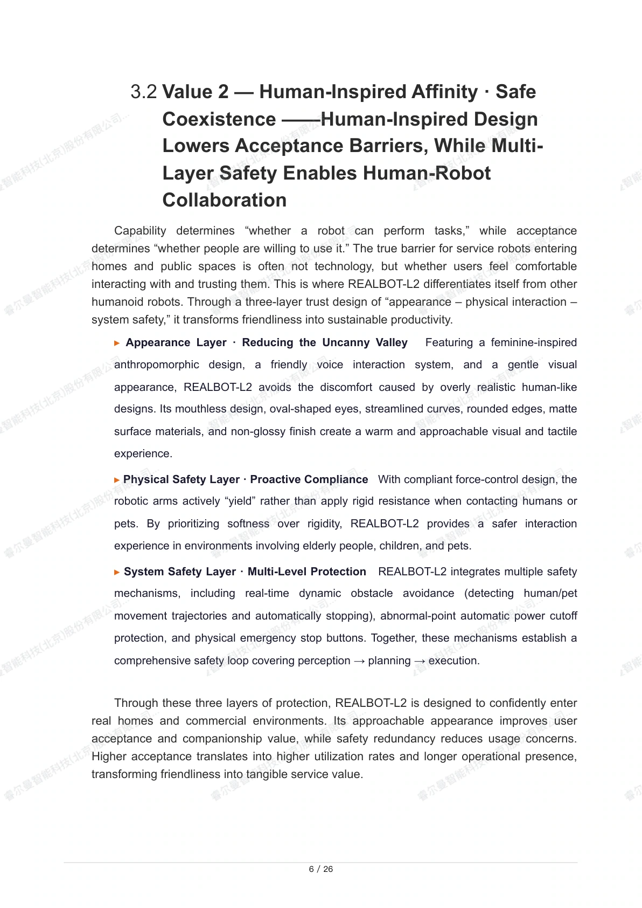




```
3.2 Value 2 — Human-Inspired Affinity · Safe 
Coexistence ——Human-Inspired Design 
Lowers Acceptance Barriers, While Multi-
Layer Safety Enables Human-Robot 
Collaboration
Capability determines “whether a robot can perform tasks,” while acceptance 
determines “whether people are willing to use it.” The true barrier for service robots entering 
homes and public spaces is often not technology, but whether users feel comfortable 
interacting with and trusting them. This is where REALBOT-L2 differentiates itself from other 
humanoid robots. Through a three-layer trust design of “appearance – physical interaction – 
system safety,” it transforms friendliness into sustainable productivity.
▸ Appearance Layer · Reducing the Uncanny Valley   Featuring a feminine-inspired 
anthropomorphic design, a friendly voice interaction system, and a gentle visual 
appearance, REALBOT-L2 avoids the discomfort caused by overly realistic human-like 
designs. Its mouthless design, oval-shaped eyes, streamlined curves, rounded edges, matte 
surface materials, and non-glossy finish create a warm and approachable visual and tactile 
experience.
▸ Physical Safety Layer · Proactive Compliance   With compliant force-control design, the 
robotic arms actively “yield” rather than apply rigid resistance when contacting humans or 
pets. By prioritizing softness over rigidity, REALBOT-L2 provides a safer interaction 
experience in environments involving elderly people, children, and pets.
▸ System Safety Layer · Multi-Level Protection   REALBOT-L2 integrates multiple safety 
mechanisms, including real-time dynamic obstacle avoidance (detecting human/pet 
movement trajectories and automatically stopping), abnormal-point automatic power cutoff 
protection, and physical emergency stop buttons. Together, these mechanisms establish a 
comprehensive safety loop covering perception → planning → execution.

Through these three layers of protection, REALBOT-L2 is designed to confidently enter 
real homes and commercial environments. Its approachable appearance improves user 
acceptance and companionship value, while safety redundancy reduces usage concerns. 
Higher acceptance translates into higher utilization rates and longer operational presence, 
transforming friendliness into tangible service value.
6 / 26
```




## PDF page 7

[RealBot-L2 solution white paper V2+, original PDF page 7](https://1292444914-files.gitbook.io/~/files/v0/b/gitbook-x-prod.appspot.com/o/spaces%2FtgOfPnscWebs1eh82EKq%2Fuploads%2FtYx9rT32L8MjwvNrNaSy%2FL2-pages-01-21.pdf?alt=media#page=7)



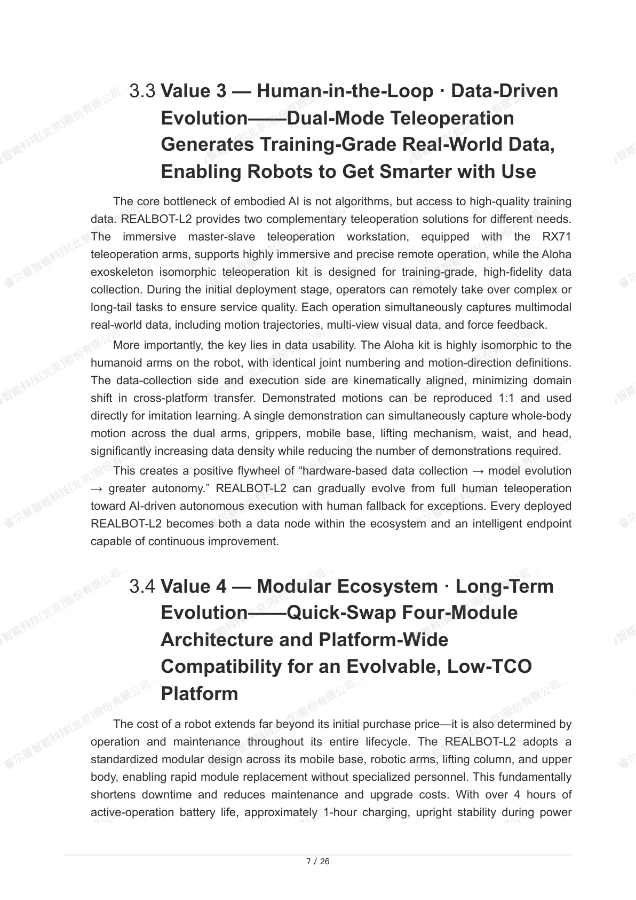




```
3.3 Value 3 — Human-in-the-Loop · Data-Driven 
Evolution——Dual-Mode Teleoperation 
Generates Training-Grade Real-World Data, 
Enabling Robots to Get Smarter with Use
The core bottleneck of embodied AI is not algorithms, but access to high-quality training 
data. REALBOT-L2 provides two complementary teleoperation solutions for different needs. 
The immersive master-slave teleoperation workstation, equipped with the RX71 
teleoperation arms, supports highly immersive and precise remote operation, while the Aloha 
exoskeleton isomorphic teleoperation kit is designed for training-grade, high-fidelity data 
collection. During the initial deployment stage, operators can remotely take over complex or 
long-tail tasks to ensure service quality. Each operation simultaneously captures multimodal 
real-world data, including motion trajectories, multi-view visual data, and force feedback.
More importantly, the key lies in data usability. The Aloha kit is highly isomorphic to the 
humanoid arms on the robot, with identical joint numbering and motion-direction definitions. 
The data-collection side and execution side are kinematically aligned, minimizing domain 
shift in cross-platform transfer. Demonstrated motions can be reproduced 1:1 and used 
directly for imitation learning. A single demonstration can simultaneously capture whole-body 
motion across the dual arms, grippers, mobile base, lifting mechanism, waist, and head, 
significantly increasing data density while reducing the number of demonstrations required.
This creates a positive flywheel of “hardware-based data collection → model evolution 
→ greater autonomy.” REALBOT-L2 can gradually evolve from full human teleoperation 
toward AI-driven autonomous execution with human fallback for exceptions. Every deployed 
REALBOT-L2 becomes both a data node within the ecosystem and an intelligent endpoint 
capable of continuous improvement.
3.4 Value 4 — Modular Ecosystem · Long-Term 
Evolution——Quick-Swap Four-Module 
Architecture and Platform-Wide 
Compatibility for an Evolvable, Low-TCO 
Platform
The cost of a robot extends far beyond its initial purchase price—it is also determined by 
operation and maintenance throughout its entire lifecycle. The REALBOT-L2 adopts a 
standardized modular design across its mobile base, robotic arms, lifting column, and upper 
body, enabling rapid module replacement without specialized personnel. This fundamentally 
shortens downtime and reduces maintenance and upgrade costs. With over 4 hours of 
active-operation battery life, approximately 1-hour charging, upright stability during power 
7 / 26
```




## PDF page 8

[RealBot-L2 solution white paper V2+, original PDF page 8](https://1292444914-files.gitbook.io/~/files/v0/b/gitbook-x-prod.appspot.com/o/spaces%2FtgOfPnscWebs1eh82EKq%2Fuploads%2FtYx9rT32L8MjwvNrNaSy%2FL2-pages-01-21.pdf?alt=media#page=8)



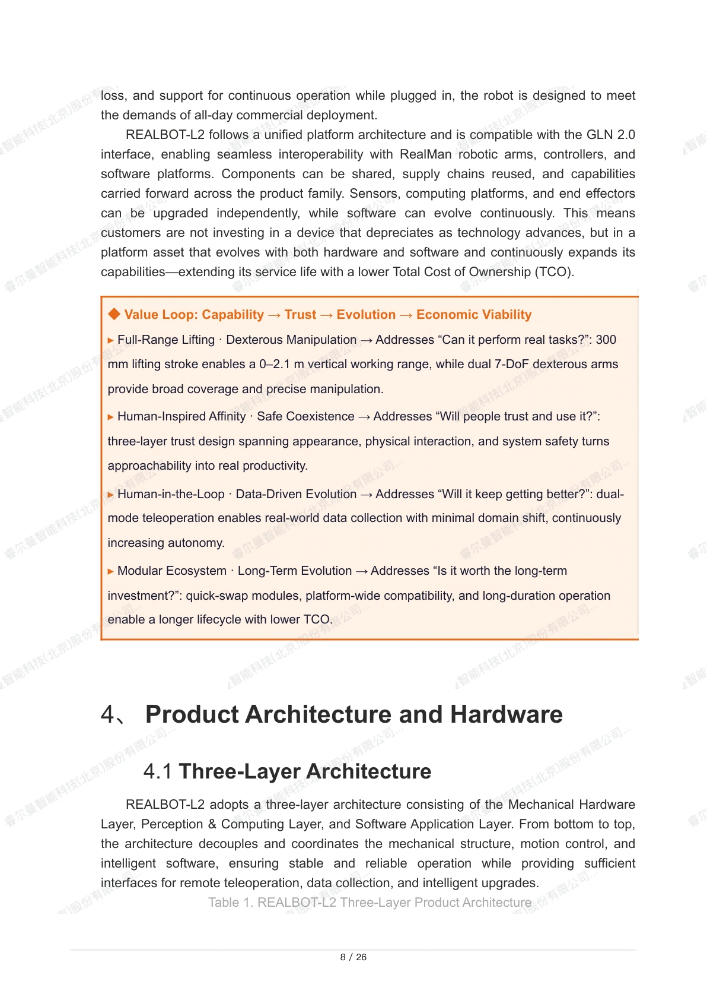




```
loss, and support for continuous operation while plugged in, the robot is designed to meet 
the demands of all-day commercial deployment.
REALBOT-L2 follows a unified platform architecture and is compatible with the GLN 2.0 
interface, enabling seamless interoperability with RealMan robotic arms, controllers, and 
software platforms. Components can be shared, supply chains reused, and capabilities 
carried forward across the product family. Sensors, computing platforms, and end effectors 
can be upgraded independently, while software can evolve continuously. This means 
customers are not investing in a device that depreciates as technology advances, but in a 
platform asset that evolves with both hardware and software and continuously expands its 
capabilities—extending its service life with a lower Total Cost of Ownership (TCO).

4、Product Architecture and Hardware
4.1 Three-Layer Architecture
REALBOT-L2 adopts a three-layer architecture consisting of the Mechanical Hardware 
Layer, Perception & Computing Layer, and Software Application Layer. From bottom to top, 
the architecture decouples and coordinates the mechanical structure, motion control, and 
intelligent software, ensuring stable and reliable operation while providing sufficient 
interfaces for remote teleoperation, data collection, and intelligent upgrades.
Table 1. REALBOT-L2 Three-Layer Product Architecture
◆ Value Loop: Capability → Trust → Evolution → Economic Viability
▸ Full-Range Lifting · Dexterous Manipulation → Addresses “Can it perform real tasks?”: 300 
mm lifting stroke enables a 0–2.1 m vertical working range, while dual 7-DoF dexterous arms 
provide broad coverage and precise manipulation.
▸ Human-Inspired Affinity · Safe Coexistence → Addresses “Will people trust and use it?”: 
three-layer trust design spanning appearance, physical interaction, and system safety turns 
approachability into real productivity.
▸ Human-in-the-Loop · Data-Driven Evolution → Addresses “Will it keep getting better?”: dual-
mode teleoperation enables real-world data collection with minimal domain shift, continuously 
increasing autonomy.
▸ Modular Ecosystem · Long-Term Evolution → Addresses “Is it worth the long-term 
investment?”: quick-swap modules, platform-wide compatibility, and long-duration operation 
enable a longer lifecycle with lower TCO.
8 / 26
```




## PDF page 9

[RealBot-L2 solution white paper V2+, original PDF page 9](https://1292444914-files.gitbook.io/~/files/v0/b/gitbook-x-prod.appspot.com/o/spaces%2FtgOfPnscWebs1eh82EKq%2Fuploads%2FtYx9rT32L8MjwvNrNaSy%2FL2-pages-01-21.pdf?alt=media#page=9)



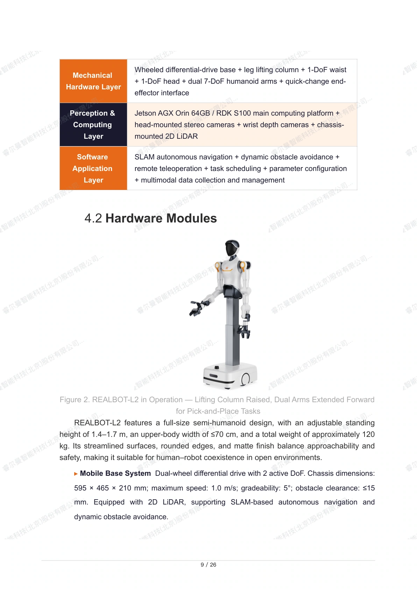




```
4.2 Hardware Modules


Figure 2. REALBOT-L2 in Operation — Lifting Column Raised, Dual Arms Extended Forward 
for Pick-and-Place Tasks
REALBOT-L2 features a full-size semi-humanoid design, with an adjustable standing 
height of 1.4–1.7 m, an upper-body width of ≤70 cm, and a total weight of approximately 120 
kg. Its streamlined surfaces, rounded edges, and matte finish balance approachability and 
safety, making it suitable for human–robot coexistence in open environments.
▸ Mobile Base System  Dual-wheel differential drive with 2 active DoF. Chassis dimensions: 
595 × 465 × 210 mm; maximum speed: 1.0 m/s; gradeability: 5°; obstacle clearance: ≤15 
mm. Equipped with 2D LiDAR, supporting SLAM-based autonomous navigation and 
dynamic obstacle avoidance.
Mechanical 
Hardware Layer
Wheeled differential-drive base + leg lifting column + 1-DoF waist 
+ 1-DoF head + dual 7-DoF humanoid arms + quick-change end-
effector interface
Perception & 
Computing 
Layer
Jetson AGX Orin 64GB / RDK S100 main computing platform + 
head-mounted stereo cameras + wrist depth cameras + chassis-
mounted 2D LiDAR
Software 
Application 
Layer
SLAM autonomous navigation + dynamic obstacle avoidance + 
remote teleoperation + task scheduling + parameter configuration 
+ multimodal data collection and management
9 / 26
```




## PDF page 10

[RealBot-L2 solution white paper V2+, original PDF page 10](https://1292444914-files.gitbook.io/~/files/v0/b/gitbook-x-prod.appspot.com/o/spaces%2FtgOfPnscWebs1eh82EKq%2Fuploads%2FtYx9rT32L8MjwvNrNaSy%2FL2-pages-01-21.pdf?alt=media#page=10)



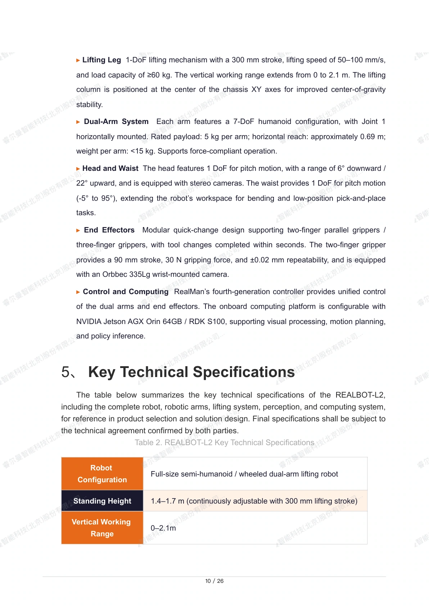




```
▸ Lifting Leg  1-DoF lifting mechanism with a 300 mm stroke, lifting speed of 50–100 mm/s, 
and load capacity of ≥60 kg. The vertical working range extends from 0 to 2.1 m. The lifting 
column is positioned at the center of the chassis XY axes for improved center-of-gravity 
stability.
▸ Dual-Arm System  Each arm features a 7-DoF humanoid configuration, with Joint 1 
horizontally mounted. Rated payload: 5 kg per arm; horizontal reach: approximately 0.69 m; 
weight per arm: <15 kg. Supports force-compliant operation.
▸ Head and Waist  The head features 1 DoF for pitch motion, with a range of 6° downward / 
22° upward, and is equipped with stereo cameras. The waist provides 1 DoF for pitch motion 
(-5° to 95°), extending the robot’s workspace for bending and low-position pick-and-place 
tasks.
▸ End Effectors  Modular quick-change design supporting two-finger parallel grippers / 
three-finger grippers, with tool changes completed within seconds. The two-finger gripper 
provides a 90 mm stroke, 30 N gripping force, and ±0.02 mm repeatability, and is equipped 
with an Orbbec 335Lg wrist-mounted camera.
▸ Control and Computing  RealMan’s fourth-generation controller provides unified control 
of the dual arms and end effectors. The onboard computing platform is configurable with 
NVIDIA Jetson AGX Orin 64GB / RDK S100, supporting visual processing, motion planning, 
and policy inference.
5、Key Technical Specifications
The table below summarizes the key technical specifications of the REALBOT-L2, 
including the complete robot, robotic arms, lifting system, perception, and computing system, 
for reference in product selection and solution design. Final specifications shall be subject to 
the technical agreement confirmed by both parties.
Table 2. REALBOT-L2 Key Technical Specifications
Robot 
Configuration
Full-size semi-humanoid / wheeled dual-arm lifting robot
Standing Height
1.4–1.7 m (continuously adjustable with 300 mm lifting stroke)
Vertical Working 
Range
0–2.1m
10 / 26
```




## PDF page 11

[RealBot-L2 solution white paper V2+, original PDF page 11](https://1292444914-files.gitbook.io/~/files/v0/b/gitbook-x-prod.appspot.com/o/spaces%2FtgOfPnscWebs1eh82EKq%2Fuploads%2FtYx9rT32L8MjwvNrNaSy%2FL2-pages-01-21.pdf?alt=media#page=11)



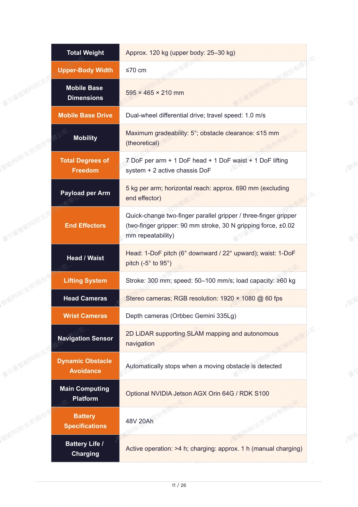




```
Total Weight
Approx. 120 kg (upper body: 25–30 kg)
Upper-Body Width
≤70 cm
Mobile Base 
Dimensions
595 × 465 × 210 mm
Mobile Base Drive
Dual-wheel differential drive; travel speed: 1.0 m/s
Mobility
Maximum gradeability: 5°; obstacle clearance: ≤15 mm 
(theoretical)
Total Degrees of 
Freedom
7 DoF per arm + 1 DoF head + 1 DoF waist + 1 DoF lifting 
system + 2 active chassis DoF
Payload per Arm
5 kg per arm; horizontal reach: approx. 690 mm (excluding 
end effector)
End Effectors
Quick-change two-finger parallel gripper / three-finger gripper 
(two-finger gripper: 90 mm stroke, 30 N gripping force, ±0.02 
mm repeatability)
Head / Waist
Head: 1-DoF pitch (6° downward / 22° upward); waist: 1-DoF 
pitch (-5° to 95°)
Lifting System
Stroke: 300 mm; speed: 50–100 mm/s; load capacity: ≥60 kg
Head Cameras
Stereo cameras; RGB resolution: 1920 × 1080 @ 60 fps
Wrist Cameras
Depth cameras (Orbbec Gemini 335Lg)
Navigation Sensor
2D LiDAR supporting SLAM mapping and autonomous 
navigation
Dynamic Obstacle 
Avoidance
Automatically stops when a moving obstacle is detected
Main Computing 
Platform
Optional NVIDIA Jetson AGX Orin 64G / RDK S100
Battery 
Specifications
48V 20Ah
Battery Life / 
Charging
Active operation: >4 h; charging: approx. 1 h (manual charging)
11 / 26
```




## PDF page 12

[RealBot-L2 solution white paper V2+, original PDF page 12](https://1292444914-files.gitbook.io/~/files/v0/b/gitbook-x-prod.appspot.com/o/spaces%2FtgOfPnscWebs1eh82EKq%2Fuploads%2FtYx9rT32L8MjwvNrNaSy%2FL2-pages-01-21.pdf?alt=media#page=12)



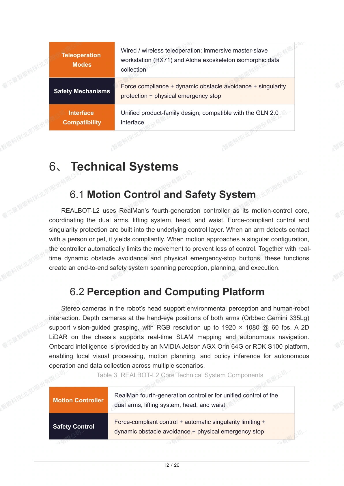




```
6、Technical Systems
6.1 Motion Control and Safety System
REALBOT-L2 uses RealMan’s fourth-generation controller as its motion-control core, 
coordinating the dual arms, lifting system, head, and waist. Force-compliant control and 
singularity protection are built into the underlying control layer. When an arm detects contact 
with a person or pet, it yields compliantly. When motion approaches a singular configuration, 
the controller automatically limits the movement to prevent loss of control. Together with real-
time dynamic obstacle avoidance and physical emergency-stop buttons, these functions 
create an end-to-end safety system spanning perception, planning, and execution.
6.2 Perception and Computing Platform
Stereo cameras in the robot’s head support environmental perception and human-robot 
interaction. Depth cameras at the hand-eye positions of both arms (Orbbec Gemini 335Lg) 
support vision-guided grasping, with RGB resolution up to 1920 × 1080 @ 60 fps. A 2D 
LiDAR on the chassis supports real-time SLAM mapping and autonomous navigation. 
Onboard intelligence is provided by an NVIDIA Jetson AGX Orin 64G or RDK S100 platform, 
enabling local visual processing, motion planning, and policy inference for autonomous 
operation and data collection across multiple scenarios.
Table 3. REALBOT-L2 Core Technical System Components
Teleoperation 
Modes
Wired / wireless teleoperation; immersive master-slave 
workstation (RX71) and Aloha exoskeleton isomorphic data 
collection
Safety Mechanisms
Force compliance + dynamic obstacle avoidance + singularity 
protection + physical emergency stop
Interface 
Compatibility
Unified product-family design; compatible with the GLN 2.0 
interface
Motion Controller
RealMan fourth-generation controller for unified control of the 
dual arms, lifting system, head, and waist
Safety Control
Force-compliant control + automatic singularity limiting + 
dynamic obstacle avoidance + physical emergency stop
12 / 26
```




## PDF page 13

[RealBot-L2 solution white paper V2+, original PDF page 13](https://1292444914-files.gitbook.io/~/files/v0/b/gitbook-x-prod.appspot.com/o/spaces%2FtgOfPnscWebs1eh82EKq%2Fuploads%2FtYx9rT32L8MjwvNrNaSy%2FL2-pages-01-21.pdf?alt=media#page=13)



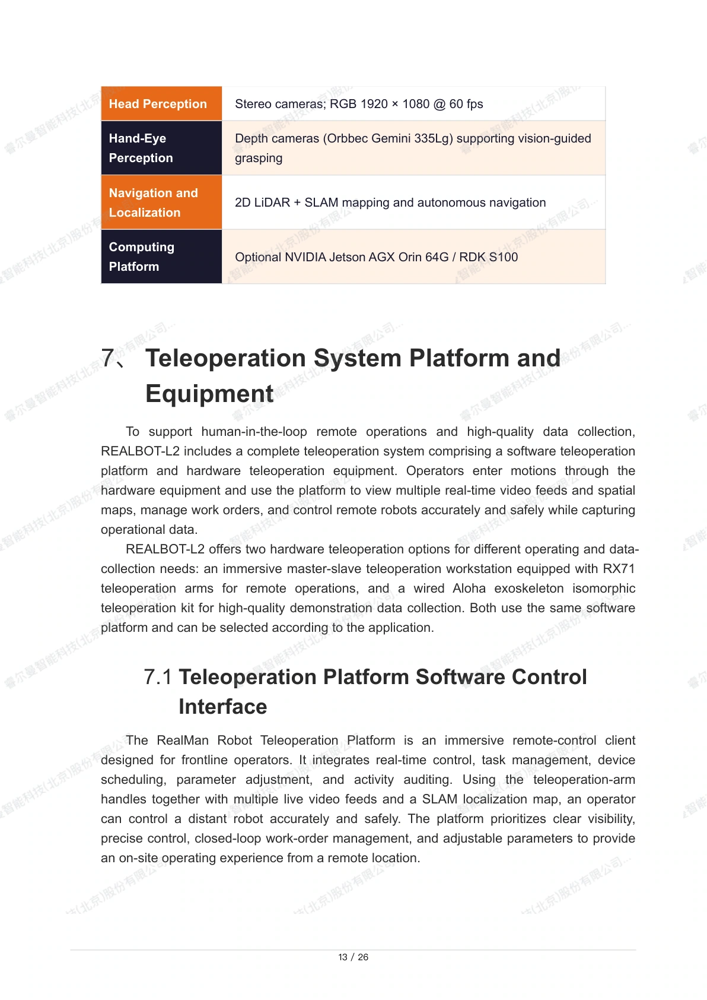




```
7、Teleoperation System Platform and 
Equipment
To support human-in-the-loop remote operations and high-quality data collection, 
REALBOT-L2 includes a complete teleoperation system comprising a software teleoperation 
platform and hardware teleoperation equipment. Operators enter motions through the 
hardware equipment and use the platform to view multiple real-time video feeds and spatial 
maps, manage work orders, and control remote robots accurately and safely while capturing 
operational data.
REALBOT-L2 offers two hardware teleoperation options for different operating and data-
collection needs: an immersive master-slave teleoperation workstation equipped with RX71 
teleoperation arms for remote operations, and a wired Aloha exoskeleton isomorphic 
teleoperation kit for high-quality demonstration data collection. Both use the same software 
platform and can be selected according to the application.
7.1 Teleoperation Platform Software Control 
Interface
The RealMan Robot Teleoperation Platform is an immersive remote-control client 
designed for frontline operators. It integrates real-time control, task management, device 
scheduling, parameter adjustment, and activity auditing. Using the teleoperation-arm 
handles together with multiple live video feeds and a SLAM localization map, an operator 
can control a distant robot accurately and safely. The platform prioritizes clear visibility, 
precise control, closed-loop work-order management, and adjustable parameters to provide 
an on-site operating experience from a remote location.
Head Perception
Stereo cameras; RGB 1920 × 1080 @ 60 fps
Hand-Eye 
Perception
Depth cameras (Orbbec Gemini 335Lg) supporting vision-guided 
grasping
Navigation and 
Localization
2D LiDAR + SLAM mapping and autonomous navigation
Computing 
Platform
Optional NVIDIA Jetson AGX Orin 64G / RDK S100
13 / 26
```




## PDF page 14

[RealBot-L2 solution white paper V2+, original PDF page 14](https://1292444914-files.gitbook.io/~/files/v0/b/gitbook-x-prod.appspot.com/o/spaces%2FtgOfPnscWebs1eh82EKq%2Fuploads%2FtYx9rT32L8MjwvNrNaSy%2FL2-pages-01-21.pdf?alt=media#page=14)



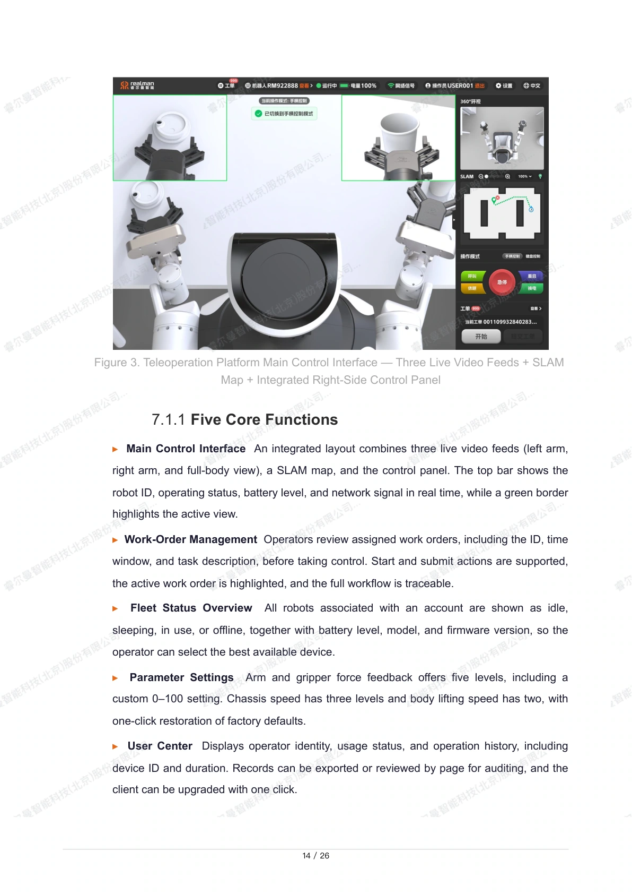




```
Figure 3. Teleoperation Platform Main Control Interface — Three Live Video Feeds + SLAM 
Map + Integrated Right-Side Control Panel
7.1.1 Five Core Functions
▸  Main Control Interface  An integrated layout combines three live video feeds (left arm, 
right arm, and full-body view), a SLAM map, and the control panel. The top bar shows the 
robot ID, operating status, battery level, and network signal in real time, while a green border 
highlights the active view.
▸  Work-Order Management  Operators review assigned work orders, including the ID, time 
window, and task description, before taking control. Start and submit actions are supported, 
the active work order is highlighted, and the full workflow is traceable.
▸  Fleet Status Overview  All robots associated with an account are shown as idle, 
sleeping, in use, or offline, together with battery level, model, and firmware version, so the 
operator can select the best available device.
▸  Parameter Settings  Arm and gripper force feedback offers five levels, including a 
custom 0–100 setting. Chassis speed has three levels and body lifting speed has two, with 
one-click restoration of factory defaults.
▸  User Center  Displays operator identity, usage status, and operation history, including 
device ID and duration. Records can be exported or reviewed by page for auditing, and the 
client can be upgraded with one click.
14 / 26
```




## PDF page 15

[RealBot-L2 solution white paper V2+, original PDF page 15](https://1292444914-files.gitbook.io/~/files/v0/b/gitbook-x-prod.appspot.com/o/spaces%2FtgOfPnscWebs1eh82EKq%2Fuploads%2FtYx9rT32L8MjwvNrNaSy%2FL2-pages-01-21.pdf?alt=media#page=15)



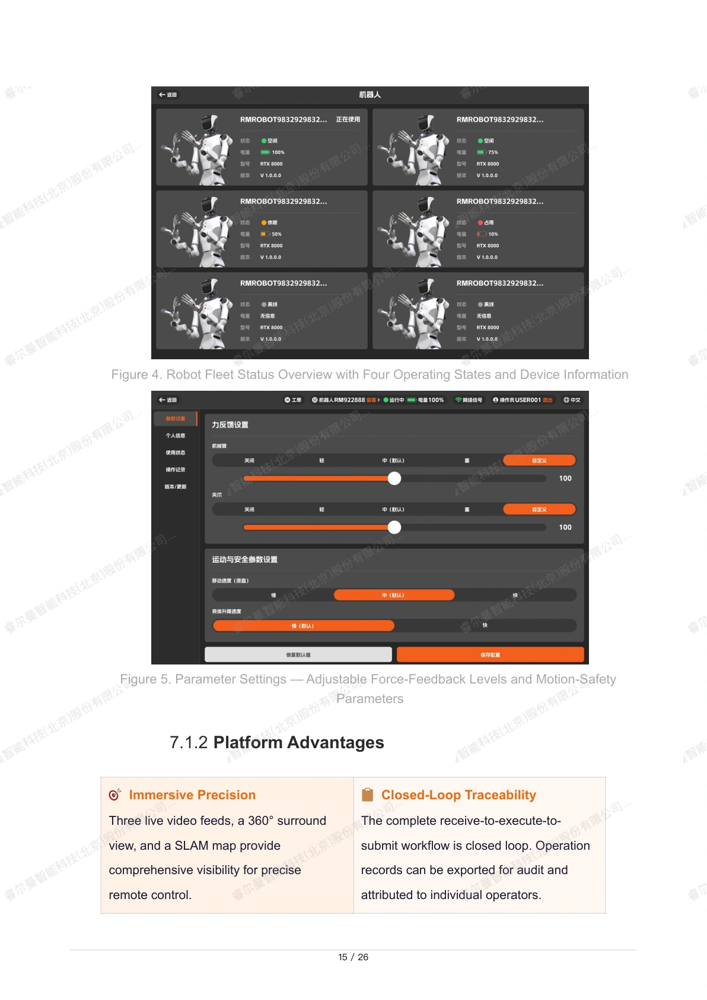




```
Figure 4. Robot Fleet Status Overview with Four Operating States and Device Information


Figure 5. Parameter Settings — Adjustable Force-Feedback Levels and Motion-Safety 
Parameters
7.1.2 Platform Advantages
🎯  Immersive Precision
Three live video feeds, a 360° surround 
view, and a SLAM map provide 
comprehensive visibility for precise 
remote control.
📋  Closed-Loop Traceability
The complete receive-to-execute-to-
submit workflow is closed loop. Operation 
records can be exported for audit and 
attributed to individual operators.
15 / 26
```




## PDF page 16

[RealBot-L2 solution white paper V2+, original PDF page 16](https://1292444914-files.gitbook.io/~/files/v0/b/gitbook-x-prod.appspot.com/o/spaces%2FtgOfPnscWebs1eh82EKq%2Fuploads%2FtYx9rT32L8MjwvNrNaSy%2FL2-pages-01-21.pdf?alt=media#page=16)



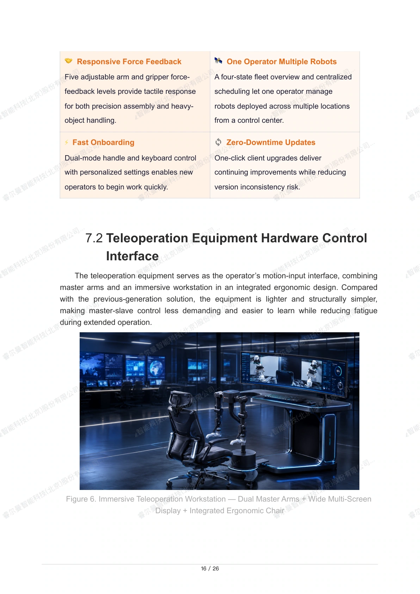




```
7.2 Teleoperation Equipment Hardware Control 
Interface
The teleoperation equipment serves as the operator’s motion-input interface, combining 
master arms and an immersive workstation in an integrated ergonomic design. Compared 
with the previous-generation solution, the equipment is lighter and structurally simpler, 
making master-slave control less demanding and easier to learn while reducing fatigue 
during extended operation.


Figure 6. Immersive Teleoperation Workstation — Dual Master Arms + Wide Multi-Screen 
Display + Integrated Ergonomic Chair
🤝  Responsive Force Feedback
Five adjustable arm and gripper force-
feedback levels provide tactile response 
for both precision assembly and heavy-
object handling.
🛰️  One Operator Multiple Robots
A four-state fleet overview and centralized 
scheduling let one operator manage 
robots deployed across multiple locations 
from a control center.
⚡  Fast Onboarding
Dual-mode handle and keyboard control 
with personalized settings enables new 
operators to begin work quickly.
🔄  Zero-Downtime Updates
One-click client upgrades deliver 
continuing improvements while reducing 
version inconsistency risk.
16 / 26
```




## PDF page 17

[RealBot-L2 solution white paper V2+, original PDF page 17](https://1292444914-files.gitbook.io/~/files/v0/b/gitbook-x-prod.appspot.com/o/spaces%2FtgOfPnscWebs1eh82EKq%2Fuploads%2FtYx9rT32L8MjwvNrNaSy%2FL2-pages-01-21.pdf?alt=media#page=17)



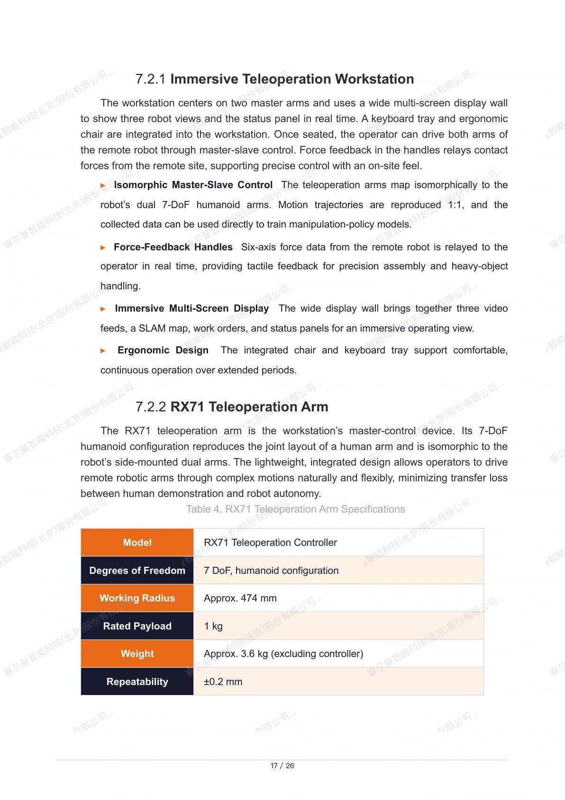




```
7.2.1 Immersive Teleoperation Workstation
The workstation centers on two master arms and uses a wide multi-screen display wall 
to show three robot views and the status panel in real time. A keyboard tray and ergonomic 
chair are integrated into the workstation. Once seated, the operator can drive both arms of 
the remote robot through master-slave control. Force feedback in the handles relays contact 
forces from the remote site, supporting precise control with an on-site feel.
▸  Isomorphic Master-Slave Control  The teleoperation arms map isomorphically to the 
robot’s dual 7-DoF humanoid arms. Motion trajectories are reproduced 1:1, and the 
collected data can be used directly to train manipulation-policy models.
▸  Force-Feedback Handles  Six-axis force data from the remote robot is relayed to the 
operator in real time, providing tactile feedback for precision assembly and heavy-object 
handling.
▸  Immersive Multi-Screen Display  The wide display wall brings together three video 
feeds, a SLAM map, work orders, and status panels for an immersive operating view.
▸  Ergonomic Design  The integrated chair and keyboard tray support comfortable, 
continuous operation over extended periods.
7.2.2 RX71 Teleoperation Arm
The RX71 teleoperation arm is the workstation’s master-control device. Its 7-DoF 
humanoid configuration reproduces the joint layout of a human arm and is isomorphic to the 
robot’s side-mounted dual arms. The lightweight, integrated design allows operators to drive 
remote robotic arms through complex motions naturally and flexibly, minimizing transfer loss 
between human demonstration and robot autonomy.
Table 4. RX71 Teleoperation Arm Specifications
Model
RX71 Teleoperation Controller
Degrees of Freedom
7 DoF, humanoid configuration
Working Radius
Approx. 474 mm
Rated Payload
1 kg
Weight
Approx. 3.6 kg (excluding controller)
Repeatability
±0.2 mm
17 / 26
```




## PDF page 18

[RealBot-L2 solution white paper V2+, original PDF page 18](https://1292444914-files.gitbook.io/~/files/v0/b/gitbook-x-prod.appspot.com/o/spaces%2FtgOfPnscWebs1eh82EKq%2Fuploads%2FtYx9rT32L8MjwvNrNaSy%2FL2-pages-01-21.pdf?alt=media#page=18)



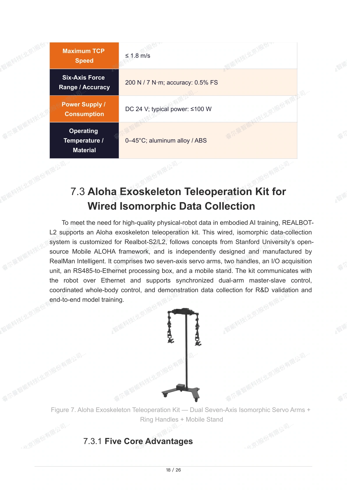




```
7.3 Aloha Exoskeleton Teleoperation Kit for 
Wired Isomorphic Data Collection
To meet the need for high-quality physical-robot data in embodied AI training, REALBOT-
L2 supports an Aloha exoskeleton teleoperation kit. This wired, isomorphic data-collection 
system is customized for Realbot-S2/L2, follows concepts from Stanford University’s open-
source Mobile ALOHA framework, and is independently designed and manufactured by 
RealMan Intelligent. It comprises two seven-axis servo arms, two handles, an I/O acquisition 
unit, an RS485-to-Ethernet processing box, and a mobile stand. The kit communicates with 
the robot over Ethernet and supports synchronized dual-arm master-slave control, 
coordinated whole-body control, and demonstration data collection for R&D validation and 
end-to-end model training.


Figure 7. Aloha Exoskeleton Teleoperation Kit — Dual Seven-Axis Isomorphic Servo Arms + 
Ring Handles + Mobile Stand
7.3.1 Five Core Advantages
Maximum TCP 
Speed
≤ 1.8 m/s
Six-Axis Force 
Range / Accuracy
200 N / 7 N·m; accuracy: 0.5% FS
Power Supply / 
Consumption
DC 24 V; typical power: ≤100 W
Operating 
Temperature / 
Material
0–45°C; aluminum alloy / ABS
18 / 26
```




## PDF page 19

[RealBot-L2 solution white paper V2+, original PDF page 19](https://1292444914-files.gitbook.io/~/files/v0/b/gitbook-x-prod.appspot.com/o/spaces%2FtgOfPnscWebs1eh82EKq%2Fuploads%2FtYx9rT32L8MjwvNrNaSy%2FL2-pages-01-21.pdf?alt=media#page=19)



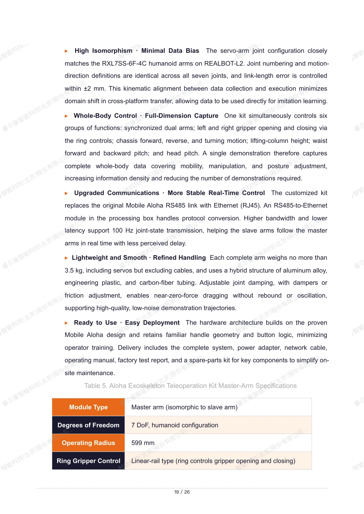




```
▸  High Isomorphism · Minimal Data Bias  The servo-arm joint configuration closely 
matches the RXL7SS-6F-4C humanoid arms on REALBOT-L2. Joint numbering and motion-
direction definitions are identical across all seven joints, and link-length error is controlled 
within ±2 mm. This kinematic alignment between data collection and execution minimizes 
domain shift in cross-platform transfer, allowing data to be used directly for imitation learning.
▸  Whole-Body Control · Full-Dimension Capture  One kit simultaneously controls six 
groups of functions: synchronized dual arms; left and right gripper opening and closing via 
the ring controls; chassis forward, reverse, and turning motion; lifting-column height; waist 
forward and backward pitch; and head pitch. A single demonstration therefore captures 
complete whole-body data covering mobility, manipulation, and posture adjustment, 
increasing information density and reducing the number of demonstrations required.
▸  Upgraded Communications · More Stable Real-Time Control  The customized kit 
replaces the original Mobile Aloha RS485 link with Ethernet (RJ45). An RS485-to-Ethernet 
module in the processing box handles protocol conversion. Higher bandwidth and lower 
latency support 100 Hz joint-state transmission, helping the slave arms follow the master 
arms in real time with less perceived delay.
▸  Lightweight and Smooth · Refined Handling  Each complete arm weighs no more than 
3.5 kg, including servos but excluding cables, and uses a hybrid structure of aluminum alloy, 
engineering plastic, and carbon-fiber tubing. Adjustable joint damping, with dampers or 
friction adjustment, enables near-zero-force dragging without rebound or oscillation, 
supporting high-quality, low-noise demonstration trajectories.
▸  Ready to Use · Easy Deployment  The hardware architecture builds on the proven 
Mobile Aloha design and retains familiar handle geometry and button logic, minimizing 
operator training. Delivery includes the complete system, power adapter, network cable, 
operating manual, factory test report, and a spare-parts kit for key components to simplify on-
site maintenance.
Table 5. Aloha Exoskeleton Teleoperation Kit Master-Arm Specifications
Module Type
Master arm (isomorphic to slave arm)
Degrees of Freedom
7 DoF, humanoid configuration
Operating Radius
599 mm
Ring Gripper Control
Linear-rail type (ring controls gripper opening and closing)
19 / 26
```




## PDF page 20

[RealBot-L2 solution white paper V2+, original PDF page 20](https://1292444914-files.gitbook.io/~/files/v0/b/gitbook-x-prod.appspot.com/o/spaces%2FtgOfPnscWebs1eh82EKq%2Fuploads%2FtYx9rT32L8MjwvNrNaSy%2FL2-pages-01-21.pdf?alt=media#page=20)



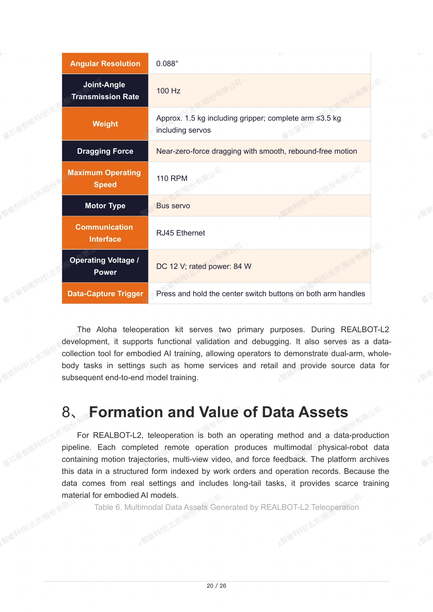




```
The Aloha teleoperation kit serves two primary purposes. During REALBOT-L2 
development, it supports functional validation and debugging. It also serves as a data-
collection tool for embodied AI training, allowing operators to demonstrate dual-arm, whole-
body tasks in settings such as home services and retail and provide source data for 
subsequent end-to-end model training.
8、Formation and Value of Data Assets
For REALBOT-L2, teleoperation is both an operating method and a data-production 
pipeline. Each completed remote operation produces multimodal physical-robot data 
containing motion trajectories, multi-view video, and force feedback. The platform archives 
this data in a structured form indexed by work orders and operation records. Because the 
data comes from real settings and includes long-tail tasks, it provides scarce training 
material for embodied AI models.
Table 6. Multimodal Data Assets Generated by REALBOT-L2 Teleoperation
Angular Resolution
0.088°
Joint-Angle 
Transmission Rate
100 Hz
Weight
Approx. 1.5 kg including gripper; complete arm ≤3.5 kg 
including servos
Dragging Force
Near-zero-force dragging with smooth, rebound-free motion
Maximum Operating 
Speed
110 RPM
Motor Type
Bus servo
Communication 
Interface
RJ45 Ethernet
Operating Voltage / 
Power
DC 12 V; rated power: 84 W
Data-Capture Trigger
Press and hold the center switch buttons on both arm handles
20 / 26
```




## PDF page 21

[RealBot-L2 solution white paper V2+, original PDF page 21](https://1292444914-files.gitbook.io/~/files/v0/b/gitbook-x-prod.appspot.com/o/spaces%2FtgOfPnscWebs1eh82EKq%2Fuploads%2FtYx9rT32L8MjwvNrNaSy%2FL2-pages-01-21.pdf?alt=media#page=21)



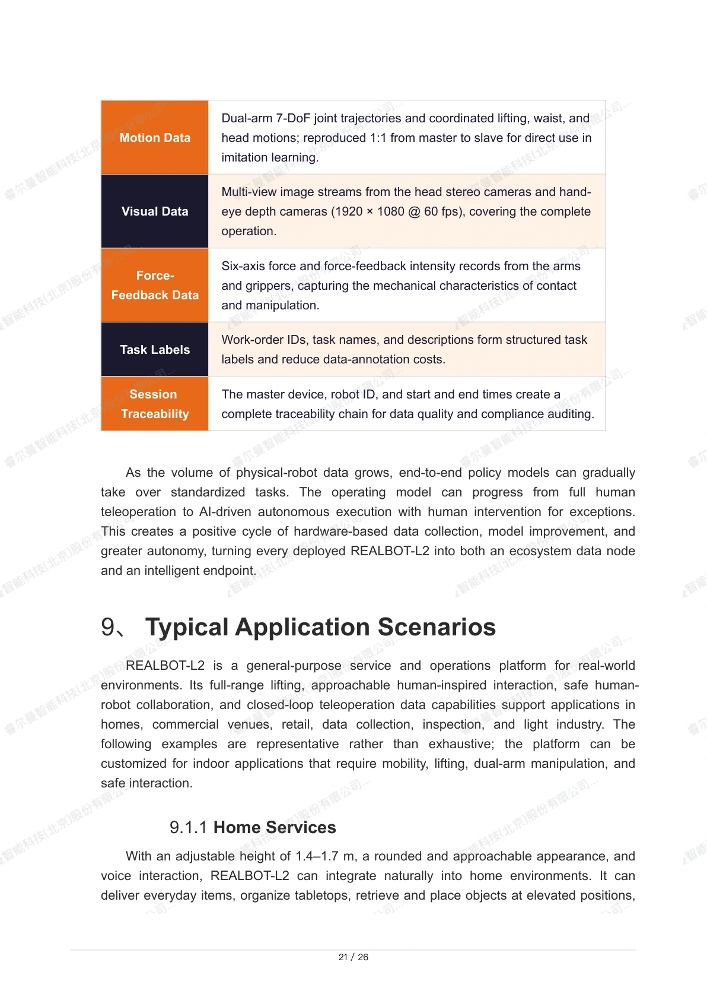




```
As the volume of physical-robot data grows, end-to-end policy models can gradually 
take over standardized tasks. The operating model can progress from full human 
teleoperation to AI-driven autonomous execution with human intervention for exceptions. 
This creates a positive cycle of hardware-based data collection, model improvement, and 
greater autonomy, turning every deployed REALBOT-L2 into both an ecosystem data node 
and an intelligent endpoint.
9、Typical Application Scenarios
REALBOT-L2 is a general-purpose service and operations platform for real-world 
environments. Its full-range lifting, approachable human-inspired interaction, safe human-
robot collaboration, and closed-loop teleoperation data capabilities support applications in 
homes, commercial venues, retail, data collection, inspection, and light industry. The 
following examples are representative rather than exhaustive; the platform can be 
customized for indoor applications that require mobility, lifting, dual-arm manipulation, and 
safe interaction.
9.1.1 Home Services
With an adjustable height of 1.4–1.7 m, a rounded and approachable appearance, and 
voice interaction, REALBOT-L2 can integrate naturally into home environments. It can 
deliver everyday items, organize tabletops, retrieve and place objects at elevated positions, 
Motion Data
Dual-arm 7-DoF joint trajectories and coordinated lifting, waist, and 
head motions; reproduced 1:1 from master to slave for direct use in 
imitation learning.
Visual Data
Multi-view image streams from the head stereo cameras and hand-
eye depth cameras (1920 × 1080 @ 60 fps), covering the complete 
operation.
Force-
Feedback Data
Six-axis force and force-feedback intensity records from the arms 
and grippers, capturing the mechanical characteristics of contact 
and manipulation.
Task Labels
Work-order IDs, task names, and descriptions form structured task 
labels and reduce data-annotation costs.
Session 
Traceability
The master device, robot ID, and start and end times create a 
complete traceability chain for data quality and compliance auditing.
21 / 26
```




## PDF page 22

[RealBot-L2 solution white paper V2+, original PDF page 22](https://1292444914-files.gitbook.io/~/files/v0/b/gitbook-x-prod.appspot.com/o/spaces%2FtgOfPnscWebs1eh82EKq%2Fuploads%2F1PCqKGgPdFTtywMqOxTs%2FL2-pages-22-26.pdf?alt=media#page=1)



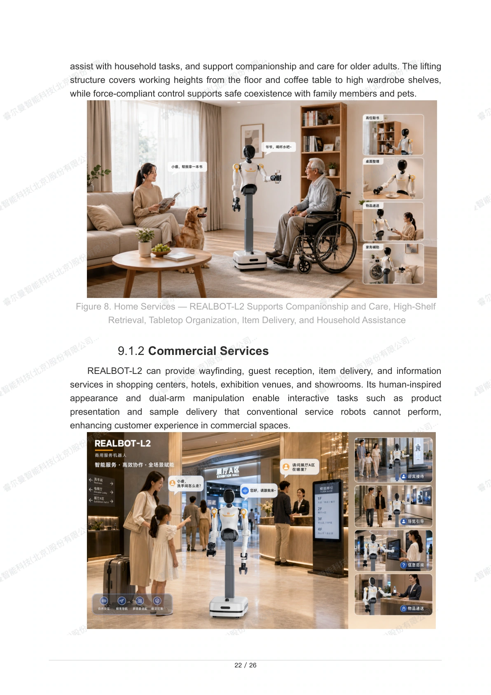




```
assist with household tasks, and support companionship and care for older adults. The lifting 
structure covers working heights from the floor and coffee table to high wardrobe shelves, 
while force-compliant control supports safe coexistence with family members and pets.


Figure 8. Home Services — REALBOT-L2 Supports Companionship and Care, High-Shelf 
Retrieval, Tabletop Organization, Item Delivery, and Household Assistance
9.1.2 Commercial Services
REALBOT-L2 can provide wayfinding, guest reception, item delivery, and information 
services in shopping centers, hotels, exhibition venues, and showrooms. Its human-inspired 
appearance and dual-arm manipulation enable interactive tasks such as product 
presentation and sample delivery that conventional service robots cannot perform, 
enhancing customer experience in commercial spaces.


22 / 26
```




## PDF page 23

[RealBot-L2 solution white paper V2+, original PDF page 23](https://1292444914-files.gitbook.io/~/files/v0/b/gitbook-x-prod.appspot.com/o/spaces%2FtgOfPnscWebs1eh82EKq%2Fuploads%2F1PCqKGgPdFTtywMqOxTs%2FL2-pages-22-26.pdf?alt=media#page=2)



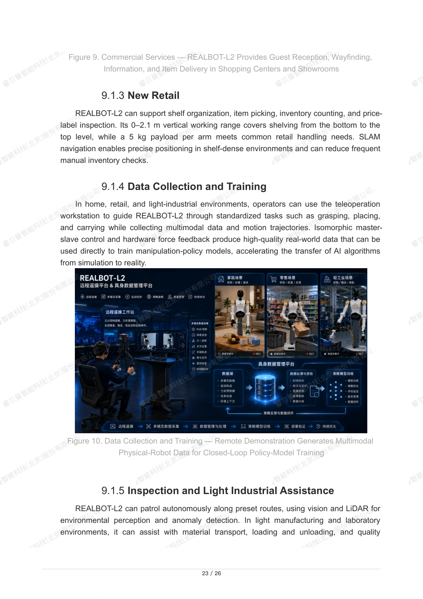




```
Figure 9. Commercial Services — REALBOT-L2 Provides Guest Reception, Wayfinding, 
Information, and Item Delivery in Shopping Centers and Showrooms
9.1.3 New Retail
REALBOT-L2 can support shelf organization, item picking, inventory counting, and price-
label inspection. Its 0–2.1 m vertical working range covers shelving from the bottom to the 
top level, while a 5 kg payload per arm meets common retail handling needs. SLAM 
navigation enables precise positioning in shelf-dense environments and can reduce frequent 
manual inventory checks.
9.1.4 Data Collection and Training
In home, retail, and light-industrial environments, operators can use the teleoperation 
workstation to guide REALBOT-L2 through standardized tasks such as grasping, placing, 
and carrying while collecting multimodal data and motion trajectories. Isomorphic master-
slave control and hardware force feedback produce high-quality real-world data that can be 
used directly to train manipulation-policy models, accelerating the transfer of AI algorithms 
from simulation to reality.


Figure 10. Data Collection and Training — Remote Demonstration Generates Multimodal 
Physical-Robot Data for Closed-Loop Policy-Model Training

9.1.5 Inspection and Light Industrial Assistance
REALBOT-L2 can patrol autonomously along preset routes, using vision and LiDAR for 
environmental perception and anomaly detection. In light manufacturing and laboratory 
environments, it can assist with material transport, loading and unloading, and quality 
23 / 26
```




## PDF page 24

[RealBot-L2 solution white paper V2+, original PDF page 24](https://1292444914-files.gitbook.io/~/files/v0/b/gitbook-x-prod.appspot.com/o/spaces%2FtgOfPnscWebs1eh82EKq%2Fuploads%2F1PCqKGgPdFTtywMqOxTs%2FL2-pages-22-26.pdf?alt=media#page=3)



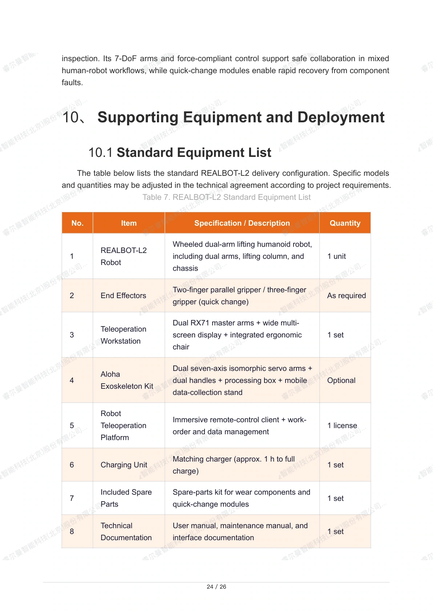




```
inspection. Its 7-DoF arms and force-compliant control support safe collaboration in mixed 
human-robot workflows, while quick-change modules enable rapid recovery from component 
faults.
10、Supporting Equipment and Deployment
10.1 Standard Equipment List
The table below lists the standard REALBOT-L2 delivery configuration. Specific models 
and quantities may be adjusted in the technical agreement according to project requirements.
Table 7. REALBOT-L2 Standard Equipment List
No.
Item
Specification / Description
Quantity
1
REALBOT-L2 
Robot
Wheeled dual-arm lifting humanoid robot, 
including dual arms, lifting column, and 
chassis
1 unit
2
End Effectors
Two-finger parallel gripper / three-finger 
gripper (quick change)
As required
3
Teleoperation 
Workstation
Dual RX71 master arms + wide multi-
screen display + integrated ergonomic 
chair
1 set
4
Aloha 
Exoskeleton Kit
Dual seven-axis isomorphic servo arms + 
dual handles + processing box + mobile 
data-collection stand
Optional
5
Robot 
Teleoperation 
Platform
Immersive remote-control client + work-
order and data management
1 license
6
Charging Unit
Matching charger (approx. 1 h to full 
charge)
1 set
7
Included Spare 
Parts
Spare-parts kit for wear components and 
quick-change modules
1 set
8
Technical 
Documentation
User manual, maintenance manual, and 
interface documentation
1 set
24 / 26
```




## PDF page 25

[RealBot-L2 solution white paper V2+, original PDF page 25](https://1292444914-files.gitbook.io/~/files/v0/b/gitbook-x-prod.appspot.com/o/spaces%2FtgOfPnscWebs1eh82EKq%2Fuploads%2F1PCqKGgPdFTtywMqOxTs%2FL2-pages-22-26.pdf?alt=media#page=4)



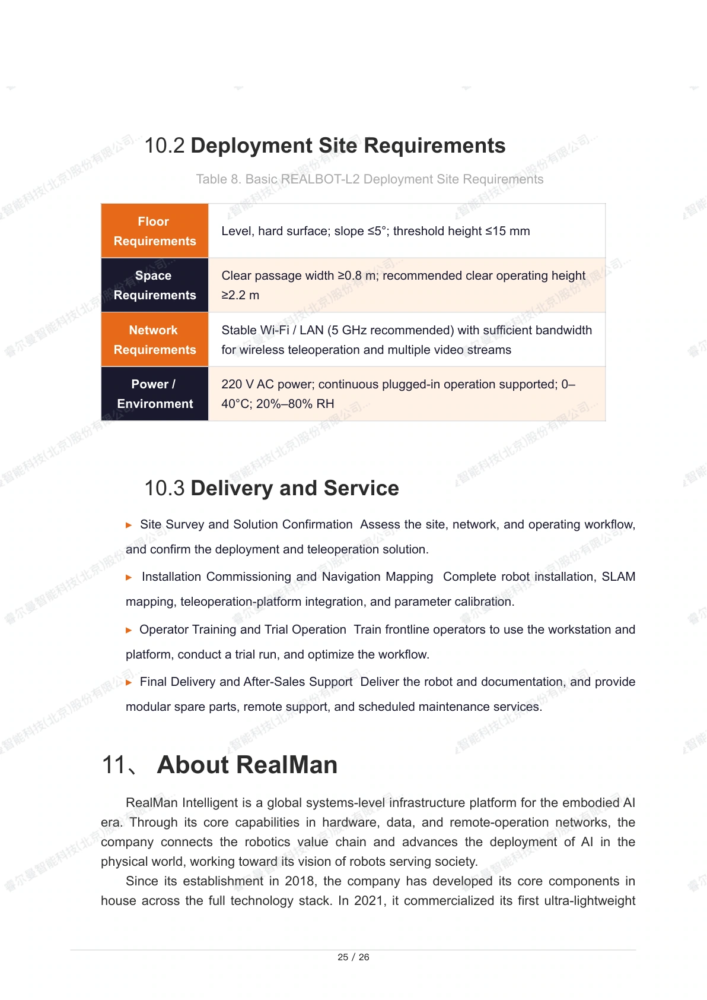




```
10.2 Deployment Site Requirements
Table 8. Basic REALBOT-L2 Deployment Site Requirements

10.3 Delivery and Service
▸  Site Survey and Solution Confirmation  Assess the site, network, and operating workflow, 
and confirm the deployment and teleoperation solution.
▸  Installation Commissioning and Navigation Mapping  Complete robot installation, SLAM 
mapping, teleoperation-platform integration, and parameter calibration.
▸  Operator Training and Trial Operation  Train frontline operators to use the workstation and 
platform, conduct a trial run, and optimize the workflow.
▸  Final Delivery and After-Sales Support  Deliver the robot and documentation, and provide 
modular spare parts, remote support, and scheduled maintenance services.
11、About RealMan
RealMan Intelligent is a global systems-level infrastructure platform for the embodied AI 
era. Through its core capabilities in hardware, data, and remote-operation networks, the 
company connects the robotics value chain and advances the deployment of AI in the 
physical world, working toward its vision of robots serving society.
Since its establishment in 2018, the company has developed its core components in 
house across the full technology stack. In 2021, it commercialized its first ultra-lightweight 
Floor 
Requirements
Level, hard surface; slope ≤5°; threshold height ≤15 mm
Space 
Requirements
Clear passage width ≥0.8 m; recommended clear operating height 
≥2.2 m
Network 
Requirements
Stable Wi-Fi / LAN (5 GHz recommended) with sufficient bandwidth 
for wireless teleoperation and multiple video streams
Power / 
Environment
220 V AC power; continuous plugged-in operation supported; 0–
40°C; 20%–80% RH
25 / 26
```




## PDF page 26

[RealBot-L2 solution white paper V2+, original PDF page 26](https://1292444914-files.gitbook.io/~/files/v0/b/gitbook-x-prod.appspot.com/o/spaces%2FtgOfPnscWebs1eh82EKq%2Fuploads%2F1PCqKGgPdFTtywMqOxTs%2FL2-pages-22-26.pdf?alt=media#page=5)



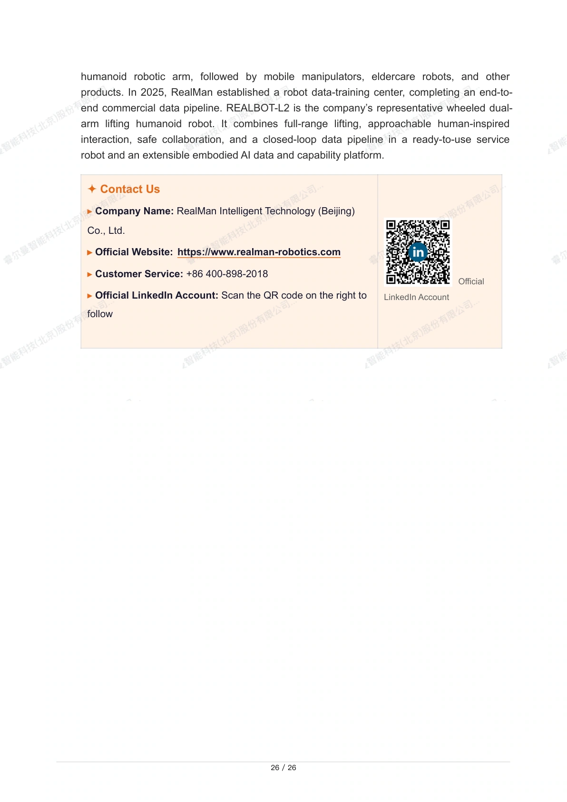




```
humanoid robotic arm, followed by mobile manipulators, eldercare robots, and other 
products. In 2025, RealMan established a robot data-training center, completing an end-to-
end commercial data pipeline. REALBOT-L2 is the company’s representative wheeled dual-
arm lifting humanoid robot. It combines full-range lifting, approachable human-inspired 
interaction, safe collaboration, and a closed-loop data pipeline in a ready-to-use service 
robot and an extensible embodied AI data and capability platform.


✦ Contact Us
▸ Company Name: RealMan Intelligent Technology (Beijing) 
Co., Ltd.
▸ Official Website: https://www.realman-robotics.com
▸ Customer Service: +86 400-898-2018
▸ Official LinkedIn Account: Scan the QR code on the right to 
follow


  Official 
LinkedIn Account
26 / 26
```



