# RM65 and RM75 hardware manual — complete supplied document (58 pages)


**Complete supplied document:** RM65+Series+\_+RM75+Series+Ultra-lightweight+Humanoid+Robotic+Arm+User+Manual.pdf · **PDF pages:** 58. This reference preserves every source page, including tables, drawings, connector views, examples, revision notes, warranty text and appendices. [Return to the RealMan source library](./).


The **Original page** tab retains the exact visual layout. The **Searchable text** tab contains extracted text, or a visually checked transcription for the two image-only specification sheets. Native PDF text can have reading-order or character defects; use the original page for table column alignment, connector orientation, equations and code indentation.


RM65 and RM75 have different joint counts, brake allocations and power tables. The supplied RM75 angle/speed table enumerates only J1–J6 despite describing a seven-axis arm; it does not establish a J7 limit. Keep that omission visible and obtain the delivered revision’s complete joint limits before motion. Gen1/Gen2 wire colors and connector views must not be interchanged.


## Document navigation

| Topic                                                                         | PDF pages                                             |
| ----------------------------------------------------------------------------- | ----------------------------------------------------- |
| Safety, responsibilities and warranty                                         | [PDF 1–10](complete-rm65-rm75-manual.md#pdf-page-1)   |
| Product composition, mounting, startup, teaching and shutdown                 | [PDF 10–21](complete-rm65-rm75-manual.md#pdf-page-10) |
| Gen1/Gen2 16-core controller cable and 6-core tool interface                  | [PDF 21–29](complete-rm65-rm75-manual.md#pdf-page-21) |
| RM65 specifications, MDH, dynamics, dimensions, singularities and load curves | [PDF 29–41](complete-rm65-rm75-manual.md#pdf-page-29) |
| RM75 specifications, MDH, dynamics, dimensions and load curves                | [PDF 42–50](complete-rm65-rm75-manual.md#pdf-page-42) |
| FAQs, transportation, maintenance, repair and disposal                        | [PDF 51–58](complete-rm65-rm75-manual.md#pdf-page-51) |

**Source attribution:** RealMan, supplied document named above. All original notices and technical statements remain visible in the source page images. Added navigation and discrepancy notes are OpenELAB editorial guidance. Software execution and hardware validation: **not run**.

## PDF page 1

[RM65 and RM75 hardware manual, original PDF page 1](https://1292444914-files.gitbook.io/~/files/v0/b/gitbook-x-prod.appspot.com/o/spaces%2FtgOfPnscWebs1eh82EKq%2Fuploads%2FuvGprFyJjl4xwR2oLKuz%2FRM65-pages-01-16.pdf?alt=media#page=1)








```
RM65 Series / RM75 Series
Ultra-lightweight Humanoid
Robotic Arm User Manual


I.Safety
1.1Introduction
This chapter introduces the safety principles and specifications to be 
followed when operating robots or robotic systems. Integrators and users 
must read this manual carefully. Content marked with warning symbols 
requires focused attention and strict compliance. Due to the complexity and 
high risk associated with robotic systems, operators must fully recognize the 
hazards involved. Improper operation or use may result in injury. Users are 
required to strictly adhere to and implement the specifications and 
requirements outlined in this manual. Integrators and users must possess 
adequate safety awareness.
1.2Safety Warning Signs
The instructions for the safety signs in this manual are as follows and 
must be strictly observed.
Warning Sign Descriptions
1 / 58
```




## PDF page 2

[RM65 and RM75 hardware manual, original PDF page 2](https://1292444914-files.gitbook.io/~/files/v0/b/gitbook-x-prod.appspot.com/o/spaces%2FtgOfPnscWebs1eh82EKq%2Fuploads%2FuvGprFyJjl4xwR2oLKuz%2FRM65-pages-01-16.pdf?alt=media#page=2)



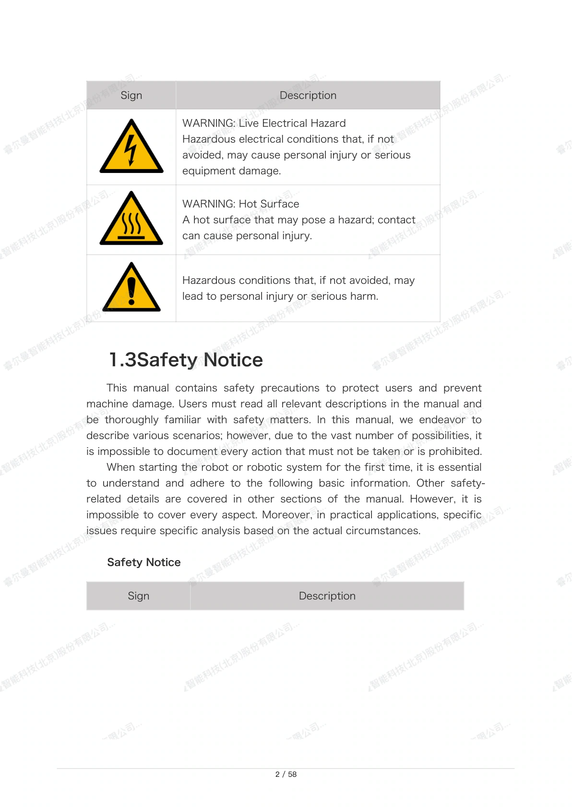




```
1.3Safety Notice
This manual contains safety precautions to protect users and prevent 
machine damage. Users must read all relevant descriptions in the manual and 
be thoroughly familiar with safety matters. In this manual, we endeavor to 
describe various scenarios; however, due to the vast number of possibilities, it 
is impossible to document every action that must not be taken or is prohibited.
When starting the robot or robotic system for the first time, it is essential 
to understand and adhere to the following basic information. Other safety-
related details are covered in other sections of the manual. However, it is 
impossible to cover every aspect. Moreover, in practical applications, specific 
issues require specific analysis based on the actual circumstances.

Safety Notice
Sign
Description


WARNING: Live Electrical Hazard
Hazardous electrical conditions that, if not 
avoided, may cause personal injury or serious 
equipment damage.


WARNING: Hot Surface
A hot surface that may pose a hazard; contact 
can cause personal injury.


Hazardous conditions that, if not avoided, may 
lead to personal injury or serious harm.
Sign
Description
2 / 58
```




## PDF page 3

[RM65 and RM75 hardware manual, original PDF page 3](https://1292444914-files.gitbook.io/~/files/v0/b/gitbook-x-prod.appspot.com/o/spaces%2FtgOfPnscWebs1eh82EKq%2Fuploads%2FuvGprFyJjl4xwR2oLKuz%2FRM65-pages-01-16.pdf?alt=media#page=3)



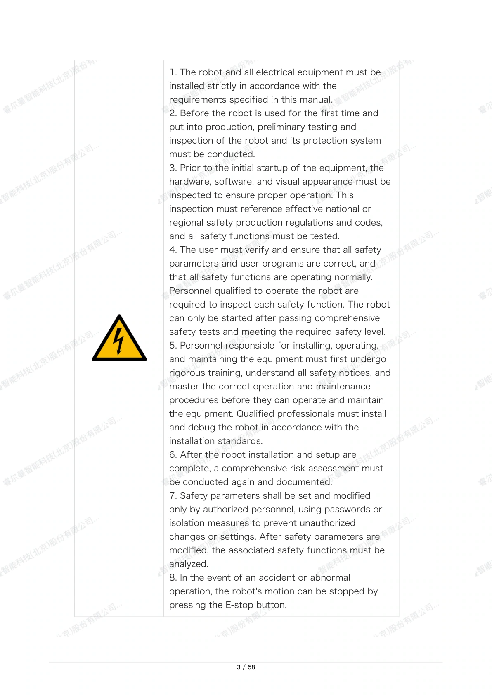




```
1. The robot and all electrical equipment must be 
installed strictly in accordance with the 
requirements specified in this manual.
2. Before the robot is used for the first time and 
put into production, preliminary testing and 
inspection of the robot and its protection system 
must be conducted.
3. Prior to the initial startup of the equipment, the 
hardware, software, and visual appearance must be 
inspected to ensure proper operation. This 
inspection must reference effective national or 
regional safety production regulations and codes, 
and all safety functions must be tested.
4. The user must verify and ensure that all safety 
parameters and user programs are correct, and 
that all safety functions are operating normally. 
Personnel qualified to operate the robot are 
required to inspect each safety function. The robot 
can only be started after passing comprehensive 
safety tests and meeting the required safety level.
5. Personnel responsible for installing, operating, 
and maintaining the equipment must first undergo 
rigorous training, understand all safety notices, and 
master the correct operation and maintenance 
procedures before they can operate and maintain 
the equipment. Qualified professionals must install 
and debug the robot in accordance with the 
installation standards.
6. After the robot installation and setup are 
complete, a comprehensive risk assessment must 
be conducted again and documented.
7. Safety parameters shall be set and modified 
only by authorized personnel, using passwords or 
isolation measures to prevent unauthorized 
changes or settings. After safety parameters are 
modified, the associated safety functions must be 
analyzed.
8. In the event of an accident or abnormal 
operation, the robot's motion can be stopped by 
pressing the E-stop button.
3 / 58
```




## PDF page 4

[RM65 and RM75 hardware manual, original PDF page 4](https://1292444914-files.gitbook.io/~/files/v0/b/gitbook-x-prod.appspot.com/o/spaces%2FtgOfPnscWebs1eh82EKq%2Fuploads%2FuvGprFyJjl4xwR2oLKuz%2FRM65-pages-01-16.pdf?alt=media#page=4)








```
1. The robot body and control cabinet generate 
heat during operation. Do not operate or touch the 
robot while it is working or immediately after it has 
stopped.
2. Disconnect the power and wait for one hour for 
the robot to cool down.
3. Never place your fingers near hot parts of the 
controller.
4 / 58
```




## PDF page 5

[RM65 and RM75 hardware manual, original PDF page 5](https://1292444914-files.gitbook.io/~/files/v0/b/gitbook-x-prod.appspot.com/o/spaces%2FtgOfPnscWebs1eh82EKq%2Fuploads%2FuvGprFyJjl4xwR2oLKuz%2FRM65-pages-01-16.pdf?alt=media#page=5)



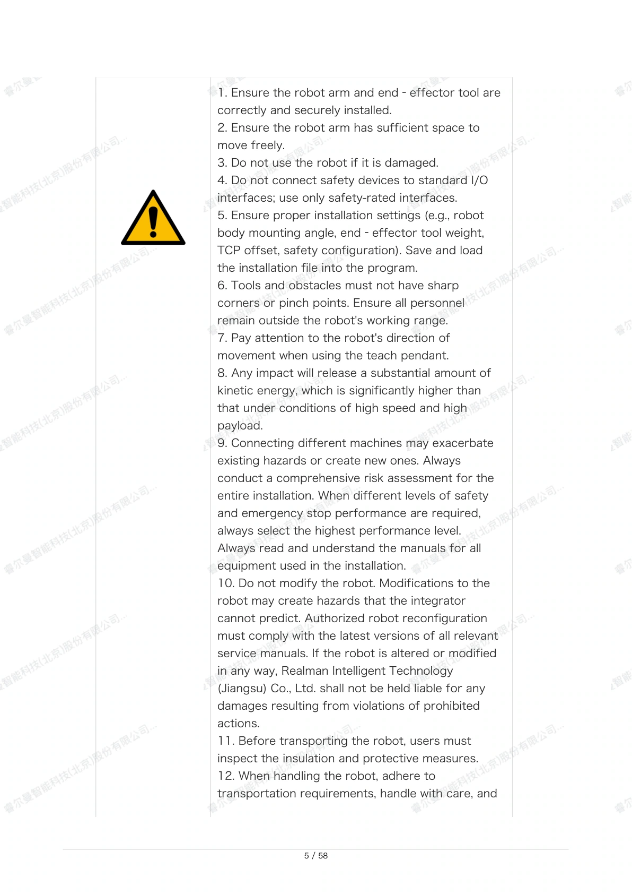




```
1. Ensure the robot arm and end‑effector tool are 
correctly and securely installed.
2. Ensure the robot arm has sufficient space to 
move freely.
3. Do not use the robot if it is damaged.
4. Do not connect safety devices to standard I/O 
interfaces; use only safety-rated interfaces.
5. Ensure proper installation settings (e.g., robot 
body mounting angle, end‑effector tool weight, 
TCP offset, safety configuration). Save and load 
the installation file into the program.
6. Tools and obstacles must not have sharp 
corners or pinch points. Ensure all personnel 
remain outside the robot's working range.
7. Pay attention to the robot's direction of 
movement when using the teach pendant.
8. Any impact will release a substantial amount of 
kinetic energy, which is significantly higher than 
that under conditions of high speed and high 
payload.
9. Connecting different machines may exacerbate 
existing hazards or create new ones. Always 
conduct a comprehensive risk assessment for the 
entire installation. When different levels of safety 
and emergency stop performance are required, 
always select the highest performance level. 
Always read and understand the manuals for all 
equipment used in the installation.
10. Do not modify the robot. Modifications to the 
robot may create hazards that the integrator 
cannot predict. Authorized robot reconfiguration 
must comply with the latest versions of all relevant 
service manuals. If the robot is altered or modified 
in any way, Realman Intelligent Technology 
(Jiangsu) Co., Ltd. shall not be held liable for any 
damages resulting from violations of prohibited 
actions.
11. Before transporting the robot, users must 
inspect the insulation and protective measures.
12. When handling the robot, adhere to 
transportation requirements, handle with care, and 
5 / 58
```




## PDF page 6

[RM65 and RM75 hardware manual, original PDF page 6](https://1292444914-files.gitbook.io/~/files/v0/b/gitbook-x-prod.appspot.com/o/spaces%2FtgOfPnscWebs1eh82EKq%2Fuploads%2FuvGprFyJjl4xwR2oLKuz%2FRM65-pages-01-16.pdf?alt=media#page=6)



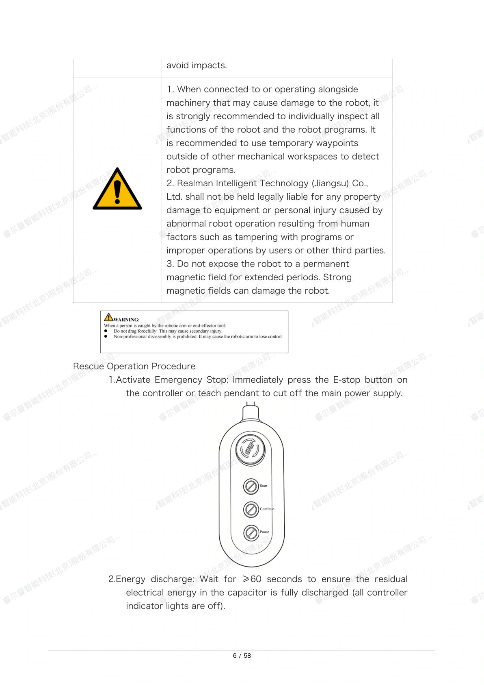




```
Rescue Operation Procedure
1.Activate Emergency Stop: Immediately press the E-stop button on 
the controller or teach pendant to cut off the main power supply.

2.Energy discharge: Wait for ≥60 seconds to ensure the residual 
electrical energy in the capacitor is fully discharged (all controller 
indicator lights are off).
avoid impacts.


1. When connected to or operating alongside 
machinery that may cause damage to the robot, it 
is strongly recommended to individually inspect all 
functions of the robot and the robot programs. It 
is recommended to use temporary waypoints 
outside of other mechanical workspaces to detect 
robot programs.
2. Realman Intelligent Technology (Jiangsu) Co., 
Ltd. shall not be held legally liable for any property 
damage to equipment or personal injury caused by 
abnormal robot operation resulting from human 
factors such as tampering with programs or 
improper operations by users or other third parties.
3. Do not expose the robot to a permanent 
magnetic field for extended periods. Strong 
magnetic fields can damage the robot.
6 / 58
```




## PDF page 7

[RM65 and RM75 hardware manual, original PDF page 7](https://1292444914-files.gitbook.io/~/files/v0/b/gitbook-x-prod.appspot.com/o/spaces%2FtgOfPnscWebs1eh82EKq%2Fuploads%2FuvGprFyJjl4xwR2oLKuz%2FRM65-pages-01-16.pdf?alt=media#page=7)



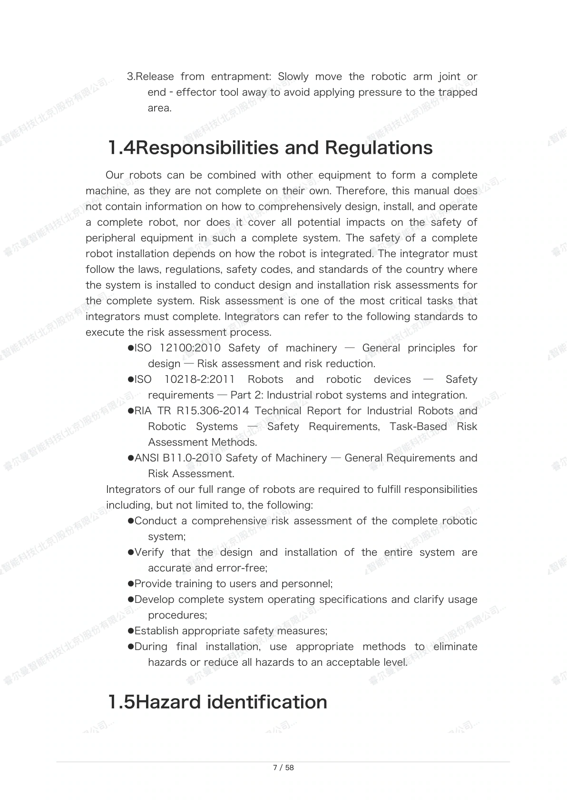




```
3.Release from entrapment: Slowly move the robotic arm joint or 
end‑effector tool away to avoid applying pressure to the trapped 
area.
1.4Responsibilities and Regulations
Our robots can be combined with other equipment to form a complete 
machine, as they are not complete on their own. Therefore, this manual does 
not contain information on how to comprehensively design, install, and operate 
a complete robot, nor does it cover all potential impacts on the safety of 
peripheral equipment in such a complete system. The safety of a complete 
robot installation depends on how the robot is integrated. The integrator must 
follow the laws, regulations, safety codes, and standards of the country where 
the system is installed to conduct design and installation risk assessments for 
the complete system. Risk assessment is one of the most critical tasks that 
integrators must complete. Integrators can refer to the following standards to 
execute the risk assessment process.
ISO 12100:2010 Safety of machinery — General principles for 
design — Risk assessment and risk reduction.
ISO 
10218-2:2011 
Robots 
and 
robotic 
devices 
— 
Safety 
requirements — Part 2: Industrial robot systems and integration.
RIA TR R15.306-2014 Technical Report for Industrial Robots and 
Robotic Systems — Safety Requirements, Task-Based Risk 
Assessment Methods.
ANSI B11.0-2010 Safety of Machinery — General Requirements and 
Risk Assessment.
Integrators of our full range of robots are required to fulfill responsibilities 
including, but not limited to, the following:
Conduct a comprehensive risk assessment of the complete robotic 
system;
Verify that the design and installation of the entire system are 
accurate and error-free;
Provide training to users and personnel;
Develop complete system operating specifications and clarify usage 
procedures;
Establish appropriate safety measures;
During final installation, use appropriate methods to eliminate 
hazards or reduce all hazards to an acceptable level.
1.5Hazard identification
7 / 58
```




## PDF page 8

[RM65 and RM75 hardware manual, original PDF page 8](https://1292444914-files.gitbook.io/~/files/v0/b/gitbook-x-prod.appspot.com/o/spaces%2FtgOfPnscWebs1eh82EKq%2Fuploads%2FuvGprFyJjl4xwR2oLKuz%2FRM65-pages-01-16.pdf?alt=media#page=8)



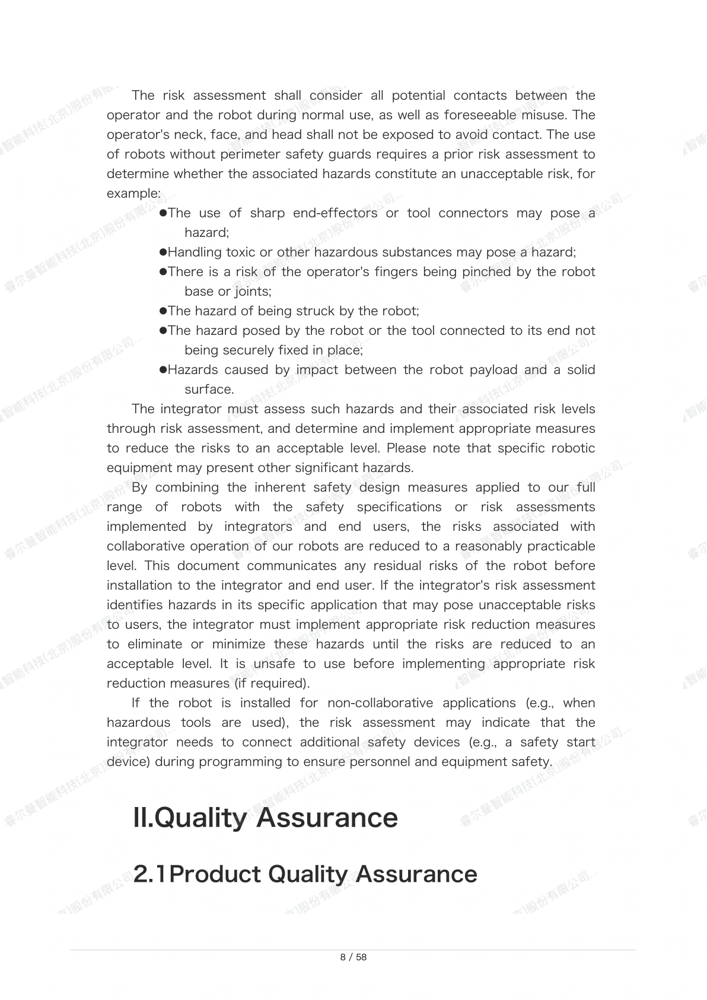




```
The risk assessment shall consider all potential contacts between the 
operator and the robot during normal use, as well as foreseeable misuse. The 
operator's neck, face, and head shall not be exposed to avoid contact. The use 
of robots without perimeter safety guards requires a prior risk assessment to 
determine whether the associated hazards constitute an unacceptable risk, for 
example:
The use of sharp end-effectors or tool connectors may pose a 
hazard;
Handling toxic or other hazardous substances may pose a hazard;
There is a risk of the operator's fingers being pinched by the robot 
base or joints;
The hazard of being struck by the robot;
The hazard posed by the robot or the tool connected to its end not 
being securely fixed in place;
Hazards caused by impact between the robot payload and a solid 
surface.
The integrator must assess such hazards and their associated risk levels 
through risk assessment, and determine and implement appropriate measures 
to reduce the risks to an acceptable level. Please note that specific robotic 
equipment may present other significant hazards.
By combining the inherent safety design measures applied to our full 
range of robots with the safety specifications or risk assessments 
implemented by integrators and end users, the risks associated with 
collaborative operation of our robots are reduced to a reasonably practicable 
level. This document communicates any residual risks of the robot before 
installation to the integrator and end user. If the integrator's risk assessment 
identifies hazards in its specific application that may pose unacceptable risks 
to users, the integrator must implement appropriate risk reduction measures 
to eliminate or minimize these hazards until the risks are reduced to an 
acceptable level. It is unsafe to use before implementing appropriate risk 
reduction measures (if required).
If the robot is installed for non-collaborative applications (e.g., when 
hazardous tools are used), the risk assessment may indicate that the 
integrator needs to connect additional safety devices (e.g., a safety start 
device) during programming to ensure personnel and equipment safety.
II.Quality Assurance
2.1Product Quality Assurance
8 / 58
```




## PDF page 9

[RM65 and RM75 hardware manual, original PDF page 9](https://1292444914-files.gitbook.io/~/files/v0/b/gitbook-x-prod.appspot.com/o/spaces%2FtgOfPnscWebs1eh82EKq%2Fuploads%2FuvGprFyJjl4xwR2oLKuz%2FRM65-pages-01-16.pdf?alt=media#page=9)



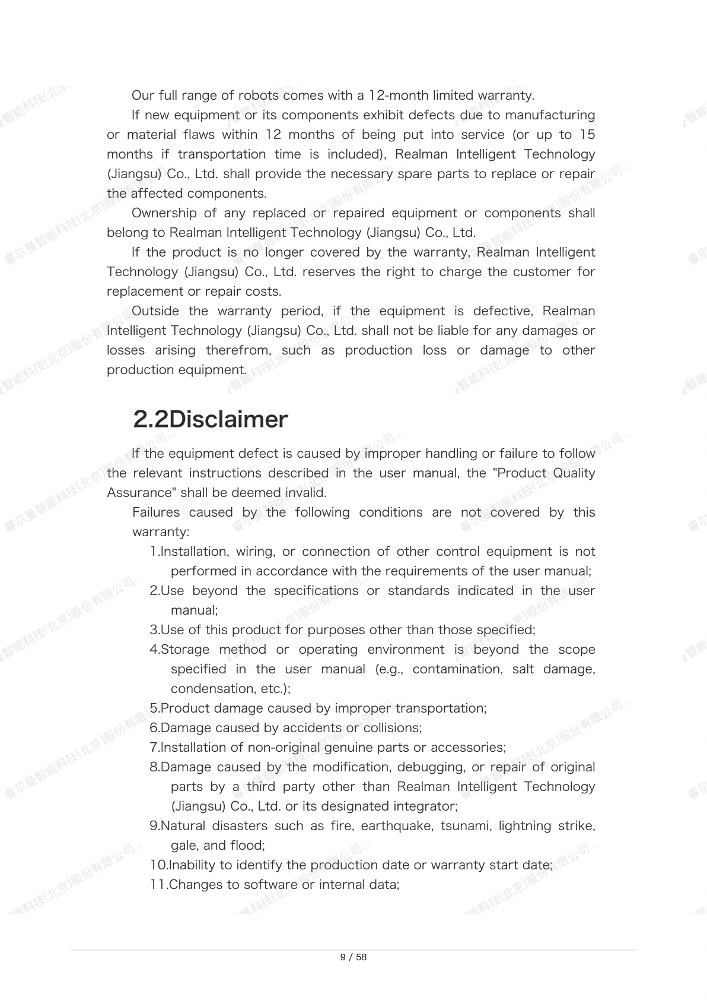




```
Our full range of robots comes with a 12-month limited warranty.
If new equipment or its components exhibit defects due to manufacturing 
or material flaws within 12 months of being put into service (or up to 15 
months if transportation time is included), Realman Intelligent Technology 
(Jiangsu) Co., Ltd. shall provide the necessary spare parts to replace or repair 
the affected components.
Ownership of any replaced or repaired equipment or components shall 
belong to Realman Intelligent Technology (Jiangsu) Co., Ltd.
If the product is no longer covered by the warranty, Realman Intelligent 
Technology (Jiangsu) Co., Ltd. reserves the right to charge the customer for 
replacement or repair costs.
Outside the warranty period, if the equipment is defective, Realman 
Intelligent Technology (Jiangsu) Co., Ltd. shall not be liable for any damages or 
losses arising therefrom, such as production loss or damage to other 
production equipment.
2.2Disclaimer
If the equipment defect is caused by improper handling or failure to follow 
the relevant instructions described in the user manual, the "Product Quality 
Assurance" shall be deemed invalid.
Failures caused by the following conditions are not covered by this 
warranty:
1.Installation, wiring, or connection of other control equipment is not 
performed in accordance with the requirements of the user manual;
2.Use beyond the specifications or standards indicated in the user 
manual;
3.Use of this product for purposes other than those specified;
4.Storage method or operating environment is beyond the scope 
specified in the user manual (e.g., contamination, salt damage, 
condensation, etc.);
5.Product damage caused by improper transportation;
6.Damage caused by accidents or collisions;
7.Installation of non-original genuine parts or accessories;
8.Damage caused by the modification, debugging, or repair of original 
parts by a third party other than Realman Intelligent Technology 
(Jiangsu) Co., Ltd. or its designated integrator;
9.Natural disasters such as fire, earthquake, tsunami, lightning strike, 
gale, and flood;
10.Inability to identify the production date or warranty start date;
11.Changes to software or internal data;
9 / 58
```




## PDF page 10

[RM65 and RM75 hardware manual, original PDF page 10](https://1292444914-files.gitbook.io/~/files/v0/b/gitbook-x-prod.appspot.com/o/spaces%2FtgOfPnscWebs1eh82EKq%2Fuploads%2FuvGprFyJjl4xwR2oLKuz%2FRM65-pages-01-16.pdf?alt=media#page=10)








```
12.The fault cannot be reproduced or cannot be identified by Realman 
Intelligent Technology (Jiangsu) Co., Ltd.;
13.Use this product in radioactive equipment, biological testing 
equipment, or for hazardous purposes as determined by Realman 
Intelligent Technology (Jiangsu) Co., Ltd.;
14.Faults not attributable to Realman Intelligent Technology (Jiangsu) 
Co., Ltd., other than the situations mentioned above.
Note: Users are strictly prohibited from disassembling the product 
without authorization from Realman.
According to the product quality assurance agreement, Realman 
Intelligent Technology (Jiangsu) Co., Ltd. warrants only against defects and 
deficiencies in products sold through authorized distributors and in original 
factory parts. Realman Intelligent Technology (Jiangsu) Co., Ltd. disclaims any 
other warranties or liabilities, express or implied, including but not limited to 
any implied warranties of merchantability or fitness for a particular purpose. In 
addition, Realman Intelligent Technology (Jiangsu) Co., Ltd. shall not be liable 
for any indirect damages or consequences arising from the relevant products.
In the event of a robot failure, contact Realman Intelligent Technology 
(Jiangsu) Co., Ltd. immediately to obtain a solution. Users are not permitted to 
disassemble or perform maintenance on the robot for any reason; otherwise, 
the warranty service will be terminated.
To the maximum extent permitted by law, the products described in this 
manual are provided "as is" and may contain defects, errors, or malfunctions. 
Realman makes no express or implied warranties of any kind and shall not be 
liable for any special, incidental, consequential, or indirect damages (including 
but not limited to loss of profits, data loss, or damage to goodwill) arising from 
the use of this manual or the company's products.
II.Product Overview
This manual is a Quick Start Guide for operating the Realman RM65 and 
RM75 series robots, designed to enable users to complete assembly and basic 
action editing quickly. Through this manual, operators, product technicians, 
technical service personnel, and robot program developers can quickly start 
using the Realman robotic arm.
3.1Product Composition
A complete set of Realman collaborative robot products consists of the 
following:
10 / 58
```




## PDF page 11

[RM65 and RM75 hardware manual, original PDF page 11](https://1292444914-files.gitbook.io/~/files/v0/b/gitbook-x-prod.appspot.com/o/spaces%2FtgOfPnscWebs1eh82EKq%2Fuploads%2FuvGprFyJjl4xwR2oLKuz%2FRM65-pages-01-16.pdf?alt=media#page=11)



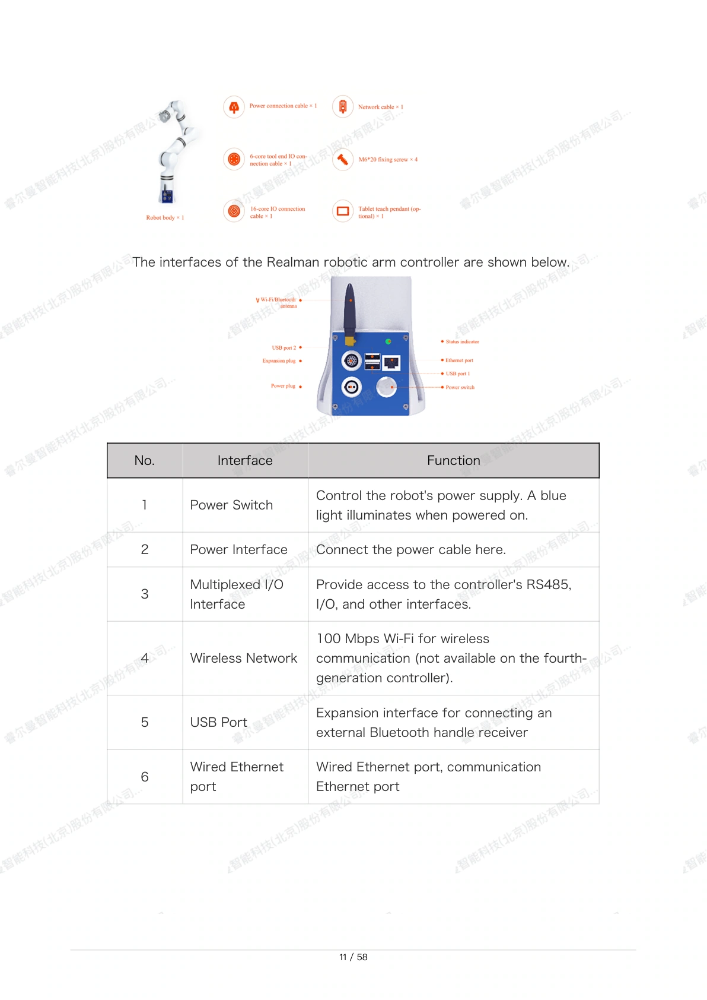




```
The interfaces of the Realman robotic arm controller are shown below.


No.
Interface
Function
1
Power Switch
Control the robot's power supply. A blue 
light illuminates when powered on.
2
Power Interface
Connect the power cable here.
3
Multiplexed I/O 
Interface
Provide access to the controller's RS485, 
I/O, and other interfaces.
4
Wireless Network
100 Mbps Wi-Fi for wireless 
communication (not available on the fourth-
generation controller).
5
USB Port
Expansion interface for connecting an 
external Bluetooth handle receiver
6
Wired Ethernet 
port
Wired Ethernet port, communication 
Ethernet port
11 / 58
```




## PDF page 12

[RM65 and RM75 hardware manual, original PDF page 12](https://1292444914-files.gitbook.io/~/files/v0/b/gitbook-x-prod.appspot.com/o/spaces%2FtgOfPnscWebs1eh82EKq%2Fuploads%2FuvGprFyJjl4xwR2oLKuz%2FRM65-pages-01-16.pdf?alt=media#page=12)



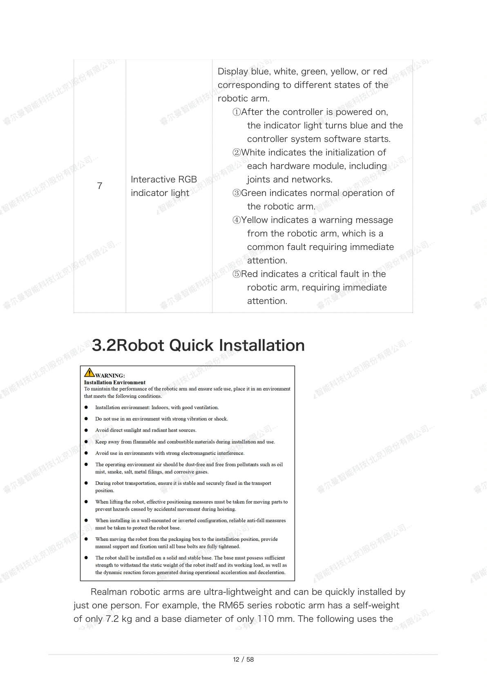




```
3.2Robot Quick Installation
Realman robotic arms are ultra-lightweight and can be quickly installed by 
just one person. For example, the RM65 series robotic arm has a self-weight 
of only 7.2 kg and a base diameter of only 110 mm. The following uses the 
7
Interactive RGB 
indicator light
Display blue, white, green, yellow, or red 
corresponding to different states of the 
robotic arm.
①After the controller is powered on, 
the indicator light turns blue and the 
controller system software starts.
②White indicates the initialization of 
each hardware module, including 
joints and networks.
③Green indicates normal operation of 
the robotic arm.
④Yellow indicates a warning message 
from the robotic arm, which is a 
common fault requiring immediate 
attention.
⑤Red indicates a critical fault in the 
robotic arm, requiring immediate 
attention.
12 / 58
```




## PDF page 13

[RM65 and RM75 hardware manual, original PDF page 13](https://1292444914-files.gitbook.io/~/files/v0/b/gitbook-x-prod.appspot.com/o/spaces%2FtgOfPnscWebs1eh82EKq%2Fuploads%2FuvGprFyJjl4xwR2oLKuz%2FRM65-pages-01-16.pdf?alt=media#page=13)



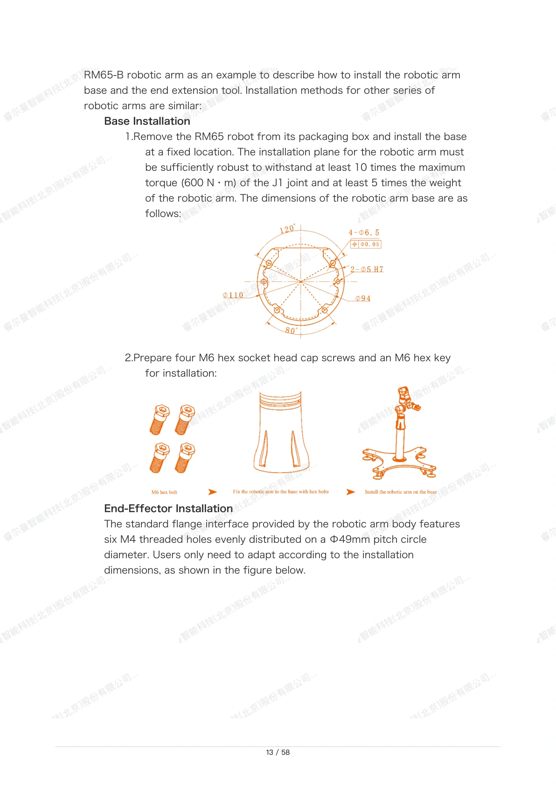




```
RM65-B robotic arm as an example to describe how to install the robotic arm 
base and the end extension tool. Installation methods for other series of 
robotic arms are similar:
Base Installation
1.Remove the RM65 robot from its packaging box and install the base 
at a fixed location. The installation plane for the robotic arm must 
be sufficiently robust to withstand at least 10 times the maximum 
torque (600 N·m) of the J1 joint and at least 5 times the weight 
of the robotic arm. The dimensions of the robotic arm base are as 
follows:


2.Prepare four M6 hex socket head cap screws and an M6 hex key 
for installation:


End-Effector Installation
The standard flange interface provided by the robotic arm body features 
six M4 threaded holes evenly distributed on a Ф49mm pitch circle 
diameter. Users only need to adapt according to the installation 
dimensions, as shown in the figure below.
13 / 58
```




## PDF page 14

[RM65 and RM75 hardware manual, original PDF page 14](https://1292444914-files.gitbook.io/~/files/v0/b/gitbook-x-prod.appspot.com/o/spaces%2FtgOfPnscWebs1eh82EKq%2Fuploads%2FuvGprFyJjl4xwR2oLKuz%2FRM65-pages-01-16.pdf?alt=media#page=14)








```
3.3Robot Wiring and Power-on 
Debugging
1.Prepare a DC 24V power supply and connect it to the robotic arm's 
power supply interface. The robotic arm's power supply interface 
is a 2-core aviation plug located at the lower left corner of the 
controller panel. In the 2-core power cable, the brown wire is the 
positive pole and the blue wire is the negative pole.


2.The robot shall not be exposed to dust or moisture exceeding IP54 
rating. Pay close attention to environments with conductive dust, 
as they require special protection.
3.Connect the robot cable. If there are no external devices, only the 
power cord and network cable need to be connected, as shown in 
14 / 58
```




## PDF page 15

[RM65 and RM75 hardware manual, original PDF page 15](https://1292444914-files.gitbook.io/~/files/v0/b/gitbook-x-prod.appspot.com/o/spaces%2FtgOfPnscWebs1eh82EKq%2Fuploads%2FuvGprFyJjl4xwR2oLKuz%2FRM65-pages-01-16.pdf?alt=media#page=15)



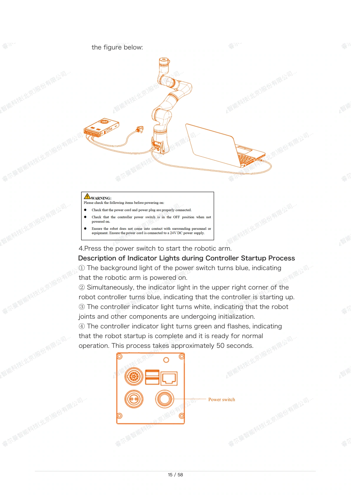




```
the figure below:


4.Press the power switch to start the robotic arm.
Description of Indicator Lights during Controller Startup Process
① The background light of the power switch turns blue, indicating 
that the robotic arm is powered on.
② Simultaneously, the indicator light in the upper right corner of the 
robot controller turns blue, indicating that the controller is starting up.
③ The controller indicator light turns white, indicating that the robot 
joints and other components are undergoing initialization.
④ The controller indicator light turns green and flashes, indicating 
that the robot startup is complete and it is ready for normal 
operation. This process takes approximately 50 seconds.


15 / 58
```




## PDF page 16

[RM65 and RM75 hardware manual, original PDF page 16](https://1292444914-files.gitbook.io/~/files/v0/b/gitbook-x-prod.appspot.com/o/spaces%2FtgOfPnscWebs1eh82EKq%2Fuploads%2FuvGprFyJjl4xwR2oLKuz%2FRM65-pages-01-16.pdf?alt=media#page=16)



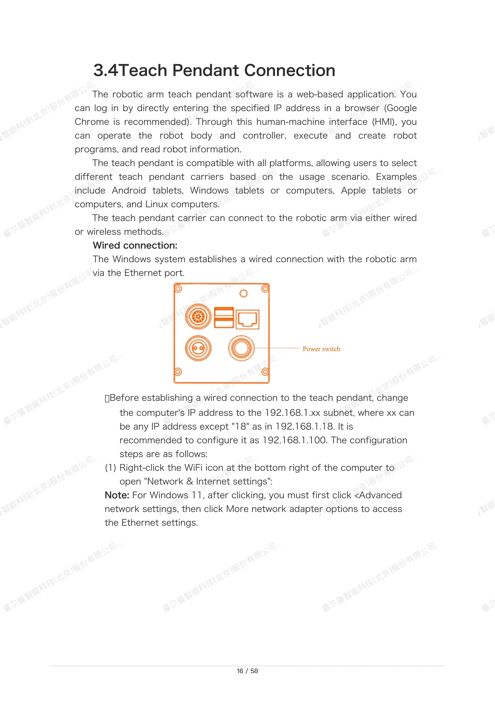




```
3.4Teach Pendant Connection
The robotic arm teach pendant software is a web-based application. You 
can log in by directly entering the specified IP address in a browser (Google 
Chrome is recommended). Through this human-machine interface (HMI), you 
can operate the robot body and controller, execute and create robot 
programs, and read robot information.
The teach pendant is compatible with all platforms, allowing users to select 
different teach pendant carriers based on the usage scenario. Examples 
include Android tablets, Windows tablets or computers, Apple tablets or 
computers, and Linux computers.
The teach pendant carrier can connect to the robotic arm via either wired 
or wireless methods.
Wired connection:
The Windows system establishes a wired connection with the robotic arm 
via the Ethernet port.


Before establishing a wired connection to the teach pendant, change 
the computer's IP address to the 192.168.1.xx subnet, where xx can 
be any IP address except "18" as in 192.168.1.18. It is 
recommended to configure it as 192.168.1.100. The configuration 
steps are as follows:
(1) Right-click the WiFi icon at the bottom right of the computer to 
open "Network & Internet settings":
Note: For Windows 11, after clicking, you must first click <Advanced 
network settings, then click More network adapter options to access 
the Ethernet settings.
16 / 58
```




## PDF page 17

[RM65 and RM75 hardware manual, original PDF page 17](https://1292444914-files.gitbook.io/~/files/v0/b/gitbook-x-prod.appspot.com/o/spaces%2FtgOfPnscWebs1eh82EKq%2Fuploads%2FgsKKCns43MghAwQyuKN0%2FRM65-pages-17-19.pdf?alt=media#page=1)



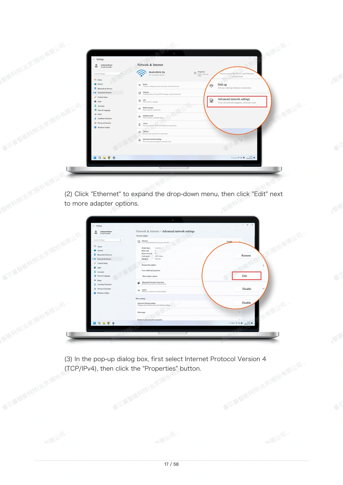




```
(2) Click "Ethernet" to expand the drop-down menu, then click "Edit" next 
to more adapter options. 

(3) In the pop-up dialog box, first select Internet Protocol Version 4 
(TCP/IPv4), then click the "Properties" button. 
17 / 58
```




## PDF page 18

[RM65 and RM75 hardware manual, original PDF page 18](https://1292444914-files.gitbook.io/~/files/v0/b/gitbook-x-prod.appspot.com/o/spaces%2FtgOfPnscWebs1eh82EKq%2Fuploads%2FgsKKCns43MghAwQyuKN0%2FRM65-pages-17-19.pdf?alt=media#page=2)



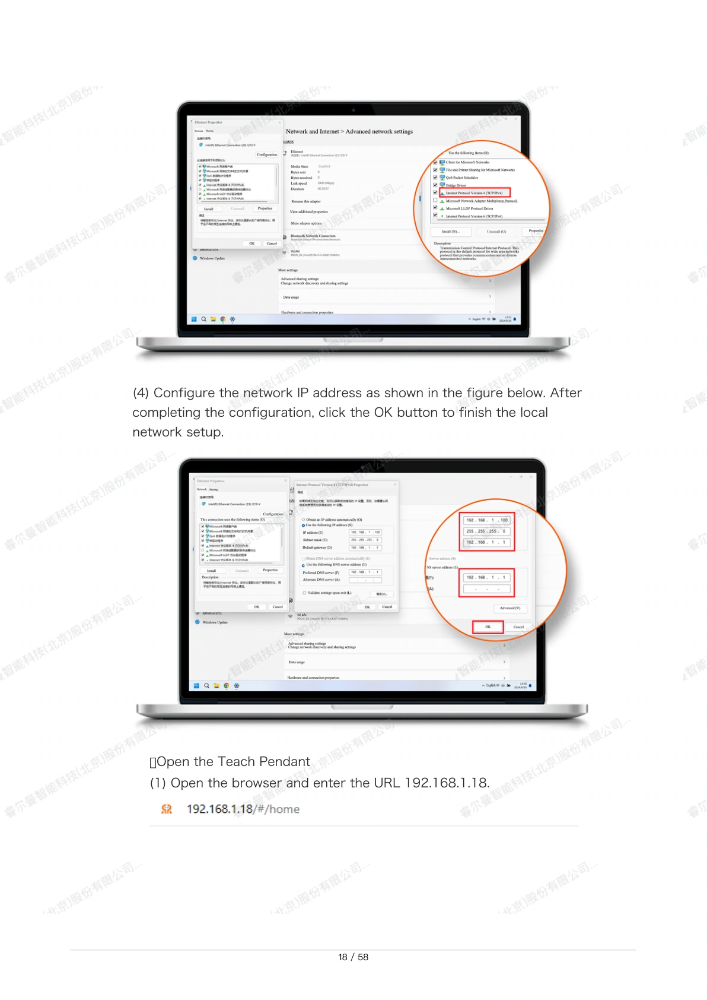




```
(4) Configure the network IP address as shown in the figure below. After 
completing the configuration, click the OK button to finish the local 
network setup. 

Open the Teach Pendant
(1) Open the browser and enter the URL 192.168.1.18.
18 / 58
```




## PDF page 19

[RM65 and RM75 hardware manual, original PDF page 19](https://1292444914-files.gitbook.io/~/files/v0/b/gitbook-x-prod.appspot.com/o/spaces%2FtgOfPnscWebs1eh82EKq%2Fuploads%2FgsKKCns43MghAwQyuKN0%2FRM65-pages-17-19.pdf?alt=media#page=3)



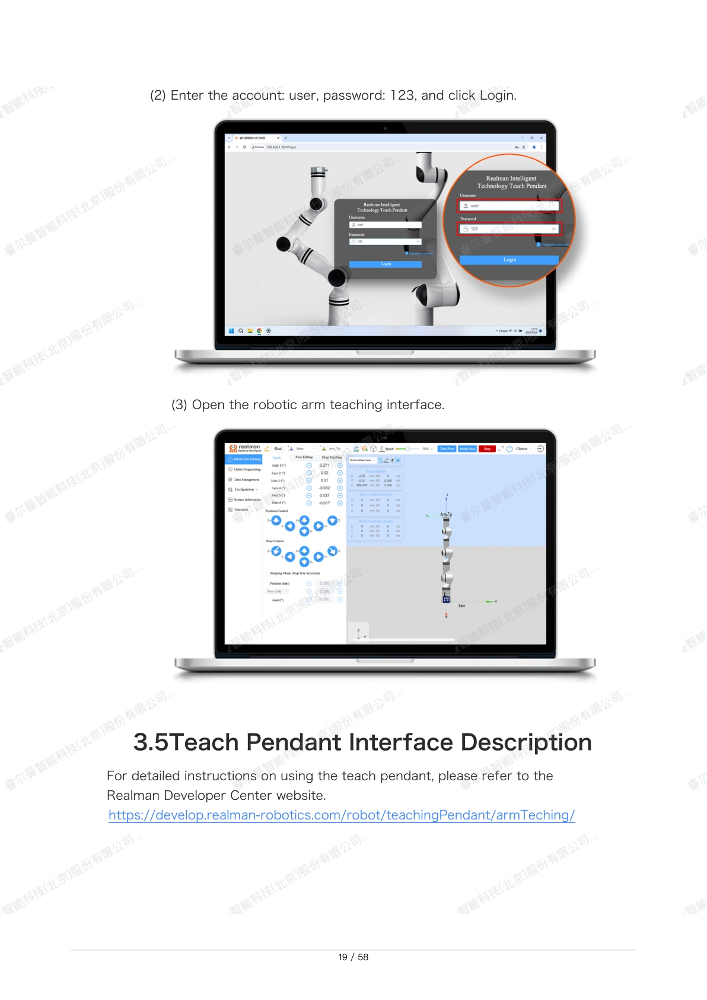




```
(2) Enter the account: user, password: 123, and click Login. 
(3) Open the robotic arm teaching interface. 
3.5Teach Pendant Interface Description
For detailed instructions on using the teach pendant, please refer to the 
Realman Developer Center website.
https://develop.realman-robotics.com/robot/teachingPendant/armTeching/
19 / 58
```




## PDF page 20

[RM65 and RM75 hardware manual, original PDF page 20](https://1292444914-files.gitbook.io/~/files/v0/b/gitbook-x-prod.appspot.com/o/spaces%2FtgOfPnscWebs1eh82EKq%2Fuploads%2FpLKtq6uSAnoqIqlfL7Ly%2FRM65-pages-20-39.pdf?alt=media#page=1)



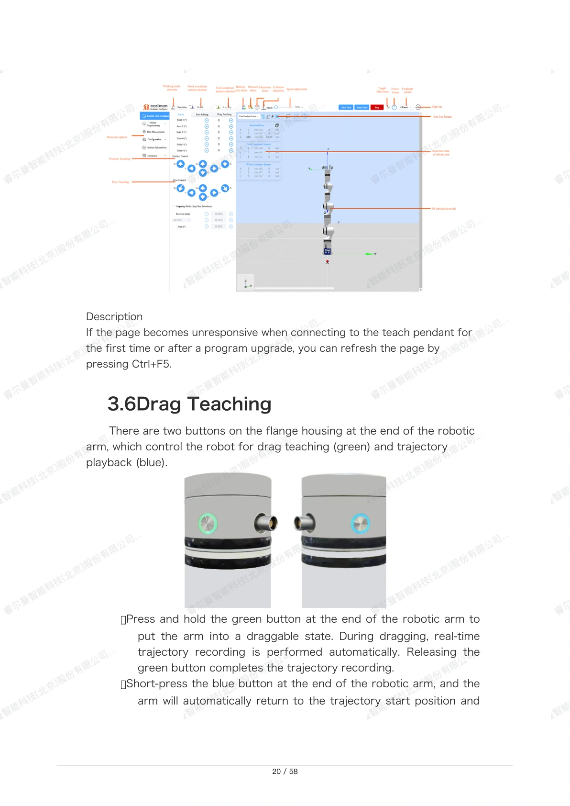




```
Description
If the page becomes unresponsive when connecting to the teach pendant for 
the first time or after a program upgrade, you can refresh the page by 
pressing Ctrl+F5.
3.6Drag Teaching
There are two buttons on the flange housing at the end of the robotic 
arm, which control the robot for drag teaching (green) and trajectory 
playback (blue).


Press and hold the green button at the end of the robotic arm to 
put the arm into a draggable state. During dragging, real-time 
trajectory recording is performed automatically. Releasing the 
green button completes the trajectory recording.
Short-press the blue button at the end of the robotic arm, and the 
arm will automatically return to the trajectory start position and 
20 / 58
```




## PDF page 21

[RM65 and RM75 hardware manual, original PDF page 21](https://1292444914-files.gitbook.io/~/files/v0/b/gitbook-x-prod.appspot.com/o/spaces%2FtgOfPnscWebs1eh82EKq%2Fuploads%2FpLKtq6uSAnoqIqlfL7Ly%2FRM65-pages-20-39.pdf?alt=media#page=2)



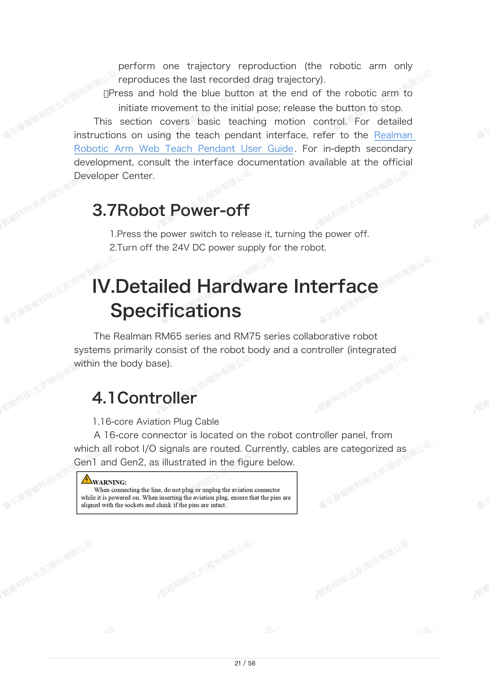




```
perform one trajectory reproduction (the robotic arm only 
reproduces the last recorded drag trajectory).
Press and hold the blue button at the end of the robotic arm to 
initiate movement to the initial pose; release the button to stop.
This section covers basic teaching motion control. For detailed 
instructions on using the teach pendant interface, refer to the Realman 
Robotic Arm Web Teach Pendant User Guide. For in-depth secondary 
development, consult the interface documentation available at the official 
Developer Center.
3.7Robot Power-off
1.Press the power switch to release it, turning the power off.
2.Turn off the 24V DC power supply for the robot.
IV.Detailed Hardware Interface 
Specifications
The Realman RM65 series and RM75 series collaborative robot 
systems primarily consist of the robot body and a controller (integrated 
within the body base).
4.1Controller
1.16-core Aviation Plug Cable
A 16-core connector is located on the robot controller panel, from 
which all robot I/O signals are routed. Currently, cables are categorized as 
Gen1 and Gen2, as illustrated in the figure below.
21 / 58
```




## PDF page 22

[RM65 and RM75 hardware manual, original PDF page 22](https://1292444914-files.gitbook.io/~/files/v0/b/gitbook-x-prod.appspot.com/o/spaces%2FtgOfPnscWebs1eh82EKq%2Fuploads%2FpLKtq6uSAnoqIqlfL7Ly%2FRM65-pages-20-39.pdf?alt=media#page=3)



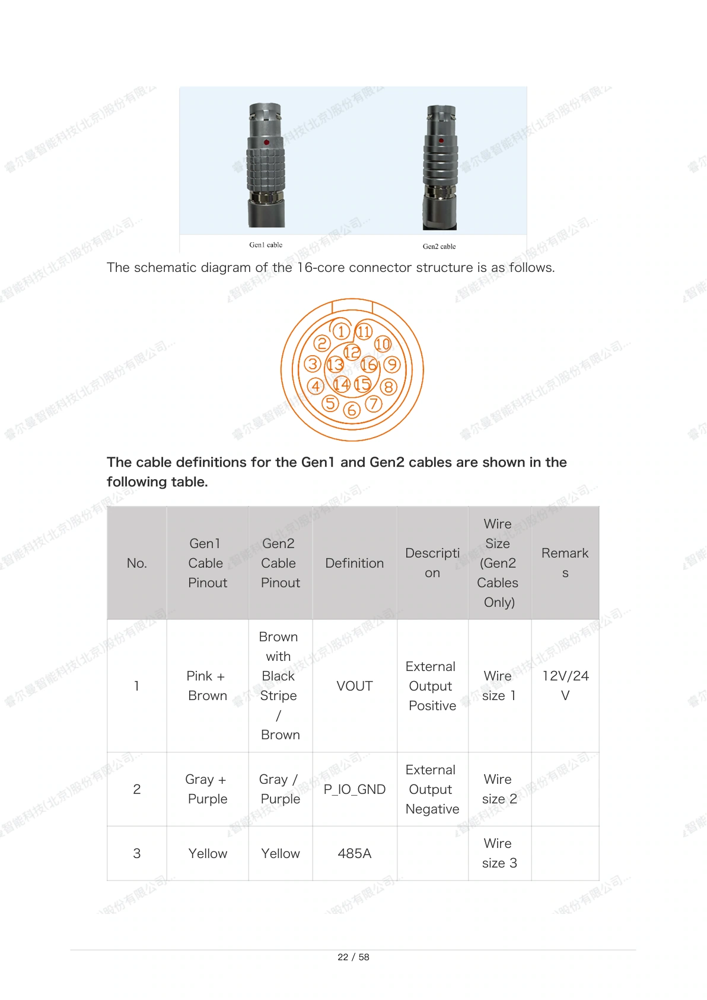




```
The schematic diagram of the 16-core connector structure is as follows.


The cable definitions for the Gen1 and Gen2 cables are shown in the 
following table.
No.
Gen1 
Cable 
Pinout
Gen2 
Cable 
Pinout
Definition
Descripti
on
Wire 
Size 
(Gen2 
Cables 
Only)
Remark
s
1
Pink + 
Brown
Brown 
with 
Black 
Stripe 
/ 
Brown
VOUT
External 
Output 
Positive
Wire 
size 1
12V/24
V
2
Gray + 
Purple
Gray / 
Purple
P_IO_GND
External 
Output 
Negative
Wire 
size 2

3
Yellow
Yellow
485A

Wire 
size 3

22 / 58
```




## PDF page 23

[RM65 and RM75 hardware manual, original PDF page 23](https://1292444914-files.gitbook.io/~/files/v0/b/gitbook-x-prod.appspot.com/o/spaces%2FtgOfPnscWebs1eh82EKq%2Fuploads%2FpLKtq6uSAnoqIqlfL7Ly%2FRM65-pages-20-39.pdf?alt=media#page=4)








```
4
Yellow-
Green
Yellow 
with 
Black 
Stripe
485B

Wire 
size 4

5
Purple/Wh
ite
White 
with 
Black 
Stripe
IO1
Reusabl
e I/O
Wire 
size 5

6
Red/White
Red + 
White 
Stripe
IO2
Reusabl
e I/O
Wire 
size 6

7
Green/Whi
te
Green 
with 
Black 
Stripe
IO3
Reusabl
e I/O
Wire 
size 7

8
Yellow/Wh
ite
Black 
+ 
White 
Stripe
IO4
Reusabl
e I/O
Wire 
size 8

9
Blue/Whit
e
Orange
 with 
Black 
Stripe
OUT_P_IN
External 
Input 
Digital 
Power
Wire 
size 9
0~24V
10
Light Blue
Blue 
with 
Black 
Stripe
OUT_P_OU
T
External 
Output 
Digital 
Power
Wire 
size 10
0~24V
11
Dark Blue
Blue
OUT_P_GN
D
External 
Digital 
Ground
Wire 
size 11

12
Green
Green
FDCAN_A
CAN_H
Wire 
size 12

13
Red
Red
FDCAN_B
CAN_L
Wire 
size 13

23 / 58
```




## PDF page 24

[RM65 and RM75 hardware manual, original PDF page 24](https://1292444914-files.gitbook.io/~/files/v0/b/gitbook-x-prod.appspot.com/o/spaces%2FtgOfPnscWebs1eh82EKq%2Fuploads%2FpLKtq6uSAnoqIqlfL7Ly%2FRM65-pages-20-39.pdf?alt=media#page=5)








```
Note
The voltage level for digital I/O is determined by the connected 
reference voltage. The 16-core expansion interface cable of the robotic 
arm only provides 12V and 24V power supply voltages. If the digital I/O 
needs to output other voltage levels, reference voltages must be 
introduced externally to the OUT_P_OUT+, OUT_P_IN+, and OUT_P_GND 
pins.
2.Power Supply Output
The robot's 16-core cable can output 12V/24V power externally (when 
outputting 24V, the actual output voltage matches the robot's power 
supply voltage; if the supply voltage is unstable, the output voltage will be 
affected). The power output type can be configured, and the ON/OFF state 
is controlled, via the teach pendant or JSON protocol. The electrical 
characteristics are shown in the table below.
3.Digital Input
The controller interface features a total of four digital inputs. During 
use, the user must connect the external input digital power channel 
(OUT_P_IN+) and the external digital ground channel (OUT_P_GND) 
14
White
White
E_STOP
Circuit-
Type 
I/O 
Emergen
cy Stop
Wire 
size 14

15
Black
Black
Reserved
Reserve
d
Wire 
size 15

16
Orange
Orange
Reserved
Reserve
d
Wire 
size 16

Parameter
Minimum
Typical 
Value
Maximum
Unit
Power 
Supply 
Voltage
0
——
24
V
Power 
Supply 
Current
——
1000
1500
mA
24 / 58
```




## PDF page 25

[RM65 and RM75 hardware manual, original PDF page 25](https://1292444914-files.gitbook.io/~/files/v0/b/gitbook-x-prod.appspot.com/o/spaces%2FtgOfPnscWebs1eh82EKq%2Fuploads%2FpLKtq6uSAnoqIqlfL7Ly%2FRM65-pages-20-39.pdf?alt=media#page=6)



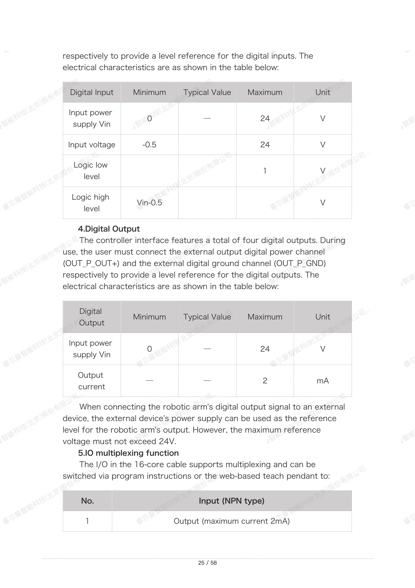




```
respectively to provide a level reference for the digital inputs. The 
electrical characteristics are as shown in the table below:
4.Digital Output
The controller interface features a total of four digital outputs. During 
use, the user must connect the external output digital power channel 
(OUT_P_OUT+) and the external digital ground channel (OUT_P_GND) 
respectively to provide a level reference for the digital outputs. The 
electrical characteristics are as shown in the table below:
When connecting the robotic arm's digital output signal to an external 
device, the external device's power supply can be used as the reference 
level for the robotic arm's output. However, the maximum reference 
voltage must not exceed 24V.
5.IO multiplexing function
The I/O in the 16-core cable supports multiplexing and can be 
switched via program instructions or the web-based teach pendant to:
Digital Input
Minimum
Typical Value
Maximum
Unit
Input power 
supply Vin
0
—
24
V
Input voltage
-0.5

24
V
Logic low 
level


1
V
Logic high 
level
Vin-0.5


V
Digital 
Output
Minimum
Typical Value
Maximum
Unit
Input power 
supply Vin
0
—
24
V
Output 
current
—
—
2
mA
No.
Input (NPN type)
1
Output (maximum current 2mA)
25 / 58
```




## PDF page 26

[RM65 and RM75 hardware manual, original PDF page 26](https://1292444914-files.gitbook.io/~/files/v0/b/gitbook-x-prod.appspot.com/o/spaces%2FtgOfPnscWebs1eh82EKq%2Fuploads%2FpLKtq6uSAnoqIqlfL7Ly%2FRM65-pages-20-39.pdf?alt=media#page=7)



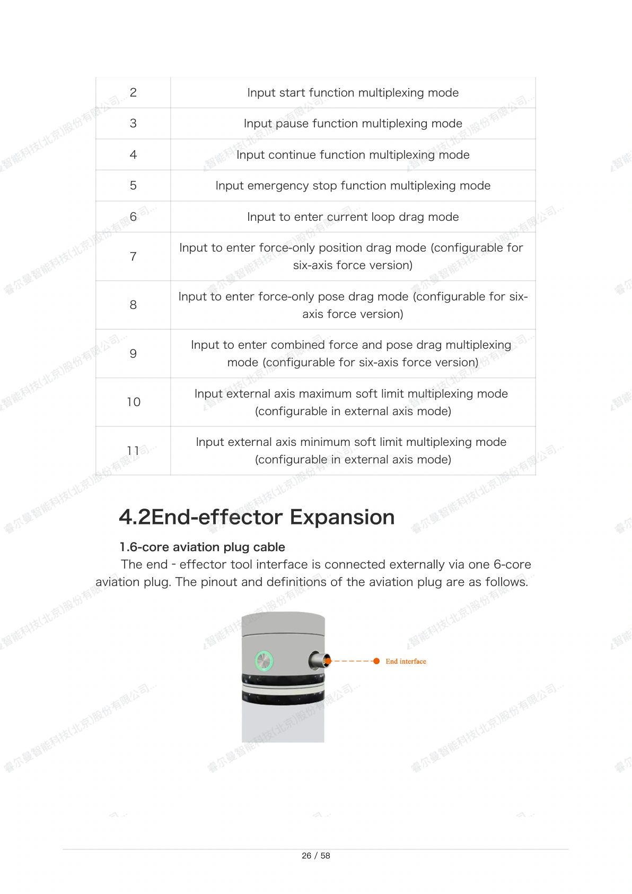




```
4.2End-effector Expansion
1.6-core aviation plug cable
The end‑effector tool interface is connected externally via one 6-core 
aviation plug. The pinout and definitions of the aviation plug are as follows.


2
Input start function multiplexing mode
3
Input pause function multiplexing mode
4
Input continue function multiplexing mode
5
Input emergency stop function multiplexing mode
6
Input to enter current loop drag mode
7
Input to enter force-only position drag mode (configurable for 
six-axis force version)
8
Input to enter force-only pose drag mode (configurable for six-
axis force version)
9
Input to enter combined force and pose drag multiplexing 
mode (configurable for six-axis force version)
10
Input external axis maximum soft limit multiplexing mode 
(configurable in external axis mode)
11
Input external axis minimum soft limit multiplexing mode 
(configurable in external axis mode)
26 / 58
```




## PDF page 27

[RM65 and RM75 hardware manual, original PDF page 27](https://1292444914-files.gitbook.io/~/files/v0/b/gitbook-x-prod.appspot.com/o/spaces%2FtgOfPnscWebs1eh82EKq%2Fuploads%2FpLKtq6uSAnoqIqlfL7Ly%2FRM65-pages-20-39.pdf?alt=media#page=8)








```
External Pin Definition for Tool-Side Aviation Plug
Remarks
The multiplexing functions in the table above are switched via program 
instructions. By default, Pin 3 and Pin 4 are configured as digital input 
channels (DI1 and DI2), and the power output of Pin 6 is set to 0V 
(configurable via program).
2.Digital I/O Input
The tool has two digital inputs. Their electrical characteristics are 
shown in the table below.
Pin No.
Wire Color
Function
1
Yellow
RS485_A
2
White
RS485_B
3
Red
Digital Interface 1 (DI1/DO1)
4
Black
Digital Interface 2 (DI2/DO2)
5
Green
Power GND
6
Blue
Power Output: 0V/12V/24V, 
programmatically controllable
Digital Input
Minimum
Typical Value
Maximum
Unit
Input power 
supply Vin
0
——
24
V
Input voltage
-0.5

24
V
Logic low 
level


1
V
27 / 58
```




## PDF page 28

[RM65 and RM75 hardware manual, original PDF page 28](https://1292444914-files.gitbook.io/~/files/v0/b/gitbook-x-prod.appspot.com/o/spaces%2FtgOfPnscWebs1eh82EKq%2Fuploads%2FpLKtq6uSAnoqIqlfL7Ly%2FRM65-pages-20-39.pdf?alt=media#page=9)



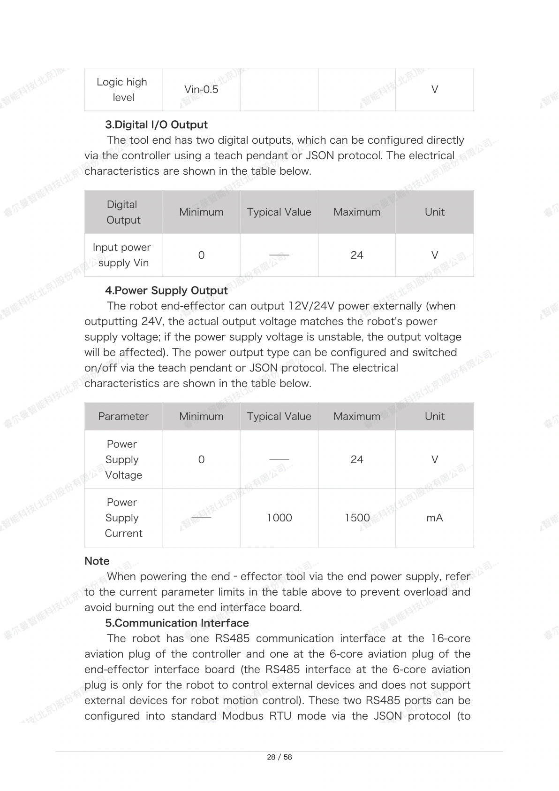




```
3.Digital I/O Output
The tool end has two digital outputs, which can be configured directly 
via the controller using a teach pendant or JSON protocol. The electrical 
characteristics are shown in the table below.
4.Power Supply Output
The robot end-effector can output 12V/24V power externally (when 
outputting 24V, the actual output voltage matches the robot's power 
supply voltage; if the power supply voltage is unstable, the output voltage 
will be affected). The power output type can be configured and switched 
on/off via the teach pendant or JSON protocol. The electrical 
characteristics are shown in the table below.
Note
When powering the end‑effector tool via the end power supply, refer 
to the current parameter limits in the table above to prevent overload and 
avoid burning out the end interface board.
5.Communication Interface
The robot has one RS485 communication interface at the 16-core 
aviation plug of the controller and one at the 6-core aviation plug of the 
end-effector interface board (the RS485 interface at the 6-core aviation 
plug is only for the robot to control external devices and does not support 
external devices for robot motion control). These two RS485 ports can be 
configured into standard Modbus RTU mode via the JSON protocol (to 
Logic high 
level
Vin-0.5


V
Digital 
Output
Minimum
Typical Value
Maximum
Unit
Input power 
supply Vin
0
——
24
V
Parameter
Minimum
Typical Value
Maximum
Unit
Power 
Supply 
Voltage
0
——
24
V
Power 
Supply 
Current
——
1000
1500
mA
28 / 58
```




## PDF page 29

[RM65 and RM75 hardware manual, original PDF page 29](https://1292444914-files.gitbook.io/~/files/v0/b/gitbook-x-prod.appspot.com/o/spaces%2FtgOfPnscWebs1eh82EKq%2Fuploads%2FpLKtq6uSAnoqIqlfL7Ly%2FRM65-pages-20-39.pdf?alt=media#page=10)



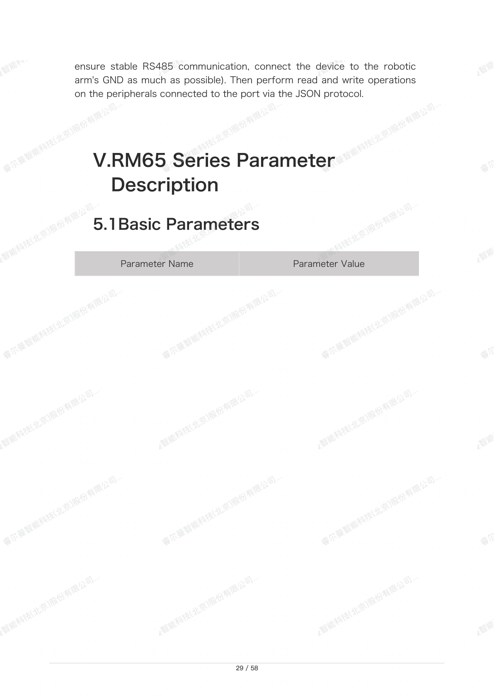




```
ensure stable RS485 communication, connect the device to the robotic 
arm's GND as much as possible). Then perform read and write operations 
on the peripherals connected to the port via the JSON protocol.
V.RM65 Series Parameter 
Description
5.1Basic Parameters
Parameter Name
Parameter Value
29 / 58
```




## PDF page 30

[RM65 and RM75 hardware manual, original PDF page 30](https://1292444914-files.gitbook.io/~/files/v0/b/gitbook-x-prod.appspot.com/o/spaces%2FtgOfPnscWebs1eh82EKq%2Fuploads%2FpLKtq6uSAnoqIqlfL7Ly%2FRM65-pages-20-39.pdf?alt=media#page=11)



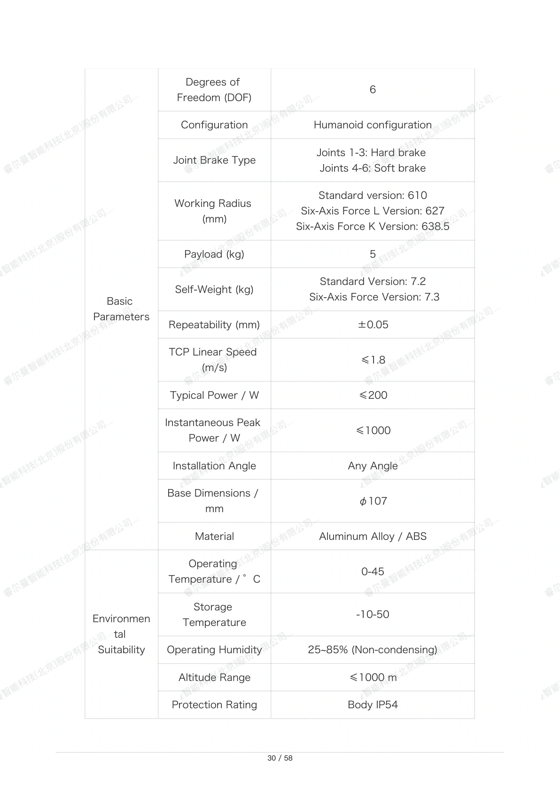




```
Basic 
Parameters
Degrees of 
Freedom (DOF)
6
Configuration
Humanoid configuration
Joint Brake Type
Joints 1-3: Hard brake 
Joints 4-6: Soft brake
Working Radius 
(mm)
Standard version: 610
Six-Axis Force L Version: 627
Six-Axis Force K Version: 638.5
Payload (kg)
5
Self-Weight (kg)
Standard Version: 7.2
 Six-Axis Force Version: 7.3
Repeatability (mm)
±0.05
TCP Linear Speed 
(m/s)
≤1.8
Typical Power / W
≤200
Instantaneous Peak 
Power / W
≤1000
Installation Angle
Any Angle
Base Dimensions / 
mm
φ107
Material
Aluminum Alloy / ABS
Environmen
tal 
Suitability
Operating 
Temperature / °C
0-45
Storage 
Temperature
-10-50
Operating Humidity
25~85% (Non-condensing)
Altitude Range
≤1000 m
Protection Rating
Body IP54
30 / 58
```




## PDF page 31

[RM65 and RM75 hardware manual, original PDF page 31](https://1292444914-files.gitbook.io/~/files/v0/b/gitbook-x-prod.appspot.com/o/spaces%2FtgOfPnscWebs1eh82EKq%2Fuploads%2FpLKtq6uSAnoqIqlfL7Ly%2FRM65-pages-20-39.pdf?alt=media#page=12)



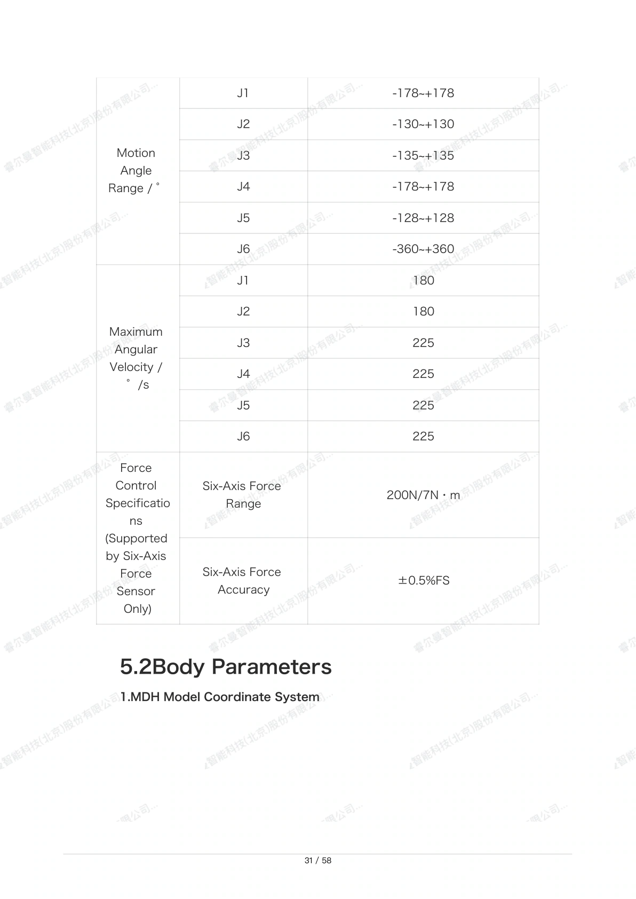




```
5.2Body Parameters
1.MDH Model Coordinate System
Motion 
Angle 
Range / °
J1
-178~+178
J2
-130~+130
J3
-135~+135
J4
-178~+178
J5
-128~+128
J6
-360~+360
Maximum 
Angular 
Velocity / 
°/s
J1
180
J2
180
J3
225
J4
225
J5
225
J6
225
Force 
Control 
Specificatio
ns 
(Supported 
by Six-Axis 
Force 
Sensor 
Only)
Six-Axis Force 
Range
200N/7N·m
Six-Axis Force 
Accuracy
±0.5%FS
31 / 58
```




## PDF page 32

[RM65 and RM75 hardware manual, original PDF page 32](https://1292444914-files.gitbook.io/~/files/v0/b/gitbook-x-prod.appspot.com/o/spaces%2FtgOfPnscWebs1eh82EKq%2Fuploads%2FpLKtq6uSAnoqIqlfL7Ly%2FRM65-pages-20-39.pdf?alt=media#page=13)



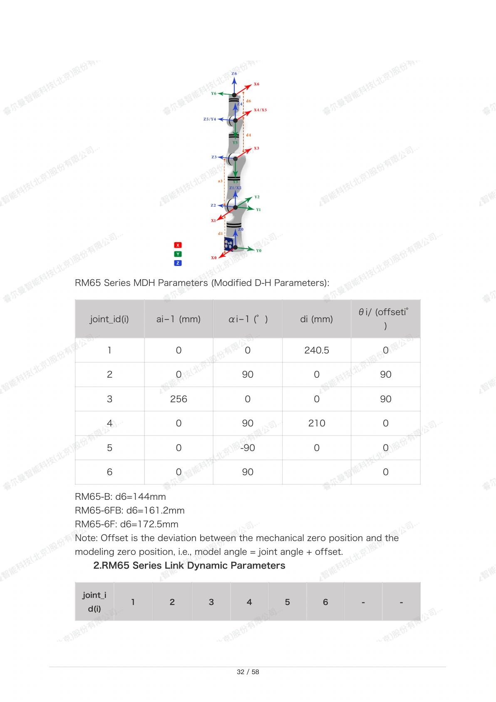




```
RM65 Series MDH Parameters (Modified D-H Parameters):
RM65-B: d6=144mm
RM65-6FB: d6=161.2mm
RM65-6F: d6=172.5mm
Note: Offset is the deviation between the mechanical zero position and the 
modeling zero position, i.e., model angle = joint angle + offset.
2.RM65 Series Link Dynamic Parameters
joint_id(i)
ai−1​ (mm)
αi−1 (°)
di​ (mm)
θi/ (offseti°
)
1
0
0
240.5
0
2
0
90
0
90
3
256
0
0
90
4
0
90
210
0
5
0
-90
0
0
6
0
90

0
joint_i
d(i)
1
2
3
4
5
6
-
-
32 / 58
```




## PDF page 33

[RM65 and RM75 hardware manual, original PDF page 33](https://1292444914-files.gitbook.io/~/files/v0/b/gitbook-x-prod.appspot.com/o/spaces%2FtgOfPnscWebs1eh82EKq%2Fuploads%2FpLKtq6uSAnoqIqlfL7Ly%2FRM65-pages-20-39.pdf?alt=media#page=14)



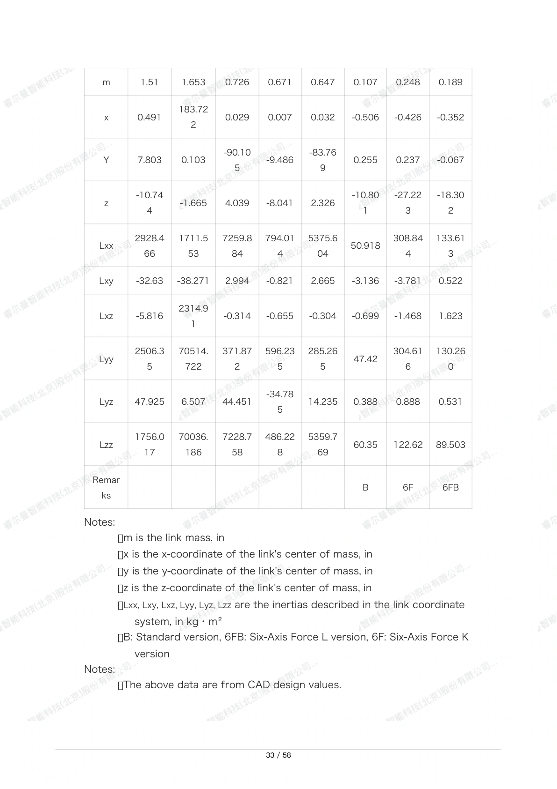




```
Notes:
m is the link mass, in
x is the x-coordinate of the link's center of mass, in
y is the y-coordinate of the link's center of mass, in
z is the z-coordinate of the link's center of mass, in
Lxx, Lxy, Lxz, Lyy, Lyz, Lzz are the inertias described in the link coordinate 
system, in kg·m²
B: Standard version, 6FB: Six-Axis Force L version, 6F: Six-Axis Force K 
version
Notes:
The above data are from CAD design values.
m
1.51
1.653
0.726
0.671
0.647
0.107
0.248
0.189
x
0.491
183.72
2
0.029
0.007
0.032
-0.506
-0.426
-0.352
Y
7.803
0.103
-90.10
5
-9.486
-83.76
9
0.255
0.237
-0.067
z
-10.74
4
-1.665
4.039
-8.041
2.326
-10.80
1
-27.22
3
-18.30
2
Lxx
2928.4
66
1711.5
53
7259.8
84
794.01
4
5375.6
04
50.918
308.84
4
133.61
3
Lxy
-32.63
-38.271
2.994
-0.821
2.665
-3.136
-3.781
0.522
Lxz
-5.816
2314.9
1
-0.314
-0.655
-0.304
-0.699
-1.468
1.623
Lyy
2506.3
5
70514.
722
371.87
2
596.23
5
285.26
5
47.42
304.61
6
130.26
0
Lyz
47.925
6.507
44.451
-34.78
5
14.235
0.388
0.888
0.531
Lzz
1756.0
17
70036.
186
7228.7
58
486.22
8
5359.7
69
60.35
122.62
89.503
Remar
ks


B
6F
6FB
33 / 58
```




## PDF page 34

[RM65 and RM75 hardware manual, original PDF page 34](https://1292444914-files.gitbook.io/~/files/v0/b/gitbook-x-prod.appspot.com/o/spaces%2FtgOfPnscWebs1eh82EKq%2Fuploads%2FpLKtq6uSAnoqIqlfL7Ly%2FRM65-pages-20-39.pdf?alt=media#page=15)



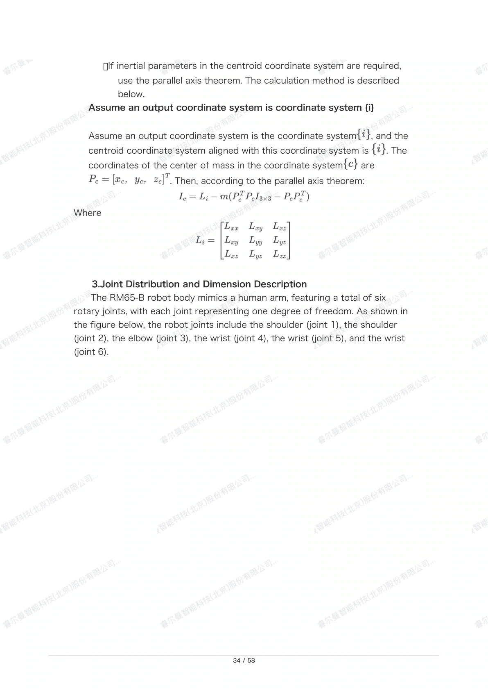




```
If inertial parameters in the centroid coordinate system are required, 
use the parallel axis theorem. The calculation method is described 
below.
Assume an output coordinate system is coordinate system {i}
Assume an output coordinate system is the coordinate system
, and the 
centroid coordinate system aligned with this coordinate system is 
. The 
coordinates of the center of mass in the coordinate system
 are 
. Then, according to the parallel axis theorem:


Where


3.Joint Distribution and Dimension Description
The RM65-B robot body mimics a human arm, featuring a total of six 
rotary joints, with each joint representing one degree of freedom. As shown in 
the figure below, the robot joints include the shoulder (joint 1), the shoulder 
(joint 2), the elbow (joint 3), the wrist (joint 4), the wrist (joint 5), and the wrist 
(joint 6).
34 / 58
```




## PDF page 35

[RM65 and RM75 hardware manual, original PDF page 35](https://1292444914-files.gitbook.io/~/files/v0/b/gitbook-x-prod.appspot.com/o/spaces%2FtgOfPnscWebs1eh82EKq%2Fuploads%2FpLKtq6uSAnoqIqlfL7Ly%2FRM65-pages-20-39.pdf?alt=media#page=16)



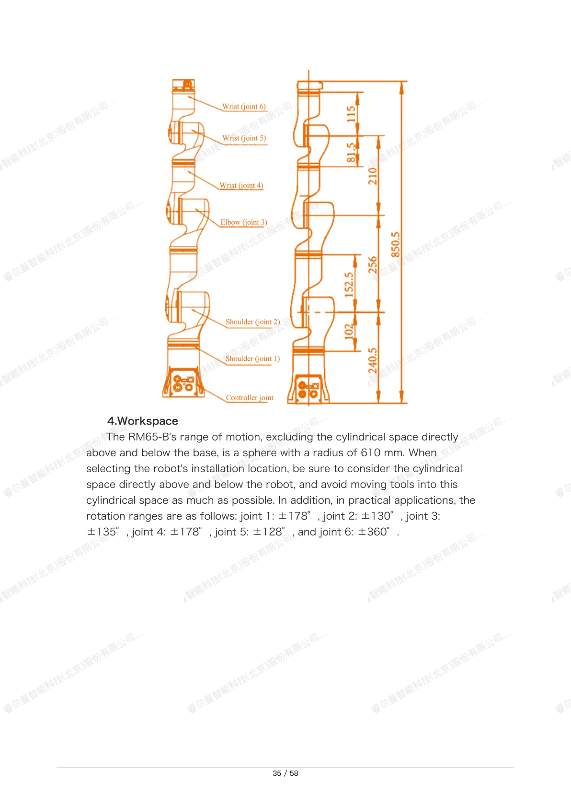




```
4.Workspace
The RM65-B's range of motion, excluding the cylindrical space directly 
above and below the base, is a sphere with a radius of 610 mm. When 
selecting the robot's installation location, be sure to consider the cylindrical 
space directly above and below the robot, and avoid moving tools into this 
cylindrical space as much as possible. In addition, in practical applications, the 
rotation ranges are as follows: joint 1: ±178°, joint 2: ±130°, joint 3: 
±135°, joint 4: ±178°, joint 5: ±128°, and joint 6: ±360°.
35 / 58
```




## PDF page 36

[RM65 and RM75 hardware manual, original PDF page 36](https://1292444914-files.gitbook.io/~/files/v0/b/gitbook-x-prod.appspot.com/o/spaces%2FtgOfPnscWebs1eh82EKq%2Fuploads%2FpLKtq6uSAnoqIqlfL7Ly%2FRM65-pages-20-39.pdf?alt=media#page=17)



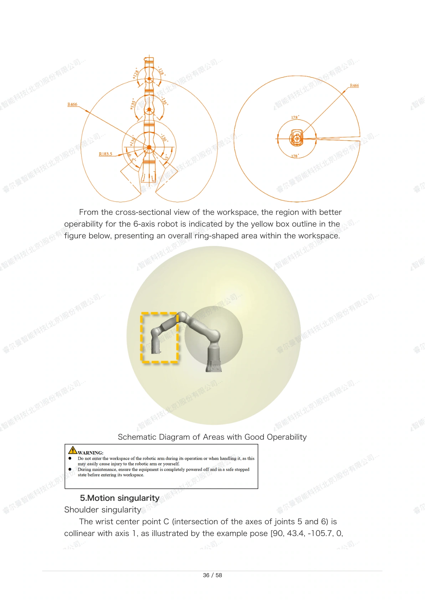




```
From the cross-sectional view of the workspace, the region with better 
operability for the 6-axis robot is indicated by the yellow box outline in the 
figure below, presenting an overall ring-shaped area within the workspace.


Schematic Diagram of Areas with Good Operability
5.Motion singularity
Shoulder singularity
The wrist center point C (intersection of the axes of joints 5 and 6) is 
collinear with axis 1, as illustrated by the example pose [90, 43.4, -105.7, 0, 
36 / 58
```




## PDF page 37

[RM65 and RM75 hardware manual, original PDF page 37](https://1292444914-files.gitbook.io/~/files/v0/b/gitbook-x-prod.appspot.com/o/spaces%2FtgOfPnscWebs1eh82EKq%2Fuploads%2FpLKtq6uSAnoqIqlfL7Ly%2FRM65-pages-20-39.pdf?alt=media#page=18)



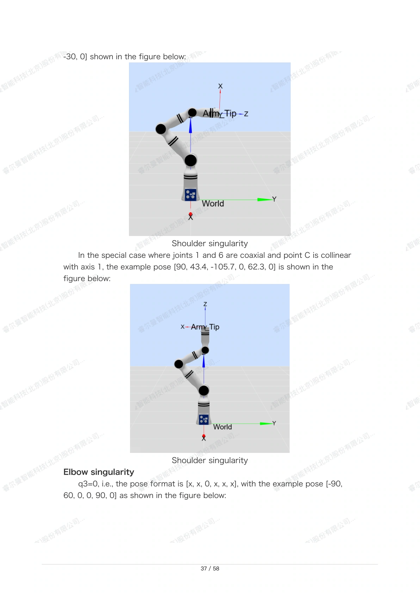




```
-30, 0] shown in the figure below:


Shoulder singularity
In the special case where joints 1 and 6 are coaxial and point C is collinear 
with axis 1, the example pose [90, 43.4, -105.7, 0, 62.3, 0] is shown in the 
figure below:


Shoulder singularity
Elbow singularity
q3=0, i.e., the pose format is [x, x, 0, x, x, x], with the example pose [-90, 
60, 0, 0, 90, 0] as shown in the figure below:
37 / 58
```




## PDF page 38

[RM65 and RM75 hardware manual, original PDF page 38](https://1292444914-files.gitbook.io/~/files/v0/b/gitbook-x-prod.appspot.com/o/spaces%2FtgOfPnscWebs1eh82EKq%2Fuploads%2FpLKtq6uSAnoqIqlfL7Ly%2FRM65-pages-20-39.pdf?alt=media#page=19)



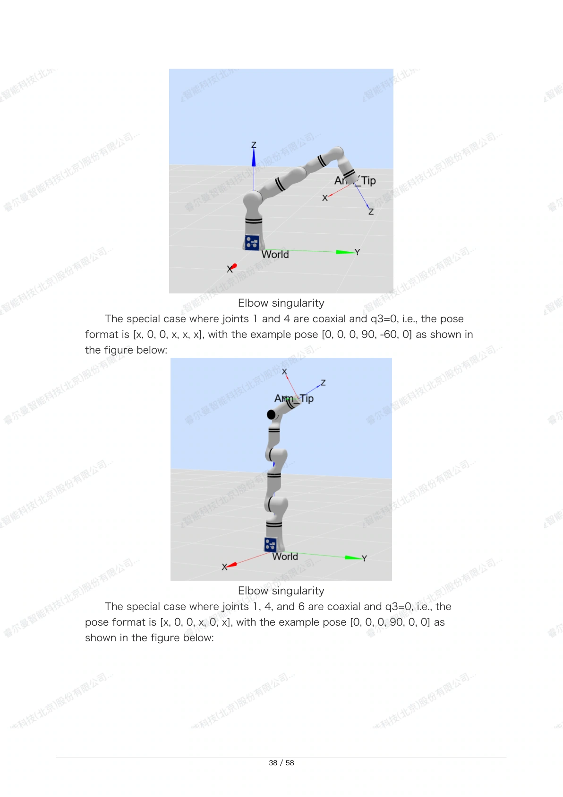




```
Elbow singularity
The special case where joints 1 and 4 are coaxial and q3=0, i.e., the pose 
format is [x, 0, 0, x, x, x], with the example pose [0, 0, 0, 90, -60, 0] as shown in 
the figure below:


Elbow singularity
The special case where joints 1, 4, and 6 are coaxial and q3=0, i.e., the 
pose format is [x, 0, 0, x, 0, x], with the example pose [0, 0, 0, 90, 0, 0] as 
shown in the figure below:
38 / 58
```




## PDF page 39

[RM65 and RM75 hardware manual, original PDF page 39](https://1292444914-files.gitbook.io/~/files/v0/b/gitbook-x-prod.appspot.com/o/spaces%2FtgOfPnscWebs1eh82EKq%2Fuploads%2FpLKtq6uSAnoqIqlfL7Ly%2FRM65-pages-20-39.pdf?alt=media#page=20)



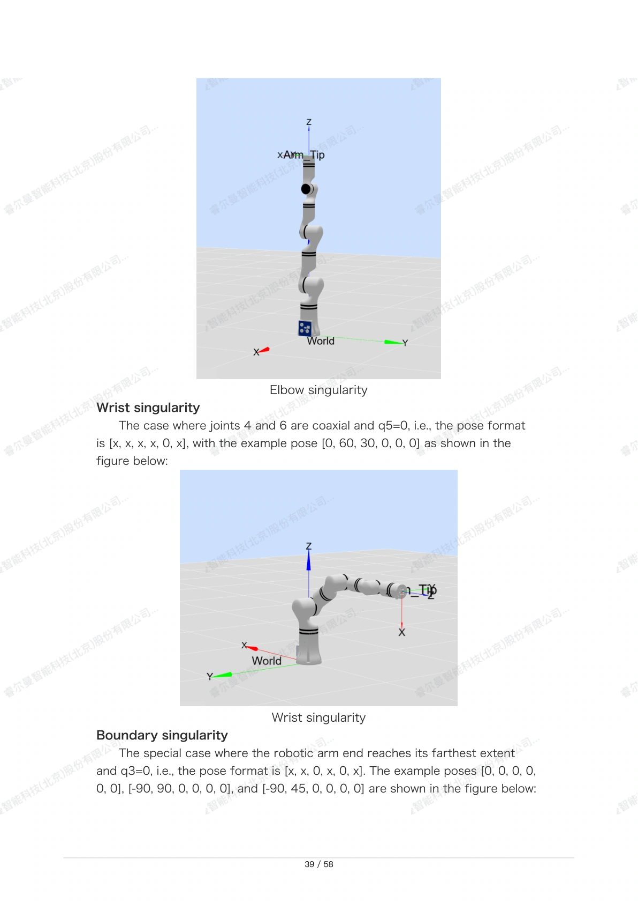




```
Elbow singularity
Wrist singularity
The case where joints 4 and 6 are coaxial and q5=0, i.e., the pose format 
is [x, x, x, x, 0, x], with the example pose [0, 60, 30, 0, 0, 0] as shown in the 
figure below:


Wrist singularity
Boundary singularity
The special case where the robotic arm end reaches its farthest extent 
and q3=0, i.e., the pose format is [x, x, 0, x, 0, x]. The example poses [0, 0, 0, 0, 
0, 0], [-90, 90, 0, 0, 0, 0], and [-90, 45, 0, 0, 0, 0] are shown in the figure below:
39 / 58
```




## PDF page 40

[RM65 and RM75 hardware manual, original PDF page 40](https://1292444914-files.gitbook.io/~/files/v0/b/gitbook-x-prod.appspot.com/o/spaces%2FtgOfPnscWebs1eh82EKq%2Fuploads%2Fq0K4ojQBOfMh9tUiyj0c%2FRM65-pages-40-51.pdf?alt=media#page=1)



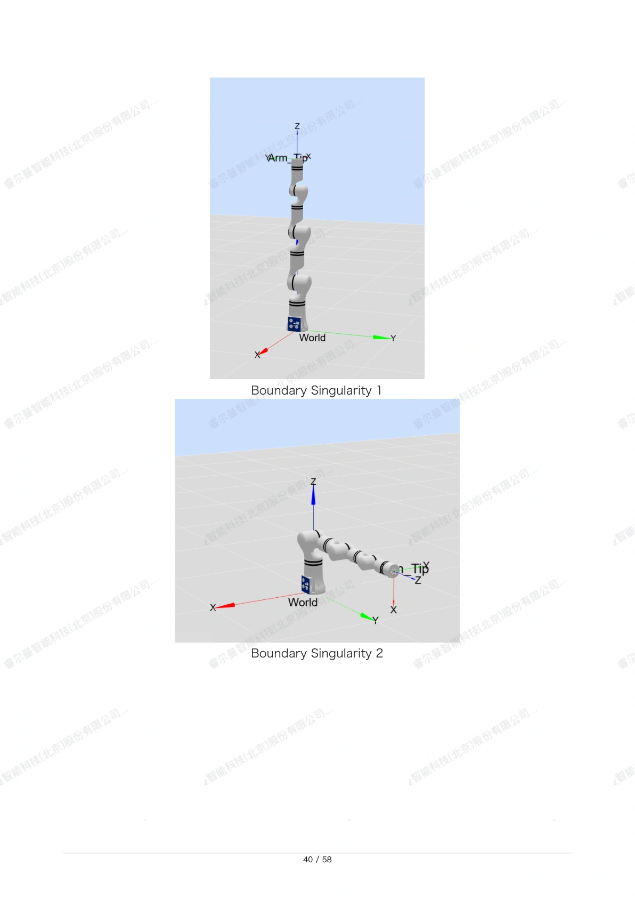




```
Boundary Singularity 1


Boundary Singularity 2
40 / 58
```




## PDF page 41

[RM65 and RM75 hardware manual, original PDF page 41](https://1292444914-files.gitbook.io/~/files/v0/b/gitbook-x-prod.appspot.com/o/spaces%2FtgOfPnscWebs1eh82EKq%2Fuploads%2Fq0K4ojQBOfMh9tUiyj0c%2FRM65-pages-40-51.pdf?alt=media#page=2)



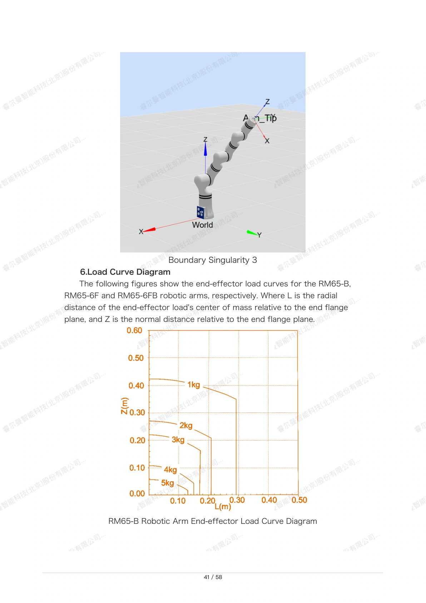




```
Boundary Singularity 3
6.Load Curve Diagram
The following figures show the end-effector load curves for the RM65-B, 
RM65-6F and RM65-6FB robotic arms, respectively. Where L is the radial 
distance of the end-effector load's center of mass relative to the end flange 
plane, and Z is the normal distance relative to the end flange plane.


RM65-B Robotic Arm End-effector Load Curve Diagram
41 / 58
```




## PDF page 42

[RM65 and RM75 hardware manual, original PDF page 42](https://1292444914-files.gitbook.io/~/files/v0/b/gitbook-x-prod.appspot.com/o/spaces%2FtgOfPnscWebs1eh82EKq%2Fuploads%2Fq0K4ojQBOfMh9tUiyj0c%2FRM65-pages-40-51.pdf?alt=media#page=3)



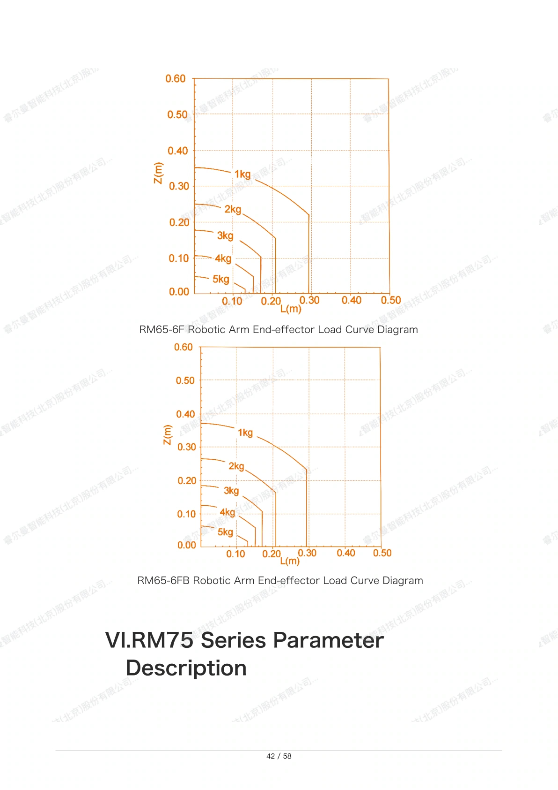




```
RM65-6F Robotic Arm End-effector Load Curve Diagram


 RM65-6FB Robotic Arm End-effector Load Curve Diagram
VI.RM75 Series Parameter 
Description
42 / 58
```




## PDF page 43

[RM65 and RM75 hardware manual, original PDF page 43](https://1292444914-files.gitbook.io/~/files/v0/b/gitbook-x-prod.appspot.com/o/spaces%2FtgOfPnscWebs1eh82EKq%2Fuploads%2Fq0K4ojQBOfMh9tUiyj0c%2FRM65-pages-40-51.pdf?alt=media#page=4)



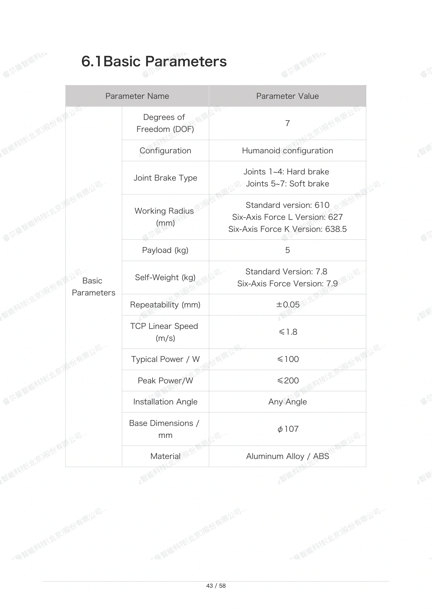




```
6.1Basic Parameters
Parameter Name
Parameter Value
Basic 
Parameters
Degrees of 
Freedom (DOF)
7
Configuration
Humanoid configuration
Joint Brake Type
Joints 1~4: Hard brake 
Joints 5~7: Soft brake
Working Radius 
(mm)
Standard version: 610
Six-Axis Force L Version: 627
Six-Axis Force K Version: 638.5
Payload (kg)
5
Self-Weight (kg)
Standard Version: 7.8 
Six-Axis Force Version: 7.9
Repeatability (mm)
±0.05
TCP Linear Speed 
(m/s)
≤1.8
Typical Power / W
≤100
Peak Power/W
≤200
Installation Angle
Any Angle
Base Dimensions / 
mm
φ107
Material
Aluminum Alloy / ABS
43 / 58
```




## PDF page 44

[RM65 and RM75 hardware manual, original PDF page 44](https://1292444914-files.gitbook.io/~/files/v0/b/gitbook-x-prod.appspot.com/o/spaces%2FtgOfPnscWebs1eh82EKq%2Fuploads%2Fq0K4ojQBOfMh9tUiyj0c%2FRM65-pages-40-51.pdf?alt=media#page=5)



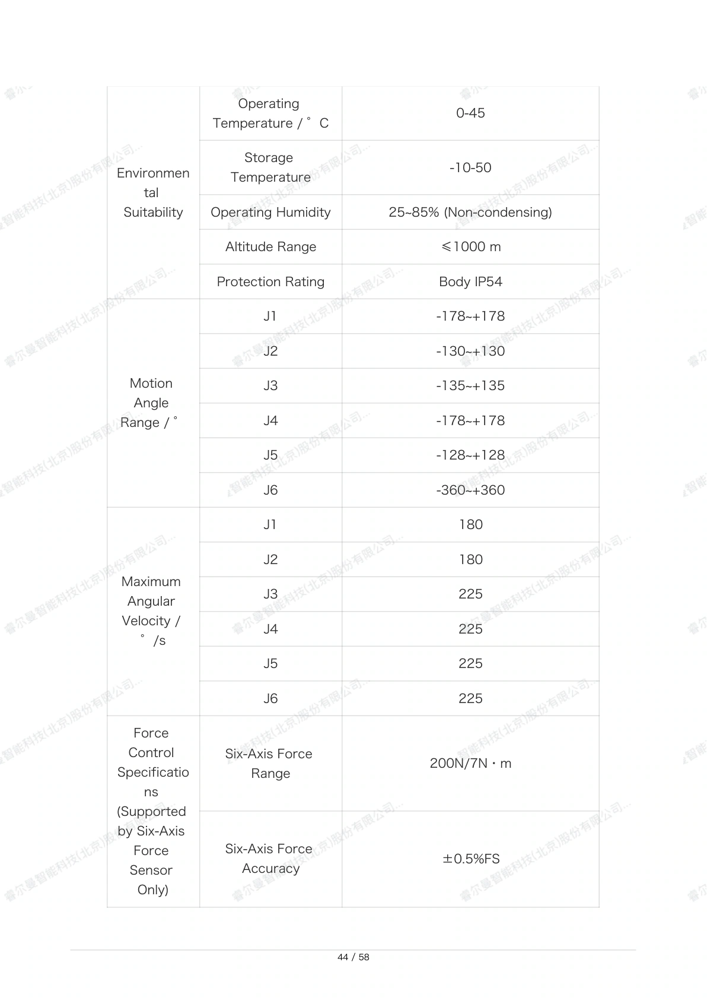




```
Environmen
tal 
Suitability
Operating 
Temperature / °C
0-45
Storage 
Temperature
-10-50
Operating Humidity
25~85% (Non-condensing)
Altitude Range
≤1000 m
Protection Rating
Body IP54
Motion 
Angle 
Range / °
J1
-178~+178
J2
-130~+130
J3
-135~+135
J4
-178~+178
J5
-128~+128
J6
-360~+360
Maximum 
Angular 
Velocity / 
°/s
J1
180
J2
180
J3
225
J4
225
J5
225
J6
225
Force 
Control 
Specificatio
ns 
(Supported 
by Six-Axis 
Force 
Sensor 
Only)
Six-Axis Force 
Range
200N/7N·m
Six-Axis Force 
Accuracy
±0.5%FS
44 / 58
```




## PDF page 45

[RM65 and RM75 hardware manual, original PDF page 45](https://1292444914-files.gitbook.io/~/files/v0/b/gitbook-x-prod.appspot.com/o/spaces%2FtgOfPnscWebs1eh82EKq%2Fuploads%2Fq0K4ojQBOfMh9tUiyj0c%2FRM65-pages-40-51.pdf?alt=media#page=6)



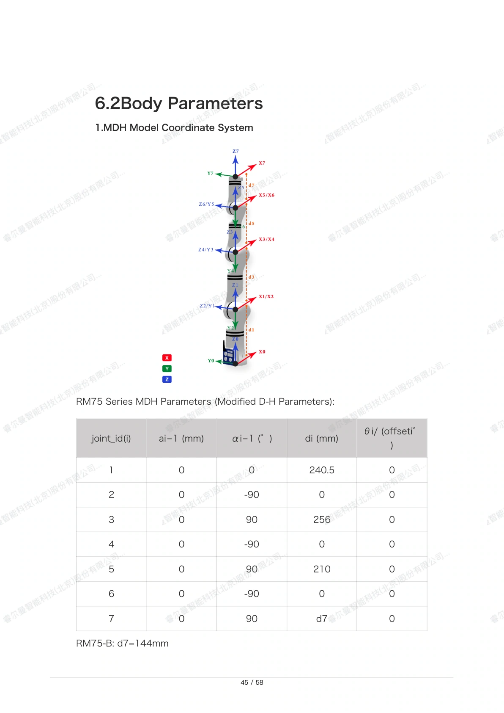




```
6.2Body Parameters
1.MDH Model Coordinate System


RM75 Series MDH Parameters (Modified D-H Parameters):
RM75-B: d7=144mm
joint_id(i)
ai−1​ (mm)
αi−1 (°)
di​ (mm)
θi/ (offseti°
)
1
0
0
240.5
0
2
0
-90
0
0
3
0
90
256
0
4
0
-90
0
0
5
0
90
210
0
6
0
-90
0
0
7
0
90
d7
0
45 / 58
```




## PDF page 46

[RM65 and RM75 hardware manual, original PDF page 46](https://1292444914-files.gitbook.io/~/files/v0/b/gitbook-x-prod.appspot.com/o/spaces%2FtgOfPnscWebs1eh82EKq%2Fuploads%2Fq0K4ojQBOfMh9tUiyj0c%2FRM65-pages-40-51.pdf?alt=media#page=7)



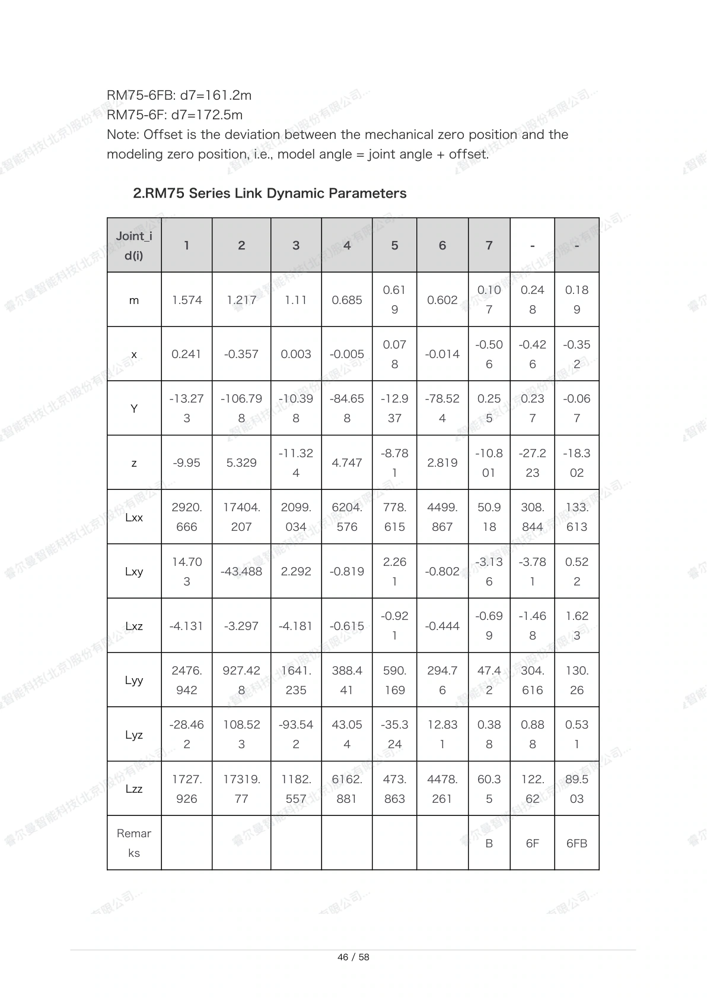




```
RM75-6FB: d7=161.2m
RM75-6F: d7=172.5m
Note: Offset is the deviation between the mechanical zero position and the 
modeling zero position, i.e., model angle = joint angle + offset.
2.RM75 Series Link Dynamic Parameters
Joint_i
d(i)
1
2
3
4
5
6
7
-
-
m
1.574
1.217
1.11
0.685
0.61
9
0.602
0.10
7
0.24
8
0.18
9
x
0.241
-0.357
0.003
-0.005
0.07
8
-0.014
-0.50
6
-0.42
6
-0.35
2
Y
-13.27
3
-106.79
8
-10.39
8
-84.65
8
-12.9
37
-78.52
4
0.25
5
0.23
7
-0.06
7
z
-9.95
5.329
-11.32
4
4.747
-8.78
1
2.819
-10.8
01
-27.2
23
-18.3
02
Lxx
2920.
666
17404.
207
2099.
034
6204.
576
778.
615
4499.
867
50.9
18
308.
844
133.
613
Lxy
14.70
3
-43.488
2.292
-0.819
2.26
1
-0.802
-3.13
6
-3.78
1
0.52
2
Lxz
-4.131
-3.297
-4.181
-0.615
-0.92
1
-0.444
-0.69
9
-1.46
8
1.62
3
Lyy
2476.
942
927.42
8
1641.
235
388.4
41
590.
169
294.7
6
47.4
2
304.
616
130.
26
Lyz
-28.46
2
108.52
3
-93.54
2
43.05
4
-35.3
24
12.83
1
0.38
8
0.88
8
0.53
1
Lzz
1727.
926
17319.
77
1182.
557
6162.
881
473.
863
4478.
261
60.3
5
122.
62
89.5
03
Remar
ks


B
6F
6FB
46 / 58
```




## PDF page 47

[RM65 and RM75 hardware manual, original PDF page 47](https://1292444914-files.gitbook.io/~/files/v0/b/gitbook-x-prod.appspot.com/o/spaces%2FtgOfPnscWebs1eh82EKq%2Fuploads%2Fq0K4ojQBOfMh9tUiyj0c%2FRM65-pages-40-51.pdf?alt=media#page=8)



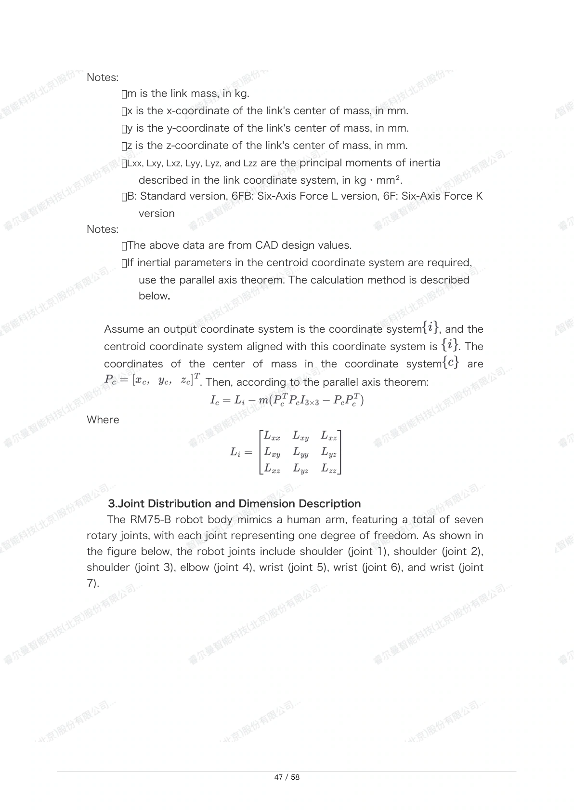




```
Notes:
m is the link mass, in kg.
x is the x-coordinate of the link's center of mass, in mm.
y is the y-coordinate of the link's center of mass, in mm.
z is the z-coordinate of the link's center of mass, in mm.
Lxx, Lxy, Lxz, Lyy, Lyz, and Lzz are the principal moments of inertia 
described in the link coordinate system, in kg·mm².
B: Standard version, 6FB: Six-Axis Force L version, 6F: Six-Axis Force K 
version
Notes:
The above data are from CAD design values.
If inertial parameters in the centroid coordinate system are required, 
use the parallel axis theorem. The calculation method is described 
below.
Assume an output coordinate system is the coordinate system
, and the 
centroid coordinate system aligned with this coordinate system is 
. The 
coordinates of the center of mass in the coordinate system
 are 
. Then, according to the parallel axis theorem:


Where


3.Joint Distribution and Dimension Description
The RM75-B robot body mimics a human arm, featuring a total of seven 
rotary joints, with each joint representing one degree of freedom. As shown in 
the figure below, the robot joints include shoulder (joint 1), shoulder (joint 2), 
shoulder (joint 3), elbow (joint 4), wrist (joint 5), wrist (joint 6), and wrist (joint 
7).
47 / 58
```




## PDF page 48

[RM65 and RM75 hardware manual, original PDF page 48](https://1292444914-files.gitbook.io/~/files/v0/b/gitbook-x-prod.appspot.com/o/spaces%2FtgOfPnscWebs1eh82EKq%2Fuploads%2Fq0K4ojQBOfMh9tUiyj0c%2FRM65-pages-40-51.pdf?alt=media#page=9)



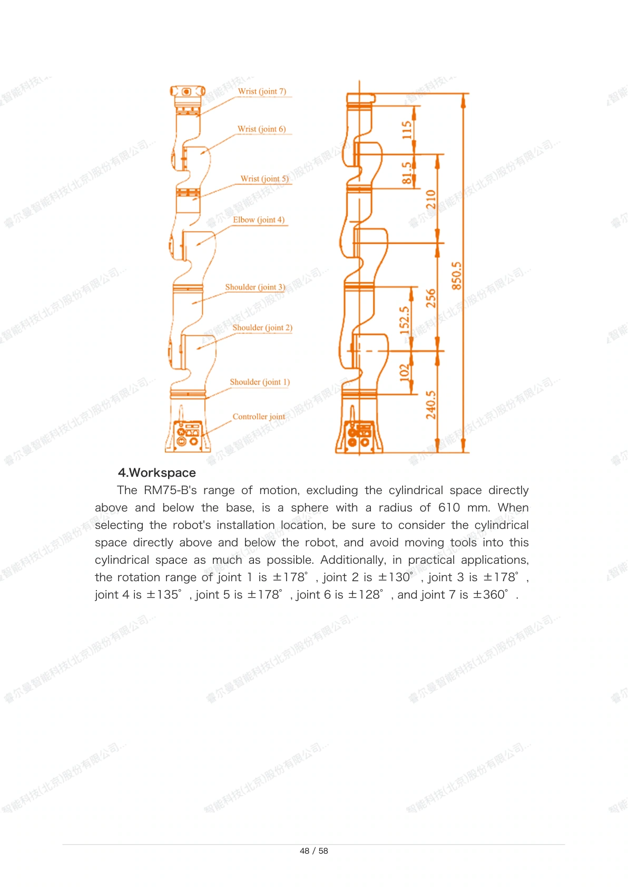




```
4.Workspace
The RM75-B's range of motion, excluding the cylindrical space directly 
above and below the base, is a sphere with a radius of 610 mm. When 
selecting the robot's installation location, be sure to consider the cylindrical 
space directly above and below the robot, and avoid moving tools into this 
cylindrical space as much as possible. Additionally, in practical applications, 
the rotation range of joint 1 is ±178°, joint 2 is ±130°, joint 3 is ±178°, 
joint 4 is ±135°, joint 5 is ±178°, joint 6 is ±128°, and joint 7 is ±360°.
48 / 58
```




## PDF page 49

[RM65 and RM75 hardware manual, original PDF page 49](https://1292444914-files.gitbook.io/~/files/v0/b/gitbook-x-prod.appspot.com/o/spaces%2FtgOfPnscWebs1eh82EKq%2Fuploads%2Fq0K4ojQBOfMh9tUiyj0c%2FRM65-pages-40-51.pdf?alt=media#page=10)



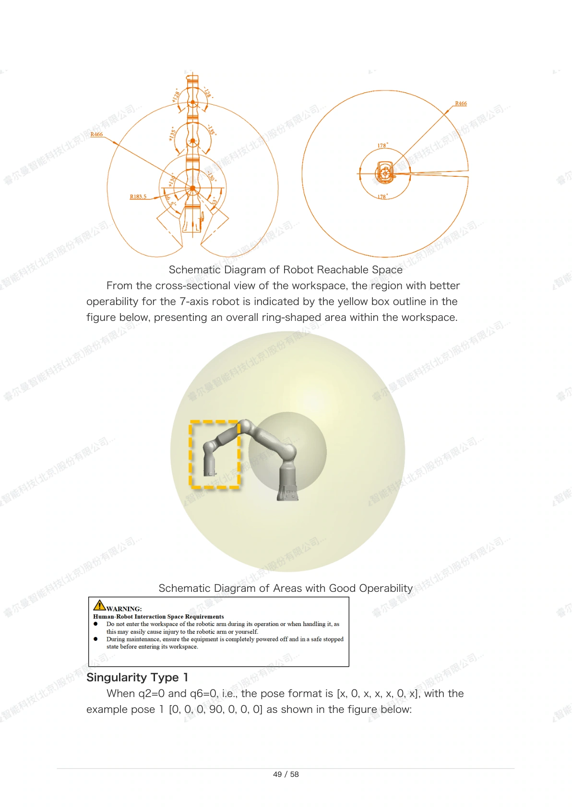




```
Schematic Diagram of Robot Reachable Space
From the cross-sectional view of the workspace, the region with better 
operability for the 7-axis robot is indicated by the yellow box outline in the 
figure below, presenting an overall ring-shaped area within the workspace.


Schematic Diagram of Areas with Good Operability
Singularity Type 1
When q2=0 and q6=0, i.e., the pose format is [x, 0, x, x, x, 0, x], with the 
example pose 1 [0, 0, 0, 90, 0, 0, 0] as shown in the figure below:
49 / 58
```




## PDF page 50

[RM65 and RM75 hardware manual, original PDF page 50](https://1292444914-files.gitbook.io/~/files/v0/b/gitbook-x-prod.appspot.com/o/spaces%2FtgOfPnscWebs1eh82EKq%2Fuploads%2Fq0K4ojQBOfMh9tUiyj0c%2FRM65-pages-40-51.pdf?alt=media#page=11)



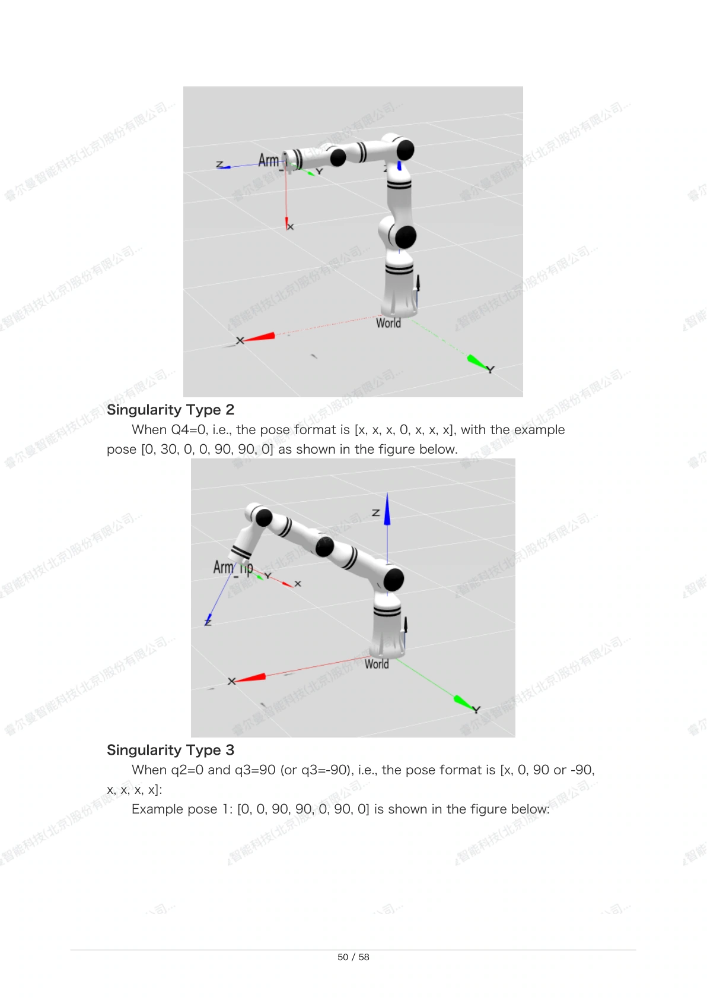




```
Singularity Type 2
When Q4=0, i.e., the pose format is [x, x, x, 0, x, x, x], with the example 
pose [0, 30, 0, 0, 90, 90, 0] as shown in the figure below.


Singularity Type 3
When q2=0 and q3=90 (or q3=-90), i.e., the pose format is [x, 0, 90 or -90, 
x, x, x, x]:
Example pose 1: [0, 0, 90, 90, 0, 90, 0] is shown in the figure below:
50 / 58
```




## PDF page 51

[RM65 and RM75 hardware manual, original PDF page 51](https://1292444914-files.gitbook.io/~/files/v0/b/gitbook-x-prod.appspot.com/o/spaces%2FtgOfPnscWebs1eh82EKq%2Fuploads%2Fq0K4ojQBOfMh9tUiyj0c%2FRM65-pages-40-51.pdf?alt=media#page=12)



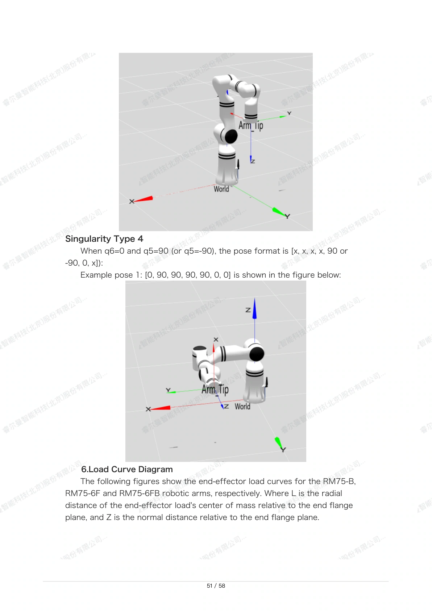




```
Singularity Type 4
When q6=0 and q5=90 (or q5=-90), the pose format is [x, x, x, x, 90 or 
-90, 0, x]):
Example pose 1: [0, 90, 90, 90, 90, 0, 0] is shown in the figure below:


6.Load Curve Diagram
The following figures show the end-effector load curves for the RM75-B, 
RM75-6F and RM75-6FB robotic arms, respectively. Where L is the radial 
distance of the end-effector load's center of mass relative to the end flange 
plane, and Z is the normal distance relative to the end flange plane.
51 / 58
```




## PDF page 52

[RM65 and RM75 hardware manual, original PDF page 52](https://1292444914-files.gitbook.io/~/files/v0/b/gitbook-x-prod.appspot.com/o/spaces%2FtgOfPnscWebs1eh82EKq%2Fuploads%2Fchg4addyUmOuTODjjakO%2FRM65-pages-52-58.pdf?alt=media#page=1)



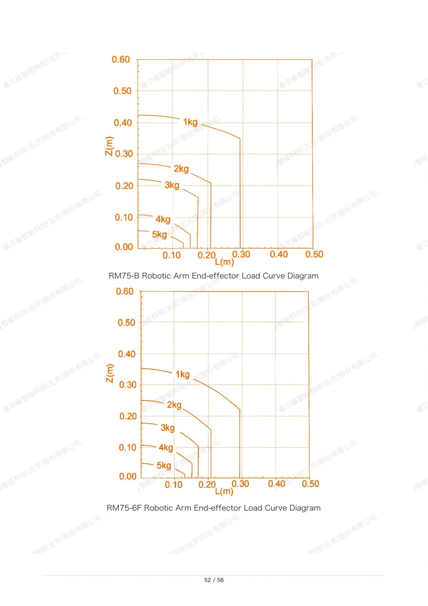




```
RM75-B Robotic Arm End-effector Load Curve Diagram


RM75-6F Robotic Arm End-effector Load Curve Diagram
52 / 58
```




## PDF page 53

[RM65 and RM75 hardware manual, original PDF page 53](https://1292444914-files.gitbook.io/~/files/v0/b/gitbook-x-prod.appspot.com/o/spaces%2FtgOfPnscWebs1eh82EKq%2Fuploads%2Fchg4addyUmOuTODjjakO%2FRM65-pages-52-58.pdf?alt=media#page=2)



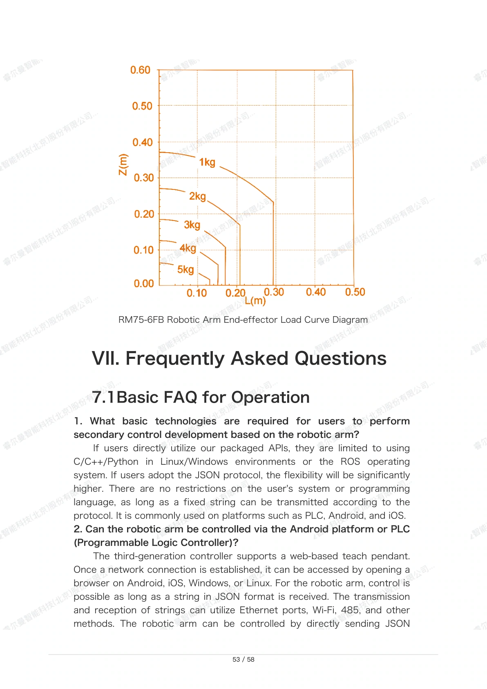




```
RM75-6FB Robotic Arm End-effector Load Curve Diagram
VII. Frequently Asked Questions
7.1Basic FAQ for Operation
1. What basic technologies are required for users to perform 
secondary control development based on the robotic arm?
If users directly utilize our packaged APIs, they are limited to using 
C/C++/Python in Linux/Windows environments or the ROS operating 
system. If users adopt the JSON protocol, the flexibility will be significantly 
higher. There are no restrictions on the user's system or programming 
language, as long as a fixed string can be transmitted according to the 
protocol. It is commonly used on platforms such as PLC, Android, and iOS.
2. Can the robotic arm be controlled via the Android platform or PLC 
(Programmable Logic Controller)?
The third-generation controller supports a web-based teach pendant. 
Once a network connection is established, it can be accessed by opening a 
browser on Android, iOS, Windows, or Linux. For the robotic arm, control is 
possible as long as a string in JSON format is received. The transmission 
and reception of strings can utilize Ethernet ports, Wi-Fi, 485, and other 
methods. The robotic arm can be controlled by directly sending JSON 
53 / 58
```




## PDF page 54

[RM65 and RM75 hardware manual, original PDF page 54](https://1292444914-files.gitbook.io/~/files/v0/b/gitbook-x-prod.appspot.com/o/spaces%2FtgOfPnscWebs1eh82EKq%2Fuploads%2Fchg4addyUmOuTODjjakO%2FRM65-pages-52-58.pdf?alt=media#page=3)



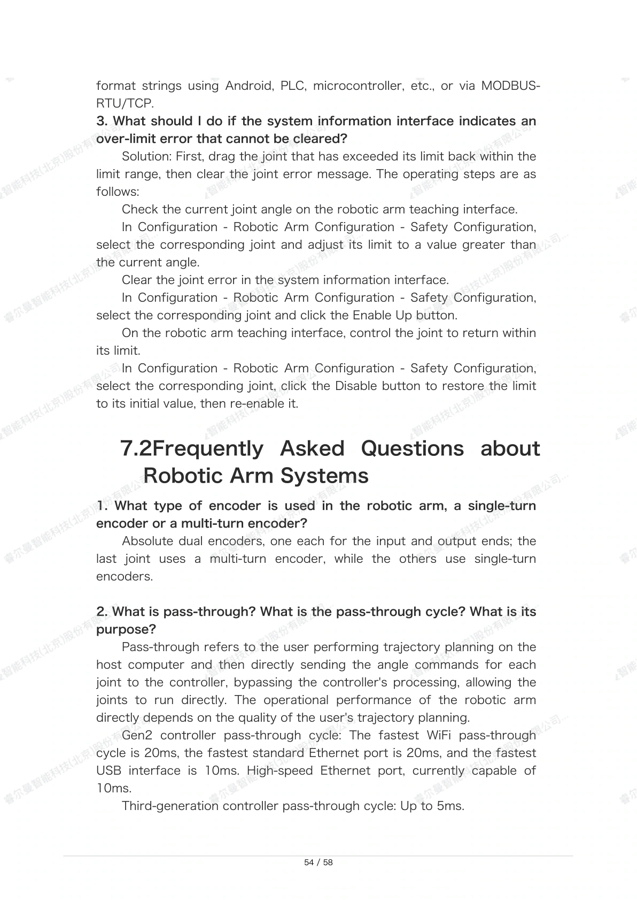




```
format strings using Android, PLC, microcontroller, etc., or via MODBUS-
RTU/TCP.
3. What should I do if the system information interface indicates an 
over-limit error that cannot be cleared?
Solution: First, drag the joint that has exceeded its limit back within the 
limit range, then clear the joint error message. The operating steps are as 
follows:
Check the current joint angle on the robotic arm teaching interface.
In Configuration - Robotic Arm Configuration - Safety Configuration, 
select the corresponding joint and adjust its limit to a value greater than 
the current angle.
Clear the joint error in the system information interface.
In Configuration - Robotic Arm Configuration - Safety Configuration, 
select the corresponding joint and click the Enable Up button.
On the robotic arm teaching interface, control the joint to return within 
its limit.
In Configuration - Robotic Arm Configuration - Safety Configuration, 
select the corresponding joint, click the Disable button to restore the limit 
to its initial value, then re-enable it.
7.2Frequently Asked Questions about
Robotic Arm Systems
1. What type of encoder is used in the robotic arm, a single-turn 
encoder or a multi-turn encoder?
Absolute dual encoders, one each for the input and output ends; the 
last joint uses a multi-turn encoder, while the others use single-turn 
encoders.
2. What is pass-through? What is the pass-through cycle? What is its 
purpose?
Pass-through refers to the user performing trajectory planning on the 
host computer and then directly sending the angle commands for each 
joint to the controller, bypassing the controller's processing, allowing the 
joints to run directly. The operational performance of the robotic arm 
directly depends on the quality of the user's trajectory planning.
Gen2 controller pass-through cycle: The fastest WiFi pass-through 
cycle is 20ms, the fastest standard Ethernet port is 20ms, and the fastest 
USB interface is 10ms. High-speed Ethernet port, currently capable of 
10ms.
Third-generation controller pass-through cycle: Up to 5ms.
54 / 58
```




## PDF page 55

[RM65 and RM75 hardware manual, original PDF page 55](https://1292444914-files.gitbook.io/~/files/v0/b/gitbook-x-prod.appspot.com/o/spaces%2FtgOfPnscWebs1eh82EKq%2Fuploads%2Fchg4addyUmOuTODjjakO%2FRM65-pages-52-58.pdf?alt=media#page=4)



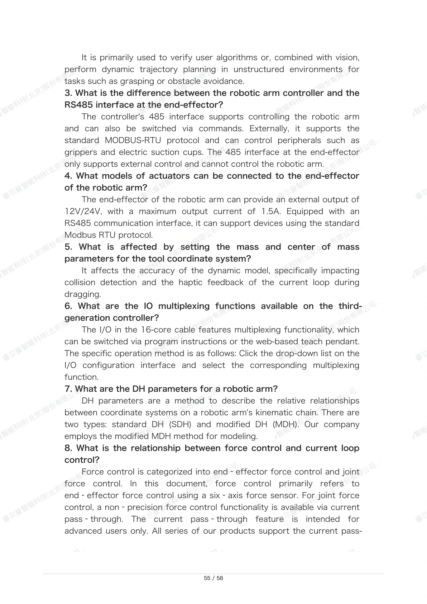




```
It is primarily used to verify user algorithms or, combined with vision, 
perform dynamic trajectory planning in unstructured environments for 
tasks such as grasping or obstacle avoidance.
3. What is the difference between the robotic arm controller and the 
RS485 interface at the end-effector?
The controller's 485 interface supports controlling the robotic arm 
and can also be switched via commands. Externally, it supports the 
standard MODBUS-RTU protocol and can control peripherals such as 
grippers and electric suction cups. The 485 interface at the end-effector 
only supports external control and cannot control the robotic arm.
4. What models of actuators can be connected to the end-effector 
of the robotic arm?
The end-effector of the robotic arm can provide an external output of 
12V/24V, with a maximum output current of 1.5A. Equipped with an 
RS485 communication interface, it can support devices using the standard 
Modbus RTU protocol.
5. What is affected by setting the mass and center of mass 
parameters for the tool coordinate system?
It affects the accuracy of the dynamic model, specifically impacting 
collision detection and the haptic feedback of the current loop during 
dragging.
6. What are the IO multiplexing functions available on the third-
generation controller?
The I/O in the 16-core cable features multiplexing functionality, which 
can be switched via program instructions or the web-based teach pendant. 
The specific operation method is as follows: Click the drop-down list on the 
I/O configuration interface and select the corresponding multiplexing 
function.
7. What are the DH parameters for a robotic arm?
DH parameters are a method to describe the relative relationships 
between coordinate systems on a robotic arm's kinematic chain. There are 
two types: standard DH (SDH) and modified DH (MDH). Our company 
employs the modified MDH method for modeling.
8. What is the relationship between force control and current loop 
control?
Force control is categorized into end‑effector force control and joint 
force control. In this document, force control primarily refers to 
end‑effector force control using a six‑axis force sensor. For joint force 
control, a non‑precision force control functionality is available via current 
pass‑through. The current pass‑through feature is intended for 
advanced users only. All series of our products support the current pass-
55 / 58
```




## PDF page 56

[RM65 and RM75 hardware manual, original PDF page 56](https://1292444914-files.gitbook.io/~/files/v0/b/gitbook-x-prod.appspot.com/o/spaces%2FtgOfPnscWebs1eh82EKq%2Fuploads%2Fchg4addyUmOuTODjjakO%2FRM65-pages-52-58.pdf?alt=media#page=5)








```
through function, while end-effector force control is only supported by 
models equipped with a six-axis force sensor.
9. What is the service life of the RM robotic arm?
The continuous operation life of the robotic arm under rated load is 
50,000 hours. It has currently obtained MTBF testing and certification 
from the Shanghai National Robot Testing Center.
VIII. Handling and Precautions
During robot installation, appropriate measures and positioning should be 
applied to moving parts to prevent unintended movement during installation 
and transportation, thereby avoiding potential hazards. When packaging for 
transport, packaging shall be performed in accordance with the packaging 
standards, and the required markings shall be applied to the outside of the 
packaging box.
During transportation, ensure that the robot is stable and remains in a 
fixed position.
When moving the robot from its packaging material to the installation 
position, support the robot until all bolts on the robot base are fully tightened.
No brake is installed inside joints 4~6 of the robot. When the power is off, 
keep the robot in a suitable position to prevent joint rotation under gravity 
from causing a collision. (In the vertical state, place the robot in the zero 
position and pose before powering off.)
After transportation, retain the original packaging and store the packaging 
materials in a dry place for potential future repackaging and movement of the 
robot.
IX.Maintenance, 
Repair, 
and
Disposal
Maintenance and repair work must comply with all safety instructions in 
this manual. Personnel responsible for installing, operating, and maintaining 
the equipment must first undergo rigorous training, understand all safety 
notices, and master the correct operation and maintenance procedures before 
they can operate and maintain the equipment. Professionals are required to 
install and debug the robot in accordance with the installation standards.
After modifying the control system or robot joints, on-site recalibration of 
the robot and tool zero points is required. Additionally, parameter settings 
must be checked. If a parameter backup exists, it can be imported; otherwise, 
56 / 58
```




## PDF page 57

[RM65 and RM75 hardware manual, original PDF page 57](https://1292444914-files.gitbook.io/~/files/v0/b/gitbook-x-prod.appspot.com/o/spaces%2FtgOfPnscWebs1eh82EKq%2Fuploads%2Fchg4addyUmOuTODjjakO%2FRM65-pages-52-58.pdf?alt=media#page=6)



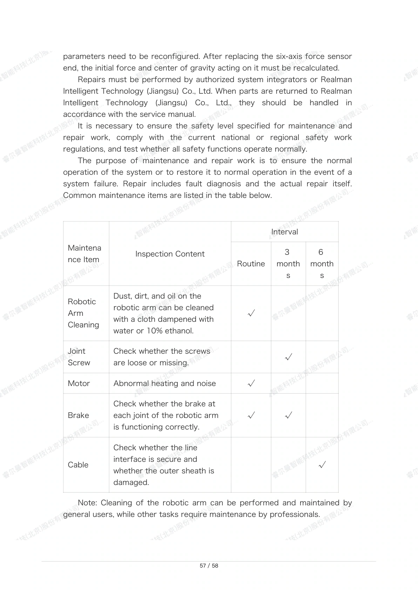




```
parameters need to be reconfigured. After replacing the six-axis force sensor 
end, the initial force and center of gravity acting on it must be recalculated.
Repairs must be performed by authorized system integrators or Realman 
Intelligent Technology (Jiangsu) Co., Ltd. When parts are returned to Realman 
Intelligent Technology (Jiangsu) Co., Ltd., they should be handled in 
accordance with the service manual.
It is necessary to ensure the safety level specified for maintenance and 
repair work, comply with the current national or regional safety work 
regulations, and test whether all safety functions operate normally.
The purpose of maintenance and repair work is to ensure the normal 
operation of the system or to restore it to normal operation in the event of a 
system failure. Repair includes fault diagnosis and the actual repair itself. 
Common maintenance items are listed in the table below.
Note: Cleaning of the robotic arm can be performed and maintained by 
general users, while other tasks require maintenance by professionals.
Maintena
nce Item
Inspection Content
Interval
Routine
3 
month
s
6 
month
s
Robotic 
Arm 
Cleaning
Dust, dirt, and oil on the 
robotic arm can be cleaned 
with a cloth dampened with 
water or 10% ethanol.
√


Joint 
Screw
Check whether the screws 
are loose or missing.

√

Motor
Abnormal heating and noise
√


Brake
Check whether the brake at 
each joint of the robotic arm 
is functioning correctly.
√
√

Cable
Check whether the line 
interface is secure and 
whether the outer sheath is 
damaged.


√
57 / 58
```




## PDF page 58

[RM65 and RM75 hardware manual, original PDF page 58](https://1292444914-files.gitbook.io/~/files/v0/b/gitbook-x-prod.appspot.com/o/spaces%2FtgOfPnscWebs1eh82EKq%2Fuploads%2Fchg4addyUmOuTODjjakO%2FRM65-pages-52-58.pdf?alt=media#page=7)



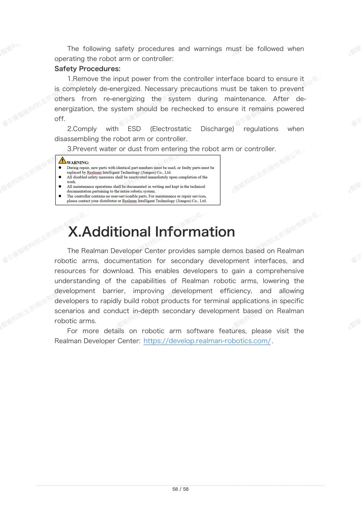




```
The following safety procedures and warnings must be followed when 
operating the robot arm or controller:
Safety Procedures:
1.Remove the input power from the controller interface board to ensure it 
is completely de-energized. Necessary precautions must be taken to prevent 
others from re-energizing the system during maintenance. After de-
energization, the system should be rechecked to ensure it remains powered 
off.
2.Comply 
with 
ESD 
(Electrostatic 
Discharge) 
regulations 
when 
disassembling the robot arm or controller.
3.Prevent water or dust from entering the robot arm or controller.
X.Additional Information
The Realman Developer Center provides sample demos based on Realman 
robotic arms, documentation for secondary development interfaces, and 
resources for download. This enables developers to gain a comprehensive 
understanding of the capabilities of Realman robotic arms, lowering the 
development 
barrier, 
improving 
development 
efficiency, 
and 
allowing 
developers to rapidly build robot products for terminal applications in specific 
scenarios and conduct in-depth secondary development based on Realman 
robotic arms.
For more details on robotic arm software features, please visit the 
Realman Developer Center: https://develop.realman-robotics.com/.
58 / 58
```



