# RMG22-65 parallel gripper manual V1.3 — complete supplied document (53 pages)


**Complete supplied document:** RealMan\_RMG22-65\_Two-Finger\_Parallel\_Gripper\_User\_Manual\_V1.3\_EN.pdf · **PDF pages:** 53. This reference preserves every source page, including tables, drawings, connector views, examples, revision notes, warranty text and appendices. [Return to the RealMan source library](./).


The **Original page** tab retains the exact visual layout. The **Searchable text** tab contains extracted text, or a visually checked transcription for the two image-only specification sheets. Native PDF text can have reading-order or character defects; use the original page for table column alignment, connector orientation, equations and code indentation.


The supplied V1.3 manual contains internal differences: its specification gives a 2 s open/close time, while the host-software scale description mentions 0.4 s; the 0–1000 torque scale references a 4 kg value that is not interchangeable with the stated 5 kg encompassing / recommended 2 kg friction payloads. The baud table repeats 19200 for codes 1 and 2, and the command catalogue reuses 0xDA for two labels. These are preserved source statements, not reconciled command guidance. Confirm the firmware-specific protocol before using the ambiguous settings. The gripper’s 5.7 A maximum input demand exceeds the 1.5 A maximum tool-output table in the supplied arm manual; an independently approved power arrangement is necessary.


## Document navigation

| Topic                                                                    | PDF pages                                            |
| ------------------------------------------------------------------------ | ---------------------------------------------------- |
| Safety, revisions and contents                                           | [PDF 1–6](complete-rmg22-65-manual.md#pdf-page-1)    |
| Product specifications and packing list                                  | [PDF 7–9](complete-rmg22-65-manual.md#pdf-page-7)    |
| Mechanical/electrical installation and serial configuration              | [PDF 10–13](complete-rmg22-65-manual.md#pdf-page-10) |
| Host software controls, status, calibration and firmware                 | [PDF 13–17](complete-rmg22-65-manual.md#pdf-page-13) |
| Modbus coil and holding registers                                        | [PDF 18–20](complete-rmg22-65-manual.md#pdf-page-18) |
| RS485 framing, checksum and command catalogue                            | [PDF 21–24](complete-rmg22-65-manual.md#pdf-page-21) |
| Every proprietary command, request and response example, I/O and support | [PDF 25–53](complete-rmg22-65-manual.md#pdf-page-25) |

**Source attribution:** RealMan, supplied document named above. All original notices and technical statements remain visible in the source page images. Added navigation and discrepancy notes are OpenELAB editorial guidance. Software execution and hardware validation: **not run**.

## PDF page 1

[RMG22-65 parallel gripper manual V1.3, original PDF page 1](https://1292444914-files.gitbook.io/~/files/v0/b/gitbook-x-prod.appspot.com/o/spaces%2FtgOfPnscWebs1eh82EKq%2Fuploads%2FMISWJx440NuLDkZ0DN2e%2FRMG22-pages-01-53.pdf?alt=media#page=1)



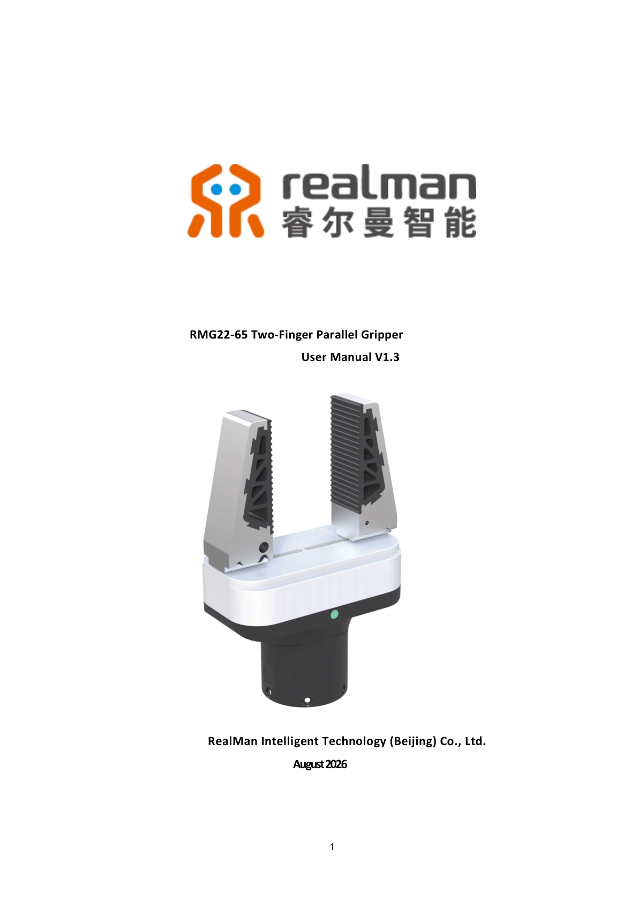




```
1
 
 
 
 
 
 
 
 
 
 
 
RMG22-65 Two-Finger Parallel Gripper  
User Manual V1.3 
 
      
 
 
RealMan Intelligent Technology (Beijing) Co., Ltd. 
August 2026
```




## PDF page 2

[RMG22-65 parallel gripper manual V1.3, original PDF page 2](https://1292444914-files.gitbook.io/~/files/v0/b/gitbook-x-prod.appspot.com/o/spaces%2FtgOfPnscWebs1eh82EKq%2Fuploads%2FMISWJx440NuLDkZ0DN2e%2FRMG22-pages-01-53.pdf?alt=media#page=2)








```
2
Safety Instructions 
 
 
 
Thank you very much for purchasing RealMan Intelligent Technology (Beijing) Co., Ltd. 
After opening the package, please first check the accessories according to the equipment 
configuration list. If you find that the accessories are damaged or missing, please contact 
your dealer or customer service as soon as possible to solve the problem. 
 
 
 
    Before using the product, be sure to read the product instructions 
carefully. 
 
    In order to ensure the safety of you and the device, please 
make sure that the power supply voltage is accurate before 
connecting the device to the power supply. 
 
    When using, please strictly follow the operating instructions 
of the equipment or under the guidance of a professional teacher, 
and do not violate the rules and regulations. 
 
   Do not disassemble the chassis and modify the inside of the product by 
yourself, otherwise it will cause malfunction! 
 
   When installing and removing the outer control unit, please turn off the 
power first to prevent electric shock accidents or damage to the product! 
 
    Please disconnect the power after using the device. 
 
    This product contains moving parts, please do not wear 
jewelry when using, long hair needs to be rolled up to prevent danger 
of winding. 
 
    If there are abnormal conditions during the use of the equipment, 
please contact a professional in a timely manner. 
 
   Due to the damage caused by the actual working 
environment conditions (including temperature, humidity, power 
supply voltage, etc.) exceeding the technical indicators of the 
product, we will pay for the warranty, but we are not responsible 
for any other damage caused!
```




## PDF page 3

[RMG22-65 parallel gripper manual V1.3, original PDF page 3](https://1292444914-files.gitbook.io/~/files/v0/b/gitbook-x-prod.appspot.com/o/spaces%2FtgOfPnscWebs1eh82EKq%2Fuploads%2FMISWJx440NuLDkZ0DN2e%2FRMG22-pages-01-53.pdf?alt=media#page=3)



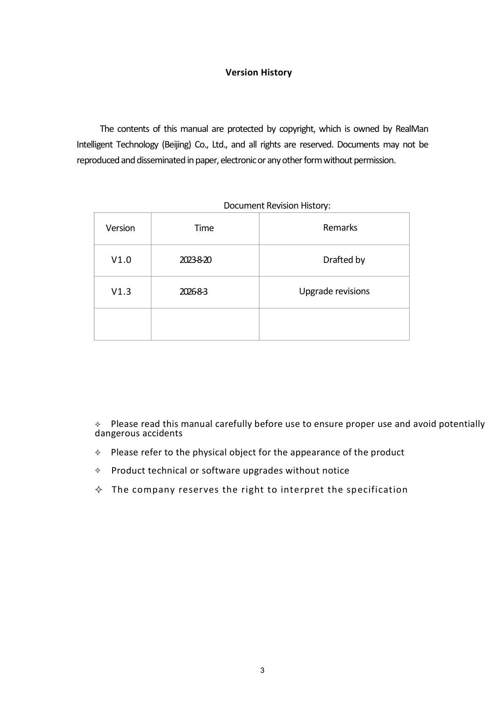




```
3
Version History 
 
 
 
The contents of this manual are protected by copyright, which is owned by RealMan 
Intelligent Technology (Beijing) Co., Ltd., and all rights are reserved. Documents may not be 
reproduced and disseminated in paper, electronic or any other form without permission. 
 
 
Document Revision History: 
 
Version 
Time 
Remarks 
V1.0 
2023-8-20 
Drafted by 
V1.3 
2026-8-3 
Upgrade revisions 
 
 
 
 
 
 
    Please read this manual carefully before use to ensure proper use and avoid potentially 
dangerous accidents 
    Please refer to the physical object for the appearance of the product 
    Product technical or software upgrades without notice 
   The company reserves the right to interpret the specification
```




## PDF page 4

[RMG22-65 parallel gripper manual V1.3, original PDF page 4](https://1292444914-files.gitbook.io/~/files/v0/b/gitbook-x-prod.appspot.com/o/spaces%2FtgOfPnscWebs1eh82EKq%2Fuploads%2FMISWJx440NuLDkZ0DN2e%2FRMG22-pages-01-53.pdf?alt=media#page=4)



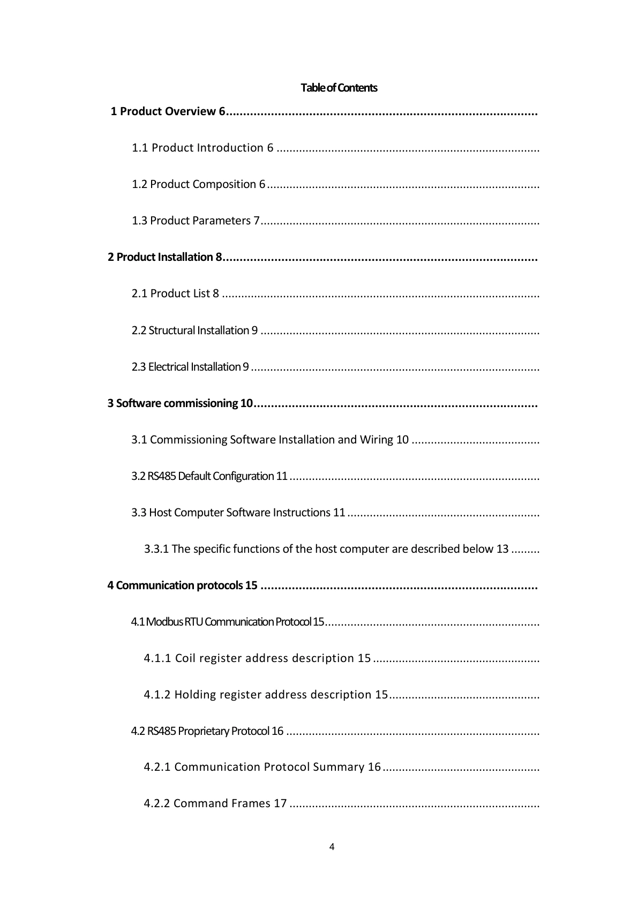




```
4
Table of Contents 
1 Product Overview 6 ..........................................................................................  
 
1.1 Product Introduction 6 .................................................................................. 
 
1.2 Product Composition 6 ..................................................................................... 
 
1.3 Product Parameters 7 ....................................................................................... 
 
2 Product Installation 8 ...........................................................................................  
 
2.1 Product List 8 ................................................................................................... 
 
2.2 Structural Installation 9 ....................................................................................... 
 
2.3 Electrical Installation 9 .......................................................................................... 
 
3 Software commissioning 10 ..................................................................................  
 
3.1 Commissioning Software Installation and Wiring 10 ........................................ 
 
3.2 RS485 Default Configuration 11 .............................................................................. 
 
3.3 Host Computer Software Instructions 11 ............................................................ 
 
3.3.1 The specific functions of the host computer are described below 13 ......... 
 
4 Communication protocols 15 ................................................................................  
 
4.1 Modbus RTU Communication Protocol 15 ................................................................... 
 
4.1.1 Coil register address description 15 .................................................... 
 
4.1.2 Holding register address description 15............................................... 
 
4.2 RS485 Proprietary Protocol 16 ............................................................................... 
 
4.2.1 Communication Protocol Summary 16 ................................................. 
 
4.2.2 Command Frames 17 ..............................................................................
```




## PDF page 5

[RMG22-65 parallel gripper manual V1.3, original PDF page 5](https://1292444914-files.gitbook.io/~/files/v0/b/gitbook-x-prod.appspot.com/o/spaces%2FtgOfPnscWebs1eh82EKq%2Fuploads%2FMISWJx440NuLDkZ0DN2e%2FRMG22-pages-01-53.pdf?alt=media#page=5)








```
5
 
4.2.3 Type of instruction 17 .............................................................................
```




## PDF page 6

[RMG22-65 parallel gripper manual V1.3, original PDF page 6](https://1292444914-files.gitbook.io/~/files/v0/b/gitbook-x-prod.appspot.com/o/spaces%2FtgOfPnscWebs1eh82EKq%2Fuploads%2FMISWJx440NuLDkZ0DN2e%2FRMG22-pages-01-53.pdf?alt=media#page=6)



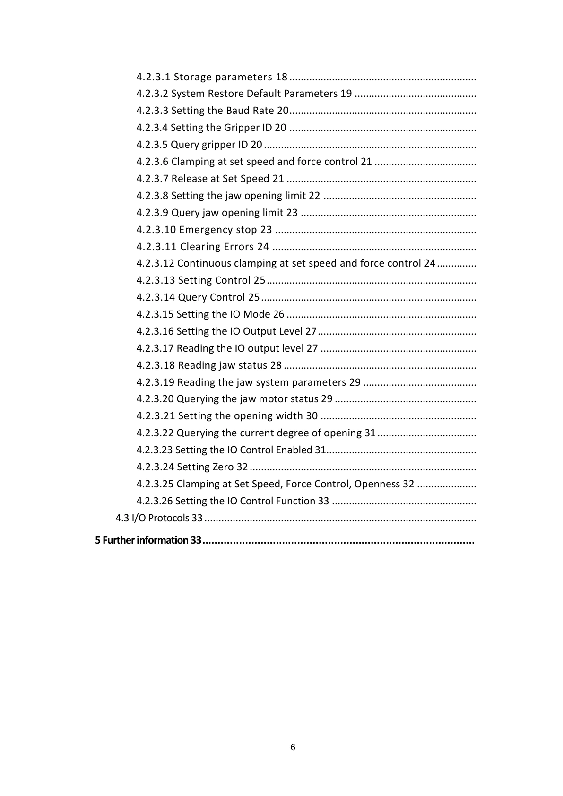




```
6
4.2.3.1 Storage parameters 18 .................................................................. 
4.2.3.2 System Restore Default Parameters 19 ........................................... 
4.2.3.3 Setting the Baud Rate 20 .................................................................. 
4.2.3.4 Setting the Gripper ID 20 .................................................................. 
4.2.3.5 Query gripper ID 20 ........................................................................... 
4.2.3.6 Clamping at set speed and force control 21 .................................... 
4.2.3.7 Release at Set Speed 21 ................................................................... 
4.2.3.8 Setting the jaw opening limit 22 ...................................................... 
4.2.3.9 Query jaw opening limit 23 .............................................................. 
4.2.3.10 Emergency stop 23 ....................................................................... 
4.2.3.11 Clearing Errors 24 ........................................................................ 
4.2.3.12 Continuous clamping at set speed and force control 24 .............. 
4.2.3.13 Setting Control 25 .......................................................................... 
4.2.3.14 Query Control 25 ............................................................................ 
4.2.3.15 Setting the IO Mode 26 ................................................................... 
4.2.3.16 Setting the IO Output Level 27 ........................................................ 
4.2.3.17 Reading the IO output level 27 ....................................................... 
4.2.3.18 Reading jaw status 28 .................................................................... 
4.2.3.19 Reading the jaw system parameters 29 ........................................ 
4.2.3.20 Querying the jaw motor status 29 .................................................. 
4.2.3.21 Setting the opening width 30 ....................................................... 
4.2.3.22 Querying the current degree of opening 31 ................................... 
4.2.3.23 Setting the IO Control Enabled 31 ..................................................... 
4.2.3.24 Setting Zero 32 ................................................................................ 
4.2.3.25 Clamping at Set Speed, Force Control, Openness 32 ..................... 
4.2.3.26 Setting the IO Control Function 33 ................................................... 
4.3 I/O Protocols 33 ................................................................................................ 
5 Further information 33 .........................................................................................
```




## PDF page 7

[RMG22-65 parallel gripper manual V1.3, original PDF page 7](https://1292444914-files.gitbook.io/~/files/v0/b/gitbook-x-prod.appspot.com/o/spaces%2FtgOfPnscWebs1eh82EKq%2Fuploads%2FMISWJx440NuLDkZ0DN2e%2FRMG22-pages-01-53.pdf?alt=media#page=7)



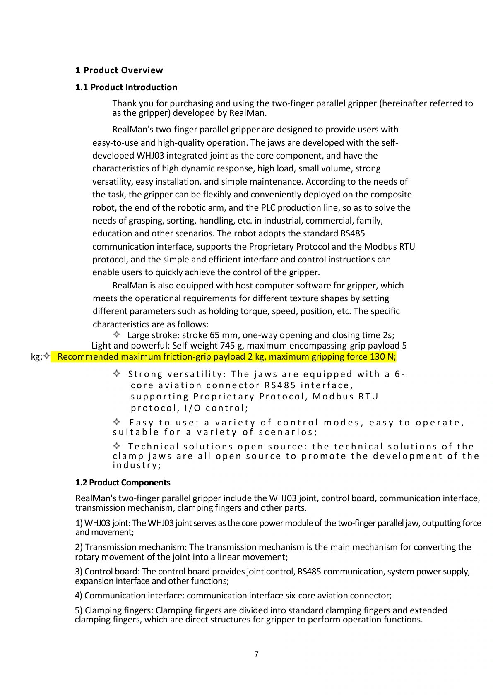




```
7
1 Product Overview 
1.1 Product Introduction 
Thank you for purchasing and using the two-finger parallel gripper (hereinafter referred to 
as the gripper) developed by RealMan. 
RealMan's two-finger parallel gripper are designed to provide users with 
easy-to-use and high-quality operation. The jaws are developed with the self-
developed WHJ03 integrated joint as the core component, and have the 
characteristics of high dynamic response, high load, small volume, strong 
versatility, easy installation, and simple maintenance. According to the needs of 
the task, the gripper can be flexibly and conveniently deployed on the composite 
robot, the end of the robotic arm, and the PLC production line, so as to solve the 
needs of grasping, sorting, handling, etc. in industrial, commercial, family, 
education and other scenarios. The robot adopts the standard RS485 
communication interface, supports the Proprietary Protocol and the Modbus RTU 
protocol, and the simple and efficient interface and control instructions can 
enable users to quickly achieve the control of the gripper. 
RealMan is also equipped with host computer software for gripper, which 
meets the operational requirements for different texture shapes by setting 
different parameters such as holding torque, speed, position, etc. The specific 
characteristics are as follows: 
   Large stroke: stroke 65 mm, one-way opening and closing time 2s; 
                           Light and powerful: Self-weight 745 g, maximum encompassing-grip payload 5 
kg;
   Recommended maximum friction-grip payload 2 kg, maximum gripping force 130 N; 
  S t ro n g ve r sa t ility:  T h e jaw s are e qu ip pe d  w it h  a 6 -
co r e  a via t io n  con ne ct o r RS48 5  in te rface , 
su p po r t in g P ro p rie t ary Pro to co l, Mo d bu s RT U 
p r o to co l, I/ O con tro l;  
  E a s y  t o  u s e :  a  v a r i e t y  o f  c o n t r o l  m o d e s ,  e a s y  t o  o p e r a t e ,  
s u i t a b l e  f o r  a  v a r i e t y  o f  s c e n a r i o s ;  
  T e ch n i ca l s o lu t io n s o p e n  s o u rc e :  t h e  t e ch n i ca l so lu t io n s o f  t h e  
cla m p  j a w s a r e  a l l  o p e n  so u r ce  t o  p r o mo t e  t h e  d e ve lo p me n t  o f  t h e  
in d u st r y;  
1.2 Product Components 
RealMan's two-finger parallel gripper include the WHJ03 joint, control board, communication interface, 
transmission mechanism, clamping fingers and other parts. 
1) WHJ03 joint: The WHJ03 joint serves as the core power module of the two-finger parallel jaw, outputting force 
and movement; 
2) Transmission mechanism: The transmission mechanism is the main mechanism for converting the 
rotary movement of the joint into a linear movement; 
3) Control board: The control board provides joint control, RS485 communication, system power supply, 
expansion interface and other functions; 
4) Communication interface: communication interface six-core aviation connector; 
5) Clamping fingers: Clamping fingers are divided into standard clamping fingers and extended 
clamping fingers, which are direct structures for gripper to perform operation functions.
```




## PDF page 8

[RMG22-65 parallel gripper manual V1.3, original PDF page 8](https://1292444914-files.gitbook.io/~/files/v0/b/gitbook-x-prod.appspot.com/o/spaces%2FtgOfPnscWebs1eh82EKq%2Fuploads%2FMISWJx440NuLDkZ0DN2e%2FRMG22-pages-01-53.pdf?alt=media#page=8)



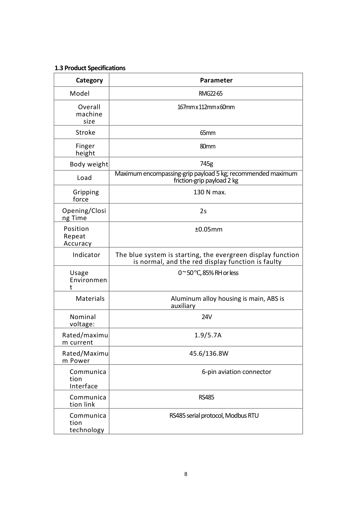




```
8
 
 
1.3 Product Specifications 
 
Category 
Parameter 
Model 
RMG22-65 
Overall 
machine 
size 
167mm x 112mm x 60mm 
Stroke 
65mm 
Finger 
height 
80mm 
Body weight 
745g 
Load 
Maximum encompassing-grip payload 5 kg; recommended maximum 
friction-grip payload 2 kg 
Gripping 
force 
130 N max. 
Opening/Closi
ng Time 
2s 
Position 
Repeat 
Accuracy 
±0.05mm 
Indicator 
The blue system is starting, the evergreen display function 
is normal, and the red display function is faulty 
Usage 
Environmen
t 
0 ~ 50 ℃, 85% RH or less 
Materials 
Aluminum alloy housing is main, ABS is 
auxiliary 
Nominal 
voltage: 
24V 
Rated/maximu
m current 
1.9/5.7A 
Rated/Maximu
m Power 
45.6/136.8W 
Communica
tion 
Interface 
6-pin aviation connector 
Communica
tion link 
RS485 
Communica
tion 
technology 
RS485 serial protocol, Modbus RTU
```




## PDF page 9

[RMG22-65 parallel gripper manual V1.3, original PDF page 9](https://1292444914-files.gitbook.io/~/files/v0/b/gitbook-x-prod.appspot.com/o/spaces%2FtgOfPnscWebs1eh82EKq%2Fuploads%2FMISWJx440NuLDkZ0DN2e%2FRMG22-pages-01-53.pdf?alt=media#page=9)



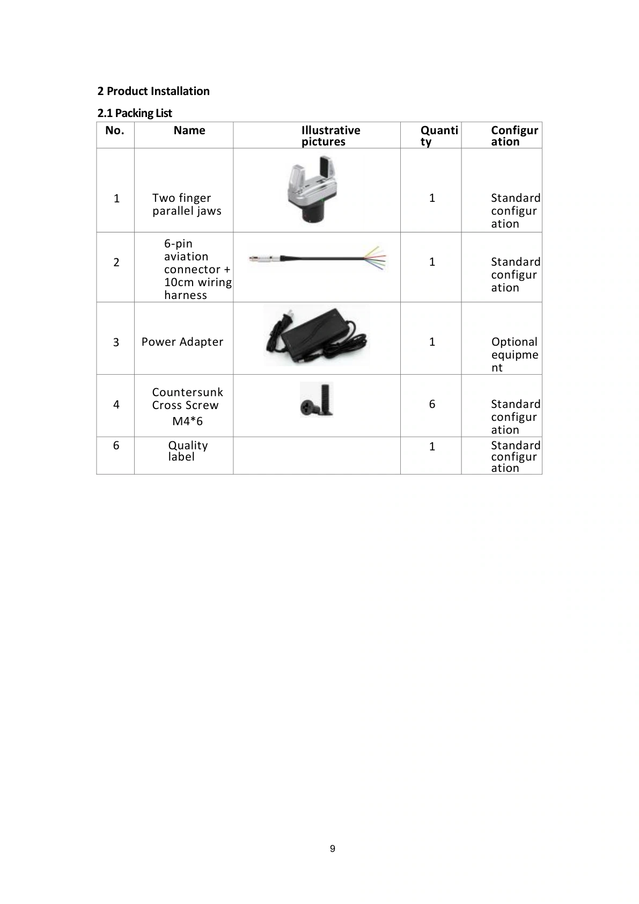




```
9
 
2 Product Installation 
2.1 Packing List 
 
No. 
Name 
Illustrative 
pictures 
Quanti
ty 
Configur
ation 
1 
Two finger 
parallel jaws 
 
1 
Standard 
configur
ation 
2 
6-pin 
aviation 
connector + 
10cm wiring 
harness 
 
1 
Standard 
configur
ation 
3 
Power Adapter 
 
1 
Optional 
equipme
nt 
4 
Countersunk 
Cross Screw 
M4*6 
 
6 
Standard 
configur
ation 
6 
Quality 
label 
1 
Standard 
configur
ation
```




## PDF page 10

[RMG22-65 parallel gripper manual V1.3, original PDF page 10](https://1292444914-files.gitbook.io/~/files/v0/b/gitbook-x-prod.appspot.com/o/spaces%2FtgOfPnscWebs1eh82EKq%2Fuploads%2FMISWJx440NuLDkZ0DN2e%2FRMG22-pages-01-53.pdf?alt=media#page=10)



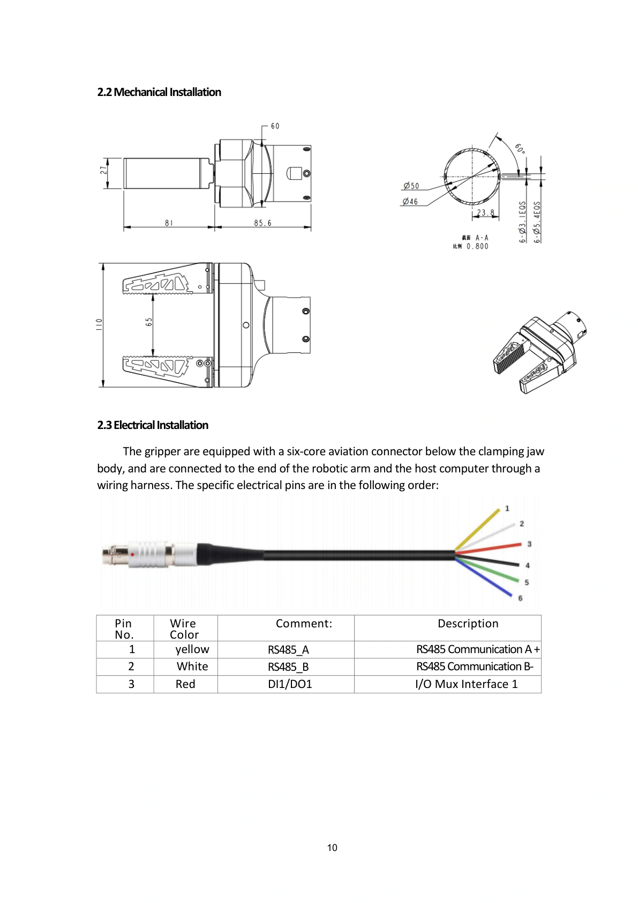




```
10
2.2 Mechanical Installation 
 
2.3 Electrical Installation 
The gripper are equipped with a six-core aviation connector below the clamping jaw 
body, and are connected to the end of the robotic arm and the host computer through a 
wiring harness. The specific electrical pins are in the following order: 
 
 
Pin 
No. 
Wire 
Color 
Comment: 
Description 
1 
yellow 
RS485_A 
RS485 Communication A + 
2 
White 
RS485_B 
RS485 Communication B- 
3 
Red 
DI1/DO1 
I/O Mux Interface 1
```




## PDF page 11

[RMG22-65 parallel gripper manual V1.3, original PDF page 11](https://1292444914-files.gitbook.io/~/files/v0/b/gitbook-x-prod.appspot.com/o/spaces%2FtgOfPnscWebs1eh82EKq%2Fuploads%2FMISWJx440NuLDkZ0DN2e%2FRMG22-pages-01-53.pdf?alt=media#page=11)



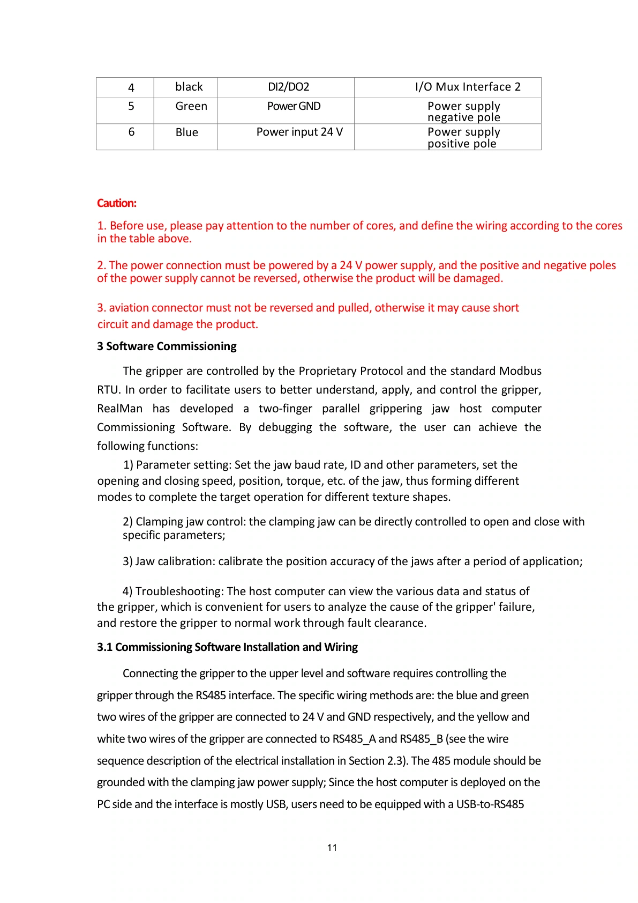




```
11
 
4 
black 
DI2/DO2 
I/O Mux Interface 2 
5 
Green 
Power GND 
Power supply 
negative pole 
6 
Blue 
Power input 24 V 
Power supply 
positive pole 
 
 
Caution: 
1. Before use, please pay attention to the number of cores, and define the wiring according to the cores 
in the table above. 
2. The power connection must be powered by a 24 V power supply, and the positive and negative poles 
of the power supply cannot be reversed, otherwise the product will be damaged. 
3. aviation connector must not be reversed and pulled, otherwise it may cause short 
circuit and damage the product. 
3 Software Commissioning 
The gripper are controlled by the Proprietary Protocol and the standard Modbus 
RTU. In order to facilitate users to better understand, apply, and control the gripper, 
RealMan has developed a two-finger parallel grippering jaw host computer 
Commissioning Software. By debugging the software, the user can achieve the 
following functions: 
1) Parameter setting: Set the jaw baud rate, ID and other parameters, set the 
opening and closing speed, position, torque, etc. of the jaw, thus forming different 
modes to complete the target operation for different texture shapes. 
2) Clamping jaw control: the clamping jaw can be directly controlled to open and close with 
specific parameters; 
3) Jaw calibration: calibrate the position accuracy of the jaws after a period of application; 
4) Troubleshooting: The host computer can view the various data and status of 
the gripper, which is convenient for users to analyze the cause of the gripper' failure, 
and restore the gripper to normal work through fault clearance. 
3.1 Commissioning Software Installation and Wiring 
Connecting the gripper to the upper level and software requires controlling the 
gripper through the RS485 interface. The specific wiring methods are: the blue and green 
two wires of the gripper are connected to 24 V and GND respectively, and the yellow and 
white two wires of the gripper are connected to RS485_A and RS485_B (see the wire 
sequence description of the electrical installation in Section 2.3). The 485 module should be 
grounded with the clamping jaw power supply; Since the host computer is deployed on the 
PC side and the interface is mostly USB, users need to be equipped with a USB-to-RS485
```




## PDF page 12

[RMG22-65 parallel gripper manual V1.3, original PDF page 12](https://1292444914-files.gitbook.io/~/files/v0/b/gitbook-x-prod.appspot.com/o/spaces%2FtgOfPnscWebs1eh82EKq%2Fuploads%2FMISWJx440NuLDkZ0DN2e%2FRMG22-pages-01-53.pdf?alt=media#page=12)








```
12
module, and connect the yellow and white 2 cables of the clamp jaws to the USB-to-RS485 
module, so that the host computer on the PC side can pass the USB
```




## PDF page 13

[RMG22-65 parallel gripper manual V1.3, original PDF page 13](https://1292444914-files.gitbook.io/~/files/v0/b/gitbook-x-prod.appspot.com/o/spaces%2FtgOfPnscWebs1eh82EKq%2Fuploads%2FMISWJx440NuLDkZ0DN2e%2FRMG22-pages-01-53.pdf?alt=media#page=13)



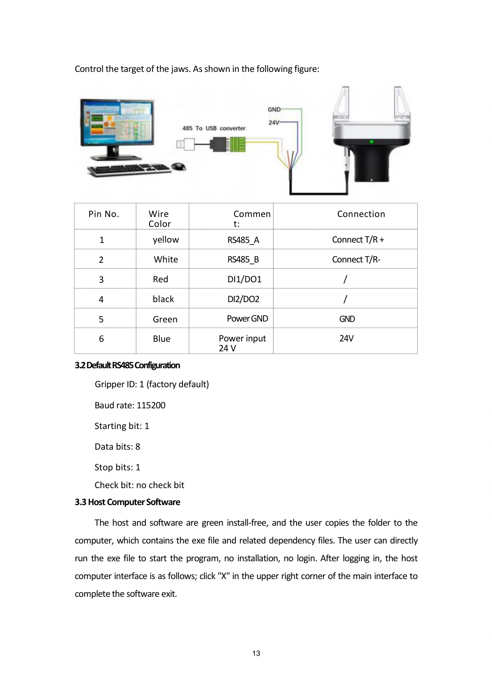




```
13
Control the target of the jaws. As shown in the following figure: 
 
 
Pin No. 
Wire 
Color 
Commen
t: 
Connection 
1 
yellow 
RS485_A 
Connect T/R + 
2 
White 
RS485_B 
Connect T/R- 
3 
Red 
DI1/DO1 
/ 
4 
black 
DI2/DO2 
/ 
5 
Green 
Power GND 
GND 
6 
Blue 
Power input 
24 V 
24V 
3.2 Default RS485 Configuration 
Gripper ID: 1 (factory default) 
Baud rate: 115200 
Starting bit: 1 
Data bits: 8 
Stop bits: 1 
Check bit: no check bit 
3.3 Host Computer Software 
The host and software are green install-free, and the user copies the folder to the 
computer, which contains the exe file and related dependency files. The user can directly 
run the exe file to start the program, no installation, no login. After logging in, the host 
computer interface is as follows; click "X" in the upper right corner of the main interface to 
complete the software exit.
```




## PDF page 14

[RMG22-65 parallel gripper manual V1.3, original PDF page 14](https://1292444914-files.gitbook.io/~/files/v0/b/gitbook-x-prod.appspot.com/o/spaces%2FtgOfPnscWebs1eh82EKq%2Fuploads%2FMISWJx440NuLDkZ0DN2e%2FRMG22-pages-01-53.pdf?alt=media#page=14)



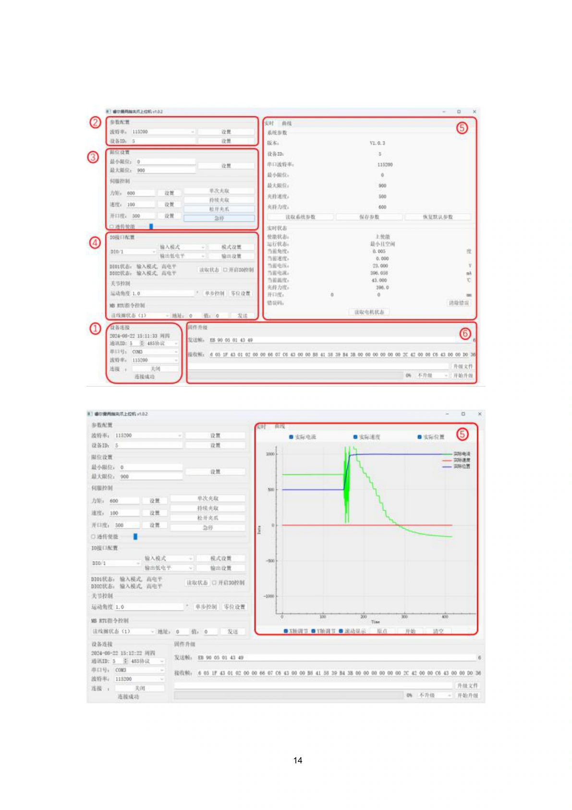




```
14
```




## PDF page 15

[RMG22-65 parallel gripper manual V1.3, original PDF page 15](https://1292444914-files.gitbook.io/~/files/v0/b/gitbook-x-prod.appspot.com/o/spaces%2FtgOfPnscWebs1eh82EKq%2Fuploads%2FMISWJx440NuLDkZ0DN2e%2FRMG22-pages-01-53.pdf?alt=media#page=15)



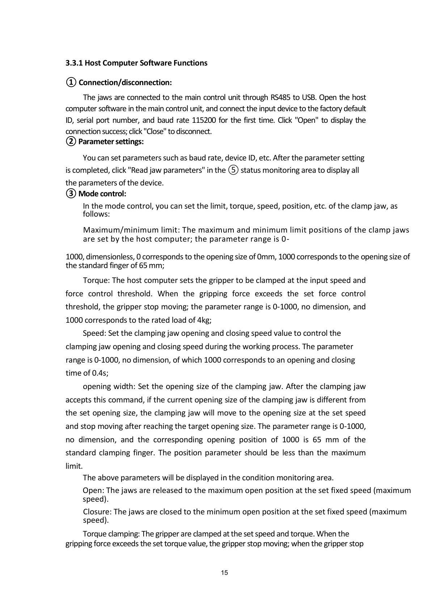




```
15
3.3.1 Host Computer Software Functions 
① Connection/disconnection: 
The jaws are connected to the main control unit through RS485 to USB. Open the host 
computer software in the main control unit, and connect the input device to the factory default 
ID, serial port number, and baud rate 115200 for the first time. Click "Open" to display the 
connection success; click "Close" to disconnect. 
② Parameter settings: 
You can set parameters such as baud rate, device ID, etc. After the parameter setting 
is completed, click "Read jaw parameters" in the ⑤ status monitoring area to display all 
the parameters of the device. 
③ Mode control: 
In the mode control, you can set the limit, torque, speed, position, etc. of the clamp jaw, as 
follows: 
Maximum/minimum limit: The maximum and minimum limit positions of the clamp jaws 
are set by the host computer; the parameter range is 0- 
1000, dimensionless, 0 corresponds to the opening size of 0mm, 1000 corresponds to the opening size of 
the standard finger of 65 mm; 
Torque: The host computer sets the gripper to be clamped at the input speed and 
force control threshold. When the gripping force exceeds the set force control 
threshold, the gripper stop moving; the parameter range is 0-1000, no dimension, and 
1000 corresponds to the rated load of 4kg; 
Speed: Set the clamping jaw opening and closing speed value to control the 
clamping jaw opening and closing speed during the working process. The parameter 
range is 0-1000, no dimension, of which 1000 corresponds to an opening and closing 
time of 0.4s; 
opening width: Set the opening size of the clamping jaw. After the clamping jaw 
accepts this command, if the current opening size of the clamping jaw is different from 
the set opening size, the clamping jaw will move to the opening size at the set speed 
and stop moving after reaching the target opening size. The parameter range is 0-1000, 
no dimension, and the corresponding opening position of 1000 is 65 mm of the 
standard clamping finger. The position parameter should be less than the maximum 
limit. 
The above parameters will be displayed in the condition monitoring area. 
Open: The jaws are released to the maximum open position at the set fixed speed (maximum 
speed). 
Closure: The jaws are closed to the minimum open position at the set fixed speed (maximum 
speed). 
Torque clamping: The gripper are clamped at the set speed and torque. When the 
gripping force exceeds the set torque value, the gripper stop moving; when the gripper stop
```




## PDF page 16

[RMG22-65 parallel gripper manual V1.3, original PDF page 16](https://1292444914-files.gitbook.io/~/files/v0/b/gitbook-x-prod.appspot.com/o/spaces%2FtgOfPnscWebs1eh82EKq%2Fuploads%2FMISWJx440NuLDkZ0DN2e%2FRMG22-pages-01-53.pdf?alt=media#page=16)








```
16
moving, if the gripping force is detected to be less than the torque value, the gripper will 
continue to clamp until the gripping force exceeds the set torque value.
```




## PDF page 17

[RMG22-65 parallel gripper manual V1.3, original PDF page 17](https://1292444914-files.gitbook.io/~/files/v0/b/gitbook-x-prod.appspot.com/o/spaces%2FtgOfPnscWebs1eh82EKq%2Fuploads%2FMISWJx440NuLDkZ0DN2e%2FRMG22-pages-01-53.pdf?alt=media#page=17)



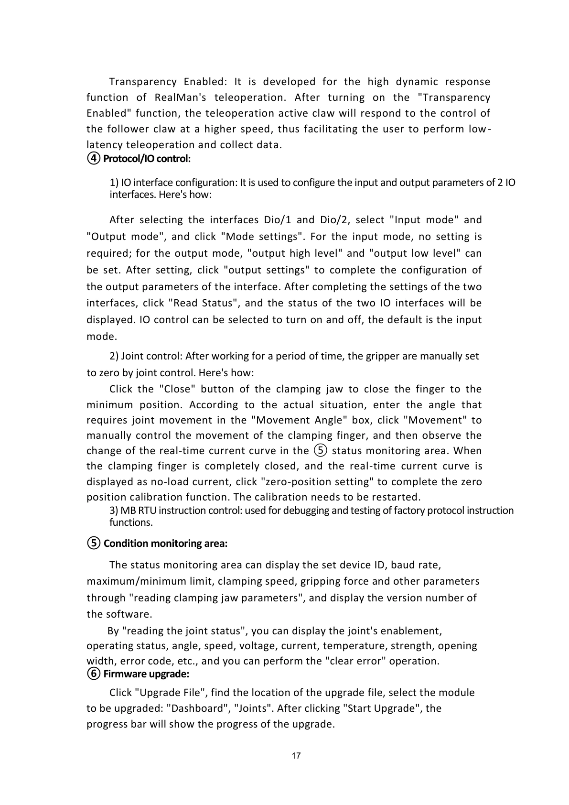




```
17
Transparency Enabled: It is developed for the high dynamic response 
function of RealMan's teleoperation. After turning on the "Transparency 
Enabled" function, the teleoperation active claw will respond to the control of 
the follower claw at a higher speed, thus facilitating the user to perform low-
latency teleoperation and collect data. 
④ Protocol/IO control: 
1) IO interface configuration: It is used to configure the input and output parameters of 2 IO 
interfaces. Here's how: 
After selecting the interfaces Dio/1 and Dio/2, select "Input mode" and 
"Output mode", and click "Mode settings". For the input mode, no setting is 
required; for the output mode, "output high level" and "output low level" can 
be set. After setting, click "output settings" to complete the configuration of 
the output parameters of the interface. After completing the settings of the two 
interfaces, click "Read Status", and the status of the two IO interfaces will be 
displayed. IO control can be selected to turn on and off, the default is the input 
mode. 
2) Joint control: After working for a period of time, the gripper are manually set 
to zero by joint control. Here's how: 
Click the "Close" button of the clamping jaw to close the finger to the 
minimum position. According to the actual situation, enter the angle that 
requires joint movement in the "Movement Angle" box, click "Movement" to 
manually control the movement of the clamping finger, and then observe the 
change of the real-time current curve in the ⑤ status monitoring area. When 
the clamping finger is completely closed, and the real-time current curve is 
displayed as no-load current, click "zero-position setting" to complete the zero 
position calibration function. The calibration needs to be restarted. 
3) MB RTU instruction control: used for debugging and testing of factory protocol instruction 
functions. 
⑤ Condition monitoring area: 
The status monitoring area can display the set device ID, baud rate, 
maximum/minimum limit, clamping speed, gripping force and other parameters 
through "reading clamping jaw parameters", and display the version number of 
the software. 
By "reading the joint status", you can display the joint's enablement, 
operating status, angle, speed, voltage, current, temperature, strength, opening 
width, error code, etc., and you can perform the "clear error" operation. 
⑥ Firmware upgrade: 
Click "Upgrade File", find the location of the upgrade file, select the module 
to be upgraded: "Dashboard", "Joints". After clicking "Start Upgrade", the 
progress bar will show the progress of the upgrade.
```




## PDF page 18

[RMG22-65 parallel gripper manual V1.3, original PDF page 18](https://1292444914-files.gitbook.io/~/files/v0/b/gitbook-x-prod.appspot.com/o/spaces%2FtgOfPnscWebs1eh82EKq%2Fuploads%2FMISWJx440NuLDkZ0DN2e%2FRMG22-pages-01-53.pdf?alt=media#page=18)



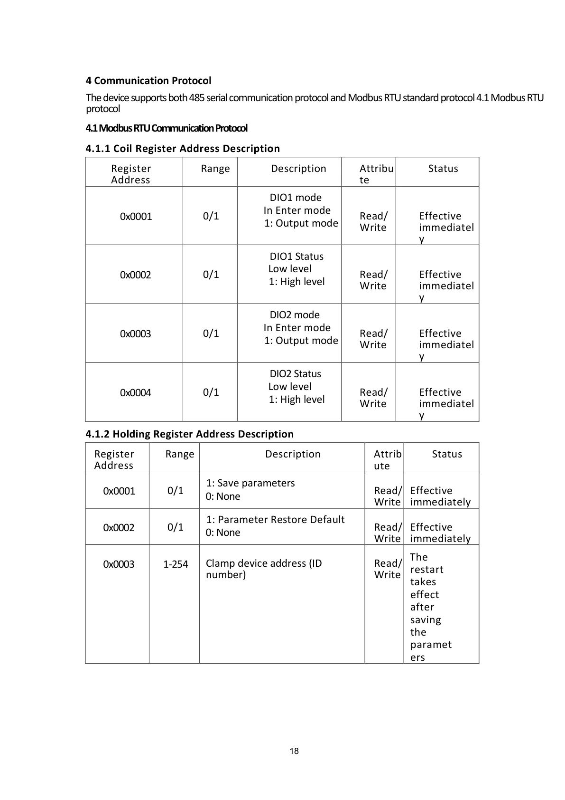




```
18
4 Communication Protocol 
The device supports both 485 serial communication protocol and Modbus RTU standard protocol 4.1 Modbus RTU 
protocol 
4.1 Modbus RTU Communication Protocol 
4.1.1 Coil Register Address Description 
 
Register 
Address 
Range 
Description 
Attribu
te 
Status 
0x0001 
0/1 
DIO1 mode 
In Enter mode 
1: Output mode 
Read/
Write 
Effective 
immediatel
y 
0x0002 
0/1 
DIO1 Status 
Low level 
1: High level 
Read/
Write 
Effective 
immediatel
y 
0x0003 
0/1 
DIO2 mode 
In Enter mode 
1: Output mode 
Read/
Write 
Effective 
immediatel
y 
0x0004 
0/1 
DIO2 Status 
Low level 
1: High level 
Read/
Write 
Effective 
immediatel
y 
4.1.2 Holding Register Address Description 
 
Register 
Address 
Range 
Description 
Attrib
ute 
Status 
0x0001 
0/1 
1: Save parameters 
0: None 
Read/
Write 
Effective 
immediately 
0x0002 
0/1 
1: Parameter Restore Default 
0: None 
Read/
Write 
Effective 
immediately 
0x0003 
1-254 
Clamp device address (ID 
number) 
Read/
Write 
The 
restart 
takes 
effect 
after 
saving 
the 
paramet
ers
```




## PDF page 19

[RMG22-65 parallel gripper manual V1.3, original PDF page 19](https://1292444914-files.gitbook.io/~/files/v0/b/gitbook-x-prod.appspot.com/o/spaces%2FtgOfPnscWebs1eh82EKq%2Fuploads%2FMISWJx440NuLDkZ0DN2e%2FRMG22-pages-01-53.pdf?alt=media#page=19)



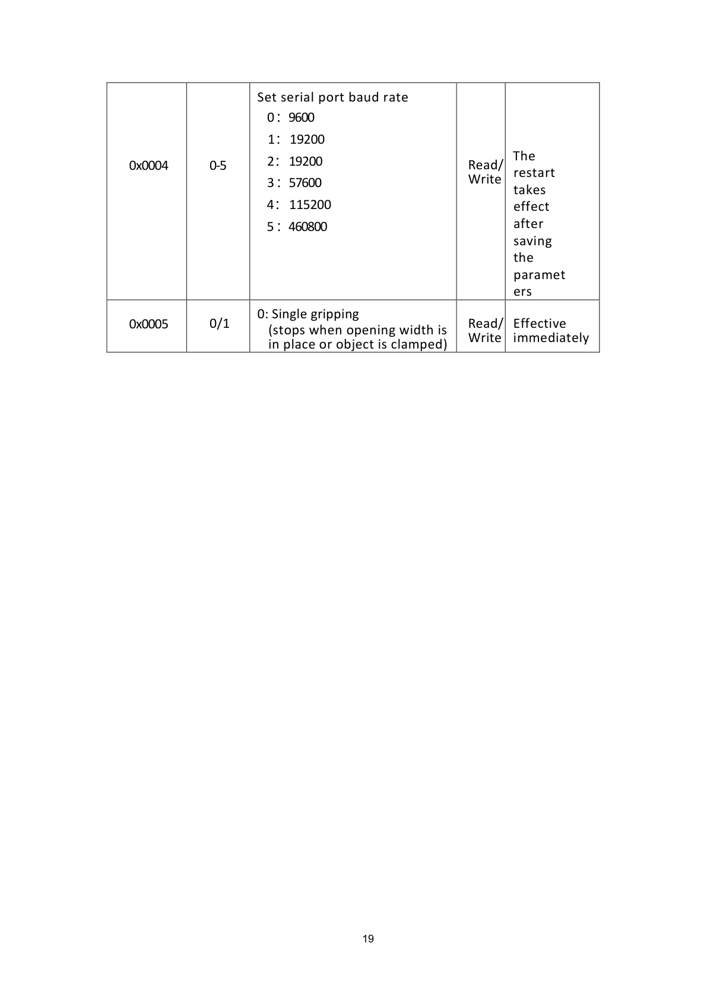




```
19
0x0004 
0-5 
Set serial port baud rate 
0 ：9600 
1： 19200 
2： 19200 
3 ：57600 
4： 115200 
5 ：460800 
Read/
Write 
The 
restart 
takes 
effect 
after 
saving 
the 
paramet
ers 
0x0005 
0/1 
0: Single gripping 
(stops when opening width is 
in place or object is clamped) 
Read/
Write 
Effective 
immediately
```




## PDF page 20

[RMG22-65 parallel gripper manual V1.3, original PDF page 20](https://1292444914-files.gitbook.io/~/files/v0/b/gitbook-x-prod.appspot.com/o/spaces%2FtgOfPnscWebs1eh82EKq%2Fuploads%2FMISWJx440NuLDkZ0DN2e%2FRMG22-pages-01-53.pdf?alt=media#page=20)



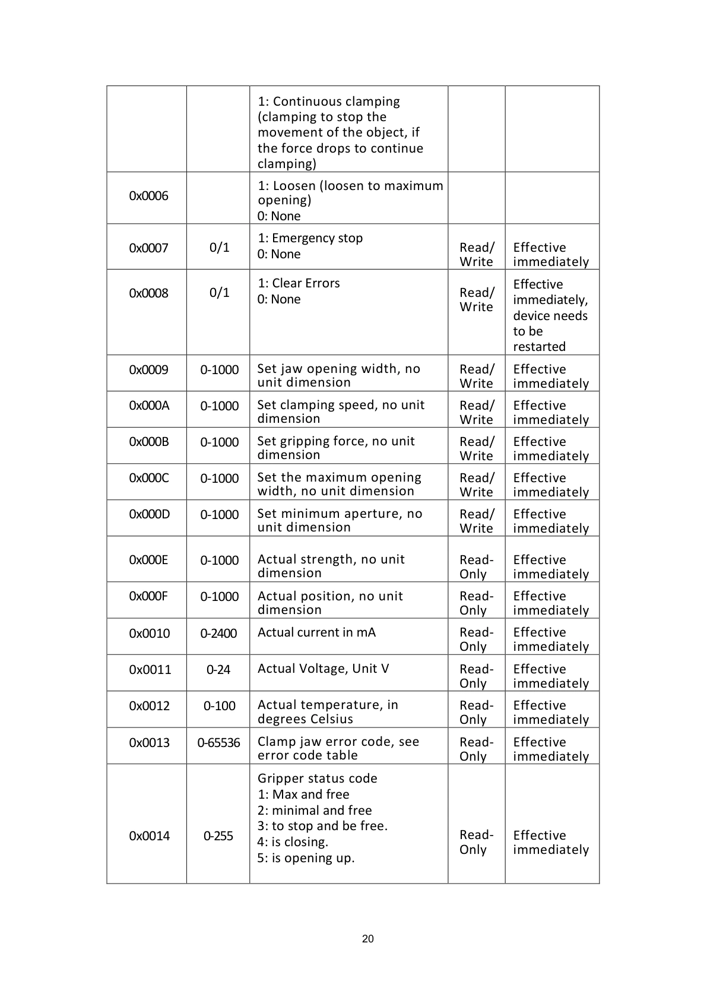




```
20
 
1: Continuous clamping 
(clamping to stop the 
movement of the object, if 
the force drops to continue 
clamping) 
0x0006 
1: Loosen (loosen to maximum 
opening) 
0: None 
0x0007 
0/1 
1: Emergency stop 
0: None 
Read/
Write 
Effective 
immediately 
0x0008 
0/1 
1: Clear Errors 
0: None 
Read/
Write 
Effective 
immediately, 
device needs 
to be 
restarted 
0x0009 
0-1000 
Set jaw opening width, no 
unit dimension 
Read/
Write 
Effective 
immediately 
0x000A 
0-1000 
Set clamping speed, no unit 
dimension 
Read/
Write 
Effective 
immediately 
0x000B 
0-1000 
Set gripping force, no unit 
dimension 
Read/
Write 
Effective 
immediately 
0x000C 
0-1000 
Set the maximum opening 
width, no unit dimension 
Read/
Write 
Effective 
immediately 
0x000D 
0-1000 
Set minimum aperture, no 
unit dimension 
Read/
Write 
Effective 
immediately 
0x000E 
0-1000 
Actual strength, no unit 
dimension 
Read-
Only 
Effective 
immediately 
0x000F 
0-1000 
Actual position, no unit 
dimension 
Read-
Only 
Effective 
immediately 
0x0010 
0-2400 
Actual current in mA 
Read-
Only 
Effective 
immediately 
0x0011 
0-24 
Actual Voltage, Unit V 
Read-
Only 
Effective 
immediately 
0x0012 
0-100 
Actual temperature, in 
degrees Celsius 
Read-
Only 
Effective 
immediately 
0x0013 
0-65536 
Clamp jaw error code, see 
error code table 
Read-
Only 
Effective 
immediately 
0x0014 
0-255 
Gripper status code 
1: Max and free 
2: minimal and free 
3: to stop and be free. 
4: is closing. 
5: is opening up. 
Read-
Only 
Effective 
immediately
```




## PDF page 21

[RMG22-65 parallel gripper manual V1.3, original PDF page 21](https://1292444914-files.gitbook.io/~/files/v0/b/gitbook-x-prod.appspot.com/o/spaces%2FtgOfPnscWebs1eh82EKq%2Fuploads%2FMISWJx440NuLDkZ0DN2e%2FRMG22-pages-01-53.pdf?alt=media#page=21)



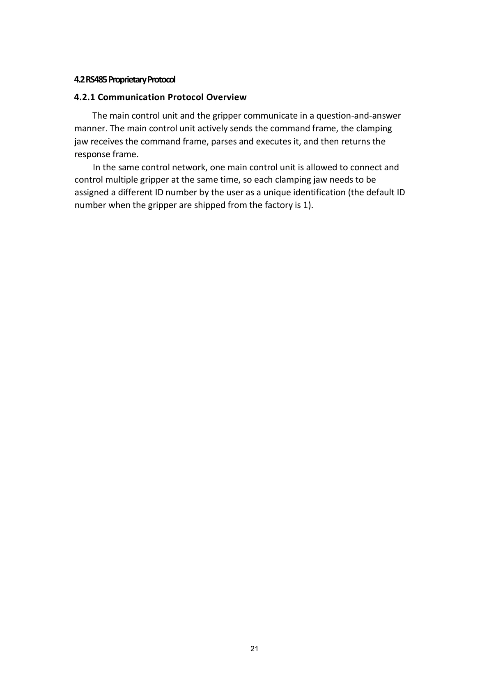




```
21
 
4.2 RS485 Proprietary Protocol 
4.2.1 Communication Protocol Overview 
The main control unit and the gripper communicate in a question-and-answer 
manner. The main control unit actively sends the command frame, the clamping 
jaw receives the command frame, parses and executes it, and then returns the 
response frame. 
In the same control network, one main control unit is allowed to connect and 
control multiple gripper at the same time, so each clamping jaw needs to be 
assigned a different ID number by the user as a unique identification (the default ID 
number when the gripper are shipped from the factory is 1).
```




## PDF page 22

[RMG22-65 parallel gripper manual V1.3, original PDF page 22](https://1292444914-files.gitbook.io/~/files/v0/b/gitbook-x-prod.appspot.com/o/spaces%2FtgOfPnscWebs1eh82EKq%2Fuploads%2FMISWJx440NuLDkZ0DN2e%2FRMG22-pages-01-53.pdf?alt=media#page=22)



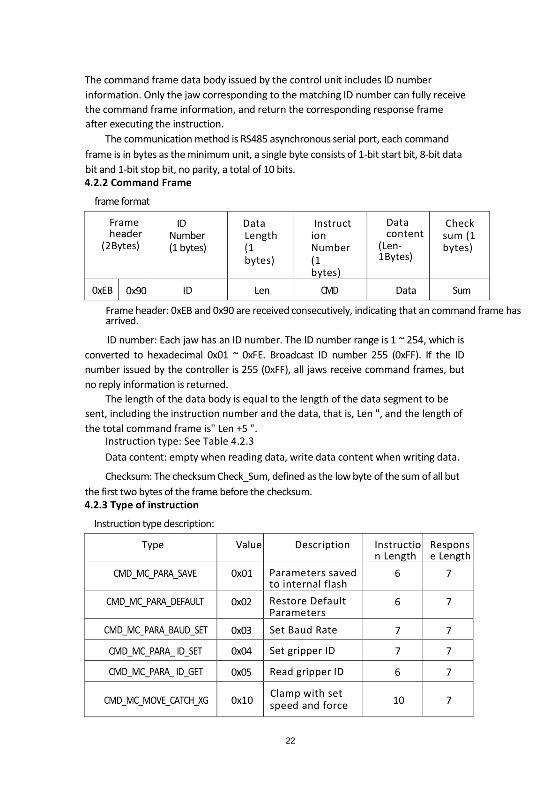




```
22
The command frame data body issued by the control unit includes ID number 
information. Only the jaw corresponding to the matching ID number can fully receive 
the command frame information, and return the corresponding response frame 
after executing the instruction. 
The communication method is RS485 asynchronous serial port, each command 
frame is in bytes as the minimum unit, a single byte consists of 1-bit start bit, 8-bit data 
bit and 1-bit stop bit, no parity, a total of 10 bits. 
4.2.2 Command Frame 
frame format 
 
Frame 
header 
(2Bytes) 
ID 
Number          
(1 bytes) 
Data 
Length 
(1 
bytes) 
Instruct
ion 
Number 
(1 
bytes) 
Data 
content 
(Len-
1Bytes) 
Check
sum (1 
bytes) 
0xEB 
0x90 
ID 
Len 
CMD 
Data 
Sum 
Frame header: 0xEB and 0x90 are received consecutively, indicating that an command frame has 
arrived. 
ID number: Each jaw has an ID number. The ID number range is 1 ~ 254, which is 
converted to hexadecimal 0x01 ~ 0xFE. Broadcast ID number 255 (0xFF). If the ID 
number issued by the controller is 255 (0xFF), all jaws receive command frames, but 
no reply information is returned. 
The length of the data body is equal to the length of the data segment to be 
sent, including the instruction number and the data, that is, Len ", and the length of 
the total command frame is" Len +5 ". 
Instruction type: See Table 4.2.3 
Data content: empty when reading data, write data content when writing data. 
Checksum: The checksum Check_Sum, defined as the low byte of the sum of all but 
the first two bytes of the frame before the checksum. 
4.2.3 Type of instruction 
Instruction type description: 
 
Type 
Value 
Description 
Instructio
n Length 
Respons
e Length 
CMD_MC_PARA_SAVE 
0x01 
Parameters saved 
to internal flash 
6 
7 
CMD_MC_PARA_DEFAULT 
0x02 
Restore Default 
Parameters 
6 
7 
CMD_MC_PARA_BAUD_SET 
0x03 
Set Baud Rate 
7 
7 
CMD_MC_PARA_ ID_SET 
0x04 
Set gripper ID 
7 
7 
CMD_MC_PARA_ ID_GET 
0x05 
Read gripper ID 
6 
7 
CMD_MC_MOVE_CATCH_XG 
0x10 
Clamp with set 
speed and force 
10 
7
```




## PDF page 23

[RMG22-65 parallel gripper manual V1.3, original PDF page 23](https://1292444914-files.gitbook.io/~/files/v0/b/gitbook-x-prod.appspot.com/o/spaces%2FtgOfPnscWebs1eh82EKq%2Fuploads%2FMISWJx440NuLDkZ0DN2e%2FRMG22-pages-01-53.pdf?alt=media#page=23)








```
23
control 
thresholds 
CMD_MC_MOVE_RELEASE 
0x11 
Release at set 
speed 
8 
7
```




## PDF page 24

[RMG22-65 parallel gripper manual V1.3, original PDF page 24](https://1292444914-files.gitbook.io/~/files/v0/b/gitbook-x-prod.appspot.com/o/spaces%2FtgOfPnscWebs1eh82EKq%2Fuploads%2FMISWJx440NuLDkZ0DN2e%2FRMG22-pages-01-53.pdf?alt=media#page=24)



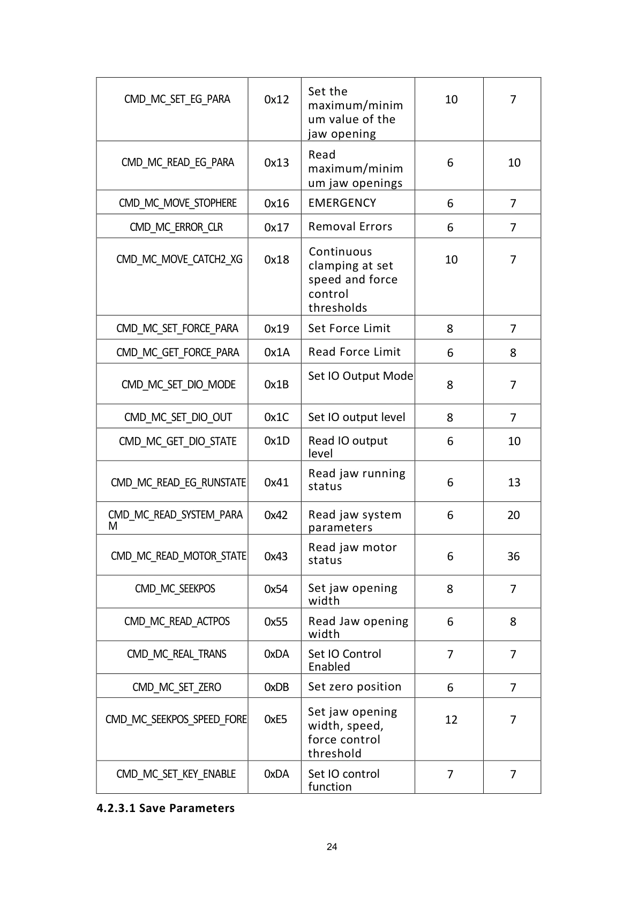




```
24
 
CMD_MC_SET_EG_PARA 
0x12 
Set the 
maximum/minim
um value of the 
jaw opening 
10 
7 
CMD_MC_READ_EG_PARA 
0x13 
Read 
maximum/minim
um jaw openings 
6 
10 
CMD_MC_MOVE_STOPHERE 
0x16 
EMERGENCY 
6 
7 
CMD_MC_ERROR_CLR 
0x17 
Removal Errors 
6 
7 
CMD_MC_MOVE_CATCH2_XG 
0x18 
Continuous 
clamping at set 
speed and force 
control 
thresholds 
10 
7 
CMD_MC_SET_FORCE_PARA 
0x19 
Set Force Limit 
8 
7 
CMD_MC_GET_FORCE_PARA 
0x1A 
Read Force Limit 
6 
8 
CMD_MC_SET_DIO_MODE 
0x1B 
Set IO Output Mode 
8 
7 
CMD_MC_SET_DIO_OUT 
0x1C 
Set IO output level 
8 
7 
CMD_MC_GET_DIO_STATE 
0x1D 
Read IO output 
level 
6 
10 
CMD_MC_READ_EG_RUNSTATE 
0x41 
Read jaw running 
status 
6 
13 
CMD_MC_READ_SYSTEM_PARA
M 
0x42 
Read jaw system 
parameters 
6 
20 
CMD_MC_READ_MOTOR_STATE 
0x43 
Read jaw motor 
status 
6 
36 
CMD_MC_SEEKPOS 
0x54 
Set jaw opening 
width 
8 
7 
CMD_MC_READ_ACTPOS 
0x55 
Read Jaw opening 
width 
6 
8 
CMD_MC_REAL_TRANS 
0xDA 
Set IO Control 
Enabled 
7 
7 
CMD_MC_SET_ZERO 
0xDB 
Set zero position 
6 
7 
CMD_MC_SEEKPOS_SPEED_FORE 
0xE5 
Set jaw opening 
width, speed, 
force control 
threshold 
12 
7 
CMD_MC_SET_KEY_ENABLE 
0xDA 
Set IO control 
function 
7 
7 
4.2.3.1 Save Parameters
```




## PDF page 25

[RMG22-65 parallel gripper manual V1.3, original PDF page 25](https://1292444914-files.gitbook.io/~/files/v0/b/gitbook-x-prod.appspot.com/o/spaces%2FtgOfPnscWebs1eh82EKq%2Fuploads%2FMISWJx440NuLDkZ0DN2e%2FRMG22-pages-01-53.pdf?alt=media#page=25)








```
25
Function: The main control unit saves the maximum and minimum opening 
parameters currently used by the jaws to the internal flash memory without loss of 
power. 
Command Frame Length: 6 bytes 
Command ID: 0x01 
Data content: None
```




## PDF page 26

[RMG22-65 parallel gripper manual V1.3, original PDF page 26](https://1292444914-files.gitbook.io/~/files/v0/b/gitbook-x-prod.appspot.com/o/spaces%2FtgOfPnscWebs1eh82EKq%2Fuploads%2FMISWJx440NuLDkZ0DN2e%2FRMG22-pages-01-53.pdf?alt=media#page=26)



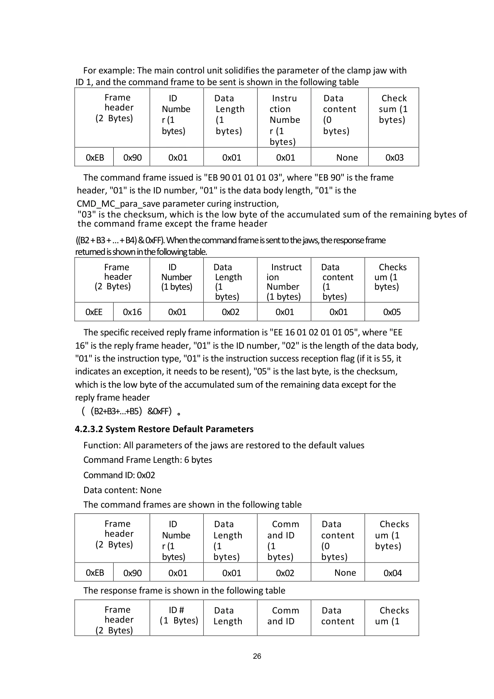




```
26
For example: The main control unit solidifies the parameter of the clamp jaw with 
ID 1, and the command frame to be sent is shown in the following table 
Frame 
header 
(2 Bytes) 
ID 
Numbe
r (1 
bytes) 
Data 
Length 
(1 
bytes) 
Instru
ction 
Numbe
r (1 
bytes) 
Data 
content 
(0 
bytes) 
Check
sum (1 
bytes) 
0xEB 
0x90 
0x01 
0x01 
0x01 
None 
0x03 
The command frame issued is "EB 90 01 01 01 03", where "EB 90" is the frame 
header, "01" is the ID number, "01" is the data body length, "01" is the 
CMD_MC_para_save parameter curing instruction, 
"03" is the checksum, which is the low byte of the accumulated sum of the remaining bytes of 
the command frame except the frame header 
((B2 + B3 + … + B4) & 0xFF). When the command frame is sent to the jaws, the response frame 
returned is shown in the following table. 
Frame 
header 
(2 Bytes) 
ID 
Number 
(1 bytes) 
Data 
Length 
(1 
bytes) 
Instruct
ion 
Number 
(1 bytes) 
Data 
content 
(1 
bytes) 
Checks
um (1 
bytes) 
0xEE 
0x16 
0x01 
0x02 
0x01 
0x01 
0x05 
The specific received reply frame information is "EE 16 01 02 01 01 05", where "EE 
16" is the reply frame header, "01" is the ID number, "02" is the length of the data body, 
"01" is the instruction type, "01" is the instruction success reception flag (if it is 55, it 
indicates an exception, it needs to be resent), "05" is the last byte, is the checksum, 
which is the low byte of the accumulated sum of the remaining data except for the 
reply frame header 
（（B2+B3+…+B5）&0xFF）。 
4.2.3.2 System Restore Default Parameters 
Function: All parameters of the jaws are restored to the default values 
Command Frame Length: 6 bytes 
Command ID: 0x02 
Data content: None 
The command frames are shown in the following table 
 
Frame 
header 
(2 Bytes) 
ID 
Numbe
r (1 
bytes) 
Data 
Length 
(1 
bytes) 
Comm
and ID 
(1 
bytes) 
Data 
content 
(0 
bytes) 
Checks
um (1 
bytes) 
0xEB 
0x90 
0x01 
0x01 
0x02 
None 
0x04 
The response frame is shown in the following table 
 
Frame 
header 
(2 Bytes) 
ID # 
(1 Bytes) 
Data 
Length 
Comm
and ID 
Data 
content 
Checks
um (1
```




## PDF page 27

[RMG22-65 parallel gripper manual V1.3, original PDF page 27](https://1292444914-files.gitbook.io/~/files/v0/b/gitbook-x-prod.appspot.com/o/spaces%2FtgOfPnscWebs1eh82EKq%2Fuploads%2FMISWJx440NuLDkZ0DN2e%2FRMG22-pages-01-53.pdf?alt=media#page=27)








```
27
(1 
bytes) 
(1 
bytes) 
(1 
bytes) 
bytes) 
0xEE 
0x16 
0x01 
0x02 
0x02 
0x01 
0x06
```




## PDF page 28

[RMG22-65 parallel gripper manual V1.3, original PDF page 28](https://1292444914-files.gitbook.io/~/files/v0/b/gitbook-x-prod.appspot.com/o/spaces%2FtgOfPnscWebs1eh82EKq%2Fuploads%2FMISWJx440NuLDkZ0DN2e%2FRMG22-pages-01-53.pdf?alt=media#page=28)



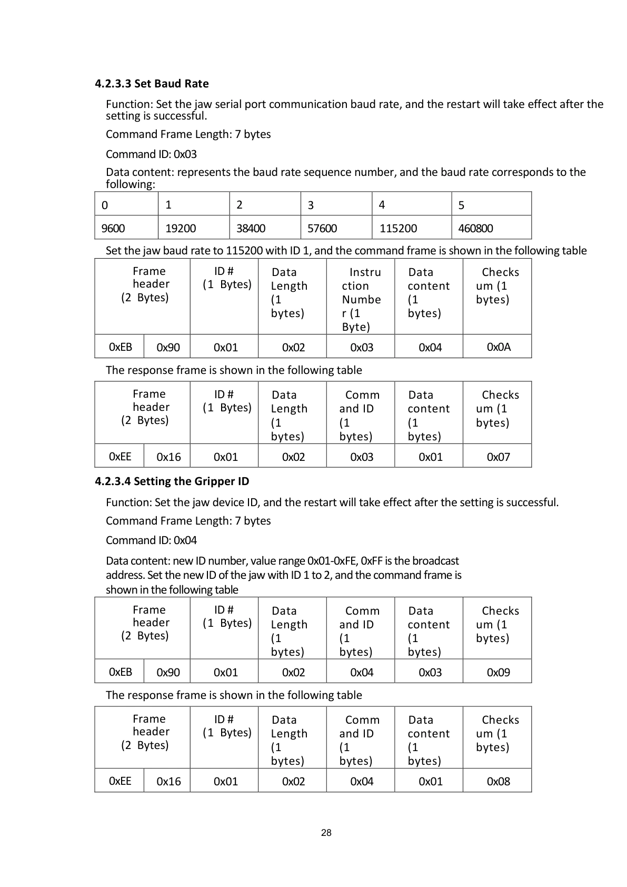




```
28
4.2.3.3 Set Baud Rate 
Function: Set the jaw serial port communication baud rate, and the restart will take effect after the 
setting is successful. 
Command Frame Length: 7 bytes 
Command ID: 0x03 
Data content: represents the baud rate sequence number, and the baud rate corresponds to the 
following: 
 
0 
1 
2 
3 
4 
5 
9600 
19200 
38400 
57600 
115200 
460800 
Set the jaw baud rate to 115200 with ID 1, and the command frame is shown in the following table 
 
Frame 
header 
(2 Bytes) 
ID # 
(1 Bytes) 
Data 
Length 
(1 
bytes) 
Instru
ction 
Numbe
r (1 
Byte) 
Data 
content 
(1 
bytes) 
Checks
um (1 
bytes) 
0xEB 
0x90 
0x01 
0x02 
0x03 
0x04 
0x0A 
The response frame is shown in the following table 
 
Frame 
header 
(2 Bytes) 
ID # 
(1 Bytes) 
Data 
Length 
(1 
bytes) 
Comm
and ID 
(1 
bytes) 
Data 
content 
(1 
bytes) 
Checks
um (1 
bytes) 
0xEE 
0x16 
0x01 
0x02 
0x03 
0x01 
0x07 
4.2.3.4 Setting the Gripper ID 
Function: Set the jaw device ID, and the restart will take effect after the setting is successful. 
Command Frame Length: 7 bytes 
Command ID: 0x04 
Data content: new ID number, value range 0x01-0xFE, 0xFF is the broadcast 
address. Set the new ID of the jaw with ID 1 to 2, and the command frame is 
shown in the following table 
Frame 
header 
(2 Bytes) 
ID # 
(1 Bytes) 
Data 
Length 
(1 
bytes) 
Comm
and ID 
(1 
bytes) 
Data 
content 
(1 
bytes) 
Checks
um (1 
bytes) 
0xEB 
0x90 
0x01 
0x02 
0x04 
0x03 
0x09 
The response frame is shown in the following table 
 
Frame 
header 
(2 Bytes) 
ID # 
(1 Bytes) 
Data 
Length 
(1 
bytes) 
Comm
and ID 
(1 
bytes) 
Data 
content 
(1 
bytes) 
Checks
um (1 
bytes) 
0xEE 
0x16 
0x01 
0x02 
0x04 
0x01 
0x08
```




## PDF page 29

[RMG22-65 parallel gripper manual V1.3, original PDF page 29](https://1292444914-files.gitbook.io/~/files/v0/b/gitbook-x-prod.appspot.com/o/spaces%2FtgOfPnscWebs1eh82EKq%2Fuploads%2FMISWJx440NuLDkZ0DN2e%2FRMG22-pages-01-53.pdf?alt=media#page=29)








```
29
4.2.3.5 Query gripper ID 
Function: Query jaw device ID 
Command Frame Length: 6 bytes
```




## PDF page 30

[RMG22-65 parallel gripper manual V1.3, original PDF page 30](https://1292444914-files.gitbook.io/~/files/v0/b/gitbook-x-prod.appspot.com/o/spaces%2FtgOfPnscWebs1eh82EKq%2Fuploads%2FMISWJx440NuLDkZ0DN2e%2FRMG22-pages-01-53.pdf?alt=media#page=30)



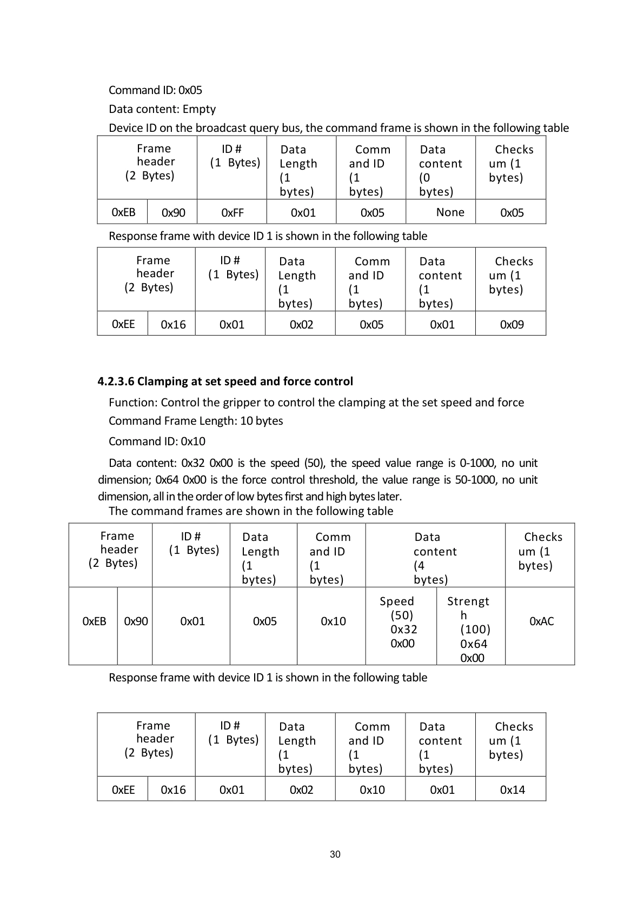




```
30
Command ID: 0x05 
Data content: Empty 
Device ID on the broadcast query bus, the command frame is shown in the following table 
 
Frame 
header 
(2 Bytes) 
ID # 
(1 Bytes) 
Data 
Length 
(1 
bytes) 
Comm
and ID 
(1 
bytes) 
Data 
content 
(0 
bytes) 
Checks
um (1 
bytes) 
0xEB 
0x90 
0xFF 
0x01 
0x05 
None 
0x05 
Response frame with device ID 1 is shown in the following table 
 
Frame 
header 
(2 Bytes) 
ID # 
(1 Bytes) 
Data 
Length 
(1 
bytes) 
Comm
and ID 
(1 
bytes) 
Data 
content 
(1 
bytes) 
Checks
um (1 
bytes) 
0xEE 
0x16 
0x01 
0x02 
0x05 
0x01 
0x09 
 
 
4.2.3.6 Clamping at set speed and force control 
Function: Control the gripper to control the clamping at the set speed and force 
Command Frame Length: 10 bytes 
Command ID: 0x10 
Data content: 0x32 0x00 is the speed (50), the speed value range is 0-1000, no unit 
dimension; 0x64 0x00 is the force control threshold, the value range is 50-1000, no unit 
dimension, all in the order of low bytes first and high bytes later. 
The command frames are shown in the following table 
 
Frame 
header 
(2 Bytes) 
ID # 
(1 Bytes) 
Data 
Length 
(1 
bytes) 
Comm
and ID 
(1 
bytes) 
Data 
content 
(4 
bytes) 
Checks
um (1 
bytes) 
0xEB 
0x90 
0x01 
0x05 
0x10 
Speed 
(50) 
0x32 
0x00 
Strengt
h 
(100) 
0x64 
0x00 
0xAC 
Response frame with device ID 1 is shown in the following table 
 
Frame 
header 
(2 Bytes) 
ID # 
(1 Bytes) 
Data 
Length 
(1 
bytes) 
Comm
and ID 
(1 
bytes) 
Data 
content 
(1 
bytes) 
Checks
um (1 
bytes) 
0xEE 
0x16 
0x01 
0x02 
0x10 
0x01 
0x14
```




## PDF page 31

[RMG22-65 parallel gripper manual V1.3, original PDF page 31](https://1292444914-files.gitbook.io/~/files/v0/b/gitbook-x-prod.appspot.com/o/spaces%2FtgOfPnscWebs1eh82EKq%2Fuploads%2FMISWJx440NuLDkZ0DN2e%2FRMG22-pages-01-53.pdf?alt=media#page=31)








```
31
 
4.2.3.7 Release at set speed
```




## PDF page 32

[RMG22-65 parallel gripper manual V1.3, original PDF page 32](https://1292444914-files.gitbook.io/~/files/v0/b/gitbook-x-prod.appspot.com/o/spaces%2FtgOfPnscWebs1eh82EKq%2Fuploads%2FMISWJx440NuLDkZ0DN2e%2FRMG22-pages-01-53.pdf?alt=media#page=32)



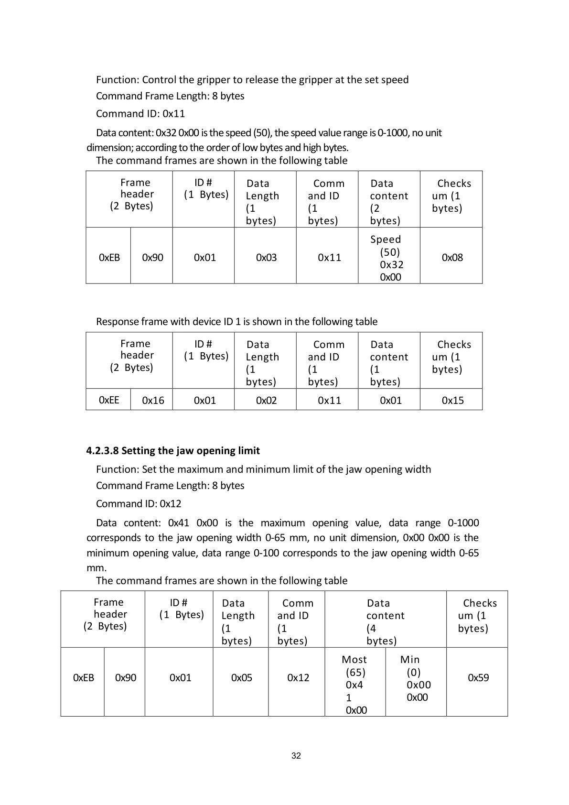




```
32
Function: Control the gripper to release the gripper at the set speed 
Command Frame Length: 8 bytes 
Command ID: 0x11 
Data content: 0x32 0x00 is the speed (50), the speed value range is 0-1000, no unit 
dimension; according to the order of low bytes and high bytes. 
The command frames are shown in the following table 
 
Frame 
header 
(2 Bytes) 
ID # 
(1 Bytes) 
Data 
Length 
(1 
bytes) 
Comm
and ID 
(1 
bytes) 
Data 
content 
(2 
bytes) 
Checks
um (1 
bytes) 
0xEB 
0x90 
0x01 
0x03 
0x11 
Speed 
(50) 
0x32 
0x00 
0x08 
 
Response frame with device ID 1 is shown in the following table 
 
Frame 
header 
(2 Bytes) 
ID # 
(1 Bytes) 
Data 
Length 
(1 
bytes) 
Comm
and ID 
(1 
bytes) 
Data 
content 
(1 
bytes) 
Checks
um (1 
bytes) 
0xEE 
0x16 
0x01 
0x02 
0x11 
0x01 
0x15 
 
 
4.2.3.8 Setting the jaw opening limit 
Function: Set the maximum and minimum limit of the jaw opening width 
Command Frame Length: 8 bytes 
Command ID: 0x12 
Data content: 0x41 0x00 is the maximum opening value, data range 0-1000 
corresponds to the jaw opening width 0-65 mm, no unit dimension, 0x00 0x00 is the 
minimum opening value, data range 0-100 corresponds to the jaw opening width 0-65 
mm. 
The command frames are shown in the following table 
 
Frame 
header 
(2 Bytes) 
ID # 
(1 Bytes) 
Data 
Length 
(1 
bytes) 
Comm
and ID 
(1 
bytes) 
Data 
content 
(4 
bytes) 
Checks
um (1 
bytes) 
0xEB 
0x90 
0x01 
0x05 
0x12 
Most 
(65) 
0x4
1 
0x00 
Min 
(0) 
0x00 
0x00 
0x59
```




## PDF page 33

[RMG22-65 parallel gripper manual V1.3, original PDF page 33](https://1292444914-files.gitbook.io/~/files/v0/b/gitbook-x-prod.appspot.com/o/spaces%2FtgOfPnscWebs1eh82EKq%2Fuploads%2FMISWJx440NuLDkZ0DN2e%2FRMG22-pages-01-53.pdf?alt=media#page=33)



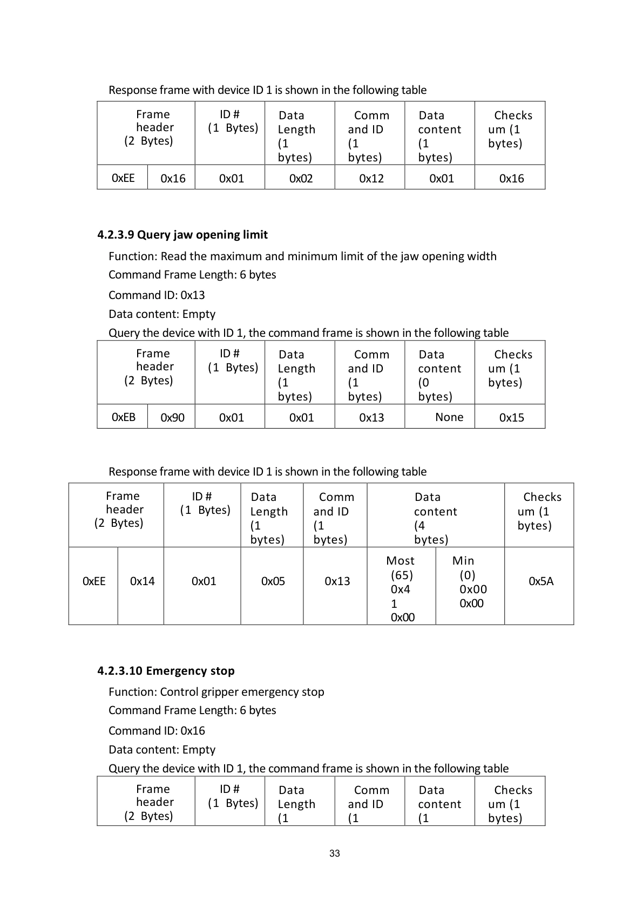




```
33
Response frame with device ID 1 is shown in the following table 
 
Frame 
header 
(2 Bytes) 
ID # 
(1 Bytes) 
Data 
Length 
(1 
bytes) 
Comm
and ID 
(1 
bytes) 
Data 
content 
(1 
bytes) 
Checks
um (1 
bytes) 
0xEE 
0x16 
0x01 
0x02 
0x12 
0x01 
0x16 
 
 
4.2.3.9 Query jaw opening limit 
Function: Read the maximum and minimum limit of the jaw opening width 
Command Frame Length: 6 bytes 
Command ID: 0x13 
Data content: Empty 
Query the device with ID 1, the command frame is shown in the following table 
 
Frame 
header 
(2 Bytes) 
ID # 
(1 Bytes) 
Data 
Length 
(1 
bytes) 
Comm
and ID 
(1 
bytes) 
Data 
content 
(0 
bytes) 
Checks
um (1 
bytes) 
0xEB 
0x90 
0x01 
0x01 
0x13 
None 
0x15 
 
Response frame with device ID 1 is shown in the following table 
 
Frame 
header 
(2 Bytes) 
ID # 
(1 Bytes) 
Data 
Length 
(1 
bytes) 
Comm
and ID 
(1 
bytes) 
Data 
content 
(4 
bytes) 
Checks
um (1 
bytes) 
0xEE 
0x14 
0x01 
0x05 
0x13 
Most 
(65) 
0x4
1 
0x00 
Min 
(0) 
0x00 
0x00 
0x5A 
 
 
4.2.3.10 Emergency stop 
Function: Control gripper emergency stop 
Command Frame Length: 6 bytes 
Command ID: 0x16 
Data content: Empty 
Query the device with ID 1, the command frame is shown in the following table 
 
Frame 
header 
(2 Bytes) 
ID # 
(1 Bytes) 
Data 
Length 
(1 
Comm
and ID 
(1 
Data 
content 
(1 
Checks
um (1 
bytes)
```




## PDF page 34

[RMG22-65 parallel gripper manual V1.3, original PDF page 34](https://1292444914-files.gitbook.io/~/files/v0/b/gitbook-x-prod.appspot.com/o/spaces%2FtgOfPnscWebs1eh82EKq%2Fuploads%2FMISWJx440NuLDkZ0DN2e%2FRMG22-pages-01-53.pdf?alt=media#page=34)








```
34
bytes) 
bytes) 
bytes) 
0xEB 
0x90 
0x01 
0x01 
0x16 
None 
0x18
```




## PDF page 35

[RMG22-65 parallel gripper manual V1.3, original PDF page 35](https://1292444914-files.gitbook.io/~/files/v0/b/gitbook-x-prod.appspot.com/o/spaces%2FtgOfPnscWebs1eh82EKq%2Fuploads%2FMISWJx440NuLDkZ0DN2e%2FRMG22-pages-01-53.pdf?alt=media#page=35)



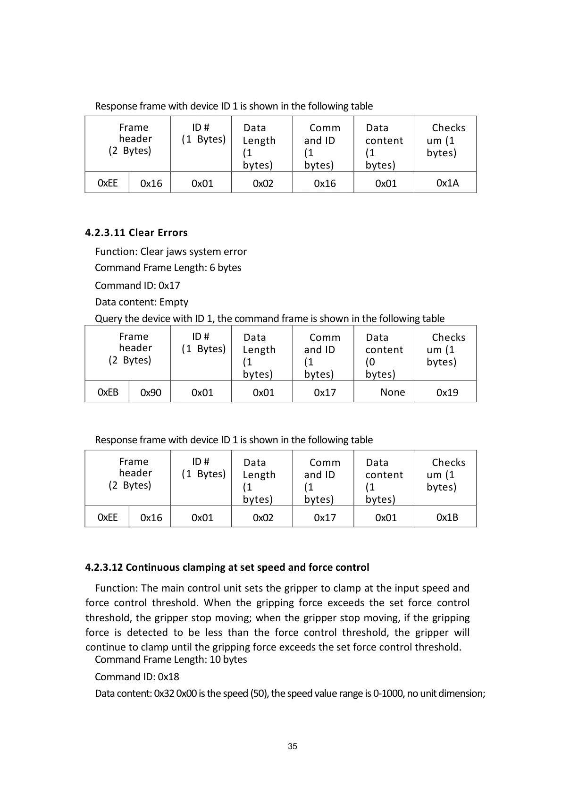




```
35
 
 
Response frame with device ID 1 is shown in the following table 
 
Frame 
header 
(2 Bytes) 
ID # 
(1 Bytes) 
Data 
Length 
(1 
bytes) 
Comm
and ID 
(1 
bytes) 
Data 
content 
(1 
bytes) 
Checks
um (1 
bytes) 
0xEE 
0x16 
0x01 
0x02 
0x16 
0x01 
0x1A 
 
 
4.2.3.11 Clear Errors 
Function: Clear jaws system error 
Command Frame Length: 6 bytes 
Command ID: 0x17 
Data content: Empty 
Query the device with ID 1, the command frame is shown in the following table 
 
Frame 
header 
(2 Bytes) 
ID # 
(1 Bytes) 
Data 
Length 
(1 
bytes) 
Comm
and ID 
(1 
bytes) 
Data 
content 
(0 
bytes) 
Checks
um (1 
bytes) 
0xEB 
0x90 
0x01 
0x01 
0x17 
None 
0x19 
 
Response frame with device ID 1 is shown in the following table 
 
Frame 
header 
(2 Bytes) 
ID # 
(1 Bytes) 
Data 
Length 
(1 
bytes) 
Comm
and ID 
(1 
bytes) 
Data 
content 
(1 
bytes) 
Checks
um (1 
bytes) 
0xEE 
0x16 
0x01 
0x02 
0x17 
0x01 
0x1B 
 
 
4.2.3.12 Continuous clamping at set speed and force control 
Function: The main control unit sets the gripper to clamp at the input speed and 
force control threshold. When the gripping force exceeds the set force control 
threshold, the gripper stop moving; when the gripper stop moving, if the gripping 
force is detected to be less than the force control threshold, the gripper will 
continue to clamp until the gripping force exceeds the set force control threshold. 
Command Frame Length: 10 bytes 
Command ID: 0x18 
Data content: 0x32 0x00 is the speed (50), the speed value range is 0-1000, no unit dimension;
```




## PDF page 36

[RMG22-65 parallel gripper manual V1.3, original PDF page 36](https://1292444914-files.gitbook.io/~/files/v0/b/gitbook-x-prod.appspot.com/o/spaces%2FtgOfPnscWebs1eh82EKq%2Fuploads%2FMISWJx440NuLDkZ0DN2e%2FRMG22-pages-01-53.pdf?alt=media#page=36)








```
36
0x64 0x00 is the force control threshold, in the order of low bytes and high bytes, from 50 
to 1000, no unit dimension.
```




## PDF page 37

[RMG22-65 parallel gripper manual V1.3, original PDF page 37](https://1292444914-files.gitbook.io/~/files/v0/b/gitbook-x-prod.appspot.com/o/spaces%2FtgOfPnscWebs1eh82EKq%2Fuploads%2FMISWJx440NuLDkZ0DN2e%2FRMG22-pages-01-53.pdf?alt=media#page=37)



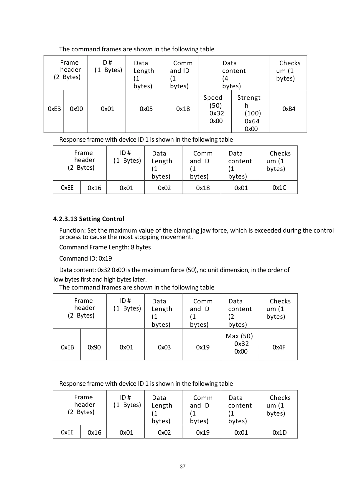




```
37
The command frames are shown in the following table 
 
Frame 
header 
(2 Bytes) 
ID # 
(1 Bytes) 
Data 
Length 
(1 
bytes) 
Comm
and ID 
(1 
bytes) 
Data 
content 
(4 
bytes) 
Checks
um (1 
bytes) 
0xEB 
0x90 
0x01 
0x05 
0x18 
Speed 
(50) 
0x32 
0x00 
Strengt
h 
(100) 
0x64 
0x00 
0xB4 
Response frame with device ID 1 is shown in the following table 
 
Frame 
header 
(2 Bytes) 
ID # 
(1 Bytes) 
Data 
Length 
(1 
bytes) 
Comm
and ID 
(1 
bytes) 
Data 
content 
(1 
bytes) 
Checks
um (1 
bytes) 
0xEE 
0x16 
0x01 
0x02 
0x18 
0x01 
0x1C 
 
 
4.2.3.13 Setting Control 
Function: Set the maximum value of the clamping jaw force, which is exceeded during the control 
process to cause the most stopping movement. 
Command Frame Length: 8 bytes 
Command ID: 0x19 
Data content: 0x32 0x00 is the maximum force (50), no unit dimension, in the order of 
low bytes first and high bytes later. 
The command frames are shown in the following table 
 
Frame 
header 
(2 Bytes) 
ID # 
(1 Bytes) 
Data 
Length 
(1 
bytes) 
Comm
and ID 
(1 
bytes) 
Data 
content 
(2 
bytes) 
Checks
um (1 
bytes) 
0xEB 
0x90 
0x01 
0x03 
0x19 
Max (50) 
0x32 
0x00 
0x4F 
 
Response frame with device ID 1 is shown in the following table 
 
Frame 
header 
(2 Bytes) 
ID # 
(1 Bytes) 
Data 
Length 
(1 
bytes) 
Comm
and ID 
(1 
bytes) 
Data 
content 
(1 
bytes) 
Checks
um (1 
bytes) 
0xEE 
0x16 
0x01 
0x02 
0x19 
0x01 
0x1D
```




## PDF page 38

[RMG22-65 parallel gripper manual V1.3, original PDF page 38](https://1292444914-files.gitbook.io/~/files/v0/b/gitbook-x-prod.appspot.com/o/spaces%2FtgOfPnscWebs1eh82EKq%2Fuploads%2FMISWJx440NuLDkZ0DN2e%2FRMG22-pages-01-53.pdf?alt=media#page=38)








```
38
 
4.2.3.14 Query Control 
Function: Clear jaws system error 
Command Frame Length: 6 bytes
```




## PDF page 39

[RMG22-65 parallel gripper manual V1.3, original PDF page 39](https://1292444914-files.gitbook.io/~/files/v0/b/gitbook-x-prod.appspot.com/o/spaces%2FtgOfPnscWebs1eh82EKq%2Fuploads%2FMISWJx440NuLDkZ0DN2e%2FRMG22-pages-01-53.pdf?alt=media#page=39)



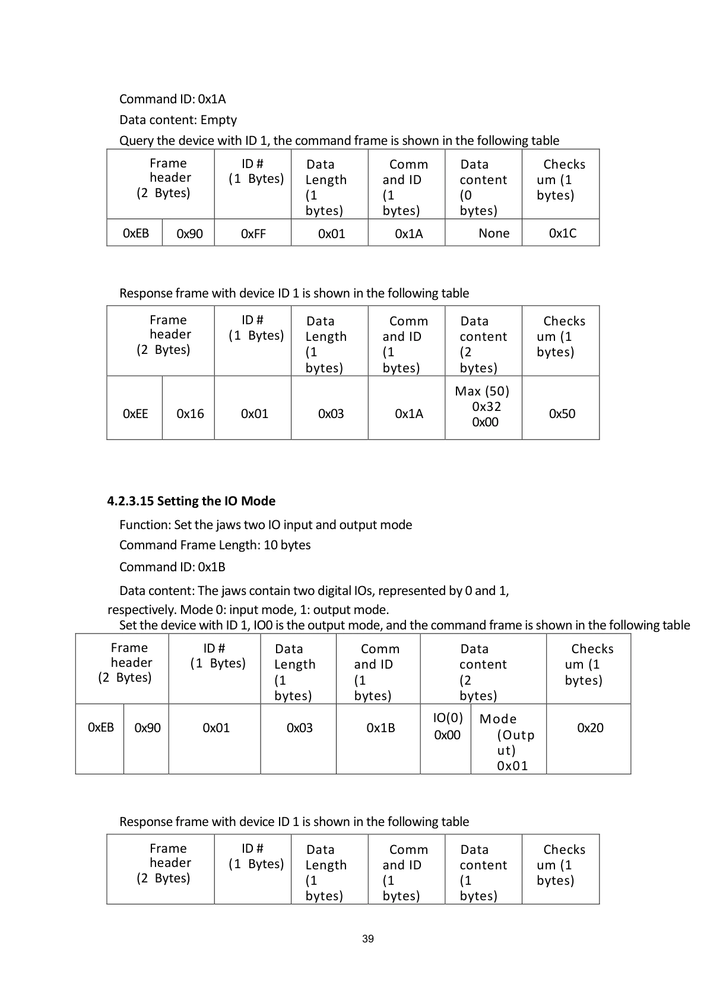




```
39
Command ID: 0x1A 
Data content: Empty 
Query the device with ID 1, the command frame is shown in the following table 
 
Frame 
header 
(2 Bytes) 
ID # 
(1 Bytes) 
Data 
Length 
(1 
bytes) 
Comm
and ID 
(1 
bytes) 
Data 
content 
(0 
bytes) 
Checks
um (1 
bytes) 
0xEB 
0x90 
0xFF 
0x01 
0x1A 
None 
0x1C 
 
Response frame with device ID 1 is shown in the following table 
 
Frame 
header 
(2 Bytes) 
ID # 
(1 Bytes) 
Data 
Length 
(1 
bytes) 
Comm
and ID 
(1 
bytes) 
Data 
content 
(2 
bytes) 
Checks
um (1 
bytes) 
0xEE 
0x16 
0x01 
0x03 
0x1A 
Max (50) 
0x32 
0x00 
0x50 
 
 
4.2.3.15 Setting the IO Mode 
Function: Set the jaws two IO input and output mode 
Command Frame Length: 10 bytes 
Command ID: 0x1B 
Data content: The jaws contain two digital IOs, represented by 0 and 1, 
respectively. Mode 0: input mode, 1: output mode. 
Set the device with ID 1, IO0 is the output mode, and the command frame is shown in the following table 
 
Frame 
header 
(2 Bytes) 
ID # 
(1 Bytes) 
Data 
Length 
(1 
bytes) 
Comm
and ID 
(1 
bytes) 
Data 
content 
(2 
bytes) 
Checks
um (1 
bytes) 
0xEB 
0x90 
0x01 
0x03 
0x1B 
IO(0) 
0x00 
Mode 
(Outp
ut) 
0x01 
0x20 
 
Response frame with device ID 1 is shown in the following table 
 
Frame 
header 
(2 Bytes) 
ID # 
(1 Bytes) 
Data 
Length 
(1 
bytes) 
Comm
and ID 
(1 
bytes) 
Data 
content 
(1 
bytes) 
Checks
um (1 
bytes)
```




## PDF page 40

[RMG22-65 parallel gripper manual V1.3, original PDF page 40](https://1292444914-files.gitbook.io/~/files/v0/b/gitbook-x-prod.appspot.com/o/spaces%2FtgOfPnscWebs1eh82EKq%2Fuploads%2FMISWJx440NuLDkZ0DN2e%2FRMG22-pages-01-53.pdf?alt=media#page=40)








```
40
0xEE 
0x16 
0x01 
0x02 
0x1B 
0x01 
0x1F
```




## PDF page 41

[RMG22-65 parallel gripper manual V1.3, original PDF page 41](https://1292444914-files.gitbook.io/~/files/v0/b/gitbook-x-prod.appspot.com/o/spaces%2FtgOfPnscWebs1eh82EKq%2Fuploads%2FMISWJx440NuLDkZ0DN2e%2FRMG22-pages-01-53.pdf?alt=media#page=41)



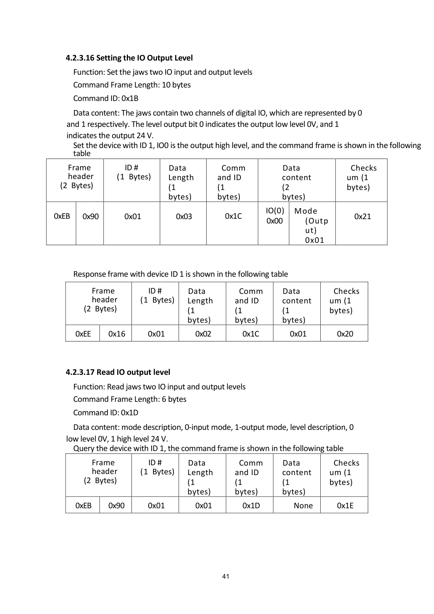




```
41
4.2.3.16 Setting the IO Output Level 
Function: Set the jaws two IO input and output levels 
Command Frame Length: 10 bytes 
Command ID: 0x1B 
Data content: The jaws contain two channels of digital IO, which are represented by 0 
and 1 respectively. The level output bit 0 indicates the output low level 0V, and 1 
indicates the output 24 V. 
Set the device with ID 1, IO0 is the output high level, and the command frame is shown in the following 
table 
 
Frame 
header 
(2 Bytes) 
ID # 
(1 Bytes) 
Data 
Length 
(1 
bytes) 
Comm
and ID 
(1 
bytes) 
Data 
content 
(2 
bytes) 
Checks
um (1 
bytes) 
0xEB 
0x90 
0x01 
0x03 
0x1C 
IO(0) 
0x00 
Mode 
(Outp
ut) 
0x01 
0x21 
 
Response frame with device ID 1 is shown in the following table 
 
Frame 
header 
(2 Bytes) 
ID # 
(1 Bytes) 
Data 
Length 
(1 
bytes) 
Comm
and ID 
(1 
bytes) 
Data 
content 
(1 
bytes) 
Checks
um (1 
bytes) 
0xEE 
0x16 
0x01 
0x02 
0x1C 
0x01 
0x20 
 
 
4.2.3.17 Read IO output level 
Function: Read jaws two IO input and output levels 
Command Frame Length: 6 bytes 
Command ID: 0x1D 
Data content: mode description, 0-input mode, 1-output mode, level description, 0 
low level 0V, 1 high level 24 V. 
Query the device with ID 1, the command frame is shown in the following table 
 
Frame 
header 
(2 Bytes) 
ID # 
(1 Bytes) 
Data 
Length 
(1 
bytes) 
Comm
and ID 
(1 
bytes) 
Data 
content 
(1 
bytes) 
Checks
um (1 
bytes) 
0xEB 
0x90 
0x01 
0x01 
0x1D 
None 
0x1E
```




## PDF page 42

[RMG22-65 parallel gripper manual V1.3, original PDF page 42](https://1292444914-files.gitbook.io/~/files/v0/b/gitbook-x-prod.appspot.com/o/spaces%2FtgOfPnscWebs1eh82EKq%2Fuploads%2FMISWJx440NuLDkZ0DN2e%2FRMG22-pages-01-53.pdf?alt=media#page=42)



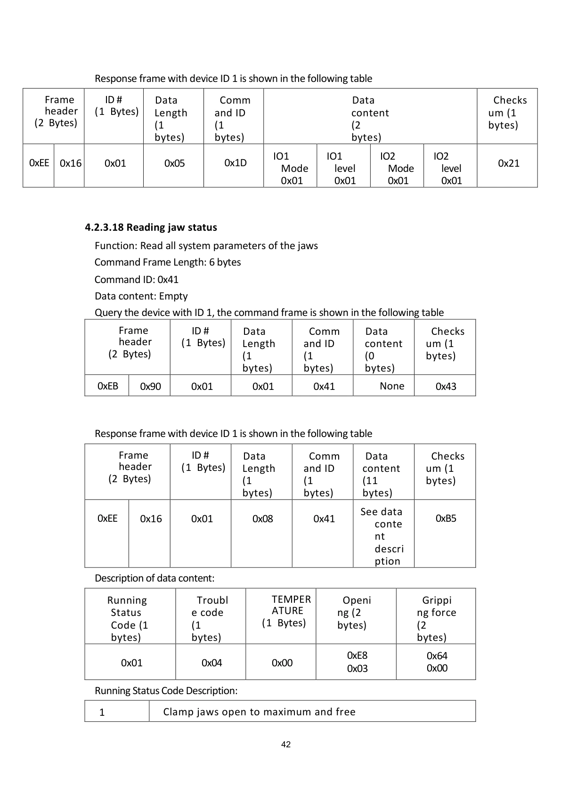




```
42
Response frame with device ID 1 is shown in the following table 
 
Frame 
header 
(2 Bytes) 
ID # 
(1 Bytes) 
Data 
Length 
(1 
bytes) 
Comm
and ID 
(1 
bytes) 
Data 
content 
(2 
bytes) 
Checks
um (1 
bytes) 
0xEE 0x16 
0x01 
0x05 
0x1D 
IO1 
Mode 
0x01 
IO1 
level 
0x01 
IO2 
Mode 
0x01 
IO2 
level 
0x01 
0x21 
 
 
4.2.3.18 Reading jaw status 
Function: Read all system parameters of the jaws 
Command Frame Length: 6 bytes 
Command ID: 0x41 
Data content: Empty 
Query the device with ID 1, the command frame is shown in the following table 
 
Frame 
header 
(2 Bytes) 
ID # 
(1 Bytes) 
Data 
Length 
(1 
bytes) 
Comm
and ID 
(1 
bytes) 
Data 
content 
(0 
bytes) 
Checks
um (1 
bytes) 
0xEB 
0x90 
0x01 
0x01 
0x41 
None 
0x43 
 
Response frame with device ID 1 is shown in the following table 
 
Frame 
header 
(2 Bytes) 
ID # 
(1 Bytes) 
Data 
Length 
(1 
bytes) 
Comm
and ID 
(1 
bytes) 
Data 
content 
(11 
bytes) 
Checks
um (1 
bytes) 
0xEE 
0x16 
0x01 
0x08 
0x41 
See data 
conte
nt 
descri
ption 
0xB5 
Description of data content: 
 
Running 
Status 
Code (1 
bytes) 
Troubl
e code 
(1 
bytes) 
TEMPER
ATURE 
(1 Bytes) 
Openi
ng (2 
bytes) 
Grippi
ng force 
(2 
bytes) 
0x01 
0x04 
0x00 
0xE8 
0x03 
0x64 
0x00 
Running Status Code Description: 
 
1 
Clamp jaws open to maximum and free
```




## PDF page 43

[RMG22-65 parallel gripper manual V1.3, original PDF page 43](https://1292444914-files.gitbook.io/~/files/v0/b/gitbook-x-prod.appspot.com/o/spaces%2FtgOfPnscWebs1eh82EKq%2Fuploads%2FMISWJx440NuLDkZ0DN2e%2FRMG22-pages-01-53.pdf?alt=media#page=43)








```
43
2 
gripper closed to minimum and idle 
3 
gripper stopped and free 
4 
gripper are closing 
5 
The jaws are opening
```




## PDF page 44

[RMG22-65 parallel gripper manual V1.3, original PDF page 44](https://1292444914-files.gitbook.io/~/files/v0/b/gitbook-x-prod.appspot.com/o/spaces%2FtgOfPnscWebs1eh82EKq%2Fuploads%2FMISWJx440NuLDkZ0DN2e%2FRMG22-pages-01-53.pdf?alt=media#page=44)



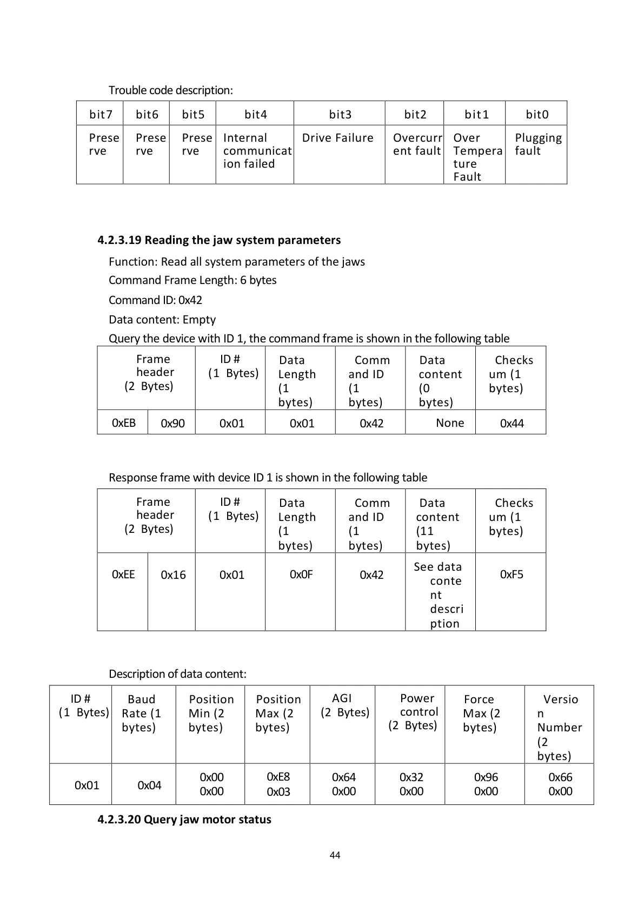




```
44
Trouble code description: 
 
bit7 
bit6 
bit5 
bit4 
bit3 
bit2 
bit1 
bit0 
Prese
rve 
Prese
rve 
Prese
rve 
Internal 
communicat
ion failed 
Drive Failure 
Overcurr
ent fault 
Over 
Tempera
ture 
Fault 
Plugging 
fault 
 
 
4.2.3.19 Reading the jaw system parameters 
Function: Read all system parameters of the jaws 
Command Frame Length: 6 bytes 
Command ID: 0x42 
Data content: Empty 
Query the device with ID 1, the command frame is shown in the following table 
 
Frame 
header 
(2 Bytes) 
ID # 
(1 Bytes) 
Data 
Length 
(1 
bytes) 
Comm
and ID 
(1 
bytes) 
Data 
content 
(0 
bytes) 
Checks
um (1 
bytes) 
0xEB 
0x90 
0x01 
0x01 
0x42 
None 
0x44 
 
Response frame with device ID 1 is shown in the following table 
 
Frame 
header 
(2 Bytes) 
ID # 
(1 Bytes) 
Data 
Length 
(1 
bytes) 
Comm
and ID 
(1 
bytes) 
Data 
content 
(11 
bytes) 
Checks
um (1 
bytes) 
0xEE 
0x16 
0x01 
0x0F 
0x42 
See data 
conte
nt 
descri
ption 
0xF5 
 
Description of data content: 
 
ID # 
(1 Bytes) 
Baud 
Rate (1 
bytes) 
Position 
Min (2 
bytes) 
Position 
Max (2 
bytes) 
AGI 
(2 Bytes) 
Power 
control 
(2 Bytes) 
Force 
Max (2 
bytes) 
Versio
n 
Number 
(2 
bytes) 
0x01 
0x04 
0x00 
0x00 
0xE8 
0x03 
0x64 
0x00 
0x32 
0x00 
0x96 
0x00 
0x66 
0x00 
4.2.3.20 Query jaw motor status
```




## PDF page 45

[RMG22-65 parallel gripper manual V1.3, original PDF page 45](https://1292444914-files.gitbook.io/~/files/v0/b/gitbook-x-prod.appspot.com/o/spaces%2FtgOfPnscWebs1eh82EKq%2Fuploads%2FMISWJx440NuLDkZ0DN2e%2FRMG22-pages-01-53.pdf?alt=media#page=45)








```
45
Function: Reading joint status data 
Command Frame Length: 6 bytes 
Command ID: 0x43 
Data content: Empty 
Query the device with ID 1, the command frame is shown in the following table
```




## PDF page 46

[RMG22-65 parallel gripper manual V1.3, original PDF page 46](https://1292444914-files.gitbook.io/~/files/v0/b/gitbook-x-prod.appspot.com/o/spaces%2FtgOfPnscWebs1eh82EKq%2Fuploads%2FMISWJx440NuLDkZ0DN2e%2FRMG22-pages-01-53.pdf?alt=media#page=46)



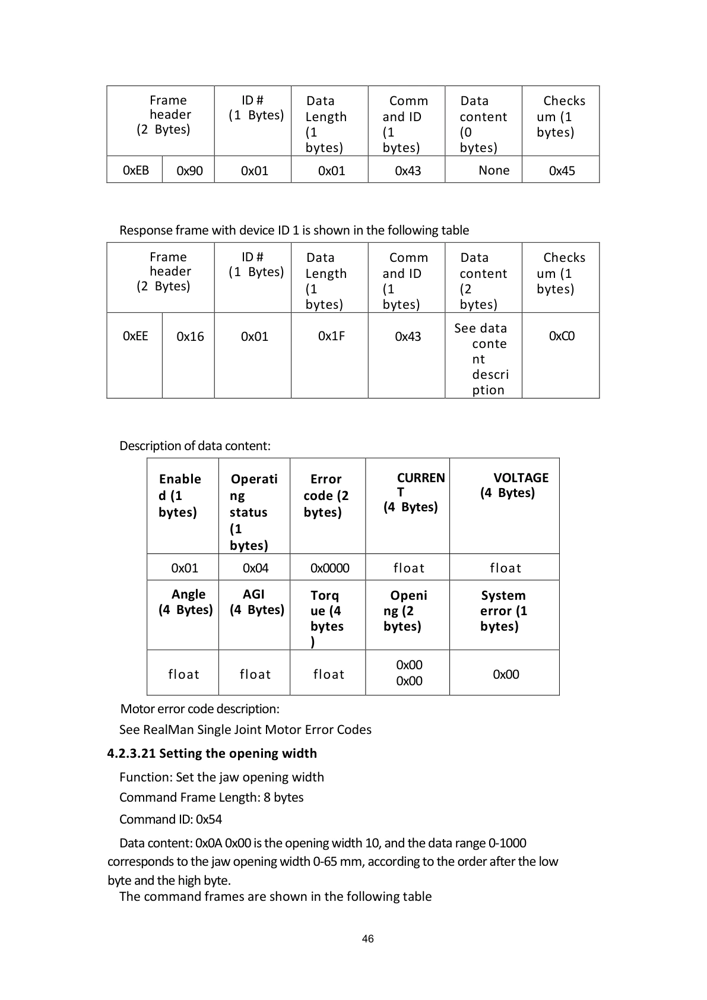




```
46
 
Frame 
header 
(2 Bytes) 
ID # 
(1 Bytes) 
Data 
Length 
(1 
bytes) 
Comm
and ID 
(1 
bytes) 
Data 
content 
(0 
bytes) 
Checks
um (1 
bytes) 
0xEB 
0x90 
0x01 
0x01 
0x43 
None 
0x45 
 
Response frame with device ID 1 is shown in the following table 
 
Frame 
header 
(2 Bytes) 
ID # 
(1 Bytes) 
Data 
Length 
(1 
bytes) 
Comm
and ID 
(1 
bytes) 
Data 
content 
(2 
bytes) 
Checks
um (1 
bytes) 
0xEE 
0x16 
0x01 
0x1F 
0x43 
See data 
conte
nt 
descri
ption 
0xC0 
 
Description of data content: 
 
Enable
d (1 
bytes) 
Operati
ng 
status 
(1 
bytes) 
Error 
code (2 
bytes) 
CURREN
T 
(4 Bytes) 
VOLTAGE 
(4 Bytes) 
0x01 
0x04 
0x0000 
float 
float 
Angle 
(4 Bytes) 
AGI 
(4 Bytes) 
Torq
ue (4 
bytes
) 
Openi
ng (2 
bytes) 
System 
error (1 
bytes) 
float 
float 
float 
0x00 
0x00 
0x00 
Motor error code description: 
See RealMan Single Joint Motor Error Codes 
4.2.3.21 Setting the opening width 
Function: Set the jaw opening width 
Command Frame Length: 8 bytes 
Command ID: 0x54 
Data content: 0x0A 0x00 is the opening width 10, and the data range 0-1000 
corresponds to the jaw opening width 0-65 mm, according to the order after the low 
byte and the high byte. 
The command frames are shown in the following table
```




## PDF page 47

[RMG22-65 parallel gripper manual V1.3, original PDF page 47](https://1292444914-files.gitbook.io/~/files/v0/b/gitbook-x-prod.appspot.com/o/spaces%2FtgOfPnscWebs1eh82EKq%2Fuploads%2FMISWJx440NuLDkZ0DN2e%2FRMG22-pages-01-53.pdf?alt=media#page=47)



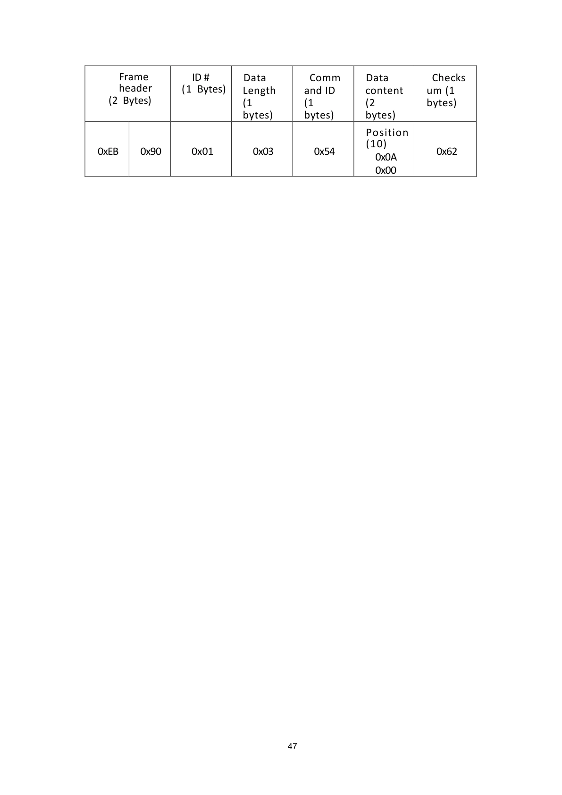




```
47
Frame 
header 
(2 Bytes) 
ID # 
(1 Bytes) 
Data 
Length 
(1 
bytes) 
Comm
and ID 
(1 
bytes) 
Data 
content 
(2 
bytes) 
Checks
um (1 
bytes) 
0xEB 
0x90 
0x01 
0x03 
0x54 
Position 
(10) 
0x0A 
0x00 
0x62
```




## PDF page 48

[RMG22-65 parallel gripper manual V1.3, original PDF page 48](https://1292444914-files.gitbook.io/~/files/v0/b/gitbook-x-prod.appspot.com/o/spaces%2FtgOfPnscWebs1eh82EKq%2Fuploads%2FMISWJx440NuLDkZ0DN2e%2FRMG22-pages-01-53.pdf?alt=media#page=48)



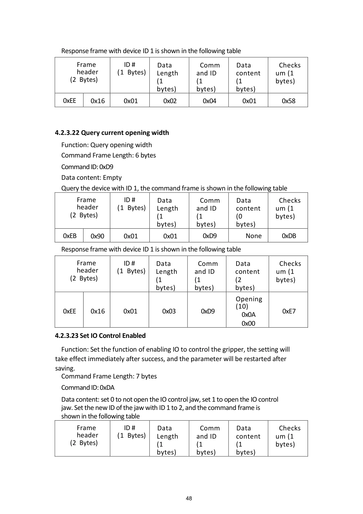




```
48
Response frame with device ID 1 is shown in the following table 
 
Frame 
header 
(2 Bytes) 
ID # 
(1 Bytes) 
Data 
Length 
(1 
bytes) 
Comm
and ID 
(1 
bytes) 
Data 
content 
(1 
bytes) 
Checks
um (1 
bytes) 
0xEE 
0x16 
0x01 
0x02 
0x04 
0x01 
0x58 
 
 
4.2.3.22 Query current opening width 
Function: Query opening width 
Command Frame Length: 6 bytes 
Command ID: 0xD9 
Data content: Empty 
Query the device with ID 1, the command frame is shown in the following table 
 
Frame 
header 
(2 Bytes) 
ID # 
(1 Bytes) 
Data 
Length 
(1 
bytes) 
Comm
and ID 
(1 
bytes) 
Data 
content 
(0 
bytes) 
Checks
um (1 
bytes) 
0xEB 
0x90 
0x01 
0x01 
0xD9 
None 
0xDB 
Response frame with device ID 1 is shown in the following table 
 
Frame 
header 
(2 Bytes) 
ID # 
(1 Bytes) 
Data 
Length 
(1 
bytes) 
Comm
and ID 
(1 
bytes) 
Data 
content 
(2 
bytes) 
Checks
um (1 
bytes) 
0xEE 
0x16 
0x01 
0x03 
0xD9 
Opening 
(10) 
0x0A 
0x00 
0xE7 
4.2.3.23 Set IO Control Enabled 
Function: Set the function of enabling IO to control the gripper, the setting will 
take effect immediately after success, and the parameter will be restarted after 
saving. 
Command Frame Length: 7 bytes 
Command ID: 0xDA 
Data content: set 0 to not open the IO control jaw, set 1 to open the IO control 
jaw. Set the new ID of the jaw with ID 1 to 2, and the command frame is 
shown in the following table 
Frame 
header 
(2 Bytes) 
ID # 
(1 Bytes) 
Data 
Length 
(1 
bytes) 
Comm
and ID 
(1 
bytes) 
Data 
content 
(1 
bytes) 
Checks
um (1 
bytes)
```




## PDF page 49

[RMG22-65 parallel gripper manual V1.3, original PDF page 49](https://1292444914-files.gitbook.io/~/files/v0/b/gitbook-x-prod.appspot.com/o/spaces%2FtgOfPnscWebs1eh82EKq%2Fuploads%2FMISWJx440NuLDkZ0DN2e%2FRMG22-pages-01-53.pdf?alt=media#page=49)








```
49
0xEB 
0x90 
0x01 
0x02 
0xDA 
0x01 
0xDE 
The response frame is shown in the following table
```




## PDF page 50

[RMG22-65 parallel gripper manual V1.3, original PDF page 50](https://1292444914-files.gitbook.io/~/files/v0/b/gitbook-x-prod.appspot.com/o/spaces%2FtgOfPnscWebs1eh82EKq%2Fuploads%2FMISWJx440NuLDkZ0DN2e%2FRMG22-pages-01-53.pdf?alt=media#page=50)



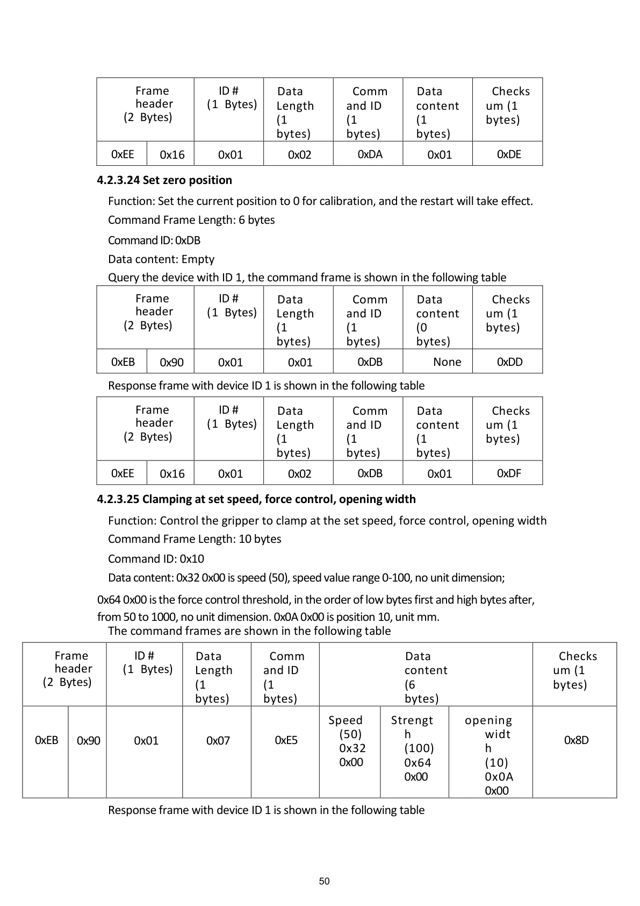




```
50 
 
Frame 
header 
(2 Bytes) 
ID # 
(1 Bytes) 
Data 
Length 
(1 
bytes) 
Comm
and ID 
(1 
bytes) 
Data 
content 
(1 
bytes) 
Checks
um (1 
bytes) 
0xEE 
0x16 
0x01 
0x02 
0xDA 
0x01 
0xDE 
4.2.3.24 Set zero position 
Function: Set the current position to 0 for calibration, and the restart will take effect. 
Command Frame Length: 6 bytes 
Command ID: 0xDB 
Data content: Empty 
Query the device with ID 1, the command frame is shown in the following table 
 
Frame 
header 
(2 Bytes) 
ID # 
(1 Bytes) 
Data 
Length 
(1 
bytes) 
Comm
and ID 
(1 
bytes) 
Data 
content 
(0 
bytes) 
Checks
um (1 
bytes) 
0xEB 
0x90 
0x01 
0x01 
0xDB 
None 
0xDD 
Response frame with device ID 1 is shown in the following table 
 
Frame 
header 
(2 Bytes) 
ID # 
(1 Bytes) 
Data 
Length 
(1 
bytes) 
Comm
and ID 
(1 
bytes) 
Data 
content 
(1 
bytes) 
Checks
um (1 
bytes) 
0xEE 
0x16 
0x01 
0x02 
0xDB 
0x01 
0xDF 
4.2.3.25 Clamping at set speed, force control, opening width 
Function: Control the gripper to clamp at the set speed, force control, opening width 
Command Frame Length: 10 bytes 
Command ID: 0x10 
Data content: 0x32 0x00 is speed (50), speed value range 0-100, no unit dimension; 
0x64 0x00 is the force control threshold, in the order of low bytes first and high bytes after, 
from 50 to 1000, no unit dimension. 0x0A 0x00 is position 10, unit mm. 
The command frames are shown in the following table 
 
Frame 
header 
(2 Bytes) 
ID # 
(1 Bytes) 
Data 
Length 
(1 
bytes) 
Comm
and ID 
(1 
bytes) 
Data 
content 
(6 
bytes) 
Checks
um (1 
bytes) 
 
0xEB 
0x90 
0x01 
0x07 
0xE5 
Speed 
(50) 
0x32 
0x00 
Strengt
h 
(100) 
0x64 
0x00 
opening 
widt
h 
(10) 
0x0A 
0x00 
0x8D 
Response frame with device ID 1 is shown in the following table
```




## PDF page 51

[RMG22-65 parallel gripper manual V1.3, original PDF page 51](https://1292444914-files.gitbook.io/~/files/v0/b/gitbook-x-prod.appspot.com/o/spaces%2FtgOfPnscWebs1eh82EKq%2Fuploads%2FMISWJx440NuLDkZ0DN2e%2FRMG22-pages-01-53.pdf?alt=media#page=51)








```
51 
Frame 
header 
(2 Bytes) 
ID # 
(1 Bytes) 
Data 
Length 
(1 
bytes) 
Comm
and ID 
(1 
bytes) 
Data 
content 
(1 
bytes) 
Checks
um (1 
bytes)
```




## PDF page 52

[RMG22-65 parallel gripper manual V1.3, original PDF page 52](https://1292444914-files.gitbook.io/~/files/v0/b/gitbook-x-prod.appspot.com/o/spaces%2FtgOfPnscWebs1eh82EKq%2Fuploads%2FMISWJx440NuLDkZ0DN2e%2FRMG22-pages-01-53.pdf?alt=media#page=52)



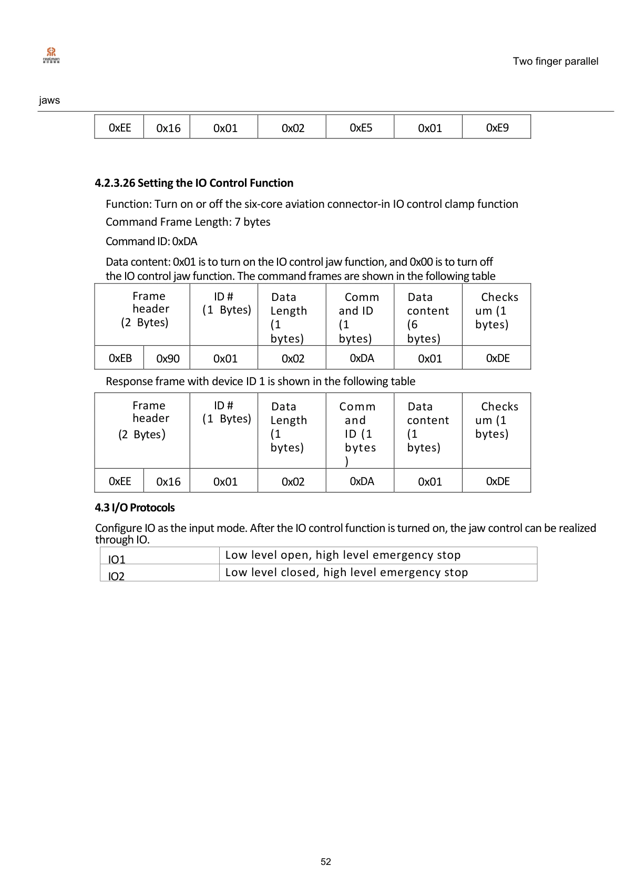




```
Two finger parallel 
jaws 
 
52
 
0xEE 
0x16 
0x01 
0x02 
0xE5 
0x01 
0xE9 
 
 
4.2.3.26 Setting the IO Control Function 
Function: Turn on or off the six-core aviation connector-in IO control clamp function 
Command Frame Length: 7 bytes 
Command ID: 0xDA 
Data content: 0x01 is to turn on the IO control jaw function, and 0x00 is to turn off 
the IO control jaw function. The command frames are shown in the following table 
Frame 
header 
(2 Bytes) 
ID # 
(1 Bytes) 
Data 
Length 
(1 
bytes) 
Comm
and ID 
(1 
bytes) 
Data 
content 
(6 
bytes) 
Checks
um (1 
bytes) 
0xEB 
0x90 
0x01 
0x02 
0xDA 
0x01 
0xDE 
Response frame with device ID 1 is shown in the following table 
 
Frame 
header 
(2 Bytes） 
ID # 
(1 Bytes) 
Data 
Length 
(1 
bytes) 
Comm
and 
ID (1 
bytes
) 
Data 
content 
(1 
bytes) 
Checks
um (1 
bytes) 
0xEE 
0x16 
0x01 
0x02 
0xDA 
0x01 
0xDE 
4.3 I/O Protocols 
Configure IO as the input mode. After the IO control function is turned on, the jaw control can be realized 
through IO. 
 
IO1 
Low level open, high level emergency stop 
IO2 
Low level closed, high level emergency stop
```




## PDF page 53

[RMG22-65 parallel gripper manual V1.3, original PDF page 53](https://1292444914-files.gitbook.io/~/files/v0/b/gitbook-x-prod.appspot.com/o/spaces%2FtgOfPnscWebs1eh82EKq%2Fuploads%2FMISWJx440NuLDkZ0DN2e%2FRMG22-pages-01-53.pdf?alt=media#page=53)



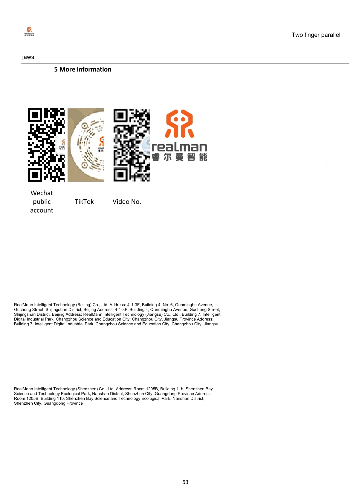




```
Two finger parallel 
jaws 
 
 
53
5 More information 
 
 
 
Wechat 
public 
account 
TikTok 
Video No. 
 
 
RealMann Intelligent Technology (Beijing) Co., Ltd. Address: 4-1-3F, Building 4, No. 6, Qunminghu Avenue, 
Gucheng Street, Shijingshan District, Beijing Address: 4-1-3F, Building 4, Qunminghu Avenue, Gucheng Street, 
Shijingshan District, Beijing Address: RealMann Intelligent Technology (Jiangsu) Co., Ltd., Building 7, Intelligent 
Digital Industrial Park, Changzhou Science and Education City, Changzhou City, Jiangsu Province Address: 
Building 7, Intelligent Digital Industrial Park, Changzhou Science and Education City, Changzhou City, Jiangsu 
 
 
RealMann Intelligent Technology (Shenzhen) Co., Ltd. Address: Room 1205B, Building 11b, Shenzhen Bay 
Science and Technology Ecological Park, Nanshan District, Shenzhen City, Guangdong Province Address: 
Room 1205B, Building 11b, Shenzhen Bay Science and Technology Ecological Park, Nanshan District, 
Shenzhen City, Guangdong Province
```



