# RealBot2.0 / S2 interface manual V1.3 — complete supplied document (70 pages)


**Complete supplied document:** RealBot2.0\_S2\_Secondary\_Development\_Interface\_Document\_V1.3\_EN.pdf · **PDF pages:** 70. This reference preserves every source page, including tables, drawings, connector views, examples, revision notes, warranty text and appendices. [Return to the RealMan source library](./).


The **Original page** tab retains the exact visual layout. The **Searchable text** tab contains extracted text, or a visually checked transcription for the two image-only specification sheets. Native PDF text can have reading-order or character defects; use the original page for table column alignment, connector orientation, equations and code indentation.


This is the V1.3 S2 interface contract, not permission to command motion. Preserve the distinction between SI radians in ROS state messages and integer millidegrees (0.001°) in the JSON command contract. Some English prose incorrectly calls 0.001° “milliradians”; the stated conversion formula and degree symbol show the difference. Software speed limits, a returned service response and a zero command are not proof of a safe or completed motion. Collision recovery, hardware emergency stop and authority/timeout behavior must be checked for the delivered project.


## Document navigation

| Topic                                                                               | PDF pages                                                |
| ----------------------------------------------------------------------------------- | -------------------------------------------------------- |
| Document scope, versions, hardware profiles and scenes                              | [PDF 1–7](complete-s2-interface-manual.md#pdf-page-1)    |
| Autostart readiness, lifecycle, runtime domains and development routes              | [PDF 8–14](complete-s2-interface-manual.md#pdf-page-8)   |
| Types, SI units, QoS, timestamps and JSON conventions                               | [PDF 14–16](complete-s2-interface-manual.md#pdf-page-14) |
| Aggregate-state fields, complete JSON schema and state enumerations                 | [PDF 16–24](complete-s2-interface-manual.md#pdf-page-16) |
| Head/waist and arm service contracts, units, schema, response handling and stopping | [PDF 24–35](complete-s2-interface-manual.md#pdf-page-24) |
| Chassis topics, wheel/odometry/battery data, collision and speed-control contracts  | [PDF 35–43](complete-s2-interface-manual.md#pdf-page-35) |
| Arm/hand high-frequency fields, validation and control                              | [PDF 44–50](complete-s2-interface-manual.md#pdf-page-44) |
| Cameras, encoding, IMU/LiDAR/navigation and data recording                          | [PDF 50–54](complete-s2-interface-manual.md#pdf-page-50) |
| Operations, lifecycle, logs, evidence and safety/failure behavior                   | [PDF 54–60](complete-s2-interface-manual.md#pdf-page-54) |
| Client workspace, dependencies, complete examples, deployment and self-test         | [PDF 61–66](complete-s2-interface-manual.md#pdf-page-61) |
| Custom/standard interface definitions and full quick reference                      | [PDF 66–70](complete-s2-interface-manual.md#pdf-page-66) |

**Source attribution:** RealMan, supplied document named above. All original notices and technical statements remain visible in the source page images. Added navigation and discrepancy notes are OpenELAB editorial guidance. Software execution and hardware validation: **not run**.

## PDF page 1

[RealBot2.0 / S2 interface manual V1.3, original PDF page 1](https://1292444914-files.gitbook.io/~/files/v0/b/gitbook-x-prod.appspot.com/o/spaces%2FtgOfPnscWebs1eh82EKq%2Fuploads%2F588gZef2ZxEvFbJF8KVl%2FS2_API-pages-01-67.pdf?alt=media#page=1)



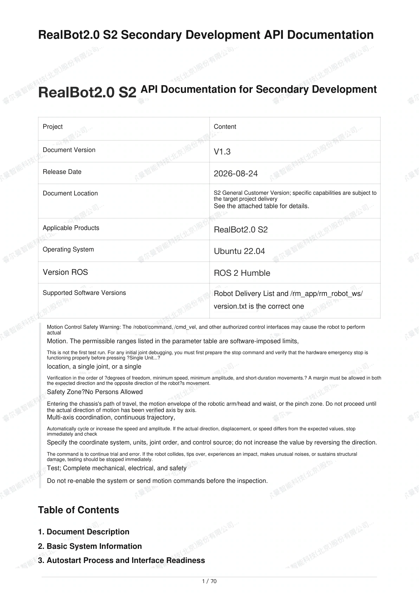




```
RealBot2.0 S2
V1.3
2026-08-24
RealBot2.0 S2
Ubuntu 22.04
ROS 2 Humble
1 / 70
RealBot2.0 S2 Secondary Development API Documentation
API Documentation for Secondary Development
Project
Content
Document Version
Release Date
Document Location
S2 General Customer Version; specific capabilities are subject to
the target project delivery
See the attached table for details.
Applicable Products
Operating System
Version ROS
Supported Software Versions
Robot Delivery List and /rm_app/rm_robot_ws/
version.txt is the correct one
Motion Control Safety Warning: The /robot/command, /cmd_vel, and other authorized control interfaces may cause the robot to perform
actual
Motion. The permissible ranges listed in the parameter table are software-imposed limits,
This is not the first test run. For any initial joint debugging, you must first prepare the stop command and verify that the hardware emergency stop is
functioning properly before pressing ?Single Unit...?
location, a single joint, or a single
Verification in the order of ?degrees of freedom, minimum speed, minimum amplitude, and short-duration movements.? A margin must be allowed in both
the expected direction and the opposite direction of the robot?s movement.
Safety Zone?No Persons Allowed
Entering the chassis's path of travel, the motion envelope of the robotic arm/head and waist, or the pinch zone. Do not proceed until
the actual direction of motion has been verified axis by axis.
Multi-axis coordination, continuous trajectory,
Automatically cycle or increase the speed and amplitude. If the actual direction, displacement, or speed differs from the expected values, stop
immediately and check
Specify the coordinate system, units, joint order, and control source; do not increase the value by reversing the direction.
The command is to continue trial and error. If the robot collides, tips over, experiences an impact, makes unusual noises, or sustains structural
damage, testing should be stopped immediately.
Test; Complete mechanical, electrical, and safety
Do not re-enable the system or send motion commands before the inspection.
Table of Contents
1. Document Description
2. Basic System Information
3. Autostart Process and Interface Readiness
```




## PDF page 2

[RealBot2.0 / S2 interface manual V1.3, original PDF page 2](https://1292444914-files.gitbook.io/~/files/v0/b/gitbook-x-prod.appspot.com/o/spaces%2FtgOfPnscWebs1eh82EKq%2Fuploads%2F588gZef2ZxEvFbJF8KVl%2FS2_API-pages-01-67.pdf?alt=media#page=2)



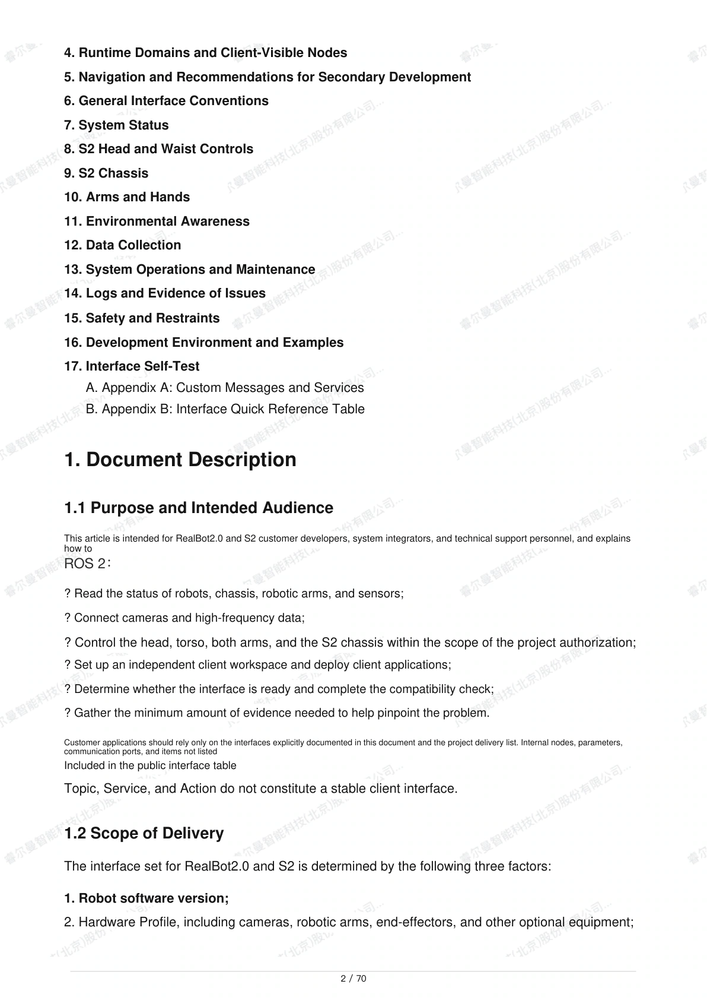




```
ROS 2：
2 / 70
4. Runtime Domains and Client-Visible Nodes
5. Navigation and Recommendations for Secondary Development
6. General Interface Conventions
7. System Status
8. S2 Head and Waist Controls
9. S2 Chassis
10. Arms and Hands
11. Environmental Awareness
12. Data Collection
13. System Operations and Maintenance
14. Logs and Evidence of Issues
15. Safety and Restraints
16. Development Environment and Examples
17. Interface Self-Test
A. Appendix A: Custom Messages and Services
B. Appendix B: Interface Quick Reference Table
1. Document Description
1.1 Purpose and Intended Audience
This article is intended for RealBot2.0 and S2 customer developers, system integrators, and technical support personnel, and explains
how to
? Read the status of robots, chassis, robotic arms, and sensors;
? Connect cameras and high-frequency data;
? Control the head, torso, both arms, and the S2 chassis within the scope of the project authorization;
? Set up an independent client workspace and deploy client applications;
? Determine whether the interface is ready and complete the compatibility check;
? Gather the minimum amount of evidence needed to help pinpoint the problem.
Customer applications should rely only on the interfaces explicitly documented in this document and the project delivery list. Internal nodes, parameters,
communication ports, and items not listed
Included in the public interface table
Topic, Service, and Action do not constitute a stable client interface.
1.2 Scope of Delivery
The interface set for RealBot2.0 and S2 is determined by the following three factors:
1. Robot software version;
2. Hardware Profile, including cameras, robotic arms, end-effectors, and other optional equipment;
```




## PDF page 3

[RealBot2.0 / S2 interface manual V1.3, original PDF page 3](https://1292444914-files.gitbook.io/~/files/v0/b/gitbook-x-prod.appspot.com/o/spaces%2FtgOfPnscWebs1eh82EKq%2Fuploads%2F588gZef2ZxEvFbJF8KVl%2FS2_API-pages-01-67.pdf?alt=media#page=3)



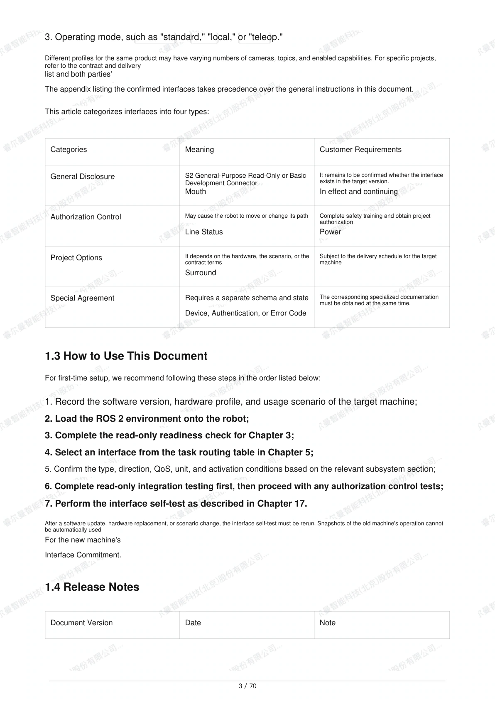




```
3 / 70
3. Operating mode, such as "standard," "local," or "teleop."
Different profiles for the same product may have varying numbers of cameras, topics, and enabled capabilities. For specific projects,
refer to the contract and delivery
list and both parties'
The appendix listing the confirmed interfaces takes precedence over the general instructions in this document.
This article categorizes interfaces into four types:
Categories
Meaning
Customer Requirements
General Disclosure
S2 General-Purpose Read-Only or Basic
Development Connector
It remains to be confirmed whether the interface
exists in the target version.
Mouth
In effect and continuing
Authorization Control
May cause the robot to move or change its path
Complete safety training and obtain project
authorization
Line Status
Power
Project Options
It depends on the hardware, the scenario, or the
contract terms
Subject to the delivery schedule for the target
machine
Surround
Special Agreement
Requires a separate schema and state
The corresponding specialized documentation
must be obtained at the same time.
Device, Authentication, or Error Code
1.3 How to Use This Document
For first-time setup, we recommend following these steps in the order listed below:
1. Record the software version, hardware profile, and usage scenario of the target machine;
2. Load the ROS 2 environment onto the robot;
3. Complete the read-only readiness check for Chapter 3;
4. Select an interface from the task routing table in Chapter 5;
5. Confirm the type, direction, QoS, unit, and activation conditions based on the relevant subsystem section;
6. Complete read-only integration testing first, then proceed with any authorization control tests;
7. Perform the interface self-test as described in Chapter 17.
After a software update, hardware replacement, or scenario change, the interface self-test must be rerun. Snapshots of the old machine's operation cannot
be automatically used
For the new machine's
Interface Commitment.
1.4 Release Notes
Document Version
Date
Note
```




## PDF page 4

[RealBot2.0 / S2 interface manual V1.3, original PDF page 4](https://1292444914-files.gitbook.io/~/files/v0/b/gitbook-x-prod.appspot.com/o/spaces%2FtgOfPnscWebs1eh82EKq%2Fuploads%2F588gZef2ZxEvFbJF8KVl%2FS2_API-pages-01-67.pdf?alt=media#page=4)



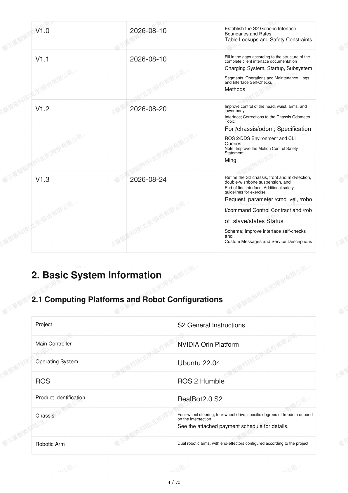




```
V1.0
2026-08-10
V1.1
2026-08-10
V1.2
2026-08-20
V1.3
2026-08-24
Ubuntu 22.04
ROS
ROS 2 Humble
RealBot2.0 S2
4 / 70
Establish the S2 Generic Interface
Boundaries and Rates
Table Lookups and Safety Constraints
Fill in the gaps according to the structure of the
complete client interface documentation
Charging System, Startup, Subsystem
Segments, Operations and Maintenance, Logs,
and Interface Self-Checks
Methods
Improve control of the head, waist, arms, and
lower body
Interface; Corrections to the Chassis Odometer
Topic
For /chassis/odom; Specification
ROS 2/DDS Environment and CLI
Queries
Note: Improve the Motion Control Safety
Statement
Ming
Refine the S2 chassis, front and mid-section,
double-wishbone suspension, and
End-of-line interface; Additional safety
guidelines for exercise
Request, parameter /cmd_vel, /robo
t/command Control Contract and /rob
ot_slave/states Status
Schema; Improve interface self-checks
and
Custom Messages and Service Descriptions
2. Basic System Information
2.1 Computing Platforms and Robot Configurations
Project
S2 General Instructions
Main Controller
NVIDIA Orin Platform
Operating System
Product Identification
Chassis
Four-wheel steering, four-wheel drive; specific degrees of freedom depend
on the intersection
See the attached payment schedule for details.
Robotic Arm
Dual robotic arms, with end-effectors configured according to the project
```




## PDF page 5

[RealBot2.0 / S2 interface manual V1.3, original PDF page 5](https://1292444914-files.gitbook.io/~/files/v0/b/gitbook-x-prod.appspot.com/o/spaces%2FtgOfPnscWebs1eh82EKq%2Fuploads%2F588gZef2ZxEvFbJF8KVl%2FS2_API-pages-01-67.pdf?alt=media#page=5)



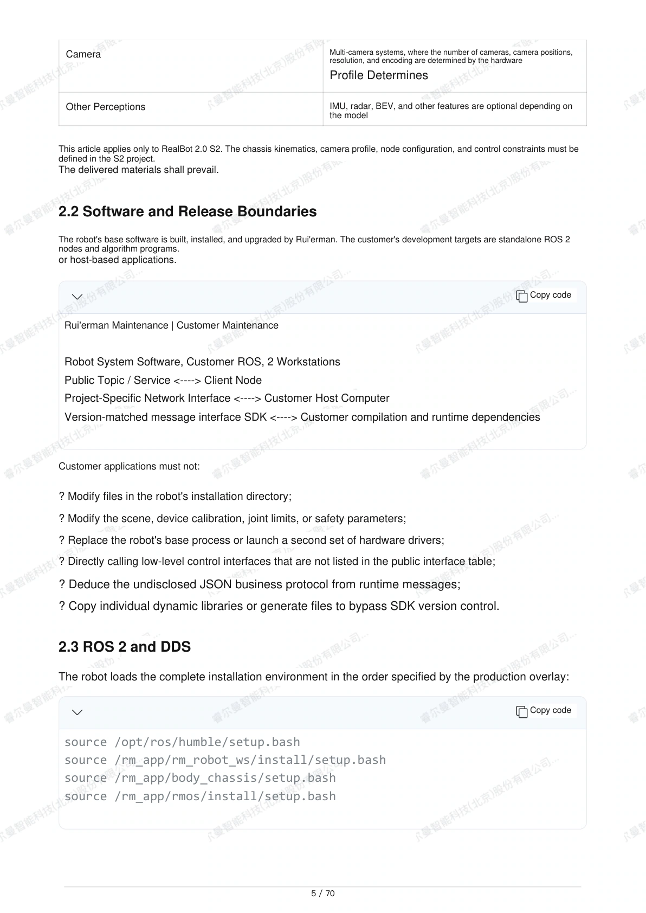




```
source /opt/ros/humble/setup.bash
source /rm_app/rm_robot_ws/install/setup.bash
source /rm_app/body_chassis/setup.bash
source /rm_app/rmos/install/setup.bash
5 / 70
Camera
Multi-camera systems, where the number of cameras, camera positions,
resolution, and encoding are determined by the hardware
Profile Determines
Other Perceptions
IMU, radar, BEV, and other features are optional depending on
the model
This article applies only to RealBot 2.0 S2. The chassis kinematics, camera profile, node configuration, and control constraints must be
defined in the S2 project.
The delivered materials shall prevail.
2.2 Software and Release Boundaries
The robot's base software is built, installed, and upgraded by Rui'erman. The customer's development targets are standalone ROS 2
nodes and algorithm programs.
or host-based applications.
Copy code
Rui'erman Maintenance | Customer Maintenance
Robot System Software, Customer ROS, 2 Workstations
Public Topic / Service <----> Client Node
Project-Specific Network Interface <----> Customer Host Computer
Version-matched message interface SDK <----> Customer compilation and runtime dependencies
Customer applications must not:
? Modify files in the robot's installation directory;
? Modify the scene, device calibration, joint limits, or safety parameters;
? Replace the robot's base process or launch a second set of hardware drivers;
? Directly calling low-level control interfaces that are not listed in the public interface table;
? Deduce the undisclosed JSON business protocol from runtime messages;
? Copy individual dynamic libraries or generate files to bypass SDK version control.
2.3 ROS 2 and DDS
The robot loads the complete installation environment in the order specified by the production overlay:
Copy code
```




## PDF page 6

[RealBot2.0 / S2 interface manual V1.3, original PDF page 6](https://1292444914-files.gitbook.io/~/files/v0/b/gitbook-x-prod.appspot.com/o/spaces%2FtgOfPnscWebs1eh82EKq%2Fuploads%2F588gZef2ZxEvFbJF8KVl%2FS2_API-pages-01-67.pdf?alt=media#page=6)



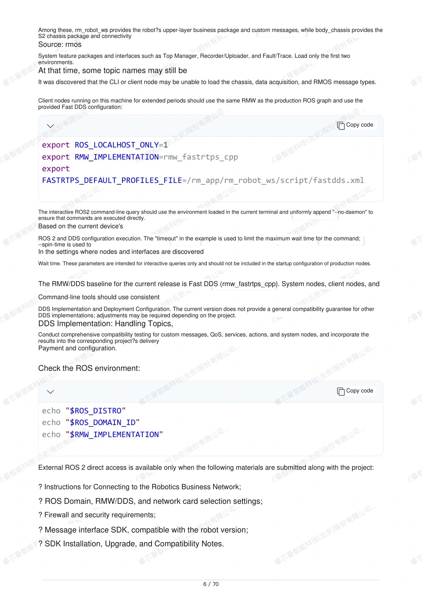




```
export ROS_LOCALHOST_ONLY=1
export RMW_IMPLEMENTATION=rmw_fastrtps_cpp
export 
FASTRTPS_DEFAULT_PROFILES_FILE=/rm_app/rm_robot_ws/script/fastdds.xml
echo "$ROS_DISTRO"
echo "$ROS_DOMAIN_ID"
echo "$RMW_IMPLEMENTATION"
6 / 70
Among these, rm_robot_ws provides the robot?s upper-layer business package and custom messages, while body_chassis provides the
S2 chassis package and connectivity
Source: rmos
System feature packages and interfaces such as Top Manager, Recorder/Uploader, and Fault/Trace. Load only the first two
environments.
At that time, some topic names may still be
It was discovered that the CLI or client node may be unable to load the chassis, data acquisition, and RMOS message types.
Client nodes running on this machine for extended periods should use the same RMW as the production ROS graph and use the
provided Fast DDS configuration:
Copy code
The interactive ROS2 command-line query should use the environment loaded in the current terminal and uniformly append "--no-daemon" to
ensure that commands are executed directly.
Based on the current device's
ROS 2 and DDS configuration execution. The "timeout" in the example is used to limit the maximum wait time for the command;
--spin-time is used to
In the settings where nodes and interfaces are discovered
Wait time. These parameters are intended for interactive queries only and should not be included in the startup configuration of production nodes.
The RMW/DDS baseline for the current release is Fast DDS (rmw_fastrtps_cpp). System nodes, client nodes, and
Command-line tools should use consistent
DDS Implementation and Deployment Configuration. The current version does not provide a general compatibility guarantee for other
DDS implementations; adjustments may be required depending on the project.
DDS Implementation: Handling Topics,
Conduct comprehensive compatibility testing for custom messages, QoS, services, actions, and system nodes, and incorporate the
results into the corresponding project?s delivery
Payment and configuration.
Check the ROS environment:
Copy code
External ROS 2 direct access is available only when the following materials are submitted along with the project:
? Instructions for Connecting to the Robotics Business Network;
? ROS Domain, RMW/DDS, and network card selection settings;
? Firewall and security requirements;
? Message interface SDK, compatible with the robot version;
? SDK Installation, Upgrade, and Compatibility Notes.
```




## PDF page 7

[RealBot2.0 / S2 interface manual V1.3, original PDF page 7](https://1292444914-files.gitbook.io/~/files/v0/b/gitbook-x-prod.appspot.com/o/spaces%2FtgOfPnscWebs1eh82EKq%2Fuploads%2F588gZef2ZxEvFbJF8KVl%2FS2_API-pages-01-67.pdf?alt=media#page=7)



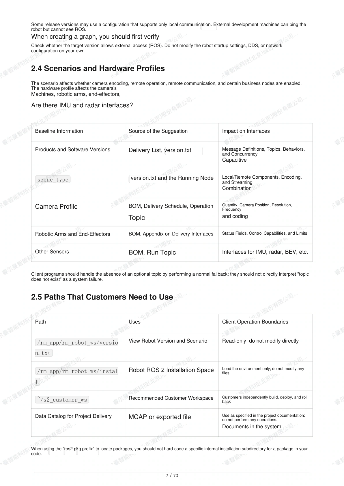




```
scene_type 
Topic
/rm_app/rm_robot_ws/versio
n.txt 
/rm_app/rm_robot_ws/instal
l 
~/s2_customer_ws 
7 / 70
Some release versions may use a configuration that supports only local communication. External development machines can ping the
robot but cannot see ROS.
When creating a graph, you should first verify
Check whether the target version allows external access (ROS). Do not modify the robot startup settings, DDS, or network
configuration on your own.
2.4 Scenarios and Hardware Profiles
The scenario affects whether camera encoding, remote operation, remote communication, and certain business nodes are enabled.
The hardware profile affects the camera's
Machines, robotic arms, end-effectors,
Are there IMU and radar interfaces?
Baseline Information
Source of the Suggestion
Impact on Interfaces
Products and Software Versions
Delivery List, version.txt
Message Definitions, Topics, Behaviors,
and Concurrency
Capacitive
version.txt and the Running Node
Local/Remote Components, Encoding,
and Streaming
Combination
Camera Profile
BOM, Delivery Schedule, Operation
Quantity, Camera Position, Resolution,
Frequency
and coding
Robotic Arms and End-Effectors
BOM, Appendix on Delivery Interfaces
Status Fields, Control Capabilities, and Limits
Other Sensors
BOM, Run Topic
Interfaces for IMU, radar, BEV, etc.
Client programs should handle the absence of an optional topic by performing a normal fallback; they should not directly interpret "topic
does not exist" as a system failure.
2.5 Paths That Customers Need to Use
Path
Uses
Client Operation Boundaries
View Robot Version and Scenario
Read-only; do not modify directly
Robot ROS 2 Installation Space
Load the environment only; do not modify any
files.
Recommended Customer Workspace
Customers independently build, deploy, and roll
back
Data Catalog for Project Delivery
MCAP or exported file
Use as specified in the project documentation;
do not perform any operations.
Documents in the system
When using the `ros2 pkg prefix` to locate packages, you should not hard-code a specific internal installation subdirectory for a package in your
code.
```




## PDF page 8

[RealBot2.0 / S2 interface manual V1.3, original PDF page 8](https://1292444914-files.gitbook.io/~/files/v0/b/gitbook-x-prod.appspot.com/o/spaces%2FtgOfPnscWebs1eh82EKq%2Fuploads%2F588gZef2ZxEvFbJF8KVl%2FS2_API-pages-01-67.pdf?alt=media#page=8)



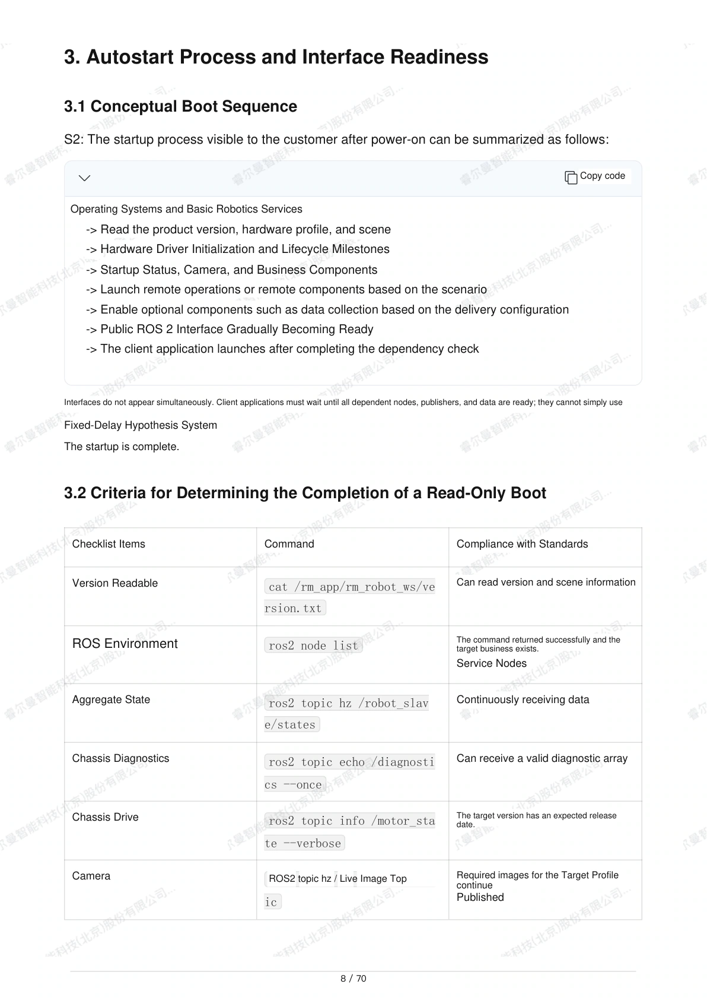




```
cat /rm_app/rm_robot_ws/ve
rsion.txt 
ros2 node list 
ros2 topic hz /robot_slav
e/states 
ros2 topic echo /diagnosti
cs --once 
ros2 topic info /motor_sta
te --verbose 
ic 
8 / 70
3. Autostart Process and Interface Readiness
3.1 Conceptual Boot Sequence
S2: The startup process visible to the customer after power-on can be summarized as follows:
Copy code
Operating Systems and Basic Robotics Services
-> Read the product version, hardware profile, and scene
-> Hardware Driver Initialization and Lifecycle Milestones
-> Startup Status, Camera, and Business Components
-> Launch remote operations or remote components based on the scenario
-> Enable optional components such as data collection based on the delivery configuration
-> Public ROS 2 Interface Gradually Becoming Ready
-> The client application launches after completing the dependency check
Interfaces do not appear simultaneously. Client applications must wait until all dependent nodes, publishers, and data are ready; they cannot simply use
Fixed-Delay Hypothesis System
The startup is complete.
3.2 Criteria for Determining the Completion of a Read-Only Boot
Checklist Items
Command
Compliance with Standards
Version Readable
Can read version and scene information
ROS Environment
The command returned successfully and the
target business exists.
Service Nodes
Aggregate State
Continuously receiving data
Chassis Diagnostics
Can receive a valid diagnostic array
Chassis Drive
The target version has an expected release
date.
Camera
ROS2 topic hz / Live Image Top
Required images for the Target Profile
continue
Published
```




## PDF page 9

[RealBot2.0 / S2 interface manual V1.3, original PDF page 9](https://1292444914-files.gitbook.io/~/files/v0/b/gitbook-x-prod.appspot.com/o/spaces%2FtgOfPnscWebs1eh82EKq%2Fuploads%2F588gZef2ZxEvFbJF8KVl%2FS2_API-pages-01-67.pdf?alt=media#page=9)



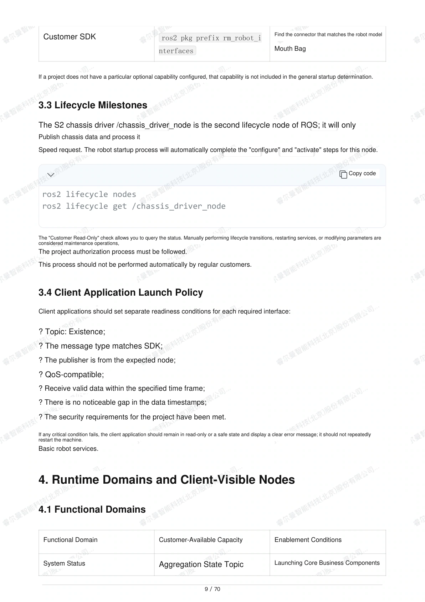




```
ros2 pkg prefix rm_robot_i
nterfaces 
ros2 lifecycle nodes
ros2 lifecycle get /chassis_driver_node
9 / 70
Customer SDK
Find the connector that matches the robot model
Mouth Bag
If a project does not have a particular optional capability configured, that capability is not included in the general startup determination.
3.3 Lifecycle Milestones
The S2 chassis driver /chassis_driver_node is the second lifecycle node of ROS; it will only
Publish chassis data and process it
Speed request. The robot startup process will automatically complete the "configure" and "activate" steps for this node.
Copy code
The "Customer Read-Only" check allows you to query the status. Manually performing lifecycle transitions, restarting services, or modifying parameters are
considered maintenance operations,
The project authorization process must be followed.
This process should not be performed automatically by regular customers.
3.4 Client Application Launch Policy
Client applications should set separate readiness conditions for each required interface:
? Topic: Existence;
? The message type matches SDK;
? The publisher is from the expected node;
? QoS-compatible;
? Receive valid data within the specified time frame;
? There is no noticeable gap in the data timestamps;
? The security requirements for the project have been met.
If any critical condition fails, the client application should remain in read-only or a safe state and display a clear error message; it should not repeatedly
restart the machine.
Basic robot services.
4. Runtime Domains and Client-Visible Nodes
4.1 Functional Domains
Functional Domain
Customer-Available Capacity
Enablement Conditions
System Status
Aggregation State Topic
Launching Core Business Components
```




## PDF page 10

[RealBot2.0 / S2 interface manual V1.3, original PDF page 10](https://1292444914-files.gitbook.io/~/files/v0/b/gitbook-x-prod.appspot.com/o/spaces%2FtgOfPnscWebs1eh82EKq%2Fuploads%2F588gZef2ZxEvFbJF8KVl%2FS2_API-pages-01-67.pdf?alt=media#page=10)



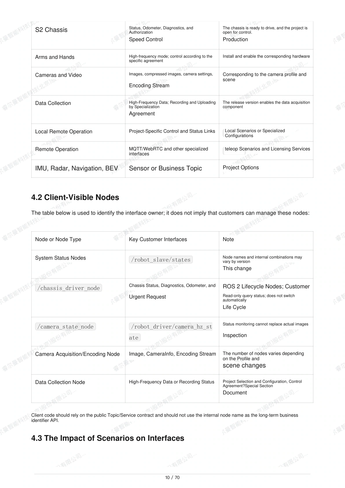




```
/robot_slave/states 
/chassis_driver_node 
/camera_state_node 
/robot_driver/camera_hz_st
ate 
10 / 70
S2 Chassis
Status, Odometer, Diagnostics, and
Authorization
The chassis is ready to drive, and the project is
open for control.
Speed Control
Production
Arms and Hands
High-frequency mode; control according to the
specific agreement
Install and enable the corresponding hardware
Cameras and Video
Images, compressed images, camera settings,
Corresponding to the camera profile and
scene
Encoding Stream
Data Collection
High-Frequency Data; Recording and Uploading
by Specialization
The release version enables the data acquisition
component
Agreement
Local Remote Operation
Project-Specific Control and Status Links
Local Scenarios or Specialized
Configurations
Remote Operation
MQTT/WebRTC and other specialized
interfaces
teleop Scenarios and Licensing Services
IMU, Radar, Navigation, BEV
Sensor or Business Topic
Project Options
4.2 Client-Visible Nodes
The table below is used to identify the interface owner; it does not imply that customers can manage these nodes:
Node or Node Type
Key Customer Interfaces
Note
System Status Nodes
Node names and internal combinations may
vary by version
This change
Chassis Status, Diagnostics, Odometer, and
ROS 2 Lifecycle Nodes; Customer
Urgent Request
Read-only query status; does not switch
automatically
Life Cycle
Status monitoring cannot replace actual images
Inspection
Camera Acquisition/Encoding Node
Image, CameraInfo, Encoding Stream
The number of nodes varies depending
on the Profile and
scene changes
Data Collection Node
High-Frequency Data or Recording Status
Project Selection and Configuration, Control
Agreement?Special Section
Document
Client code should rely on the public Topic/Service contract and should not use the internal node name as the long-term business
identifier API.
4.3 The Impact of Scenarios on Interfaces
```




## PDF page 11

[RealBot2.0 / S2 interface manual V1.3, original PDF page 11](https://1292444914-files.gitbook.io/~/files/v0/b/gitbook-x-prod.appspot.com/o/spaces%2FtgOfPnscWebs1eh82EKq%2Fuploads%2F588gZef2ZxEvFbJF8KVl%2FS2_API-pages-01-67.pdf?alt=media#page=11)



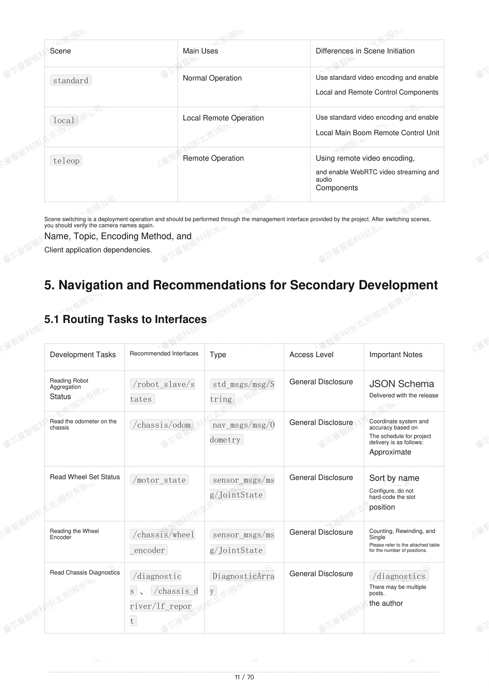




```
standard 
local 
teleop 
/robot_slave/s
tates 
std_msgs/msg/S
tring 
JSON Schema 
/chassis/odom 
nav_msgs/msg/O
dometry 
/motor_state 
sensor_msgs/ms
g/JointState 
/chassis/wheel
_encoder 
sensor_msgs/ms
g/JointState 
/diagnostic
s 、/chassis_d
river/lf_repor
t
DiagnosticArra
y 
/diagnostics  
11 / 70
Scene
Main Uses
Differences in Scene Initiation
Normal Operation
Use standard video encoding and enable
Local and Remote Control Components
Local Remote Operation
Use standard video encoding and enable
Local Main Boom Remote Control Unit
Remote Operation
Using remote video encoding,
and enable WebRTC video streaming and
audio
Components
Scene switching is a deployment operation and should be performed through the management interface provided by the project. After switching scenes,
you should verify the camera names again.
Name, Topic, Encoding Method, and
Client application dependencies.
5. Navigation and Recommendations for Secondary Development
5.1 Routing Tasks to Interfaces
Development Tasks
Recommended Interfaces
Type
Access Level
Important Notes
Reading Robot
Aggregation
General Disclosure
Status
Delivered with the release
Read the odometer on the
chassis
General Disclosure
Coordinate system and
accuracy based on
The schedule for project
delivery is as follows:
Approximate
Read Wheel Set Status
General Disclosure
Sort by name
Configure, do not
hard-code the slot
position
Reading the Wheel
Encoder
General Disclosure
Counting, Rewinding, and
Single
Please refer to the attached table
for the number of positions.
Read Chassis Diagnostics
General Disclosure
There may be multiple
posts.
the author
```




## PDF page 12

[RealBot2.0 / S2 interface manual V1.3, original PDF page 12](https://1292444914-files.gitbook.io/~/files/v0/b/gitbook-x-prod.appspot.com/o/spaces%2FtgOfPnscWebs1eh82EKq%2Fuploads%2F588gZef2ZxEvFbJF8KVl%2FS2_API-pages-01-67.pdf?alt=media#page=12)



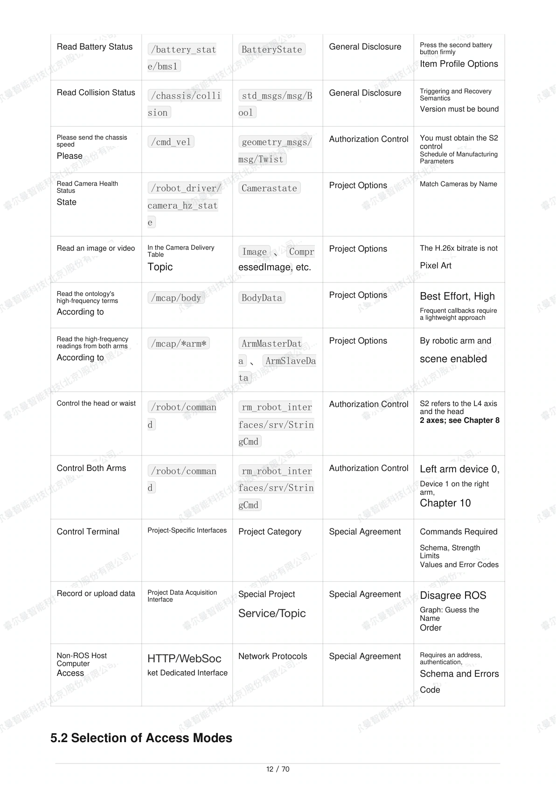




```
/battery_stat
e/bms1 
BatteryState 
/chassis/colli
sion 
std_msgs/msg/B
ool 
/cmd_vel 
geometry_msgs/
msg/Twist 
/robot_driver/
camera_hz_stat
e
Camerastate 
Image 、Compr
/mcap/body 
BodyData 
/mcap/*arm* 
ArmMasterDat
a 、ArmSlaveDa
ta 
/robot/comman
d
rm_robot_inter
faces/srv/Strin
gCmd 
/robot/comman
d
rm_robot_inter
faces/srv/Strin
gCmd 
Service/Topic
HTTP/WebSoc
12 / 70
Read Battery Status
General Disclosure
Press the second battery
button firmly
Item Profile Options
Read Collision Status
General Disclosure
Triggering and Recovery
Semantics
Version must be bound
Please send the chassis
speed
Authorization Control
You must obtain the S2
control
Please
Schedule of Manufacturing
Parameters
Read Camera Health
Status
Project Options
Match Cameras by Name
State
Read an image or video
In the Camera Delivery
Table
Project Options
The H.26x bitrate is not
Topic
essedImage, etc.
Pixel Art
Read the ontology's
high-frequency terms
Project Options
Best Effort, High
According to
Frequent callbacks require
a lightweight approach
Read the high-frequency
readings from both arms
Project Options
By robotic arm and
According to
scene enabled
Control the head or waist
Authorization Control
S2 refers to the L4 axis
and the head
2 axes; see Chapter 8
Control Both Arms
Authorization Control
Left arm device 0,
Device 1 on the right
arm,
Chapter 10
Control Terminal
Project-Specific Interfaces
Project Category
Special Agreement
Commands Required
Schema, Strength
Limits
Values and Error Codes
Record or upload data
Project Data Acquisition
Interface
Special Project
Special Agreement
Disagree ROS
Graph: Guess the
Name
Order
Non-ROS Host
Computer
Network Protocols
Special Agreement
Requires an address,
authentication,
Access
ket Dedicated Interface
Schema and Errors
Code
5.2 Selection of Access Modes
```




## PDF page 13

[RealBot2.0 / S2 interface manual V1.3, original PDF page 13](https://1292444914-files.gitbook.io/~/files/v0/b/gitbook-x-prod.appspot.com/o/spaces%2FtgOfPnscWebs1eh82EKq%2Fuploads%2F588gZef2ZxEvFbJF8KVl%2FS2_API-pages-01-67.pdf?alt=media#page=13)



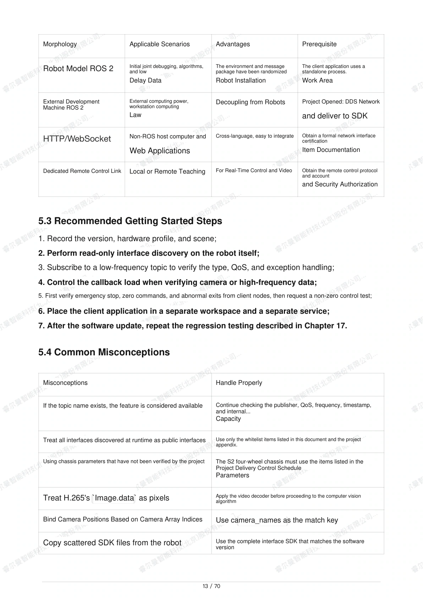




```
HTTP/WebSocket
13 / 70
Morphology
Applicable Scenarios
Advantages
Prerequisite
Robot Model ROS 2
Initial joint debugging, algorithms,
and low
The environment and message
package have been randomized
The client application uses a
standalone process.
Delay Data
Robot Installation
Work Area
External Development
Machine ROS 2
External computing power,
workstation computing
Decoupling from Robots
Project Opened: DDS Network
Law
and deliver to SDK
Non-ROS host computer and
Cross-language, easy to integrate
Obtain a formal network interface
certification
Web Applications
Item Documentation
Dedicated Remote Control Link
Local or Remote Teaching
For Real-Time Control and Video
Obtain the remote control protocol
and account
and Security Authorization
5.3 Recommended Getting Started Steps
1. Record the version, hardware profile, and scene;
2. Perform read-only interface discovery on the robot itself;
3. Subscribe to a low-frequency topic to verify the type, QoS, and exception handling;
4. Control the callback load when verifying camera or high-frequency data;
5. First verify emergency stop, zero commands, and abnormal exits from client nodes, then request a non-zero control test;
6. Place the client application in a separate workspace and a separate service;
7. After the software update, repeat the regression testing described in Chapter 17.
5.4 Common Misconceptions
Misconceptions
Handle Properly
If the topic name exists, the feature is considered available
Continue checking the publisher, QoS, frequency, timestamp,
and internal...
Capacity
Treat all interfaces discovered at runtime as public interfaces
Use only the whitelist items listed in this document and the project
appendix.
Using chassis parameters that have not been verified by the project
The S2 four-wheel chassis must use the items listed in the
Project Delivery Control Schedule
Parameters
Treat H.265's `Image.data` as pixels
Apply the video decoder before proceeding to the computer vision
algorithm
Bind Camera Positions Based on Camera Array Indices
Use camera_names as the match key
Copy scattered SDK files from the robot
Use the complete interface SDK that matches the software
version
```




## PDF page 14

[RealBot2.0 / S2 interface manual V1.3, original PDF page 14](https://1292444914-files.gitbook.io/~/files/v0/b/gitbook-x-prod.appspot.com/o/spaces%2FtgOfPnscWebs1eh82EKq%2Fuploads%2F588gZef2ZxEvFbJF8KVl%2FS2_API-pages-01-67.pdf?alt=media#page=14)



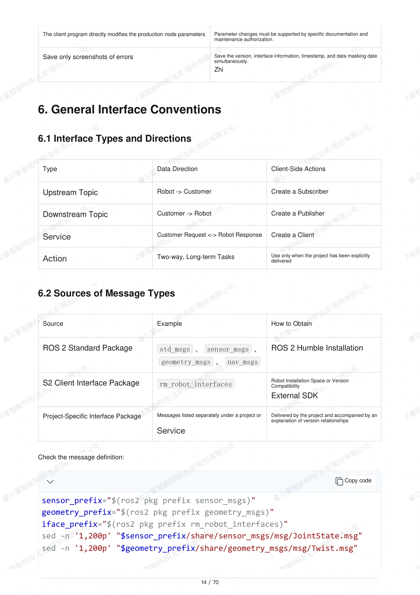




```
Service
Action
std_msgs 、sensor_msgs 、
geometry_msgs 、nav_msgs 
rm_robot_interfaces 
Service
sensor_prefix="$(ros2 pkg prefix sensor_msgs)"
geometry_prefix="$(ros2 pkg prefix geometry_msgs)"
iface_prefix="$(ros2 pkg prefix rm_robot_interfaces)"
sed -n '1,200p' "$sensor_prefix/share/sensor_msgs/msg/JointState.msg"
sed -n '1,200p' "$geometry_prefix/share/geometry_msgs/msg/Twist.msg"
14 / 70
The client program directly modifies the production node parameters
Parameter changes must be supported by specific documentation and
maintenance authorization.
Save only screenshots of errors
Save the version, interface information, timestamp, and data masking date
simultaneously.
Zhi
6. General Interface Conventions
6.1 Interface Types and Directions
Type
Data Direction
Client-Side Actions
Upstream Topic
Robot -> Customer
Create a Subscriber
Downstream Topic
Customer -> Robot
Create a Publisher
Customer Request <-> Robot Response
Create a Client
Two-way, Long-term Tasks
Use only when the project has been explicitly
delivered
6.2 Sources of Message Types
Source
Example
How to Obtain
ROS 2 Standard Package
ROS 2 Humble Installation
S2 Client Interface Package
Robot Installation Space or Version
Compatibility
External SDK
Project-Specific Interface Package
Messages listed separately under a project or
Delivered by the project and accompanied by an
explanation of version relationships
Check the message definition:
Copy code
```




## PDF page 15

[RealBot2.0 / S2 interface manual V1.3, original PDF page 15](https://1292444914-files.gitbook.io/~/files/v0/b/gitbook-x-prod.appspot.com/o/spaces%2FtgOfPnscWebs1eh82EKq%2Fuploads%2F588gZef2ZxEvFbJF8KVl%2FS2_API-pages-01-67.pdf?alt=media#page=15)



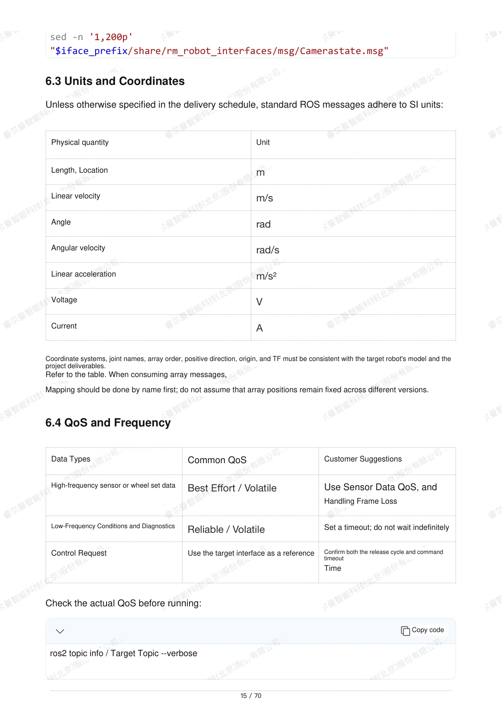




```
sed -n '1,200p' 
"$iface_prefix/share/rm_robot_interfaces/msg/Camerastate.msg"
m
m/s
rad
rad/s
m/s²
V
A
Best Effort / Volatile
Reliable / Volatile
15 / 70
6.3 Units and Coordinates
Unless otherwise specified in the delivery schedule, standard ROS messages adhere to SI units:
Physical quantity
Unit
Length, Location
Linear velocity
Angle
Angular velocity
Linear acceleration
Voltage
Current
Coordinate systems, joint names, array order, positive direction, origin, and TF must be consistent with the target robot's model and the
project deliverables.
Refer to the table. When consuming array messages,
Mapping should be done by name first; do not assume that array positions remain fixed across different versions.
6.4 QoS and Frequency
Data Types
Common QoS
Customer Suggestions
High-frequency sensor or wheel set data
Use Sensor Data QoS, and
Handling Frame Loss
Low-Frequency Conditions and Diagnostics
Set a timeout; do not wait indefinitely
Control Request
Use the target interface as a reference
Confirm both the release cycle and command
timeout
Time
Check the actual QoS before running:
Copy code
ros2 topic info / Target Topic --verbose
```




## PDF page 16

[RealBot2.0 / S2 interface manual V1.3, original PDF page 16](https://1292444914-files.gitbook.io/~/files/v0/b/gitbook-x-prod.appspot.com/o/spaces%2FtgOfPnscWebs1eh82EKq%2Fuploads%2F588gZef2ZxEvFbJF8KVl%2FS2_API-pages-01-67.pdf?alt=media#page=16)



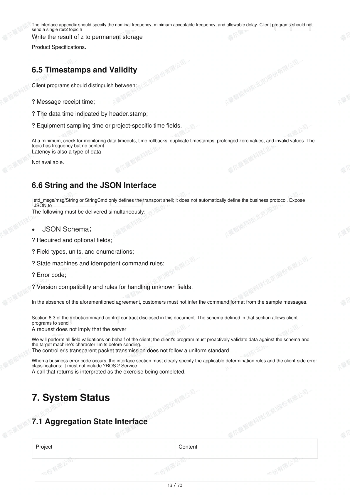




```
JSON Schema；
●
16 / 70
The interface appendix should specify the nominal frequency, minimum acceptable frequency, and allowable delay. Client programs should not
send a single ros2 topic h
Write the result of z to permanent storage
Product Specifications.
6.5 Timestamps and Validity
Client programs should distinguish between:
? Message receipt time;
? The data time indicated by header.stamp;
? Equipment sampling time or project-specific time fields.
At a minimum, check for monitoring data timeouts, time rollbacks, duplicate timestamps, prolonged zero values, and invalid values. The
topic has frequency but no content.
Latency is also a type of data
Not available.
6.6 String and the JSON Interface
std_msgs/msg/String or StringCmd only defines the transport shell; it does not automatically define the business protocol. Expose
JSON to
The following must be delivered simultaneously:
? Required and optional fields;
? Field types, units, and enumerations;
? State machines and idempotent command rules;
? Error code;
? Version compatibility and rules for handling unknown fields.
In the absence of the aforementioned agreement, customers must not infer the command format from the sample messages.
Section 8.3 of the /robot/command control contract disclosed in this document. The schema defined in that section allows client
programs to send
A request does not imply that the server
We will perform all field validations on behalf of the client; the client's program must proactively validate data against the schema and
the target machine's character limits before sending.
The controller's transparent packet transmission does not follow a uniform standard.
When a business error code occurs, the interface section must clearly specify the applicable determination rules and the client-side error
classifications; it must not include ?ROS 2 Service
A call that returns is interpreted as the exercise being completed.
7. System Status
7.1 Aggregation State Interface
Project
Content
```




## PDF page 17

[RealBot2.0 / S2 interface manual V1.3, original PDF page 17](https://1292444914-files.gitbook.io/~/files/v0/b/gitbook-x-prod.appspot.com/o/spaces%2FtgOfPnscWebs1eh82EKq%2Fuploads%2F588gZef2ZxEvFbJF8KVl%2FS2_API-pages-01-67.pdf?alt=media#page=17)



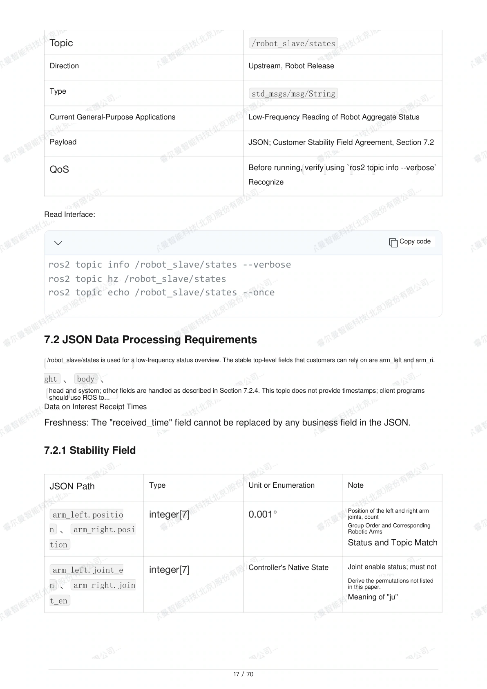




```
ght 、body 、
Topic
/robot_slave/states 
std_msgs/msg/String 
QoS
ros2 topic info /robot_slave/states --verbose
ros2 topic hz /robot_slave/states
ros2 topic echo /robot_slave/states --once
arm_left.positio
n 、arm_right.posi
tion 
integer[7]
0.001°
arm_left.joint_e
n 、arm_right.join
t_en 
integer[7]
17 / 70
Direction
Upstream, Robot Release
Type
Current General-Purpose Applications
Low-Frequency Reading of Robot Aggregate Status
Payload
JSON; Customer Stability Field Agreement, Section 7.2
Before running, verify using `ros2 topic info --verbose`
Recognize
Read Interface:
Copy code
7.2 JSON Data Processing Requirements
/robot_slave/states is used for a low-frequency status overview. The stable top-level fields that customers can rely on are arm_left and arm_ri.
head and system; other fields are handled as described in Section 7.2.4. This topic does not provide timestamps; client programs
should use ROS to...
Data on Interest Receipt Times
Freshness: The "received_time" field cannot be replaced by any business field in the JSON.
7.2.1 Stability Field
JSON Path
Type
Unit or Enumeration
Note
Position of the left and right arm
joints, count
Group Order and Corresponding
Robotic Arms
Status and Topic Match
Controller's Native State
Joint enable status; must not
Derive the permutations not listed
in this paper.
Meaning of "ju"
```




## PDF page 18

[RealBot2.0 / S2 interface manual V1.3, original PDF page 18](https://1292444914-files.gitbook.io/~/files/v0/b/gitbook-x-prod.appspot.com/o/spaces%2FtgOfPnscWebs1eh82EKq%2Fuploads%2F588gZef2ZxEvFbJF8KVl%2FS2_API-pages-01-67.pdf?alt=media#page=18)



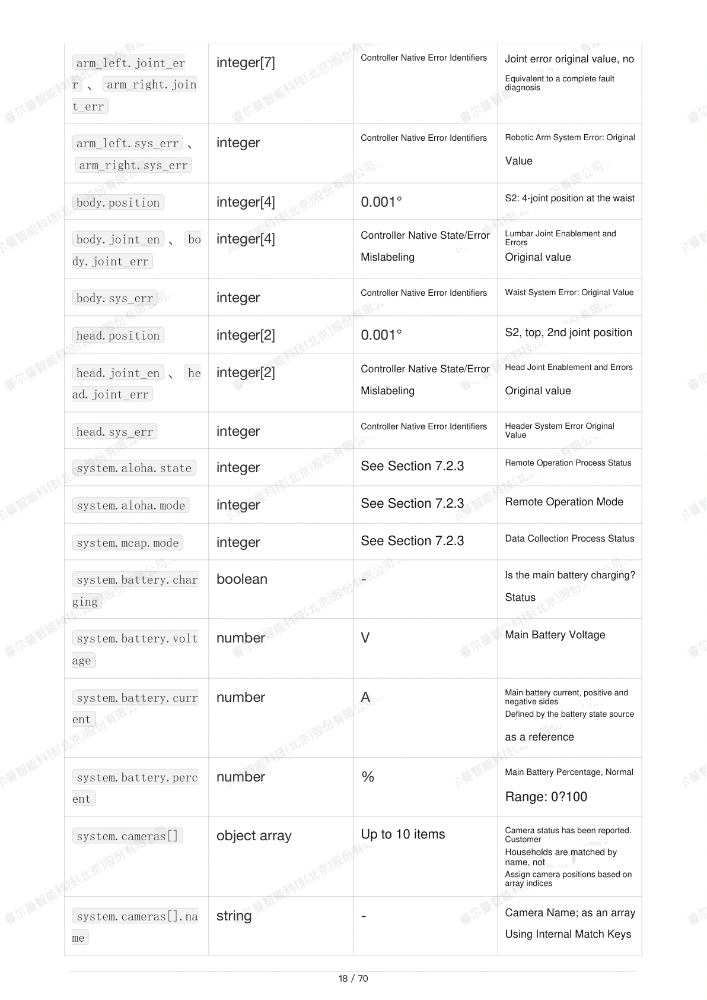




```
arm_left.joint_er
r 、arm_right.join
t_err 
integer[7]
arm_left.sys_err 、
arm_right.sys_err 
integer
body.position 
integer[4]
0.001°
body.joint_en 、bo
dy.joint_err 
integer[4]
body.sys_err 
integer
head.position 
integer[2]
0.001°
head.joint_en 、he
ad.joint_err 
integer[2]
head.sys_err 
integer
system.aloha.state 
integer
system.aloha.mode 
integer
system.mcap.mode 
integer
system.battery.char
ging 
boolean
-
system.battery.volt
age 
number
V
system.battery.curr
ent 
number
A
system.battery.perc
ent 
number
%
system.cameras[] 
object array
system.cameras[].na
me 
string
-
18 / 70
Controller Native Error Identifiers
Joint error original value, no
Equivalent to a complete fault
diagnosis
Controller Native Error Identifiers
Robotic Arm System Error: Original
Value
S2: 4-joint position at the waist
Controller Native State/Error
Lumbar Joint Enablement and
Errors
Mislabeling
Original value
Controller Native Error Identifiers
Waist System Error: Original Value
S2, top, 2nd joint position
Controller Native State/Error
Head Joint Enablement and Errors
Mislabeling
Original value
Controller Native Error Identifiers
Header System Error Original
Value
See Section 7.2.3
Remote Operation Process Status
See Section 7.2.3
Remote Operation Mode
See Section 7.2.3
Data Collection Process Status
Is the main battery charging?
Status
Main Battery Voltage
Main battery current, positive and
negative sides
Defined by the battery state source
as a reference
Main Battery Percentage, Normal
Range: 0?100
Up to 10 items
Camera status has been reported.
Customer
Households are matched by
name, not
Assign camera positions based on
array indices
Camera Name; as an array
Using Internal Match Keys
```




## PDF page 19

[RealBot2.0 / S2 interface manual V1.3, original PDF page 19](https://1292444914-files.gitbook.io/~/files/v0/b/gitbook-x-prod.appspot.com/o/spaces%2FtgOfPnscWebs1eh82EKq%2Fuploads%2F588gZef2ZxEvFbJF8KVl%2FS2_API-pages-01-67.pdf?alt=media#page=19)



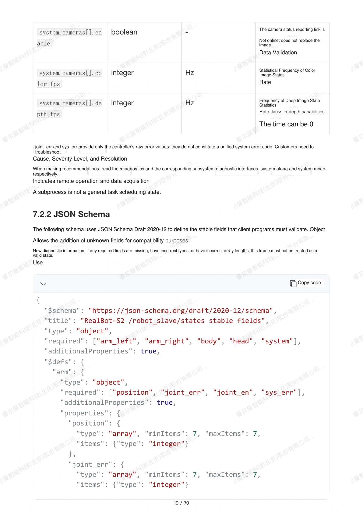




```
7.2.2 JSON Schema
system.cameras[].en
able 
boolean
-
system.cameras[].co
lor_fps 
integer
Hz
system.cameras[].de
pth_fps 
integer
Hz
{
  "$schema": "https://json-schema.org/draft/2020-12/schema",
  "title": "RealBot-S2 /robot_slave/states stable fields",
  "type": "object",
  "required": ["arm_left", "arm_right", "body", "head", "system"],
  "additionalProperties": true,
  "$defs": {
    "arm": {
      "type": "object",
      "required": ["position", "joint_err", "joint_en", "sys_err"],
      "additionalProperties": true,
      "properties": {
        "position": {
          "type": "array", "minItems": 7, "maxItems": 7,
          "items": {"type": "integer"}
        },
        "joint_err": {
          "type": "array", "minItems": 7, "maxItems": 7,
          "items": {"type": "integer"}
19 / 70
The camera status reporting link is
Not online; does not replace the
image
Data Validation
Statistical Frequency of Color
Image States
Rate
Frequency of Deep Image State
Statistics
Rate; lacks in-depth capabilities
The time can be 0
joint_err and sys_err provide only the controller's raw error values; they do not constitute a unified system error code. Customers need to
troubleshoot
Cause, Severity Level, and Resolution
When making recommendations, read the /diagnostics and the corresponding subsystem diagnostic interfaces. system.aloha and system.mcap,
respectively,
Indicates remote operation and data acquisition
A subprocess is not a general task scheduling state.
The following schema uses JSON Schema Draft 2020-12 to define the stable fields that client programs must validate. Object
Allows the addition of unknown fields for compatibility purposes
New diagnostic information; if any required fields are missing, have incorrect types, or have incorrect array lengths, this frame must not be treated as a
valid state.
Use.
Copy code
```




## PDF page 20

[RealBot2.0 / S2 interface manual V1.3, original PDF page 20](https://1292444914-files.gitbook.io/~/files/v0/b/gitbook-x-prod.appspot.com/o/spaces%2FtgOfPnscWebs1eh82EKq%2Fuploads%2F588gZef2ZxEvFbJF8KVl%2FS2_API-pages-01-67.pdf?alt=media#page=20)



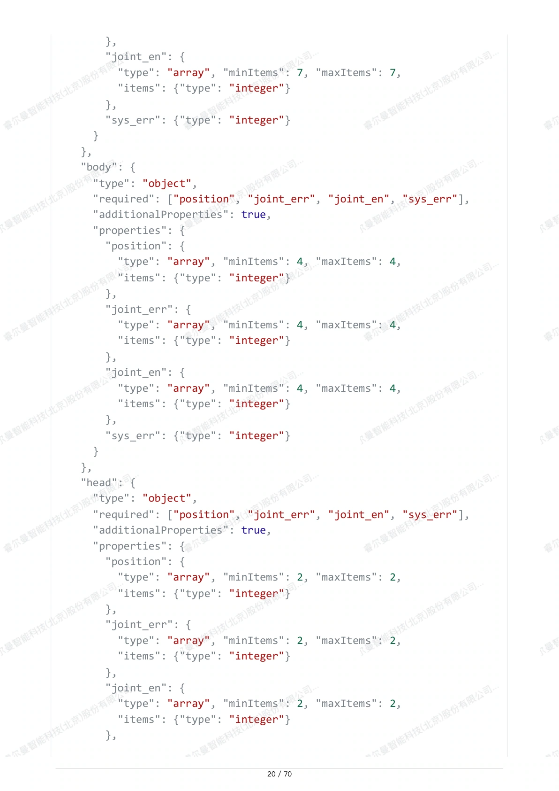




```
},
        "joint_en": {
          "type": "array", "minItems": 7, "maxItems": 7,
          "items": {"type": "integer"}
        },
        "sys_err": {"type": "integer"}
      }
    },
    "body": {
      "type": "object",
      "required": ["position", "joint_err", "joint_en", "sys_err"],
      "additionalProperties": true,
      "properties": {
        "position": {
          "type": "array", "minItems": 4, "maxItems": 4,
          "items": {"type": "integer"}
        },
        "joint_err": {
          "type": "array", "minItems": 4, "maxItems": 4,
          "items": {"type": "integer"}
        },
        "joint_en": {
          "type": "array", "minItems": 4, "maxItems": 4,
          "items": {"type": "integer"}
        },
        "sys_err": {"type": "integer"}
      }
    },
    "head": {
      "type": "object",
      "required": ["position", "joint_err", "joint_en", "sys_err"],
      "additionalProperties": true,
      "properties": {
        "position": {
          "type": "array", "minItems": 2, "maxItems": 2,
          "items": {"type": "integer"}
        },
        "joint_err": {
          "type": "array", "minItems": 2, "maxItems": 2,
          "items": {"type": "integer"}
        },
        "joint_en": {
          "type": "array", "minItems": 2, "maxItems": 2,
          "items": {"type": "integer"}
        },
20 / 70
```




## PDF page 21

[RealBot2.0 / S2 interface manual V1.3, original PDF page 21](https://1292444914-files.gitbook.io/~/files/v0/b/gitbook-x-prod.appspot.com/o/spaces%2FtgOfPnscWebs1eh82EKq%2Fuploads%2F588gZef2ZxEvFbJF8KVl%2FS2_API-pages-01-67.pdf?alt=media#page=21)



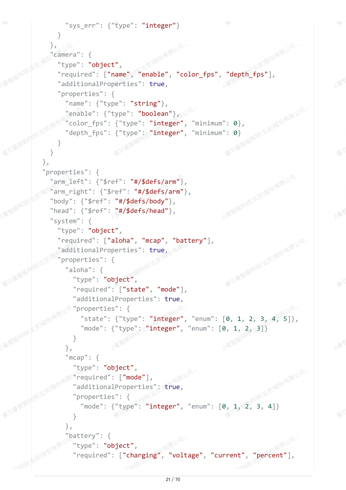




```
"sys_err": {"type": "integer"}
      }
    },
    "camera": {
      "type": "object",
      "required": ["name", "enable", "color_fps", "depth_fps"],
      "additionalProperties": true,
      "properties": {
        "name": {"type": "string"},
        "enable": {"type": "boolean"},
        "color_fps": {"type": "integer", "minimum": 0},
        "depth_fps": {"type": "integer", "minimum": 0}
      }
    }
  },
  "properties": {
    "arm_left": {"$ref": "#/$defs/arm"},
    "arm_right": {"$ref": "#/$defs/arm"},
    "body": {"$ref": "#/$defs/body"},
    "head": {"$ref": "#/$defs/head"},
    "system": {
      "type": "object",
      "required": ["aloha", "mcap", "battery"],
      "additionalProperties": true,
      "properties": {
        "aloha": {
          "type": "object",
          "required": ["state", "mode"],
          "additionalProperties": true,
          "properties": {
            "state": {"type": "integer", "enum": [0, 1, 2, 3, 4, 5]},
            "mode": {"type": "integer", "enum": [0, 1, 2, 3]}
          }
        },
        "mcap": {
          "type": "object",
          "required": ["mode"],
          "additionalProperties": true,
          "properties": {
            "mode": {"type": "integer", "enum": [0, 1, 2, 3, 4]}
          }
        },
        "battery": {
          "type": "object",
          "required": ["charging", "voltage", "current", "percent"],
21 / 70
```




## PDF page 22

[RealBot2.0 / S2 interface manual V1.3, original PDF page 22](https://1292444914-files.gitbook.io/~/files/v0/b/gitbook-x-prod.appspot.com/o/spaces%2FtgOfPnscWebs1eh82EKq%2Fuploads%2F588gZef2ZxEvFbJF8KVl%2FS2_API-pages-01-67.pdf?alt=media#page=22)



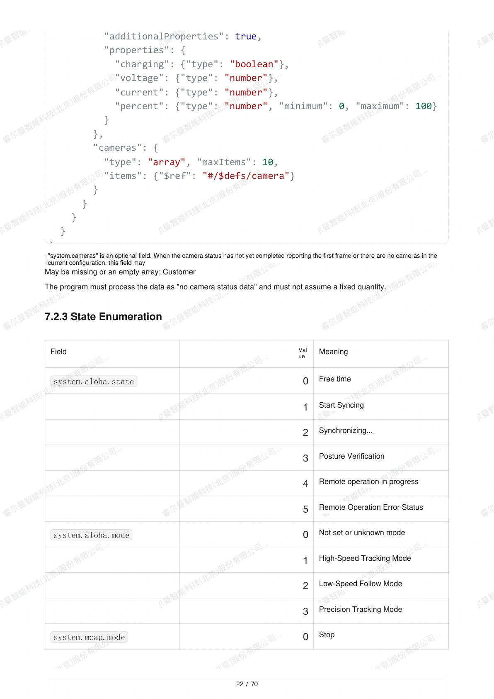




```
"additionalProperties": true,
          "properties": {
            "charging": {"type": "boolean"},
            "voltage": {"type": "number"},
            "current": {"type": "number"},
            "percent": {"type": "number", "minimum": 0, "maximum": 100}
          }
        },
        "cameras": {
          "type": "array", "maxItems": 10,
          "items": {"$ref": "#/$defs/camera"}
        }
      }
    }
  }
}
system.aloha.state 
0
1
2
3
4
5
system.aloha.mode 
0
1
2
3
system.mcap.mode 
0
22 / 70
"system.cameras" is an optional field. When the camera status has not yet completed reporting the first frame or there are no cameras in the
current configuration, this field may
May be missing or an empty array; Customer
The program must process the data as "no camera status data" and must not assume a fixed quantity.
7.2.3 State Enumeration
Field
Val
ue
Meaning
Free time
Start Syncing
Synchronizing...
Posture Verification
Remote operation in progress
Remote Operation Error Status
Not set or unknown mode
High-Speed Tracking Mode
Low-Speed Follow Mode
Precision Tracking Mode
Stop
```




## PDF page 23

[RealBot2.0 / S2 interface manual V1.3, original PDF page 23](https://1292444914-files.gitbook.io/~/files/v0/b/gitbook-x-prod.appspot.com/o/spaces%2FtgOfPnscWebs1eh82EKq%2Fuploads%2F588gZef2ZxEvFbJF8KVl%2FS2_API-pages-01-67.pdf?alt=media#page=23)



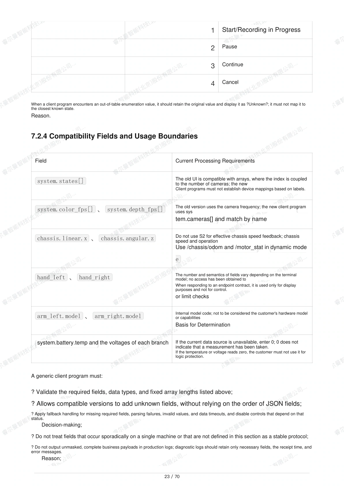




```
1
2
3
4
system.states[] 
system.color_fps[] 、system.depth_fps[] 
chassis.linear.x 、chassis.angular.z 
e 
hand_left 、hand_right 
arm_left.model 、arm_right.model 
23 / 70
Start/Recording in Progress
Pause
Continue
Cancel
When a client program encounters an out-of-table enumeration value, it should retain the original value and display it as ?Unknown?; it must not map it to
the closest known state.
Reason.
7.2.4 Compatibility Fields and Usage Boundaries
Field
Current Processing Requirements
The old UI is compatible with arrays, where the index is coupled
to the number of cameras; the new
Client programs must not establish device mappings based on labels.
The old version uses the camera frequency; the new client program
uses sys
tem.cameras[] and match by name
Do not use S2 for effective chassis speed feedback; chassis
speed and operation
Use /chassis/odom and /motor_stat in dynamic mode
The number and semantics of fields vary depending on the terminal
model; no access has been obtained to
When responding to an endpoint contract, it is used only for display
purposes and not for control.
or limit checks
Internal model code; not to be considered the customer's hardware model
or capabilities
Basis for Determination
system.battery.temp and the voltages of each branch
If the current data source is unavailable, enter 0; 0 does not
indicate that a measurement has been taken.
If the temperature or voltage reads zero, the customer must not use it for
logic protection.
A generic client program must:
? Validate the required fields, data types, and fixed array lengths listed above;
? Allows compatible versions to add unknown fields, without relying on the order of JSON fields;
? Apply fallback handling for missing required fields, parsing failures, invalid values, and data timeouts, and disable controls that depend on that
status.
Decision-making;
? Do not treat fields that occur sporadically on a single machine or that are not defined in this section as a stable protocol;
? Do not output unmasked, complete business payloads in production logs; diagnostic logs should retain only necessary fields, the receipt time, and
error messages.
Reason;
```




## PDF page 24

[RealBot2.0 / S2 interface manual V1.3, original PDF page 24](https://1292444914-files.gitbook.io/~/files/v0/b/gitbook-x-prod.appspot.com/o/spaces%2FtgOfPnscWebs1eh82EKq%2Fuploads%2F588gZef2ZxEvFbJF8KVl%2FS2_API-pages-01-67.pdf?alt=media#page=24)



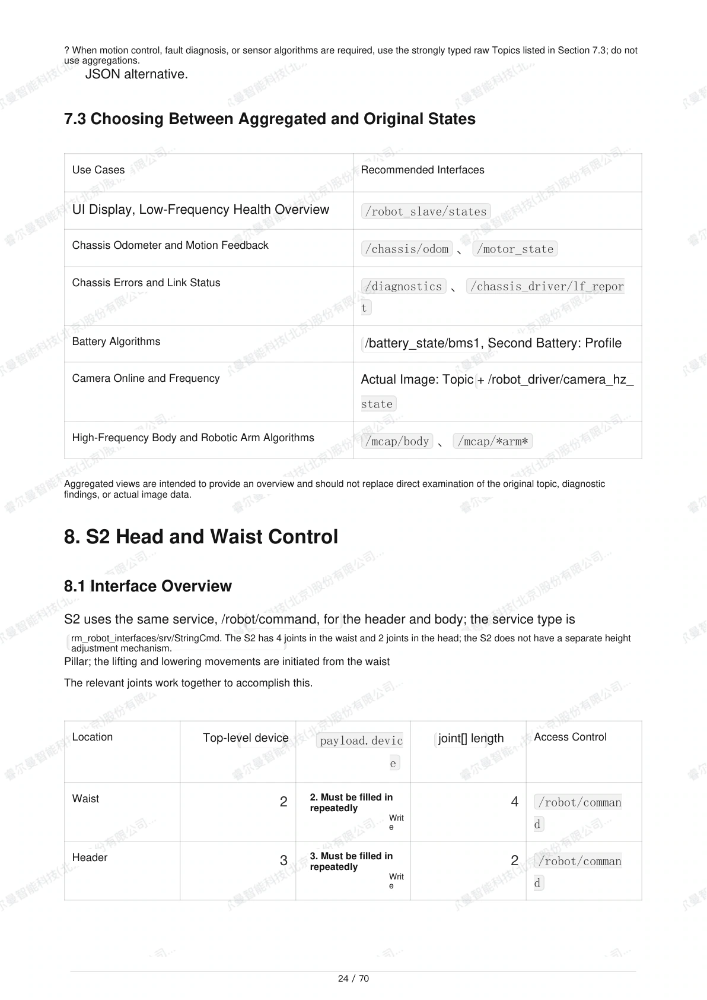




```
/robot_slave/states 
/chassis/odom 、/motor_state 
/diagnostics 、/chassis_driver/lf_repor
t 
state 
/mcap/body 、/mcap/*arm* 

payload.devic
e 
2
4
/robot/comman
d 
3
2
/robot/comman
d 
24 / 70
? When motion control, fault diagnosis, or sensor algorithms are required, use the strongly typed raw Topics listed in Section 7.3; do not
use aggregations.
JSON alternative.
7.3 Choosing Between Aggregated and Original States
Use Cases
Recommended Interfaces
UI Display, Low-Frequency Health Overview
Chassis Odometer and Motion Feedback
Chassis Errors and Link Status
Battery Algorithms
/battery_state/bms1, Second Battery: Profile
Camera Online and Frequency
Actual Image: Topic + /robot_driver/camera_hz_
High-Frequency Body and Robotic Arm Algorithms
Aggregated views are intended to provide an overview and should not replace direct examination of the original topic, diagnostic
findings, or actual image data.
8. S2 Head and Waist Control
8.1 Interface Overview
S2 uses the same service, /robot/command, for the header and body; the service type is
rm_robot_interfaces/srv/StringCmd. The S2 has 4 joints in the waist and 2 joints in the head; the S2 does not have a separate height
adjustment mechanism.
Pillar; the lifting and lowering movements are initiated from the waist
The relevant joints work together to accomplish this.
Location
Top-level device
joint[] length
Access Control
Waist
2. Must be filled in
repeatedly
Writ
e
Header
3. Must be filled in
repeatedly
Writ
e
```




## PDF page 25

[RealBot2.0 / S2 interface manual V1.3, original PDF page 25](https://1292444914-files.gitbook.io/~/files/v0/b/gitbook-x-prod.appspot.com/o/spaces%2FtgOfPnscWebs1eh82EKq%2Fuploads%2F588gZef2ZxEvFbJF8KVl%2FS2_API-pages-01-67.pdf?alt=media#page=25)



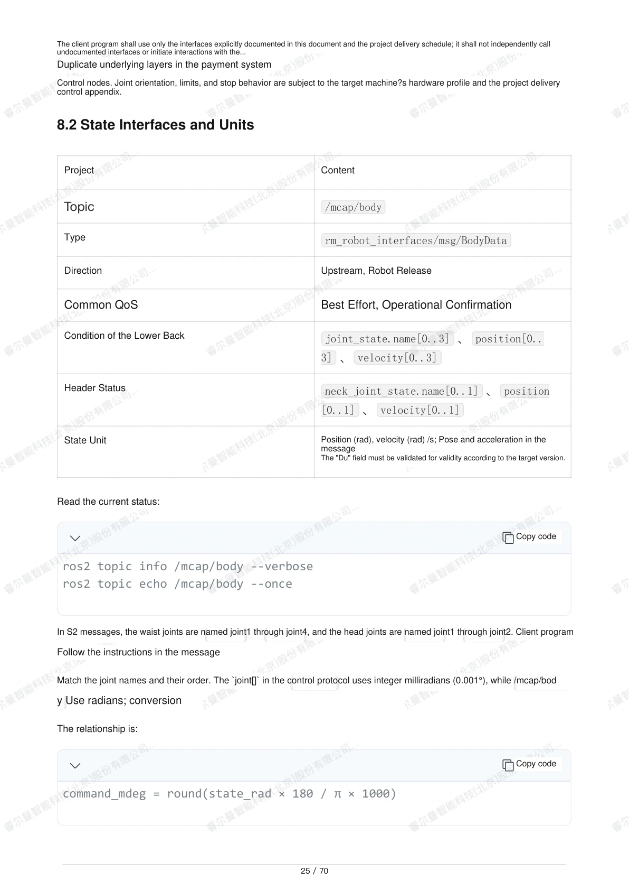




```
Topic
/mcap/body 
rm_robot_interfaces/msg/BodyData 
joint_state.name[0..3] 、position[0..
3] 、velocity[0..3] 
neck_joint_state.name[0..1] 、position
[0..1] 、velocity[0..1] 
ros2 topic info /mcap/body --verbose
ros2 topic echo /mcap/body --once
command_mdeg = round(state_rad × 180 / π × 1000)
25 / 70
The client program shall use only the interfaces explicitly documented in this document and the project delivery schedule; it shall not independently call
undocumented interfaces or initiate interactions with the...
Duplicate underlying layers in the payment system
Control nodes. Joint orientation, limits, and stop behavior are subject to the target machine?s hardware profile and the project delivery
control appendix.
8.2 State Interfaces and Units
Project
Content
Type
Direction
Upstream, Robot Release
Common QoS
Best Effort, Operational Confirmation
Condition of the Lower Back
Header Status
State Unit
Position (rad), velocity (rad) /s; Pose and acceleration in the
message
The "Du" field must be validated for validity according to the target version.
Read the current status:
Copy code
In S2 messages, the waist joints are named joint1 through joint4, and the head joints are named joint1 through joint2. Client program
Follow the instructions in the message
Match the joint names and their order. The `joint[]` in the control protocol uses integer milliradians (0.001°), while /mcap/bod
y Use radians; conversion
The relationship is:
Copy code
```




## PDF page 26

[RealBot2.0 / S2 interface manual V1.3, original PDF page 26](https://1292444914-files.gitbook.io/~/files/v0/b/gitbook-x-prod.appspot.com/o/spaces%2FtgOfPnscWebs1eh82EKq%2Fuploads%2F588gZef2ZxEvFbJF8KVl%2FS2_API-pages-01-67.pdf?alt=media#page=26)



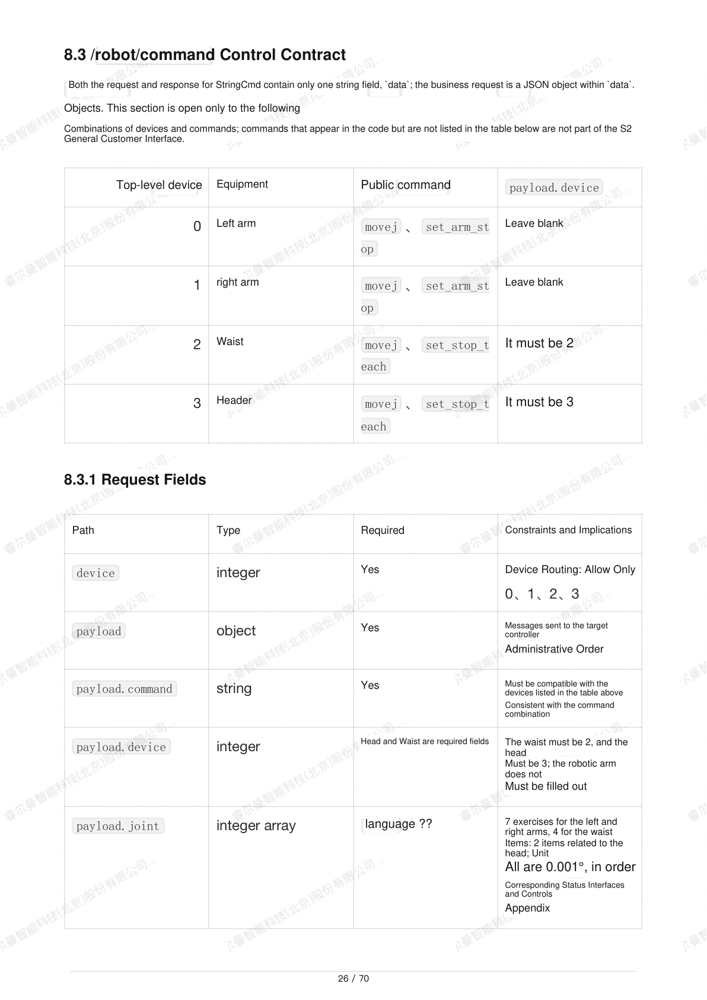




```
payload.device 
0
movej 、set_arm_st
op 
1
movej 、set_arm_st
op 
2
movej 、set_stop_t
each 
3
movej 、set_stop_t
each 
device 
integer
0、1、2、3
payload 
object
payload.command 
string
payload.device 
integer
payload.joint 
integer array
26 / 70
8.3 /robot/command Control Contract
Both the request and response for StringCmd contain only one string field, `data`; the business request is a JSON object within `data`.
Objects. This section is open only to the following
Combinations of devices and commands; commands that appear in the code but are not listed in the table below are not part of the S2
General Customer Interface.
Top-level device
Equipment
Public command
Left arm
Leave blank
right arm
Leave blank
Waist
It must be 2
Header
It must be 3
8.3.1 Request Fields
Path
Type
Required
Constraints and Implications
Yes
Device Routing: Allow Only
Yes
Messages sent to the target
controller
Administrative Order
Yes
Must be compatible with the
devices listed in the table above
Consistent with the command
combination
Head and Waist are required fields
The waist must be 2, and the
head
Must be 3; the robotic arm
does not
Must be filled out
language ??
7 exercises for the left and
right arms, 4 for the waist
Items: 2 items related to the
head; Unit
All are 0.001°, in order
Corresponding Status Interfaces
and Controls
Appendix
```




## PDF page 27

[RealBot2.0 / S2 interface manual V1.3, original PDF page 27](https://1292444914-files.gitbook.io/~/files/v0/b/gitbook-x-prod.appspot.com/o/spaces%2FtgOfPnscWebs1eh82EKq%2Fuploads%2F588gZef2ZxEvFbJF8KVl%2FS2_API-pages-01-67.pdf?alt=media#page=27)



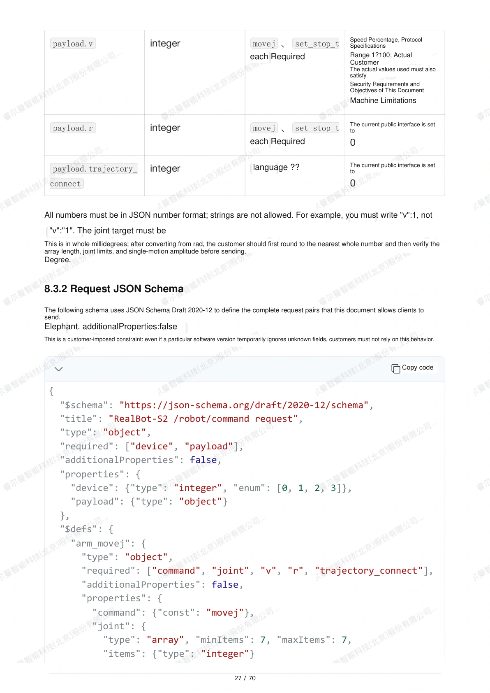




```
payload.v 
integer
movej 、set_stop_t
payload.r 
integer
movej 、set_stop_t
0
payload.trajectory_
connect 
integer
0
{
  "$schema": "https://json-schema.org/draft/2020-12/schema",
  "title": "RealBot-S2 /robot/command request",
  "type": "object",
  "required": ["device", "payload"],
  "additionalProperties": false,
  "properties": {
    "device": {"type": "integer", "enum": [0, 1, 2, 3]},
    "payload": {"type": "object"}
  },
  "$defs": {
    "arm_movej": {
      "type": "object",
      "required": ["command", "joint", "v", "r", "trajectory_connect"],
      "additionalProperties": false,
      "properties": {
        "command": {"const": "movej"},
        "joint": {
          "type": "array", "minItems": 7, "maxItems": 7,
          "items": {"type": "integer"}
27 / 70
Speed Percentage, Protocol
Specifications
each Required
Range 1?100; Actual
Customer
The actual values used must also
satisfy
Security Requirements and
Objectives of This Document
Machine Limitations
The current public interface is set
to
each Required
language ??
The current public interface is set
to
All numbers must be in JSON number format; strings are not allowed. For example, you must write "v":1, not
"v":"1". The joint target must be
This is in whole millidegrees; after converting from rad, the customer should first round to the nearest whole number and then verify the
array length, joint limits, and single-motion amplitude before sending.
Degree.
8.3.2 Request JSON Schema
The following schema uses JSON Schema Draft 2020-12 to define the complete request pairs that this document allows clients to
send.
Elephant. additionalProperties:false
This is a customer-imposed constraint: even if a particular software version temporarily ignores unknown fields, customers must not rely on this behavior.
Copy code
```




## PDF page 28

[RealBot2.0 / S2 interface manual V1.3, original PDF page 28](https://1292444914-files.gitbook.io/~/files/v0/b/gitbook-x-prod.appspot.com/o/spaces%2FtgOfPnscWebs1eh82EKq%2Fuploads%2F588gZef2ZxEvFbJF8KVl%2FS2_API-pages-01-67.pdf?alt=media#page=28)



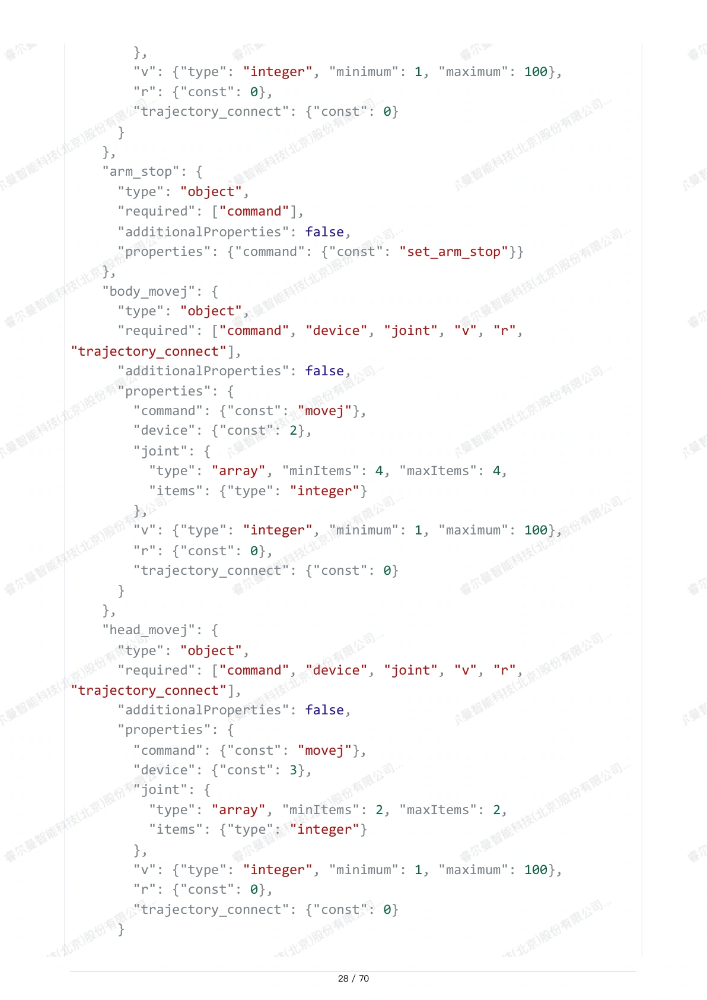




```
},
        "v": {"type": "integer", "minimum": 1, "maximum": 100},
        "r": {"const": 0},
        "trajectory_connect": {"const": 0}
      }
    },
    "arm_stop": {
      "type": "object",
      "required": ["command"],
      "additionalProperties": false,
      "properties": {"command": {"const": "set_arm_stop"}}
    },
    "body_movej": {
      "type": "object",
      "required": ["command", "device", "joint", "v", "r", 
"trajectory_connect"],
      "additionalProperties": false,
      "properties": {
        "command": {"const": "movej"},
        "device": {"const": 2},
        "joint": {
          "type": "array", "minItems": 4, "maxItems": 4,
          "items": {"type": "integer"}
        },
        "v": {"type": "integer", "minimum": 1, "maximum": 100},
        "r": {"const": 0},
        "trajectory_connect": {"const": 0}
      }
    },
    "head_movej": {
      "type": "object",
      "required": ["command", "device", "joint", "v", "r", 
"trajectory_connect"],
      "additionalProperties": false,
      "properties": {
        "command": {"const": "movej"},
        "device": {"const": 3},
        "joint": {
          "type": "array", "minItems": 2, "maxItems": 2,
          "items": {"type": "integer"}
        },
        "v": {"type": "integer", "minimum": 1, "maximum": 100},
        "r": {"const": 0},
        "trajectory_connect": {"const": 0}
      }
28 / 70
```




## PDF page 29

[RealBot2.0 / S2 interface manual V1.3, original PDF page 29](https://1292444914-files.gitbook.io/~/files/v0/b/gitbook-x-prod.appspot.com/o/spaces%2FtgOfPnscWebs1eh82EKq%2Fuploads%2F588gZef2ZxEvFbJF8KVl%2FS2_API-pages-01-67.pdf?alt=media#page=29)



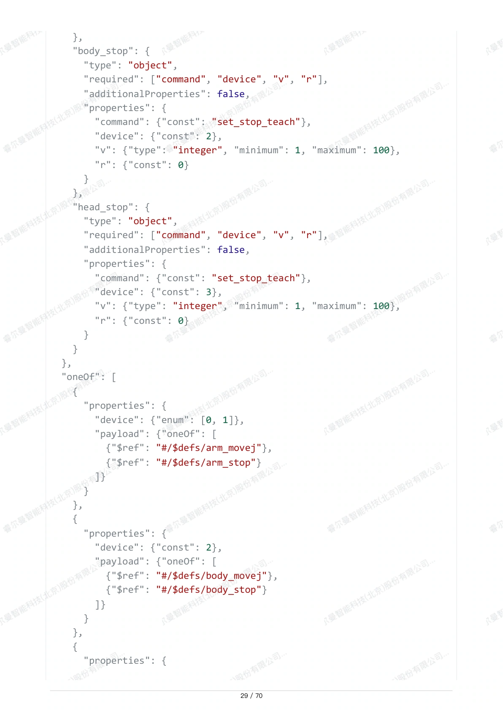




```
},
    "body_stop": {
      "type": "object",
      "required": ["command", "device", "v", "r"],
      "additionalProperties": false,
      "properties": {
        "command": {"const": "set_stop_teach"},
        "device": {"const": 2},
        "v": {"type": "integer", "minimum": 1, "maximum": 100},
        "r": {"const": 0}
      }
    },
    "head_stop": {
      "type": "object",
      "required": ["command", "device", "v", "r"],
      "additionalProperties": false,
      "properties": {
        "command": {"const": "set_stop_teach"},
        "device": {"const": 3},
        "v": {"type": "integer", "minimum": 1, "maximum": 100},
        "r": {"const": 0}
      }
    }
  },
  "oneOf": [
    {
      "properties": {
        "device": {"enum": [0, 1]},
        "payload": {"oneOf": [
          {"$ref": "#/$defs/arm_movej"},
          {"$ref": "#/$defs/arm_stop"}
        ]}
      }
    },
    {
      "properties": {
        "device": {"const": 2},
        "payload": {"oneOf": [
          {"$ref": "#/$defs/body_movej"},
          {"$ref": "#/$defs/body_stop"}
        ]}
      }
    },
    {
      "properties": {
29 / 70
```




## PDF page 30

[RealBot2.0 / S2 interface manual V1.3, original PDF page 30](https://1292444914-files.gitbook.io/~/files/v0/b/gitbook-x-prod.appspot.com/o/spaces%2FtgOfPnscWebs1eh82EKq%2Fuploads%2F588gZef2ZxEvFbJF8KVl%2FS2_API-pages-01-67.pdf?alt=media#page=30)



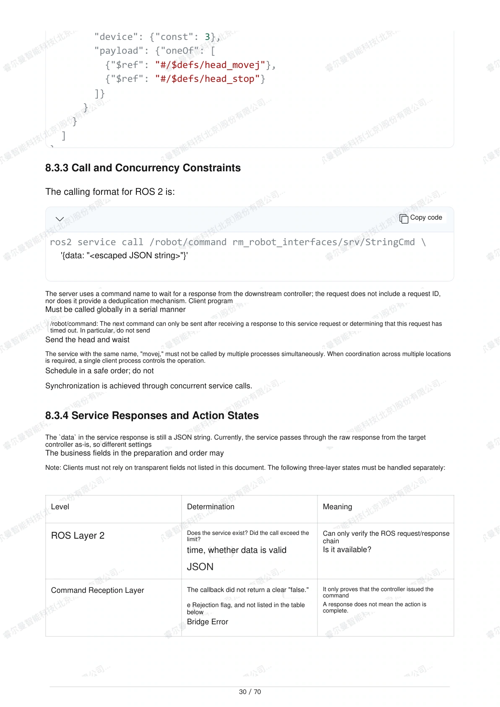




```
"device": {"const": 3},
        "payload": {"oneOf": [
          {"$ref": "#/$defs/head_movej"},
          {"$ref": "#/$defs/head_stop"}
        ]}
      }
    }
  ]
}
ros2 service call /robot/command rm_robot_interfaces/srv/StringCmd \
 
JSON
30 / 70
8.3.3 Call and Concurrency Constraints
The calling format for ROS 2 is:
Copy code
'{data: "<escaped JSON string>"}'
The server uses a command name to wait for a response from the downstream controller; the request does not include a request ID,
nor does it provide a deduplication mechanism. Client program
Must be called globally in a serial manner
/robot/command: The next command can only be sent after receiving a response to this service request or determining that this request has
timed out. In particular, do not send
Send the head and waist
The service with the same name, "movej," must not be called by multiple processes simultaneously. When coordination across multiple locations
is required, a single client process controls the operation.
Schedule in a safe order; do not
Synchronization is achieved through concurrent service calls.
8.3.4 Service Responses and Action States
The `data` in the service response is still a JSON string. Currently, the service passes through the raw response from the target
controller as-is, so different settings
The business fields in the preparation and order may
Note: Clients must not rely on transparent fields not listed in this document. The following three-layer states must be handled separately:
Level
Determination
Meaning
ROS Layer 2
Does the service exist? Did the call exceed the
limit?
Can only verify the ROS request/response
chain
time, whether data is valid
Is it available?
Command Reception Layer
The callback did not return a clear "false."
It only proves that the controller issued the
command
e Rejection flag, and not listed in the table
below
A response does not mean the action is
complete.
Bridge Error
```




## PDF page 31

[RealBot2.0 / S2 interface manual V1.3, original PDF page 31](https://1292444914-files.gitbook.io/~/files/v0/b/gitbook-x-prod.appspot.com/o/spaces%2FtgOfPnscWebs1eh82EKq%2Fuploads%2F588gZef2ZxEvFbJF8KVl%2FS2_API-pages-01-67.pdf?alt=media#page=31)



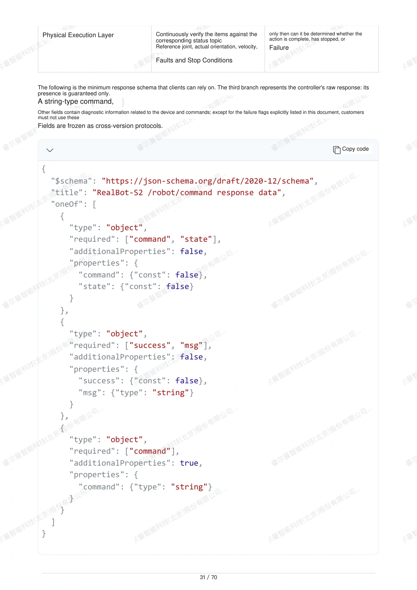




```
{
  "$schema": "https://json-schema.org/draft/2020-12/schema",
  "title": "RealBot-S2 /robot/command response data",
  "oneOf": [
    {
      "type": "object",
      "required": ["command", "state"],
      "additionalProperties": false,
      "properties": {
        "command": {"const": false},
        "state": {"const": false}
      }
    },
    {
      "type": "object",
      "required": ["success", "msg"],
      "additionalProperties": false,
      "properties": {
        "success": {"const": false},
        "msg": {"type": "string"}
      }
    },
    {
      "type": "object",
      "required": ["command"],
      "additionalProperties": true,
      "properties": {
        "command": {"type": "string"}
      }
    }
  ]
}
31 / 70
Physical Execution Layer
Continuously verify the items against the
corresponding status topic
only then can it be determined whether the
action is complete, has stopped, or
Reference joint, actual orientation, velocity,
Failure
Faults and Stop Conditions
The following is the minimum response schema that clients can rely on. The third branch represents the controller's raw response: its
presence is guaranteed only.
A string-type command,
Other fields contain diagnostic information related to the device and commands; except for the failure flags explicitly listed in this document, customers
must not use these
Fields are frozen as cross-version protocols.
Copy code
```




## PDF page 32

[RealBot2.0 / S2 interface manual V1.3, original PDF page 32](https://1292444914-files.gitbook.io/~/files/v0/b/gitbook-x-prod.appspot.com/o/spaces%2FtgOfPnscWebs1eh82EKq%2Fuploads%2F588gZef2ZxEvFbJF8KVl%2FS2_API-pages-01-67.pdf?alt=media#page=32)



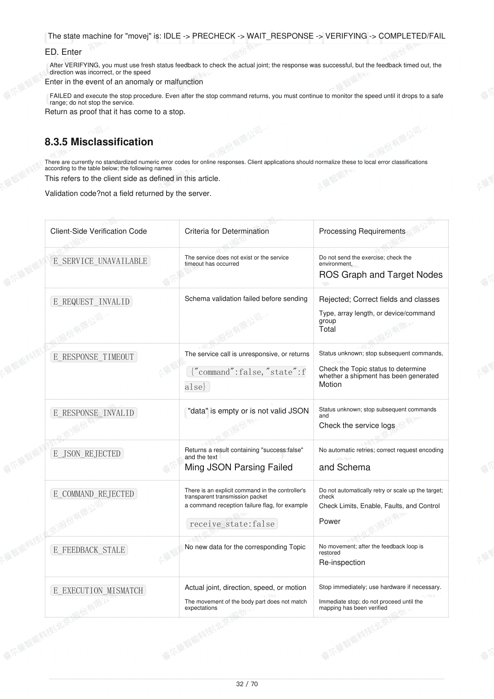




```
E_SERVICE_UNAVAILABLE 
E_REQUEST_INVALID 
E_RESPONSE_TIMEOUT 
{"command":false,"state":f
alse} 
E_RESPONSE_INVALID 
E_JSON_REJECTED 
E_COMMAND_REJECTED 
receive_state:false 
E_FEEDBACK_STALE 
E_EXECUTION_MISMATCH 
32 / 70
The state machine for "movej" is: IDLE -> PRECHECK -> WAIT_RESPONSE -> VERIFYING -> COMPLETED/FAIL
ED. Enter
After VERIFYING, you must use fresh status feedback to check the actual joint; the response was successful, but the feedback timed out, the
direction was incorrect, or the speed
Enter in the event of an anomaly or malfunction
FAILED and execute the stop procedure. Even after the stop command returns, you must continue to monitor the speed until it drops to a safe
range; do not stop the service.
Return as proof that it has come to a stop.
8.3.5 Misclassification
There are currently no standardized numeric error codes for online responses. Client applications should normalize these to local error classifications
according to the table below; the following names
This refers to the client side as defined in this article.
Validation code?not a field returned by the server.
Client-Side Verification Code
Criteria for Determination
Processing Requirements
The service does not exist or the service
timeout has occurred
Do not send the exercise; check the
environment,
ROS Graph and Target Nodes
Schema validation failed before sending
Rejected; Correct fields and classes
Type, array length, or device/command
group
Total
The service call is unresponsive, or returns
Status unknown; stop subsequent commands,
Check the Topic status to determine
whether a shipment has been generated
Motion
"data" is empty or is not valid JSON
Status unknown; stop subsequent commands
and
Check the service logs
Returns a result containing "success:false"
and the text
No automatic retries; correct request encoding
Ming JSON Parsing Failed
and Schema
There is an explicit command in the controller's
transparent transmission packet
Do not automatically retry or scale up the target;
check
a command reception failure flag, for example
Check Limits, Enable, Faults, and Control
Power
No new data for the corresponding Topic
No movement; after the feedback loop is
restored
Re-inspection
Actual joint, direction, speed, or motion
Stop immediately; use hardware if necessary.
The movement of the body part does not match
expectations
Immediate stop; do not proceed until the
mapping has been verified
```




## PDF page 33

[RealBot2.0 / S2 interface manual V1.3, original PDF page 33](https://1292444914-files.gitbook.io/~/files/v0/b/gitbook-x-prod.appspot.com/o/spaces%2FtgOfPnscWebs1eh82EKq%2Fuploads%2F588gZef2ZxEvFbJF8KVl%2FS2_API-pages-01-67.pdf?alt=media#page=33)



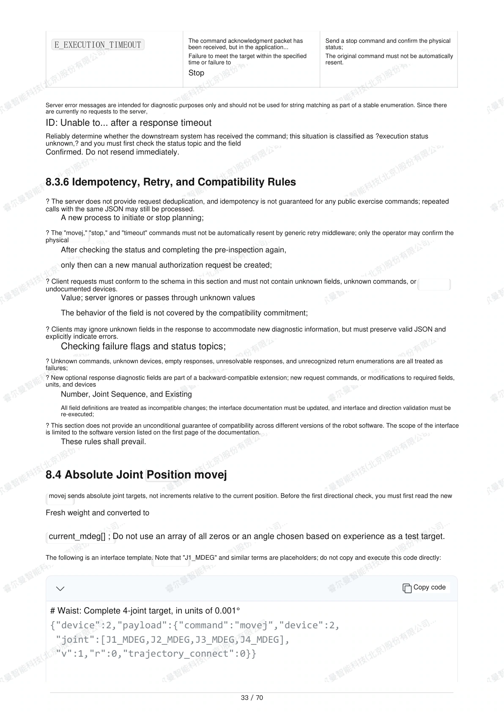




```
E_EXECUTION_TIMEOUT 
{"device":2,"payload":{"command":"movej","device":2,
 "joint":[J1_MDEG,J2_MDEG,J3_MDEG,J4_MDEG],
 "v":1,"r":0,"trajectory_connect":0}}
33 / 70
The command acknowledgment packet has
been received, but in the application...
Send a stop command and confirm the physical
status;
Failure to meet the target within the specified
time or failure to
The original command must not be automatically
resent.
Stop
Server error messages are intended for diagnostic purposes only and should not be used for string matching as part of a stable enumeration. Since there
are currently no requests to the server,
ID: Unable to... after a response timeout
Reliably determine whether the downstream system has received the command; this situation is classified as ?execution status
unknown,? and you must first check the status topic and the field
Confirmed. Do not resend immediately.
8.3.6 Idempotency, Retry, and Compatibility Rules
? The server does not provide request deduplication, and idempotency is not guaranteed for any public exercise commands; repeated
calls with the same JSON may still be processed.
A new process to initiate or stop planning;
? The "movej," "stop," and "timeout" commands must not be automatically resent by generic retry middleware; only the operator may confirm the
physical
After checking the status and completing the pre-inspection again,
only then can a new manual authorization request be created;
? Client requests must conform to the schema in this section and must not contain unknown fields, unknown commands, or
undocumented devices.
Value; server ignores or passes through unknown values
The behavior of the field is not covered by the compatibility commitment;
? Clients may ignore unknown fields in the response to accommodate new diagnostic information, but must preserve valid JSON and
explicitly indicate errors.
Checking failure flags and status topics;
? Unknown commands, unknown devices, empty responses, unresolvable responses, and unrecognized return enumerations are all treated as
failures;
? New optional response diagnostic fields are part of a backward-compatible extension; new request commands, or modifications to required fields,
units, and devices
Number, Joint Sequence, and Existing
All field definitions are treated as incompatible changes; the interface documentation must be updated, and interface and direction validation must be
re-executed;
? This section does not provide an unconditional guarantee of compatibility across different versions of the robot software. The scope of the interface
is limited to the software version listed on the first page of the documentation.
These rules shall prevail.
8.4 Absolute Joint Position movej
movej sends absolute joint targets, not increments relative to the current position. Before the first directional check, you must first read the new
Fresh weight and converted to
current_mdeg[] ; Do not use an array of all zeros or an angle chosen based on experience as a test target.
The following is an interface template. Note that "J1_MDEG" and similar terms are placeholders; do not copy and execute this code directly:
Copy code
# Waist: Complete 4-joint target, in units of 0.001°
```




## PDF page 34

[RealBot2.0 / S2 interface manual V1.3, original PDF page 34](https://1292444914-files.gitbook.io/~/files/v0/b/gitbook-x-prod.appspot.com/o/spaces%2FtgOfPnscWebs1eh82EKq%2Fuploads%2F588gZef2ZxEvFbJF8KVl%2FS2_API-pages-01-67.pdf?alt=media#page=34)



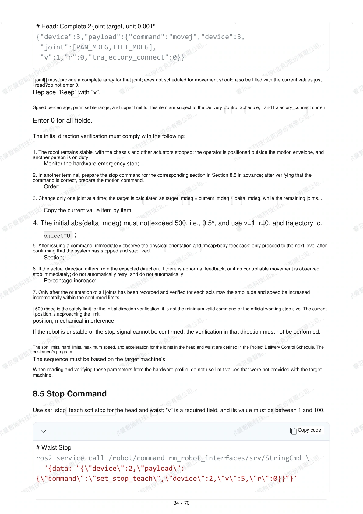




```
onnect=0 ；
{"device":3,"payload":{"command":"movej","device":3,
 "joint":[PAN_MDEG,TILT_MDEG],
 "v":1,"r":0,"trajectory_connect":0}}
ros2 service call /robot/command rm_robot_interfaces/srv/StringCmd \
  '{data: "{\"device\":2,\"payload\":
{\"command\":\"set_stop_teach\",\"device\":2,\"v\":5,\"r\":0}}"}'
34 / 70
# Head: Complete 2-joint target, unit 0.001°
joint[] must provide a complete array for that joint; axes not scheduled for movement should also be filled with the current values just
read?do not enter 0.
Replace "Keep" with "v".
Speed percentage, permissible range, and upper limit for this item are subject to the Delivery Control Schedule; r and trajectory_connect current
Enter 0 for all fields.
The initial direction verification must comply with the following:
1. The robot remains stable, with the chassis and other actuators stopped; the operator is positioned outside the motion envelope, and
another person is on duty.
Monitor the hardware emergency stop;
2. In another terminal, prepare the stop command for the corresponding section in Section 8.5 in advance; after verifying that the
command is correct, prepare the motion command.
Order;
3. Change only one joint at a time; the target is calculated as target_mdeg = current_mdeg ± delta_mdeg, while the remaining joints...
Copy the current value item by item;
4. The initial abs(delta_mdeg) must not exceed 500, i.e., 0.5°, and use v=1, r=0, and trajectory_c.
5. After issuing a command, immediately observe the physical orientation and /mcap/body feedback; only proceed to the next level after
confirming that the system has stopped and stabilized.
Section;
6. If the actual direction differs from the expected direction, if there is abnormal feedback, or if no controllable movement is observed,
stop immediately; do not automatically retry, and do not automatically
Percentage increase;
7. Only after the orientation of all joints has been recorded and verified for each axis may the amplitude and speed be increased
incrementally within the confirmed limits.
500 mdeg is the safety limit for the initial direction verification; it is not the minimum valid command or the official working step size. The current
position is approaching the limit.
position, mechanical interference,
If the robot is unstable or the stop signal cannot be confirmed, the verification in that direction must not be performed.
The soft limits, hard limits, maximum speed, and acceleration for the joints in the head and waist are defined in the Project Delivery Control Schedule. The
customer?s program
The sequence must be based on the target machine's
When reading and verifying these parameters from the hardware profile, do not use limit values that were not provided with the target
machine.
8.5 Stop Command
Use set_stop_teach soft stop for the head and waist; "v" is a required field, and its value must be between 1 and 100.
Copy code
# Waist Stop
```




## PDF page 35

[RealBot2.0 / S2 interface manual V1.3, original PDF page 35](https://1292444914-files.gitbook.io/~/files/v0/b/gitbook-x-prod.appspot.com/o/spaces%2FtgOfPnscWebs1eh82EKq%2Fuploads%2F588gZef2ZxEvFbJF8KVl%2FS2_API-pages-01-67.pdf?alt=media#page=35)



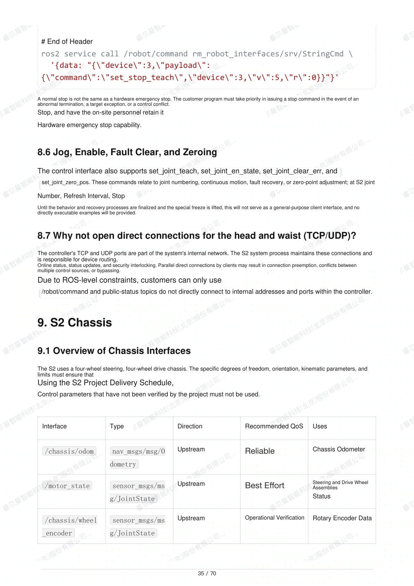




```
ros2 service call /robot/command rm_robot_interfaces/srv/StringCmd \
  '{data: "{\"device\":3,\"payload\":
{\"command\":\"set_stop_teach\",\"device\":3,\"v\":5,\"r\":0}}"}'
/chassis/odom 
nav_msgs/msg/O
dometry 
Reliable
/motor_state 
sensor_msgs/ms
g/JointState 
Best Effort
/chassis/wheel
_encoder 
sensor_msgs/ms
g/JointState 
35 / 70
# End of Header
A normal stop is not the same as a hardware emergency stop. The customer program must take priority in issuing a stop command in the event of an
abnormal termination, a target exception, or a control conflict.
Stop, and have the on-site personnel retain it
Hardware emergency stop capability.
8.6 Jog, Enable, Fault Clear, and Zeroing
The control interface also supports set_joint_teach, set_joint_en_state, set_joint_clear_err, and
set_joint_zero_pos. These commands relate to joint numbering, continuous motion, fault recovery, or zero-point adjustment; at S2 joint
Number, Refresh Interval, Stop
Until the behavior and recovery processes are finalized and the special freeze is lifted, this will not serve as a general-purpose client interface, and no
directly executable examples will be provided.
8.7 Why not open direct connections for the head and waist (TCP/UDP)?
The controller's TCP and UDP ports are part of the system's internal network. The S2 system process maintains these connections and
is responsible for device routing,
Online status, status updates, and security interlocking. Parallel direct connections by clients may result in connection preemption, conflicts between
multiple control sources, or bypassing.
Due to ROS-level constraints, customers can only use
/robot/command and public-status topics do not directly connect to internal addresses and ports within the controller.
9. S2 Chassis
9.1 Overview of Chassis Interfaces
The S2 uses a four-wheel steering, four-wheel drive chassis. The specific degrees of freedom, orientation, kinematic parameters, and
limits must ensure that
Using the S2 Project Delivery Schedule,
Control parameters that have not been verified by the project must not be used.
Interface
Type
Direction
Recommended QoS
Uses
Upstream
Chassis Odometer
Upstream
Steering and Drive Wheel
Assemblies
Status
Upstream
Operational Verification
Rotary Encoder Data
```




## PDF page 36

[RealBot2.0 / S2 interface manual V1.3, original PDF page 36](https://1292444914-files.gitbook.io/~/files/v0/b/gitbook-x-prod.appspot.com/o/spaces%2FtgOfPnscWebs1eh82EKq%2Fuploads%2F588gZef2ZxEvFbJF8KVl%2FS2_API-pages-01-67.pdf?alt=media#page=36)



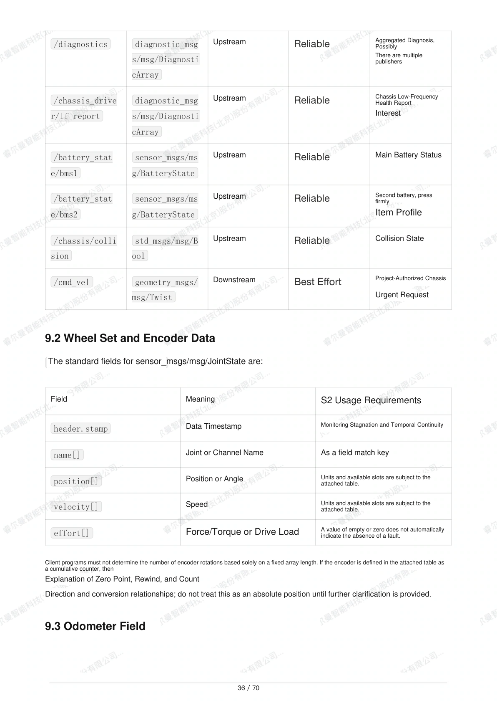




```
/diagnostics 
diagnostic_msg
s/msg/Diagnosti
cArray 
Reliable
/chassis_drive
r/lf_report 
diagnostic_msg
s/msg/Diagnosti
cArray 
Reliable
/battery_stat
e/bms1 
sensor_msgs/ms
g/BatteryState 
Reliable
/battery_stat
e/bms2 
sensor_msgs/ms
g/BatteryState 
Reliable
/chassis/colli
sion 
std_msgs/msg/B
ool 
Reliable
/cmd_vel 
geometry_msgs/
msg/Twist 
Best Effort
header.stamp 
name[] 
position[] 
velocity[] 
effort[] 
36 / 70
Upstream
Aggregated Diagnosis,
Possibly
There are multiple
publishers
Upstream
Chassis Low-Frequency
Health Report
Interest
Upstream
Main Battery Status
Upstream
Second battery, press
firmly
Item Profile
Upstream
Collision State
Downstream
Project-Authorized Chassis
Urgent Request
9.2 Wheel Set and Encoder Data
The standard fields for sensor_msgs/msg/JointState are:
Field
Meaning
S2 Usage Requirements
Data Timestamp
Monitoring Stagnation and Temporal Continuity
Joint or Channel Name
As a field match key
Position or Angle
Units and available slots are subject to the
attached table.
Speed
Units and available slots are subject to the
attached table.
Force/Torque or Drive Load
A value of empty or zero does not automatically
indicate the absence of a fault.
Client programs must not determine the number of encoder rotations based solely on a fixed array length. If the encoder is defined in the attached table as
a cumulative counter, then
Explanation of Zero Point, Rewind, and Count
Direction and conversion relationships; do not treat this as an absolute position until further clarification is provided.
9.3 Odometer Field
```




## PDF page 37

[RealBot2.0 / S2 interface manual V1.3, original PDF page 37](https://1292444914-files.gitbook.io/~/files/v0/b/gitbook-x-prod.appspot.com/o/spaces%2FtgOfPnscWebs1eh82EKq%2Fuploads%2F588gZef2ZxEvFbJF8KVl%2FS2_API-pages-01-67.pdf?alt=media#page=37)



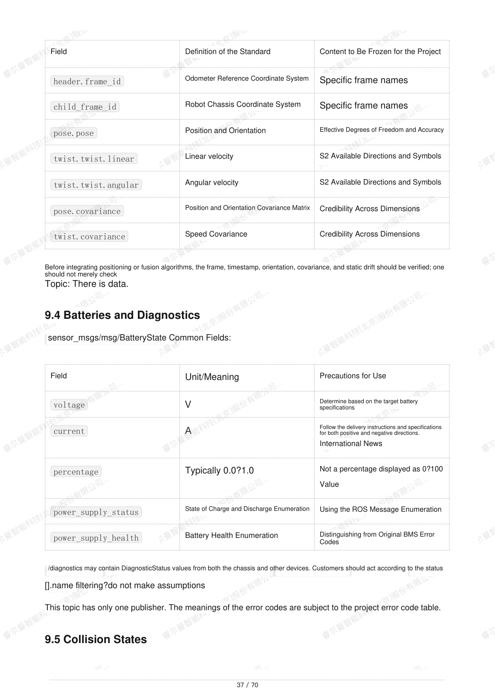




```
header.frame_id 
child_frame_id 
pose.pose 
twist.twist.linear 
twist.twist.angular 
pose.covariance 
twist.covariance 
voltage 
V
current 
A
percentage 
power_supply_status 
power_supply_health 
37 / 70
Field
Definition of the Standard
Content to Be Frozen for the Project
Odometer Reference Coordinate System
Specific frame names
Robot Chassis Coordinate System
Specific frame names
Position and Orientation
Effective Degrees of Freedom and Accuracy
Linear velocity
S2 Available Directions and Symbols
Angular velocity
S2 Available Directions and Symbols
Position and Orientation Covariance Matrix
Credibility Across Dimensions
Speed Covariance
Credibility Across Dimensions
Before integrating positioning or fusion algorithms, the frame, timestamp, orientation, covariance, and static drift should be verified; one
should not merely check
Topic: There is data.
9.4 Batteries and Diagnostics
sensor_msgs/msg/BatteryState Common Fields:
Field
Unit/Meaning
Precautions for Use
Determine based on the target battery
specifications
Follow the delivery instructions and specifications
for both positive and negative directions.
International News
Typically 0.0?1.0
Not a percentage displayed as 0?100
Value
State of Charge and Discharge Enumeration
Using the ROS Message Enumeration
Battery Health Enumeration
Distinguishing from Original BMS Error
Codes
/diagnostics may contain DiagnosticStatus values from both the chassis and other devices. Customers should act according to the status
[].name filtering?do not make assumptions
This topic has only one publisher. The meanings of the error codes are subject to the project error code table.
9.5 Collision States
```




## PDF page 38

[RealBot2.0 / S2 interface manual V1.3, original PDF page 38](https://1292444914-files.gitbook.io/~/files/v0/b/gitbook-x-prod.appspot.com/o/spaces%2FtgOfPnscWebs1eh82EKq%2Fuploads%2F588gZef2ZxEvFbJF8KVl%2FS2_API-pages-01-67.pdf?alt=media#page=38)



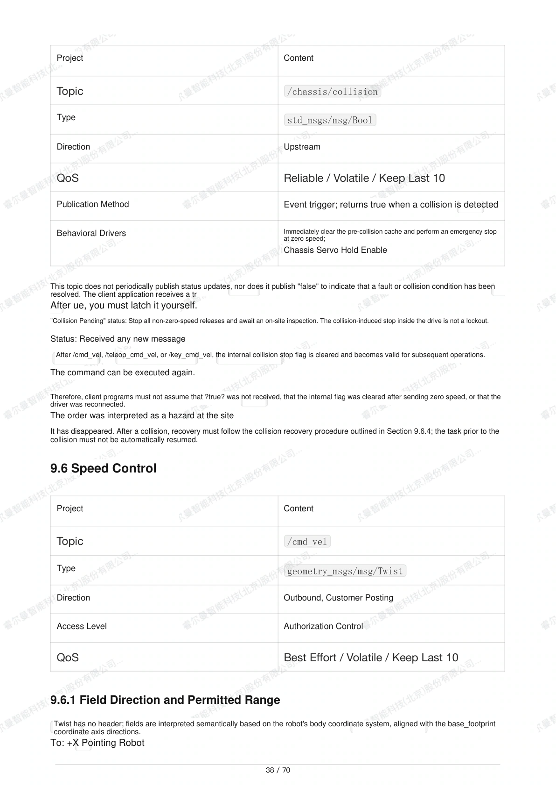




```
Topic
/chassis/collision 
std_msgs/msg/Bool 
QoS
Reliable / Volatile / Keep Last 10

Topic
/cmd_vel 
geometry_msgs/msg/Twist
QoS
Best Effort / Volatile / Keep Last 10
38 / 70
Project
Content
Type
Direction
Upstream
Publication Method
Event trigger; returns true when a collision is detected
Behavioral Drivers
Immediately clear the pre-collision cache and perform an emergency stop
at zero speed;
Chassis Servo Hold Enable
This topic does not periodically publish status updates, nor does it publish "false" to indicate that a fault or collision condition has been
resolved. The client application receives a tr
After ue, you must latch it yourself.
"Collision Pending" status: Stop all non-zero-speed releases and await an on-site inspection. The collision-induced stop inside the drive is not a lockout.
Status: Received any new message
After /cmd_vel, /teleop_cmd_vel, or /key_cmd_vel, the internal collision stop flag is cleared and becomes valid for subsequent operations.
The command can be executed again.
Therefore, client programs must not assume that ?true? was not received, that the internal flag was cleared after sending zero speed, or that the
driver was reconnected.
The order was interpreted as a hazard at the site
It has disappeared. After a collision, recovery must follow the collision recovery procedure outlined in Section 9.6.4; the task prior to the
collision must not be automatically resumed.
9.6 Speed Control
Project
Content
Type
Direction
Outbound, Customer Posting
Access Level
Authorization Control
9.6.1 Field Direction and Permitted Range
Twist has no header; fields are interpreted semantically based on the robot's body coordinate system, aligned with the base_footprint
coordinate axis directions.
To: +X Pointing Robot
```




## PDF page 39

[RealBot2.0 / S2 interface manual V1.3, original PDF page 39](https://1292444914-files.gitbook.io/~/files/v0/b/gitbook-x-prod.appspot.com/o/spaces%2FtgOfPnscWebs1eh82EKq%2Fuploads%2F588gZef2ZxEvFbJF8KVl%2FS2_API-pages-01-67.pdf?alt=media#page=39)



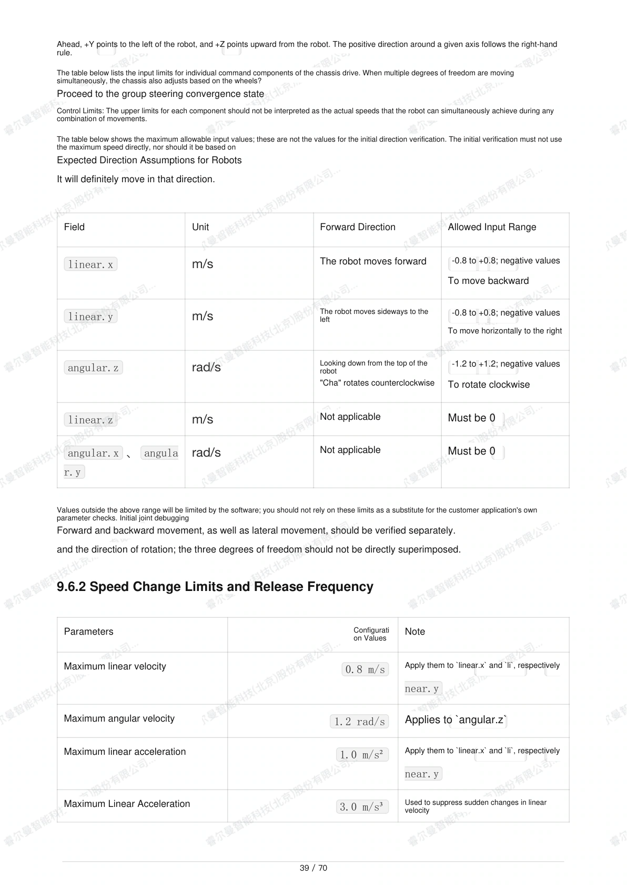




```
linear.x 
m/s
linear.y 
m/s
angular.z 
rad/s
linear.z 
m/s

angular.x 、angula
r.y 
rad/s

0.8 m/s 
near.y 
1.2 rad/s 

1.0 m/s² 
near.y 
3.0 m/s³ 
39 / 70
Ahead, +Y points to the left of the robot, and +Z points upward from the robot. The positive direction around a given axis follows the right-hand
rule.
The table below lists the input limits for individual command components of the chassis drive. When multiple degrees of freedom are moving
simultaneously, the chassis also adjusts based on the wheels?
Proceed to the group steering convergence state
Control Limits: The upper limits for each component should not be interpreted as the actual speeds that the robot can simultaneously achieve during any
combination of movements.
The table below shows the maximum allowable input values; these are not the values for the initial direction verification. The initial verification must not use
the maximum speed directly, nor should it be based on
Expected Direction Assumptions for Robots
It will definitely move in that direction.
Field
Unit
Forward Direction
Allowed Input Range
The robot moves forward
-0.8 to +0.8; negative values
To move backward
The robot moves sideways to the
left
-0.8 to +0.8; negative values
To move horizontally to the right
Looking down from the top of the
robot
-1.2 to +1.2; negative values
"Cha" rotates counterclockwise
To rotate clockwise
Not applicable
Must be 0
Not applicable
Must be 0
Values outside the above range will be limited by the software; you should not rely on these limits as a substitute for the customer application's own
parameter checks. Initial joint debugging
Forward and backward movement, as well as lateral movement, should be verified separately.
and the direction of rotation; the three degrees of freedom should not be directly superimposed.
9.6.2 Speed Change Limits and Release Frequency
Parameters
Configurati
on Values
Note
Maximum linear velocity
Apply them to `linear.x` and `li`, respectively
Maximum angular velocity
Applies to `angular.z`
Maximum linear acceleration
Apply them to `linear.x` and `li`, respectively
Maximum Linear Acceleration
Used to suppress sudden changes in linear
velocity
```




## PDF page 40

[RealBot2.0 / S2 interface manual V1.3, original PDF page 40](https://1292444914-files.gitbook.io/~/files/v0/b/gitbook-x-prod.appspot.com/o/spaces%2FtgOfPnscWebs1eh82EKq%2Fuploads%2F588gZef2ZxEvFbJF8KVl%2FS2_API-pages-01-67.pdf?alt=media#page=40)



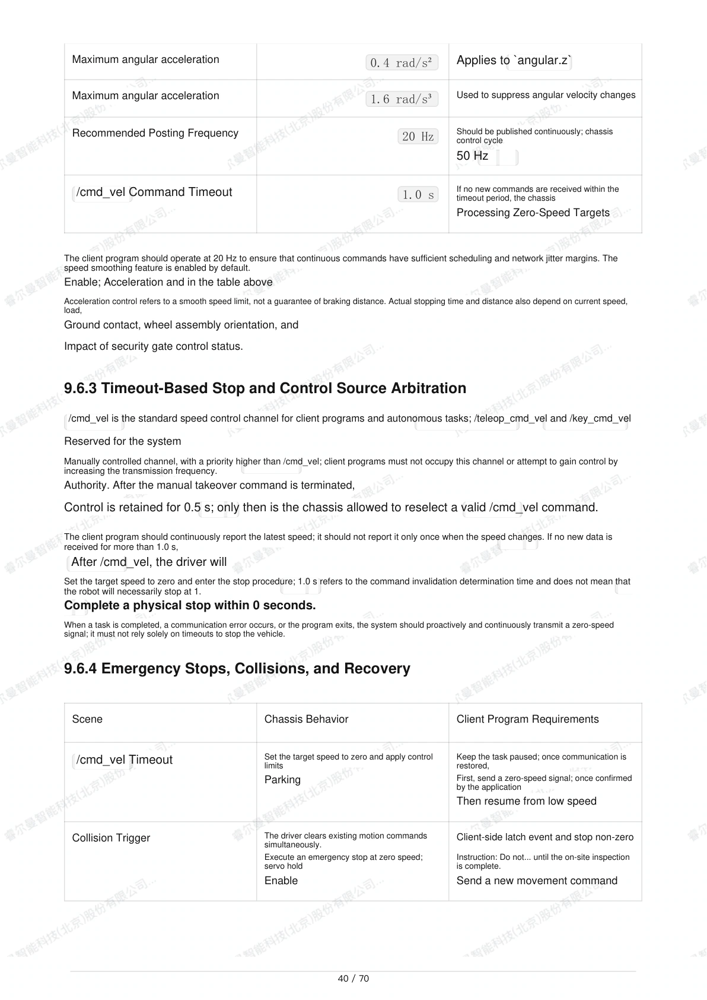




```
0.4 rad/s² 

1.6 rad/s³ 
20 Hz 

1.0 s 
40 / 70
Maximum angular acceleration
Applies to `angular.z`
Maximum angular acceleration
Used to suppress angular velocity changes
Recommended Posting Frequency
Should be published continuously; chassis
control cycle
50 Hz
/cmd_vel Command Timeout
If no new commands are received within the
timeout period, the chassis
Processing Zero-Speed Targets
The client program should operate at 20 Hz to ensure that continuous commands have sufficient scheduling and network jitter margins. The
speed smoothing feature is enabled by default.
Enable; Acceleration and in the table above
Acceleration control refers to a smooth speed limit, not a guarantee of braking distance. Actual stopping time and distance also depend on current speed,
load,
Ground contact, wheel assembly orientation, and
Impact of security gate control status.
9.6.3 Timeout-Based Stop and Control Source Arbitration
/cmd_vel is the standard speed control channel for client programs and autonomous tasks; /teleop_cmd_vel and /key_cmd_vel
Reserved for the system
Manually controlled channel, with a priority higher than /cmd_vel; client programs must not occupy this channel or attempt to gain control by
increasing the transmission frequency.
Authority. After the manual takeover command is terminated,
Control is retained for 0.5 s; only then is the chassis allowed to reselect a valid /cmd_vel command.
The client program should continuously report the latest speed; it should not report it only once when the speed changes. If no new data is
received for more than 1.0 s,
After /cmd_vel, the driver will
Set the target speed to zero and enter the stop procedure; 1.0 s refers to the command invalidation determination time and does not mean that
the robot will necessarily stop at 1.
Complete a physical stop within 0 seconds.
When a task is completed, a communication error occurs, or the program exits, the system should proactively and continuously transmit a zero-speed
signal; it must not rely solely on timeouts to stop the vehicle.
9.6.4 Emergency Stops, Collisions, and Recovery
Scene
Chassis Behavior
Client Program Requirements
/cmd_vel Timeout
Set the target speed to zero and apply control
limits
Keep the task paused; once communication is
restored,
Parking
First, send a zero-speed signal; once confirmed
by the application
Then resume from low speed
Collision Trigger
The driver clears existing motion commands
simultaneously.
Client-side latch event and stop non-zero
Execute an emergency stop at zero speed;
servo hold
Instruction: Do not... until the on-site inspection
is complete.
Enable
Send a new movement command
```




## PDF page 41

[RealBot2.0 / S2 interface manual V1.3, original PDF page 41](https://1292444914-files.gitbook.io/~/files/v0/b/gitbook-x-prod.appspot.com/o/spaces%2FtgOfPnscWebs1eh82EKq%2Fuploads%2F588gZef2ZxEvFbJF8KVl%2FS2_API-pages-01-67.pdf?alt=media#page=41)



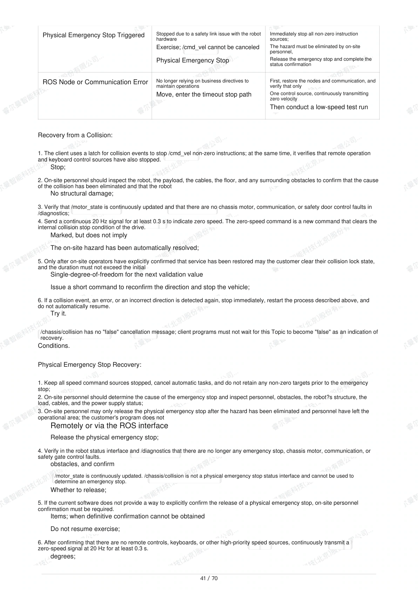




```
41 / 70
Physical Emergency Stop Triggered
Stopped due to a safety link issue with the robot
hardware
Immediately stop all non-zero instruction
sources;
Exercise; /cmd_vel cannot be canceled
The hazard must be eliminated by on-site
personnel,
Physical Emergency Stop
Release the emergency stop and complete the
status confirmation
ROS Node or Communication Error
No longer relying on business directives to
maintain operations
First, restore the nodes and communication, and
verify that only
Move, enter the timeout stop path
One control source, continuously transmitting
zero velocity
Then conduct a low-speed test run
Recovery from a Collision:
1. The client uses a latch for collision events to stop /cmd_vel non-zero instructions; at the same time, it verifies that remote operation
and keyboard control sources have also stopped.
Stop;
2. On-site personnel should inspect the robot, the payload, the cables, the floor, and any surrounding obstacles to confirm that the cause
of the collision has been eliminated and that the robot
No structural damage;
3. Verify that /motor_state is continuously updated and that there are no chassis motor, communication, or safety door control faults in
/diagnostics;
4. Send a continuous 20 Hz signal for at least 0.3 s to indicate zero speed. The zero-speed command is a new command that clears the
internal collision stop condition of the drive.
Marked, but does not imply
The on-site hazard has been automatically resolved;
5. Only after on-site operators have explicitly confirmed that service has been restored may the customer clear their collision lock state,
and the duration must not exceed the initial
Single-degree-of-freedom for the next validation value
Issue a short command to reconfirm the direction and stop the vehicle;
6. If a collision event, an error, or an incorrect direction is detected again, stop immediately, restart the process described above, and
do not automatically resume.
Try it.
/chassis/collision has no "false" cancellation message; client programs must not wait for this Topic to become "false" as an indication of
recovery.
Conditions.
Physical Emergency Stop Recovery:
1. Keep all speed command sources stopped, cancel automatic tasks, and do not retain any non-zero targets prior to the emergency
stop;
2. On-site personnel should determine the cause of the emergency stop and inspect personnel, obstacles, the robot?s structure, the
load, cables, and the power supply status;
3. On-site personnel may only release the physical emergency stop after the hazard has been eliminated and personnel have left the
operational area; the customer's program does not
Remotely or via the ROS interface
Release the physical emergency stop;
4. Verify in the robot status interface and /diagnostics that there are no longer any emergency stop, chassis motor, communication, or
safety gate control faults.
obstacles, and confirm
/motor_state is continuously updated. /chassis/collision is not a physical emergency stop status interface and cannot be used to
determine an emergency stop.
Whether to release;
5. If the current software does not provide a way to explicitly confirm the release of a physical emergency stop, on-site personnel
confirmation must be required.
Items; when definitive confirmation cannot be obtained
Do not resume exercise;
6. After confirming that there are no remote controls, keyboards, or other high-priority speed sources, continuously transmit a
zero-speed signal at 20 Hz for at least 0.3 s.
degrees;
```




## PDF page 42

[RealBot2.0 / S2 interface manual V1.3, original PDF page 42](https://1292444914-files.gitbook.io/~/files/v0/b/gitbook-x-prod.appspot.com/o/spaces%2FtgOfPnscWebs1eh82EKq%2Fuploads%2F588gZef2ZxEvFbJF8KVl%2FS2_API-pages-01-67.pdf?alt=media#page=42)



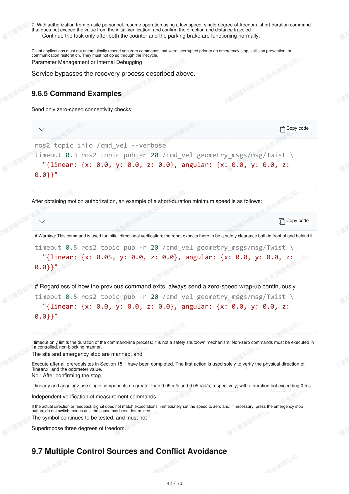




```
ros2 topic info /cmd_vel --verbose
timeout 0.3 ros2 topic pub -r 20 /cmd_vel geometry_msgs/msg/Twist \
  "{linear: {x: 0.0, y: 0.0, z: 0.0}, angular: {x: 0.0, y: 0.0, z: 
0.0}}"
timeout 0.5 ros2 topic pub -r 20 /cmd_vel geometry_msgs/msg/Twist \
  "{linear: {x: 0.05, y: 0.0, z: 0.0}, angular: {x: 0.0, y: 0.0, z: 
0.0}}"
timeout 0.5 ros2 topic pub -r 20 /cmd_vel geometry_msgs/msg/Twist \
  "{linear: {x: 0.0, y: 0.0, z: 0.0}, angular: {x: 0.0, y: 0.0, z: 
0.0}}"
42 / 70
7. With authorization from on-site personnel, resume operation using a low-speed, single-degree-of-freedom, short-duration command
that does not exceed the value from the initial verification, and confirm the direction and distance traveled.
Continue the task only after both the counter and the parking brake are functioning normally.
Client applications must not automatically resend non-zero commands that were interrupted prior to an emergency stop, collision prevention, or
communication restoration. They must not do so through the lifecycle,
Parameter Management or Internal Debugging
Service bypasses the recovery process described above.
9.6.5 Command Examples
Send only zero-speed connectivity checks:
Copy code
After obtaining motion authorization, an example of a short-duration minimum speed is as follows:
Copy code
# Warning: This command is used for initial directional verification; the robot expects there to be a safety clearance both in front of and behind it.
# Regardless of how the previous command exits, always send a zero-speed wrap-up continuously
timeout only limits the duration of the command-line process; it is not a safety shutdown mechanism. Non-zero commands must be executed in
a controlled, non-blocking manner.
The site and emergency stop are manned, and
Execute after all prerequisites in Section 15.1 have been completed. The first action is used solely to verify the physical direction of
`linear.x` and the odometer value.
No.; After confirming the stop,
linear.y and angular.z use single components no greater than 0.05 m/s and 0.05 rad/s, respectively, with a duration not exceeding 0.5 s.
Independent verification of measurement commands.
If the actual direction or feedback signal does not match expectations, immediately set the speed to zero and, if necessary, press the emergency stop
button; do not switch modes until the cause has been determined.
The symbol continues to be tested, and must not
Superimpose three degrees of freedom.
9.7 Multiple Control Sources and Conflict Avoidance
```




## PDF page 43

[RealBot2.0 / S2 interface manual V1.3, original PDF page 43](https://1292444914-files.gitbook.io/~/files/v0/b/gitbook-x-prod.appspot.com/o/spaces%2FtgOfPnscWebs1eh82EKq%2Fuploads%2F588gZef2ZxEvFbJF8KVl%2FS2_API-pages-01-67.pdf?alt=media#page=43)



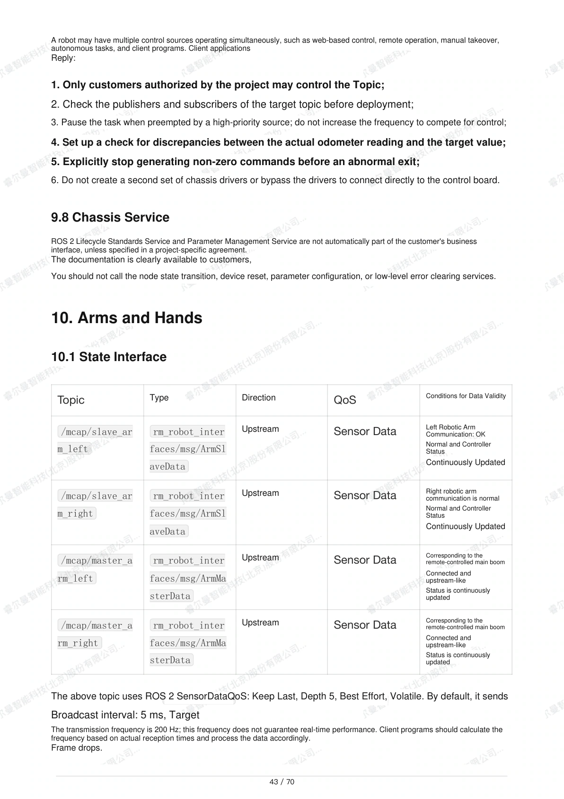




```
Topic
QoS
/mcap/slave_ar
m_left 
rm_robot_inter
faces/msg/ArmSl
aveData 
Sensor Data
/mcap/slave_ar
m_right 
rm_robot_inter
faces/msg/ArmSl
aveData 
Sensor Data
/mcap/master_a
rm_left 
rm_robot_inter
faces/msg/ArmMa
sterData 
Sensor Data
/mcap/master_a
rm_right 
rm_robot_inter
faces/msg/ArmMa
sterData 
Sensor Data
43 / 70
A robot may have multiple control sources operating simultaneously, such as web-based control, remote operation, manual takeover,
autonomous tasks, and client programs. Client applications
Reply:
1. Only customers authorized by the project may control the Topic;
2. Check the publishers and subscribers of the target topic before deployment;
3. Pause the task when preempted by a high-priority source; do not increase the frequency to compete for control;
4. Set up a check for discrepancies between the actual odometer reading and the target value;
5. Explicitly stop generating non-zero commands before an abnormal exit;
6. Do not create a second set of chassis drivers or bypass the drivers to connect directly to the control board.
9.8 Chassis Service
ROS 2 Lifecycle Standards Service and Parameter Management Service are not automatically part of the customer's business
interface, unless specified in a project-specific agreement.
The documentation is clearly available to customers,
You should not call the node state transition, device reset, parameter configuration, or low-level error clearing services.
10. Arms and Hands
10.1 State Interface
Type
Direction
Conditions for Data Validity
Upstream
Left Robotic Arm
Communication: OK
Normal and Controller
Status
Continuously Updated
Upstream
Right robotic arm
communication is normal
Normal and Controller
Status
Continuously Updated
Upstream
Corresponding to the
remote-controlled main boom
Connected and
upstream-like
Status is continuously
updated
Upstream
Corresponding to the
remote-controlled main boom
Connected and
upstream-like
Status is continuously
updated
The above topic uses ROS 2 SensorDataQoS: Keep Last, Depth 5, Best Effort, Volatile. By default, it sends
Broadcast interval: 5 ms, Target
The transmission frequency is 200 Hz; this frequency does not guarantee real-time performance. Client programs should calculate the
frequency based on actual reception times and process the data accordingly.
Frame drops.
```




## PDF page 44

[RealBot2.0 / S2 interface manual V1.3, original PDF page 44](https://1292444914-files.gitbook.io/~/files/v0/b/gitbook-x-prod.appspot.com/o/spaces%2FtgOfPnscWebs1eh82EKq%2Fuploads%2F588gZef2ZxEvFbJF8KVl%2FS2_API-pages-01-67.pdf?alt=media#page=44)



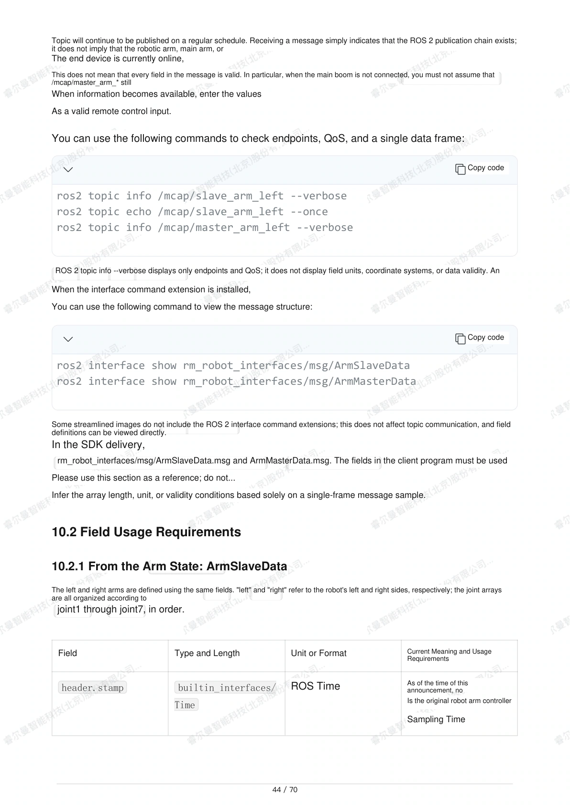




```
ros2 topic info /mcap/slave_arm_left --verbose
ros2 topic echo /mcap/slave_arm_left --once
ros2 topic info /mcap/master_arm_left --verbose
ros2 interface show rm_robot_interfaces/msg/ArmSlaveData
ros2 interface show rm_robot_interfaces/msg/ArmMasterData
header.stamp 
builtin_interfaces/
Time 
44 / 70
Topic will continue to be published on a regular schedule. Receiving a message simply indicates that the ROS 2 publication chain exists;
it does not imply that the robotic arm, main arm, or
The end device is currently online,
This does not mean that every field in the message is valid. In particular, when the main boom is not connected, you must not assume that
/mcap/master_arm_* still
When information becomes available, enter the values
As a valid remote control input.
You can use the following commands to check endpoints, QoS, and a single data frame:
Copy code
ROS 2 topic info --verbose displays only endpoints and QoS; it does not display field units, coordinate systems, or data validity. An
When the interface command extension is installed,
You can use the following command to view the message structure:
Copy code
Some streamlined images do not include the ROS 2 interface command extensions; this does not affect topic communication, and field
definitions can be viewed directly.
In the SDK delivery,
rm_robot_interfaces/msg/ArmSlaveData.msg and ArmMasterData.msg. The fields in the client program must be used
Please use this section as a reference; do not...
Infer the array length, unit, or validity conditions based solely on a single-frame message sample.
10.2 Field Usage Requirements
10.2.1 From the Arm State: ArmSlaveData
The left and right arms are defined using the same fields. "left" and "right" refer to the robot's left and right sides, respectively; the joint arrays
are all organized according to
joint1 through joint7, in order.
Field
Type and Length
Unit or Format
Current Meaning and Usage
Requirements
ROS Time
As of the time of this
announcement, no
Is the original robot arm controller
Sampling Time
```




## PDF page 45

[RealBot2.0 / S2 interface manual V1.3, original PDF page 45](https://1292444914-files.gitbook.io/~/files/v0/b/gitbook-x-prod.appspot.com/o/spaces%2FtgOfPnscWebs1eh82EKq%2Fuploads%2F588gZef2ZxEvFbJF8KVl%2FS2_API-pages-01-67.pdf?alt=media#page=45)



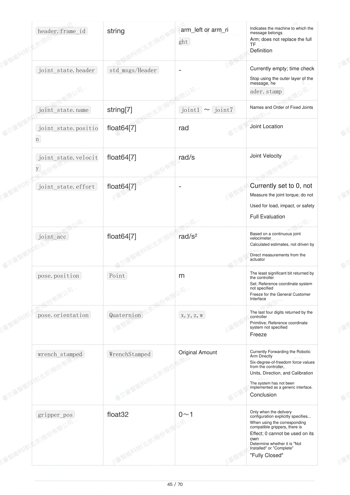




```
header.frame_id 
string
ght 
joint_state.header 
std_msgs/Header 
-
ader.stamp 
joint_state.name 
string[7]
joint1 ～joint7 
joint_state.positio
n 
float64[7]
rad
joint_state.velocit
y 
float64[7]
rad/s
joint_state.effort 
float64[7]
-
joint_acc 
float64[7]
rad/s²
pose.position 
Point 
m
pose.orientation 
Quaternion 
x,y,z,w 
wrench_stamped 
WrenchStamped 
gripper_pos 
float32
0～1
45 / 70
arm_left or arm_ri
Indicates the machine to which the
message belongs
Arm; does not replace the full
TF
Definition
Currently empty; time check
Stop using the outer layer of the
message, he
Names and Order of Fixed Joints
Joint Location
Joint Velocity
Currently set to 0, not
Measure the joint torque; do not
Used for load, impact, or safety
Full Evaluation
Based on a continuous joint
velocimeter
Calculated estimates, not driven by
Direct measurements from the
actuator
The least significant bit returned by
the controller
Set; Reference coordinate system
not specified
Freeze for the General Customer
Interface
The last four digits returned by the
controller
Primitive; Reference coordinate
system not specified
Freeze
Original Amount
Currently Forwarding the Robotic
Arm Directly
Six-degree-of-freedom force values
from the controller,
Units, Direction, and Calibration
The system has not been
implemented as a generic interface.
Conclusion
Only when the delivery
configuration explicitly specifies...
When using the corresponding
compatible grippers, there is
Effect; 0 cannot be used on its
own
Determine whether it is "Not
Installed" or "Complete"
"Fully Closed"
```




## PDF page 46

[RealBot2.0 / S2 interface manual V1.3, original PDF page 46](https://1292444914-files.gitbook.io/~/files/v0/b/gitbook-x-prod.appspot.com/o/spaces%2FtgOfPnscWebs1eh82EKq%2Fuploads%2F588gZef2ZxEvFbJF8KVl%2FS2_API-pages-01-67.pdf?alt=media#page=46)



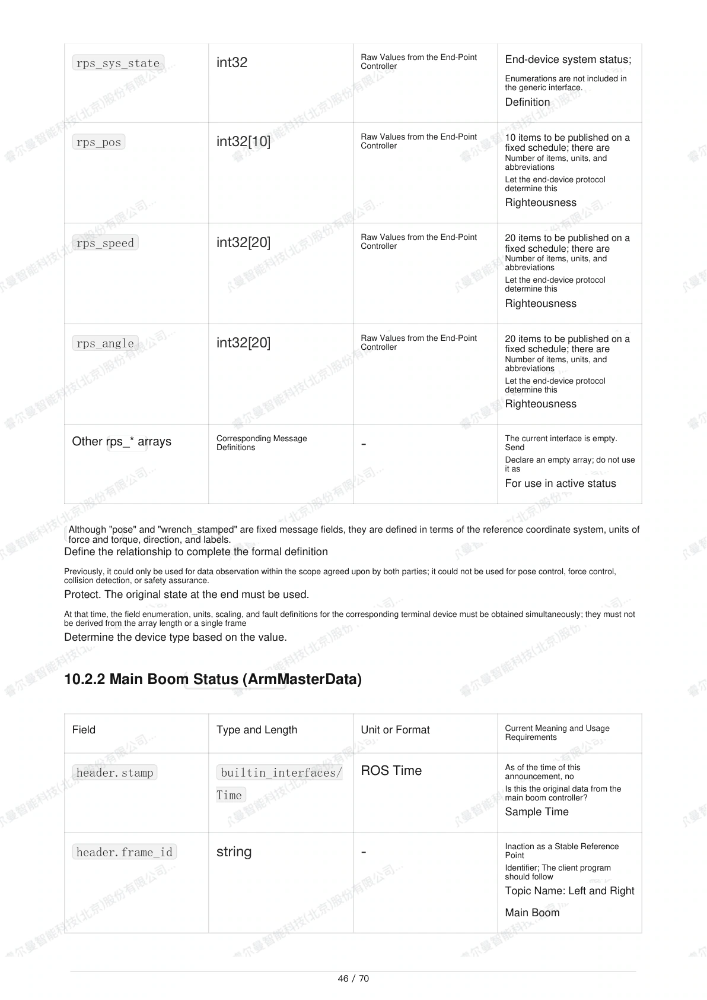




```
rps_sys_state 
int32
rps_pos 
int32[10]
rps_speed 
int32[20]
rps_angle 
int32[20]
-
header.stamp 
builtin_interfaces/
Time 
header.frame_id 
string
-
46 / 70
Raw Values from the End-Point
Controller
End-device system status;
Enumerations are not included in
the generic interface.
Definition
Raw Values from the End-Point
Controller
10 items to be published on a
fixed schedule; there are
Number of items, units, and
abbreviations
Let the end-device protocol
determine this
Righteousness
Raw Values from the End-Point
Controller
20 items to be published on a
fixed schedule; there are
Number of items, units, and
abbreviations
Let the end-device protocol
determine this
Righteousness
Raw Values from the End-Point
Controller
20 items to be published on a
fixed schedule; there are
Number of items, units, and
abbreviations
Let the end-device protocol
determine this
Righteousness
Other rps_* arrays
Corresponding Message
Definitions
The current interface is empty.
Send
Declare an empty array; do not use
it as
For use in active status
Although "pose" and "wrench_stamped" are fixed message fields, they are defined in terms of the reference coordinate system, units of
force and torque, direction, and labels.
Define the relationship to complete the formal definition
Previously, it could only be used for data observation within the scope agreed upon by both parties; it could not be used for pose control, force control,
collision detection, or safety assurance.
Protect. The original state at the end must be used.
At that time, the field enumeration, units, scaling, and fault definitions for the corresponding terminal device must be obtained simultaneously; they must not
be derived from the array length or a single frame
Determine the device type based on the value.
10.2.2 Main Boom Status (ArmMasterData)
Field
Type and Length
Unit or Format
Current Meaning and Usage
Requirements
ROS Time
As of the time of this
announcement, no
Is this the original data from the
main boom controller?
Sample Time
Inaction as a Stable Reference
Point
Identifier; The client program
should follow
Topic Name: Left and Right
Main Boom
```




## PDF page 47

[RealBot2.0 / S2 interface manual V1.3, original PDF page 47](https://1292444914-files.gitbook.io/~/files/v0/b/gitbook-x-prod.appspot.com/o/spaces%2FtgOfPnscWebs1eh82EKq%2Fuploads%2F588gZef2ZxEvFbJF8KVl%2FS2_API-pages-01-67.pdf?alt=media#page=47)



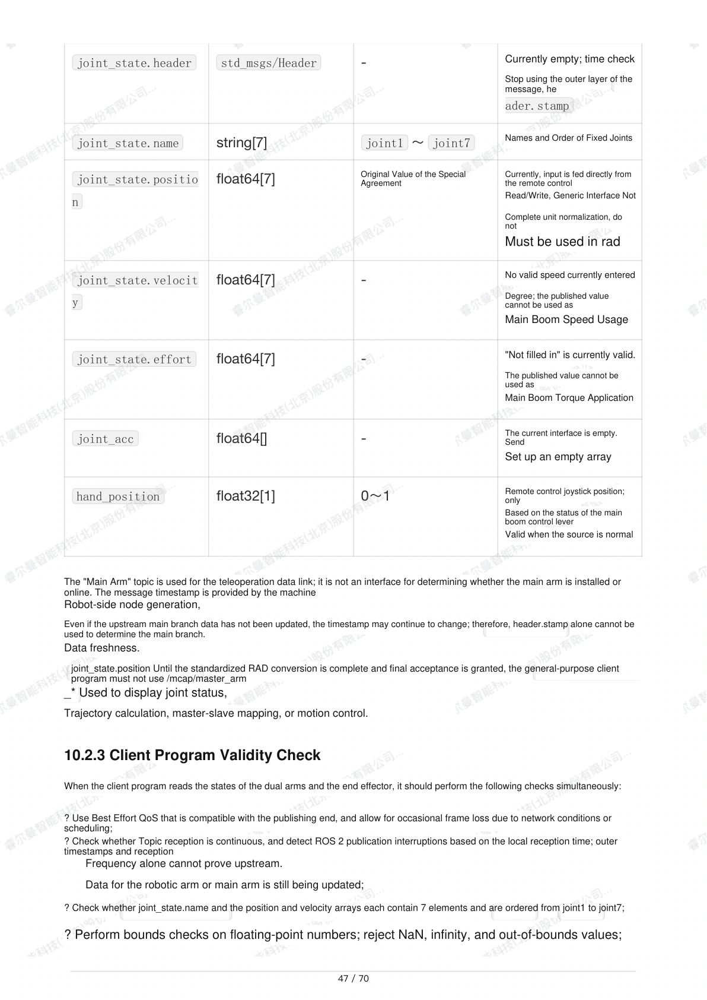




```
joint_state.header 
std_msgs/Header 
-
ader.stamp 
joint_state.name 
string[7]
joint1 ～joint7 
joint_state.positio
n 
float64[7]
joint_state.velocit
y 
float64[7]
-
joint_state.effort 
float64[7]
-
joint_acc 
float64[]
-
hand_position 
float32[1]
0～1
47 / 70
Currently empty; time check
Stop using the outer layer of the
message, he
Names and Order of Fixed Joints
Original Value of the Special
Agreement
Currently, input is fed directly from
the remote control
Read/Write, Generic Interface Not
Complete unit normalization, do
not
Must be used in rad
No valid speed currently entered
Degree; the published value
cannot be used as
Main Boom Speed Usage
"Not filled in" is currently valid.
The published value cannot be
used as
Main Boom Torque Application
The current interface is empty.
Send
Set up an empty array
Remote control joystick position;
only
Based on the status of the main
boom control lever
Valid when the source is normal
The "Main Arm" topic is used for the teleoperation data link; it is not an interface for determining whether the main arm is installed or
online. The message timestamp is provided by the machine
Robot-side node generation,
Even if the upstream main branch data has not been updated, the timestamp may continue to change; therefore, header.stamp alone cannot be
used to determine the main branch.
Data freshness.
joint_state.position Until the standardized RAD conversion is complete and final acceptance is granted, the general-purpose client
program must not use /mcap/master_arm
_* Used to display joint status,
Trajectory calculation, master-slave mapping, or motion control.
10.2.3 Client Program Validity Check
When the client program reads the states of the dual arms and the end effector, it should perform the following checks simultaneously:
? Use Best Effort QoS that is compatible with the publishing end, and allow for occasional frame loss due to network conditions or
scheduling;
? Check whether Topic reception is continuous, and detect ROS 2 publication interruptions based on the local reception time; outer
timestamps and reception
Frequency alone cannot prove upstream.
Data for the robotic arm or main arm is still being updated;
? Check whether joint_state.name and the position and velocity arrays each contain 7 elements and are ordered from joint1 to joint7;
? Perform bounds checks on floating-point numbers; reject NaN, infinity, and out-of-bounds values;
```




## PDF page 48

[RealBot2.0 / S2 interface manual V1.3, original PDF page 48](https://1292444914-files.gitbook.io/~/files/v0/b/gitbook-x-prod.appspot.com/o/spaces%2FtgOfPnscWebs1eh82EKq%2Fuploads%2F588gZef2ZxEvFbJF8KVl%2FS2_API-pages-01-67.pdf?alt=media#page=48)



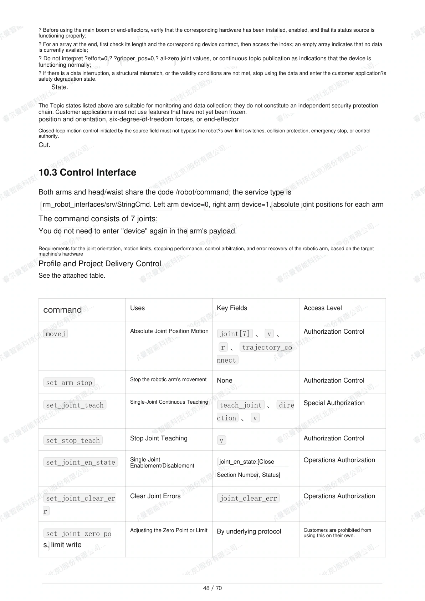




```
command
movej 
joint[7] 、v 、
r 、trajectory_co
nnect 
set_arm_stop 
set_joint_teach 
teach_joint 、dire
ction 、v 
set_stop_teach 
v 
set_joint_en_state 

set_joint_clear_er
r 
joint_clear_err 
set_joint_zero_po
48 / 70
? Before using the main boom or end-effectors, verify that the corresponding hardware has been installed, enabled, and that its status source is
functioning properly;
? For an array at the end, first check its length and the corresponding device contract, then access the index; an empty array indicates that no data
is currently available;
? Do not interpret ?effort=0,? ?gripper_pos=0,? all-zero joint values, or continuous topic publication as indications that the device is
functioning normally;
? If there is a data interruption, a structural mismatch, or the validity conditions are not met, stop using the data and enter the customer application?s
safety degradation state.
State.
The Topic states listed above are suitable for monitoring and data collection; they do not constitute an independent security protection
chain. Customer applications must not use features that have not yet been frozen.
position and orientation, six-degree-of-freedom forces, or end-effector
Closed-loop motion control initiated by the source field must not bypass the robot?s own limit switches, collision protection, emergency stop, or control
authority.
Cut.
10.3 Control Interface
Both arms and head/waist share the code /robot/command; the service type is
rm_robot_interfaces/srv/StringCmd. Left arm device=0, right arm device=1, absolute joint positions for each arm
The command consists of 7 joints;
You do not need to enter "device" again in the arm's payload.
Requirements for the joint orientation, motion limits, stopping performance, control arbitration, and error recovery of the robotic arm, based on the target
machine's hardware
Profile and Project Delivery Control
See the attached table.
Uses
Key Fields
Access Level
Absolute Joint Position Motion
Authorization Control
Stop the robotic arm's movement
None
Authorization Control
Single-Joint Continuous Teaching
Special Authorization
Stop Joint Teaching
Authorization Control
Single-Joint
Enablement/Disablement
joint_en_state:[Close
Operations Authorization
Section Number, Status]
Clear Joint Errors
Operations Authorization
Adjusting the Zero Point or Limit
By underlying protocol
Customers are prohibited from
using this on their own.
s, limit write
```




## PDF page 49

[RealBot2.0 / S2 interface manual V1.3, original PDF page 49](https://1292444914-files.gitbook.io/~/files/v0/b/gitbook-x-prod.appspot.com/o/spaces%2FtgOfPnscWebs1eh82EKq%2Fuploads%2F588gZef2ZxEvFbJF8KVl%2FS2_API-pages-01-67.pdf?alt=media#page=49)



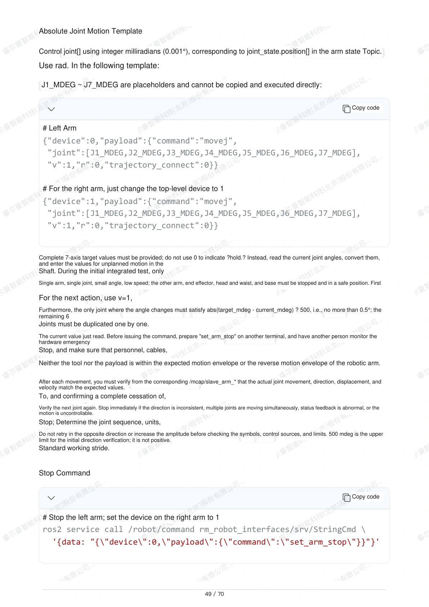




```
{"device":0,"payload":{"command":"movej",
 "joint":[J1_MDEG,J2_MDEG,J3_MDEG,J4_MDEG,J5_MDEG,J6_MDEG,J7_MDEG],
 "v":1,"r":0,"trajectory_connect":0}}
{"device":1,"payload":{"command":"movej",
 "joint":[J1_MDEG,J2_MDEG,J3_MDEG,J4_MDEG,J5_MDEG,J6_MDEG,J7_MDEG],
 "v":1,"r":0,"trajectory_connect":0}}
ros2 service call /robot/command rm_robot_interfaces/srv/StringCmd \
  '{data: "{\"device\":0,\"payload\":{\"command\":\"set_arm_stop\"}}"}'
49 / 70
Absolute Joint Motion Template
Control joint[] using integer milliradians (0.001°), corresponding to joint_state.position[] in the arm state Topic.
Use rad. In the following template:
J1_MDEG ~ J7_MDEG are placeholders and cannot be copied and executed directly:
Copy code
# Left Arm
# For the right arm, just change the top-level device to 1
Complete 7-axis target values must be provided; do not use 0 to indicate ?hold.? Instead, read the current joint angles, convert them,
and enter the values for unplanned motion in the
Shaft. During the initial integrated test, only
Single arm, single joint, small angle, low speed; the other arm, end effector, head and waist, and base must be stopped and in a safe position. First
For the next action, use v=1,
Furthermore, the only joint where the angle changes must satisfy abs(target_mdeg - current_mdeg) ? 500, i.e., no more than 0.5°; the
remaining 6
Joints must be duplicated one by one.
The current value just read. Before issuing the command, prepare "set_arm_stop" on another terminal, and have another person monitor the
hardware emergency
Stop, and make sure that personnel, cables,
Neither the tool nor the payload is within the expected motion envelope or the reverse motion envelope of the robotic arm.
After each movement, you must verify from the corresponding /mcap/slave_arm_* that the actual joint movement, direction, displacement, and
velocity match the expected values.
To, and confirming a complete cessation of,
Verify the next joint again. Stop immediately if the direction is inconsistent, multiple joints are moving simultaneously, status feedback is abnormal, or the
motion is uncontrollable.
Stop; Determine the joint sequence, units,
Do not retry in the opposite direction or increase the amplitude before checking the symbols, control sources, and limits. 500 mdeg is the upper
limit for the initial direction verification; it is not positive.
Standard working stride.
Stop Command
Copy code
# Stop the left arm; set the device on the right arm to 1
```




## PDF page 50

[RealBot2.0 / S2 interface manual V1.3, original PDF page 50](https://1292444914-files.gitbook.io/~/files/v0/b/gitbook-x-prod.appspot.com/o/spaces%2FtgOfPnscWebs1eh82EKq%2Fuploads%2F588gZef2ZxEvFbJF8KVl%2FS2_API-pages-01-67.pdf?alt=media#page=50)



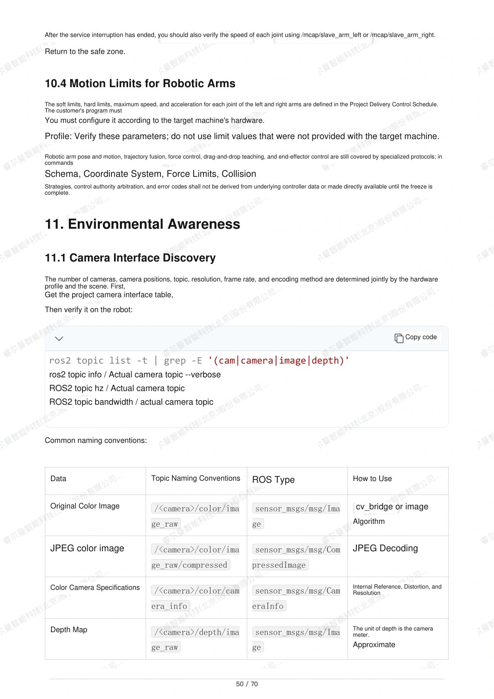




```
ros2 topic list -t | grep -E '(cam|camera|image|depth)'
/<camera>/color/ima
ge_raw 
sensor_msgs/msg/Ima
ge 
/<camera>/color/ima
ge_raw/compressed 
sensor_msgs/msg/Com
pressedImage 
/<camera>/color/cam
era_info 
sensor_msgs/msg/Cam
eraInfo 
/<camera>/depth/ima
ge_raw 
sensor_msgs/msg/Ima
ge 
50 / 70
After the service interruption has ended, you should also verify the speed of each joint using /mcap/slave_arm_left or /mcap/slave_arm_right.
Return to the safe zone.
10.4 Motion Limits for Robotic Arms
The soft limits, hard limits, maximum speed, and acceleration for each joint of the left and right arms are defined in the Project Delivery Control Schedule.
The customer's program must
You must configure it according to the target machine's hardware.
Profile: Verify these parameters; do not use limit values that were not provided with the target machine.
Robotic arm pose and motion, trajectory fusion, force control, drag-and-drop teaching, and end-effector control are still covered by specialized protocols; in
commands
Schema, Coordinate System, Force Limits, Collision
Strategies, control authority arbitration, and error codes shall not be derived from underlying controller data or made directly available until the freeze is
complete.
11. Environmental Awareness
11.1 Camera Interface Discovery
The number of cameras, camera positions, topic, resolution, frame rate, and encoding method are determined jointly by the hardware
profile and the scene. First,
Get the project camera interface table,
Then verify it on the robot:
Copy code
ros2 topic info / Actual camera topic --verbose
ROS2 topic hz / Actual camera topic
ROS2 topic bandwidth / actual camera topic
Common naming conventions:
Data
Topic Naming Conventions
ROS Type
How to Use
Original Color Image
cv_bridge or image
Algorithm
JPEG color image
JPEG Decoding
Color Camera Specifications
Internal Reference, Distortion, and
Resolution
Depth Map
The unit of depth is the camera
meter.
Approximate
```




## PDF page 51

[RealBot2.0 / S2 interface manual V1.3, original PDF page 51](https://1292444914-files.gitbook.io/~/files/v0/b/gitbook-x-prod.appspot.com/o/spaces%2FtgOfPnscWebs1eh82EKq%2Fuploads%2F588gZef2ZxEvFbJF8KVl%2FS2_API-pages-01-67.pdf?alt=media#page=51)








```
/<camera>/depth/cam
era_info 
sensor_msgs/msg/Cam
eraInfo 
H.264/H.265
left_eye 、right_eye 
left_head_wide 、right_he
ad_wide 
left_arm 、right_arm 
chassis_depth_cam 
front_view 、bev_view 
Topic
/robot_driver/camera_hz_state 
rm_robot_interfaces/msg/Camerastate 
51 / 70
Depth Camera Parameters
In-Depth Insights and Resolution
Project Camera Table
Specifications
Subject to the delivery type
Video Decoder or Media Chain
Road
Some versions may use sensor_msgs/msg/Image to carry an H.264/H.265-encoded byte stream. In this case, `data` is not
Pixel-by-pixel images cannot
Send it directly to cv_bridge.
11.2 S2 Camera Angle Examples
The following names are provided to help identify common color profiles in S2; they do not imply that all profiles are available:
Color Examples
Common Naming Patterns
Possible data
Head, left and right eyes
Original Image, CameraInfo, Encoding
Stream
Wide-angle shots of the head from the left and
right
Original image or JPEG, CameraInfo
Cameras on the Left and Right Arms
JPEG, CameraInfo, Encoding
Flow
Underbody Depth Camera
Color, Depth, CameraInfo
Forward-Facing /BEV
Project Algorithm Image
Official camera specifications must list, for each channel, the product name, camera position, topic, type, resolution, nominal frequency,
coordinate system, and calibration.
Versions and use cases.
11.3 Camera Operating Status
Project
Content
Type
Direction
Upstream
Common QoS
Reliable / Volatile, In-Service Verification
```




## PDF page 52

[RealBot2.0 / S2 interface manual V1.3, original PDF page 52](https://1292444914-files.gitbook.io/~/files/v0/b/gitbook-x-prod.appspot.com/o/spaces%2FtgOfPnscWebs1eh82EKq%2Fuploads%2F588gZef2ZxEvFbJF8KVl%2FS2_API-pages-01-67.pdf?alt=media#page=52)








```
camera_names 
camera_color_fps 
camera_depth_fps 
camera_info_fps 
52 / 70
Common Fields:
Field
Meaning
Customer Suggestions
List of Camera Names
As a match key
Frequency Distribution of Color Streams
Cross-check with the actual color Topic
Frequency Statistics for Deep Streams
Works only with cameras that support depth
sensing.
CameraInfo Frequency Statistics
Cannot be used on its own to replace image
content checks
The client program must match the format camera_names; array indices must not be hard-coded. The status monitoring configuration must
correspond to the actual image link attributes.
On two levels; Camera status
In the event of an anomaly, you should check the publisher, frequency, timestamp, and content of the actual topic simultaneously.
11.4 Acceptance of Camera Data
For each camera channel, verify at least the following:
? The topic and type match those in the delivery schedule;
? There is a steady stream of publishers and data;
? The resolution, encoding, and nominal frequency meet the project requirements;
? The timestamps are consecutive, and synchronization with other sensors meets the mission requirements;
? CameraInfo matches the image resolution and calibration version;
? H.26x can decode reliably and receive key frames periodically;
? Optional or disabled data streams can be properly downgraded by client programs.
11.5 IMU, Radar, Navigation, and BEV
IMU, magnetic field, time synchronization, radar, navigation, and BEV are not included in the S2 General Public Interface Table. When
the project is opened, the following should be submitted:
Provided by:
? Topic, type, QoS, and frequency;
? Installation location, coordinate system, and TF;
? Units, measurement ranges, noise, and covariance;
? Timestamp sources and synchronization methods;
? Hardware profiles, scenes, and activation conditions;
? Calibration, health status, and troubleshooting.
Customers must not modify sensor configurations based solely on device driver topics or parameter services that appear during
runtime.
12. Data Collection
```




## PDF page 53

[RealBot2.0 / S2 interface manual V1.3, original PDF page 53](https://1292444914-files.gitbook.io/~/files/v0/b/gitbook-x-prod.appspot.com/o/spaces%2FtgOfPnscWebs1eh82EKq%2Fuploads%2F588gZef2ZxEvFbJF8KVl%2FS2_API-pages-01-67.pdf?alt=media#page=53)








```
Topic
/mcap/body 
rm_robot_inter
faces/msg/BodyD
ata 
Best Effort
/mcap/slave_ar
m_left 
ArmSlaveData 
Best Effort
/mcap/slave_ar
m_right 
ArmSlaveData 
Best Effort
/mcap/master_a
rm_left 
ArmMasterData 
Best Effort
/mcap/master_a
rm_right 
ArmMasterData 
Best Effort
53 / 70
12.1 High-Frequency Data Topic
Type
Common QoS
Content
Enablement Conditions
High-Frequency State of
the Entity
Announcement Regarding the
Release of Ontology Data
Use
Left Arm High-Frequency
State
Left Arm Activated
Right Arm in
High-Frequency State
Right Arm Activated
Left Main Arm
High-Frequency State
Corresponding Teaching
Scenarios
High-Frequency State of
the Right Main Arm
Corresponding Teaching
Scenarios
Whether cameras, chassis, TF, and other sensors are included in the data acquisition list depends on the mission objectives and the
project?s data acquisition configuration. Topic
The fact that it appears in the list of possible configurations does not mean
It has a publisher in its current operational state or has already been successfully written to the MCAP.
12.2 Recording Control Boundaries
The S2 software may include components such as Recorder, Trigger, and Uploader. General customer documentation does not
disclose internal controls.
Service or message format.
When a project opens data collection controls, the following must be submitted:
? Formal interfaces for START, STOP, query, and cancel;
? Requests, responses, state machines, and error codes;
? Sources of fields such as taskId, sceneId, and device ID;
? Compile a list of topics and permitted customer outreach methods;
? The boundaries between the recording directory, the completed directory, and the upload directory;
? Disk quotas, file closure, power failure recovery, and failure retries;
? Acceptance testing methods for local artifacts, uploaded artifacts, and cloud objects.
Customers must not rely solely on the `ros2 service list` to guess and call the recording, upload, or OTA services.
12.3 MCAP File Validation
Perform the following on the MCAP file delivered or exported from the project:
```




## PDF page 54

[RealBot2.0 / S2 interface manual V1.3, original PDF page 54](https://1292444914-files.gitbook.io/~/files/v0/b/gitbook-x-prod.appspot.com/o/spaces%2FtgOfPnscWebs1eh82EKq%2Fuploads%2F588gZef2ZxEvFbJF8KVl%2FS2_API-pages-01-67.pdf?alt=media#page=54)








```
duration
message count
cat /rm_app/rm_robot_ws/version.txt
ros2 node list
54 / 70
Copy code
ros2 bag info /actual path/file.mcap
At a minimum, check:
Checklist Items
Compliance with Standards
File is readable
ROS2 bag info parsed successfully
Reasonably consistent with the task duration
Non-zero and consistent with frequency and duration
Topic Collection
All required topics included in the assignment instructions
Single-Topic Data
Each required topic must have messages with valid content.
Image/Status Frequency
Meet the project's minimum requirements
Timestamp
Continuous, with no significant setbacks or prolonged stagnation
Synchronize
The time relationships across sensors meet the mission requirements
12.4 Principles of Document Processing
? Check the target storage space before recording;
? After stopping the recording, wait for the Recorder to confirm that the file has been closed;
? Do not move, delete, or compress files that are currently being written;
? Retain the original local build until the upload or backup verification is complete;
? Save the task ID, robot version, hardware profile, and checksum;
? Treat ?Local Recording Successful,? ?Upload Successful,? and ?Cloud Parsing Successful? as three separate acceptance criteria.
13. System Operations and Maintenance
13.1 Version and Interface Lookup
Customers can perform the following read-only operations:
Copy code
```




## PDF page 55

[RealBot2.0 / S2 interface manual V1.3, original PDF page 55](https://1292444914-files.gitbook.io/~/files/v0/b/gitbook-x-prod.appspot.com/o/spaces%2FtgOfPnscWebs1eh82EKq%2Fuploads%2F588gZef2ZxEvFbJF8KVl%2FS2_API-pages-01-67.pdf?alt=media#page=55)








```
ros2 topic list -t
ros2 service list -t
ros2 action list -t
ros2 pkg list | sort
55 / 70
When reporting an issue, the version information and API snapshot should be from the same session. Do not simply record the version displayed on the
interface, and do not
Treat the source code branch name as
The actual version installed on the robot.
13.2 Parameter and Lifecycle Queries
Without modifying the status, you can query by project authorization:
Copy code
ros2 node info /target-node
ros2 param list /target-node
ros2 lifecycle get /target-lifecycle-node
The following actions will change the robot's status and are not included in standard customer application permissions:
? Configure production node parameters;
? Switch between lifecycle states;
? Restart the robot's basic services;
? Modify network, DDS, or scene settings;
? Modify device permissions, mount points, or system files;
? Initiate an OTA update, rollback, or restore;
? Reset the hardware or send a motion command.
These operations must be performed using the management interface provided by the project, in accordance with the Runbook or
specific protocols, and within the authorized maintenance window.
Okay.
13.3 Service-Oriented Client Applications
If a client application needs to start automatically at system boot, it should use a standalone service and meet the following requirements:
? Ensure that the robot's basic interfaces are ready;
? A startup failure does not affect the robot's basic services;
? Customer service can be started, stopped, and rolled back independently;
? No non-zero motion commands remain after an abnormal termination;
? There is a limit on the number of restart attempts to prevent a failure loop;
? There are constraints on CPU, memory, disk space, and log space;
? Re-validate the dependency interfaces after the software update.
```




## PDF page 56

[RealBot2.0 / S2 interface manual V1.3, original PDF page 56](https://1292444914-files.gitbook.io/~/files/v0/b/gitbook-x-prod.appspot.com/o/spaces%2FtgOfPnscWebs1eh82EKq%2Fuploads%2F588gZef2ZxEvFbJF8KVl%2FS2_API-pages-01-67.pdf?alt=media#page=56)








```
56 / 70
13.4 OTA, Uploads, and Remote Configuration
OTA, file uploads, remote parameters, and cloud tasks are considered specialized management capabilities. Only when a project
provides all of the following:
Only then are customers allowed to integrate:
? Service address and authentication;
? Requests, responses, state machines, and error codes;
? Version compatibility, idempotency, and retries;
? Success, failure, and recovery from interruptions;
? Rollback conditions and recovery entry points;
? Audit logs and handling of sensitive information.
The General ROS 2 interface documentation does not disclose the names of internal OTA, Uploader, or remote control services.
14. Logs and Evidence of Issues
14.1 Log Boundaries
The directory, retention, and export methods for robot base software logs may vary by release version. Customers should not rely on any specific internal
Temporary path as stable API,
You should also not modify the bot log rotation policy.
Client applications should use their own log directories and rotation policies, and should log at least the following:
? Client application version and startup time;
? Robot version, hardware profile, and scene;
? Depends on the interface being ready;
? Data timeouts, parsing failures, and QoS incompatibility;
? Changes in control and security status;
? Request ID, response code, and response time;
? Reasons for process termination and recovery.
Do not record passwords, tokens, certificate private keys, complete pre-signed URLs, or unmasked business data.
14.2 ROS 2 Log
Client nodes can use ROS 2 log level:
Copy code
ros2 run <client package> <client node> --ros-args --log-level debug
The recommended default logging level for production is "info" or a level specified by the project. Debug logs may contain a large amount
of data and should only be used in controlled environments.
Enable the barrier window, and in
```




## PDF page 57

[RealBot2.0 / S2 interface manual V1.3, original PDF page 57](https://1292444914-files.gitbook.io/~/files/v0/b/gitbook-x-prod.appspot.com/o/spaces%2FtgOfPnscWebs1eh82EKq%2Fuploads%2F588gZef2ZxEvFbJF8KVl%2FS2_API-pages-01-67.pdf?alt=media#page=57)








```
57 / 70
De-identify the data before sharing it.
14.3 Collecting Evidence Based on Observations
Phenomenon
Initial Inspection
Suggestion: Save
The external development machine
cannot see ROS
Internet, Domain, DDS, Web
Network Configuration Summary, Environment
Variables,
Card and whether external access is
enabled ROS
List of Nodes
Topic Exists but Has No Data
Publisher, Scenario, Hardware, and Node
Topic Info, hz, Node Info
Status
Interest
The command line can receive it, but the client
node cannot.
Type and QoS
Publisher/Subscriber QoS, Clients
to
Configuration
Failed to parse the aggregation state
JSON Schema and Version
De-identified samples, anomalous fields,
versions
Chassis Status Abnormal
Diagnostics, Wheel Set Status, Linkage, and
Control
/diagnostics, Low-Frequency Report,
Source
Time Window
The chassis does not respond to authorization
commands
Safety Status, Faults, Arbitration, and Over
Number of Publishers, Target/Actual
Speed
Time
Degree, Diagnosis
No image from the camera
Hardware Profile, Publisher, Frequency
Camera display, Topic information, Time
and content
Tap
H.26x cannot be decoded
Encoding Format, Resolution, Keyframes
Bitstream parameters, decoder logs, and de-
Sensitive Samples
MCAP Data Missing
Recording status, Topic publisher,
ROS2 Bag Info, Topic Search
Disk
Search, Task Information
Errors After Software Update
Robots and the SDK Version
API snapshots before and after the upgrade,
customer configuration
Construction Information
14.4 Minimum Information for Issue Reports
The problem sheet must include at least the following:
1. Robot model and serial number;
2. Software version, hardware profile, and scene;
3. Client application and SDK version;
4. Time the issue occurred and time zone;
5. Complete steps for reproducing the issue;
```




## PDF page 58

[RealBot2.0 / S2 interface manual V1.3, original PDF page 58](https://1292444914-files.gitbook.io/~/files/v0/b/gitbook-x-prod.appspot.com/o/spaces%2FtgOfPnscWebs1eh82EKq%2Fuploads%2F588gZef2ZxEvFbJF8KVl%2FS2_API-pages-01-67.pdf?alt=media#page=58)








```
0.5 s 
58 / 70
6. Expected results and actual results;
7. The name, type, QoS, publisher, and subscriber of the target interface;
8. De-identified logs, message samples, or screenshots;
9. Does it involve physical movement, sudden stops, power outages, network interruptions, or software updates?
15. Safety and Restraints
15.1 Prerequisites for Motion Control
Before any non-zero motion test, you must:
1. Complete product safety training;
2. Identify the emergency stop locations and verify that the emergency stops are functional;
3. Clear the area around the robot of people and obstacles;
4. Verify the robot's mode, enable status, and fault status;
5. Verify that only one set of applications sends controls of the same type;
6. Obtain information on the target version's direction, speed limit, acceleration, timeout, and arbitration rules;
7. First, verify the behavior of the zero command, the stop command, and abnormal exits from client nodes;
8. Use a two-person operation: One person issues commands, while the other remains on standby at all times to operate the hardware
emergency stop; neither person may enter the motion envelope;
9. Open a separate terminal in advance and prepare the corresponding stop or zero-speed commands; do not let the command line
time out or the service return a
Treat a power or software limit switch as an emergency stop;
10. Ensure there is a safety margin in both the robot?s intended direction and the opposite direction; the head, torso, robotic arm, and
chassis must not all begin their first movement simultaneously.
Verification;
11. Start at the lowest feasible speed and with the smallest possible movements in a controlled environment.
If any of these items is missing, a non-zero command should not be sent.
15.1.1 Initial Verification of Direction and Magnitude
The first movement is used solely to confirm the mapping between the "command field/joint number" and the "actual movement
direction"; it is not used to verify performance or position.
Extreme Challenges or Missions:
Location
First-time input limit
One-Time Verification Requirements
S2 Chassis
Single component; linear velocity not exceeding
Verify the forward, backward, lateral, and
rotational movements separately
0.05 m/s, angular velocity not
exceeding
Turn; stop and check the odometer each time
0.05 rad/s ; Lasting no longer than
Continue later
```




## PDF page 59

[RealBot2.0 / S2 interface manual V1.3, original PDF page 59](https://1292444914-files.gitbook.io/~/files/v0/b/gitbook-x-prod.appspot.com/o/spaces%2FtgOfPnscWebs1eh82EKq%2Fuploads%2F588gZef2ZxEvFbJF8KVl%2FS2_API-pages-01-67.pdf?alt=media#page=59)








```
bs(target-current) <= 500 m
deg (0.5°) ；v=1 
bs(target-current) <= 500 m
deg (0.5°) ；v=1 
59 / 70
S2 Upper Back
movej moves only one joint; a
Fill the remaining joints with the current absolute
value; step by
Axis Alignment Check for Physical Orientation
and Status Feedback
Single-arm robotic arm
movej moves only one joint; a
Move only one arm at a time; the other arm,
Head, torso, hips, lower body, and extremities
should stop and avoid
Let
End-effector
This article does not provide general guidelines
for first-time exercise.
Get the direction and row corresponding to the
endpoint
After explaining distance, speed, force, and
stopping
Separate Verification
If the above range of motion does not produce a discernible and controllable movement, first check the enable, feedback, gate control, unit, and control
authority; do not
Get the auto-zoom command. Only
Only after the direction of each axis, the stop links, and the status feedback have been verified and documented may the travel be increased in stages
within the official limit range.
or perform multi-axis movements.
15.2 Limits and Parameters
S2 General Documents do not publish cross-version general motion limits. The project control appendix should list the following item by
item:
Scope
Parameters That Must Be Frozen
S2 Chassis
Available degrees of freedom, direction, velocity, acceleration, and
acceleration
Resolution and Command Timeout
S2 Upper Back
Joint sequences and soft/hard limits for the 4-axis waist and
2-axis head
Position, Speed, Acceleration, Stop, and Error Clearing
both arms
Joint Sequence, Limits, Trajectory Parameters, Force Control Boundaries,
and Collisions
Collision Handling
End-user devices
Opening and Closing Range, Speed, Force, Haptic Feedback, and Error
Codes
Camera/Radar
Device Parameters and Security Settings That Must Not Be Modified
Customers may not independently expand the permitted scope by accessing production configurations or internal source code.
15.3 Stopping, Emergency Stops, and Collisions
Client applications must distinguish between:
? Normal stop: After the task is complete, send the stop or zero command specified by the project;
? Command Timeout Stop: Controls the driver's safety behavior after a request stops updating;
```




## PDF page 60

[RealBot2.0 / S2 interface manual V1.3, original PDF page 60](https://1292444914-files.gitbook.io/~/files/v0/b/gitbook-x-prod.appspot.com/o/spaces%2FtgOfPnscWebs1eh82EKq%2Fuploads%2F588gZef2ZxEvFbJF8KVl%2FS2_API-pages-01-67.pdf?alt=media#page=60)








```
60 / 70
? Collision Response: Behavior following a collision detected by the driver or an upper-level safety module;
? Emergency Stop: Puts the robot into a safe state via safety hardware or a safety link.
The recovery conditions for these four cases may differ. Client programs must not treat ?resending motion commands? as a general recovery strategy,
unless the purpose is
The Schedule of Version Control Specifications clearly states
Allowed.
In the event of a collision, overturn, impact, out-of-limits movement, unusual noise, deformation of structural components, or damage to actuators, the test
should be stopped immediately and
Press the emergency stop button; secure the scene and
Record the software version, control commands, feedback, diagnostics, and time at that moment. Do not proceed without confirmation from mechanical,
electrical, and safety inspections.
After the emergency stop is released, continue the test run,
You must not use error clearing, re-enabling, or increasing command values to verify ?whether movement is still possible.?
15.4 Wire Breaks and Failure Behaviors
Client applications should configure security policies for the following failures:
Failure
Minimum Requirements
Client Process Exits
Stop generating non-zero commands; the service manager must not retry
indefinitely.
Preface
Internet Outage
Control entry into the timeout or safety states defined in the project
Topic: Data Timeout
Stop any automated tasks that rely on this data and report the issue
JSON Resolution Failed
Discard invalid messages; do not use partial parsing results to control the
machine.
Robot
QoS Incompatibility
Prevent the task from starting and display a clear diagnostic message
Timestamp Rewind/Pause
Mark the data as invalid to prevent it from being included in fusion or
control
Other Control Sources Take Over
Pause the client's automated tasks; do not compete for control.
Insufficient disk space
Stop new recordings to protect completed data and ensure system
operation
15.5 Client Application Design Requirements
? Decoupling control from status reading;
? Perform range and type validation on all external inputs;
? Set timeouts for Topics and Services;
? Allows for missing interfaces in project selections;
? Does not rely on internal node names, process PIDs, or temporary filenames;
```




## PDF page 61

[RealBot2.0 / S2 interface manual V1.3, original PDF page 61](https://1292444914-files.gitbook.io/~/files/v0/b/gitbook-x-prod.appspot.com/o/spaces%2FtgOfPnscWebs1eh82EKq%2Fuploads%2F588gZef2ZxEvFbJF8KVl%2FS2_API-pages-01-67.pdf?alt=media#page=61)








```
ROS_LOCALHOST_ONLY=1 。
source /opt/ros/humble/setup.bash
source /rm_app/rm_robot_ws/install/setup.bash
source /rm_app/body_chassis/setup.bash
source /rm_app/rmos/install/setup.bash
export ROS_LOCALHOST_ONLY=0
export RMW_IMPLEMENTATION=rmw_fastrtps_cpp
export 
FASTRTPS_DEFAULT_PROFILES_FILE=/rm_app/rm_robot_ws/script/fastdds.xml
echo "$ROS_DISTRO"
ros2 pkg prefix rm_robot_interfaces
timeout 15 ros2 topic list -t --no-daemon --spin-time 5
source /opt/ros/humble/setup.bash
61 / 70
? Do not perform blocking I/O in callbacks;
? Logs can be searched, rotated, and redacted;
? There is a limit on resource usage;
? Client applications can be disabled and rolled back independently;
? Perform interface regression testing after the software update.
16. Development Environment and Examples
16.1 The Robot's Local Environment
Copy code
The environment described above is intended for interactive CLI queries on the robot itself. Client nodes running for extended periods
should use the production environment specified in Section 2.3.
Environment, in which
16.2 External Development Environment
Recommended external development machines: Ubuntu 22.04, ROS 2, and Humble. After installing them according to the SDK
instructions provided by the project, load:
Copy code
source <setup.bash from the S2 Interface SDK>
The external environment must use the ROS Domain, RMW/DDS, and message interface versions that are compatible with the target
robot.
16.3 Setting Up a Client Workspace
```




## PDF page 62

[RealBot2.0 / S2 interface manual V1.3, original PDF page 62](https://1292444914-files.gitbook.io/~/files/v0/b/gitbook-x-prod.appspot.com/o/spaces%2FtgOfPnscWebs1eh82EKq%2Fuploads%2F588gZef2ZxEvFbJF8KVl%2FS2_API-pages-01-67.pdf?alt=media#page=62)








```
mkdir -p ~/s2_customer_ws/src
cd ~/s2_customer_ws
source /opt/ros/humble/setup.bash
source /rm_app/rm_robot_ws/install/setup.bash
source /rm_app/body_chassis/setup.bash
source /rm_app/rmos/install/setup.bash
colcon build --symlink-install
source install/setup.bash
<depend>rclcpp</depend>
<depend>std_msgs</depend>
<depend>sensor_msgs</depend>
<depend>geometry_msgs</depend>
<depend>diagnostic_msgs</depend>
<depend>nav_msgs</depend>
<depend>rm_robot_interfaces</depend>
#!/usr/bin/env python3
import json
import rclpy
from rclpy.node import Node
from std_msgs.msg import String
62 / 70
Copy code
The three overlays mentioned above (/rm_app) exist only on the robot itself. External development machines do not load these paths;
instead, follow the instructions in Section 16.2.
Delivery of Projects Loaded by Section
S2 Interface SDK Environment Script.
16.4 Dependency Declarations
Customer ROS's package declares the following dependencies based on actual usage:
Copy code
Python client packages use rclpy. Client packages must not have the same name as the official robot packages.
16.5 Python Example for System-Wide Status
Copy code
```




## PDF page 63

[RealBot2.0 / S2 interface manual V1.3, original PDF page 63](https://1292444914-files.gitbook.io/~/files/v0/b/gitbook-x-prod.appspot.com/o/spaces%2FtgOfPnscWebs1eh82EKq%2Fuploads%2F588gZef2ZxEvFbJF8KVl%2FS2_API-pages-01-67.pdf?alt=media#page=63)








```
class S2StateReader(Node):
    def __init__(self):
        super().__init__('s2_state_reader')
        self.create_subscription(String, '/robot_slave/states', 
self.on_state, 10)
    def on_state(self, msg):
        try:
            state = json.loads(msg.data)
        except json.JSONDecodeError as exc:
            self.get_logger().error(f'invalid state JSON: {exc}')
            return
        self.get_logger().info(
            f'received fields: {sorted(state.keys())}'
        )
def main():
    rclpy.init()
    node = S2StateReader()
    try:
        rclpy.spin(node)
    finally:
        node.destroy_node()
        rclpy.shutdown()
if __name__ == '__main__':
    main()
from rclpy.qos import qos_profile_sensor_data
self.create_subscription(
    MessageType,
    '/high_rate_topic',
    self.on_message,
    qos_profile_sensor_data,
63 / 70
The business logic should also implement data timeouts, schema versioning, and sensitive log handling.
16.6 Example of QoS for High-Frequency Data Subscriptions
Copy code
```




## PDF page 64

[RealBot2.0 / S2 interface manual V1.3, original PDF page 64](https://1292444914-files.gitbook.io/~/files/v0/b/gitbook-x-prod.appspot.com/o/spaces%2FtgOfPnscWebs1eh82EKq%2Fuploads%2F588gZef2ZxEvFbJF8KVl%2FS2_API-pages-01-67.pdf?alt=media#page=64)








```
)
cat /rm_app/rm_robot_ws/version.txt
timeout 15 ros2 node list --no-daemon --spin-time 5
timeout 15 ros2 topic list -t --no-daemon --spin-time 5
timeout 15 ros2 service list -t --no-daemon --spin-time 5
sensor_prefix="$(ros2 pkg prefix sensor_msgs)"
iface_prefix="$(ros2 pkg prefix rm_robot_interfaces)"
sed -n '1,200p' "$sensor_prefix/share/sensor_msgs/msg/JointState.msg"
sed -n '1,200p' 
"$iface_prefix/share/rm_robot_interfaces/msg/Camerastate.msg"
timeout 15 ros2 topic list -t --no-daemon --spin-time 5 | grep -E 
'(cam|camera|image|depth)'
source /opt/ros/humble/setup.bash
source /rm_app/rm_robot_ws/install/setup.bash
source /rm_app/body_chassis/setup.bash
source /rm_app/rmos/install/setup.bash
source ~/s2_customer_ws/install/setup.bash
64 / 70
16.7 Command-Line Quick Reference
Copy code
# Versions and Interfaces
# Topic: Contracts
timeout 15 ros2 topic info /Target Topics --verbose --no-daemon --spin-time 5
timeout 15 ros2 topic hz /target Topic
timeout 15 ros2 topic echo /targetTopic --once --no-daemon --spin-time 5
# Message Definition
# Camera
ROS2 Topic Bandwidth / Actual Image Topic
# Read-Only MCAP Information
ros2 bag info /actual path/file.mcap
16.8 Deployment Recommendations
Load in the following order when running the client application:
Copy code
```




## PDF page 65

[RealBot2.0 / S2 interface manual V1.3, original PDF page 65](https://1292444914-files.gitbook.io/~/files/v0/b/gitbook-x-prod.appspot.com/o/spaces%2FtgOfPnscWebs1eh82EKq%2Fuploads%2F588gZef2ZxEvFbJF8KVl%2FS2_API-pages-01-67.pdf?alt=media#page=65)








```
export ROS_LOCALHOST_ONLY=1
export RMW_IMPLEMENTATION=rmw_fastrtps_cpp
export 
FASTRTPS_DEFAULT_PROFILES_FILE=/rm_app/rm_robot_ws/script/fastdds.xml
source /opt/ros/humble/setup.bash
source /rm_app/rm_robot_ws/install/setup.bash
source /rm_app/body_chassis/setup.bash
source /rm_app/rmos/install/setup.bash
export ROS_LOCALHOST_ONLY=0
export RMW_IMPLEMENTATION=rmw_fastrtps_cpp
export 
FASTRTPS_DEFAULT_PROFILES_FILE=/rm_app/rm_robot_ws/script/fastdds.xml
cat /rm_app/rm_robot_ws/version.txt
timeout 15 ros2 node list --no-daemon --spin-time 5
timeout 15 ros2 topic list -t --no-daemon --spin-time 5
timeout 15 ros2 service list -t --no-daemon --spin-time 5
65 / 70
ros2 run <client package> <client node>
Customer application upgrades should be kept separate from robot firmware upgrades, with versions, rollback packages, and validation records maintained
separately for each.
17. Interface Self-Test
17.1 Initial Connection Self-Test
First, save the read-only baseline:
Copy code
For each public Topic that is ready for use:
Copy code
timeout 15 ros2 topic info /Target Topics --verbose --no-daemon --spin-time 5
timeout 15 ros2 topic hz /target Topic
timeout 15 ros2 topic echo /targetTopic --once --no-daemon --spin-time 5
For custom messages:
```




## PDF page 66

[RealBot2.0 / S2 interface manual V1.3, original PDF page 66](https://1292444914-files.gitbook.io/~/files/v0/b/gitbook-x-prod.appspot.com/o/spaces%2FtgOfPnscWebs1eh82EKq%2Fuploads%2F588gZef2ZxEvFbJF8KVl%2FS2_API-pages-01-67.pdf?alt=media#page=66)








```
iface_prefix="$(ros2 pkg prefix rm_robot_interfaces)"
1
2
3
4
5
6
7
8
9
10
66 / 70
Copy code
sed -n '1,200p' "$iface_prefix/share/rm_robot_interfaces/msg/ Target Deletion
"Message.msg"
If the system has the `ros2interface` extension installed, you can also use `ros2 interface show`; if it is not installed, use the command above.
Describe the file reading methods.
17.2 Hierarchical Authentication Sequence
Order
Verification Details
Compliance with Standards
Version, Hardware Profile, and Scene
Consistent with the robot's current installation
configuration
ROS Environment and SDK
Version matching, parseable interfaces
Node and Topic Existence
The target interface has an expected
owner
QoS, Frequency, and Timestamps
As specified in this document and as actually
loaded
Consistent and continuously effective
Fields, Units, and Coordinate Systems
The sample conforms to the interface contract
Disconnections, Timeouts, and Invalid Data
Client Application Security Downgrade
Zero Commands and Stop Links
No unintended movement occurs
Minimum Authorization Action
Approved in accordance with a specific plan at a
controlled site
Client Application Deployment and Rollback
Can be started, stopped, and resumed
independently
Software Update Rollback
The interface discrepancy has been confirmed;
the customer should
Works properly
Appendix A: Custom Messages and Services
A.1 View Installed Interface Definitions
The rm_robot_interfaces installed on the robot contains the custom messages and service definitions used in this article. The following methods
do not follow
Lai
ROS 2 Interface Command Extensions:
```




## PDF page 67

[RealBot2.0 / S2 interface manual V1.3, original PDF page 67](https://1292444914-files.gitbook.io/~/files/v0/b/gitbook-x-prod.appspot.com/o/spaces%2FtgOfPnscWebs1eh82EKq%2Fuploads%2F588gZef2ZxEvFbJF8KVl%2FS2_API-pages-01-67.pdf?alt=media#page=67)








```
iface_prefix="$(ros2 pkg prefix rm_robot_interfaces)"
message_name=Camerastate
sed -n '1,240p' 
"$iface_prefix/share/rm_robot_interfaces/msg/${message_name}.msg"
sed -n '1,80p' 
"$iface_prefix/share/rm_robot_interfaces/srv/StringCmd.srv"
rm_robot_interfaces/msg/Ca
merastate 
string[] camera_names 、u
int16[] camera_color_fps 、
uint16[] camera_depth_fp
s 、uint16[] camera_info_f
ps 
rm_robot_interfaces/msg/Bo
dyData 
oint_acc/neck_pose 
rm_robot_interfaces/msg/Ar
mMasterData 
header 、joint_state 、j
oint_acc 、hand_position 
rm_robot_interfaces/msg/Ar
mSlaveData 
header 、joint_state 、j
oint_acc 、pose 、wrench
rm_robot_interfaces/srv/St
ringCmd 
67 / 70
Copy code
You can also change message_name to BodyData, ArmMasterData, or ArmSlaveData. This command is used to verify
Identify the robot's current installation
Interface Structure; for field units, validity conditions, and safety boundaries, refer to the corresponding sections of this document.
A.2 Custom Interfaces Used in This Paper
Type
Fixed Structure
Instructions for Using the Main Text
Section 11.3
header, middle section joint_stat
Section 8.2
e/body_joint_acc/pose, head
Department neck_joint_state/neck_j
Sections 10.1?10.2
Sections 10.1?10.2
_stamped, gripper_pos, and
rps_* trailing field
The request and response each contain a
string.
Section 8.3
"ing data" field
Camerastate Array Mappings
Field
Type
Meaning
```




## PDF page 68

[RealBot2.0 / S2 interface manual V1.3, original PDF page 68](https://1292444914-files.gitbook.io/~/files/v0/b/gitbook-x-prod.appspot.com/o/spaces%2FtgOfPnscWebs1eh82EKq%2Fuploads%2FkS8JdyMky0iC7izwCrnu%2FS2_API-pages-68-70.pdf?alt=media#page=1)








```
camera_names 
string[]
camera_color_fps 
uint16[]
camera_depth_fps 
uint16[]
camera_info_fps 
uint16[]
std_msgs/msg/String 
std_msgs/msg/Bool 
68 / 70
Camera Name; and Three Frequency Arrays
Using the Same Subscript
Frequency distribution of color data from the
corresponding camera
Frequency, in Hz
Frequency distribution of camera depth data
Frequency, in Hz
Frequency distribution based on
CameraInfo statistics
Frequency, in Hz
The client program should first verify that the four arrays are of the same length, then identify the camera using camera_names[i], and ensure
that the fixed lower
Permanently assign the marker to a specific camera position.
The "Frequency" field represents the status statistics; when determining whether an image is available, you must also check the actual
image Topic as described in Sections 11.3?11.4,
Timestamps and content.
BodyData Structure Boundaries
BodyData simultaneously stores the states of the 4 joints in the S2 waist and the 2 joints in the head. The waist uses joint_state and
body_joint_ac.
c, For use in the header
neck_joint_state and neck_joint_acc; for joint sequences, state units, and control variable conversions, see Section 8.2. pos
e and neck_pose's
The reference coordinate system is not defined in this document; customer-specific programs must not use it for closed-loop pose control or safety
determinations.
Robotic Arm Messages and StringCmd
The field-by-field units, array lengths, validity conditions, and current limitations for ArmMasterData and ArmSlaveData have already been
described in Section
As defined in Section 10.2, there are no further appendices.
Repeat the description of a field that may result in a branch. StringCmd specifies that both ROS 2 service requests and responses must
use strings.
Field data ;
The JSON request schema, response validation, error classification, and compatibility rules contained in "data" by /robot/command
are as follows:
Refer to Section 8.3.
A.3 Standard Messages
Key standard messages used in this document:
Type
Uses
JSON or Text-State Enclosure
Boolean state
```




## PDF page 69

[RealBot2.0 / S2 interface manual V1.3, original PDF page 69](https://1292444914-files.gitbook.io/~/files/v0/b/gitbook-x-prod.appspot.com/o/spaces%2FtgOfPnscWebs1eh82EKq%2Fuploads%2FkS8JdyMky0iC7izwCrnu%2FS2_API-pages-68-70.pdf?alt=media#page=2)








```
sensor_msgs/msg/JointState 
sensor_msgs/msg/BatteryState 
sensor_msgs/msg/Image 
sensor_msgs/msg/CompressedImage 
sensor_msgs/msg/CameraInfo 
diagnostic_msgs/msg/DiagnosticArray 
nav_msgs/msg/Odometry 
geometry_msgs/msg/Twist 
/robot_slave/s
tates 
std_msgs/msg/S
tring 
Schema
7
/chassis/odom 
nav_msgs/msg/O
dometry 
9
/motor_state 
sensor_msgs/ms
g/JointState 
9
/chassis/wheel
_encoder 
sensor_msgs/ms
g/JointState 
9
/diagnostics 
diagnostic_msg
s/msg/Diagnosti
cArray 
9
/chassis_drive
r/lf_report 
diagnostic_msg
s/msg/Diagnosti
cArray 
9
/battery_stat
e/bms1 
sensor_msgs/ms
g/BatteryState 
9
69 / 70
Joint, wheel set, or encoder data
Battery Status
The original image or the encoded byte stream specified in the project
agreement
Single-frame compressed images, such as JPEGs
Camera Specifications and Distortion
Diagnostic Array
Odometer
Chassis Speed Request
Appendix B: Comprehensive Interface Reference Table
Interface
Type
Direction
Access Level
Chapters
Robot -> Customer
General public, requires
Robot -> Customer
General Disclosure
Robot -> Customer
General Disclosure
Robot -> Customer
General Disclosure
Robot -> Customer
General Disclosure
Robot -> Customer
General Disclosure
Robot -> Customer
General Disclosure
```




## PDF page 70

[RealBot2.0 / S2 interface manual V1.3, original PDF page 70](https://1292444914-files.gitbook.io/~/files/v0/b/gitbook-x-prod.appspot.com/o/spaces%2FtgOfPnscWebs1eh82EKq%2Fuploads%2FkS8JdyMky0iC7izwCrnu%2FS2_API-pages-68-70.pdf?alt=media#page=3)








```
/battery_stat
e/bms2 
sensor_msgs/ms
g/BatteryState 
9
/chassis/colli
sion 
std_msgs/msg/B
ool 
9
/cmd_vel 
geometry_msgs/
msg/Twist 
9
/robot/comman
d 
rm_robot_inter
faces/srv/Strin
gCmd 
8、10
/robot_driver/
camera_hz_stat
e 
Camerastate 
11
/<camera>/colo
r/image_raw 
sensor_msgs/ms
g/Image 
11
/<camera>/colo
r/image_raw/com
pressed 
CompressedImag
e
11
/<camera>/colo
r/camera_info 
CameraInfo 
11
/<camera>/dept
h/image_raw 
sensor_msgs/ms
g/Image 
11
/mcap/body 
BodyData 
8、12
/mcap/slave_ar
m_left 
ArmSlaveData 
10、12
/mcap/slave_ar
m_right 
ArmSlaveData 
10、12
/mcap/master_a
rm_left 
ArmMasterData 
10、12
/mcap/master_a
rm_right 
ArmMasterData 
10、12
70 / 70
Robot -> Customer
Project Options
Robot -> Customer
General Disclosure,
Conduct
A schedule must be
attached
Customer -> Robot
Authorization Control
Customer -> Robot
Head, Waist, and Arms
Authorization
Control
Robot -> Customer
Project Options
Robot -> Customer
Project Options
Robot -> Customer
Project Options
Robot -> Customer
Project Options
Robot -> Customer
Project Options
Robot -> Customer
Project Options
Robot -> Customer
Project Options
Robot -> Customer
Project Options
Robot -> Customer
Project Options
Robot -> Customer
Project Options
```



