# RealBot-S2 user manual — complete supplied document (38 pages)


**Complete supplied document:** RealBot-S2\_User\_Manual\_EN.pdf · **PDF pages:** 38. This reference preserves every source page, including tables, drawings, connector views, examples, revision notes, warranty text and appendices. [Return to the RealMan source library](./).


The **Original page** tab retains the exact visual layout. The **Searchable text** tab contains extracted text, or a visually checked transcription for the two image-only specification sheets. Native PDF text can have reading-order or character defects; use the original page for table column alignment, connector orientation, equations and code indentation.


This supplied user manual has broken printed contents/bookmark references. The page numbers and navigation in this reader refer to actual PDF pages. S2 whole-robot network/pendant addresses, folding waist and charging procedures must not be substituted with standalone arm instructions. Packaging, initial-pose, jog, joint-enable, error-clear and force-calibration controls can cause real movement.


## Document navigation

| Topic                                                                    | PDF pages                                           |
| ------------------------------------------------------------------------ | --------------------------------------------------- |
| Cover, revision and original contents                                    | [PDF 1–5](complete-s2-user-manual.md#pdf-page-1)    |
| Features, architecture, full-unit/arm/computer/camera specifications     | [PDF 6–15](complete-s2-user-manual.md#pdf-page-6)   |
| Mechanical dimensions, controls, charging, emergency stop and interfaces | [PDF 16–18](complete-s2-user-manual.md#pdf-page-16) |
| Local networking, SSH, Wi-Fi and wired networking                        | [PDF 19–22](complete-s2-user-manual.md#pdf-page-19) |
| Android/desktop teach pendant and operating controls                     | [PDF 23–34](complete-s2-user-manual.md#pdf-page-23) |
| Arm connection and six-axis force calibration                            | [PDF 35–36](complete-s2-user-manual.md#pdf-page-35) |
| Safety, transport, storage, unpacking and further resources              | [PDF 36–38](complete-s2-user-manual.md#pdf-page-36) |

**Source attribution:** RealMan, supplied document named above. All original notices and technical statements remain visible in the source page images. Added navigation and discrepancy notes are OpenELAB editorial guidance. Software execution and hardware validation: **not run**.

## PDF page 1

[RealBot-S2 user manual, original PDF page 1](https://1292444914-files.gitbook.io/~/files/v0/b/gitbook-x-prod.appspot.com/o/spaces%2FtgOfPnscWebs1eh82EKq%2Fuploads%2FwKnjht6Zu1EqJtjKVIaX%2FS2-pages-01-15.pdf?alt=media#page=1)








```
http://www.realman-robotics.com
RealBot­S2 Wheeled Folding Robot
User Manual
Rui'erman Intelligent Technology (Beijing) Co., Ltd.
Life is wonderful­and arms are essential.
```




## PDF page 2

[RealBot-S2 user manual, original PDF page 2](https://1292444914-files.gitbook.io/~/files/v0/b/gitbook-x-prod.appspot.com/o/spaces%2FtgOfPnscWebs1eh82EKq%2Fuploads%2FwKnjht6Zu1EqJtjKVIaX%2FS2-pages-01-15.pdf?alt=media#page=2)








```
http://www.realman-robotics.com
1
Safety Tips
Thank you very much for purchasing a product from Rui'erman Intelligent Technology (Beijing) Co., Ltd.,
After opening the package, please first check the accessories against the equipment configuration list. If you find any missing accessories,
If there is any damage or missing parts, please contact your dealer or customer service as soon as possible to resolve the issue.
­ Be sure to read the product instructions carefully before use.
­ To ensure your safety and the safety of the device, please be sure to check the following before connecting the device to a power source:
Is the power supply voltage correct?
­ When using this equipment, please strictly follow the operating instructions or use it under the guidance of a qualified instructor; do not
Operating in violation of rules and regulations.
­ This product contains moving parts. Please do not wear jewelry while using it, and tie back long hair,
Prevent entanglement hazards.
­ If any abnormalities occur while the equipment is in use, please contact a professional immediately for assistance.
­ After using the equipment, you should first stop the robot's movement, remote operation, data recording, and
Upgrade Task: Shut down the software, confirm that the system has stopped, and then disconnect the power supply from the entire unit.
Except in emergencies.
Life is wonderful­and arms are essential.
```




## PDF page 3

[RealBot-S2 user manual, original PDF page 3](https://1292444914-files.gitbook.io/~/files/v0/b/gitbook-x-prod.appspot.com/o/spaces%2FtgOfPnscWebs1eh82EKq%2Fuploads%2FwKnjht6Zu1EqJtjKVIaX%2FS2-pages-01-15.pdf?alt=media#page=3)



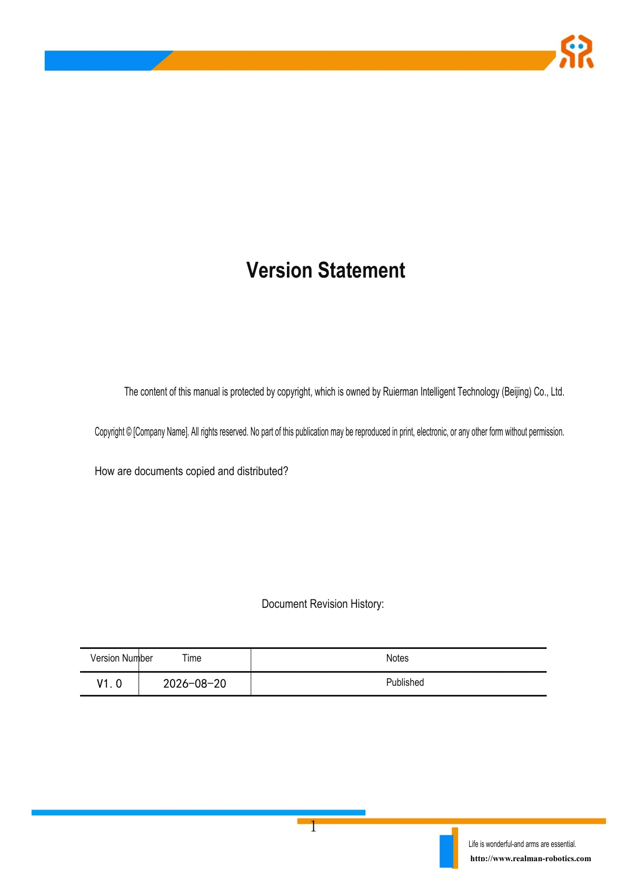




```
http://www.realman-robotics.com
1
V1.0
2026-08-20
Version Statement
The content of this manual is protected by copyright, which is owned by Ruierman Intelligent Technology (Beijing) Co., Ltd.
Copyright © [Company Name]. All rights reserved. No part of this publication may be reproduced in print, electronic, or any other form without permission.
How are documents copied and distributed?
Document Revision History:
Version Number
Time
Notes
Published
Life is wonderful­and arms are essential.
```




## PDF page 4

[RealBot-S2 user manual, original PDF page 4](https://1292444914-files.gitbook.io/~/files/v0/b/gitbook-x-prod.appspot.com/o/spaces%2FtgOfPnscWebs1eh82EKq%2Fuploads%2FwKnjht6Zu1EqJtjKVIaX%2FS2-pages-01-15.pdf?alt=media#page=4)



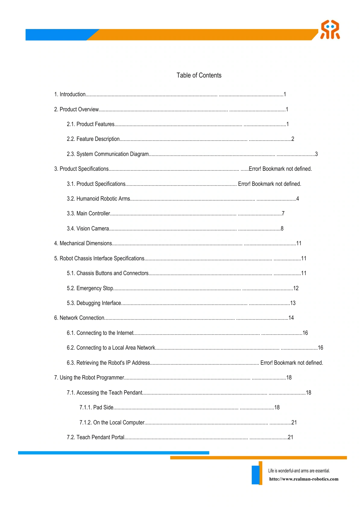




```
http://www.realman-robotics.com
Table of Contents
1. Introduction................................................................................................ ...............................................1
2. Product Overview.............................................................................................. .........................................1
2.1. Product Features............................................................................................. ...............................1
2.2. Feature Description............................................................................................. ...............................2
2.3. System Communication Diagram............................................................................................ ............................3
3. Product Specifications............................................................................................... ......Error! Bookmark not defined.
3.1. Product Specifications................................................................................. Error! Bookmark not defined.
3.2. Humanoid Robotic Arms........................................................................................... .............................4
3.3. Main Controller............................................................................................ ................................7
3.4. Vision Camera............................................................................................. ...............................8
4. Mechanical Dimensions............................................................................................... ......................................11
5. Robot Chassis Interface Specifications............................................................................................. ....................11
5.1. Chassis Buttons and Connectors.......................................................................................... ....................11
5.2. Emergency Stop............................................................................................. .....................................12
5.3. Debugging Interface............................................................................................ ..............................13
6. Network Connection............................................................................................... ......................................14
6.1. Connecting to the Internet............................................................................................ ..............................16
6.2. Connecting to a Local Area Network........................................................................................... ...........................16
6.3. Retrieving the Robot's IP Address................................................................................ Error! Bookmark not defined.
7. Using the Robot Programmer............................................................................................ .........................18
7.1. Accessing the Teach Pendant........................................................................................... ...........................18
7.1.1. Pad Side........................................................................................... .........................18
7.1.2. On the Local Computer.......................................................................................... ................21
7.2. Teach Pendant Portal.......................................................................................... ............................21
Life is wonderful­and arms are essential.
```




## PDF page 5

[RealBot-S2 user manual, original PDF page 5](https://1292444914-files.gitbook.io/~/files/v0/b/gitbook-x-prod.appspot.com/o/spaces%2FtgOfPnscWebs1eh82EKq%2Fuploads%2FwKnjht6Zu1EqJtjKVIaX%2FS2-pages-01-15.pdf?alt=media#page=5)



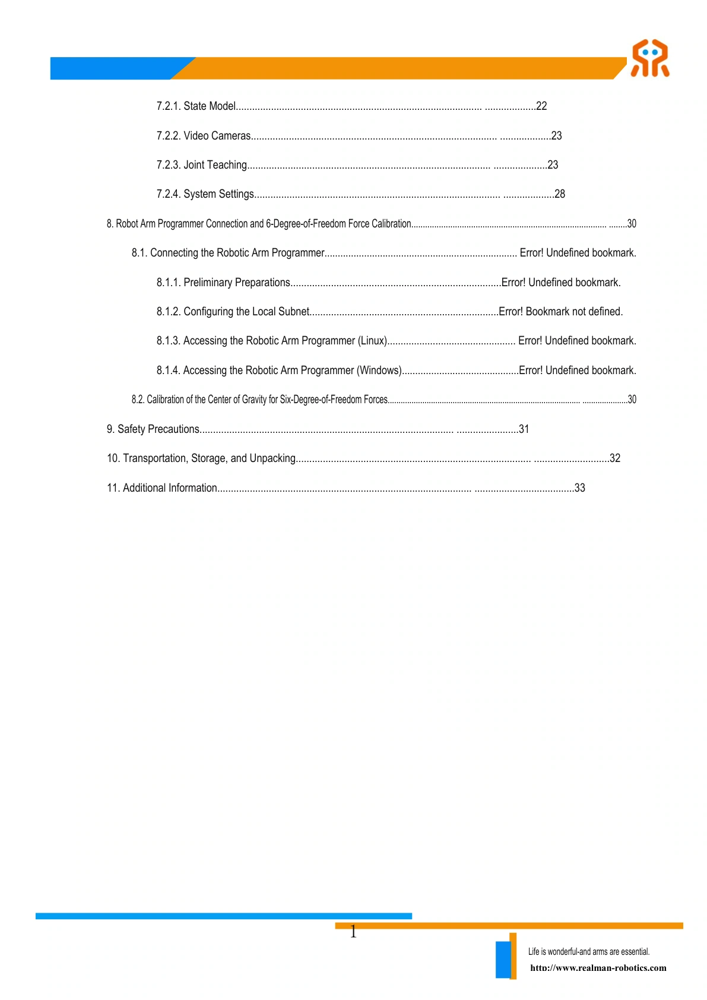




```
http://www.realman-robotics.com
1
7.2.1. State Model........................................................................................... ...................22
7.2.2. Video Cameras........................................................................................... ...................23
7.2.3. Joint Teaching.......................................................................................... ....................23
7.2.4. System Settings........................................................................................... ...................28
8. Robot Arm Programmer Connection and 6­Degree­of­Freedom Force Calibration..................................................................................... ........30
8.1. Connecting the Robotic Arm Programmer......................................................................... Error! Undefined bookmark.
8.1.1. Preliminary Preparations..............................................................................Error! Undefined bookmark.
8.1.2. Configuring the Local Subnet......................................................................Error! Bookmark not defined.
8.1.3. Accessing the Robotic Arm Programmer (Linux)................................................ Error! Undefined bookmark.
8.1.4. Accessing the Robotic Arm Programmer (Windows)............................................Error! Undefined bookmark.
8.2. Calibration of the Center of Gravity for Six­Degree­of­Freedom Forces......................................................................................... .....................30
9. Safety Precautions.............................................................................................. .......................31
10. Transportation, Storage, and Unpacking....................................................................................... ............................32
11. Additional Information.............................................................................................. .....................................33
Life is wonderful­and arms are essential.
```




## PDF page 6

[RealBot-S2 user manual, original PDF page 6](https://1292444914-files.gitbook.io/~/files/v0/b/gitbook-x-prod.appspot.com/o/spaces%2FtgOfPnscWebs1eh82EKq%2Fuploads%2FwKnjht6Zu1EqJtjKVIaX%2FS2-pages-01-15.pdf?alt=media#page=6)



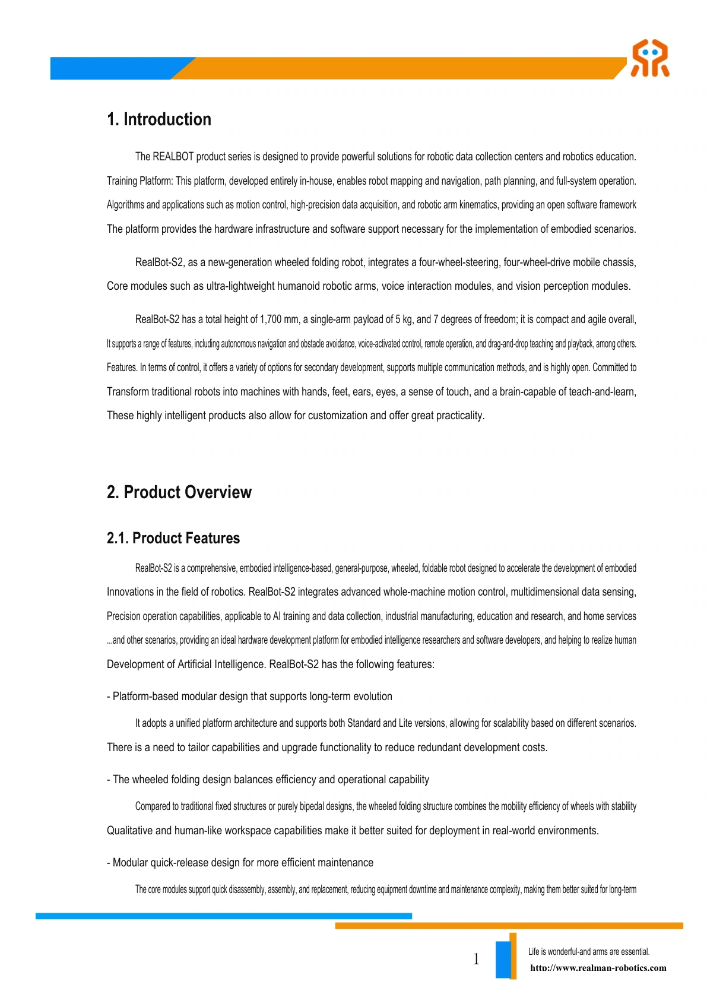




```
http://www.realman-robotics.com
1
1. Introduction
The REALBOT product series is designed to provide powerful solutions for robotic data collection centers and robotics education.
Training Platform: This platform, developed entirely in­house, enables robot mapping and navigation, path planning, and full­system operation.
Algorithms and applications such as motion control, high­precision data acquisition, and robotic arm kinematics, providing an open software framework
The platform provides the hardware infrastructure and software support necessary for the implementation of embodied scenarios.
RealBot­S2, as a new­generation wheeled folding robot, integrates a four­wheel­steering, four­wheel­drive mobile chassis,
Core modules such as ultra­lightweight humanoid robotic arms, voice interaction modules, and vision perception modules.
RealBot­S2 has a total height of 1,700 mm, a single­arm payload of 5 kg, and 7 degrees of freedom; it is compact and agile overall,
It supports a range of features, including autonomous navigation and obstacle avoidance, voice­activated control, remote operation, and drag­and­drop teaching and playback, among others.
Features. In terms of control, it offers a variety of options for secondary development, supports multiple communication methods, and is highly open. Committed to
Transform traditional robots into machines with hands, feet, ears, eyes, a sense of touch, and a brain­capable of teach­and­learn,
These highly intelligent products also allow for customization and offer great practicality.
2. Product Overview
2.1. Product Features
RealBot­S2 is a comprehensive, embodied intelligence­based, general­purpose, wheeled, foldable robot designed to accelerate the development of embodied
Innovations in the field of robotics. RealBot­S2 integrates advanced whole­machine motion control, multidimensional data sensing,
Precision operation capabilities, applicable to AI training and data collection, industrial manufacturing, education and research, and home services
...and other scenarios, providing an ideal hardware development platform for embodied intelligence researchers and software developers, and helping to realize human
Development of Artificial Intelligence. RealBot­S2 has the following features:
­ Platform­based modular design that supports long­term evolution
It adopts a unified platform architecture and supports both Standard and Lite versions, allowing for scalability based on different scenarios.
There is a need to tailor capabilities and upgrade functionality to reduce redundant development costs.
­ The wheeled folding design balances efficiency and operational capability
Compared to traditional fixed structures or purely bipedal designs, the wheeled folding structure combines the mobility efficiency of wheels with stability
Qualitative and human­like workspace capabilities make it better suited for deployment in real­world environments.
­ Modular quick­release design for more efficient maintenance
The core modules support quick disassembly, assembly, and replacement, reducing equipment downtime and maintenance complexity, making them better suited for long­term
Life is wonderful­and arms are essential.
```




## PDF page 7

[RealBot-S2 user manual, original PDF page 7](https://1292444914-files.gitbook.io/~/files/v0/b/gitbook-x-prod.appspot.com/o/spaces%2FtgOfPnscWebs1eh82EKq%2Fuploads%2FwKnjht6Zu1EqJtjKVIaX%2FS2-pages-01-15.pdf?alt=media#page=7)



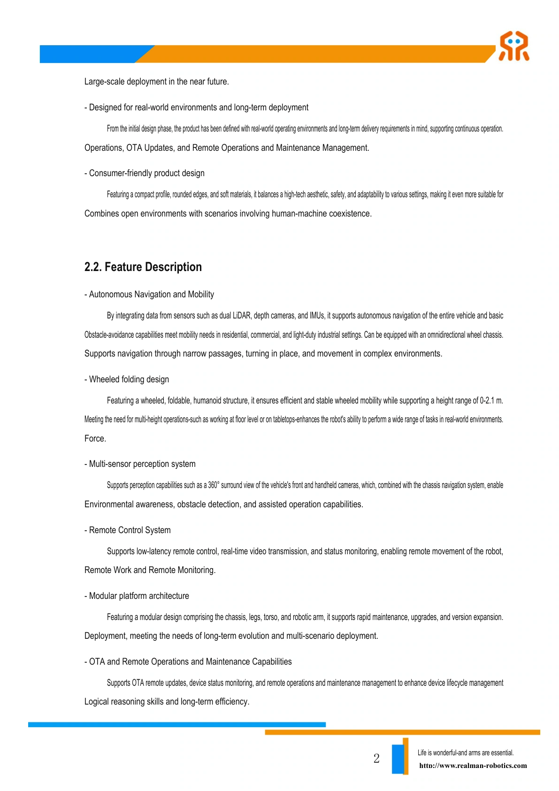




```
http://www.realman-robotics.com
2
Large­scale deployment in the near future.
­ Designed for real­world environments and long­term deployment
From the initial design phase, the product has been defined with real­world operating environments and long­term delivery requirements in mind, supporting continuous operation.
Operations, OTA Updates, and Remote Operations and Maintenance Management.
­ Consumer­friendly product design
Featuring a compact profile, rounded edges, and soft materials, it balances a high­tech aesthetic, safety, and adaptability to various settings, making it even more suitable for
Combines open environments with scenarios involving human­machine coexistence.
2.2. Feature Description
­ Autonomous Navigation and Mobility
By integrating data from sensors such as dual LiDAR, depth cameras, and IMUs, it supports autonomous navigation of the entire vehicle and basic
Obstacle­avoidance capabilities meet mobility needs in residential, commercial, and light­duty industrial settings. Can be equipped with an omnidirectional wheel chassis.
Supports navigation through narrow passages, turning in place, and movement in complex environments.
­ Wheeled folding design
Featuring a wheeled, foldable, humanoid structure, it ensures efficient and stable wheeled mobility while supporting a height range of 0­2.1 m.
Meeting the need for multi­height operations­such as working at floor level or on tabletops­enhances the robot's ability to perform a wide range of tasks in real­world environments.
Force.
­ Multi­sensor perception system
Supports perception capabilities such as a 360° surround view of the vehicle's front and handheld cameras, which, combined with the chassis navigation system, enable
Environmental awareness, obstacle detection, and assisted operation capabilities.
­ Remote Control System
Supports low­latency remote control, real­time video transmission, and status monitoring, enabling remote movement of the robot,
Remote Work and Remote Monitoring.
­ Modular platform architecture
Featuring a modular design comprising the chassis, legs, torso, and robotic arm, it supports rapid maintenance, upgrades, and version expansion.
Deployment, meeting the needs of long­term evolution and multi­scenario deployment.
­ OTA and Remote Operations and Maintenance Capabilities
Supports OTA remote updates, device status monitoring, and remote operations and maintenance management to enhance device lifecycle management
Logical reasoning skills and long­term efficiency.
Life is wonderful­and arms are essential.
```




## PDF page 8

[RealBot-S2 user manual, original PDF page 8](https://1292444914-files.gitbook.io/~/files/v0/b/gitbook-x-prod.appspot.com/o/spaces%2FtgOfPnscWebs1eh82EKq%2Fuploads%2FwKnjht6Zu1EqJtjKVIaX%2FS2-pages-01-15.pdf?alt=media#page=8)



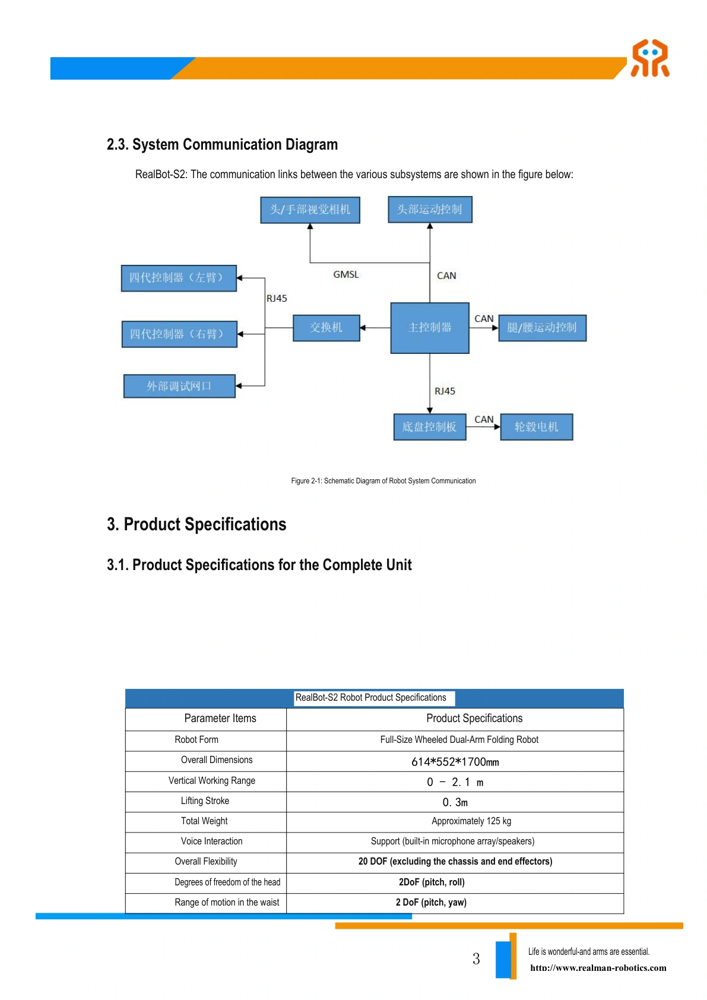




```
http://www.realman-robotics.com
3
614*552*1700mm
0 - 2.1 m
0.3m
2.3. System Communication Diagram
RealBot­S2: The communication links between the various subsystems are shown in the figure below:
Figure 2­1: Schematic Diagram of Robot System Communication
3. Product Specifications
3.1. Product Specifications for the Complete Unit
RealBot­S2 Robot Product Specifications
Parameter Items
Product Specifications
Robot Form
Full­Size Wheeled Dual­Arm Folding Robot
Overall Dimensions
Vertical Working Range
Lifting Stroke
Total Weight
Approximately 125 kg
Voice Interaction
Support (built­in microphone array/speakers)
Overall Flexibility
20 DOF (excluding the chassis and end effectors)
Degrees of freedom of the head
2DoF (pitch, roll)
Range of motion in the waist
2 DoF (pitch, yaw)
Life is wonderful­and arms are essential.
```




## PDF page 9

[RealBot-S2 user manual, original PDF page 9](https://1292444914-files.gitbook.io/~/files/v0/b/gitbook-x-prod.appspot.com/o/spaces%2FtgOfPnscWebs1eh82EKq%2Fuploads%2FwKnjht6Zu1EqJtjKVIaX%2FS2-pages-01-15.pdf?alt=media#page=9)



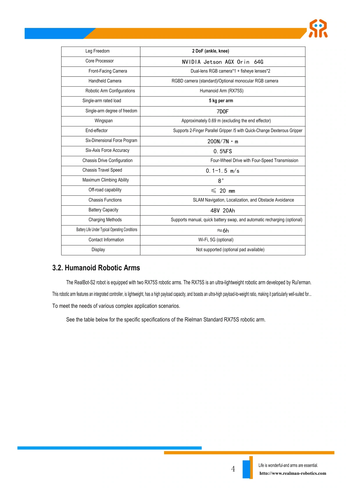




```
http://www.realman-robotics.com
4
NVIDIA Jetson AGX Orin 64G
7DOF
200N/7N·m
0.5%FS
0.1-1.5 m/s
8°
≤20 mm
48V 20Ah
≈6h
Leg Freedom
2 DoF (ankle, knee)
Core Processor
Front­Facing Camera
Dual­lens RGB camera*1 + fisheye lenses*2
Handheld Camera
RGBD camera (standard)/Optional monocular RGB camera
Robotic Arm Configurations
Humanoid Arm (RX75S)
Single­arm rated load
5 kg per arm
Single­arm degree of freedom
Wingspan
Approximately 0.69 m (excluding the end effector)
End­effector
Supports 2­Finger Parallel Gripper /5 with Quick­Change Dexterous Gripper
Six­Dimensional Force Program
Six­Axis Force Accuracy
Chassis Drive Configuration
Four­Wheel Drive with Four­Speed Transmission
Chassis Travel Speed
Maximum Climbing Ability
Off­road capability
Chassis Functions
SLAM Navigation, Localization, and Obstacle Avoidance
Battery Capacity
Charging Methods
Supports manual, quick battery swap, and automatic recharging (optional)
Battery Life Under Typical Operating Conditions
Contact Information
Wi­Fi, 5G (optional)
Display
Not supported (optional pad available)
3.2. Humanoid Robotic Arms
The RealBot­S2 robot is equipped with two RX75S robotic arms. The RX75S is an ultra­lightweight robotic arm developed by Rui'erman.
This robotic arm features an integrated controller, is lightweight, has a high payload capacity, and boasts an ultra­high payload­to­weight ratio, making it particularly well­suited for...
To meet the needs of various complex application scenarios.
See the table below for the specific specifications of the Rielman Standard RX75S robotic arm.
Life is wonderful­and arms are essential.
```




## PDF page 10

[RealBot-S2 user manual, original PDF page 10](https://1292444914-files.gitbook.io/~/files/v0/b/gitbook-x-prod.appspot.com/o/spaces%2FtgOfPnscWebs1eh82EKq%2Fuploads%2FwKnjht6Zu1EqJtjKVIaX%2FS2-pages-01-15.pdf?alt=media#page=10)



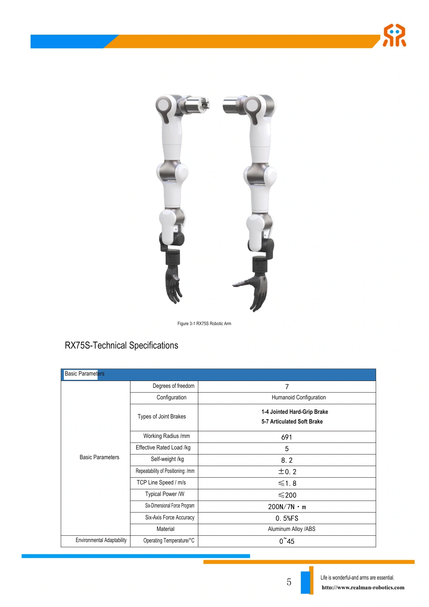




```
http://www.realman-robotics.com
5
7
691
5
8.2
±0.2
≤1.8
≤200
200N/7N·m
0.5%FS
0~45
Figure 3­1 RX75S Robotic Arm
RX75S­Technical Specifications
Basic Parameters
Degrees of freedom
Configuration
Humanoid Configuration
1­4 Jointed Hard­Grip Brake
Types of Joint Brakes
5­7 Articulated Soft Brake
Working Radius /mm
Effective Rated Load /kg
Basic Parameters
Self­weight /kg
Repeatability of Positioning: /mm
TCP Line Speed / m/s
Typical Power /W
Six­Dimensional Force Program
Six­Axis Force Accuracy
Material
Aluminum Alloy /ABS
Environmental Adaptability
Operating Temperature/°C
Life is wonderful­and arms are essential.
```




## PDF page 11

[RealBot-S2 user manual, original PDF page 11](https://1292444914-files.gitbook.io/~/files/v0/b/gitbook-x-prod.appspot.com/o/spaces%2FtgOfPnscWebs1eh82EKq%2Fuploads%2FwKnjht6Zu1EqJtjKVIaX%2FS2-pages-01-15.pdf?alt=media#page=11)



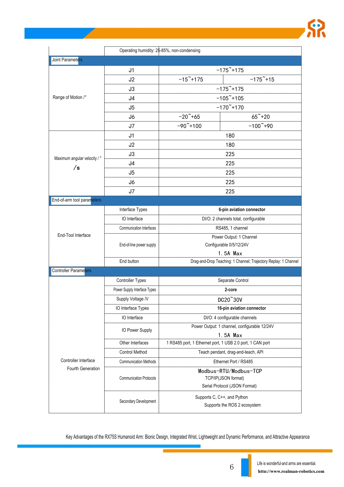




```
http://www.realman-robotics.com
6
J1
-175~+175
J2
-15~+175
-175~+15
J3
-175~+175
J4
-105~+105
J5
-170~+170
J6
-20~+65
65~+20
J7
-90~+100
-100~+90
/s
J1
180
J2
180
J3
225
J4
225
J5
225
J6
225
J7
225
1.5A Max
DC20~30V
1.5A Max
Modbus-RTU/Modbus-TCP
Operating humidity: 25­85%, non­condensing
Joint Parameters
Range of Motion /°
Maximum angular velocity / °
End­of­arm tool parameters
Interface Types
6­pin aviation connector
IO Interface
DI/O: 2 channels total, configurable
Communication Interfaces
RS485, 1 channel
End­Tool Interface
Power Output: 1 Channel
End­of­line power supply
Configurable 0/5/12/24V
End button
Drag­and­Drop Teaching: 1 Channel; Trajectory Replay: 1 Channel
Controller Parameters
Controller Types
Separate Control
Power Supply Interface Types
2­core
Supply Voltage /V
IO Interface Types
16­pin aviation connector
IO Interface
DI/O: 4 configurable channels
Power Output: 1 channel, configurable 12/24V
IO Power Supply
Other Interfaces
1 RS485 port, 1 Ethernet port, 1 USB 2.0 port, 1 CAN port
Control Method
Teach pendant, drag­and­teach, API
Controller Interface
Communication Methods
Ethernet Port / RS485
Fourth Generation
Communication Protocols
TCP/IP(JSON format)
Serial Protocol (JSON Format)
Supports C, C++, and Python
Secondary Development
Supports the ROS 2 ecosystem
Key Advantages of the RX75S Humanoid Arm: Bionic Design, Integrated Wrist, Lightweight and Dynamic Performance, and Attractive Appearance
Life is wonderful­and arms are essential.
```




## PDF page 12

[RealBot-S2 user manual, original PDF page 12](https://1292444914-files.gitbook.io/~/files/v0/b/gitbook-x-prod.appspot.com/o/spaces%2FtgOfPnscWebs1eh82EKq%2Fuploads%2FwKnjht6Zu1EqJtjKVIaX%2FS2-pages-01-15.pdf?alt=media#page=12)



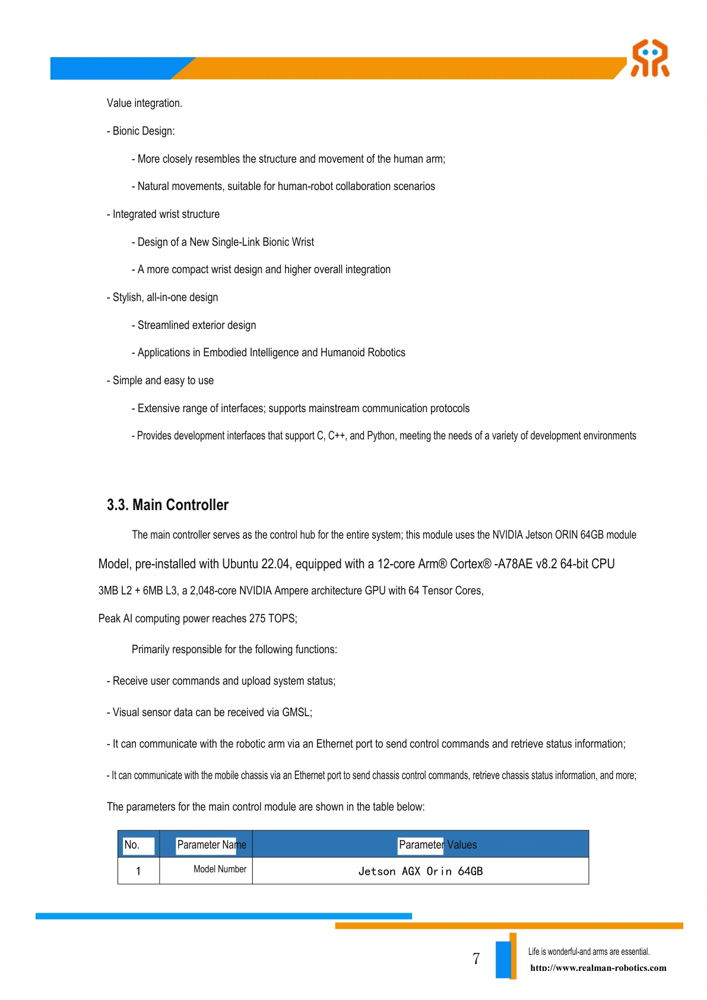




```
http://www.realman-robotics.com
7
1
Jetson AGX Orin 64GB
Value integration.
­ Bionic Design:
­ More closely resembles the structure and movement of the human arm;
­ Natural movements, suitable for human­robot collaboration scenarios
­ Integrated wrist structure
­ Design of a New Single­Link Bionic Wrist
­ A more compact wrist design and higher overall integration
­ Stylish, all­in­one design
­ Streamlined exterior design
­ Applications in Embodied Intelligence and Humanoid Robotics
­ Simple and easy to use
­ Extensive range of interfaces; supports mainstream communication protocols
­ Provides development interfaces that support C, C++, and Python, meeting the needs of a variety of development environments
3.3. Main Controller
The main controller serves as the control hub for the entire system; this module uses the NVIDIA Jetson ORIN 64GB module
Model, pre­installed with Ubuntu 22.04, equipped with a 12­core Arm® Cortex® ­A78AE v8.2 64­bit CPU
3MB L2 + 6MB L3, a 2,048­core NVIDIA Ampere architecture GPU with 64 Tensor Cores,
Peak AI computing power reaches 275 TOPS;
Primarily responsible for the following functions:
­ Receive user commands and upload system status;
­ Visual sensor data can be received via GMSL;
­ It can communicate with the robotic arm via an Ethernet port to send control commands and retrieve status information;
­ It can communicate with the mobile chassis via an Ethernet port to send chassis control commands, retrieve chassis status information, and more;
The parameters for the main control module are shown in the table below:
No.
Parameter Name
Parameter Values
Model Number
Life is wonderful­and arms are essential.
```




## PDF page 13

[RealBot-S2 user manual, original PDF page 13](https://1292444914-files.gitbook.io/~/files/v0/b/gitbook-x-prod.appspot.com/o/spaces%2FtgOfPnscWebs1eh82EKq%2Fuploads%2FwKnjht6Zu1EqJtjKVIaX%2FS2-pages-01-15.pdf?alt=media#page=13)



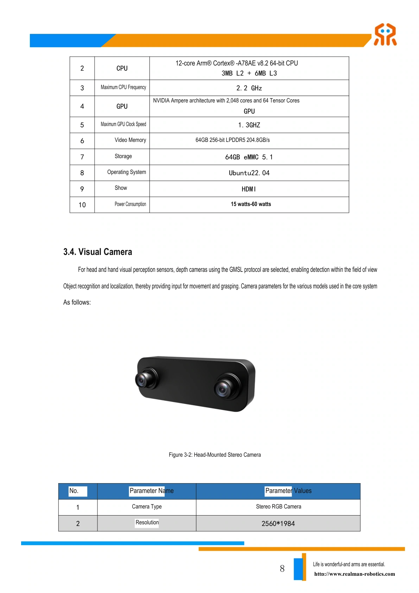




```
http://www.realman-robotics.com
8
2
CPU
3MB L2 + 6MB L3
3
2.2 GHz
4
GPU
GPU
5
1.3GHZ
6
7
64GB eMMC 5.1
8
Ubuntu22.04
9
HDMI
10
1
2
2560*1984
12­core Arm® Cortex® ­A78AE v8.2 64­bit CPU
Maximum CPU Frequency
NVIDIA Ampere architecture with 2,048 cores and 64 Tensor Cores
Maximum GPU Clock Speed
Video Memory
64GB 256­bit LPDDR5 204.8GB/s
Storage
Operating System
Show
Power Consumption
15 watts­60 watts
3.4. Visual Camera
For head and hand visual perception sensors, depth cameras using the GMSL protocol are selected, enabling detection within the field of view
Object recognition and localization, thereby providing input for movement and grasping. Camera parameters for the various models used in the core system
As follows:
Figure 3­2: Head­Mounted Stereo Camera
No.
Parameter Name
Parameter Values
Camera Type
Stereo RGB Camera
Resolution
Life is wonderful­and arms are essential.
```




## PDF page 14

[RealBot-S2 user manual, original PDF page 14](https://1292444914-files.gitbook.io/~/files/v0/b/gitbook-x-prod.appspot.com/o/spaces%2FtgOfPnscWebs1eh82EKq%2Fuploads%2FwKnjht6Zu1EqJtjKVIaX%2FS2-pages-01-15.pdf?alt=media#page=14)



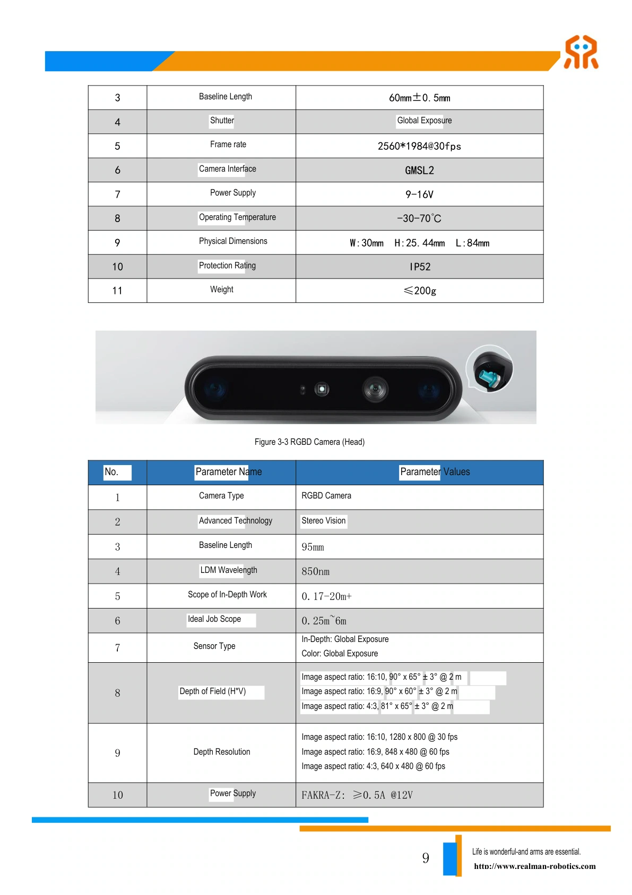




```
http://www.realman-robotics.com
9
3
60mm±0.5mm
4
5
2560*1984@30fps
6
GMSL2
7
9-16V
8
-30-70℃
9
W:30mm
H:25.44mm
L:84mm
10
IP52
11
≤200g
1
2
3
95mm
4
850nm
5
0.17-20m+
6
0.25m~6m
7
8
9
10
FAKRA-Z: ≥0.5A @12V
Baseline Length
Shutter
Global Exposure
Frame rate
Camera Interface
Power Supply
Operating Temperature
Physical Dimensions
Protection Rating
Weight
Figure 3­3 RGBD Camera (Head)
No.
Parameter Name
Parameter Values
Camera Type
RGBD Camera
Advanced Technology
Stereo Vision
Baseline Length
LDM Wavelength
Scope of In­Depth Work
Ideal Job Scope
In­Depth: Global Exposure
Sensor Type
Color: Global Exposure
Image aspect ratio: 16:10, 90° x 65° ± 3° @ 2 m
Depth of Field (H*V)
Image aspect ratio: 16:9, 90° x 60° ± 3° @ 2 m
Image aspect ratio: 4:3, 81° x 65° ± 3° @ 2 m
Image aspect ratio: 16:10, 1280 x 800 @ 30 fps
Depth Resolution
Image aspect ratio: 16:9, 848 x 480 @ 60 fps
Image aspect ratio: 4:3, 640 x 480 @ 60 fps
Power Supply
Life is wonderful­and arms are essential.
```




## PDF page 15

[RealBot-S2 user manual, original PDF page 15](https://1292444914-files.gitbook.io/~/files/v0/b/gitbook-x-prod.appspot.com/o/spaces%2FtgOfPnscWebs1eh82EKq%2Fuploads%2FwKnjht6Zu1EqJtjKVIaX%2FS2-pages-01-15.pdf?alt=media#page=15)



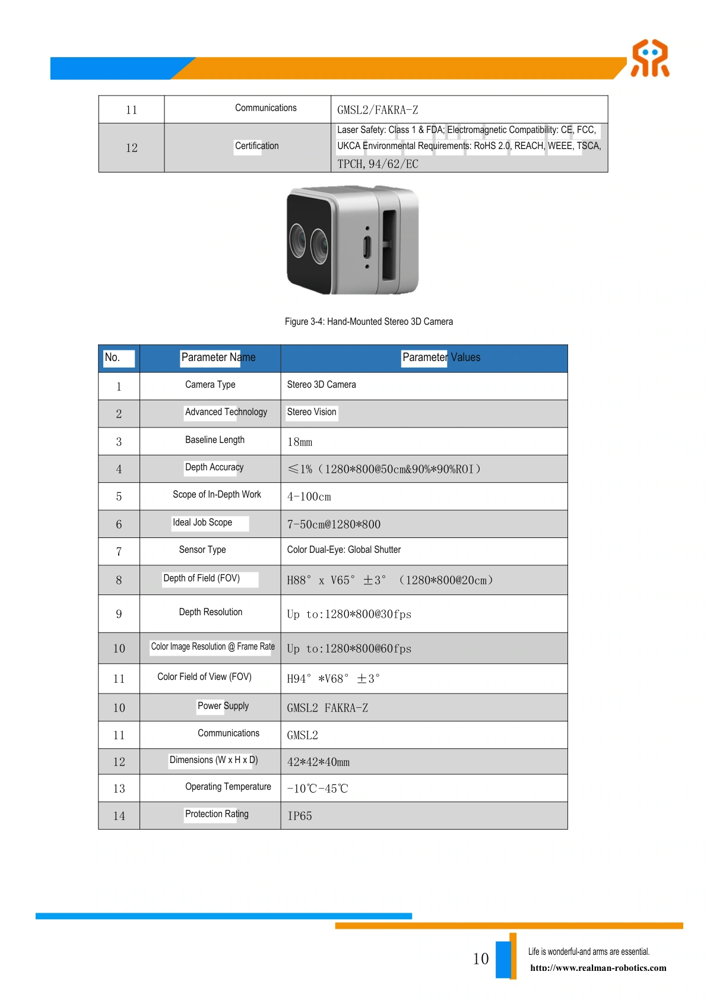




```
http://www.realman-robotics.com
10
11
GMSL2/FAKRA-Z
12
TPCH,94/62/EC
1
2
3
18mm
4
≤1%（1280*800@50cm&90%*90%ROI）
5
4-100cm
6
7-50cm@1280*800
7
8
H88°x V65°±3°（1280*800@20cm）
9
Up to:1280*800@30fps
10
Up to:1280*800@60fps
11
H94°*V68°±3°
10
GMSL2 FAKRA-Z
11
GMSL2
12
42*42*40mm
13
-10℃-45℃
14
IP65
Communications
Laser Safety: Class 1 & FDA; Electromagnetic Compatibility: CE, FCC,
Certification
UKCA Environmental Requirements: RoHS 2.0, REACH, WEEE, TSCA,
Figure 3­4: Hand­Mounted Stereo 3D Camera
No.
Parameter Name
Parameter Values
Camera Type
Stereo 3D Camera
Advanced Technology
Stereo Vision
Baseline Length
Depth Accuracy
Scope of In­Depth Work
Ideal Job Scope
Sensor Type
Color Dual­Eye: Global Shutter
Depth of Field (FOV)
Depth Resolution
Color Image Resolution @ Frame Rate
Color Field of View (FOV)
Power Supply
Communications
Dimensions (W x H x D)
Operating Temperature
Protection Rating
Life is wonderful­and arms are essential.
```




## PDF page 16

[RealBot-S2 user manual, original PDF page 16](https://1292444914-files.gitbook.io/~/files/v0/b/gitbook-x-prod.appspot.com/o/spaces%2FtgOfPnscWebs1eh82EKq%2Fuploads%2FABXE6AEUUbwgTxijrRkS%2FS2-pages-16-18.pdf?alt=media#page=1)



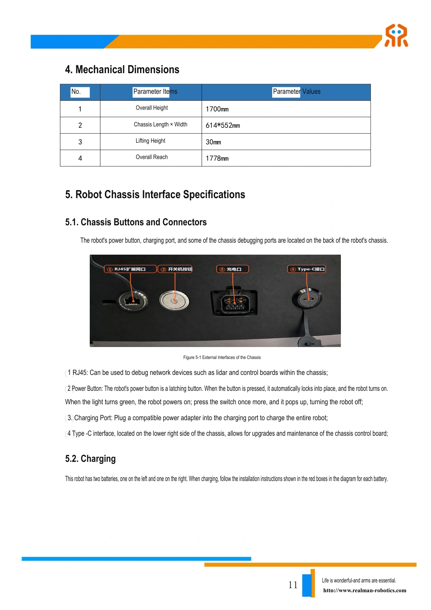




```
http://www.realman-robotics.com
11
1
1700mm
2
614*552mm
3
30mm
4
1778mm
4. Mechanical Dimensions
No.
Parameter Items
Parameter Values
Overall Height
Chassis Length × Width
Lifting Height
Overall Reach
5. Robot Chassis Interface Specifications
5.1. Chassis Buttons and Connectors
The robot's power button, charging port, and some of the chassis debugging ports are located on the back of the robot's chassis.
Figure 5­1 External Interfaces of the Chassis
1 RJ45: Can be used to debug network devices such as lidar and control boards within the chassis;
2 Power Button: The robot's power button is a latching button. When the button is pressed, it automatically locks into place, and the robot turns on.
When the light turns green, the robot powers on; press the switch once more, and it pops up, turning the robot off;
3. Charging Port: Plug a compatible power adapter into the charging port to charge the entire robot;
4 Type ­C interface, located on the lower right side of the chassis, allows for upgrades and maintenance of the chassis control board;
5.2. Charging
This robot has two batteries, one on the left and one on the right. When charging, follow the installation instructions shown in the red boxes in the diagram for each battery.
Life is wonderful­and arms are essential.
```




## PDF page 17

[RealBot-S2 user manual, original PDF page 17](https://1292444914-files.gitbook.io/~/files/v0/b/gitbook-x-prod.appspot.com/o/spaces%2FtgOfPnscWebs1eh82EKq%2Fuploads%2FABXE6AEUUbwgTxijrRkS%2FS2-pages-16-18.pdf?alt=media#page=2)



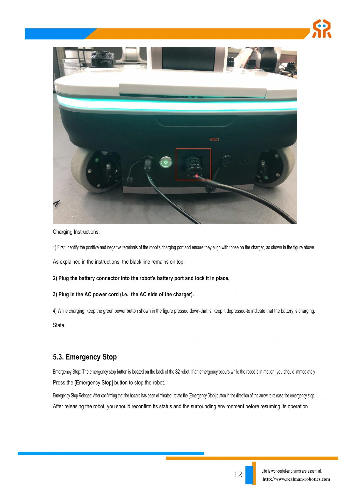




```
http://www.realman-robotics.com
12
Charging Instructions:
1) First, identify the positive and negative terminals of the robot's charging port and ensure they align with those on the charger, as shown in the figure above.
As explained in the instructions, the black line remains on top;
2) Plug the battery connector into the robot's battery port and lock it in place,
3) Plug in the AC power cord (i.e., the AC side of the charger).
4) While charging, keep the green power button shown in the figure pressed down­that is, keep it depressed­to indicate that the battery is charging.
State.
5.3. Emergency Stop
Emergency Stop: The emergency stop button is located on the back of the S2 robot. If an emergency occurs while the robot is in motion, you should immediately
Press the [Emergency Stop] button to stop the robot.
Emergency Stop Release: After confirming that the hazard has been eliminated, rotate the [Emergency Stop] button in the direction of the arrow to release the emergency stop.
After releasing the robot, you should reconfirm its status and the surrounding environment before resuming its operation.
Life is wonderful­and arms are essential.
```




## PDF page 18

[RealBot-S2 user manual, original PDF page 18](https://1292444914-files.gitbook.io/~/files/v0/b/gitbook-x-prod.appspot.com/o/spaces%2FtgOfPnscWebs1eh82EKq%2Fuploads%2FABXE6AEUUbwgTxijrRkS%2FS2-pages-16-18.pdf?alt=media#page=3)



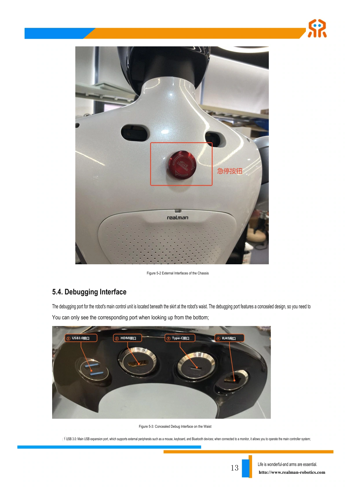




```
http://www.realman-robotics.com
13
Figure 5­2 External Interfaces of the Chassis
5.4. Debugging Interface
The debugging port for the robot's main control unit is located beneath the skirt at the robot's waist. The debugging port features a concealed design, so you need to
You can only see the corresponding port when looking up from the bottom;
Figure 5­3: Concealed Debug Interface on the Waist
1 USB 3.0: Main USB expansion port, which supports external peripherals such as a mouse, keyboard, and Bluetooth devices; when connected to a monitor, it allows you to operate the main controller system;
Life is wonderful­and arms are essential.
```




## PDF page 19

[RealBot-S2 user manual, original PDF page 19](https://1292444914-files.gitbook.io/~/files/v0/b/gitbook-x-prod.appspot.com/o/spaces%2FtgOfPnscWebs1eh82EKq%2Fuploads%2FuJgQ6vWfIUPv4rc4NsRv%2FS2-pages-19-21.pdf?alt=media#page=1)



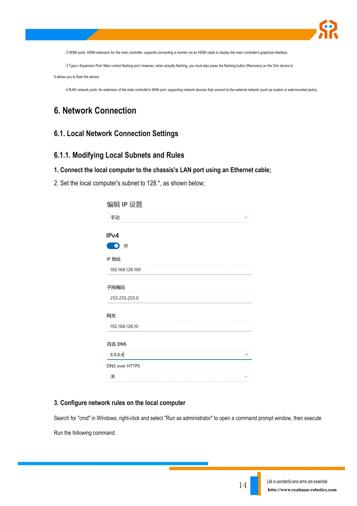




```
http://www.realman-robotics.com
14
2 HDMI ports: HDMI extension for the main controller; supports connecting a monitor via an HDMI cable to display the main controller's graphical interface;
3 Type­c Expansion Port: Main control flashing port; however, when actually flashing, you must also press the flashing button (Recovery) on the Orin device to
It allows you to flash the device.
4 RJ45 network ports: An extension of the main controller's WAN port, supporting network devices that connect to the external network (such as routers or wall­mounted jacks);
6. Network Connection
6.1. Local Network Connection Settings
6.1.1. Modifying Local Subnets and Rules
1. Connect the local computer to the chassis's LAN port using an Ethernet cable;
2. Set the local computer's subnet to 128.*, as shown below;
3. Configure network rules on the local computer
Search for "cmd" in Windows, right­click and select "Run as administrator" to open a command prompt window, then execute
Run the following command.
Life is wonderful­and arms are essential.
```




## PDF page 20

[RealBot-S2 user manual, original PDF page 20](https://1292444914-files.gitbook.io/~/files/v0/b/gitbook-x-prod.appspot.com/o/spaces%2FtgOfPnscWebs1eh82EKq%2Fuploads%2FuJgQ6vWfIUPv4rc4NsRv%2FS2-pages-19-21.pdf?alt=media#page=2)



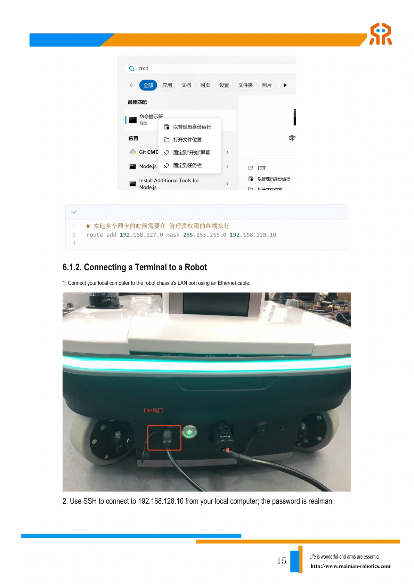




```
http://www.realman-robotics.com
15
6.1.2. Connecting a Terminal to a Robot
1. Connect your local computer to the robot chassis's LAN port using an Ethernet cable.
2. Use SSH to connect to 192.168.128.10 from your local computer; the password is realman.
Life is wonderful­and arms are essential.
```




## PDF page 21

[RealBot-S2 user manual, original PDF page 21](https://1292444914-files.gitbook.io/~/files/v0/b/gitbook-x-prod.appspot.com/o/spaces%2FtgOfPnscWebs1eh82EKq%2Fuploads%2FuJgQ6vWfIUPv4rc4NsRv%2FS2-pages-19-21.pdf?alt=media#page=3)



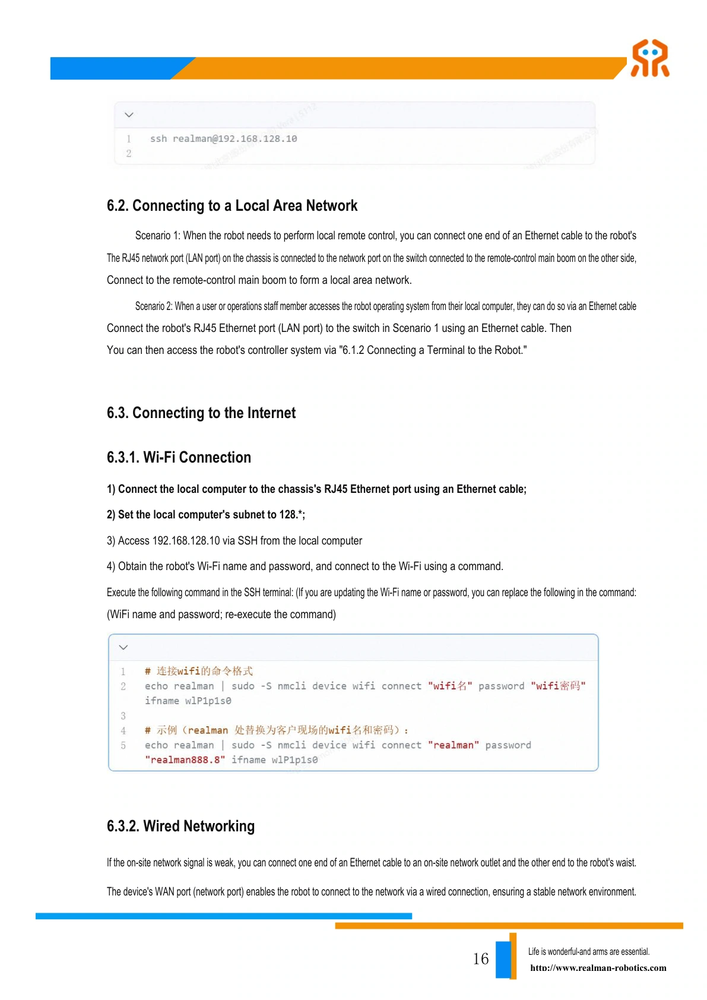




```
http://www.realman-robotics.com
16
6.2. Connecting to a Local Area Network
Scenario 1: When the robot needs to perform local remote control, you can connect one end of an Ethernet cable to the robot's
The RJ45 network port (LAN port) on the chassis is connected to the network port on the switch connected to the remote­control main boom on the other side,
Connect to the remote­control main boom to form a local area network.
Scenario 2: When a user or operations staff member accesses the robot operating system from their local computer, they can do so via an Ethernet cable
Connect the robot's RJ45 Ethernet port (LAN port) to the switch in Scenario 1 using an Ethernet cable. Then
You can then access the robot's controller system via "6.1.2 Connecting a Terminal to the Robot."
6.3. Connecting to the Internet
6.3.1. Wi­Fi Connection
1) Connect the local computer to the chassis's RJ45 Ethernet port using an Ethernet cable;
2) Set the local computer's subnet to 128.*;
3) Access 192.168.128.10 via SSH from the local computer
4) Obtain the robot's Wi­Fi name and password, and connect to the Wi­Fi using a command.
Execute the following command in the SSH terminal: (If you are updating the Wi­Fi name or password, you can replace the following in the command:
(WiFi name and password; re­execute the command)
6.3.2. Wired Networking
If the on­site network signal is weak, you can connect one end of an Ethernet cable to an on­site network outlet and the other end to the robot's waist.
The device's WAN port (network port) enables the robot to connect to the network via a wired connection, ensuring a stable network environment.
Life is wonderful­and arms are essential.
```




## PDF page 22

[RealBot-S2 user manual, original PDF page 22](https://1292444914-files.gitbook.io/~/files/v0/b/gitbook-x-prod.appspot.com/o/spaces%2FtgOfPnscWebs1eh82EKq%2Fuploads%2FjyHeuRL0FK28JiN3kRaj%2FS2-pages-22-24.pdf?alt=media#page=1)



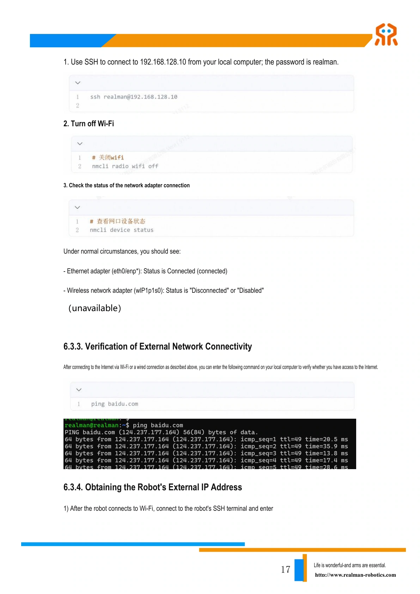




```
http://www.realman-robotics.com
17
（unavailable）
1. Use SSH to connect to 192.168.128.10 from your local computer; the password is realman.
2. Turn off Wi­Fi
3. Check the status of the network adapter connection
Under normal circumstances, you should see:
­ Ethernet adapter (eth0/enp*): Status is Connected (connected)
­ Wireless network adapter (wlP1p1s0): Status is "Disconnected" or "Disabled"
6.3.3. Verification of External Network Connectivity
After connecting to the Internet via Wi­Fi or a wired connection as described above, you can enter the following command on your local computer to verify whether you have access to the Internet.
6.3.4. Obtaining the Robot's External IP Address
1) After the robot connects to Wi­Fi, connect to the robot's SSH terminal and enter
Life is wonderful­and arms are essential.
```




## PDF page 23

[RealBot-S2 user manual, original PDF page 23](https://1292444914-files.gitbook.io/~/files/v0/b/gitbook-x-prod.appspot.com/o/spaces%2FtgOfPnscWebs1eh82EKq%2Fuploads%2FjyHeuRL0FK28JiN3kRaj%2FS2-pages-22-24.pdf?alt=media#page=2)



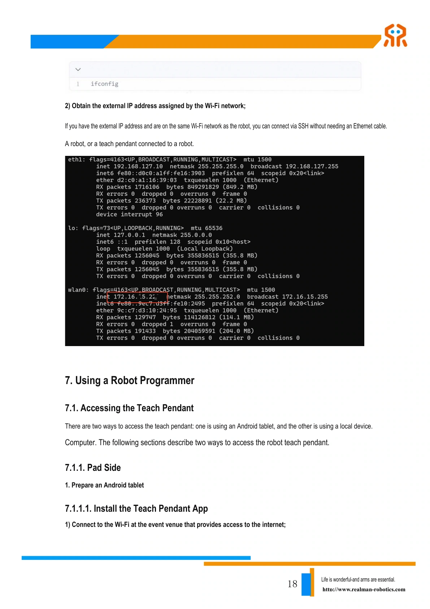




```
http://www.realman-robotics.com
18
2) Obtain the external IP address assigned by the Wi­Fi network;
If you have the external IP address and are on the same Wi­Fi network as the robot, you can connect via SSH without needing an Ethernet cable.
A robot, or a teach pendant connected to a robot.
7. Using a Robot Programmer
7.1. Accessing the Teach Pendant
There are two ways to access the teach pendant: one is using an Android tablet, and the other is using a local device.
Computer. The following sections describe two ways to access the robot teach pendant.
7.1.1. Pad Side
1. Prepare an Android tablet
7.1.1.1. Install the Teach Pendant App
1) Connect to the Wi­Fi at the event venue that provides access to the internet;
Life is wonderful­and arms are essential.
```




## PDF page 24

[RealBot-S2 user manual, original PDF page 24](https://1292444914-files.gitbook.io/~/files/v0/b/gitbook-x-prod.appspot.com/o/spaces%2FtgOfPnscWebs1eh82EKq%2Fuploads%2FjyHeuRL0FK28JiN3kRaj%2FS2-pages-22-24.pdf?alt=media#page=3)








```
http://www.realman-robotics.com
19
2) Using the address bar in your tablet's browser, go to [Teach Pendant]
The latest version of the [APP](HTTP://47.93.156.69/GLN_TELEOP/MAGELLAN­LATEST.APK).
After entering this download link in your browser and pressing Enter, the prompt shown in the image below will appear. Click the [Install] button to complete the process.
Install the Android app for the robot teach pendant (as shown below).
Figure 7­1: Teaching Pendant Download Interface
Life is wonderful­and arms are essential.
```




## PDF page 25

[RealBot-S2 user manual, original PDF page 25](https://1292444914-files.gitbook.io/~/files/v0/b/gitbook-x-prod.appspot.com/o/spaces%2FtgOfPnscWebs1eh82EKq%2Fuploads%2F7cqdvmFAwCh9SJtJQYWx%2FS2-pages-25-28.pdf?alt=media#page=1)








```
http://www.realman-robotics.com
20
Figure 7­2 App Download Complete
3) Once installation is complete, tap the "Robot Teach Pendant" icon shown below on the Pad home screen to open it.
The robot teach pendant's initial screen.
Figure 7­3 App Icon
7.1.1.2. Connecting the Teach Pendant App to the Robot
Life is wonderful­and arms are essential.
```




## PDF page 26

[RealBot-S2 user manual, original PDF page 26](https://1292444914-files.gitbook.io/~/files/v0/b/gitbook-x-prod.appspot.com/o/spaces%2FtgOfPnscWebs1eh82EKq%2Fuploads%2F7cqdvmFAwCh9SJtJQYWx%2FS2-pages-25-28.pdf?alt=media#page=2)



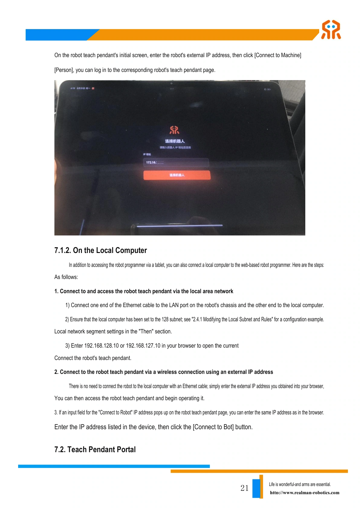




```
http://www.realman-robotics.com
21
On the robot teach pendant's initial screen, enter the robot's external IP address, then click [Connect to Machine]
[Person], you can log in to the corresponding robot's teach pendant page.
7.1.2. On the Local Computer
In addition to accessing the robot programmer via a tablet, you can also connect a local computer to the web­based robot programmer. Here are the steps:
As follows:
1. Connect to and access the robot teach pendant via the local area network
1) Connect one end of the Ethernet cable to the LAN port on the robot's chassis and the other end to the local computer.
2) Ensure that the local computer has been set to the 128 subnet; see "2.4.1 Modifying the Local Subnet and Rules" for a configuration example.
Local network segment settings in the "Then" section.
3) Enter 192.168.128.10 or 192.168.127.10 in your browser to open the current
Connect the robot's teach pendant.
2. Connect to the robot teach pendant via a wireless connection using an external IP address
There is no need to connect the robot to the local computer with an Ethernet cable; simply enter the external IP address you obtained into your browser,
You can then access the robot teach pendant and begin operating it.
3. If an input field for the "Connect to Robot" IP address pops up on the robot teach pendant page, you can enter the same IP address as in the browser.
Enter the IP address listed in the device, then click the [Connect to Bot] button.
7.2. Teach Pendant Portal
Life is wonderful­and arms are essential.
```




## PDF page 27

[RealBot-S2 user manual, original PDF page 27](https://1292444914-files.gitbook.io/~/files/v0/b/gitbook-x-prod.appspot.com/o/spaces%2FtgOfPnscWebs1eh82EKq%2Fuploads%2F7cqdvmFAwCh9SJtJQYWx%2FS2-pages-25-28.pdf?alt=media#page=3)



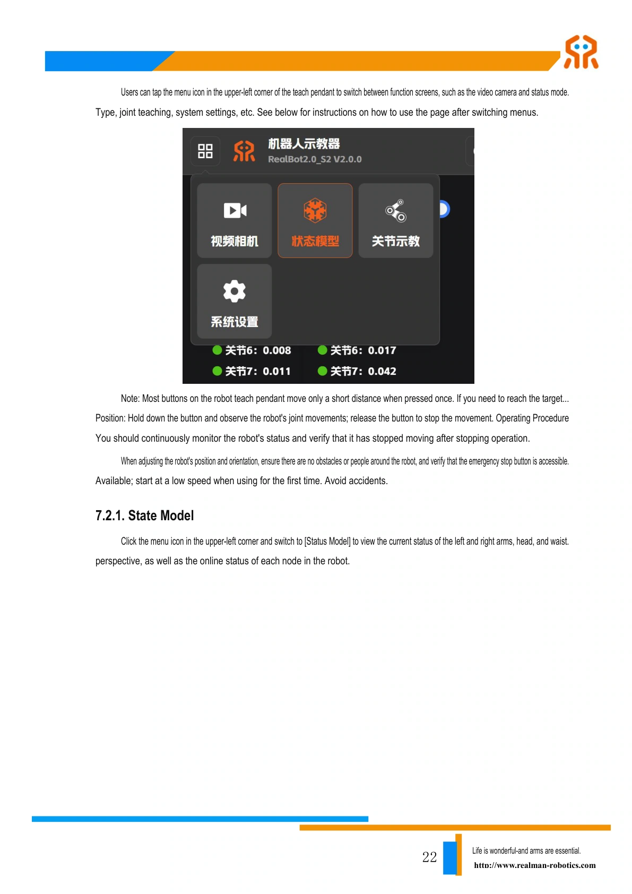




```
http://www.realman-robotics.com
22
Users can tap the menu icon in the upper­left corner of the teach pendant to switch between function screens, such as the video camera and status mode.
Type, joint teaching, system settings, etc. See below for instructions on how to use the page after switching menus.
Note: Most buttons on the robot teach pendant move only a short distance when pressed once. If you need to reach the target...
Position: Hold down the button and observe the robot's joint movements; release the button to stop the movement. Operating Procedure
You should continuously monitor the robot's status and verify that it has stopped moving after stopping operation.
When adjusting the robot's position and orientation, ensure there are no obstacles or people around the robot, and verify that the emergency stop button is accessible.
Available; start at a low speed when using for the first time. Avoid accidents.
7.2.1. State Model
Click the menu icon in the upper­left corner and switch to [Status Model] to view the current status of the left and right arms, head, and waist.
perspective, as well as the online status of each node in the robot.
Life is wonderful­and arms are essential.
```




## PDF page 28

[RealBot-S2 user manual, original PDF page 28](https://1292444914-files.gitbook.io/~/files/v0/b/gitbook-x-prod.appspot.com/o/spaces%2FtgOfPnscWebs1eh82EKq%2Fuploads%2F7cqdvmFAwCh9SJtJQYWx%2FS2-pages-25-28.pdf?alt=media#page=4)



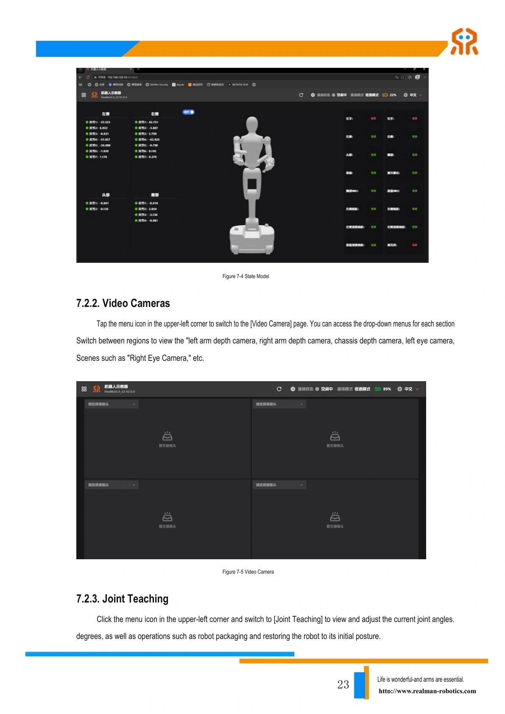




```
http://www.realman-robotics.com
23
Figure 7­4 State Model
7.2.2. Video Cameras
Tap the menu icon in the upper­left corner to switch to the [Video Camera] page. You can access the drop­down menus for each section
Switch between regions to view the "left arm depth camera, right arm depth camera, chassis depth camera, left eye camera,
Scenes such as "Right Eye Camera," etc.
Figure 7­5 Video Camera
7.2.3. Joint Teaching
Click the menu icon in the upper­left corner and switch to [Joint Teaching] to view and adjust the current joint angles.
degrees, as well as operations such as robot packaging and restoring the robot to its initial posture.
Life is wonderful­and arms are essential.
```




## PDF page 29

[RealBot-S2 user manual, original PDF page 29](https://1292444914-files.gitbook.io/~/files/v0/b/gitbook-x-prod.appspot.com/o/spaces%2FtgOfPnscWebs1eh82EKq%2Fuploads%2FyKq2qyOvNg6IIX7sZ1Sd%2FS2-pages-29-31.pdf?alt=media#page=1)



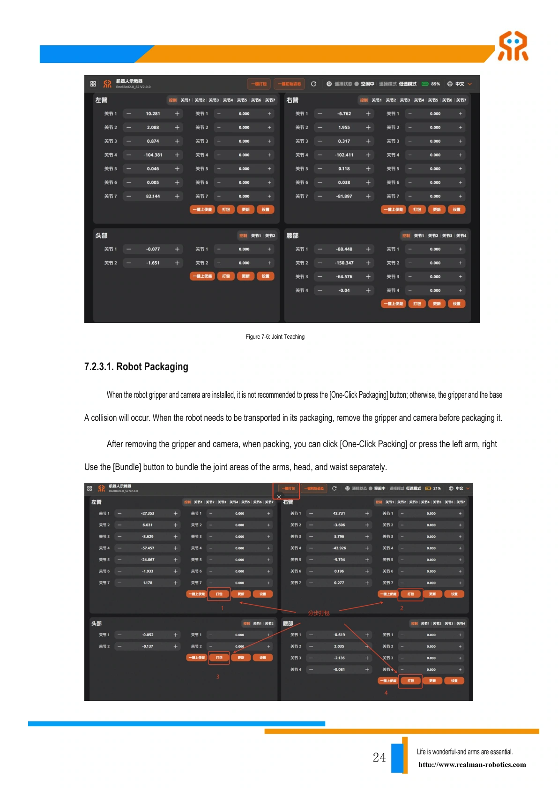




```
http://www.realman-robotics.com
24
Figure 7­6: Joint Teaching
7.2.3.1. Robot Packaging
When the robot gripper and camera are installed, it is not recommended to press the [One­Click Packaging] button; otherwise, the gripper and the base
A collision will occur. When the robot needs to be transported in its packaging, remove the gripper and camera before packaging it.
After removing the gripper and camera, when packing, you can click [One­Click Packing] or press the left arm, right
Use the [Bundle] button to bundle the joint areas of the arms, head, and waist separately.
Life is wonderful­and arms are essential.
```




## PDF page 30

[RealBot-S2 user manual, original PDF page 30](https://1292444914-files.gitbook.io/~/files/v0/b/gitbook-x-prod.appspot.com/o/spaces%2FtgOfPnscWebs1eh82EKq%2Fuploads%2FyKq2qyOvNg6IIX7sZ1Sd%2FS2-pages-29-31.pdf?alt=media#page=2)



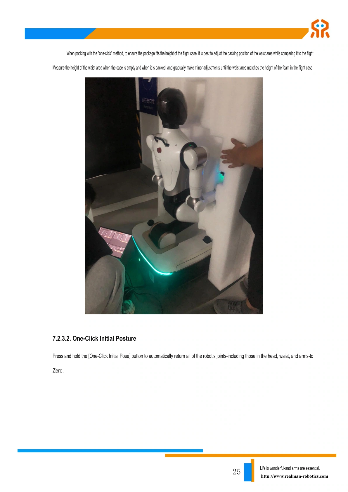




```
http://www.realman-robotics.com
25
When packing with the "one­click" method, to ensure the package fits the height of the flight case, it is best to adjust the packing position of the waist area while comparing it to the flight
Measure the height of the waist area when the case is empty and when it is packed, and gradually make minor adjustments until the waist area matches the height of the foam in the flight case.
7.2.3.2. One­Click Initial Posture
Press and hold the [One­Click Initial Pose] button to automatically return all of the robot's joints­including those in the head, waist, and arms­to
Zero.
Life is wonderful­and arms are essential.
```




## PDF page 31

[RealBot-S2 user manual, original PDF page 31](https://1292444914-files.gitbook.io/~/files/v0/b/gitbook-x-prod.appspot.com/o/spaces%2FtgOfPnscWebs1eh82EKq%2Fuploads%2FyKq2qyOvNg6IIX7sZ1Sd%2FS2-pages-29-31.pdf?alt=media#page=3)



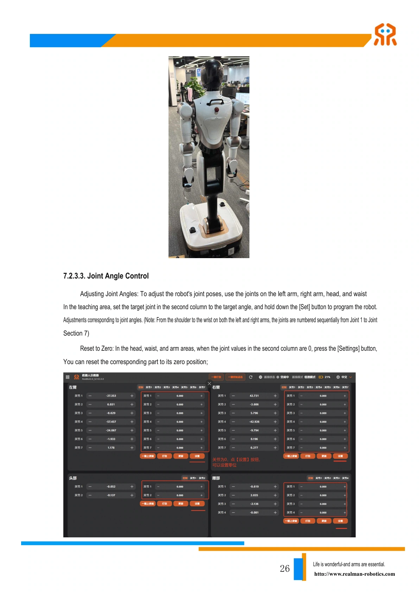




```
http://www.realman-robotics.com
26
7.2.3.3. Joint Angle Control
Adjusting Joint Angles: To adjust the robot's joint poses, use the joints on the left arm, right arm, head, and waist
In the teaching area, set the target joint in the second column to the target angle, and hold down the [Set] button to program the robot.
Adjustments corresponding to joint angles. (Note: From the shoulder to the wrist on both the left and right arms, the joints are numbered sequentially from Joint 1 to Joint
Section 7)
Reset to Zero: In the head, waist, and arm areas, when the joint values in the second column are 0, press the [Settings] button,
You can reset the corresponding part to its zero position;
Life is wonderful­and arms are essential.
```




## PDF page 32

[RealBot-S2 user manual, original PDF page 32](https://1292444914-files.gitbook.io/~/files/v0/b/gitbook-x-prod.appspot.com/o/spaces%2FtgOfPnscWebs1eh82EKq%2Fuploads%2Flz8jrt8gv3WTeBRxlidu%2FS2-pages-32-35.pdf?alt=media#page=1)



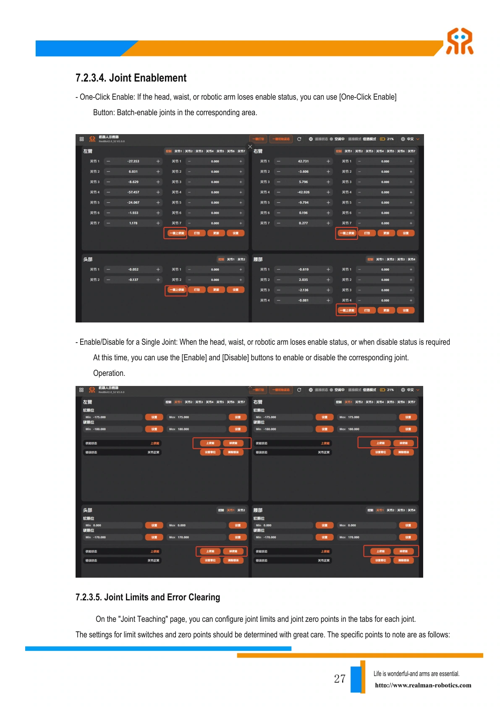




```
http://www.realman-robotics.com
27
7.2.3.4. Joint Enablement
­ One­Click Enable: If the head, waist, or robotic arm loses enable status, you can use [One­Click Enable]
Button: Batch­enable joints in the corresponding area.
­ Enable/Disable for a Single Joint: When the head, waist, or robotic arm loses enable status, or when disable status is required
At this time, you can use the [Enable] and [Disable] buttons to enable or disable the corresponding joint.
Operation.
7.2.3.5. Joint Limits and Error Clearing
On the "Joint Teaching" page, you can configure joint limits and joint zero points in the tabs for each joint.
The settings for limit switches and zero points should be determined with great care. The specific points to note are as follows:
Life is wonderful­and arms are essential.
```




## PDF page 33

[RealBot-S2 user manual, original PDF page 33](https://1292444914-files.gitbook.io/~/files/v0/b/gitbook-x-prod.appspot.com/o/spaces%2FtgOfPnscWebs1eh82EKq%2Fuploads%2Flz8jrt8gv3WTeBRxlidu%2FS2-pages-32-35.pdf?alt=media#page=2)



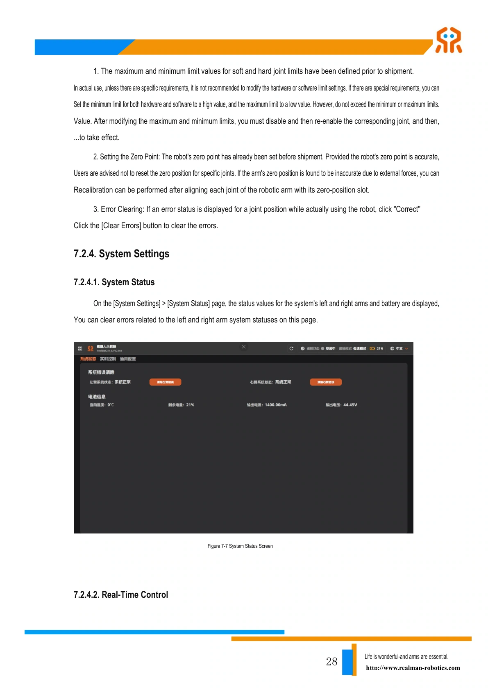




```
http://www.realman-robotics.com
28
1. The maximum and minimum limit values for soft and hard joint limits have been defined prior to shipment.
In actual use, unless there are specific requirements, it is not recommended to modify the hardware or software limit settings. If there are special requirements, you can
Set the minimum limit for both hardware and software to a high value, and the maximum limit to a low value. However, do not exceed the minimum or maximum limits.
Value. After modifying the maximum and minimum limits, you must disable and then re­enable the corresponding joint, and then,
...to take effect.
2. Setting the Zero Point: The robot's zero point has already been set before shipment. Provided the robot's zero point is accurate,
Users are advised not to reset the zero position for specific joints. If the arm's zero position is found to be inaccurate due to external forces, you can
Recalibration can be performed after aligning each joint of the robotic arm with its zero­position slot.
3. Error Clearing: If an error status is displayed for a joint position while actually using the robot, click "Correct"
Click the [Clear Errors] button to clear the errors.
7.2.4. System Settings
7.2.4.1. System Status
On the [System Settings] > [System Status] page, the status values for the system's left and right arms and battery are displayed,
You can clear errors related to the left and right arm system statuses on this page.
Figure 7­7 System Status Screen
7.2.4.2. Real­Time Control
Life is wonderful­and arms are essential.
```




## PDF page 34

[RealBot-S2 user manual, original PDF page 34](https://1292444914-files.gitbook.io/~/files/v0/b/gitbook-x-prod.appspot.com/o/spaces%2FtgOfPnscWebs1eh82EKq%2Fuploads%2Flz8jrt8gv3WTeBRxlidu%2FS2-pages-32-35.pdf?alt=media#page=3)



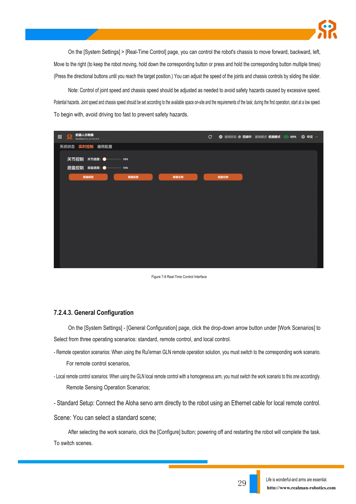




```
http://www.realman-robotics.com
29
On the [System Settings] > [Real­Time Control] page, you can control the robot's chassis to move forward, backward, left,
Move to the right (to keep the robot moving, hold down the corresponding button or press and hold the corresponding button multiple times)
(Press the directional buttons until you reach the target position.) You can adjust the speed of the joints and chassis controls by sliding the slider.
Note: Control of joint speed and chassis speed should be adjusted as needed to avoid safety hazards caused by excessive speed.
Potential hazards. Joint speed and chassis speed should be set according to the available space on­site and the requirements of the task; during the first operation, start at a low speed.
To begin with, avoid driving too fast to prevent safety hazards.
Figure 7­8 Real­Time Control Interface
7.2.4.3. General Configuration
On the [System Settings] ­ [General Configuration] page, click the drop­down arrow button under [Work Scenarios] to
Select from three operating scenarios: standard, remote control, and local control.
­ Remote operation scenarios: When using the Rui'erman GLN remote operation solution, you must switch to the corresponding work scenario.
For remote control scenarios,
­ Local remote control scenarios: When using the GLN local remote control with a homogeneous arm, you must switch the work scenario to this one accordingly.
Remote Sensing Operation Scenarios;
­ Standard Setup: Connect the Aloha servo arm directly to the robot using an Ethernet cable for local remote control.
Scene: You can select a standard scene;
After selecting the work scenario, click the [Configure] button; powering off and restarting the robot will complete the task.
To switch scenes.
Life is wonderful­and arms are essential.
```




## PDF page 35

[RealBot-S2 user manual, original PDF page 35](https://1292444914-files.gitbook.io/~/files/v0/b/gitbook-x-prod.appspot.com/o/spaces%2FtgOfPnscWebs1eh82EKq%2Fuploads%2Flz8jrt8gv3WTeBRxlidu%2FS2-pages-32-35.pdf?alt=media#page=4)








```
http://www.realman-robotics.com
30
192.168.127.19；
Figure 7­9 General Configuration Interface
8. Robot Arm Programmer Connection and Six­Degree­of­Freedom Force Calibration
In the following two situations, the six­degree­of­freedom center of mass of the robotic arm must be recalibrated at the customer's site.
Scenario 1: Since the robot's gripper is removed for shipping, the sensors on the arm may be touched during transport.
After installing the robot's gripper on­site, the six­degree­of­freedom center of gravity of the robotic arm may not be accurate;
Scenario 2: After replacing a payload (such as a gripper or camera) at the customer's site, the robot arm's six­degree­of­freedom force must be recalibrated.
Center of gravity.
8.1. Connecting the Robotic Arm Programmer
1. Connect the LAN port on the robot's chassis to the client computer using an Ethernet cable.
2. Make sure you have already completed the steps in "6.1.1 Modifying Local Subnets and Rules";
3. We recommend setting your browser to Incognito mode or clearing your browser cache before accessing the robotic arm teach pendant script.
The device's cache.
4. Use a web browser to access the IP address of the robotic arm; the left arm's IP address is 192.168.127.18, and the right arm's IP address is
8.2. Calibration of the Center of Gravity for Six­Axis Forces
Provided there are no obstacles or people within the reach of the robotic arm, at
Perform the following operations using the teach pendants on the left and right arms.
Life is wonderful­and arms are essential.
```




## PDF page 36

[RealBot-S2 user manual, original PDF page 36](https://1292444914-files.gitbook.io/~/files/v0/b/gitbook-x-prod.appspot.com/o/spaces%2FtgOfPnscWebs1eh82EKq%2Fuploads%2F3agUDOApEgobkSEpEOnz%2FS2-pages-36-38.pdf?alt=media#page=1)



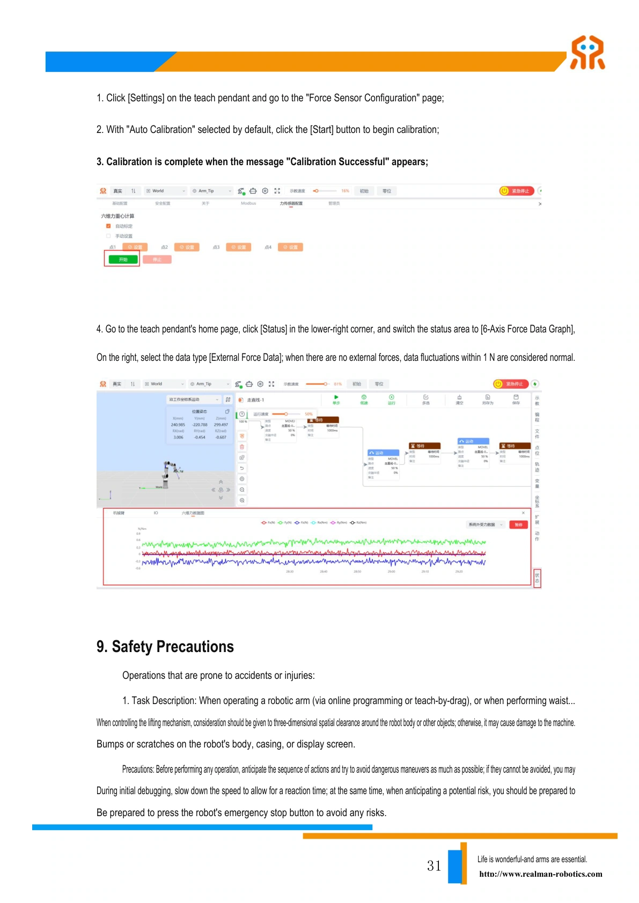




```
http://www.realman-robotics.com
31
1. Click [Settings] on the teach pendant and go to the "Force Sensor Configuration" page;
2. With "Auto Calibration" selected by default, click the [Start] button to begin calibration;
3. Calibration is complete when the message "Calibration Successful" appears;
4. Go to the teach pendant's home page, click [Status] in the lower­right corner, and switch the status area to [6­Axis Force Data Graph],
On the right, select the data type [External Force Data]; when there are no external forces, data fluctuations within 1 N are considered normal.
9. Safety Precautions
Operations that are prone to accidents or injuries:
1. Task Description: When operating a robotic arm (via online programming or teach­by­drag), or when performing waist...
When controlling the lifting mechanism, consideration should be given to three­dimensional spatial clearance around the robot body or other objects; otherwise, it may cause damage to the machine.
Bumps or scratches on the robot's body, casing, or display screen.
Precautions: Before performing any operation, anticipate the sequence of actions and try to avoid dangerous maneuvers as much as possible; if they cannot be avoided, you may
During initial debugging, slow down the speed to allow for a reaction time; at the same time, when anticipating a potential risk, you should be prepared to
Be prepared to press the robot's emergency stop button to avoid any risks.
Life is wonderful­and arms are essential.
```




## PDF page 37

[RealBot-S2 user manual, original PDF page 37](https://1292444914-files.gitbook.io/~/files/v0/b/gitbook-x-prod.appspot.com/o/spaces%2FtgOfPnscWebs1eh82EKq%2Fuploads%2F3agUDOApEgobkSEpEOnz%2FS2-pages-36-38.pdf?alt=media#page=2)








```
http://www.realman-robotics.com
32
2. Procedure Description: When using a two­finger gripper or a five­finger dexterous hand to grasp an object, ensure a secure grip,
At the same time, be careful not to exceed the load capacity of the robotic arm, gripper, or five­fingered manipulator. Additionally, since the RX75S robotic
5­axis, 6­axis, and 7­axis robotic arms do not have brakes; when power is cut off to the robotic arm (when the base runs out of power or the emergency stop button is pressed), the 5­axis
Since the 6­axis and 7­axis systems move when subjected to external forces, appropriate measures should be taken after a power outage to prevent accidents.
Countermeasures: Follow the equipment requirements when gripping a load, and in the event of a deliberate or unexpected power outage, ensure that the end­of­arm load is
Take appropriate measures to prevent accidents caused by the movement of 5­axis, 6­axis, and 7­axis robotic arms under external forces.
Note: The RX75S series robots have 5 to 7 joints without mechanical brakes.
10. Transportation, Storage, and Unpacking
The following describes the steps for packing and shipping; to unpack, simply follow these steps in reverse order.
Step 1: Remove the Five­Finger Gripper or Two­Finger Gripper, the camera, and the mount, and pack them separately.
Step 2: During transport, the robot uses drag­and­teach to adjust its posture to the packing posture, while simultaneously positioning both arms
Park the vehicle in the lowest position to minimize the impact on the motor during transport.
Step 3: Completely wrap the robot in packing foam. Note: When moving the robot by hand,
Be sure to lift the chassis' sheet metal housing; do not lift the robot's arms or outer casing, to avoid damaging the robot's internal components.
Life is wonderful­and arms are essential.
```




## PDF page 38

[RealBot-S2 user manual, original PDF page 38](https://1292444914-files.gitbook.io/~/files/v0/b/gitbook-x-prod.appspot.com/o/spaces%2FtgOfPnscWebs1eh82EKq%2Fuploads%2F3agUDOApEgobkSEpEOnz%2FS2-pages-36-38.pdf?alt=media#page=3)



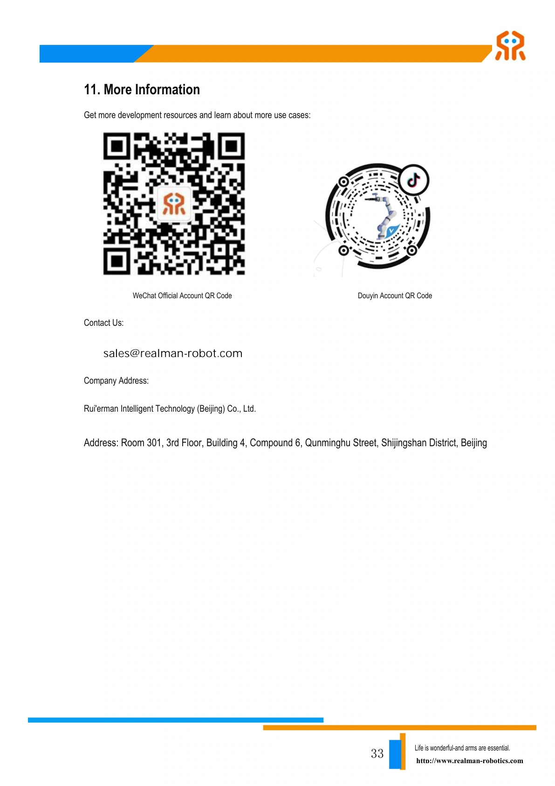




```
http://www.realman-robotics.com
33
sales@realman-robot.com
11. More Information
Get more development resources and learn about more use cases:
WeChat Official Account QR Code
Douyin Account QR Code
Contact Us:
Company Address:
Rui'erman Intelligent Technology (Beijing) Co., Ltd.
Address: Room 301, 3rd Floor, Building 4, Compound 6, Qunminghu Street, Shijingshan District, Beijing
Life is wonderful­and arms are essential.
```



