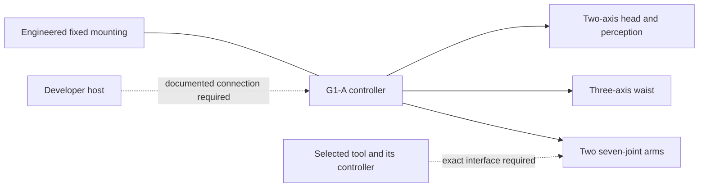

# Unitree G1-A: Fixed-Base Dual-Arm Robot Integration Guide


**Unitree G1-A Standard — manufacturer reference.** An exact OpenELAB product URL, SKU and package option have not been established for this fixed-base system. The [official G1-A / G1-D comparison](https://www.unitree.com/G1-D/) identifies the configuration covered here.


## Product overview 

Unitree G1-A Standard is a fixed-base, dual-arm upper-body robot: two seven-joint arms, a three-axis waist and a two-axis head. Its published 19 degrees of freedom exclude the end effector. It is a separate configuration from the legged G1 Standard/EDU robot and from both G1-D chassis versions. A similar torso does not establish the same mounting, power input, motor map or controller behavior. [Official configuration and parameter comparison](https://www.unitree.com/G1-D/)

The manufacturer describes shared G1 architecture and reuse of model capabilities across configurations. Treat that as a platform-design claim; exact runtime, kinematics and interfaces still need configuration-specific verification. [P](https://www.unitree.com/G1-D/)

The G1-A is intended for a stationary manipulation station. The G1-D Standard instead adds a lifting column on a manual-move chassis; G1-D Flagship adds powered chassis motion. This guide covers the fixed G1-A only. The G1D U1–U10 store listings are assigned to the G1-D guide and do not establish a G1-A purchasing option. [P](https://www.unitree.com/G1-D/)

[View Unitree's G1-A fixed-base product illustration](https://www.unitree.com/images/dad69ece50de4f8683c84478a4834b25_494x1146.png?x-oss-process=image/format,webp). This manufacturer illustration identifies the configuration; it is not a mounting drawing or connector pinout.

## Applications 

The manufacturer positions the family for embodied-AI research, education, manipulation evaluation, commercial assistance and handling tasks. For G1-A, useful engineering projects include a stationary perception-to-grasp pipeline, dual-arm coordination and evaluating different grippers or hands. Treat these as application directions, with task-specific tooling, guarding and validation still required. The commercial and home-service illustrations do not establish unattended operation around people or a certified collaborative workspace. Some demonstrated functions remain under development. [P](https://www.unitree.com/G1-D/)

A fixed station simplifies the world-to-base relationship, but moving the table or changing the mount invalidates that assumption. Record the base pose, tool frame, payload and camera calibration with each dataset. This is integration guidance, not a manufacturer-supplied calibration procedure.

## Specifications 

| Parameter                                | G1-A Standard, as currently published                                  | Integration implication                                                                 |
| ---------------------------------------- | ---------------------------------------------------------------------- | --------------------------------------------------------------------------------------- |
| Overall dimensions                       | 635 × 450 × 200 mm                                                     | Published envelope, not an arm-sweep boundary or bolt pattern                           |
| Weight, table labeled with battery       | Approximately 22 kg                                                    | Mount and handling design also need reaction forces and accessory mass                  |
| Total DoF excluding end effector         | 19                                                                     | 14 arm + 3 waist + 2 head                                                               |
| Arm DoF                                  | 7 per arm                                                              | Tool joints are additional                                                              |
| Waist motion                             | Z ±150°, Y ±29.79°, X ±29.79°                                          | Published ranges, not validated software limits for a custom controller                 |
| Column / powered chassis DoF             | Not listed for G1-A                                                    | No lift or drive commissioning procedure applies                                        |
| Maximum arm payload                      | Approximately 3 kg per arm                                             | Manufacturer says payload varies greatly with extension posture                         |
| End effectors                            | Optional two-finger gripper, three-finger hand or five-finger hand     | No included tool or per-tool performance is established by this list                    |
| Base compute                             | Eight-core high-performance CPU                                        | CPU model, RAM and installed image are not specified                                    |
| Optional compute                         | Orin NX optional                                                       | Do not assume fitted module, memory or delivered software                               |
| Vision                                   | Binocular camera and chest wide-angle camera                           | Streaming endpoints, intrinsics, timing and extrinsics remain unit-specific             |
| Audio                                    | Six-microphone array; two 10 W speakers                                | Not a calibrated sound-source localization contract                                     |
| Wireless                                 | Wi-Fi 6, Bluetooth 5.2                                                 | Wireless features do not identify the developer Ethernet port or DDS domain             |
| Battery                                  | Quick-release upper-body battery, 9 Ah                                 | Voltage, matching charger output and wiring are not given here                          |
| Endurance                                | Approximately 2 h; page also advertises charger-powered 24/7 operation | Load-dependent claim; not a verified continuous-duty or unattended charging instruction |
| Controller / OTA / secondary development | Listed as supported                                                    | Exact remote, firmware and update/recovery steps need their own documentation           |
| Warranty summary                         | 12 months                                                              | Refer to applicable Unitree terms and the purchase agreement for exclusions and service |

Source: the current official G1-A column and family footnotes, accessed November 24, 2026. The product page is undated and says configuration, appearance and availability of demonstrated functions can vary. [P](https://www.unitree.com/G1-D/)

## Hardware and connections 

### Mounting and physical workspace 

Plan for the swept volume of both arms, head and all waist axes, including a held object and any cabling. The torso's published size does not describe that volume. The page does not supply bolt locations, engagement depth, fastener torque, fixture stiffness, allowable base moment or a lifting procedure. Obtain the exact G1-A mounting drawing and load information before choosing a table, adapter or lifting fixture. Do not infer a hole pattern from the illustration. [P](https://www.unitree.com/G1-D/)

A fixed base does not remove the hazard from gravity-loaded arms or a released tool. As an integration prerequisite, establish the approved mechanical support, tool-retention and energy-isolation arrangements before power or a change of controller ownership. Neither a laptop connection nor a software process is a physical restraint.

### Power, tools and perception are separate interfaces 

The 9 Ah entry is capacity, not supply voltage. The source does not establish a DC input range, inrush current, polarity, protective earth, connector orientation, accessory output or charger identity. Do not apply the G1 biped's battery/charger ratings to G1-A. Use only the supplied, identified power system and obtain its exact instructions before energizing or charging. The charger-powered endurance claim alone does not authorize an external bench supply or a live pack exchange. [P](https://www.unitree.com/G1-D/)

Optional hands require a matching mechanical interface, electrical supply, communication protocol and controller. The product page names tool categories, without establishing interchangeability between every hand revision. Camera and microphone presence likewise does not establish a USB port, ROS topic or SDK decoder. Record device labels and delivered interfaces before planning a data collector.

This is an integration block diagram, not electrical wiring or a manufacturer bus topology.

## Software and development resources 

Unitree explicitly marks secondary development **YES** for G1-A. That statement establishes the offered development capability; it does not identify the delivered OS image, a firmware-to-SDK compatibility range, authentication, joint IDs or a safe ownership transfer. The product page directs readers to a secondary-development manual, but no exact G1-A manual content was obtained in this source review. [P](https://www.unitree.com/G1-D/)

The pinned SDK2 repository contains G1-D-specific arm, waist, lift and AGV examples. The G1-D arm source marks waist roll index `13` invalid, while G1-A physically has three waist axes. That is a concrete reason to avoid using the D map as the fixed-base map. The G1 biped's leg mappings are also inappropriate. A source under a `g1` directory is not sufficient evidence for G1-A support. The now-readable G1D portal explicitly excludes biped locomotion from G1D; that reuse statement still does not establish fixed G1-A mapping. [G1D SDK scope](https://doc-cdn.unitree.com/28/1176/en/28_1176_en) [G1-D arm source](https://github.com/unitreerobotics/unitree_sdk2/blob/b7fec6020eb93d4c059a6edf19905e12a75a8d3d/example/g1/g1d/g1d_arm_example.cpp)

SDK2's reviewed C++ host reference uses Ubuntu 20.04, aarch64/x86\_64 and GCC 9.4.0. Its CMake project is version `2.0.0`, requires C++17, and imports an architecture-specific library. The README recommends CMake 3.10 or newer; the root file's minimum is 3.5, so use the documented host recommendation when preparing a future environment. These are host-source facts, not a G1-A OS prescription. SDK2 is BSD-3-Clause. [SDK README](https://github.com/unitreerobotics/unitree_sdk2/blob/b7fec6020eb93d4c059a6edf19905e12a75a8d3d/README.md); [CMake](https://github.com/unitreerobotics/unitree_sdk2/blob/b7fec6020eb93d4c059a6edf19905e12a75a8d3d/CMakeLists.txt); [license](https://github.com/unitreerobotics/unitree_sdk2/blob/b7fec6020eb93d4c059a6edf19905e12a75a8d3d/LICENSE)

The [SDK2 state-development guide](unitree-sdk2-state-development.md) and [ROS 2 integration guide](unitree-ros2-integration.md) explain shared host concepts. The reviewed ROS 2 README discusses Go2/B2/H1 and named G1/H1/H1-2 examples; it does not establish a G1-A-specific integration. Require the exact delivered interface contract before adapting those materials. [ROS reference](https://github.com/unitreerobotics/unitree_ros2/blob/668d1ec5a05d1c38d3306bdca7d59f2ba3581a88/README.md)

## Getting started 

### First result: identify the fixed system without issuing commands 

Keep the robot unpowered for this identification checkpoint. An installer should not need a movement demo to determine which variant was delivered.

1. Read the torso, controller, battery/adapter and tool labels. Record **G1-A Standard** only when the delivered identifiers establish it; record serial and hardware revision separately.
2. Compare the configuration with the official column: two seven-axis arms, three-axis waist, two-axis head, fixed base and no D lifting column. Record each optional tool and compute module as fitted, absent or unresolved.
3. Obtain the G1-A mounting/power manual, supplied firmware/image version, developer connection information and approved stop/isolation procedure. Keep unidentified connectors disconnected.
4. Build a configuration record with the physical joint names and their documented message IDs. Mark the biped and G1-D maps as comparison references, not accepted maps.
5. Resolve the map, power, fixture and stop gaps before starting an SDK session. If any are missing, preserve the completed identity record and request the exact documents for that serial/revision.

**Expected result:** an identified fixed-base G1-A configuration and a list of its fitted hardware, with no motor command sent. This guide does not claim a live G1-A state sample or a verified startup procedure. The missing fixed-base interface contract is the next engineering dependency.

For the later first state check, require a receive-only program with the confirmed message type/topic, a bounded receive window, finite-value checks and logging of firmware and motor identity. Do not discover a motor map by sending trial commands or using arbitrary array indices. The available source evidence is not sufficient to supply an exact G1-A network command here.

## Troubleshooting and FAQs 

### Can the G1-D sample initialize this fixed G1-A? 

Do not use it to establish compatibility. Verify the fixed-base manual and firmware contract first. The physical waist differs, and the D example deliberately excludes axes that exist on G1-A. If no matching contract is available, stop at identification rather than enabling unused or misidentified slots. [P](https://www.unitree.com/G1-D/); [GARM](https://github.com/unitreerobotics/unitree_sdk2/blob/b7fec6020eb93d4c059a6edf19905e12a75a8d3d/example/g1/g1d/g1d_arm_example.cpp)

### The fixture, supply or charger does not match a G1 biped guide 

Check the delivered labels and G1-A drawing rather than treating the discrepancy as an adapter problem. The fixed-base system is a different configuration. Do not drill a mount, change polarity or substitute a charger based on a family resemblance. Preserve photos/labels and ask for the exact fixture and electrical information before proceeding.

### What is the supported recovery after a stopped program or lost connection? 

The reviewed G1-A product page does not define communication-loss braking, joint holding, an emergency-stop circuit or a power-button sequence. Establish those behaviors from the supplied manual before operation. If a later experiment behaves unexpectedly, clear the swept area and have the trained operator use the verified stop/isolation arrangement; do not assume terminating the host process stops motion or retains arm support. Restore the known controller configuration only after the robot is secured. No biped mode shortcut is prescribed here.

### Can it lift 3 kg continuously with any hand? 

No continuous, all-posture load envelope is established. The page's approximately 3 kg is a maximum arm-payload statement with a posture warning. Tool mass, center of gravity, acceleration and workspace restrictions must be assessed with the exact configuration. The source provides no tool-independent duty-cycle certification. [P](https://www.unitree.com/G1-D/)

## Downloads and technical documents 

| Resource                                                                                                                                          | What it establishes                                         | Remaining boundary                                    |
| ------------------------------------------------------------------------------------------------------------------------------------------------- | ----------------------------------------------------------- | ----------------------------------------------------- |
| [Official G1-A / G1-D comparison](https://www.unitree.com/G1-D/)                                                                                  | G1-A physical, compute, perception and development offering | No fixed-base commissioning manual or full pinout     |
| [Official G1-A configuration image](https://www.unitree.com/images/dad69ece50de4f8683c84478a4834b25_494x1146.png?x-oss-process=image/format,webp) | Visual identification                                       | Not a dimensional mounting drawing                    |
| [SDK2 pinned source](https://github.com/unitreerobotics/unitree_sdk2/blob/b7fec6020eb93d4c059a6edf19905e12a75a8d3d/README.md)                     | Shared host/library reference                               | G1-A interface support not established by this README |
| [G1-D example](https://github.com/unitreerobotics/unitree_sdk2/blob/b7fec6020eb93d4c059a6edf19905e12a75a8d3d/example/g1/g1d/g1d_arm_example.cpp)  | Comparison showing invalid D waist slots                    | Not a G1-A first-run program                          |
| [Official document center](https://support.unitree.com/main/en)                                                                                   | Manufacturer's documentation entry point                    | Exact G1-A articles were not read in this review      |
| [Unitree terms](https://www.unitree.com/terms)                                                                                                    | Original legal/service reference                            | Applicable purchase terms must be checked separately  |

No exact G1-A firmware image, CAD file, complete pinout or tool controller manual is established here. A resource not obtained in this review is not a claim that Unitree never provides it.

## References and validation 

Reviewed November 24, 2026: the official product-body configuration, complete specification column and footnotes, plus the pinned SDK sources cited above. Explanations are original English synthesis. Marketing illustrations and demonstrated applications are not test evidence. The G1D portal is now readable and its D-specific articles were reviewed separately for the G1-D guide. They do not independently establish fixed G1-A power, mounting or motor-map equivalence. No exact G1-A operating article/manual is claimed read here.

No SDK installation, vendor-code execution, compilation, ROS execution, hardware startup, charging or motion test was performed. This is a bounded manufacturer reference, with commissioning gaps retained.

**Related documentation:** [Unitree model and development directory](./).
