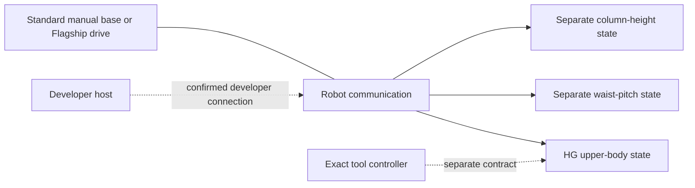

# Unitree G1-D Standard and Flagship: Chassis, Lift and SDK Guide


**Verified OpenELAB G1D listings — G1-D family only.**

[**G1D U1 on OpenELAB**](https://openelab.io/products/unitree-g1d-u1-humanoid-robot) · **SKU:** `Unitree-G1D-U1` · **Option:** `Default Title`\
[**G1D U2 on OpenELAB**](https://openelab.io/products/unitree-g1d-u2-humanoid-robot) · **SKU:** `Unitree-G1D-U2` · **Option:** `Default Title`\
[**G1D U3 on OpenELAB**](https://openelab.io/products/unitree-g1d-u3-humanoid-robot) · **SKU:** `Unitree-G1D-U3` · **Option:** `Default Title`\
[**G1D U4 on OpenELAB**](https://openelab.io/products/unitree-g1d-u4-humanoid-robot) · **SKU:** `Unitree-G1D-U4` · **Option:** `Default Title`\
[**G1D U5 on OpenELAB**](https://openelab.io/products/unitree-g1d-u5-humanoid-robot) · **SKU:** `Unitree-G1D-U5` · **Option:** `Default Title`\
[**G1D U6 on OpenELAB**](https://openelab.io/products/unitree-g1d-u6-humanoid-robot) · **SKU:** `Unitree-G1D-U6` · **Option:** `Default Title`\
[**G1D U7 on OpenELAB**](https://openelab.io/products/unitree-g1d-u7-humanoid-robot) · **SKU:** `Unitree-G1D-U7` · **Option:** `Default Title`\
[**G1D U8 on OpenELAB**](https://openelab.io/products/unitree-g1d-u8-humanoid-robot) · **SKU:** `Unitree-G1D-U8` · **Option:** `Default Title`\
[**G1D U9 on OpenELAB**](https://openelab.io/products/unitree-g1d-u9-humanoid-robot) · **SKU:** `Unitree-G1D-U9` · **Option:** `Default Title`\
[**G1D U10 on OpenELAB**](https://openelab.io/products/unitree-g1d-u10-humanoid-robot) · **SKU:** `Unitree-G1D-U10` · **Option:** `Default Title`

Store descriptions identify these as G1-D Standard. The U-number alone does not establish a different hand, compute package or chassis.


## Product overview <a href="#product-overview" id="product-overview"></a>

Unitree G1-D is a dual-arm upper-body robot on a lifting-column chassis. **G1-D Standard is manual-move; G1-D Flagship has powered differential drive.** Neither is the legged G1 Standard/EDU. The fixed G1-A is another configuration with a different waist and no column. Treat chassis, upper body, tool and developer computer as separate parts of the delivered system. [Official G1-A / G1-D comparison](https://www.unitree.com/G1-D/)

Unitree describes a shared core architecture with the G1 and model-capability reuse across configurations. That is an interoperability claim, not evidence that a biped command stream, joint map or safety procedure is interchangeable. [P](https://www.unitree.com/G1-D/)

Current manufacturer figures are 19 DoF excluding the tool for Standard and 21 for Flagship. Both include fourteen arm joints, two waist joints, two head joints and one column joint; Flagship adds two chassis DoF. These marketing totals are not DDS motor-array lengths. [P](https://www.unitree.com/G1-D/)

[View the official Standard chassis illustration](https://www.unitree.com/images/0314ecae75d64d359c316d2419aaf409_494x1146.png?x-oss-process=image/format,webp) and [Flagship illustration](https://www.unitree.com/images/91ebf8c507db4ae1b0072d7f2fd7f438_494x1146.png?x-oss-process=image/format,webp). They identify configurations, not electrical or mounting details.

## Applications <a href="#applications" id="applications"></a>

Unitree describes research/education, commercial assistance, material handling, equipment interaction and household assistance. G1-D's useful development direction is manipulation at different working heights. Powered-base tasks apply only to a delivered mobile configuration with its navigation and stop systems established. A manual-move base is repositioned as a station; it does not acquire autonomous drive because the upper body supports SDK2. [P](https://www.unitree.com/G1-D/)

The page describes a 0–2 m vertical workspace using column and waist coordination. That is a family application envelope, not proof of collision-free reach at every height or payload. Plan datasets around the actual base pose, column position, camera frames, tool and object mass. Some displayed functions remain under development. [P](https://www.unitree.com/G1-D/)

## Specifications <a href="#specifications" id="specifications"></a>

| Parameter                          | G1-D Standard                           | G1-D Flagship                                                                          |
| ---------------------------------- | --------------------------------------- | -------------------------------------------------------------------------------------- |
| Base configuration                 | Manual-move chassis                     | Powered mobile chassis                                                                 |
| Minimum-height dimensions          | Approximately 1260 × 620 × 620 mm       | Approximately 1260 × 525 × 570 mm                                                      |
| Maximum-height dimensions          | Approximately 1680 × 620 × 620 mm       | Approximately 1680 × 525 × 570 mm                                                      |
| Weight, table labeled with battery | Approximately 90 kg                     | Approximately 90 kg                                                                    |
| Total DoF excluding end effector   | 19                                      | 21                                                                                     |
| Arms / waist / head / column       | 7 per arm / 2 / 2 / 1                   | 7 per arm / 2 / 2 / 1                                                                  |
| Chassis DoF                        | Not listed                              | 2                                                                                      |
| Maximum arm payload                | Approximately 3 kg per arm              | Approximately 3 kg per arm                                                             |
| Waist range                        | Z ±155°; Y 0–135°                       | Z ±155°; Y 0–135°                                                                      |
| Product-table column speed         | Not specified (`/`)                     | Not specified (`/`)                                                                    |
| Maximum mobility speed             | Not listed                              | 1.5 m/s                                                                                |
| Drive                              | No powered-drive specification          | Dual-wheel differential drive; 360° in-place rotation                                  |
| Chassis sensors                    | Not listed                              | One LiDAR, two depth cameras, two physical collision sensors, two low-obstacle sensors |
| Battery entry                      | Quick-release upper-body battery, 9 Ah  | Built-in chassis battery, 30 Ah                                                        |
| Endurance claim                    | Approximately 2 h; charger-powered 24/7 | Approximately 6 h                                                                      |

These are current manufacturer values, not measurements. Payload varies greatly with arm extension. Runtime depends on the configuration and use; a maximum speed is not a safe commissioning speed. No supply voltage follows from the Ah entries. [P](https://www.unitree.com/G1-D/)

Both versions list an eight-core high-performance CPU, Orin NX 16GB, binocular plus chest wide-angle cameras, a six-microphone array, two 10 W speakers, Wi-Fi 6, Bluetooth 5.2, a handheld controller, OTA and secondary development. Optional tools include two-finger grippers and three- or five-finger hands. The page's warranty summary is 12 months; use the original applicable terms and purchase agreement. [P](https://www.unitree.com/G1-D/)

### Why the ten store listings need a configuration check <a href="#why-the-ten-store-listings-need-a-configuration-check" id="why-the-ten-store-listings-need-a-configuration-check"></a>

The reviewed OpenELAB U1–U10 descriptions all identify G1-D Standard and list the same core dimensions, mass, DoF and accessory categories. They do not define ten distinct mechanical or hand configurations. Each lists one robot platform; that package count does not establish which optional hand is included. Use the exact SKU and order bill of materials for fulfillment questions.

| Topic                    | U1–U10 listing text                | Current manufacturer Standard column | Decision                                                                             |
| ------------------------ | ---------------------------------- | ------------------------------------ | ------------------------------------------------------------------------------------ |
| Footprint                | 500 × 500 mm                       | 620 × 620 mm                         | Obtain the delivered revision drawing                                                |
| Weight with battery      | Approximately 50 kg                | Approximately 90 kg                  | Do not design handling or support from the lower listing mass                        |
| Total DoF excluding tool | 17                                 | 19, including head 2                 | Neither count is a complete motor-ID map                                             |
| Cameras                  | Head binocular + two wrist cameras | Binocular + chest wide-angle         | Confirm fitted wrist/chest sensors individually                                      |
| Column speed             | Approximately 60 mm/s              | Not specified                        | SDK header separately describes 76.5 mm/s; exact firmware scaling remains unresolved |
| Waist pitch              | −2.5° to +135°                     | 0–135°                               | Do not select the wider lower limit for custom motion                                |
| Compute                  | Orin NX 16GB, advertised 100 TOPS  | Orin NX 16GB                         | Peak compute label does not establish application throughput or power mode           |

Sources: the ten exact listings linked first and the current manufacturer page. Their agreement on a model family does not resolve these revision/configuration differences. The store-linked SDK repository is useful evidence only after reading the model-specific source. No stock or delivery-time claim is made here. [P](https://www.unitree.com/G1-D/)

## Hardware and connections <a href="#hardware-and-connections" id="hardware-and-connections"></a>

### Separate the power and motion domains <a href="#separate-the-power-and-motion-domains" id="separate-the-power-and-motion-domains"></a>

Identify the supplied upper-body battery, base battery where present, charger, tool power and computing module separately. The marketing page's 9 Ah and 30 Ah entries do not specify the complete charging, input-polarity, hot-swap or isolation contract. The portal below adds revision-specific accessory outputs; those are not charging inputs. Do not reuse G1 biped battery instructions, force-off timings or a bench supply based on the shared G1 name. Obtain the exact system manual and labels before energizing or charging. [P](https://www.unitree.com/G1-D/)

The Standard's charger-powered 24/7 claim is not a continuous-duty guarantee or an instruction to connect an arbitrary supply during operation. Establish cable routing, strain relief, disconnect behavior and approved operating/charging arrangements for the delivered system. Do not reposition a station while tethered in a way that tensions power or network cables.

### Chassis, lift and arm workspace <a href="#chassis-lift-and-arm-workspace" id="chassis-lift-and-arm-workspace"></a>

For a manual-move Standard, verify the approved stationary restraint and repositioning method. For a powered Flagship, establish the approved drive inhibit, physical stop and brake/isolation behavior before developer access. The reviewed page does not specify those controls. Lowering the column or terminating a process is not a substitute for that arrangement.

The column and pitching torso introduce pinch and crush regions as well as a changing center of gravity. Tool mass, held objects and arm extension change base loading. Keep the full swept area clear; do not use chassis sensor presence as a certified person-protection system. The product page supplies no mounting bolt pattern, allowable base moment, accessory pinout or exact operating environmental limits. [P](https://www.unitree.com/G1-D/)



This original diagram separates software contracts; it is not a physical wiring diagram.

### Portal mounting drawings and fixture boundaries <a href="#portal-mounting-drawings-and-fixture-boundaries" id="portal-mounting-drawings-and-fixture-boundaries"></a>

[About G1D, “Mounting Holes: Unit mm”](https://doc-cdn.unitree.com/28/1170/en/28_1170_en) supplies original [front mounting-hole drawing](https://doc-cdn.unitree.com/static/2024/10/28/cd3d0a7d4f384eedb21fb7556fc09d25_1670x2365.png) and [rear mounting-hole drawing](https://doc-cdn.unitree.com/static/2024/10/28/26eebb64bc4d4a7d88bd09c752f98490_1670x2365.png), © Unitree Robotics. The article says labels cover the mounting holes and should be removed to access them. Both figures were visually inspected for orientation and the depicted mounting locations; this guide does not infer additional dimensions from them.

Match the illustrated torso, waist, installed equipment and delivered revision before designing a bracket. These torso accessory-hole drawings do not define a floor anchorage, chassis restraint or lifting attachment. Obtain the approved fastener specification, usable thread engagement, tightening torque, allowable forces/moments and combined accessory-load limits; none is guessed here. Keep camera views, cooling, cables, moving joints and the full arm/tool swept volume clear. The linked source drawings are the dimensional reference for the illustrated configuration, not a load certification for every Standard/Flagship revision.

### Portal revisions, ports and computing roles <a href="#portal-revisions-ports-and-computing-roles" id="portal-revisions-ports-and-computing-roles"></a>

The G1D portal's **About G1D** article, updated May 29, 2026, describes Standard at approximately 50 kg and 17 DoF, and Flagship at approximately 80 kg and 19 DoF, with 60 mm/s lift, wrist cameras and a 500 × 500 mm Standard footprint. This agrees with several store entries but differs from the living marketing page's 90 kg and 19/21 DoF figures. Treat these as distinct published configurations; neither the U-number nor a fetch date establishes which revision was delivered. The portal also explicitly warns that early G1D shipments lack the newer waist-pitch module. Confirm that module before expecting `rt/waistpitchstate`. [About G1D](https://doc-cdn.unitree.com/28/1170/en/28_1170_en); [waist module](https://doc-cdn.unitree.com/28/1608/en/28_1608_en)

The portal supplies an actual [numbered interface drawing](https://doc-cdn.unitree.com/static/2024/9/29/ef105e92a6f7487eaf31f9169c44dfd8_3707x2675.jpg). Its numbered ports refer to that shoulder-board configuration:

| Number        | Connector / role  | Published limit or capability                                                                |
| ------------- | ----------------- | -------------------------------------------------------------------------------------------- |
| `1`           | XT30UPB-F, `VBAT` | Direct battery output, described as 58 V / 5 A; not a regulated accessory voltage assumption |
| `2`           | XT30UPB-F, `24V`  | 24 V / 5 A output                                                                            |
| `3`           | XT30UPB-F, `12V`  | 12 V / 5 A output                                                                            |
| `4`, `5`      | RJ45              | 1000BASE-T Ethernet                                                                          |
| `6`, `7`, `8` | Type-C            | USB 3.0 host; 5 V / 1.5 A output                                                             |
| `9`           | Alt Mode Type-C   | USB 3.2 host and DisplayPort 1.4                                                             |
| `10`          | I/O               | 12 V / 3 A output and GPIO                                                                   |

These are **outputs**, not charging inputs. The battery-linked rail can track the battery and is not a logic-level pin. The drawing identifies ports but does not establish every mating pin's polarity, aggregate power budget or inrush allowance; match the actual board and wiring before connecting a peripheral. [About G1D](https://doc-cdn.unitree.com/28/1170/en/28_1170_en)

The [I/O orientation figure](https://doc-cdn.unitree.com/static/2025/8/25/946f900a5d5644d192a4b7f917970bb4_2672x1892.jpeg) shows, from its labeled top to bottom, `GPIO6`, `GPIO5`, `GPIO4`, `GPIO3`, `GPIO2`, `GPIO1`, `GND`, `+12V`. Preserve the drawing's viewing orientation; do not read this as a cable-side pin-number assignment. The portal gives the following mappings:

| Board signal | NX pin / alternate function | Kernel name or access contract                                                       |
| ------------ | --------------------------- | ------------------------------------------------------------------------------------ |
| GPIO1        | `203`, UART1 TX             | `GPIO3_PR.02`; UART device `/dev/ttyTHS0`                                            |
| GPIO2        | `205`, UART1 RX             | `GPIO3_PR.03`; same serial interface                                                 |
| GPIO3        | `232`, I2C2 SCL             | `GPIO3_PI.03`; example uses I²C bus `0`                                              |
| GPIO4        | `234`, I2C2 SDA             | `GPIO3_PI.04`                                                                        |
| GPIO5        | `128`, GPIO                 | `GPIO3_PCC.02`; sysfs export `330`, path `PCC.02`; libgpiod `gpiochip1`, offset `14` |
| GPIO6        | `130`, GPIO                 | `GPIO3_PCC.03`; sysfs export `331`, path `PCC.03`; libgpiod `gpiochip1`, offset `15` |

The FAQ describes UART at 9600 baud, 8 data bits, no parity and one stop bit. Its GPIO high/low example uses 3.3 V / 0 V. This is separate from adjacent 12 V power. Sysfs uses export → direction → value → unexport; libgpiod uses chip/line selection. Those operations can drive attached hardware, so they are outside the first state check. Reconfirm chip numbering and alternate-function ownership for the supplied image; a familiar label is not evidence of 5 V tolerance. [GPIO and recovery FAQ](https://doc-cdn.unitree.com/28/1292/en/28_1292_en)

PC1 is reserved for Unitree motion services; secondary development belongs on PC2. The portal's PC2 is Jetson Orin NX, eight Arm Cortex-A78AE cores up to 2 GHz, 16 GB memory, 2 TB storage, Ampere GPU with 1024 CUDA cores/32 Tensor Cores and 918 MHz maximum GPU clock, at `192.168.123.164`. It gives initial login `unitree` / `123`. The table also mixes Intel-specific accelerator/graphics API fields into the NX description; those entries are not accepted as an independently verified NX feature set. Shipment substitutions remain possible. [About G1D](https://doc-cdn.unitree.com/28/1170/en/28_1170_en)

The rear debug Ethernet wire table lists pairs `0P/0N`, `1P/1N`, `2P/2N`, `3P/3N` on pins `1–8`, with colors orange/white, orange, green/white, green, blue/white, blue, brown/white, brown. That published table is an observation, **not an instruction to crimp a custom Ethernet cable**; it differs from familiar Ethernet color-pair conventions. Use the supplied cable and port documentation. [About G1D](https://doc-cdn.unitree.com/28/1170/en/28_1170_en)

### Portal joint limits and separate end-effectors <a href="#portal-joint-limits-and-separate-end-effectors" id="portal-joint-limits-and-separate-end-effectors"></a>

The portal preserves G1 index gaps rather than renumbering the torso. Its mode table identifies slot `14` as `WAIST_PITCH` in PR mode and `WAIST_B` in AB mode. That historical map must be distinguished from the newer separate self-locking pitch module. The following values are the **portal's reference limits in radians**, not approved target values for an unidentified robot:

| Slot(s)                | Reference joint                    | Published interval          |
| ---------------------- | ---------------------------------- | --------------------------- |
| `12`                   | Waist yaw                          | −2.618 to 2.618             |
| `14`                   | Waist pitch, historical body table | −0.52 to 0.52               |
| `15`, `22`             | Left/right shoulder pitch          | −3.0892 to 2.6704           |
| `16`                   | Left shoulder roll                 | −1.5882 to 2.2515           |
| `23`                   | Right shoulder roll                | −2.2515 to 1.5882           |
| `17`, `24`             | Shoulder yaw                       | −2.618 to 2.618             |
| `18`, `25`             | Elbow                              | −1.0472 to 2.0944           |
| `19`, `26`             | Wrist roll                         | −1.972222054 to 1.972222054 |
| `20`, `21`, `27`, `28` | Wrist pitch/yaw                    | −1.614429558 to 1.614429558 |

The waist table conflicts with the same article's degree-based −2.5° to +135° summary and with the current product-page pitch range. Do not merge the intervals or command slot `14` to test which mechanism is fitted. The portal's low-level table excludes hand, column and chassis; missing indices are not extra actuators. [About G1D](https://doc-cdn.unitree.com/28/1170/en/28_1170_en); [joint control](https://doc-cdn.unitree.com/28/1263/en/28_1263_en)

For its illustrated Dex3-1, the portal reports 12–58 V, seven active DoF (thumb 3, index 2, middle 2), nine sensor arrays and a 10–2500 g sensing range. The thumb's three angle intervals are 0–100°, −35–60° and −60–60°; index/middle intervals are 0–90° and 0–100°. These hand-specific figures do not increase the arm payload or certify a U1–U10 hand package. Establish body/hand clearance and avoid aggressive movement with an installed hand; exact tool control remains a separate contract. [About G1D](https://doc-cdn.unitree.com/28/1170/en/28_1170_en)

### Flagship chassis reference envelope and indicators <a href="#flagship-chassis-reference-envelope-and-indicators" id="flagship-chassis-reference-envelope-and-indicators"></a>

The portal describes the mobile chassis separately: 557 × 525 mm footprint, 215 mm height excluding LiDAR, 666 mm rotation diameter, 63 kg net mass, 40 kg rated payload and 60 kg maximum payload on flat concrete. These **bare chassis** loads and masses are not extra cargo capacity for the assembled upper-body robot. Its stated 10°/18% slope condition is paired elsewhere with a center-of-mass-height condition of at most 18 cm; do not apply that bare-platform envelope to the tall assembled G1-D. [About G1D](https://doc-cdn.unitree.com/28/1170/en/28_1170_en); [SLAM service](https://doc-cdn.unitree.com/28/1288/en/28_1288_en)

Other chassis figures are two 6.5-inch hub drives, four 2.5-inch casters, LiDAR radius up to 30 m on a 90%-reflectivity plane, two depth cameras at 0.3–3.5 m with 75° horizontal/51° vertical FOV, two ultrasonic sensors to 50 cm, 5 cm map pixels and maximum 500 × 500 m mapping. The same article claims ±5 cm navigation positioning and laser-tag docking. These are source-reported conditions, not measured system accuracy. Its chassis interface list includes Gigabit Ethernet, 2.4 GHz AP/STA Wi-Fi and a 48 V / 30 A output; built-in HDMI/USB are described as not open. Treat that rail independently from the upper body's shoulder outputs. [About G1D](https://doc-cdn.unitree.com/28/1170/en/28_1170_en)

Chassis operating conditions are 0–40°C, storage −25–55°C, 30–70% RH non-condensing, altitude at most 2000 m and noise at most 65 dB. They are not environmental certification for every tool and computer. The portal additionally describes a head MID360 with 360°/59° FOV, while the current marketing camera inventory differs; confirm the fitted head/chassis sensor roles. [About G1D](https://doc-cdn.unitree.com/28/1170/en/28_1170_en)

The chassis light guide distinguishes blue steady operation, green flashing charging, yellow steady low charge, white flashing blockage and white steady startup. Both an unresolved fault and emergency-stop activation can show steady red; brake release shows flashing yellow. A color alone does not isolate the cause. The dock indicates powered by steady red, charging by slow/breathing green, low-current charging by steady green, fuse trouble by slow red and an abnormal dock/robot condition by alternating red/green. Follow the matched dock's service instructions rather than resetting a fuse from this status table alone. [About G1D](https://doc-cdn.unitree.com/28/1170/en/28_1170_en)

## Software and development resources <a href="#software-and-development-resources" id="software-and-development-resources"></a>

### What the pinned SDK actually contains <a href="#what-the-pinned-sdk-actually-contains" id="what-the-pinned-sdk-actually-contains"></a>

SDK2 at `b7fec6020eb93d4c059a6edf19905e12a75a8d3d` includes the following declared CMake targets and source behavior. They are source references, **not first-run commands**. [Build target declarations](https://github.com/unitreerobotics/unitree_sdk2/blob/b7fec6020eb93d4c059a6edf19905e12a75a8d3d/example/g1/CMakeLists.txt)

| Source / target                                                                                                                                                   | Read contract and behavior                                                                                                                                       | First-state implication                                        |
| ----------------------------------------------------------------------------------------------------------------------------------------------------------------- | ---------------------------------------------------------------------------------------------------------------------------------------------------------------- | -------------------------------------------------------------- |
| [`g1d_arm_example`](https://github.com/unitreerobotics/unitree_sdk2/blob/b7fec6020eb93d4c059a6edf19905e12a75a8d3d/example/g1/g1d/g1d_arm_example.cpp)             | Subscribes HG `LowState_` on `rt/lowstate` and `IMUState_` on `rt/secondary_imu`; creates a `rt/lowcmd` publisher and later swings shoulder pitch after remote A | Never run the complete program just to view state              |
| [`g1d_waist_example`](https://github.com/unitreerobotics/unitree_sdk2/blob/b7fec6020eb93d4c059a6edf19905e12a75a8d3d/example/g1/g1d/g1d_waist_example.cpp)         | `MotorState_` on `rt/waistpitchstate`; sends `MotorCmd_` to `rt/waistpitchcmd`, alternating targets                                                              | Waist state is a separate contract; the example moves          |
| [`g1d_height_control`](https://github.com/unitreerobotics/unitree_sdk2/blob/b7fec6020eb93d4c059a6edf19905e12a75a8d3d/example/g1/g1d/g1d_height_control.cpp)       | Reads `geometry_msgs::msg::dds_::Point32_` on `rt/hispeed_state`; treats `.y()` as column height in metres; actively controls lift toward a target               | Do not confuse its target argument with the AGV velocity input |
| [`g1_agv_client_example`](https://github.com/unitreerobotics/unitree_sdk2/blob/b7fec6020eb93d4c059a6edf19905e12a75a8d3d/example/g1/g1d/g1_agv_client_example.cpp) | Periodically sends chassis velocity and height-adjust commands                                                                                                   | Not navigation, a state reader or a stop validation            |

The arm example uses a 29-slot working array with leg indices `0–11` invalid, waist yaw `12`, waist roll/alias `13` invalid, waist pitch `14`, left arm `15–21` and right arm `22–28`. The pitch joint also has a separate state/control example; confirm the delivered control architecture before choosing a command path. Head, lift, chassis and tools do not become arm slots by subtracting the marketed DoF count. The underlying HG state schema reserves **35 motor slots**. [ARM](https://github.com/unitreerobotics/unitree_sdk2/blob/b7fec6020eb93d4c059a6edf19905e12a75a8d3d/example/g1/g1d/g1d_arm_example.cpp); [HG schema](https://github.com/unitreerobotics/unitree_sdk2/blob/b7fec6020eb93d4c059a6edf19905e12a75a8d3d/include/unitree/idl/hg/LowState_.hpp)

| Arm function                | Left HG slot   | Right HG slot  |
| --------------------------- | -------------- | -------------- |
| Shoulder pitch / roll / yaw | `15 / 16 / 17` | `22 / 23 / 24` |
| Elbow                       | `18`           | `25`           |
| Wrist roll / pitch / yaw    | `19 / 20 / 21` | `26 / 27 / 28` |

These are the inspected G1-D example's identifiers. They do not certify a fixed G1-A, a G1 biped or every delivered revision. [ARM](https://github.com/unitreerobotics/unitree_sdk2/blob/b7fec6020eb93d4c059a6edf19905e12a75a8d3d/example/g1/g1d/g1d_arm_example.cpp)

### Chassis and lift API units matter <a href="#chassis-and-lift-api-units-matter" id="chassis-and-lift-api-units-matter"></a>

The shared `unitree::robot::g1::AgvClient` uses service `agv`, API version `1.0.0.1`, IDs `1001` for `Move` and `1002` for `HeightAdjust`. Its `Move(vx, vy, vyaw)` header describes longitudinal speed in m/s, yaw speed in rad/s and unsupported/ignored lateral `vy`. Published header ranges are ±1.5 m/s and ±0.6 rad/s, respectively. The method serializes values; the shown code does not clamp them. Do not interpret the signature as holonomic drive. [AGV client](https://github.com/unitreerobotics/unitree_sdk2/blob/b7fec6020eb93d4c059a6edf19905e12a75a8d3d/include/unitree/robot/g1/agv/g1_agv_client.hpp); [API constants](https://github.com/unitreerobotics/unitree_sdk2/blob/b7fec6020eb93d4c059a6edf19905e12a75a8d3d/include/unitree/robot/g1/agv/g1_agv_api.hpp)

`HeightAdjust(vz)` is a **normalized column-velocity command**, range −1 to +1, not a target height. The header maps it to ±76.5 mm/s. The separate height-control source accepts a target in metres and generates normalized commands with a 50 ms loop, ±0.8 clamp, 500 ms stale-data check and a stop request on exit/error. Its 1 mm error tolerance and 20 stable cycles are program settings, not a measured lift accuracy guarantee. Initial waiting for height has no finite timeout beyond interruption. The real unit's travel endpoints, scaling, braking and loss-of-command behavior still need confirmation. [CLIENT](https://github.com/unitreerobotics/unitree_sdk2/blob/b7fec6020eb93d4c059a6edf19905e12a75a8d3d/include/unitree/robot/g1/agv/g1_agv_client.hpp); [HEIGHT](https://github.com/unitreerobotics/unitree_sdk2/blob/b7fec6020eb93d4c059a6edf19905e12a75a8d3d/example/g1/g1d/g1d_height_control.cpp)

For a later active application, a zero `Move` request and zero `HeightAdjust` request are distinct from a verified physical stop or power isolation. An API return code reports the call's result, not measured standstill. This guide does not direct a reader to send motion or stop commands as a connectivity experiment.

SDK2's C++ reference host is Ubuntu 20.04, aarch64/x86\_64 and GCC 9.4.0, with C++17 in the CMake project. The Python package is `unitree_sdk2py` 1.0.1, Python ≥3.8, `cyclonedds==0.10.2`, NumPy and OpenCV. Both reviewed SDK licenses are BSD-3-Clause. The Python HG type is a source-reviewed decoder match, not an independently established G1-D firmware/Python support matrix. Shared host preparation belongs in the [SDK2 state guide](unitree-sdk2-state-development.md) and [ROS 2 integration guide](unitree-ros2-integration.md). Neither guide substitutes for the model's supplied address plan or firmware contract. [SDK](https://github.com/unitreerobotics/unitree_sdk2/blob/b7fec6020eb93d4c059a6edf19905e12a75a8d3d/README.md); [PY](https://github.com/unitreerobotics/unitree_sdk2_python/blob/814556d15970dd2ecf1c9984e845ca02ab07e206/README.md); [PYSETUP](https://github.com/unitreerobotics/unitree_sdk2_python/blob/814556d15970dd2ecf1c9984e845ca02ab07e206/setup.py); [LICENSE](https://github.com/unitreerobotics/unitree_sdk2/blob/b7fec6020eb93d4c059a6edf19905e12a75a8d3d/LICENSE); [PYLICENSE](https://github.com/unitreerobotics/unitree_sdk2_python/blob/814556d15970dd2ecf1c9984e845ca02ab07e206/LICENSE)

### Portal development route and network endpoints <a href="#portal-development-route-and-network-endpoints" id="portal-development-route-and-network-endpoints"></a>

The portal explicitly says G1D reuses SDK2 but **cannot use G1 biped high-level locomotion interfaces**. It describes G1D as always in the development/debugging route, without the biped's debug-versus-locomotion-mode distinction. That does not remove independent chassis, lift and waist service ownership. Ubuntu 20.04 is its documented development host; macOS/Windows are not supported for that SDK workflow. RoboStudio's Windows requirement is a different chassis deployment tool, not a contradiction about the C++ development host. [SDK resources](https://doc-cdn.unitree.com/28/1176/en/28_1176_en); [quick development](https://doc-cdn.unitree.com/28/1177/en/28_1177_en)

Use the robot-facing Ethernet interface on `192.168.123.x`; the article recommends host `.99` and illustrates `.222`. Its `.161` connectivity test is an onboard endpoint, **not evidence that PC2 SSH is at `.161`**. About G1D identifies developer PC2 as `.164`. Do not replace the reserved motion-controller software. The documented build sequence configures SDK2 with CMake and builds/installs its library, then builds the included examples; this guide has not executed it. The generated motion target is a later controlled experiment, not an installation acceptance test. [Quick development](https://doc-cdn.unitree.com/28/1177/en/28_1177_en)

The remote guide maps left-stick vertical to forward/back, left-stick horizontal to rotation and right-stick vertical to lift. Flagship speed selection uses `R2+UP`/`R2+DOWN`, four levels with the lowest at startup. It calls `L1+B` a chassis emergency-brake toggle and `L1+A` a data-acquisition-mode toggle; acquisition mode does not respond to ordinary remote motion/lift commands. This is configuration-specific control behavior, not a universal independent safety stop. Confirm mode and brake state before restoring control after a pause. [Remote guide](https://doc-cdn.unitree.com/28/1172/en/28_1172_en)

### Audio, ASR and image services <a href="#audio-asr-and-image-services" id="audio-asr-and-image-services"></a>

The portal's audio article describes four microphones with 20 mm spacing, an 8 Ω / 3 W speaker (5 W peak) and an RGB strip. This differs from the marketing page's six-microphone/two-10-W-speaker inventory. Its API requires `vui_service >= 2.0.3.8` and `vui module >= 2.0.0.3`; match that service/hardware revision rather than assuming the current page and portal describe identical units. [Audio and lighting](https://doc-cdn.unitree.com/28/1287/en/28_1287_en)

| Interface                                       | Contract to preserve                                                                                         |
| ----------------------------------------------- | ------------------------------------------------------------------------------------------------------------ |
| `TtsMaker(text, speaker_id)`                    | Offline text synthesis; role `0` Chinese, `1` English; mixed-language requests not supported in this article |
| `GetVolume`, `SetVolume`                        | Volume 0–100; changing it is an active setting operation                                                     |
| `LedControl(R,G,B)`                             | Each channel 0–255; intervals greater than 200 ms                                                            |
| `PlayStream(app_name, stream_id, pcm_data)`     | 16 kHz, mono, 16-bit PCM; same stream ID continues cached playback, different ID interrupts                  |
| `PlayStop(app_name)`                            | Stops that application's playback, not robot motion                                                          |
| `rt/audio_msg` / `std_msgs::msg::dds_::String_` | JSON ASR or playback-status message                                                                          |
| Multicast `239.168.123.161:5555`                | Denoised mono 16 kHz / 16-bit microphone audio when the microphone is enabled                                |

The ASR fields are `index`, `timestamp`, `text`, `angle` (0–180), `speaker_id`, `sense`, `confidence`, `language` and `is_final`; recognition is non-streaming by default and some semantic fields are still developing. Playback uses `play_state`, 0 stopped/1 playing. An ASR timestamp is not automatically synchronized with motor ticks. The full audio demonstration changes volume/lighting, speaks and records microphone data, so it is not the passive motor-state test. [Audio and lighting](https://doc-cdn.unitree.com/28/1287/en/28_1287_en)

The image article directs G1D head and wrist streams through [Teleimager](https://github.com/unitreerobotics/teleimager/tree/main), with its own `image_client.py`; it says the PC2 conda environment `tv` already contains the required components. It describes ZeroMQ PUB-SUB video, REQ-REP configuration and WebRTC; local shared-memory mode is a future item, not a shipped guarantee. Camera identity may be configured by physical path, serial or video-device path. [Image service](https://doc-cdn.unitree.com/28/1289/en/28_1289_en)

For its ZMQ route, the source uses a receiving host at `192.168.123.22` and OpenCV. Its WebRTC pages are PC2 `.164` on HTTPS ports `60001` head, `60002` left wrist and `60003` right wrist; select **start** in the page to view a configured stream. That is distinct from the R1/H2 stereo UDP services. First check the fitted camera/service configuration, stream shape and device identity; a displayed image does not establish metric depth or camera-to-arm calibration. Teleimager's linked repository was identified through this article; no current checkout or runtime was validated here. [Image service](https://doc-cdn.unitree.com/28/1289/en/28_1289_en)

### Mapping, navigation and action lifecycle <a href="#mapping-navigation-and-action-lifecycle" id="mapping-navigation-and-action-lifecycle"></a>

The G1D SLAM article gives chassis Ethernet `.163`, wireless `.12.1`, AP name `SLAMWARE-XXXXXX`, HTTP port `1448` and RoboStudio connection port `1445`. These are the article's chassis defaults, separate from PC2 `.164` and motion endpoint `.161`. Confirm the delivered chassis first. On a commissioned, stationary Flagship, its documented read-only connectivity route can be bounded as follows; it sends no action request:

```bash
curl --noproxy '*' --max-time 5 http://192.168.123.163:1448/api/core/system/v1/robot/info
```

Expected result is a successful HTTP/JSON device-information response; the article itself shows `[]` as its connectivity example. Do not require a particular nonempty identity field from that example. This has not been run here and does not establish localization, navigation readiness or braking. The REST reference's printed `/api/c or e/...` routes are malformed; this clean `core` route is independently present in the SLAM article. [SLAM service](https://doc-cdn.unitree.com/28/1288/en/28_1288_en)

RoboStudio is the Windows deployment interface. **File → Robot** opens discovery; connect through the Local list or **Manually Connect Robot** with the delivered address/port. The connected map view uses left-drag rotation, right-drag pan and scroll zoom. Plugins enable map, virtual-wall/track, star/POI and other tools. Mapping is a separate active task requiring an approved mobile workspace, not a consequence of reaching the API. [SLAM service](https://doc-cdn.unitree.com/28/1288/en/28_1288_en)

The documented deployment sequence is: preserve existing map data; enter mapping on the correct robot; traverse every required region at no more than **0.4 m/s**; synchronize the map; save a `.stcm` file; configure dock, POIs and software boundaries; upload the intended map; verify pose; then consider navigation. Mirrors and transparent glass can degrade LiDAR mapping. Power-off does not preserve the ordinary working map according to the article, so saving a file matters. Clearing a map is destructive to that map and is not a general connectivity remedy. [SLAM service](https://doc-cdn.unitree.com/28/1288/en/28_1288_en)

Map editing can change the initial pose, origin, dock locations, painted occupancy, crop and uploaded map. Cropping resets the origin, so saved target/POI coordinates need revision. Dock configuration requires firmware **≥4.3.5**. White map cells are explored free space, black obstacles and gray unexplored. A virtual wall in the main interface takes effect directly; one edited in Map Editor needs **Upload to Firmware**. These are navigation constraints, not independently certified protective barriers. [SLAM service](https://doc-cdn.unitree.com/28/1288/en/28_1288_en)

POIs are managed through **Tools → Star** or **Star → Star List**: a named position, type and arrival yaw. `PARKING` supports parking return; docks are configured in Map Editor. Double-clicking a star or choosing **Go To** can immediately start motion. The article also starts map navigation with a left-click on a target and queues targets with `Shift+left-click`. To cancel the current task, it lists map **right-click/double-click** controls or **Cancel Action**. These are software cancellation controls for the current chassis task; they are not an independently verified physical stop, arm/lift stop or power-isolation procedure. Preserve the matched physical-stop and mechanical-support arrangements before using them. Queue points prioritize waiting positions; the article says its limited-entry area feature is not supported on this model. Restricted, elevator and speed-limited areas have different purposes. Do not interpret an optional plugin or REST schema as fitted hardware capability. [SLAM service](https://doc-cdn.unitree.com/28/1288/en/28_1288_en)

Navigation `move_options.mode` is `0` free, `1` strict track and `2` track-priority/detour; `with_directed_virtual_track` requests directed track following. `with_yaw` makes the yaw field operative; yaw uses radians, counterclockwise positive. The map frame starts with +X along the robot's forward direction at mapping start. `acceptable_precision` is an arrival-acceptance radius, not a measured positioning accuracy; the REST schema describes metres and defaults of 0.1 or 0.18 m, while one SLAM example uses `100`. That example must not be adopted as a validated tolerance. `speed_ratio` is a scale factor, with a documented minimum 0.1 and firmware gate **4.5.4**; a value over one is not a safe commissioning shortcut. [SLAM service](https://doc-cdn.unitree.com/28/1288/en/28_1288_en); [REST reference](https://doc-cdn.unitree.com/28/1321/en/28_1321_en)

An action is created through `POST /api/core/motion/v1/actions`, returning an `action_id` that is then polled. Status `0` is initializing, `1` working, `3` paused in the full reference, and `4` complete. Only at completion is result `0` success, `−1` failure or `−2` interruption; preserve `reason`. HTTP request success is not motion completion. The articles mix `agent.actions.`, `slamtec.agent.actions.` and `unitree.agent.actions.` prefixes. Query the delivered chassis's available action factories and use its supported identifier, rather than silently rewriting all examples to one prefix. [SLAM service](https://doc-cdn.unitree.com/28/1288/en/28_1288_en); [REST reference](https://doc-cdn.unitree.com/28/1321/en/28_1321_en)

| Action family                                                  | Required interpretation                                                                                                                                                |
| -------------------------------------------------------------- | ---------------------------------------------------------------------------------------------------------------------------------------------------------------------- |
| `MoveToAction`, `SeriesMoveToAction`, `FollowPathPointsAction` | A target, target series or path points in the active map; motion/track options and end orientation must match the task                                                 |
| `MoveByAction`                                                 | Timed remote movement **without obstacle avoidance**; direction 0 forward, 1 backward, 2 turn right, 3 turn left; do not exceed the article's 500 ms duration guidance |
| `RotateAction`, `RotateToAction`                               | Relative rotation versus absolute yaw, radians                                                                                                                         |
| `GoHomeAction`                                                 | Configured dock; `dock` versus `no_dock`, retries and return-to-landing options; route-mode option has firmware gate ≥4.6.1                                            |
| `MoveToTagAction`, `BackOffFromTagAction`                      | Exact tag/docking hardware; tag types visual, laser, reflector, or shelf on firmware ≥6.0; docking and retreat frames/options differ                                   |
| `ReturnToParkingAction`                                        | A `PARKING` POI, or documented autonomous choice of a suitable parking point                                                                                           |
| `RecoverLocalizationAction`                                    | Global recovery if no area is supplied, otherwise a trusted rectangle; timeout in milliseconds and movement mode `RotateOnly` or `NoMove`                              |
| Multi-floor / elevator actions                                 | Per-floor `.stcm`, combined `.stcmx`, consistent elevator IDs/areas and firmware ≥5.1.1 for entry/exit; not a first-run scenario                                       |
| `SweepAction` and industry/delivery actions                    | Capability/plugin and physical configuration must be present; an API entry is not proof of a fitted cleaning, shelf-lifting or cargo system                            |

The source's deployment, delivery-route and recovery examples actually move the base and may rotate during relocalization. Review their payloads as examples rather than pasting them into a first read-only check. Offline mapping replays `.stms` logs of roughly 20–30 minutes, then saves a map; it is not a replacement for a validated live deployment. [SLAM service](https://doc-cdn.unitree.com/28/1288/en/28_1288_en)

### REST chassis reference: capabilities, resources and schemas <a href="#rest-chassis-reference-capabilities-resources-and-schemas" id="rest-chassis-reference-capabilities-resources-and-schemas"></a>

The G1D and H2D spaces each publish **API v1.1.0** with the same body apart from the applicability sentence. The following resource index retains exact operation identifiers and method/path facts from those retrieved copies. Many identifiers are visibly damaged, including `c or e`, `platfor m`, `passw or d`, `enabLED` and separated `floor`/`sensor` words. **Do not use the damaged strings as executable URLs or silently normalize them.** Resolve the actual schema/API version on the delivered chassis. The clean connectivity/action paths above have a separate readable SLAM source. [G1D API](https://doc-cdn.unitree.com/28/1321/en/28_1321_en); [H2D API](https://doc-cdn.unitree.com/41/1706/en/41_1706_en)

The system resources distinguish capabilities, power state, device identity, health, laser/IMU samples, battery-pack feedback, temporary parameters, network/AP/STA/routes/APN, lighting and optional jack/AEB functions. Capability initialization can be incomplete after startup. `PowerStatus` separates battery percentage, charging, DC connection, dock alignment, power stage and sleep state. `BaseHealthInfo` separates warning/error/fatal; component codes 0/1/2/3/4/255 identify user/system/power/motion/sensor/unknown, while severity 0/1/2/4/255 is healthy/warning/error/fatal/unknown. Clearing a health flag is not a physical repair. [REST reference](https://doc-cdn.unitree.com/28/1321/en/28_1321_en)

SLAM resources cover localization pose, odometry pose, quality, enable states, loop closure, home docks, grid/composite maps and origins. Artifact resources manage walls/tracks, rectangles, POIs and laser landmarks. Rectangle metadata is string-serialized even when values represent geometry or speeds; elevator, forbidden, hazardous, coverage, sensor-disable and restricted areas have different metadata. Do not disable sensing or erase boundaries as a diagnosis shortcut. Motion resources separate available factories, current action, creation/cancellation, result, remaining path/milestones/time/speed and strategy. [REST reference](https://doc-cdn.unitree.com/28/1321/en/28_1321_en)

Firmware, sensor-mask and application-management routes change the running platform and require their own approved maintenance procedure. Multi-floor resources manage buildings, floors, mapped poses, docks, persistence, scene binding, track search and elevators. Industry tasks use templates, action lists, targets, navigation modes and task events; delivery resources add cargo/box state, task/order identity, pickup stages, schedules, battery thresholds and operator modes. Those plugin-specific structures are conditional capabilities, not additional features guaranteed for every G1-D or H2-D. Listing a REST method does not authorize calling it. [REST reference](https://doc-cdn.unitree.com/28/1321/en/28_1321_en)

Geometry schemas distinguish points, 2D/3D poses, quaternions, scan pose/points and timed IMU fields; the IMU's availability bitmap determines which calibrated/raw/orientation values are present. Industry/delivery task states (`READY`, `RUNNING`, `SUCCEEDED`, `FAILED`, `CANCELING`, `CANCELED`) are separate from low-level numeric action status. Box door, lock and stock states are also separate. Network/mapping mutations can disconnect a session or invalidate stored coordinates. The operation and schema indexes below provide the exact lookup names without cloning the upstream request/response examples or treating unsupported operations as commissioned features. [REST reference](https://doc-cdn.unitree.com/28/1321/en/28_1321_en)

Important request/response contracts in that reference include:

* Chassis shutdown uses `shutdown_time_interval` and `restart_time_interval` in **minutes**; both zero means immediate shutdown without restart. `restartModule` distinguishes `RestartModeSoft` (slamwared), `RestartModeHard` (system) and `RestartModeBase` (chassis). These are maintenance/control actions, not whole-upper-body safe-shutdown instructions.
* Temporary system parameters revert after restart. Maximum linear/angular speed parameters use m/s and rad/s; the reference also lists `base.emergency_stop` and `base.brake_release` mutations. Software emergency-stop/brake parameters are not independent physical isolation and must not be probed to establish a connection.
* Network modes are `0` AP, `1` station, `2` Wi-Fi off, `3` DHCP off, `4` DHCP on; Android-managed network control may return false. A route/static-IP/APN change can remove the current access path.
* Battery-pack `current` is **mA**, positive charging/negative discharging; `temp_count` gives the count and `temp[]` uses **0.1°C**. These chassis fields are distinct from shoulder motor voltage and upper-body battery feedback.
* Grid-map data is little-endian: bytes `0–3`/`4–7` float origin x/y, `8–11`/`12–15` uint32 dimensions, `16–19` float resolution in metres, `20–31` reserved, `32–35` uint32 byte count and data from byte `36`. The prose calls the first 32 bytes metadata, while its table adds a length word before data. Validate the table, response length and grid-product count against the delivered API rather than assuming a 32-byte full header.
* Composite maps are binary `.stcm`. Uploading one resets pose to the origin and is described as nonpersistent across restart in that core route. Multi-floor persistence (`:save`/`:reload`/`:sync`) is a separate resource. Re-establish pose and coordinate-dependent targets after map/origin changes; dock enumeration has a separate firmware ≥4.3.2 gate in the API reference.
* Dock/POI IDs use UUIDs; `ON_DOCK`, `IN_ELEVATOR` and `UNKNOWN` are special nearby-POI outcomes, with relative pose absent for an unknown location. POI, dock and obstacle-metadata mutations must match the active map, not a stale file.
* Delivery execution enable/disable is a task scheduler setting. Cargo-box operations have their own `OPEN`/`CLOSE` type and `IN_PROGRESS`/`DONE`/`FAILED` stage, independent of door/lock/stock state; task completion must be checked at its own layer. Industry `navigation_mode` adds backward navigation value `4`, distinct from the ordinary `move_options.mode` 0/1/2.

These are source-reported contracts with the same malformed-identifier limitations as the lookup table. The retrieved reference marks the shown operations as not requiring authentication; that is a description of this reference, not proof of authentication configuration on a deployed network. Capability discovery and the delivered firmware remain necessary. [G1D REST reference](https://doc-cdn.unitree.com/28/1321/en/28_1321_en)

<details>

<summary>Operation lookup: 170 identifiers in the retrieved v1.1.0 reference</summary>

| Operation identifier as printed | Method   | Path as printed, not an executable recipe                            |
| ------------------------------- | -------- | -------------------------------------------------------------------- |
| `getCapabilities`               | `GET`    | `/api/c or e/system/v1/capabilities`                                 |
| `getPowerStatus`                | `GET`    | `/api/c or e/system/v1/power/status`                                 |
| `shutdown`                      | `POST`   | `/api/c or e/system/v1/power/:shutdown`                              |
| `hibernate`                     | `POST`   | `/api/c or e/system/v1/power/:hibernate`                             |
| `wakeup`                        | `POST`   | `/api/c or e/system/v1/power/:wakeup`                                |
| `restartModule`                 | `POST`   | `/api/c or e/system/v1/power/:restartmodule`                         |
| `getRobotInfo`                  | `GET`    | `/api/c or e/system/v1/robot/info`                                   |
| `getRobotHealth`                | `GET`    | `/api/c or e/system/v1/robot/health`                                 |
| `clearRobotHealth`              | `DELETE` | `/api/c or e/system/v1/robot/health/{error_code}`                    |
| `getLaserScan`                  | `GET`    | `/api/c or e/system/v1/laserscan`                                    |
| `getSystemParameter`            | `GET`    | `/api/c or e/system/v1/parameter`                                    |
| `setSystemParameter`            | `PUT`    | `/api/c or e/system/v1/parameter`                                    |
| `getNetworkStatus`              | `GET`    | `/api/c or e/system/v1/network/status`                               |
| `setNetworkStatus`              | `PUT`    | `/api/c or e/system/v1/network/status`                               |
| `getNetworkRoute`               | `GET`    | `/api/c or e/system/v1/network/route`                                |
| `setNetworkRoute`               | `PUT`    | `/api/c or e/system/v1/network/route`                                |
| `setStaticIP`                   | `PUT`    | `/api/c or e/system/v1/network/ip`                                   |
| `deleteStaticIP`                | `DELETE` | `/api/c or e/system/v1/network/ip`                                   |
| `getCmlinkApn`                  | `GET`    | `/api/c or e/system/v1/network/apn`                                  |
| `setCmlinkApn`                  | `PUT`    | `/api/c or e/system/v1/network/apn`                                  |
| `setCubeConfig`                 | `PUT`    | `/api/c or e/system/v1/cube/config`                                  |
| `setLightControl`               | `POST`   | `/api/c or e/system/v1/light/control`                                |
| `setAEBControl`                 | `POST`   | `/api/c or e/system/v1/aeb/control`                                  |
| `setJackReq`                    | `POST`   | `/api/c or e/system/v1/jack/status`                                  |
| `getJackStatus`                 | `GET`    | `/api/c or e/system/v1/jack/status`                                  |
| `getImuRawADCData`              | `GET`    | `/api/c or e/system/v1/rawadcimu`                                    |
| `getBatteryPack`                | `GET`    | `/api/c or e/system/v1/battery/pack`                                 |
| `getImuRawData`                 | `GET`    | `/api/c or e/system/v1/rawimu`                                       |
| `getPose`                       | `GET`    | `/api/c or e/slam/v1/localization/pose`                              |
| `setPose`                       | `PUT`    | `/api/c or e/slam/v1/localization/pose`                              |
| `getOdoPose`                    | `GET`    | `/api/c or e/slam/v1/localization/odopose`                           |
| `getLocalizationQuality`        | `GET`    | `/api/c or e/slam/v1/localization/quality`                           |
| `getMapLocalization`            | `GET`    | `/api/c or e/slam/v1/localization/:enable`                           |
| `setMapLocalization`            | `PUT`    | `/api/c or e/slam/v1/localization/:enable`                           |
| `resetLocalizationStatus`       | `POST`   | `/api/c or e/slam/v1/localization/status/:reset`                     |
| `getMapUpdate`                  | `GET`    | `/api/c or e/slam/v1/mapping/:enable`                                |
| `setMapUpdate`                  | `PUT`    | `/api/c or e/slam/v1/mapping/:enable`                                |
| `getLoopClosure`                | `GET`    | `/api/c or e/slam/v1/loopclosure/:enable`                            |
| `setLoopClosure`                | `PUT`    | `/api/c or e/slam/v1/loopclosure/:enable`                            |
| `getHomePose`                   | `GET`    | `/api/c or e/slam/v1/homepose`                                       |
| `setHomePose`                   | `PUT`    | `/api/c or e/slam/v1/homepose`                                       |
| `getHomeDocks`                  | `GET`    | `/api/c or e/slam/v1/homedocks`                                      |
| `setHomeDocks`                  | `PUT`    | `/api/c or e/slam/v1/homedocks`                                      |
| `addHomeDock`                   | `POST`   | `/api/c or e/slam/v1/homedocks`                                      |
| `clearHomeDocks`                | `DELETE` | `/api/c or e/slam/v1/homedocks`                                      |
| `registerHomeDock`              | `POST`   | `/api/c or e/slam/v1/homedocks/:register`                            |
| `editHomeDock`                  | `PUT`    | `/api/c or e/slam/v1/homedocks/{dock_id}`                            |
| `eraseHomeDock`                 | `DELETE` | `/api/c or e/slam/v1/homedocks/{dock_id}`                            |
| `getImu`                        | `GET`    | `/api/c or e/slam/v1/imu`                                            |
| `getKnownArea`                  | `GET`    | `/api/c or e/slam/v1/knownarea`                                      |
| `getExpl or eMap`               | `GET`    | `/api/c or e/slam/v1/maps/expl or e`                                 |
| `getCompositeMap`               | `GET`    | `/api/c or e/slam/v1/maps/stcm`                                      |
| `setCompositeMap`               | `PUT`    | `/api/c or e/slam/v1/maps/stcm`                                      |
| `clearMap`                      | `DELETE` | `/api/c or e/slam/v1/maps`                                           |
| `moveOriginPoint`               | `PUT`    | `/api/c or e/slam/v1/maps/origin`                                    |
| `getLines`                      | `GET`    | `/api/c or e/artifact/v1/lines/{usage}`                              |
| `addLines`                      | `POST`   | `/api/c or e/artifact/v1/lines/{usage}`                              |
| `modifyLines`                   | `PUT`    | `/api/c or e/artifact/v1/lines/{usage}`                              |
| `clearLines`                    | `DELETE` | `/api/c or e/artifact/v1/lines/{usage}`                              |
| `removeLineById`                | `DELETE` | `/api/c or e/artifact/v1/lines/{usage}/{id}`                         |
| `getRectangleAreas`             | `GET`    | `/api/c or e/artifact/v1/rectangle-areas/{usage}`                    |
| `addRectangleArea`              | `POST`   | `/api/c or e/artifact/v1/rectangle-areas/{usage}`                    |
| `clearRectangleAreas`           | `DELETE` | `/api/c or e/artifact/v1/rectangle-areas/{usage}`                    |
| `editRectangleArea`             | `PUT`    | `/api/c or e/artifact/v1/rectangle-areas/{usage}/{id}`               |
| `removeRectangleAreaById`       | `DELETE` | `/api/c or e/artifact/v1/rectangle-areas/{usage}/{id}`               |
| `getCurrentPois`                | `GET`    | `/api/c or e/artifact/v1/pois`                                       |
| `addPois`                       | `POST`   | `/api/c or e/artifact/v1/pois`                                       |
| `clearPois`                     | `DELETE` | `/api/c or e/artifact/v1/pois`                                       |
| `adjustPois`                    | `POST`   | `/api/c or e/artifact/v1/pois/:adjust`                               |
| `getPoiById`                    | `GET`    | `/api/c or e/artifact/v1/pois/{poi_id}`                              |
| `modifyPoi`                     | `PUT`    | `/api/c or e/artifact/v1/pois/{poi_id}`                              |
| `deletePoi`                     | `DELETE` | `/api/c or e/artifact/v1/pois/{poi_id}`                              |
| `getLaserLandmarks`             | `GET`    | `/api/c or e/artifact/v1/laser-l and marks`                          |
| `deleteLaserLandmarks`          | `DELETE` | `/api/c or e/artifact/v1/laser-l and marks`                          |
| `putLaserLandmarks`             | `PUT`    | `/api/c or e/artifact/v1/laser-l and marks`                          |
| `getLaserLandmarkUpdate`        | `GET`    | `/api/c or e/artifact/v1/laser-l and marks/:update`                  |
| `setLaserLandmarkUpdate`        | `PUT`    | `/api/c or e/artifact/v1/laser-l and marks/:update`                  |
| `removeLaserLandmarks`          | `POST`   | `/api/c or e/artifact/v1/laser-l and marks/:remove`                  |
| `getActionFact or ies`          | `GET`    | `/api/c or e/motion/v1/action-fact or ies`                           |
| `getCurrentAction`              | `GET`    | `/api/c or e/motion/v1/actions/:current`                             |
| `ab or tCurrentAction`          | `DELETE` | `/api/c or e/motion/v1/actions/:current`                             |
| `createAction`                  | `POST`   | `/api/c or e/motion/v1/actions`                                      |
| `getActionResult`               | `GET`    | `/api/c or e/motion/v1/actions/{action_id}`                          |
| `getRemainingPath`              | `GET`    | `/api/c or e/motion/v1/path`                                         |
| `getRemainingMilestones`        | `GET`    | `/api/c or e/motion/v1/milestones`                                   |
| `getCurrentSpeed`               | `GET`    | `/api/c or e/motion/v1/speed`                                        |
| `getRemainingTime`              | `GET`    | `/api/c or e/motion/v1/time`                                         |
| `searchPath`                    | `POST`   | `/api/c or e/motion/v1/:search_path`                                 |
| `getMotionStrategies`           | `GET`    | `/api/c or e/motion/v1/strategies`                                   |
| `getCurrentStrategy`            | `GET`    | `/api/c or e/motion/v1/strategies/:current`                          |
| `setCurrentStrategy`            | `PUT`    | `/api/c or e/motion/v1/strategies/:current`                          |
| `getNewVersion`                 | `GET`    | `/api/c or e/firmware/v1/newversion`                                 |
| `getEnableAutoUpdate`           | `GET`    | `/api/c or e/firmware/v1/autoupdate/:enable`                         |
| `setEnableAutoUpdate`           | `PUT`    | `/api/c or e/firmware/v1/autoupdate/:enable`                         |
| `startUpdate`                   | `POST`   | `/api/c or e/firmware/v1/autoupdate/:start`                          |
| `uploadAndStartUpdate`          | `POST`   | `/api/c or e/firmware/v1/update/:start`                              |
| `getFirmwareProgress`           | `GET`    | `/api/c or e/firmware/v1/progress`                                   |
| `getOdometry`                   | `GET`    | `/api/c or e/statistics/v1/odometry`                                 |
| `getRuntime`                    | `GET`    | `/api/c or e/statistics/v1/runtime`                                  |
| `setDepthSens or State`         | `PUT`    | `/api/c or e/sens or s/v1/depth/:enable`                             |
| `getDisabLEDSens or sMaskData`  | `GET`    | `/api/c or e/sens or s/v1/masks`                                     |
| `setSens or Mask`               | `PUT`    | `/api/c or e/sens or s/v1/masks`                                     |
| `getApps`                       | `GET`    | `/api/c or e/application/v1/apps`                                    |
| `installApp`                    | `POST`   | `/api/c or e/application/v1/apps`                                    |
| `deleteApp`                     | `DELETE` | `/api/c or e/application/v1/apps/{app_name}`                         |
| `getTimestamp`                  | `GET`    | `/api/platfor m/v1/timestamp`                                        |
| `getEvents`                     | `GET`    | `/api/platfor m/v1/events`                                           |
| `getStatus`                     | `GET`    | `/api/multi-floor/status`                                            |
| `getFlo or s`                   | `GET`    | `/api/multi-floor/map/v1/flo or s`                                   |
| `getCurrentFloor`               | `GET`    | `/api/multi-floor/map/v1/flo or s/:current`                          |
| `setCurrentFloor`               | `PUT`    | `/api/multi-floor/map/v1/flo or s/:current`                          |
| `getAllPois`                    | `GET`    | `/api/multi-floor/map/v1/pois`                                       |
| `searchNearbyPoi`               | `POST`   | `/api/multi-floor/map/v1/pois/:search_nearby`                        |
| `dispatchByPois`                | `POST`   | `/api/multi-floor/map/v1/pois/:dispatch`                             |
| `getMutilFlo or HomeDocks`      | `GET`    | `/api/multi-floor/map/v1/homedocks`                                  |
| `getCurrentHomeDock`            | `GET`    | `/api/multi-floor/map/v1/homedocks/:current`                         |
| `setCurrentHomeDock`            | `PUT`    | `/api/multi-floor/map/v1/homedocks/:current`                         |
| `searchNearbyHomeDock`          | `POST`   | `/api/multi-floor/map/v1/homedocks/:search_nearby`                   |
| `uploadMap`                     | `POST`   | `/api/multi-floor/map/v1/stcm`                                       |
| `deleteMap`                     | `DELETE` | `/api/multi-floor/map/v1/stcm`                                       |
| `saveStcm`                      | `POST`   | `/api/multi-floor/map/v1/stcm/:save`                                 |
| `reloadStcm`                    | `POST`   | `/api/multi-floor/map/v1/stcm/:reload`                               |
| `syncStcm`                      | `POST`   | `/api/multi-floor/map/v1/stcm/:sync`                                 |
| `unbindScene`                   | `POST`   | `/api/multi-floor/map/v1/scene/unbind`                               |
| `searchPathPointsInGraph`       | `POST`   | `/api/multi-floor/map/v1/search_path_points`                         |
| `setPoseByPOI`                  | `PUT`    | `/api/multi-floor/localization/v1/pose`                              |
| `setPoseByHomedock`             | `PUT`    | `/api/multi-floor/localization/v1/homedock`                          |
| `getElevator s`                 | `GET`    | `/api/multi-floor/map/v1/elevator s`                                 |
| `getElevator sByID`             | `GET`    | `/api/multi-floor/map/v1/elevator s/{elevator_id}`                   |
| `getPoseRelationToElevator`     | `GET`    | `/api/multi-floor/map/v1/elevator s/{elevator_id}/pose_relation`     |
| `createTaskTemplate`            | `POST`   | `/api/industry/v1/tasks/templates`                                   |
| `getTaskTemplates`              | `GET`    | `/api/industry/v1/tasks/templates`                                   |
| `deleteTaskTemplate`            | `DELETE` | `/api/industry/v1/tasks/templates/{key_id}`                          |
| `createIndustryTasks`           | `POST`   | `/api/industry/v1/tasks`                                             |
| `getIndustryTasks`              | `GET`    | `/api/industry/v1/tasks`                                             |
| `postTaskEvent`                 | `POST`   | `/api/industry/v1/tasks/events`                                      |
| `getPassw or d`                 | `GET`    | `/api/delivery/v1/admin/passw or d`                                  |
| `setPassw or d`                 | `PUT`    | `/api/delivery/v1/admin/passw or d`                                  |
| `getWorkMode`                   | `GET`    | `/api/delivery/v1/admin/mode`                                        |
| `setWorkMode`                   | `PUT`    | `/api/delivery/v1/admin/mode`                                        |
| `getLanguage`                   | `GET`    | `/api/delivery/v1/admin/language`                                    |
| `setLanguage`                   | `PUT`    | `/api/delivery/v1/admin/language`                                    |
| `getWorkingTime`                | `GET`    | `/api/delivery/v1/admin/working_time`                                |
| `setWorkingTime`                | `PUT`    | `/api/delivery/v1/admin/working_time`                                |
| `getMoveOptions`                | `GET`    | `/api/delivery/v1/admin/move_options`                                |
| `setMoveOptions`                | `PUT`    | `/api/delivery/v1/admin/move_options`                                |
| `getLineSpeed`                  | `GET`    | `/api/delivery/v1/admin/line_speed`                                  |
| `setLineSpeed`                  | `PUT`    | `/api/delivery/v1/admin/line_speed`                                  |
| `getConfigurations`             | `GET`    | `/api/delivery/v1/configurations`                                    |
| `getDeliverySettings`           | `GET`    | `/api/delivery/v1/settings`                                          |
| `setTimeoutSettings`            | `PUT`    | `/api/delivery/v1/settings/timeout`                                  |
| `getVoiceResources`             | `GET`    | `/api/delivery/v1/voice_resources`                                   |
| `getCargos`                     | `GET`    | `/api/delivery/v1/cargos`                                            |
| `getCargoBoxes`                 | `GET`    | `/api/delivery/v1/cargos/{cargo_id}/boxes`                           |
| `getCargoBox`                   | `GET`    | `/api/delivery/v1/cargos/{cargo_id}/boxes/{box_id}`                  |
| `operateBox`                    | `PUT`    | `/api/delivery/v1/cargos/{cargo_id}/boxes/{box_id}/{op}`             |
| `getOperationResult`            | `GET`    | `/api/delivery/v1/cargos/{cargo_id}/boxes/{box_id}/operation_result` |
| `getAssignedCargos`             | `GET`    | `/api/delivery/v1/cargos/assigned`                                   |
| `getTasks`                      | `GET`    | `/api/delivery/v1/tasks`                                             |
| `createTask`                    | `POST`   | `/api/delivery/v1/tasks`                                             |
| `cancelAllTasks`                | `DELETE` | `/api/delivery/v1/tasks`                                             |
| `createTasks`                   | `POST`   | `/api/delivery/v1/tasks/:batch`                                      |
| `cancelTaskByTaskId`            | `DELETE` | `/api/delivery/v1/tasks/{task_id}`                                   |
| `cancelTaskByOrderId`           | `DELETE` | `/api/delivery/v1/tasks/orders/{order_id}`                           |
| `getStage`                      | `GET`    | `/api/delivery/v1/stage`                                             |
| `setTaskExecution`              | `PUT`    | `/api/delivery/v1/tasks/:task_execution`                             |
| `endTask`                       | `PUT`    | `/api/delivery/v1/tasks/:task_finish`                                |
| `startPickup`                   | `PUT`    | `/api/delivery/v1/tasks/:start_pickup`                               |
| `endPickup`                     | `PUT`    | `/api/delivery/v1/tasks/:end_pickup`                                 |
| `endOperation`                  | `PUT`    | `/api/delivery/v1/tasks/:end_operation`                              |

</details>

<details>

<summary>Schema lookup: fields and enum families</summary>

| Schema identifier as printed       | Fields to identify in a version-matched response or payload                                                                                                                                                       |
| ---------------------------------- | ----------------------------------------------------------------------------------------------------------------------------------------------------------------------------------------------------------------- |
| `Capability`                       | `name`, `version`, `enabLED`                                                                                                                                                                                      |
| `PowerStatus`                      | `batteryPercentage`, `dockingStatus`, `isCharging`, `isDCConnected`, `powerStage`, `sleepMode`                                                                                                                    |
| `DeviceInfo`                       | `manufacturerId`, `manufacturerName`, `modelId`, `modelName`, `deviceID`, `hardwareVersion`, `softwareVersion`                                                                                                    |
| `BaseError`                        | `id`, `component`, `error Code`, `level`, `message`                                                                                                                                                               |
| `BaseHealthInfo`                   | `hasWarning`, `hasError`, `hasFatal`, `baseError`                                                                                                                                                                 |
| `NetworkStatus`                    | `ethip1`, `ip`, `mac`, `mode`, `quality`, `ssid`                                                                                                                                                                  |
| `ApModeOptions`                    | `ssid`, `passw or d`                                                                                                                                                                                              |
| `StationModeOptions`               | `ssid`, `passw or d`                                                                                                                                                                                              |
| `RouteStatus`                      | `priority`                                                                                                                                                                                                        |
| `ApnStatus`                        | `apn`                                                                                                                                                                                                             |
| `ActionState`                      | `status`, `result`, `reason`                                                                                                                                                                                      |
| `ActionGravestone`                 | `action_id`, `state`                                                                                                                                                                                              |
| `ActionInfo`                       | `action_id`, `action_name`, `stage`, `state`                                                                                                                                                                      |
| `Pose3D`                           | `x`, `y`, `z`, `yaw`, `pitch`, `roll`                                                                                                                                                                             |
| `Pose2D`                           | `x`, `y`, `yaw`                                                                                                                                                                                                   |
| `Location`                         | `x`, `y`, `z`                                                                                                                                                                                                     |
| `Point`                            | `x`, `y`                                                                                                                                                                                                          |
| `Quaternion`                       | `w`, `x`, `y`, `z`                                                                                                                                                                                                |
| `PathPoints`                       | Enumeration, union, array or empty metadata; use the original schema definition                                                                                                                                   |
| `LaserScan`                        | `pose`, `laser_points`, `distance`, `angle`, `valid`                                                                                                                                                              |
| `EmptyMetadata`                    | Enumeration, union, array or empty metadata; use the original schema definition                                                                                                                                   |
| `BezierCurveMetadata`              | `control_point1`, `control_point2`                                                                                                                                                                                |
| `Line`                             | `id`, `start`, `end`, `metadata`                                                                                                                                                                                  |
| `Rectangle`                        | `x`, `y`, `width`, `height`                                                                                                                                                                                       |
| `RectangleAreaUsage`               | Enumeration, union, array or empty metadata; use the original schema definition                                                                                                                                   |
| `Elevator AreaMetadata`            | `elevator_id`, `elevator_sill_width`, `elevator_scheduling_point_dist`, `elevator_door_type`                                                                                                                      |
| `ForbiddenAreaMetadata`            | `escape_distance`                                                                                                                                                                                                 |
| `DangerousAreaMetadata`            | `dangerous_area_type`, `max_line_speed`                                                                                                                                                                           |
| `Sens or DisableAreaMetadata`      | `sensor_type`                                                                                                                                                                                                     |
| `CoverageAreaMetadata`             | Enumeration, union, array or empty metadata; use the original schema definition                                                                                                                                   |
| `RestrictedAreaMetadata`           | `restricted_scheduling_points`, `restricted_robots_number_limit`                                                                                                                                                  |
| `RectangleAreaMetadata`            | Enumeration, union, array or empty metadata; use the original schema definition                                                                                                                                   |
| `RectangleArea`                    | `id`, `usage`, `area`, `start`, `end`, `half_width`, `metadata`                                                                                                                                                   |
| `ImuData`                          | `acc`, `availibilityBitMap`, `compass`, `euler_angle`, `gyro`, `quaternion`, `raw_acc`, `raw_compass`, `raw_gyro`, `timestamp`                                                                                    |
| `FirmwareInfo`                     | `manufacturer`, `model`, `firmware`, `firmware_id`                                                                                                                                                                |
| `Flo or Info`                      | `building`, `floor`, `order`, `is_default_floor`                                                                                                                                                                  |
| `CurrentFlo or Info`               | `building`, `floor`, `elevator`, `map_id`                                                                                                                                                                         |
| `MultiFlo or Target`               | `building`, `floor`, `pose`                                                                                                                                                                                       |
| `PoiType`                          | Enumeration, union, array or empty metadata; use the original schema definition                                                                                                                                   |
| `SpecialPOIName`                   | Enumeration, union, array or empty metadata; use the original schema definition                                                                                                                                   |
| `NearbyPoiInfo`                    | `id`, `name`, `relative_pose`                                                                                                                                                                                     |
| `MultiFlo or PoiInfo`              | `id`, `poi_name`, `type`, `floor`, `building`, `pose`                                                                                                                                                             |
| `MultiFlo or DockInfo`             | `id`, `dock_name`, `floor`, `building`, `pose`                                                                                                                                                                    |
| `PoseEntry`                        | `id`, `pose`, `metadata`                                                                                                                                                                                          |
| `Box`                              | `id`, `door_status`, `lock_status`, `stock_status`, `status`, `error s`                                                                                                                                           |
| `Cargo`                            | `id`, `pos`, `orientation`, `layer`, `type`, `error s`, `boxes`                                                                                                                                                   |
| `CargoEntry`                       | `cargo_id`, `boxes`                                                                                                                                                                                               |
| `AssignedCargoEntry`               | `target`, `order_id`, `cargo_id`, `boxes`                                                                                                                                                                         |
| `FaiLEDTask`                       | `target`, `cargos`                                                                                                                                                                                                |
| `DeliveryTaskRequest`              | `target`, `type`, `req_id`, `order_id`, `no_pickup_wait`, `cargos`, `faiLED_tasks`, `station_id`, `station_cargos`, `message`                                                                                     |
| `DeliveryPickupResultEntry`        | `cargo_id`, `box_id`, `result`, `reason`, `task_point_id`                                                                                                                                                         |
| `DeliveryTaskEventStage`           | Enumeration, union, array or empty metadata; use the original schema definition                                                                                                                                   |
| `DeliveryTaskResult`               | `stage`, `reason`, `pickup_result`, `timestamp`                                                                                                                                                                   |
| `DeliveryTaskStatus`               | Enumeration, union, array or empty metadata; use the original schema definition                                                                                                                                   |
| `DeliveryTask`                     | `id`, `task`, `status`, `result`                                                                                                                                                                                  |
| `DeviceError`                      | `component`, `error_code`, `error_level`, `message`                                                                                                                                                               |
| `TaskExecutionInfo`                | `enable_task_execution`                                                                                                                                                                                           |
| `GeneralEventType`                 | Enumeration, union, array or empty metadata; use the original schema definition                                                                                                                                   |
| `Elevator EventType`               | Enumeration, union, array or empty metadata; use the original schema definition                                                                                                                                   |
| `DeliveryEventType`                | Enumeration, union, array or empty metadata; use the original schema definition                                                                                                                                   |
| `RobotEvent`                       | `type`, `timestamp`                                                                                                                                                                                               |
| `PostTaskRequestEntry`             | `location`, `poi_name`, `task_points`, `type`, `cargos`                                                                                                                                                           |
| `DeliveryWorkMode`                 | `work_mode`                                                                                                                                                                                                       |
| `DeliverySettings`                 | `low_battery_level`, `level1`, `level2`, `level3`, `level4`, `timeout_settings`, `takeout_pickup_timeout`, `takeout_open_door_timeout`, `collect_pickup_timeout`, `brake_released_timeout`, `food_pickup_timeout` |
| `WorkingTime`                      | `hours`, `start_time`, `end_time`, `restdays`                                                                                                                                                                     |
| `LocationInfo`                     | `poi_name`, `type`                                                                                                                                                                                                |
| `GoingHomeStage`                   | `stage`, `milestone`, `current_floor`, `target_floor`                                                                                                                                                             |
| `IdleStage`                        | `stage`, `current_floor`                                                                                                                                                                                          |
| `OnDeliveringStage`                | `stage`, `milestone`, `current_floor`, `target_floor`, `info`, `task`, `location`                                                                                                                                 |
| `ArrivedAtTargetStage`             | `stage`, `info`, `pickup`, `num_total`, `num_picked_up`, `result`                                                                                                                                                 |
| `DeviceErr or Stage`               | `stage`, `info`, `error s`                                                                                                                                                                                        |
| `OnReturningStage`                 | `stage`, `current_floor`, `target_floor`                                                                                                                                                                          |
| `ArrivedAtTaskPointStage`          | `stage`, `info`, `task`, `location`                                                                                                                                                                               |
| `GoingToTaskPointStage`            | `stage`, `current_floor`, `target_floor`, `info`, `task`                                                                                                                                                          |
| `TaskStage`                        | Enumeration, union, array or empty metadata; use the original schema definition                                                                                                                                   |
| `Elevator Info`                    | `door_type`, `elevator_id`, `front_scheduling_poses`, `rear_scheduling_poses`                                                                                                                                     |
| `MoveOptions`                      | `mode`, `flags`, `yaw`, `acceptable_precision`, `fail_retry_count`, `speed_ratio`                                                                                                                                 |
| `EnterElevator Options`            | `elevator_door_flag`, `elevator_stopping_yaw`, `timeout_in_ms`, `use_conservative_mode`                                                                                                                           |
| `LeaveElevator Options`            | `elevator_door_flag`, `timeout_in_ms`, `arrive_door_timeout_in_ms`, `search_path_timeout_in_ms`, `on_elevator_door_timeout_in_ms`, `if_need_reach_milestone`, `move_options`                                      |
| `MoveToActionOptions`              | `target`, `move_options`                                                                                                                                                                                          |
| `SeriesMoveToActionOptions`        | `targets`, `move_options`                                                                                                                                                                                         |
| `ActionDirection`                  | Enumeration, union, array or empty metadata; use the original schema definition                                                                                                                                   |
| `MoveByActionOptions`              | `direction`, `theta`, `duration`                                                                                                                                                                                  |
| `GoHomeActionOptions`              | `gohome_options`, `flags`, `back_to_l and ing`, `charging_retry_count`, `move_options`, `mode`                                                                                                                    |
| `RotateActionOptions`              | `angle`                                                                                                                                                                                                           |
| `RotateToActionOptions`            | `angle`                                                                                                                                                                                                           |
| `RecoverLocalizationActionOptions` | `area`, `relocalization_options`, `max_recover_time`, `recover_movement_type`                                                                                                                                     |
| `MoveToTagActionOptions`           | `target`, `tag_type`, `target_relative_pose`, `x`, `y`, `backward_docking`, `turn_radian`, `tag_ids`, `reflect_tag_num`, `dock_retry_count`, `dock_allowance`                                                     |
| `BackOffFromTagActionOptions`      | `backup_mode`, `tag_type`, `backup_distance`, `backward_docking`                                                                                                                                                  |
| `MultiFlo or MoveActionOptions`    | `target`, `poi_name`, `move_options`                                                                                                                                                                              |
| `SweepActionOptions`               | `sweep_options`, `region_ids`, `spacing`                                                                                                                                                                          |
| `ReturnToParkingActionOptions`     | `target`, `poi_name`, `move_options`                                                                                                                                                                              |
| `FollowPathPointsActionOptions`    | `path_points`, `move_options`                                                                                                                                                                                     |
| `EnterElevator ActionOptions`      | `elevator_id`, `enter_elevator_options`                                                                                                                                                                           |
| `LeaveElevator ActionOptions`      | `elevator_id`, `target`, `leave_elevator_options`                                                                                                                                                                 |
| `DisabLEDSens or MaskData`         | `id`, `isAlways`                                                                                                                                                                                                  |
| `Sens or MaskCtrlData`             | `id`, `isAlways`, `isEnabLED`                                                                                                                                                                                     |
| `LightControlData`                 | `channel`, `controlPart`, `mode`, `color`, `red`, `green`, `blue`, `brightnessEndColor`, `brightMs`, `offMs`                                                                                                      |
| `TaskActionType`                   | Enumeration, union, array or empty metadata; use the original schema definition                                                                                                                                   |
| `IndustryTarget`                   | `target_name`, `action`, `navigation_mode`, `wait_time`                                                                                                                                                           |
| `NavigationMode`                   | Enumeration, union, array or empty metadata; use the original schema definition                                                                                                                                   |
| `IndustryOrderRequest`             | `type`, `task_targets`                                                                                                                                                                                            |
| `TaskOperation`                    | `display_name`, `action`, `wait_time`                                                                                                                                                                             |
| `TaskTemplateRequest`              | `key`, `name`, `action_list`                                                                                                                                                                                      |
| `TaskTemplate`                     | `task_template_key`, `task_template_type`, `name`, `scene_id`, `device_id`, `action_list`                                                                                                                         |
| `IndustryTaskRequest`              | `target`, `type`, `order_id`, `template_key`, `start_time`, `task_targets`, `message`                                                                                                                             |
| `IndustryTaskEventStage`           | Enumeration, union, array or empty metadata; use the original schema definition                                                                                                                                   |
| `IndustryTaskResult`               | `stage`, `reason`, `timestamp`                                                                                                                                                                                    |
| `IndustryTask`                     | `id`, `task`, `status`, `result`                                                                                                                                                                                  |

</details>

## Getting started <a href="#getting-started" id="getting-started"></a>

### First read-only upper-body result <a href="#first-read-only-upper-body-result" id="first-read-only-upper-body-result"></a>

Prerequisites are an already commissioned, secured G1-D with its approved stop/isolation arrangement, confirmed firmware-to-HG contract, identified developer port/address plan and a prepared compatible host. Resolve the listing/manufacturer discrepancies against the delivered unit first. The portal brake/mode controls are documented above, but the linked graphical manuals’ full initial power-on, charging and isolation sequence has not been reviewed here. This receive-only check presupposes commissioning; it is not that commissioning procedure.

1. Record Standard versus Flagship, exact SKU/order, serial, fitted tool, compute, batteries, firmware and network information. Keep the base stationary and work area clear under the approved procedure.
2. Confirm that the actual developer connection publishes HG `LowState_` on `rt/lowstate`. Use the supplied network plan; do not assume the common biped IP address or choose an arbitrary connector.
3. Save the original receive-only sample below as `read_upper_body_state.py` on the prepared host. Set `ROBOT_IFACE` to the confirmed host interface and invoke `python3 read_upper_body_state.py g1d "$ROBOT_IFACE"` only after those prerequisites are met.
4. Observe up to three distinct ticks in roughly ten seconds of receiving. The one-second blocking read can extend the final receive iteration. The sample never acquires command ownership, publishes commands or releases the built-in controller.
5. On timeout, decoding error, non-finite data or unexpected physical behavior, end the check and use the recovery section. Do not start a vendor motion demo to make state appear.

```python
"""Original receive-only example; exact firmware and physical setup must be confirmed."""
import argparse
import math
import time

from unitree_sdk2py.core.channel import ChannelFactoryInitialize, ChannelSubscriber
from unitree_sdk2py.idl.unitree_hg.msg.dds_ import LowState_

parser = argparse.ArgumentParser()
parser.add_argument("profile", choices=("g1d", "h2d", "r1-a5", "r1-a7"))
parser.add_argument("interface", help="Confirmed robot-facing host interface")
args = parser.parse_args()
ChannelFactoryInitialize(0, args.interface)
reader = ChannelSubscriber("rt/lowstate", LowState_)
reader.Init()
seen = set()
deadline = time.monotonic() + 10.0
try:
    while time.monotonic() < deadline and len(seen) < 3:
        state = reader.Read(1)
        if state is None:
            continue
        motor = state.motor_state[15]  # Left shoulder pitch in these inspected examples
        if not all(math.isfinite(v) for v in (motor.q, motor.dq, motor.tau_est)):
            raise SystemExit("Non-finite shoulder state; stop and investigate")
        if state.tick in seen:
            continue
        seen.add(state.tick)
        print(f"{args.profile} tick={state.tick} mode_machine={state.mode_machine} "
              f"shoulder_slot=15 q={motor.q:.5f} dq={motor.dq:.5f} "
              f"tau_est={motor.tau_est:.5f} motorstate={motor.motorstate}")
finally:
    reader.Close()
if len(seen) != 3:
    raise SystemExit("Fewer than three distinct ticks in the receive window; no control attempted")
```

**Expected result:** three lines identifying profile `g1d`, distinct `tick` values, received `mode_machine`, shoulder slot `15`, finite `q`, `dq`, `tau_est` and the raw `motorstate` code. This is an expected result, not an observed run. The profile label selects the intended configuration for the operator; it does not detect the robot automatically. A nonzero fault code requires the exact fault definition before proceeding. [ARM](https://github.com/unitreerobotics/unitree_sdk2/blob/b7fec6020eb93d4c059a6edf19905e12a75a8d3d/example/g1/g1d/g1d_arm_example.cpp); [Python channel API](https://github.com/unitreerobotics/unitree_sdk2_python/blob/814556d15970dd2ecf1c9984e845ca02ab07e206/unitree_sdk2py/core/channel.py); [Python HG schema](https://github.com/unitreerobotics/unitree_sdk2_python/blob/814556d15970dd2ecf1c9984e845ca02ab07e206/unitree_sdk2py/idl/unitree_hg/msg/dds_/_LowState_.py)

Receiving plausible numbers establishes limited communication/decoding evidence. It does not verify absolute calibration, clock synchronization, CRC, safe freshness for feedback control, applied tool force, battery condition, the column, cameras or chassis. `tau_est` is an estimated joint quantity, not a calibrated contact-force sensor. `seen` filters repeated ticks; it does not prove the remaining ticks are temporally fresh. The source type has no top-level Go2-style `power_v` or `power_a`; do not decode it as Go2 state. [HG](https://github.com/unitreerobotics/unitree_sdk2/blob/b7fec6020eb93d4c059a6edf19905e12a75a8d3d/include/unitree/idl/hg/LowState_.hpp); [PYHG](https://github.com/unitreerobotics/unitree_sdk2_python/blob/814556d15970dd2ecf1c9984e845ca02ab07e206/unitree_sdk2py/idl/unitree_hg/msg/dds_/_LowState_.py)

## Troubleshooting and FAQs <a href="#troubleshooting-and-faqs" id="troubleshooting-and-faqs"></a>

### No state arrives or HG decoding fails <a href="#no-state-arrives-or-hg-decoding-fails" id="no-state-arrives-or-hg-decoding-fails"></a>

Check the exact delivered identity/firmware first, then link, host interface, routing and supplied address plan. Confirm the HG type and `rt/lowstate` topic, middleware environment and any documented domain/QoS settings. DDS discovery is not proven by a successful IP ping. Do not disable the motion controller, change firmware or send `ReleaseMode()` as a state-reception repair. Preserve the error, host version and firmware identifiers for diagnosis. [ARM](https://github.com/unitreerobotics/unitree_sdk2/blob/b7fec6020eb93d4c059a6edf19905e12a75a8d3d/example/g1/g1d/g1d_arm_example.cpp); [CHANNEL](https://github.com/unitreerobotics/unitree_sdk2_python/blob/814556d15970dd2ecf1c9984e845ca02ab07e206/unitree_sdk2py/core/channel.py)

### Can a Standard chassis run the AGV example? <a href="#can-a-standard-chassis-run-the-agv-example" id="can-a-standard-chassis-run-the-agv-example"></a>

The current product page describes Standard as manual-move and Flagship as mobile. The repository's family example does not establish powered drive on Standard. Identify the physical base and its interface before selecting an API. A working arm state channel does not prove a chassis command is supported. [P](https://www.unitree.com/G1-D/); [AGVEX](https://github.com/unitreerobotics/unitree_sdk2/blob/b7fec6020eb93d4c059a6edf19905e12a75a8d3d/example/g1/g1d/g1_agv_client_example.cpp)

### Why does a height value not move the column to that height? <a href="#why-does-a-height-value-not-move-the-column-to-that-height" id="why-does-a-height-value-not-move-the-column-to-that-height"></a>

`HeightAdjust` accepts normalized velocity; a value is not metres. The target-height example closes its own loop using `Point32_.y()` feedback in metres. Do not interpret `.z()` as height merely because the type resembles a geometric point, or import the header's speed scaling into an unidentified firmware revision. If the reading is absent, stale or outside the delivered physical travel, stop diagnosis before active control. [HEIGHT](https://github.com/unitreerobotics/unitree_sdk2/blob/b7fec6020eb93d4c059a6edf19905e12a75a8d3d/example/g1/g1d/g1d_height_control.cpp); [CLIENT](https://github.com/unitreerobotics/unitree_sdk2/blob/b7fec6020eb93d4c059a6edf19905e12a75a8d3d/include/unitree/robot/g1/agv/g1_agv_client.hpp)

### A developer program stopped, a remote disconnected, or the robot moved unexpectedly <a href="#a-developer-program-stopped-a-remote-disconnected-or-the-robot-moved-unexpectedly" id="a-developer-program-stopped-a-remote-disconnected-or-the-robot-moved-unexpectedly"></a>

Clear the arm, waist, column and drive areas and use the trained operator's verified physical stop/isolation procedure for that configuration. Quitting an application does not establish that every controller has stopped or that a gravity-loaded arm remains supported. The arm example's second A press exits its loop; it does not show a coordinated chassis/lift/arm safety stop. The height example attempts a zero-height-velocity request, which can itself fail; it is not an independent emergency stop. Do not copy G1 biped damping shortcuts or force-off timings. [ARM](https://github.com/unitreerobotics/unitree_sdk2/blob/b7fec6020eb93d4c059a6edf19905e12a75a8d3d/example/g1/g1d/g1d_arm_example.cpp); [HEIGHT](https://github.com/unitreerobotics/unitree_sdk2/blob/b7fec6020eb93d4c059a6edf19905e12a75a8d3d/example/g1/g1d/g1d_height_control.cpp)

Before restarting, secure the robot under its approved procedure, identify which service owns each motion domain, save logs and restore the known delivered configuration. Do not catch a moving arm, back-drive a loaded joint or remove a live pack as a recovery experiment. The portal remote brake/mode table and original G1-D manual links below now provide model-specific references; the graphical manuals' full power-down sequence has not been reviewed here, and physical use still requires the supplied support/isolation procedure.

### What maintenance or update procedure is established? <a href="#what-maintenance-or-update-procedure-is-established" id="what-maintenance-or-update-procedure-is-established"></a>

The product page lists OTA, without a firmware package, rollback contract or recovery procedure. Record the delivered versions and obtain the matching release instructions; a communication issue does not justify an update. With the system isolated under its supplied procedure, an operator can identify visible damage, loose tooling, cable strain or obscured sensors for service, but this page does not prescribe joint lubrication, calibration, tightening torque or pack repair. [P](https://www.unitree.com/G1-D/)

### Portal troubleshooting, network setup and storage recovery <a href="#portal-troubleshooting-network-setup-and-storage-recovery" id="portal-troubleshooting-network-setup-and-storage-recovery"></a>

For chassis trouble, inspect chassis/dock indicators before interpreting an API error. In RoboStudio, its exclamation indicator exposes health details; costmap layers help explain a sudden blockage. **Diagnostics → Fetch Agent Log** collects a support log. Red can mean either an emergency stop or another unresolved fault; do not release a stop until the original reason and surrounding workspace have been checked. Software cancellation and power isolation have different effects on gravity-loaded mechanisms. [SLAM troubleshooting](https://doc-cdn.unitree.com/28/1288/en/28_1288_en)

`CANNOT_REACH_TARGET` calls for checking the target/free map area and obstruction; `POI_NOT_FOUND` calls for the correct POI type/name. Localization drift calls for map/environment/wheel-slip diagnosis before controlled relocalization. Timeouts require checking routing and proxy interception before changing robot configuration. `start_action_failed` may reflect missing hardware, plugin or firmware requirements; an elevator example's existence does not enable elevator support. Arrival tolerance does not turn an inaccurate map or camera transform into an accurate one. [SLAM troubleshooting](https://doc-cdn.unitree.com/28/1288/en/28_1288_en)

The SLAM article's 40 kg rated / 60 kg flat-concrete maximum, 10° slope and center-of-mass-height ≤18 cm statements describe its bare chassis envelope. **They do not validate a tall assembled G1-D on that slope or permit 40 kg in an arm.** The whole robot requires its own load/stability assessment. Its general emergency text must be used with the matched physical controls and support procedure, not improvised power removal while an arm is loaded. [SLAM safety notes](https://doc-cdn.unitree.com/28/1288/en/28_1288_en)

The FAQ says the Go2 expansion dock is not supported and describes the built-in NX plus optional higher-compute backpack. Network setup examples cover AP creation with `create_ap`, STA setup through `wpa_cli`, and NetworkManager via `nmcli`. The functional sequence is select interface → discover/select network → set credentials → enable → save where applicable → inspect status. The article's `wpa_cli` example uses smart quotes; do not paste those as shell syntax. Changing AP/STA can break the developer session, so retain the wired recovery route and verify which interface/network manager owns the radio first. The referenced third-party AP mirror was not executed or independently audited here. [FAQ](https://doc-cdn.unitree.com/28/1292/en/28_1292_en)

The recovery section names `g1d_img_jetpack5.1.1_v2603.tar.gz` and an external image resource. Its illustrated write pipeline invokes `bzip2` despite that `.tar.gz` name, and another Wi-Fi note refers to a different `g1_nx_Jetpack5.1.1_20250930.img.bz2` image. These are unresolved image/compression/model cues, not a validated flash recipe. Do not run the shown whole-disk write against an assumed `/dev/sdc`. Obtain the exact recovery artifact, checksum, archive layout, target media and serial-specific instructions before any image restoration. [FAQ](https://doc-cdn.unitree.com/28/1292/en/28_1292_en)

For a reduced-capacity disk after a verified restoration, the article describes using an Ubuntu computer and NVMe enclosure, selecting the actual restored disk in GParted, repairing its partition-table warning if applicable, resizing the intended partition into unallocated space and applying the change before reinstalling the drive. Its `/dev/sdb1` is an example, not a device identifier for the reader's computer. Preserve a backup and the exact disk identity; partition modification is outside this guide's observed tests. [FAQ](https://doc-cdn.unitree.com/28/1292/en/28_1292_en)

For image-specific missing Wi-Fi, the article links an `rtl8852bu-dkms_1.19.14_arm64.deb` package, shows DKMS build-log monitoring and says installation can take 20–30 minutes before reboot and interface verification. That is conditional recovery guidance, not a universal package requirement or permission to install a driver on a working image. Match image/kernel/module architecture and support instructions first. [FAQ](https://doc-cdn.unitree.com/28/1292/en/28_1292_en)

## Downloads and technical documents <a href="#downloads-and-technical-documents" id="downloads-and-technical-documents"></a>

| Resource                                                                                                                                                                                                                                                                                                                                                                                                                                                                                                                                                                                      | Exact scope                                                                         |
| --------------------------------------------------------------------------------------------------------------------------------------------------------------------------------------------------------------------------------------------------------------------------------------------------------------------------------------------------------------------------------------------------------------------------------------------------------------------------------------------------------------------------------------------------------------------------------------------- | ----------------------------------------------------------------------------------- |
| [G1-A / G1-D manufacturer page](https://www.unitree.com/G1-D/)                                                                                                                                                                                                                                                                                                                                                                                                                                                                                                                                | Current configuration/specification comparison and source caveats                   |
| [Standard image](https://www.unitree.com/images/0314ecae75d64d359c316d2419aaf409_494x1146.png?x-oss-process=image/format,webp) / [Flagship image](https://www.unitree.com/images/91ebf8c507db4ae1b0072d7f2fd7f438_494x1146.png?x-oss-process=image/format,webp)                                                                                                                                                                                                                                                                                                                               | Manufacturer configuration illustrations; no engineering dimensions inferred        |
| [Arm](https://github.com/unitreerobotics/unitree_sdk2/blob/b7fec6020eb93d4c059a6edf19905e12a75a8d3d/example/g1/g1d/g1d_arm_example.cpp) / [waist](https://github.com/unitreerobotics/unitree_sdk2/blob/b7fec6020eb93d4c059a6edf19905e12a75a8d3d/example/g1/g1d/g1d_waist_example.cpp) / [height](https://github.com/unitreerobotics/unitree_sdk2/blob/b7fec6020eb93d4c059a6edf19905e12a75a8d3d/example/g1/g1d/g1d_height_control.cpp) / [AGV example](https://github.com/unitreerobotics/unitree_sdk2/blob/b7fec6020eb93d4c059a6edf19905e12a75a8d3d/example/g1/g1d/g1_agv_client_example.cpp) | Pinned active examples read as source contracts, not passive setup tools            |
| [AGV API](https://github.com/unitreerobotics/unitree_sdk2/blob/b7fec6020eb93d4c059a6edf19905e12a75a8d3d/include/unitree/robot/g1/agv/g1_agv_api.hpp) / [client](https://github.com/unitreerobotics/unitree_sdk2/blob/b7fec6020eb93d4c059a6edf19905e12a75a8d3d/include/unitree/robot/g1/agv/g1_agv_client.hpp)                                                                                                                                                                                                                                                                                 | Service/version/IDs and input semantics                                             |
| [HG C++ state](https://github.com/unitreerobotics/unitree_sdk2/blob/b7fec6020eb93d4c059a6edf19905e12a75a8d3d/include/unitree/idl/hg/LowState_.hpp) / [Python HG type](https://github.com/unitreerobotics/unitree_sdk2_python/blob/814556d15970dd2ecf1c9984e845ca02ab07e206/unitree_sdk2py/idl/unitree_hg/msg/dds_/_LowState_.py)                                                                                                                                                                                                                                                              | State serialization capacity; not physical joint count                              |
| [SDK README](https://github.com/unitreerobotics/unitree_sdk2/blob/b7fec6020eb93d4c059a6edf19905e12a75a8d3d/README.md) / [Python README](https://github.com/unitreerobotics/unitree_sdk2_python/blob/814556d15970dd2ecf1c9984e845ca02ab07e206/README.md)                                                                                                                                                                                                                                                                                                                                       | Shared host requirements; exact firmware pairing still needed                       |
| [Official document center](https://support.unitree.com/main/en)                                                                                                                                                                                                                                                                                                                                                                                                                                                                                                                               | Entry point for the supplied revision's operating and secondary-development manuals |

The portal now supplies exact manual, STEP and URDF links and numbered interface tables. Linked graphical manuals/model archives were not semantically inspected or executed, and full schematics, all mating-pin polarities and a verified firmware-recovery artifact remain gaps.

### Portal-linked original manuals and assets <a href="#portal-linked-original-manuals-and-assets" id="portal-linked-original-manuals-and-assets"></a>

| Resource                                                                                                                                                                                                               | Observed scope and review boundary                                                                              |
| ---------------------------------------------------------------------------------------------------------------------------------------------------------------------------------------------------------------------- | --------------------------------------------------------------------------------------------------------------- |
| [User Manual, linked as V1.1](https://marketing.unitree.com/article/en/G1-D/User_Manual.html)                                                                                                                          | Official English manual link from the portal; its image pages have not been semantically reviewed in this batch |
| [Battery & Charger, linked as V1.0](https://marketing.unitree.com/article/en/G1-D/Battery_Charger.html)                                                                                                                | Exact G1-D link; not substituted with the G1 biped battery manual                                               |
| [Remote Controller manual](https://marketing.unitree.com/article/en/G1-D/Remote_Control.html)                                                                                                                          | Original operating reference; portal button table reviewed separately                                           |
| [Original unboxing video](https://oss-global-cdn.unitree.com/static/4ec7b937721c4d9195c29f8c231cb4d4.mp4) / [new-waist unboxing video](https://oss-global-cdn.unitree.com/static/e4a3dce1719c442b98d6607b4bbb2e74.mp4) | Linked demonstrations, not watched/tested procedures                                                            |
| [Simplified STEP archive](https://oss-global-cdn.unitree.com/static/b658cc53e1ad41408f593b38dcfa0193.zip)                                                                                                              | Exact observed archive link; model dimensions inside not inspected or executed                                  |
| [G1-D URDF](https://github.com/unitreerobotics/unitree_ros/tree/master/robots/g1_d_description)                                                                                                                        | Observed model resource; no simulation/build or installed-model equivalence claimed                             |
| [RoboStudio archive](https://oss-global-cdn.unitree.com/static/93f1b633131a40eaa12ea13bb59b8251.zip)                                                                                                                   | Chassis mapping/deployment tool link, not executed                                                              |
| [Navigation Python examples](https://oss-global-cdn.unitree.com/static/3969ecf3b9e944a7a052f1a743e5c0f3.zip)                                                                                                           | Active navigation examples; not the read-only state program                                                     |
| [CostMap documentation](https://oss-global-cdn.unitree.com/static/ad87cf6ddc4b47b8a327b4d29d895378.pdf)                                                                                                                | Linked diagnostic resource; PDF contents not claimed read                                                       |

These links were read in [User Manual](https://doc-cdn.unitree.com/28/1290/en/28_1290_en), [Get SDK](https://doc-cdn.unitree.com/28/1176/en/28_1176_en) and [SLAM](https://doc-cdn.unitree.com/28/1288/en/28_1288_en). A linked archive, video or graphical manual is a distinct review boundary from the article containing its link.

## References and validation <a href="#references-and-validation" id="references-and-validation"></a>

Reviewed November 24, 2026: complete G1-A/D product-body text and parameter columns, all ten catalog records, and the exact SDK files linked above. The receive-only sample is original and has been checked as text/AST only. Its Python decoder contract is pinned at `814556d15970dd2ecf1c9984e845ca02ab07e206`; no robot firmware pairing has been tested. The SDK C++ example's trajectory clock increment and actual sleep interval also differ; they are not a measured update-rate guarantee.

No vendor code was executed or imported; no SDK install, build, ROS run, hardware, power, charging, motion or stop test was performed. These limits are separate from the usefulness of the documented source contracts. Portal access and article review are distinct: no permanent access block or exhaustive review is asserted.

**Related documentation:** [Unitree model and development directory](./).
