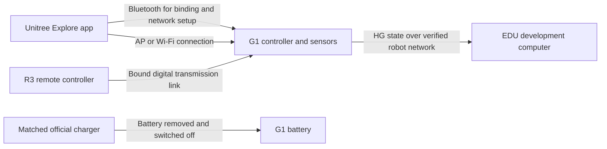

# Unitree G1 Standard and EDU: Robot Setup and State Development Guide


[**View the Unitree G1 Standard robot on OpenELAB**](https://openelab.io/products/unitree-g1-humanoid-robot)

**Model:** G1 Standard · **SKU:** `Unitree-G1` · **Option:** `Default Title`

**G1 EDU packages:** [**U1**](https://openelab.io/products/unitree-g1-edu-standard-u1) (`Unitree-G1edu-U1`), [**U2**](https://openelab.io/products/unitree-g1-edu-plus-u2) (`Unitree-G1edu-U2`), [**U3**](https://openelab.io/products/unitree-g1-edu-ultimate-u3) (`Unitree-G1edu-U3`), [**U4**](https://openelab.io/products/unitree-g1-edu-ultimate-b-u4) (`Unitree-G1edu-U4`), [**U5**](https://openelab.io/products/unitree-g1-edu-ultimate-u5) (`Unitree-G1edu-U5`), [**U6**](https://openelab.io/products/unitree-g1-edu-ultimate-d-u6-humanoid-robot) (`Unitree-G1edu-U6`), [**U7**](https://openelab.io/products/unitree-g1edu-u7-humanoid-robot) (`Unitree-G1edu-U7`), [**U8**](https://openelab.io/products/unitree-g1edu-u8-humanoid-robot) (`Unitree-G1edu-U8`), [**U9**](https://openelab.io/products/unitree-g1edu-u9-humanoid-robot) (`Unitree-G1edu-U9`), [**U10**](https://openelab.io/products/unitree-g1edu-u10-humanoid-robot) (`Unitree-G1edu-U10`). Each observed EDU listing has the option `Default Title`.


## Product overview <a href="#product-overview" id="product-overview"></a>

The Unitree G1 is a battery-powered biped humanoid with six joints per leg, onboard perception, a wireless controller and app-based inspection. G1 Standard is the retail demonstration model; G1 EDU provides the documented route to secondary development. This guide explains model selection, preparation, charging, inspection and an initial **subscriber-only G1 EDU state check**. It does not establish SDK access for Standard. Unitree's comparison marks secondary development `/` for G1 and `YES` for G1 EDU; the Standard OpenELAB listing also explicitly says it is not intended for programming or adding functions. [G1 manufacturer specifications](https://www.unitree.com/g1); [OpenELAB G1 listing](https://openelab.io/products/unitree-g1-humanoid-robot)

“EDU Standard (U1)” means an EDU package, whereas “G1 Standard” here means the base `Unitree-G1`. Keep those identities separate even though both can have 23 body degrees of freedom (DoF). G1-D/G1-A dual-arm systems, G1+, G1-Comp, G1-Boxing and third-party hand controllers require their own configuration documentation. In particular, **Ultimate D (U6)** is a G1 EDU package name; it is not the G1-D mobile manipulator. [OpenELAB G1 listing](https://openelab.io/products/unitree-g1-humanoid-robot); [G1 manufacturer specifications](https://www.unitree.com/g1)

### Match the purchased package before development <a href="#match-the-purchased-package-before-development" id="match-the-purchased-package-before-development"></a>

These are exact OpenELAB catalog labels/SKUs, reviewed November 24, 2026. Package DoF, hand and compute details below are **store descriptions**, not an independent manufacturer certification of each U-number. The current manufacturer G1 page provides a family-level 23–43 DoF EDU envelope, not a U1–U10 configuration matrix. Confirm the delivered bill of materials, serial label, hand controller and joint layout before selecting a robot description or control example. Prices, availability and delivery remain on the linked store pages. [OpenELAB G1 listing](https://openelab.io/products/unitree-g1-humanoid-robot); [G1 manufacturer specifications](https://www.unitree.com/g1)

| Listing / package | Exact SKU           | Store-described distinction and integration implication                                                                                                |
| ----------------- | ------------------- | ------------------------------------------------------------------------------------------------------------------------------------------------------ |
| G1 Standard       | `Unitree-G1`        | 23 DoF, no dexterous hands; use app/controller functions. Do not infer development access.                                                             |
| EDU Standard U1   | `Unitree-G1edu-U1`  | 23 DoF; listing describes 100 TOPS compute. Confirm installed compute identity and power mode.                                                         |
| EDU Plus U2       | `Unitree-G1edu-U2`  | 29 DoF; three-axis waist and seven-axis arms in listing. Requires the actual unlocked/locked waist configuration.                                      |
| EDU Ultimate A U3 | `Unitree-G1edu-U3`  | 43 total DoF; listing includes two Dex3-1 three-finger force-controlled hands. Tactile sensing is not explicitly promised in that package description. |
| EDU Ultimate B U4 | `Unitree-G1edu-U4`  | 43 total DoF; listing includes two Dex3-1 three-finger force-controlled hands with tactile sensors. Confirm hand revision and controller.              |
| EDU Ultimate C U5 | `Unitree-G1edu-U5`  | 41 total DoF; listing names two Inspire hands, `RH56DFQ-2R` and `RH56DFQ-2L`. Do not address them with Dex3-1 commands.                                |
| EDU Ultimate D U6 | `Unitree-G1edu-U6`  | 41 total DoF; listing names the same Inspire right/left hand identifiers. This is a G1 EDU biped package.                                              |
| EDU U7            | `Unitree-G1edu-U7`  | Listing gives a 23–43 DoF family range, not one resolved hardware layout; exact BOM remains essential.                                                 |
| EDU U8            | `Unitree-G1edu-U8`  | 37 total DoF; two Dex3-1 hands without tactile sensing, according to listing.                                                                          |
| EDU U9            | `Unitree-G1edu-U9`  | 37 total DoF; two tactile Dex3-1 hands; listing says 33 tactile sensors. The counting basis needs confirmation.                                        |
| EDU U10           | `Unitree-G1edu-U10` | 35 total DoF; two BrainCo Revo 2 Basic five-finger hands, according to listing. Requires that hand vendor's interface documentation.                   |

Hand joints are not automatically additional entries in the body SDK motor map. A total advertised DoF count may include hands, optional wrists and waist axes that use different interfaces. The inspected G1 body example uses a 29-position index layout, while the HG state message reserves 35 motor slots; neither number is a statement that every package has 29 or 35 active body motors. [G1 SDK example](https://github.com/unitreerobotics/unitree_sdk2_python/blob/814556d15970dd2ecf1c9984e845ca02ab07e206/example/g1/low_level/g1_low_level_example.py); [HG state schema](https://github.com/unitreerobotics/unitree_sdk2_python/blob/814556d15970dd2ecf1c9984e845ca02ab07e206/unitree_sdk2py/idl/unitree_hg/msg/dds_/_LowState_.py)

## Applications <a href="#applications" id="applications"></a>

G1 Standard supports demonstrations through the delivered controller/app, including documented locomotion and interaction functions. EDU can support humanoid sensing, control coursework, state logging, simulation-to-hardware research and manipulation development when the installed hardware, interfaces and firmware match the project. Start an EDU project with identity and state acquisition; validate sensor frames and the joint map before commanding motion. [G1 manufacturer specifications](https://www.unitree.com/g1); [G1 User Manual](https://marketing.unitree.com/article/en/G1/User_Manual.html); [G1 SDK example](https://github.com/unitreerobotics/unitree_sdk2_python/blob/814556d15970dd2ecf1c9984e845ca02ab07e206/example/g1/low_level/g1_low_level_example.py)

The public manual specifies open, flat, unobstructed ground, a 0–40°C operating environment, visibility of the robot and at least 2 m clearance from obstacles, crowds and water. It explicitly says G1 is neither waterproof nor dustproof. Avoid rain, wet surfaces, ice, loose dust and gravel. The remote manual's introduction mentions slopes/steps, but its operational warning says the current walking mode does **not** include stair climbing. Do not turn demonstration footage or that introductory language into an out-of-box stair-climbing procedure. [G1 User Manual, printed pp. 11, 25–26](https://marketing.unitree.com/article/en/G1/User_Manual.html); [G1 Remote Control Manual, p. 7](https://marketing.unitree.com/article/en/G1/Remote_Control.html)

## Specifications <a href="#specifications" id="specifications"></a>

### G1 Standard versus G1 EDU <a href="#g1-standard-versus-g1-edu" id="g1-standard-versus-g1-edu"></a>

Values below are manufacturer-reported, not OpenELAB bench measurements. Configuration and posture affect weight, reach, endurance and load. Maximum joint torque is not continuous torque, and maximum arm load is not a rated payload at every extension. [P1](https://www.unitree.com/g1)

| Parameter                                 | G1 Standard                                                | G1 EDU                                 | Conditions / selection consequence                              |
| ----------------------------------------- | ---------------------------------------------------------- | -------------------------------------- | --------------------------------------------------------------- |
| Standing size, height × width × thickness | 1320 × 450 × 200 mm                                        | Same family dimensions                 | Check actual hand/cable envelope.                               |
| Folded size, same axis order              | 690 × 450 × 300 mm                                         | Same family dimensions                 | Packaging orientation is separately specified in M1.            |
| Weight including battery                  | About 35 kg                                                | About 35 kg+                           | EDU accessories change mass and balance.                        |
| Total joint DoF                           | 23                                                         | 23–43                                  | Family range; identify purchased configuration.                 |
| Each leg                                  | 6                                                          | 6                                      | Two legs, twelve leg joints.                                    |
| Waist                                     | 1                                                          | 1, optionally 2 additional axes        | Hardware fastener and software lock must agree.                 |
| Each arm                                  | 5                                                          | Base description 5, optional wrists    | Store U2–U6 descriptions include seven-axis arms.               |
| Hand                                      | None listed                                                | Optional Dex3-1: 7 active DoF per hand | Thumb 3, index 2, middle 2; other packages use different hands. |
| Maximum knee joint torque                 | 90 N·m                                                     | 120 N·m                                | Maximum, not sustained operating torque.                        |
| Maximum arm load                          | About 2 kg                                                 | About 3 kg                             | Strongly dependent on arm extension/posture.                    |
| Calf + thigh length / arm span            | 0.6 m / about 0.45 m                                       | Same family figures                    | Not a collision-free workspace model.                           |
| Joint sensing / cooling                   | Dual encoders / local air cooling                          | Same family description                | Keep cooling inlets and outlets unobstructed.                   |
| Base compute                              | 8-core CPU                                                 | 8-core CPU                             | EDU high-compute module is configuration dependent.             |
| Perception                                | Depth camera + 3D LiDAR                                    | Same family description                | Read actual sensor model/revision.                              |
| Audio / wireless                          | Four-microphone array, 5 W speaker; Wi-Fi 6, Bluetooth 5.2 | Same family description                | Radio reach and streaming depend on environment.                |
| Battery / runtime                         | Quick-release 9000 mAh; about 2 h                          | Same family figures                    | Speed, load, posture, terrain and temperature affect runtime.   |
| Secondary development                     | `/` in manufacturer table                                  | `YES`                                  | Public repository availability does not unlock Standard.        |

The current product page gives mechanical movement ranges: knee 0–165°, hip pitch ±154°, roll −30° to +170°, yaw ±158°, and waist yaw ±155°. EDU additionally lists waist roll/pitch and optional wrist ranges; these are **mechanical envelope data**, not safe trajectory limits. OpenELAB package copy gives waist X ±45°, while the current manufacturer page gives X ±30°. Resolve the exact hardware/controller limit before motion; do not average the numbers or use them as software end stops. [G1 manufacturer specifications](https://www.unitree.com/g1); [OpenELAB G1 listing](https://openelab.io/products/unitree-g1-humanoid-robot)

### Power and perception details that need exact revision matching <a href="#power-and-perception-details-that-need-exact-revision-matching" id="power-and-perception-details-that-need-exact-revision-matching"></a>

The dedicated battery manual V1.0 specifies 46.8 V nominal, 54.6 V charge limit, 9000 mAh / 421.2 Wh, and a 120 × 80 × 182 mm battery. Its charger table gives 100–240 V AC, 50/60 Hz input and **54.6 V, 5.5 A** output, with about 1.5 h charging. The product page instead summarizes the charger as **54 V, 5 A**. Use the label and matching official charger for the supplied battery; neither summary authorizes substituting a bench supply or another charger. Robot battery voltage is not a GPIO logic level or an accessory-power pinout. [G1 Battery Manual, pp. 2–3](https://marketing.unitree.com/article/en/G1/Battery_Charger.html); [G1 manufacturer specifications](https://www.unitree.com/g1)

M1 printed p. 8 identifies Livox MID360 and Intel RealSense D435i on the illustrated configuration. Its LiDAR field-of-view discussion gives 360° horizontal and 59° vertical; its later sensor table gives a different 360° × 90° figure and other sensor data. Those sections are internally inconsistent. Preserve the sensor identities as manual context, verify the installed parts, and obtain their exact documentation before relying on a field of view, range, point rate, intrinsic calibration or camera stream format. A body `LowState_` message does not contain camera frames or a point cloud. The later table also describes 1080p app video and a microphone pickup context of 5 m; these do not establish an SDK camera profile or guaranteed speech-recognition radius. [G1 User Manual, printed pp. 8, 27–28](https://marketing.unitree.com/article/en/G1/User_Manual.html); [HG state schema](https://github.com/unitreerobotics/unitree_sdk2_python/blob/814556d15970dd2ecf1c9984e845ca02ab07e206/unitree_sdk2py/idl/unitree_hg/msg/dds_/_LowState_.py)

## Hardware and connections <a href="#hardware-and-connections" id="hardware-and-connections"></a>

### Inspect, support and identify the robot <a href="#inspect-support-and-identify-the-robot" id="inspect-support-and-identify-the-robot"></a>

Before power, inspect the shell, joints, foot soles, battery bay, latches and wiring for damage or contamination. Check fasteners and cooling openings, and verify controller sticks return to their neutral position. Keep the camera window and LiDAR aperture clear. The manual calls for a protective frame with locked casters; use the dedicated shoulder suspension points and the illustrated support arrangement. A controller or computer connection is not a physical fall restraint. [G1 User Manual, printed pp. 11–16, 26–27](https://marketing.unitree.com/article/en/G1/User_Manual.html)

Install the switched-off battery from the side with its power switch toward the robot's back. Confirm both catches latch; if the pack will not seat, correct orientation instead of forcing the connector. Never install or remove it while powered. The front/back parts and mounting-hole figures in M1 distinguish the 23-DoF body from the illustrated 29-DoF EDU body. Use the original dimensioned figure for bracket work; screw engagement, accessory power limits and full electrical pinouts have not been established here. Do not derive them from photographs. [G1 User Manual, printed pp. 4–5, 12](https://marketing.unitree.com/article/en/G1/User_Manual.html); [G1 Battery Manual, pp. 2, 7](https://marketing.unitree.com/article/en/G1/Battery_Charger.html)

### Connection roles <a href="#connection-roles" id="connection-roles"></a>



This is an original connection-role diagram, not a pinout or a wiring drawing. The app and R3 wireless link are separate from the SDK's DDS network. M1 describes WLAN HTTP port `9991` as a WebRTC signalling service, Bluetooth Low Energy for app network configuration and a one-to-one remote-controller radio link; none is an invitation to expose robot services to the public Internet. [G1 User Manual, printed pp. 18–20, 27](https://marketing.unitree.com/article/en/G1/User_Manual.html); [G1 Remote Control Manual, pp. 2, 6](https://marketing.unitree.com/article/en/G1/Remote_Control.html); [SDK channel implementation](https://github.com/unitreerobotics/unitree_sdk2_python/blob/814556d15970dd2ecf1c9984e845ca02ab07e206/unitree_sdk2py/core/channel.py)

For EDU development, confirm the actual robot's supported Ethernet connector, computer interface, address plan and firmware with its supplied developer documentation. The ROS2 repository demonstrates a wired computer at `192.168.123.99` with mask `255.255.255.0` and an explicitly selected network interface. Treat that as the repository's example plan, not proof of every G1's factory address. Do not guess port wiring, PoE capability, connector power or SSH credentials. [R1](https://github.com/unitreerobotics/unitree_ros2/blob/668d1ec5a05d1c38d3306bdca7d59f2ba3581a88/README.md)

### Charging and battery management <a href="#charging-and-battery-management" id="charging-and-battery-management"></a>

1. Put the robot into the supported seated or suspended shutdown arrangement. Switch off the battery and remove it; let a hot pack cool to room temperature.
2. Inspect the official charger, battery casing and connectors. Keep the charging area dry, ventilated and free of combustible items, with the battery in sight.
3. Check the charger's actual AC input label, connect AC first, then connect the switched-off battery to its dedicated charging connector.
4. Watch the battery and charger indicators. The battery manual says all pack LEDs off at the end of charging means full; this differs from the R3 remote's all-lit full indication. Disconnect after completion.
5. Refit only after disconnecting the charger, with the battery off and both latches engaged. [G1 User Manual, printed pp. 9–10](https://marketing.unitree.com/article/en/G1/User_Manual.html); [G1 Battery Manual, pp. 5–8](https://marketing.unitree.com/article/en/G1/Battery_Charger.html)

**Below 10% battery charge, stop using the G1 as soon as possible and replace or recharge its battery.** Establish the supported seated or suspended shutdown arrangement and switch the pack off before removal; never swap a powered pack. This operating recommendation is separate from the LED display bands and the 39 V protective cutoff below. [G1 Battery Manual, p. 7](https://marketing.unitree.com/article/en/G1/Battery_Charger.html); [G1 User Manual, printed p. 22](https://marketing.unitree.com/article/en/G1/User_Manual.html)

M3 describes balancing, overcharge, temperature, overcurrent, short-circuit, low-voltage and load-detection protections. Its 39 V discharge cutoff and >10 A charging-current protection are protection thresholds, not recommended operating targets. The pack cannot normally turn on when removed and automatically turns off if removed while on; never test that behavior by pulling a live pack. [G1 Battery Manual, pp. 3–4](https://marketing.unitree.com/article/en/G1/Battery_Charger.html)

M3 has conflicting upper charging-temperature statements: its protection section refers to 50°C, while later guidance says 55°C. Its recommended charging ambient range is 5–40°C. Charge after cooling to room temperature within that recommended range; do not rely on either higher boundary to justify hot charging. For storage, remove the pack, keep it dry and away from heat/metal objects, and inspect its state of charge periodically. M3 recommends 22–28°C storage, describes self-discharge toward 65% after ten inactive days above that level, and says to recharge a stored pack below 30% to about 70%. Follow applicable carrier instructions for transport; do not transport a damaged pack. Route damaged packs to qualified battery service/recycling rather than attempting repairs or intentional deep discharge. [G1 Battery Manual, pp. 3, 7–9](https://marketing.unitree.com/article/en/G1/Battery_Charger.html)

M1 printed p. 7 describes its illustrated optional Dex3-1 as seven active hand DoF, 12–58 V operating voltage, a 10–2500 g perception range and nine array sensors. Those are manual-specific hand figures, not G1 battery output specifications or a U1–U10 tactile-count equivalence. The hand and its controller require their own exact revision documentation before connecting an external supply. [M1](https://marketing.unitree.com/article/en/G1/User_Manual.html)

### EDU waist fastener: physical and software state must agree <a href="#edu-waist-fastener-physical-and-software-state-must-agree" id="edu-waist-fastener-physical-and-software-state-must-agree"></a>

The waist-fastener manual V1.0 lists two fixing parts, two M5 screws and an Allen wrench. In the illustrated installation, tilt the supported body back to place part 1, then forward to place part 2, keep the waist cable clear and secure the two screws. No tightening torque is specified. Enable the waist motor lock in **Unitree Explore → Settings → Robot**, then restart as prompted. [G1 Waist Fastener Manual, pp. 2–4](https://marketing.unitree.com/article/en/G1/Lumbar_fasteners.html)

Removal reverses that sequence: support the body, remove the screws and part 2, then part 1; disable the waist motor lock in the same app area and restart as prompted. M4 warns that calibration performed in the locked 27-joint configuration affects subsequent use of the unlocked 29-joint configuration. Do not treat removing the fixture as a software-only change or perform a routine recalibration to troubleshoot communication. Consult Unitree about any calibration transition. The SDK's waist indices 13/14 are explicitly invalid for a 23-DoF or waist-locked configuration. [G1 Waist Fastener Manual, pp. 4–6](https://marketing.unitree.com/article/en/G1/Lumbar_fasteners.html); [G1 SDK example](https://github.com/unitreerobotics/unitree_sdk2_python/blob/814556d15970dd2ecf1c9984e845ca02ab07e206/example/g1/low_level/g1_low_level_example.py)

## Software and development resources <a href="#software-and-development-resources" id="software-and-development-resources"></a>

### Choose the G1 HG contract <a href="#choose-the-g1-hg-contract" id="choose-the-g1-hg-contract"></a>

| Resource reviewed                          | Source version / role                                               | Practical boundary                                                                                                                                                 |
| ------------------------------------------ | ------------------------------------------------------------------- | ------------------------------------------------------------------------------------------------------------------------------------------------------------------ |
| `unitree_sdk2`                             | Commit `b7fec6020eb93d4c059a6edf19905e12a75a8d3d`; C++ SDK          | README prebuilt environment: Ubuntu 20.04, `aarch64`/`x86_64`, GCC 9.4.0; CMake ≥3.10. These are source-stated environments, not testing performed for this guide. |
| `unitree_sdk2_python`                      | Commit `814556d15970dd2ecf1c9984e845ca02ab07e206`; Python interface | `setup.py` version `1.0.1`, Python ≥3.8, `cyclonedds==0.10.2`, `numpy`, `opencv-python`; BSD-3-Clause.                                                             |
| Python G1 example / channel implementation | Same Python commit                                                  | G1 uses `unitree_hg`, not `unitree_go`; subscribe to `rt/lowstate` with `LowState_`.                                                                               |
| `unitree_ros2`                             | Commit `668d1ec5a05d1c38d3306bdca7d59f2ba3581a88`                   | README lists Ubuntu 20.04/Foxy and 22.04/Humble, with Humble recommended. G1 HG state reader is the relevant source.                                               |

Sources: [Python SDK README](https://github.com/unitreerobotics/unitree_sdk2_python/blob/814556d15970dd2ecf1c9984e845ca02ab07e206/README.md); [SDK channel implementation](https://github.com/unitreerobotics/unitree_sdk2_python/blob/814556d15970dd2ecf1c9984e845ca02ab07e206/unitree_sdk2py/core/channel.py); [G1 SDK example](https://github.com/unitreerobotics/unitree_sdk2_python/blob/814556d15970dd2ecf1c9984e845ca02ab07e206/example/g1/low_level/g1_low_level_example.py); [HG state schema](https://github.com/unitreerobotics/unitree_sdk2_python/blob/814556d15970dd2ecf1c9984e845ca02ab07e206/unitree_sdk2py/idl/unitree_hg/msg/dds_/_LowState_.py); [ROS2 README](https://github.com/unitreerobotics/unitree_ros2/blob/668d1ec5a05d1c38d3306bdca7d59f2ba3581a88/README.md); [ROS2 HG state reader](https://github.com/unitreerobotics/unitree_ros2/blob/668d1ec5a05d1c38d3306bdca7d59f2ba3581a88/example/src/src/read_low_state_hg.cpp). Exact firmware-to-SDK compatibility for the received serial/revision remains unverified. Preserve the installed firmware version before changing the host environment; a repository commit is not a firmware release approval.

Use [Unitree SDK2 state development](unitree-sdk2-state-development.md) for the common host/dependency workflow and [Unitree ROS2 integration](unitree-ros2-integration.md) for middleware and workspace configuration. The G1-specific requirements below still apply. The generic Python README's “low-level status” path also appears under active motor control and discusses a quadruped leg. Do not use that filename alone as evidence that a program is passive or G1-compatible. [Python SDK README](https://github.com/unitreerobotics/unitree_sdk2_python/blob/814556d15970dd2ecf1c9984e845ca02ab07e206/README.md); [G1 SDK example](https://github.com/unitreerobotics/unitree_sdk2_python/blob/814556d15970dd2ecf1c9984e845ca02ab07e206/example/g1/low_level/g1_low_level_example.py)

The inspected G1 motion example instantiates a `ChannelPublisher` for `rt/lowcmd`, calls `MotionSwitcherClient.ReleaseMode()`, and later writes motor commands. Its body index map is useful evidence, but running it changes robot control and motion. The first state check below uses only the subscriber API. It does not release a motion service, select Develop mode, create a motor command or publish `rt/lowcmd`. DDS discovery traffic will still occur. [SDK channel implementation](https://github.com/unitreerobotics/unitree_sdk2_python/blob/814556d15970dd2ecf1c9984e845ca02ab07e206/unitree_sdk2py/core/channel.py); [G1 SDK example](https://github.com/unitreerobotics/unitree_sdk2_python/blob/814556d15970dd2ecf1c9984e845ca02ab07e206/example/g1/low_level/g1_low_level_example.py)

### Interpret body state without inventing joints <a href="#interpret-body-state-without-inventing-joints" id="interpret-body-state-without-inventing-joints"></a>

The inspected HG schema contains `version`, `mode_pr`, `mode_machine`, `tick`, `imu_state`, `motor_state[35]`, `wireless_remote[40]`, reserved fields and `crc`. The array capacity is not a count of fitted joints. The body example assigns indices 0–5 to the left leg, 6–11 to the right leg, 12 to waist yaw, 13/14 to optional waist roll/pitch, 15–21 to the left arm/wrist and 22–28 to the right arm/wrist. It marks 13/14 invalid when the waist is locked or on a 23-DoF configuration, and 20/21/27/28 invalid for 23 DoF. [G1 SDK example](https://github.com/unitreerobotics/unitree_sdk2_python/blob/814556d15970dd2ecf1c9984e845ca02ab07e206/example/g1/low_level/g1_low_level_example.py); [HG state schema](https://github.com/unitreerobotics/unitree_sdk2_python/blob/814556d15970dd2ecf1c9984e845ca02ab07e206/unitree_sdk2py/idl/unitree_hg/msg/dds_/_LowState_.py)

For the first check, read left knee index `3`, which the inspected map identifies independently of optional wrists and waist. `q` is in radians and `dq` in radians per second in the ROS HG example; `tau_est` is an estimated torque field, not a calibrated hand/contact-force measurement. Do not infer battery voltage fields from a Go2 example: the reviewed HG top-level schema has no `power_v`/`power_a`. IMU, camera, LiDAR, body joints and external hands are separate contracts. [G1 SDK example](https://github.com/unitreerobotics/unitree_sdk2_python/blob/814556d15970dd2ecf1c9984e845ca02ab07e206/example/g1/low_level/g1_low_level_example.py); [HG state schema](https://github.com/unitreerobotics/unitree_sdk2_python/blob/814556d15970dd2ecf1c9984e845ca02ab07e206/unitree_sdk2py/idl/unitree_hg/msg/dds_/_LowState_.py); [ROS2 HG state reader](https://github.com/unitreerobotics/unitree_ros2/blob/668d1ec5a05d1c38d3306bdca7d59f2ba3581a88/example/src/src/read_low_state_hg.cpp)

## Getting started <a href="#getting-started" id="getting-started"></a>

1. Match the delivered SKU, body configuration and firmware, then prepare the supported startup/shutdown arrangement.
2. Bind Unitree Explore and inspect status; Standard users stop at the supported app/controller workflow.
3. On a documented compatible EDU network and prepared host, save the subscriber below, substitute the actual interface name and inspect three received state samples.
4. If no state arrives, follow the communication checks before attempting any control operation; finish with a supported shutdown.

### 1. Record identity and prepare the supported shutdown path <a href="#id-1-record-identity-and-prepare-the-supported-shutdown-path" id="id-1-record-identity-and-prepare-the-supported-shutdown-path"></a>

Record SKU, serial number, body DoF, optional hands and wrist axes, waist-fastener/lock state, compute module, app version, firmware version and chosen SDK commit. Stop preparation if a delivered configuration cannot be matched to the relevant documentation. Keep an adult trained operator, a suitable protective frame and a charged paired remote available. G1 is not a toy. [G1 User Manual, printed pp. 3, 11–16](https://marketing.unitree.com/article/en/G1/User_Manual.html); [G1 Waist Fastener Manual](https://marketing.unitree.com/article/en/G1/Lumbar_fasteners.html)

M1 V1.6 supports seated startup and suspended startup. For suspension, use the shoulder attachment points, secure the frame and arrange limbs naturally with no entanglement. Insert and latch the battery while off, short-press its button once and then hold for more than 2 s. Initialization takes about a minute and initially reaches zero-torque state. Do not proceed into standing/walking as a requirement for reading state. Read the complete illustrated startup sequence before operating a physical unit. [G1 User Manual, printed pp. 12–17](https://marketing.unitree.com/article/en/G1/User_Manual.html)

### 2. Bind the app and inspect status <a href="#id-2-bind-the-app-and-inspect-status" id="id-2-bind-the-app-and-inspect-status"></a>

Install Unitree Explore from the [official G1 app page](https://www.unitree.com/app/g1), sign in, enable the phone's Bluetooth permission and stay near the robot. Choose **Add Robot**, select the correct G1 and complete the displayed AP-direct or Wi-Fi binding workflow. In AP mode, connect to the named robot hotspot; a hotspot name with spaces or special symbols can prevent setup. Follow the app's current network prompts. [G1 User Manual, printed pp. 18–19](https://marketing.unitree.com/article/en/G1/User_Manual.html)

Complete the app's built-in tutorial and use its inspection/data screens to read motor/status information. This is the supported first inspection path for Standard as well as EDU. To bind an R3 controller, open **Settings → Remote Control Settings**, enter the delivered controller code and verify the right-side **DL** link indicator comes on. Do not copy a code from a screenshot. An R3 switches on with a short press followed by a hold longer than 2 s. [G1 User Manual, printed p. 20](https://marketing.unitree.com/article/en/G1/User_Manual.html); [G1 Remote Control Manual, pp. 4, 6](https://marketing.unitree.com/article/en/G1/Remote_Control.html)

### 3. Prepare an EDU host for a passive state subscription <a href="#id-3-prepare-an-edu-host-for-a-passive-state-subscription" id="id-3-prepare-an-edu-host-for-a-passive-state-subscription"></a>

Use an EDU unit with confirmed network access and an already prepared Python SDK environment matching the reviewed commit/dependencies. For installation and host setup, follow the common SDK2 guide. Connect through the documented robot network and explicitly select the host interface connected to it; replace `ROBOT_INTERFACE` below with that actual name. If using the ROS repository's `192.168.123.0/24` example plan, confirm no address collision and that this is the supplied unit's network before assigning `192.168.123.99/24`. SDK subscriptions are not a reason to change robot firmware or enter diagnostic motion. [Python SDK README](https://github.com/unitreerobotics/unitree_sdk2_python/blob/814556d15970dd2ecf1c9984e845ca02ab07e206/README.md); [SDK channel implementation](https://github.com/unitreerobotics/unitree_sdk2_python/blob/814556d15970dd2ecf1c9984e845ca02ab07e206/unitree_sdk2py/core/channel.py); [G1 SDK example](https://github.com/unitreerobotics/unitree_sdk2_python/blob/814556d15970dd2ecf1c9984e845ca02ab07e206/example/g1/low_level/g1_low_level_example.py); [ROS2 README](https://github.com/unitreerobotics/unitree_ros2/blob/668d1ec5a05d1c38d3306bdca7d59f2ba3581a88/README.md)

The following is an **original, unexecuted subscriber-only example** based on the inspected channel API and G1 HG type. Save as `g1_read_state.py`. It reads up to three samples, exits after a bounded wait when none arrive, and prints left-knee state; it does not command the robot.

```python
import argparse
import time
from unitree_sdk2py.core.channel import ChannelFactoryInitialize, ChannelSubscriber
from unitree_sdk2py.idl.unitree_hg.msg.dds_ import LowState_

parser = argparse.ArgumentParser(description="Read G1 EDU HG body state only")
parser.add_argument("interface", help="Host network interface connected to the robot")
args = parser.parse_args()

ChannelFactoryInitialize(0, args.interface)
reader = ChannelSubscriber("rt/lowstate", LowState_)
reader.Init()
samples = 0
last_tick = None
deadline = time.monotonic() + 10.0
try:
    while samples < 3 and time.monotonic() < deadline:
        state = reader.Read(1)
        if state is None:
            continue
        knee = state.motor_state[3]
        print(f"tick={state.tick} left_knee_q_rad={knee.q:.6f} "
              f"left_knee_dq_rad_s={knee.dq:.6f}")
        if last_tick is not None and state.tick == last_tick:
            print("Repeated tick: inspect freshness before using the sample.")
        last_tick = state.tick
        samples += 1
finally:
    reader.Close()
if samples < 3:
    raise SystemExit("Fewer than three samples; check network, HG type and firmware support.")
```

```bash
python3 g1_read_state.py ROBOT_INTERFACE
```

**Expected result:** three decoded state lines containing `tick`, `left_knee_q_rad` and `left_knee_dq_rad_s`. Values are actual observations only when you run the program on the identified EDU unit; no example numbers or successful robot logs are claimed here. Check sample freshness over a longer passive capture before using the stream in analysis. Three samples establish only basic reception, not timing, calibration, full robot health or closed-loop readiness. A failed subscription must be diagnosed as a communication problem before trying motor commands. [SDK channel implementation](https://github.com/unitreerobotics/unitree_sdk2_python/blob/814556d15970dd2ecf1c9984e845ca02ab07e206/unitree_sdk2py/core/channel.py); [G1 SDK example](https://github.com/unitreerobotics/unitree_sdk2_python/blob/814556d15970dd2ecf1c9984e845ca02ab07e206/example/g1/low_level/g1_low_level_example.py); [HG state schema](https://github.com/unitreerobotics/unitree_sdk2_python/blob/814556d15970dd2ecf1c9984e845ca02ab07e206/unitree_sdk2py/idl/unitree_hg/msg/dds_/_LowState_.py); [ROS2 HG state reader](https://github.com/unitreerobotics/unitree_ros2/blob/668d1ec5a05d1c38d3306bdca7d59f2ba3581a88/example/src/src/read_low_state_hg.cpp)

For ROS2, the reviewed G1 reader subscribes using `unitree_hg::msg::LowState` on `lowstate`, or `lf/lowstate` when its high-frequency selector is off. Its source comments reference 500 Hz, but this is not a measured rate for your robot. The example prints only the first twelve motor entries; its output is not a full arm/waist inventory. In an established ROS2 environment, inspect the actual topic/type before echoing state; do not use a Go2 `unitree_go` decoder or a publisher to test connectivity. [ROS2 README](https://github.com/unitreerobotics/unitree_ros2/blob/668d1ec5a05d1c38d3306bdca7d59f2ba3581a88/README.md); [ROS2 HG state reader](https://github.com/unitreerobotics/unitree_ros2/blob/668d1ec5a05d1c38d3306bdca7d59f2ba3581a88/example/src/src/read_low_state_hg.cpp)

### 4. Keep operation and development modes distinct <a href="#id-4-keep-operation-and-development-modes-distinct" id="id-4-keep-operation-and-development-modes-distinct"></a>

M1 V1.6 describes normal startup transitions through damping (`L2+B`), ready (`L2+UP`) and operation control (`R2+A`); these are **motion-related actions**, not requirements of the passive subscriber above. The earlier remote manual V1.3 contains additional modes and older button tables. M1's revision history records the August 2025 change to `R2+A` and the double-tap `START` standing/walking toggle. Confirm the installed firmware and supplied controller label before using any mode shortcut. [G1 User Manual, printed pp. 13, 16–17, 30](https://marketing.unitree.com/article/en/G1/User_Manual.html); [G1 Remote Control Manual, pp. 8–10](https://marketing.unitree.com/article/en/G1/Remote_Control.html)

For active EDU low-level development, M1 says to suspend the robot in damping and enter Develop mode with `L2+R2`; `L2+A` then produces a diagnostic position posture and `L2+B` returns to damping. This deliberately moves joints and is outside the first-result procedure. It matters because the built-in control program may otherwise keep sending zero-speed commands, causing conflicts/jitter with a custom controller. The manual also says remote commands remain valid during high-level development but fail during low-level development. Do not assume a remote button is an independent emergency stop in every SDK mode. [G1 User Manual, printed pp. 3, 21](https://marketing.unitree.com/article/en/G1/User_Manual.html)

### 5. Power down and pack without losing support <a href="#id-5-power-down-and-pack-without-losing-support" id="id-5-power-down-and-pack-without-losing-support"></a>

Before shutting down, return the robot to the manual's supported seated or suspended arrangement and damping state. Switching off an unsupported upright biped removes the torque holding it up. For the identified battery, M3 specifies a short press followed by a hold over 2 s for normal power-off; the indicators then go out. If the remote cannot provide the normal mode transition, use the source-specific [remote-loss recovery](unitree-g1-standard-edu-development-guide.md#remote-control-fails-before-you-can-shut-down) below. [G1 User Manual, printed p. 22](https://marketing.unitree.com/article/en/G1/User_Manual.html); [G1 Battery Manual, p. 5](https://marketing.unitree.com/article/en/G1/Battery_Charger.html)

After power-off, remove the battery for extended storage. For packing, use the matching shaped case and M1's illustrated sequence: support vertically, fold the legs in the shown direction, lower the rear into its designated position, orient head/chest down, place arms alongside the body and fold the legs into the lining. Preserve the middle protective insert and protect every contact surface. Hand packages can change the required clearance; never force a wrist or hand into the base case shape. [G1 User Manual, printed pp. 22–23](https://marketing.unitree.com/article/en/G1/User_Manual.html); [G1 Remote Control Manual, p. 10](https://marketing.unitree.com/article/en/G1/Remote_Control.html)

## Troubleshooting and FAQs <a href="#troubleshooting-and-faqs" id="troubleshooting-and-faqs"></a>

### No G1 EDU state arrives, or the message does not decode <a href="#no-g1-edu-state-arrives-or-the-message-does-not-decode" id="no-g1-edu-state-arrives-or-the-message-does-not-decode"></a>

Confirm the exact EDU identity, then the connected interface/link and the actual supplied address plan. Check that host routing and DDS interface selection reach that link, and that the host has the reviewed Python/CycloneDDS environment. Next verify `unitree_hg.msg.dds_.LowState_`, `rt/lowstate` and the firmware's supported state contract. A successful IP connection alone does not prove DDS discovery/type compatibility. Do not try `ReleaseMode()`, change the battery firmware or run a torque example to repair a passive receive failure. If middleware cannot locate CycloneDDS, the Python README describes `CYCLONEDDS_HOME`/`CMAKE_PREFIX_PATH`; follow the common host guide before reconnecting to hardware. [Python SDK README](https://github.com/unitreerobotics/unitree_sdk2_python/blob/814556d15970dd2ecf1c9984e845ca02ab07e206/README.md); [SDK channel implementation](https://github.com/unitreerobotics/unitree_sdk2_python/blob/814556d15970dd2ecf1c9984e845ca02ab07e206/unitree_sdk2py/core/channel.py); [G1 SDK example](https://github.com/unitreerobotics/unitree_sdk2_python/blob/814556d15970dd2ecf1c9984e845ca02ab07e206/example/g1/low_level/g1_low_level_example.py); [HG state schema](https://github.com/unitreerobotics/unitree_sdk2_python/blob/814556d15970dd2ecf1c9984e845ca02ab07e206/unitree_sdk2py/idl/unitree_hg/msg/dds_/_LowState_.py); [ROS2 README](https://github.com/unitreerobotics/unitree_ros2/blob/668d1ec5a05d1c38d3306bdca7d59f2ba3581a88/README.md)

### The app cannot connect, or the controller DL light stays off <a href="#the-app-cannot-connect-or-the-controller-dl-light-stays-off" id="the-app-cannot-connect-or-the-controller-dl-light-stays-off"></a>

Keep Bluetooth enabled and grant the app its Bluetooth permission. Confirm the right robot and AP/Wi-Fi mode, phone-to-hotspot connection and a hotspot name without spaces/special symbols. Move the phone close, then retry the app connection with the robot safely supported. For R3, check its charge and bind its own code through **Remote Control Settings**; the DL indicator confirms the robot data link. Account transfer uses **Settings → Robot Settings → Unbind**, then binding by the new account; an inaccessible old account requires Unitree assistance, not a factory-reset guess. [G1 User Manual, printed pp. 18–20, 24](https://marketing.unitree.com/article/en/G1/User_Manual.html); [G1 Remote Control Manual, p. 6](https://marketing.unitree.com/article/en/G1/Remote_Control.html)

### Remote control fails before you can shut down <a href="#remote-control-fails-before-you-can-shut-down" id="remote-control-fails-before-you-can-shut-down"></a>

M1 V1.6 printed p. 24 addresses remote-module failure, including a depleted remote or phone, with the robot suspended in standby. Its battery-button fallback requires secure suspension on the protective frame, **both feet clear of the ground**, and at least **2 m clearance** from obstacles, complex terrain, people, water and other objects. Once that support is established, M1 specifies a short press of the battery button followed by a hold **over 2 s** to switch off. This is not a procedure for approaching an uncontrolled biped or catching it by hand; keep clear of moving joints, and obtain trained assistance if the required support cannot be established safely. [G1 User Manual, printed p. 24](https://marketing.unitree.com/article/en/G1/User_Manual.html)

M1 calls that remote-loss route “forced shutdown.” M3 V1.0 p. 5 uses “Force Shutdown” for a different battery-level action: holding the button **over 10 s**. The shared name does not make the actions interchangeable: remote loss alone does not call for the >10 s battery action. Both can remove supporting torque; never attempt either on a freely standing robot. Confirm the supplied battery revision and robot firmware with Unitree if their behavior or documentation differs, rather than guessing timings or repeatedly cycling power. [G1 User Manual, printed p. 24](https://marketing.unitree.com/article/en/G1/User_Manual.html); [G1 Battery Manual, p. 5](https://marketing.unitree.com/article/en/G1/Battery_Charger.html)

### Startup fails, the robot jitters, falls or cannot stand <a href="#startup-fails-the-robot-jitters-falls-or-cannot-stand" id="startup-fails-the-robot-jitters-falls-or-cannot-stand"></a>

Stop motion and secure the robot. M1 says failed initialization can be associated with the startup posture; repeat the pre-power inspection and limb/support checks before a supported restart. Its abnormal-condition section gives a 30 s ankle self-test cue, while the startup section says about a minute for overall initialization; do not mistake those for one universal timeout. If an EDU controller jitters, check for conflicting built-in/custom command sources and the documented Develop-mode prerequisites. If instability persists, contact Unitree before recalibration. The robot is factory calibrated; M1 explicitly says not to recalibrate for normal use. [G1 User Manual, printed pp. 13, 16, 21, 24](https://marketing.unitree.com/article/en/G1/User_Manual.html)

For an unexpected state in normal operation, M1 describes holding `L2+B` for over 5 s to enter damping, with the robot slowly falling toward the ground. This is not a promise of balance-preserving braking, and low-level SDK operation can invalidate remote commands. Keep the fall zone clear and use the already established physical support and shutdown plan. Fall self-protection in the manufacturer's normal controller does not establish equivalent protection for a custom controller. [G1 User Manual, printed pp. 3, 13, 17, 24](https://marketing.unitree.com/article/en/G1/User_Manual.html)

### Battery does not power on, charge, or shows red flashing LEDs <a href="#battery-does-not-power-on-charge-or-shows-red-flashing-leds" id="battery-does-not-power-on-charge-or-shows-red-flashing-leds"></a>

First distinguish a removed pack's normal load-detection behavior from a fault. Check seating/latches, charger identity, connector condition and temperature after power is safely off. In M3 p. 6, red flashing on LED2 indicates a high/low temperature fault; LED3 indicates a voltage fault; LED4 indicates overcurrent/short circuit. All four flashing at 2.5 Hz calls for detailed fault inspection; all four at 5 Hz is firmware-update mode. These patterns belong to that battery revision, not the R3 controller. Stop using a damaged, wet, deformed or seriously impacted pack and seek official service. Do not bypass protection, disassemble the pack or intentionally short terminals. [G1 Battery Manual, pp. 3–9](https://marketing.unitree.com/article/en/G1/Battery_Charger.html)

### Sticks drift, or remote feedback is confusing <a href="#sticks-drift-or-remote-feedback-is-confusing" id="sticks-drift-or-remote-feedback-is-confusing"></a>

Inspect stick installation, neutral return, damage and debris with the robot safely supported and no active motion test running. The R3 manual describes calibration: release untouched sticks, press/release `F1` and `F3` together to enter calibration, then move both sticks through full travel until the repeating sound stops, and press `F3` once to save calibration. Its feedback settings use three presses of `F3` to switch sound/vibration and three presses of `F1` to turn feedback on/off; holding `F1` during shutdown saves that feedback choice. Do not confuse remote-stick calibration with robot-joint calibration. [G1 Remote Control Manual, pp. 3–5](https://marketing.unitree.com/article/en/G1/Remote_Control.html)

### Battery indicator and remote-control checks <a href="#battery-indicator-and-remote-control-checks" id="battery-indicator-and-remote-control-checks"></a>

M3 distinguishes battery LEDs by operating state: white for the off-state level check, green during output, and a flashing/steady progression during charge. Its level table uses nine bands: 0–4%, 4–16%, 16–28%, 28–40%, 40–52%, 52–64%, 64–76%, 76–88%, and 88–100%. Do not apply the remote's four-quarter charge display to this pack. In M3 p. 6's protection table, red flashing at 2.5 Hz on LED2 indicates temperature, LED3 voltage, and LED4 overcurrent/short circuit. All four red at 2.5 Hz requests computer-side fault inspection; all four at 5 Hz is the documented firmware-update indication. Record the pattern and stop charging/use while determining the cause; the LED table is not a repair or flashing procedure. [M3](https://marketing.unitree.com/article/en/G1/Battery_Charger.html)

For the R3 remote, remove the two detachable sticks from their storage recess and screw them clockwise into their sockets; return them to storage for transport. With no robot/phone connection or operation, M2 describes automatic remote power-off within ten minutes. This is not a robot fall-protection feature.

For the R3 remote, left-stick vertical travel commands forward/backward motion and right-stick horizontal travel commands turning in the illustrated mode. Neutral stick position is essential, and walls/doors can weaken the radio link despite the open-environment range claim of over 100 m. Zero torque, damping, ready, squat, seat, motion and standing are distinct states; the remote manual explicitly says squat/seat transitions have no balance control. Its standing mode can step to recover balance, even with neutral input. Keep the robot supported during setup. [M2](https://marketing.unitree.com/article/en/G1/Remote_Control.html)

The remote's `F3` triple press toggles vibration/sound selection; `F1` triple press toggles feedback on/off. M2 says to hold `F1` during shutdown to retain a changed feedback mode. For remote-stick calibration, keep hands off the sticks while pressing/releasing `F1` and `F3` together, rotate both sticks fully only after the calibration beeps begin, and press `F3` when the beeps stop to commit. Perform this with the robot secured and unable to respond to unintended inputs. Pairing and neutral-stick checks precede any attempt to move. Interactive wave/handshake shortcuts and the multiple older locomotion-mode tables remain in M2 pp. 8–9; match them to the installed firmware rather than mixing those tables with the newer V1.6 startup sequence. [M2](https://marketing.unitree.com/article/en/G1/Remote_Control.html)

### What routine care is supported? <a href="#what-routine-care-is-supported" id="what-routine-care-is-supported"></a>

Power off before cleaning with a clean, dry soft cloth. Keep optics and cooling passages clear, store the robot in a cool dry room and avoid water/solvent cleaning. Inspect shell, feet, joints, connections, battery catches and remote keys before and after use; stop for cracks, loose connections, abnormal fan noise or obstructed airflow. Do not leave the robot standing unattended for long periods: M1 recommends supported suspension in damping to avoid a fall after battery depletion. Charge the R3 through USB-C with the manual's recommended 5 V / 2 A USB source while the controller is off; its technical table lists a 780 mAh battery, 700 mA charging current and about 5 h runtime. That supply rating is not a requirement to force 2 A into the controller. [G1 User Manual, printed pp. 10, 24–27](https://marketing.unitree.com/article/en/G1/User_Manual.html); [G1 Remote Control Manual, pp. 3, 5](https://marketing.unitree.com/article/en/G1/Remote_Control.html)

## Downloads and technical documents <a href="#downloads-and-technical-documents" id="downloads-and-technical-documents"></a>

### Original manuals and selected engineering figures <a href="#original-manuals-and-selected-engineering-figures" id="original-manuals-and-selected-engineering-figures"></a>

Original documents remain hosted by Unitree; their figures and text are © Unitree Robotics. Page numbers below refer to **printed pages**, except where scan numbers are explicitly stated. This guide provides original explanations rather than republishing the manuals. [G1 app download](https://www.unitree.com/app/g1); [G1 User Manual](https://marketing.unitree.com/article/en/G1/User_Manual.html); [G1 Remote Control Manual](https://marketing.unitree.com/article/en/G1/Remote_Control.html); [G1 Battery Manual](https://marketing.unitree.com/article/en/G1/Battery_Charger.html); [G1 Waist Fastener Manual](https://marketing.unitree.com/article/en/G1/Lumbar_fasteners.html)

| Resource                                                                                   | Version and scope                                                    | Useful sections / figures                                                                                                                                                                                           |
| ------------------------------------------------------------------------------------------ | -------------------------------------------------------------------- | ------------------------------------------------------------------------------------------------------------------------------------------------------------------------------------------------------------------- |
| [G1 User Manual](https://marketing.unitree.com/article/en/G1/User_Manual.html)             | V1.6, August 12, 2026; 31 image pages, printed 0–30                  | Parts/mounting pp. 4–5; perception p. 8; charging pp. 9–10; preparation/startup pp. 11–17; app/control pp. 18–20; EDU debugging p. 21; shutdown/packing pp. 22–23; faults pp. 24–25; care/interfaces pp. 26–28.     |
| [G1 Remote Control](https://marketing.unitree.com/article/en/G1/Remote_Control.html)       | V1.3, June 6, 2025; 10 pages                                         | Parts p. 2; specs/stick installation p. 3; calibration/power p. 4; charging/feedback p. 5; binding/joysticks p. 6; modes/buttons pp. 7–9; revision history p. 10. Older motion shortcuts require firmware matching. |
| [G1 Battery and Charger](https://marketing.unitree.com/article/en/G1/Battery_Charger.html) | V1.0; 9 pages, no explicit issue date established                    | Dimensions/connectors p. 2; electrical/protections pp. 3–4; normal/forced power-off and charge p. 5; indicators p. 6; safety/storage/maintenance pp. 7–9.                                                           |
| [G1 EDU Waist Fastener](https://marketing.unitree.com/article/en/G1/Lumbar_fasteners.html) | Installation Guide V1.0; 6 pages, no explicit issue date established | Kit/part 1 p. 2; part 2 and M5 fasteners p. 3; lock/restart/calibration boundary p. 4; removal/software unlock pp. 5–6.                                                                                             |
| [G1 official app and manual entry](https://www.unitree.com/app/g1)                         | Living download page                                                 | Obtain Unitree Explore and confirm the currently linked originals.                                                                                                                                                  |
| [G1 official specification page](https://www.unitree.com/g1)                               | Living comparison page, reviewed November 24, 2026                   | Base/EDU selection, mechanical ranges and optional hardware.                                                                                                                                                        |

For bracket design, open M1 printed p. 5's **installation-hole figure**; for field-of-view interpretation use printed p. 8's **sensor orientation figure** while retaining the noted inconsistency with the later sensor table. For suspension, use printed pp. 14–17's **shoulder/support figures**. For connector identification and red-LED faults, use M3 pp. 2 and 6's **battery connector/indicator figures**. For the waist cable and fixing-part orientation, use M4 pp. 2–6. These links to attributed source diagrams preserve labels and orientation without redrawing an unverified pinout.

* [Unitree original G1 mounting-hole figure, in User Manual scan page 6 / printed page 5](https://doc-cdn.unitree.com/static/2026/8/12/81d76fa75a1742958367e27c7b1fa353_2481x3509.png). © Unitree Robotics; source page containing the selected figure, linked rather than rehosted.
* [Unitree original Battery connector and dimension figure, Battery Manual page 2](https://doc-cdn.unitree.com/static/2024/9/2/54732cc287bf429887b76f7137313cef_2481x3508.png). © Unitree Robotics; source page containing the selected figure, linked rather than rehosted.
* [Unitree original Waist cable and M5 fixing figure, Waist Fastener Manual page 3](https://doc-cdn.unitree.com/static/2024/10/24/e5d42911cbe84db3bda6abb0eed3793b_2481x3508.png). © Unitree Robotics; source page containing the selected figure, linked rather than rehosted.

M1 printed pp. 28–30 contains FCC, RF exposure/frequency, ANATEL and Taiwan notices, plus revision history. Consult the original notices for the region and exact delivered radio configuration. These manufacturer statements do not certify a new accessory installation, custom software or the safety of a complete application. Legal/warranty wording remains in the original source and applicable purchase documents. No separate full system schematic, connector pinout, STEP CAD package, calibration file or exact G1 firmware download/SDK pairing was verified in this review.

### Development sources <a href="#development-sources" id="development-sources"></a>

* [C++ SDK2 and environment README](https://github.com/unitreerobotics/unitree_sdk2/blob/b7fec6020eb93d4c059a6edf19905e12a75a8d3d/README.md); [G1 arm7 example](https://github.com/unitreerobotics/unitree_sdk2/blob/b7fec6020eb93d4c059a6edf19905e12a75a8d3d/example/g1/high_level/g1_arm7_sdk_dds_example.cpp) is active control source, not a passive start command.
* [Python SDK2 README](https://github.com/unitreerobotics/unitree_sdk2_python/blob/814556d15970dd2ecf1c9984e845ca02ab07e206/README.md), [channel implementation](https://github.com/unitreerobotics/unitree_sdk2_python/blob/814556d15970dd2ecf1c9984e845ca02ab07e206/unitree_sdk2py/core/channel.py), [G1 example and model index](https://github.com/unitreerobotics/unitree_sdk2_python/blob/814556d15970dd2ecf1c9984e845ca02ab07e206/example/g1/low_level/g1_low_level_example.py), [G1 HG family note](https://github.com/unitreerobotics/unitree_sdk2_python/blob/814556d15970dd2ecf1c9984e845ca02ab07e206/example/g1/readme.md), and [package metadata](https://github.com/unitreerobotics/unitree_sdk2_python/blob/814556d15970dd2ecf1c9984e845ca02ab07e206/setup.py).
* [HG Python state schema](https://github.com/unitreerobotics/unitree_sdk2_python/blob/814556d15970dd2ecf1c9984e845ca02ab07e206/unitree_sdk2py/idl/unitree_hg/msg/dds_/_LowState_.py); use the type matching the firmware, not a Go2 message with a similar topic name.
* [Unitree ROS2 README](https://github.com/unitreerobotics/unitree_ros2/blob/668d1ec5a05d1c38d3306bdca7d59f2ba3581a88/README.md) and [HG state reader](https://github.com/unitreerobotics/unitree_ros2/blob/668d1ec5a05d1c38d3306bdca7d59f2ba3581a88/example/src/src/read_low_state_hg.cpp); common setup belongs in the linked SDK2/ROS2 integration guides.
* [Python SDK license](https://github.com/unitreerobotics/unitree_sdk2_python/blob/814556d15970dd2ecf1c9984e845ca02ab07e206/LICENSE). Retain upstream notices when distributing upstream code; the state subscriber in this guide is original explanatory example code.

## References and validation <a href="#references-and-validation" id="references-and-validation"></a>

Review date: November 24, 2026. Store identities were matched to the supplied OpenELAB catalog and observed product URLs. All 56 image pages of the four English G1 manuals were visually reviewed; private OCR was used as a navigation/checking aid. Functional content is summarized here, with version conflicts explicitly retained. This is not a claim to have read all G1 support-portal chapters.

The example was checked for Python syntax and subscriber-only structure. No SDK was installed/imported for execution, no firmware was changed, no ROS2 workspace was built and no robot or battery test was performed. The exact delivered firmware pairing, developer Ethernet connection details, full accessory pinout, U-package BOM details and noted source conflicts remain unresolved. Accordingly, the first-result procedure is a **source-grounded draft**, conditional on an identified compatible EDU unit and a prepared host; it is not a commissioned or hardware-tested procedure.

**Related documentation:** [Unitree robot and development directory](./).
