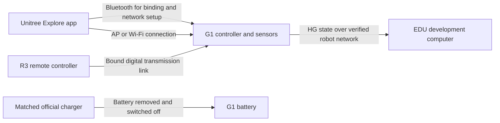

# Unitree G1 Standard and EDU: Robot Setup and State Development Guide


[**View the Unitree G1 Standard robot on OpenELAB**](https://openelab.io/products/unitree-g1-humanoid-robot)

**Model:** G1 Standard · **SKU:** `Unitree-G1` · **Option:** `Default Title`

**G1 EDU packages:** [**U1**](https://openelab.io/products/unitree-g1-edu-standard-u1) (`Unitree-G1edu-U1`), [**U2**](https://openelab.io/products/unitree-g1-edu-plus-u2) (`Unitree-G1edu-U2`), [**U3**](https://openelab.io/products/unitree-g1-edu-ultimate-u3) (`Unitree-G1edu-U3`), [**U4**](https://openelab.io/products/unitree-g1-edu-ultimate-b-u4) (`Unitree-G1edu-U4`), [**U5**](https://openelab.io/products/unitree-g1-edu-ultimate-u5) (`Unitree-G1edu-U5`), [**U6**](https://openelab.io/products/unitree-g1-edu-ultimate-d-u6-humanoid-robot) (`Unitree-G1edu-U6`), [**U7**](https://openelab.io/products/unitree-g1edu-u7-humanoid-robot) (`Unitree-G1edu-U7`), [**U8**](https://openelab.io/products/unitree-g1edu-u8-humanoid-robot) (`Unitree-G1edu-U8`), [**U9**](https://openelab.io/products/unitree-g1edu-u9-humanoid-robot) (`Unitree-G1edu-U9`), [**U10**](https://openelab.io/products/unitree-g1edu-u10-humanoid-robot) (`Unitree-G1edu-U10`). Each observed EDU listing has the option `Default Title`.


## Product overview <a href="#product-overview" id="product-overview"></a>

The Unitree G1 is a battery-powered biped humanoid with six joints per leg, onboard perception, a wireless controller and app-based inspection. G1 Standard is the retail demonstration model; G1 EDU provides the documented route to secondary development. This guide explains model selection, preparation, charging, inspection and an initial **subscriber-only G1 EDU state check**. It does not establish SDK access for Standard. Unitree's comparison marks secondary development `/` for G1 and `YES` for G1 EDU; the Standard OpenELAB listing also explicitly says it is not intended for programming or adding functions. [G1 manufacturer specifications](https://www.unitree.com/g1); [OpenELAB G1 listing](https://openelab.io/products/unitree-g1-humanoid-robot)

“EDU Standard (U1)” means an EDU package, whereas “G1 Standard” here means the base `Unitree-G1`. Keep those identities separate even though both can have 23 body degrees of freedom (DoF). G1-D/G1-A dual-arm systems, G1+ and third-party hand controllers require their own configuration documentation. G1-Comp and G1-Boxing application plans are bounded in the application subsection below; they are not new store SKUs or automatically compatible SDK layouts. In particular, **Ultimate D (U6)** is a G1 EDU package name; it is not the G1-D mobile manipulator. [OpenELAB G1 listing](https://openelab.io/products/unitree-g1-humanoid-robot); [G1 manufacturer specifications](https://www.unitree.com/g1)

### Match the purchased package before development <a href="#match-the-purchased-package-before-development" id="match-the-purchased-package-before-development"></a>

These are exact OpenELAB catalog labels/SKUs, reviewed November 24, 2026. Package DoF, hand and compute details below are **store descriptions**, not an independent manufacturer certification of each U-number. The current manufacturer G1 page provides a family-level 23–43 DoF EDU envelope, not a U1–U10 configuration matrix. Confirm the delivered bill of materials, serial label, hand controller and joint layout before selecting a robot description or control example. Prices, availability and delivery remain on the linked store pages. [OpenELAB G1 listing](https://openelab.io/products/unitree-g1-humanoid-robot); [G1 manufacturer specifications](https://www.unitree.com/g1)

| Listing / package | Exact SKU           | Store-described distinction and integration implication                                                                                                |
| ----------------- | ------------------- | ------------------------------------------------------------------------------------------------------------------------------------------------------ |
| G1 Standard       | `Unitree-G1`        | 23 DoF, no dexterous hands; use app/controller functions. Do not infer development access.                                                             |
| EDU Standard U1   | `Unitree-G1edu-U1`  | 23 DoF; listing describes 100 TOPS compute. Confirm installed compute identity and power mode.                                                         |
| EDU Plus U2       | `Unitree-G1edu-U2`  | 29 DoF; three-axis waist and seven-axis arms in listing. Requires the actual unlocked/locked waist configuration.                                      |
| EDU Ultimate A U3 | `Unitree-G1edu-U3`  | 43 total DoF; listing includes two Dex3-1 three-finger force-controlled hands. Tactile sensing is not explicitly promised in that package description. |
| EDU Ultimate B U4 | `Unitree-G1edu-U4`  | 43 total DoF; listing includes two Dex3-1 three-finger force-controlled hands with tactile sensors. Confirm hand revision and controller.              |
| EDU Ultimate C U5 | `Unitree-G1edu-U5`  | 41 total DoF; listing names two Inspire hands, `RH56DFQ-2R` and `RH56DFQ-2L`. Do not address them with Dex3-1 commands.                                |
| EDU Ultimate D U6 | `Unitree-G1edu-U6`  | 41 total DoF; listing names the same Inspire right/left hand identifiers. This is a G1 EDU biped package.                                              |
| EDU U7            | `Unitree-G1edu-U7`  | Listing gives a 23–43 DoF family range, not one resolved hardware layout; exact BOM remains essential.                                                 |
| EDU U8            | `Unitree-G1edu-U8`  | 37 total DoF; two Dex3-1 hands without tactile sensing, according to listing.                                                                          |
| EDU U9            | `Unitree-G1edu-U9`  | 37 total DoF; two tactile Dex3-1 hands; listing says 33 tactile sensors. The counting basis needs confirmation.                                        |
| EDU U10           | `Unitree-G1edu-U10` | 35 total DoF; two BrainCo Revo 2 Basic five-finger hands, according to listing. Requires that hand vendor's interface documentation.                   |

Hand joints are not automatically additional entries in the body SDK motor map. A total advertised DoF count may include hands, optional wrists and waist axes that use different interfaces. The inspected G1 body example uses a 29-position index layout, while the HG state message reserves 35 motor slots; neither number is a statement that every package has 29 or 35 active body motors. [G1 SDK example](https://github.com/unitreerobotics/unitree_sdk2_python/blob/814556d15970dd2ecf1c9984e845ca02ab07e206/example/g1/low_level/g1_low_level_example.py); [HG state schema](https://github.com/unitreerobotics/unitree_sdk2_python/blob/814556d15970dd2ecf1c9984e845ca02ab07e206/unitree_sdk2py/idl/unitree_hg/msg/dds_/_LowState_.py)

## Applications <a href="#applications" id="applications"></a>

G1 Standard supports demonstrations through the delivered controller/app, including documented locomotion and interaction functions. EDU can support humanoid sensing, control coursework, state logging, simulation-to-hardware research and manipulation development when the installed hardware, interfaces and firmware match the project. Start an EDU project with identity and state acquisition; validate sensor frames and the joint map before commanding motion. [G1 manufacturer specifications](https://www.unitree.com/g1); [G1 User Manual](https://marketing.unitree.com/article/en/G1/User_Manual.html); [G1 SDK example](https://github.com/unitreerobotics/unitree_sdk2_python/blob/814556d15970dd2ecf1c9984e845ca02ab07e206/example/g1/low_level/g1_low_level_example.py)

The public manual specifies open, flat, unobstructed ground, a 0–40°C operating environment, visibility of the robot and at least 2 m clearance from obstacles, crowds and water. It explicitly says G1 is neither waterproof nor dustproof. Avoid rain, wet surfaces, ice, loose dust and gravel. The remote manual's introduction mentions slopes/steps, but its operational warning says the current walking mode does **not** include stair climbing. Do not turn demonstration footage or that introductory language into an out-of-box stair-climbing procedure. [G1 User Manual, printed pp. 11, 25–26](https://marketing.unitree.com/article/en/G1/User_Manual.html); [G1 Remote Control Manual, p. 7](https://marketing.unitree.com/article/en/G1/Remote_Control.html)

### G1-Comp and Boxing application plans <a href="#g1-comp-and-boxing-application-plans" id="g1-comp-and-boxing-application-plans"></a>

Unitree's official [G1-Comp application page](https://www.unitree.com/robocup) describes a competition configuration with **two head axes** and **25–45 advertised total DoF**, rather than silently extending the canonical 23/29-body map. Its table reports 1320 × 450 × 200 mm standing, 690 × 450 × 300 mm folded, about 35 kg+, six joints per leg, optional three-axis waist/wrists/hands, maximum knee torque 120 N·m, posture-dependent arm load about 3 kg and approximately two-hour battery life. Its waist-X range is ±45°, another configuration-specific figure. These are product-page claims, not a fitted BOM or calibrated competition limit set.

The page advertises YOLO11 detection, monocular-geometric/binocular positioning, RoboCup visual/spatial/motion APIs, DDS/ROS support, ASR/TTS, app inspection, Orin NX “100 TOPS” compute and Isaac Gym/MuJoCo / `unitree_rl_gym` training directions. It marks secondary development supported but also says some demonstrations remain under development. No separately pinned RoboCup SDK, head-motor map, competition firmware entitlement or OpenELAB SKU was established by that page. Obtain those exact configuration resources before reusing the biped examples; this subsection creates no new purchasing listing or SDK guarantee.

The [G1-Boxing page](https://www.unitree.com/boxing/) presents combat demonstrations, motion-capture training and motion-sensing/controller/voice interaction. It provides no engineering limits, separate SKU or independently specified boxing SDK in the read page. The portal's Boxing/Combat controller stickers are configuration resources, not permission to reproduce impact demonstrations or a guarantee that Standard includes those behaviors. Keep this application plan separate from ordinary controller commissioning and the first passive EDU result.

## Specifications <a href="#specifications" id="specifications"></a>

### G1 Standard versus G1 EDU <a href="#g1-standard-versus-g1-edu" id="g1-standard-versus-g1-edu"></a>

Values below are manufacturer-reported, not OpenELAB bench measurements. Configuration and posture affect weight, reach, endurance and load. Maximum joint torque is not continuous torque, and maximum arm load is not a rated payload at every extension. [P1](https://www.unitree.com/g1)

| Parameter                                 | G1 Standard                                                | G1 EDU                                 | Conditions / selection consequence                              |
| ----------------------------------------- | ---------------------------------------------------------- | -------------------------------------- | --------------------------------------------------------------- |
| Standing size, height × width × thickness | 1320 × 450 × 200 mm                                        | Same family dimensions                 | Check actual hand/cable envelope.                               |
| Folded size, same axis order              | 690 × 450 × 300 mm                                         | Same family dimensions                 | Packaging orientation is separately specified in M1.            |
| Weight including battery                  | About 35 kg                                                | About 35 kg+                           | EDU accessories change mass and balance.                        |
| Total joint DoF                           | 23                                                         | 23–43                                  | Family range; identify purchased configuration.                 |
| Each leg                                  | 6                                                          | 6                                      | Two legs, twelve leg joints.                                    |
| Waist                                     | 1                                                          | 1, optionally 2 additional axes        | Hardware fastener and software lock must agree.                 |
| Each arm                                  | 5                                                          | Base description 5, optional wrists    | Store U2–U6 descriptions include seven-axis arms.               |
| Hand                                      | None listed                                                | Optional Dex3-1: 7 active DoF per hand | Thumb 3, index 2, middle 2; other packages use different hands. |
| Maximum knee joint torque                 | 90 N·m                                                     | 120 N·m                                | Maximum, not sustained operating torque.                        |
| Maximum arm load                          | About 2 kg                                                 | About 3 kg                             | Strongly dependent on arm extension/posture.                    |
| Calf + thigh length / arm span            | 0.6 m / about 0.45 m                                       | Same family figures                    | Not a collision-free workspace model.                           |
| Joint sensing / cooling                   | Dual encoders / local air cooling                          | Same family description                | Keep cooling inlets and outlets unobstructed.                   |
| Base compute                              | 8-core CPU                                                 | 8-core CPU                             | EDU high-compute module is configuration dependent.             |
| Perception                                | Depth camera + 3D LiDAR                                    | Same family description                | Read actual sensor model/revision.                              |
| Audio / wireless                          | Four-microphone array, 5 W speaker; Wi-Fi 6, Bluetooth 5.2 | Same family description                | Radio reach and streaming depend on environment.                |
| Battery / runtime                         | Quick-release 9000 mAh; about 2 h                          | Same family figures                    | Speed, load, posture, terrain and temperature affect runtime.   |
| Secondary development                     | `/` in manufacturer table                                  | `YES`                                  | Public repository availability does not unlock Standard.        |

The current product page gives mechanical movement ranges: knee 0–165°, hip pitch ±154°, roll −30° to +170°, yaw ±158°, and waist yaw ±155°. EDU additionally lists waist roll/pitch and optional wrist ranges; these are **mechanical envelope data**, not safe trajectory limits. OpenELAB package copy gives waist X ±45°, while the current manufacturer page gives X ±30°. Resolve the exact hardware/controller limit before motion; do not average the numbers or use them as software end stops. [G1 manufacturer specifications](https://www.unitree.com/g1); [OpenELAB G1 listing](https://openelab.io/products/unitree-g1-humanoid-robot)

### Power and perception details that need exact revision matching <a href="#power-and-perception-details-that-need-exact-revision-matching" id="power-and-perception-details-that-need-exact-revision-matching"></a>

The dedicated battery manual V1.0 specifies 46.8 V nominal, 54.6 V charge limit, 9000 mAh / 421.2 Wh, and a 120 × 80 × 182 mm battery. Its charger table gives 100–240 V AC, 50/60 Hz input and **54.6 V, 5.5 A** output, with about 1.5 h charging. The product page instead summarizes the charger as **54 V, 5 A**. Use the label and matching official charger for the supplied battery; neither summary authorizes substituting a bench supply or another charger. Robot battery voltage is not a GPIO logic level or an accessory-power pinout. [G1 Battery Manual, pp. 2–3](https://marketing.unitree.com/article/en/G1/Battery_Charger.html); [G1 manufacturer specifications](https://www.unitree.com/g1)

M1 printed p. 8 identifies Livox MID360 and Intel RealSense D435i on the illustrated configuration. Its LiDAR field-of-view discussion gives 360° horizontal and 59° vertical; its later sensor table gives a different 360° × 90° figure and other sensor data. Those sections are internally inconsistent. Preserve the sensor identities as manual context, verify the installed parts, and obtain their exact documentation before relying on a field of view, range, point rate, intrinsic calibration or camera stream format. A body `LowState_` message does not contain camera frames or a point cloud. The later table also describes 1080p app video and a microphone pickup context of 5 m; these do not establish an SDK camera profile or guaranteed speech-recognition radius. [G1 User Manual, printed pp. 8, 27–28](https://marketing.unitree.com/article/en/G1/User_Manual.html); [HG state schema](https://github.com/unitreerobotics/unitree_sdk2_python/blob/814556d15970dd2ecf1c9984e845ca02ab07e206/unitree_sdk2py/idl/unitree_hg/msg/dds_/_LowState_.py)

## Hardware and connections <a href="#hardware-and-connections" id="hardware-and-connections"></a>

### Inspect, support and identify the robot <a href="#inspect-support-and-identify-the-robot" id="inspect-support-and-identify-the-robot"></a>

Before power, inspect the shell, joints, foot soles, battery bay, latches and wiring for damage or contamination. Check fasteners and cooling openings, and verify controller sticks return to their neutral position. Keep the camera window and LiDAR aperture clear. The manual calls for a protective frame with locked casters; use the dedicated shoulder suspension points and the illustrated support arrangement. A controller or computer connection is not a physical fall restraint. [G1 User Manual, printed pp. 11–16, 26–27](https://marketing.unitree.com/article/en/G1/User_Manual.html)

Install the switched-off battery from the side with its power switch toward the robot's back. Confirm both catches latch; if the pack will not seat, correct orientation instead of forcing the connector. Never install or remove it while powered. The front/back parts and mounting-hole figures in M1 distinguish the 23-DoF body from the illustrated 29-DoF EDU body. Use the original dimensioned figure for bracket work; screw engagement, accessory power limits and full electrical pinouts have not been established here. Do not derive them from photographs. [G1 User Manual, printed pp. 4–5, 12](https://marketing.unitree.com/article/en/G1/User_Manual.html); [G1 Battery Manual, pp. 2, 7](https://marketing.unitree.com/article/en/G1/Battery_Charger.html)

### Connection roles <a href="#connection-roles" id="connection-roles"></a>



This is an original connection-role diagram, not a pinout or a wiring drawing. The app and R3 wireless link are separate from the SDK's DDS network. M1 describes WLAN HTTP port `9991` as a WebRTC signalling service, Bluetooth Low Energy for app network configuration and a one-to-one remote-controller radio link; none is an invitation to expose robot services to the public Internet. [G1 User Manual, printed pp. 18–20, 27](https://marketing.unitree.com/article/en/G1/User_Manual.html); [G1 Remote Control Manual, pp. 2, 6](https://marketing.unitree.com/article/en/G1/Remote_Control.html); [SDK channel implementation](https://github.com/unitreerobotics/unitree_sdk2_python/blob/814556d15970dd2ecf1c9984e845ca02ab07e206/unitree_sdk2py/core/channel.py)

For EDU development, confirm the actual robot's supported Ethernet connector, computer interface, address plan and firmware with its supplied developer documentation. The ROS2 repository demonstrates a wired computer at `192.168.123.99` with mask `255.255.255.0` and an explicitly selected network interface. Treat that as the repository's example plan, not proof of every G1's factory address. Do not guess port wiring, PoE capability, connector power or SSH credentials. [R1](https://github.com/unitreerobotics/unitree_ros2/blob/668d1ec5a05d1c38d3306bdca7d59f2ba3581a88/README.md)

### Charging and battery management <a href="#charging-and-battery-management" id="charging-and-battery-management"></a>

1. Put the robot into the supported seated or suspended shutdown arrangement. Switch off the battery and remove it; let a hot pack cool to room temperature.
2. Inspect the official charger, battery casing and connectors. Keep the charging area dry, ventilated and free of combustible items, with the battery in sight.
3. Check the charger's actual AC input label, connect AC first, then connect the switched-off battery to its dedicated charging connector.
4. Watch the battery and charger indicators. The battery manual says all pack LEDs off at the end of charging means full; this differs from the R3 remote's all-lit full indication. Disconnect after completion.
5. Refit only after disconnecting the charger, with the battery off and both latches engaged. [G1 User Manual, printed pp. 9–10](https://marketing.unitree.com/article/en/G1/User_Manual.html); [G1 Battery Manual, pp. 5–8](https://marketing.unitree.com/article/en/G1/Battery_Charger.html)

**Below 10% battery charge, stop using the G1 as soon as possible and replace or recharge its battery.** Establish the supported seated or suspended shutdown arrangement and switch the pack off before removal; never swap a powered pack. This operating recommendation is separate from the LED display bands and the 39 V protective cutoff below. [G1 Battery Manual, p. 7](https://marketing.unitree.com/article/en/G1/Battery_Charger.html); [G1 User Manual, printed p. 22](https://marketing.unitree.com/article/en/G1/User_Manual.html)

M3 describes balancing, overcharge, temperature, overcurrent, short-circuit, low-voltage and load-detection protections. Its 39 V discharge cutoff and >10 A charging-current protection are protection thresholds, not recommended operating targets. The pack cannot normally turn on when removed and automatically turns off if removed while on; never test that behavior by pulling a live pack. [G1 Battery Manual, pp. 3–4](https://marketing.unitree.com/article/en/G1/Battery_Charger.html)

M3 has conflicting upper charging-temperature statements: its protection section refers to 50°C, while later guidance says 55°C. Its recommended charging ambient range is 5–40°C. Charge after cooling to room temperature within that recommended range; do not rely on either higher boundary to justify hot charging. For storage, remove the pack, keep it dry and away from heat/metal objects, and inspect its state of charge periodically. M3 recommends 22–28°C storage, describes self-discharge toward 65% after ten inactive days above that level, and says to recharge a stored pack below 30% to about 70%. Follow applicable carrier instructions for transport; do not transport a damaged pack. Route damaged packs to qualified battery service/recycling rather than attempting repairs or intentional deep discharge. [G1 Battery Manual, pp. 3, 7–9](https://marketing.unitree.com/article/en/G1/Battery_Charger.html)

M1 printed p. 7 describes its illustrated optional Dex3-1 as seven active hand DoF, 12–58 V operating voltage, a 10–2500 g perception range and nine array sensors. Those are manual-specific hand figures, not G1 battery output specifications or a U1–U10 tactile-count equivalence. The hand and its controller require their own exact revision documentation before connecting an external supply. [M1](https://marketing.unitree.com/article/en/G1/User_Manual.html)

### EDU waist fastener: physical and software state must agree <a href="#edu-waist-fastener-physical-and-software-state-must-agree" id="edu-waist-fastener-physical-and-software-state-must-agree"></a>

The waist-fastener manual V1.0 lists two fixing parts, two M5 screws and an Allen wrench. In the illustrated installation, tilt the supported body back to place part 1, then forward to place part 2, keep the waist cable clear and secure the two screws. No tightening torque is specified. Enable the waist motor lock in **Unitree Explore → Settings → Robot**, then restart as prompted. [G1 Waist Fastener Manual, pp. 2–4](https://marketing.unitree.com/article/en/G1/Lumbar_fasteners.html)

Removal reverses that sequence: support the body, remove the screws and part 2, then part 1; disable the waist motor lock in the same app area and restart as prompted. M4 warns that calibration performed in the locked 27-joint configuration affects subsequent use of the unlocked 29-joint configuration. Do not treat removing the fixture as a software-only change or perform a routine recalibration to troubleshoot communication. Consult Unitree about any calibration transition. The SDK's waist indices 13/14 are explicitly invalid for a 23-DoF or waist-locked configuration. [G1 Waist Fastener Manual, pp. 4–6](https://marketing.unitree.com/article/en/G1/Lumbar_fasteners.html); [G1 SDK example](https://github.com/unitreerobotics/unitree_sdk2_python/blob/814556d15970dd2ecf1c9984e845ca02ab07e206/example/g1/low_level/g1_low_level_example.py)

### Portal hardware revisions, shoulder ports and developer computer <a href="#portal-hardware-revisions-shoulder-ports-and-developer-computer" id="portal-hardware-revisions-shoulder-ports-and-developer-computer"></a>

The [About G1 article](https://doc-cdn.unitree.com/11/223/en/11_223_en) supplies a numbered shoulder-interface table and identifies PC2 as a Jetson Orin NX. Its illustrated PC2 has eight Cortex-A78AE cores, up to 2 GHz, 16 GB shared memory, 2 TB storage, 2 MB L2 plus 4 MB L3 cache, and an Ampere GPU with 1024 CUDA cores/32 Tensor cores, listed at up to 918 MHz. The same table contains Intel-specific feature rows that do not form a reliable specification for this Arm module. Treat the module identity and supplied label as the starting point; do not promise every listed instruction/graphics feature or an installed inference service. The article says compute substitutions may occur and Unitree does not deploy services on the NX by default; later EDU+ patch guidance is a configuration-specific exception.

PC1 is reserved for Unitree motion control. Developer PC2 is **`192.168.123.164`**; About G1 lists initial `unitree` / `123`, whereas the [architecture article](https://doc-cdn.unitree.com/11/233/en/11_233_en) directs users to support for initial credentials. Verify the delivered login and network plan. The [quick-development article](https://doc-cdn.unitree.com/11/236/en/11_236_en) tests `.161`, a different onboard endpoint, and illustrates host `.222` while recommending `.99`. Successful ping to `.161` does not identify PC2's SSH address or validate an HG decoder.

| Figure number | Article's connector / electrical role                                              | Integration boundary                                                         |
| ------------- | ---------------------------------------------------------------------------------- | ---------------------------------------------------------------------------- |
| 1             | `XT30UPB-F`, VBAT output, listed **58 V / 5 A**, directly connected to the battery | Variable battery domain; not a regulated 58 V supply or charging input       |
| 2             | `XT30UPB-F`, **24 V / 5 A output**                                                 | Separate accessory rail; mating polarity and aggregate budget still required |
| 3             | `XT30UPB-F`, **12 V / 5 A output**                                                 | Separate accessory rail                                                      |
| 4, 5          | RJ45, `1000 BASE-T`                                                                | Gigabit Ethernet; no PoE permission follows                                  |
| 6, 7, 8       | USB-C, USB 3.0 host, **5 V / 1.5 A output**                                        | Match host/device and power roles                                            |
| 9             | USB-C alternate mode, USB 3.2 host / DP 1.4                                        | Not evidence that every USB-C port accepts charging                          |
| 10            | `5577`, I/O plus **12 V / 3 A output**                                             | Its power pins and 3.3 V GPIO are different domains                          |

Use Unitree's [numbered port figure](https://doc-cdn.unitree.com/static/2024/9/29/ef105e92a6f7487eaf31f9169c44dfd8_3707x2675.jpg) and [GPIO orientation figure](https://doc-cdn.unitree.com/static/2025/8/25/946f900a5d5644d192a4b7f917970bb4_2672x1892.jpeg), © Unitree Robotics. Both were visually checked. The latter labels, from its pictured top downward, `GPIO6`, `GPIO5`, `GPIO4`, `GPIO3`, `GPIO2`, `GPIO1`, `GND`, `+12V`. Preserve the viewing orientation; this is not a cable-side pin-number assignment. The article also prints an unusual RJ45 color sequence; use the supplied Ethernet assembly rather than fabricating a cable from a translation. [About G1](https://doc-cdn.unitree.com/11/223/en/11_223_en); [G1 shoulder I/O FAQ](https://doc-cdn.unitree.com/11/242/en/11_242_en)

| I/O label | NX pin | Function | Source pin name |
| --------- | ------ | -------- | --------------- |
| GPIO1     | 203    | UART TX  | `GPIO3_PR.02`   |
| GPIO2     | 205    | UART RX  | `GPIO3_PR.03`   |
| GPIO3     | 232    | I2C SCL  | `GPIO3_PI.03`   |
| GPIO4     | 234    | I2C SDA  | `GPIO3_PI.04`   |
| GPIO5     | 128    | GPIO     | `GPIO3_PCC.02`  |
| GPIO6     | 130    | GPIO     | `GPIO3_PCC.03`  |

The FAQ describes UART `/dev/ttyTHS0` at **9600, 8-N-1**, I2C bus **0**, and GPIO output levels **3.3 V / 0 V**. Its sysfs mapping exports `330/331` for `PCC.02/PCC.03`; its libgpiod mapping is chip `1`, offsets `14/15`. Discovery with `gpiodetect`/`gpioinfo` precedes interpreting a delivered image's mapping. Sysfs export, direction changes and `gpioset` alter hardware; even I2C probing interacts with attached devices. No such operation is part of the passive body-state check. The FAQ has a corrupted `/sys/极class/...` path: consult the actual filesystem rather than copying it. Obtain input-voltage tolerance and the mating wiring before connecting external logic. [FAQ](https://doc-cdn.unitree.com/11/242/en/11_242_en)

The article also lists an **optional Thor backpack**, not an included U-package guarantee: Jetson T5000, 14-core Arm Neoverse-V3AE CPU, 2560-core Blackwell GPU/96 fifth-generation Tensor cores, 128 GB 256-bit LPDDR5X unified memory, 1 TB storage, peak 130 W, two Type-A 3.2 and two Type-C 3.1 ports, Jetson Linux 38.2.1 and JetPack 7. Its **2070 TFLOPS FP4** figure is a precision-specific compute claim, not interchangeable with the store's TOPS labels or sustained application throughput. [About G1](https://doc-cdn.unitree.com/11/223/en/11_223_en)

### Portal mounting figures and attachment boundaries <a href="#portal-mounting-figures-and-attachment-boundaries" id="portal-mounting-figures-and-attachment-boundaries"></a>

[About G1, “Installation hole position: unit: mm”](https://doc-cdn.unitree.com/11/223/en/11_223_en) supplies original [front mounting-hole drawing](https://doc-cdn.unitree.com/static/2024/10/28/cd3d0a7d4f384eedb21fb7556fc09d25_1670x2365.png) and [rear mounting-hole drawing](https://doc-cdn.unitree.com/static/2024/10/28/26eebb64bc4d4a7d88bd09c752f98490_1670x2365.png), © Unitree Robotics. The article says labels cover the mounting holes and must first be removed to access them. Both original figures were visually inspected for the pictured torso mounting locations and viewing orientation; no numeric dimensions are transcribed here.

Match the actual body revision and intended attachment to these drawings before designing a bracket. Obtain approved screw/thread engagement, tightening torque, attachment load/reaction limits and internal clearance from the matched engineering documentation; the drawings do not establish those limits. Check the attachment against arm/hand/waist swept volumes, cables, sensors and cooling access. Use the manual's designated support/suspension arrangement for handling; these accessory mounting figures alone do not authorize a lifting or floor-anchoring scheme. [About G1](https://doc-cdn.unitree.com/11/223/en/11_223_en)

### Complete body indexing, reference limits and parallel mechanisms <a href="#complete-body-indexing-reference-limits-and-parallel-mechanisms" id="complete-body-indexing-reference-limits-and-parallel-mechanisms"></a>

The [joint-sequence article](https://doc-cdn.unitree.com/11/249/en/11_249_en) identifies 23-DoF `mode_machine==1`, 29-DoF `==2`, and an arms-only 14-DoF `==9` map. The [basic-service sketch](https://doc-cdn.unitree.com/11/254/en/11_254_en) instead comments `4/5/6` for 23/29/waist-locked 27 DoF. These are incompatible source descriptions. **Log the received value with firmware/serial; do not select a controller from either comment alone or rewrite the passive decoder to force a match.** Mode `9` describes a separate source configuration, not a new store SKU or proof that a biped can become a fixed robot through software.

The following is a reference index/limit table from About G1, in **radians**, with optional axes called out. It is not a safe trajectory, calibration pose or firmware end-stop certificate. It differs from marketing mechanical envelopes, including knee minimum and waist yaw, so keep source/revision with the data. [About G1](https://doc-cdn.unitree.com/11/223/en/11_223_en)

| HG slot | PR-mode joint                     | Reference range, rad |
| ------- | --------------------------------- | -------------------- |
| 0 / 6   | Left / right hip pitch            | −2.5307 to 2.8798    |
| 1       | Left hip roll                     | −0.5236 to 2.9671    |
| 7       | Right hip roll                    | −2.9671 to 0.5236    |
| 2 / 8   | Left / right hip yaw              | ±2.7576              |
| 3 / 9   | Left / right knee                 | −0.087267 to 2.8798  |
| 4 / 10  | Left / right ankle pitch          | −0.87267 to 0.5236   |
| 5 / 11  | Left / right ankle roll           | ±0.2618              |
| 12      | Waist yaw                         | ±2.618               |
| 13 / 14 | Optional waist roll / pitch       | ±0.52 each           |
| 15 / 22 | Left / right shoulder pitch       | −3.0892 to 2.6704    |
| 16      | Left shoulder roll                | −1.5882 to 2.2515    |
| 23      | Right shoulder roll               | −2.2515 to 1.5882    |
| 17 / 24 | Left / right shoulder yaw         | ±2.618               |
| 18 / 25 | Left / right elbow                | −1.0472 to 2.0944    |
| 19 / 26 | Left / right wrist roll           | ±1.972222054         |
| 20 / 27 | Optional left / right wrist pitch | ±1.614429558         |
| 21 / 28 | Optional left / right wrist yaw   | ±1.614429558         |

For a 23-DoF source map, `13/14`, `20/21` and `27/28` are empty; arms-only mode `9` uses only `15–28`. For the 29-DoF layout, `mode_pr==0` means pitch/roll joint coordinates; `mode_pr==1` means direct parallel-motor coordinates. **Ankle slots `4/10` become B, `5/11` become A; waist `13` becomes A and `14` becomes B.** The A/B order is not the same for ankle and waist. [Joint sequence](https://doc-cdn.unitree.com/11/249/en/11_249_en)

The physical ankle and optional waist pitch/roll are parallel mechanisms. PR matches the articulated coordinates used by the URDF; AB addresses the actuators and requires the appropriate kinematics. Two coordinate descriptions do not create four independent ankle DoF. The [ankle routine](https://doc-cdn.unitree.com/11/248/en/11_248_en) first drives body joints toward zero, then swings ankles in PR and AB stages. Its two 500 Hz loops, 2 ms period, three-second stages, buffered state, command CRC and feedback CRC are properties of an **active demonstration**. They are not measured telemetry rates or permission to run it from an arbitrary pose.

The [23-DoF frame figure](https://doc-cdn.unitree.com/static/2024/9/14/1dcad03430904e14aec140c9e7e1e981_1304x2033.png), [29-DoF frame figure](https://doc-cdn.unitree.com/static/2024/9/14/24b7205f093d45918fcce5459931e3a8_1304x2033.png) and [parallel-mechanism archive](https://oss-global-cdn.unitree.com/static/6b15e9e64db64c57970f9fbd6e51c60f.zip) are original resources. The 29-DoF figure was visually checked: colored axes identify joint frames in the illustrated zero configuration, not a body posture to command during commissioning. Archive contents were not opened or built.

## Software and development resources <a href="#software-and-development-resources" id="software-and-development-resources"></a>

### Choose the G1 HG contract <a href="#choose-the-g1-hg-contract" id="choose-the-g1-hg-contract"></a>

| Resource reviewed                          | Source version / role                                               | Practical boundary                                                                                                                                                 |
| ------------------------------------------ | ------------------------------------------------------------------- | ------------------------------------------------------------------------------------------------------------------------------------------------------------------ |
| `unitree_sdk2`                             | Commit `b7fec6020eb93d4c059a6edf19905e12a75a8d3d`; C++ SDK          | README prebuilt environment: Ubuntu 20.04, `aarch64`/`x86_64`, GCC 9.4.0; CMake ≥3.10. These are source-stated environments, not testing performed for this guide. |
| `unitree_sdk2_python`                      | Commit `814556d15970dd2ecf1c9984e845ca02ab07e206`; Python interface | `setup.py` version `1.0.1`, Python ≥3.8, `cyclonedds==0.10.2`, `numpy`, `opencv-python`; BSD-3-Clause.                                                             |
| Python G1 example / channel implementation | Same Python commit                                                  | G1 uses `unitree_hg`, not `unitree_go`; subscribe to `rt/lowstate` with `LowState_`.                                                                               |
| `unitree_ros2`                             | Commit `668d1ec5a05d1c38d3306bdca7d59f2ba3581a88`                   | README lists Ubuntu 20.04/Foxy and 22.04/Humble, with Humble recommended. G1 HG state reader is the relevant source.                                               |

Sources: [Python SDK README](https://github.com/unitreerobotics/unitree_sdk2_python/blob/814556d15970dd2ecf1c9984e845ca02ab07e206/README.md); [SDK channel implementation](https://github.com/unitreerobotics/unitree_sdk2_python/blob/814556d15970dd2ecf1c9984e845ca02ab07e206/unitree_sdk2py/core/channel.py); [G1 SDK example](https://github.com/unitreerobotics/unitree_sdk2_python/blob/814556d15970dd2ecf1c9984e845ca02ab07e206/example/g1/low_level/g1_low_level_example.py); [HG state schema](https://github.com/unitreerobotics/unitree_sdk2_python/blob/814556d15970dd2ecf1c9984e845ca02ab07e206/unitree_sdk2py/idl/unitree_hg/msg/dds_/_LowState_.py); [ROS2 README](https://github.com/unitreerobotics/unitree_ros2/blob/668d1ec5a05d1c38d3306bdca7d59f2ba3581a88/README.md); [ROS2 HG state reader](https://github.com/unitreerobotics/unitree_ros2/blob/668d1ec5a05d1c38d3306bdca7d59f2ba3581a88/example/src/src/read_low_state_hg.cpp). Exact firmware-to-SDK compatibility for the received serial/revision remains unverified. Preserve the installed firmware version before changing the host environment; a repository commit is not a firmware release approval.

Use [Unitree SDK2 state development](unitree-sdk2-state-development.md) for the common host/dependency workflow and [Unitree ROS2 integration](unitree-ros2-integration.md) for middleware and workspace configuration. The G1-specific requirements below still apply. The generic Python README's “low-level status” path also appears under active motor control and discusses a quadruped leg. Do not use that filename alone as evidence that a program is passive or G1-compatible. [Python SDK README](https://github.com/unitreerobotics/unitree_sdk2_python/blob/814556d15970dd2ecf1c9984e845ca02ab07e206/README.md); [G1 SDK example](https://github.com/unitreerobotics/unitree_sdk2_python/blob/814556d15970dd2ecf1c9984e845ca02ab07e206/example/g1/low_level/g1_low_level_example.py)

The inspected G1 motion example instantiates a `ChannelPublisher` for `rt/lowcmd`, calls `MotionSwitcherClient.ReleaseMode()`, and later writes motor commands. Its body index map is useful evidence, but running it changes robot control and motion. The first state check below uses only the subscriber API. It does not release a motion service, select Develop mode, create a motor command or publish `rt/lowcmd`. DDS discovery traffic will still occur. [SDK channel implementation](https://github.com/unitreerobotics/unitree_sdk2_python/blob/814556d15970dd2ecf1c9984e845ca02ab07e206/unitree_sdk2py/core/channel.py); [G1 SDK example](https://github.com/unitreerobotics/unitree_sdk2_python/blob/814556d15970dd2ecf1c9984e845ca02ab07e206/example/g1/low_level/g1_low_level_example.py)

### Interpret body state without inventing joints <a href="#interpret-body-state-without-inventing-joints" id="interpret-body-state-without-inventing-joints"></a>

The inspected HG schema contains `version`, `mode_pr`, `mode_machine`, `tick`, `imu_state`, `motor_state[35]`, `wireless_remote[40]`, reserved fields and `crc`. The array capacity is not a count of fitted joints. The body example assigns indices 0–5 to the left leg, 6–11 to the right leg, 12 to waist yaw, 13/14 to optional waist roll/pitch, 15–21 to the left arm/wrist and 22–28 to the right arm/wrist. It marks 13/14 invalid when the waist is locked or on a 23-DoF configuration, and 20/21/27/28 invalid for 23 DoF. [G1 SDK example](https://github.com/unitreerobotics/unitree_sdk2_python/blob/814556d15970dd2ecf1c9984e845ca02ab07e206/example/g1/low_level/g1_low_level_example.py); [HG state schema](https://github.com/unitreerobotics/unitree_sdk2_python/blob/814556d15970dd2ecf1c9984e845ca02ab07e206/unitree_sdk2py/idl/unitree_hg/msg/dds_/_LowState_.py)

For the first check, read left knee index `3`, which the inspected map identifies independently of optional wrists and waist. `q` is in radians and `dq` in radians per second in the ROS HG example; `tau_est` is an estimated torque field, not a calibrated hand/contact-force measurement. Do not infer battery voltage fields from a Go2 example: the reviewed HG top-level schema has no `power_v`/`power_a`. IMU, camera, LiDAR, body joints and external hands are separate contracts. [G1 SDK example](https://github.com/unitreerobotics/unitree_sdk2_python/blob/814556d15970dd2ecf1c9984e845ca02ab07e206/example/g1/low_level/g1_low_level_example.py); [HG state schema](https://github.com/unitreerobotics/unitree_sdk2_python/blob/814556d15970dd2ecf1c9984e845ca02ab07e206/unitree_sdk2py/idl/unitree_hg/msg/dds_/_LowState_.py); [ROS2 HG state reader](https://github.com/unitreerobotics/unitree_ros2/blob/668d1ec5a05d1c38d3306bdca7d59f2ba3581a88/example/src/src/read_low_state_hg.cpp)

### G1 architecture, DDS and source-version contracts <a href="#g1-architecture-dds-and-source-version-contracts" id="g1-architecture-dds-and-source-version-contracts"></a>

The [SDK overview](https://doc-cdn.unitree.com/11/232/en/11_232_en), [service index](https://doc-cdn.unitree.com/11/237/en/11_237_en) and [architecture article](https://doc-cdn.unitree.com/11/233/en/11_233_en) distinguish continuous DDS publish/subscribe from lower-frequency RPC requests. Functional clients wrap request/response topics; replies are broadcast and associated with request identity/UUID. ROS 2 compatibility depends on generated types and the selected middleware, not merely on both systems using DDS. The overview's statement that GST video is unsupported must be read with later sensor/EDU+ service articles; it is not a universal ban on direct RealSense acquisition.

The manufacturer describes BLE for app network configuration/authentication, WebRTC for app audio/video/point clouds/state/control, MQTT for OTA/fault information/signaling, HTTP for account/device binding, and STUN/TURN for connection establishment/relay. It says cloud access follows user authorization. These are manufacturer architecture statements, not an independent traffic/privacy audit or permission to export logs. Keep reserved PC1 and developer PC2 roles separate. [Architecture](https://doc-cdn.unitree.com/11/233/en/11_233_en)

The [quick-development route](https://doc-cdn.unitree.com/11/236/en/11_236_en) recommends Ubuntu 20.04, lists its development route as unsupported on macOS/Windows, and documents dependencies → SDK library configure/build/install → included-example build → interface selection. It points dependency updates back to the SDK README. A completed build, ping or DDS discovery would be a separate result from receiving valid HG state. Its final ankle routine actively moves joints and requires the supported suspension/debug arrangement. Use the [common SDK2 guide](unitree-sdk2-state-development.md) for host setup; none of those install/build steps was performed for this guide.

The [DDS article](https://doc-cdn.unitree.com/11/252/en/11_252_en) describes singleton factory initialization, `CreateSendChannel`, `CreateRecvChannel`, publisher initialization/write/close and subscriber callback/queue/close. Lengthy callback processing should use an appropriate nonzero queue rather than block the receive thread; a queue can still retain old samples. `GetLastDataAvailableTime()` is described as microseconds from a monotonic startup clock, with −1 before initialization. It is not UTC. The common guide explains host transport setup; the G1-specific corrections are:

* At pinned SDK2 `b7fec6020eb93d4c059a6edf19905e12a75a8d3d`, the domain/interface overload is **`Init(int32_t domainId, const std::string& networkInterface = "")`**. The portal's third `enableSharedMemory` argument is not accepted by that header. Keep working two-argument code; do not paste a three-argument compile recipe.
* Pinned `GetApiVersion()` returns a const string reference, but **`GetServerApiVersion()` returns `std::string` by value**. The portal's server-version reference sketch does not describe that pin.
* The portal subscriber paragraph incorrectly names `CreateSendChannel`; actual receiving uses `CreateRecvChannel`.
* Several hand `rt/` versus `rt/lf/` captions mix normal/low-frequency labels or left/right names. They establish neither measured rates nor a corrected topic by inference.

These comparisons use the actual [pinned factory header](https://github.com/unitreerobotics/unitree_sdk2/blob/b7fec6020eb93d4c059a6edf19905e12a75a8d3d/include/unitree/robot/channel/channel_factory.hpp) and [pinned client header](https://github.com/unitreerobotics/unitree_sdk2/blob/b7fec6020eb93d4c059a6edf19905e12a75a8d3d/include/unitree/robot/client/client.hpp), read without compiling.

A client must initialize registered APIs before requests. The documented **`SetTimeout(float)` overload uses seconds**, so use an explicit floating-point form such as `SetTimeout(2.0f)` for two seconds. Pinned `ClientBase` also declares a distinct `SetTimeout(int64_t)` overload in the internal time representation; its one-second default constant is `1000000`. Do not treat an integer literal as a seconds value or copy it as a substitute for the floating-point form. [Pinned ClientBase](https://github.com/unitreerobotics/unitree_sdk2/blob/b7fec6020eb93d4c059a6edf19905e12a75a8d3d/include/unitree/robot/client/client_base.hpp) `WaitLeaseApplied` blocks until lease acquisition when leases are enabled. A successful RPC return does not prove completion of a physical transition. General error numbers are recorded in the troubleshooting chapter below. [DDS services](https://doc-cdn.unitree.com/11/252/en/11_252_en)

### Body, hand and auxiliary message boundaries <a href="#body-hand-and-auxiliary-message-boundaries" id="body-hand-and-auxiliary-message-boundaries"></a>

The [basic-services article](https://doc-cdn.unitree.com/11/254/en/11_254_en) defines body command/state, IMU, motor and tactile concepts. Body `rt/lowcmd` and `rt/lowstate` use HG types; hand command/state streams are separate. IMU quaternion order is **w, x, y, z**; gyroscope/accelerometer/rpy fields must retain their own units and frames. Motor feedback includes `q` rad, `dq` rad/s, `ddq` rad/s², `tau_est`, surface/winding temperatures, sensors, terminal voltage and `motorstate`. Motor commands carry enable mode, target position/velocity, feed-forward torque, stiffness and damping. Neither a zero target nor zero estimated torque guarantees a gravity-supported body.

Its IDL sketches are not identical to the pinned generated files: the portal's body state omits pinned `version[2]`, and its motor sketch shows `q_raw`, `dq_raw`, `ddq_raw` absent from the reviewed pinned Python motor declaration. The Dex3 article also has a different hand/tactile structure sketch from basic services. **Do not create a decoder by merging these snippets.** Match delivered firmware to the complete generated layout, including reserved fields and CRC. [Basic services](https://doc-cdn.unitree.com/11/254/en/11_254_en); [Dex3 article](https://doc-cdn.unitree.com/11/251/en/11_251_en); [pinned HG state](https://github.com/unitreerobotics/unitree_sdk2_python/blob/814556d15970dd2ecf1c9984e845ca02ab07e206/unitree_sdk2py/idl/unitree_hg/msg/dds_/_LowState_.py)

| Source topic group                                                                      | Purpose / boundary                                                                                                                                   |
| --------------------------------------------------------------------------------------- | ---------------------------------------------------------------------------------------------------------------------------------------------------- |
| `rt/lowstate`, `rt/lf/lowstate`                                                         | Body HG state; `lf` caption alone supplies no verified delivered rate                                                                                |
| `rt/lowcmd`                                                                             | Active body command; not a hand command and never sent by the first result                                                                           |
| `rt/dex3/left/state`, `rt/dex3/right/state`, corresponding `/cmd` and `rt/lf/.../state` | Separate Dex3 messages; confirm fitted hand, layout and actual rate                                                                                  |
| `rt/lf/mainboardstate`, `rt/lf/bmsstate`                                                | Separate mainboard/battery feedback; not automatically embedded in HG body state                                                                     |
| `rt/secondary_imu`, `rt/lf/secondary_imu`                                               | Additional IMU stream; record frame and installed sensor                                                                                             |
| `rt/odommodestate`, `rt/lf/odommodestate`                                               | Use the dedicated odometry article's type/rate/version contract below; the generic topic table's `IMUState_` label conflicts with its actual example |

Source: [DDS topic list](https://doc-cdn.unitree.com/11/252/en/11_252_en). A listed topic is a source contract, not proof it is enabled on the supplied robot. [Remote data](https://doc-cdn.unitree.com/11/250/en/11_250_en) is 40 raw bytes in `wireless_remote`: two header bytes, a 16-bit button mask, float `lx`, `rx`, `ry`, `L2`, `ly`, then 16 reserved bytes. Stick values are −1 to 1. Mask order is `R1`, `L1`, `start`, `select`, `R2`, `L2`, `F1`, `F2`, `A`, `B`, `X`, `Y`, `up`, `right`, `down`, `left`. The example's `unitree_go` declaration is reused text; G1 body reception still uses the matched HG layout. Explicit byte/layout validation is preferable to assuming a C++ bitfield's ABI.

### Built-in locomotion, user control and upper-body ownership <a href="#built-in-locomotion-user-control-and-upper-body-ownership" id="built-in-locomotion-user-control-and-upper-body-ownership"></a>

The [high-motion chapter](https://doc-cdn.unitree.com/11/239/en/11_239_en) develops on Unitree's controller, whereas [basic development](https://doc-cdn.unitree.com/11/238/en/11_238_en) supplies a custom low-level controller. The [locomotion service](https://doc-cdn.unitree.com/11/255/en/11_255_en) depends on the built-in controller; it becomes unavailable in ordinary debug mode. Do not enter debug and then expect built-in `LocoClient` walking or arm actions to remain available.

| Locomotion operation                                     | Source meaning / important condition                                                                          |
| -------------------------------------------------------- | ------------------------------------------------------------------------------------------------------------- |
| `Damp`, `Start`, `Squat`, `Sit`, `StandUp`, `ZeroTorque` | Request FSM transitions; success remains subject to controller transition rules                               |
| `GetFsmId`, `GetFsmMode`                                 | Read controller state; mode 0 standing / 1 moving in portal                                                   |
| `SetFsmId`                                               | Active FSM selection; no mode-ID probing as a state test                                                      |
| `Move(vx,vy,vyaw)`                                       | Forward/lateral/yaw velocity; ordinarily expires after 1 s                                                    |
| `Move(..., continous_move)`                              | Explicit persistence selection; true keeps the request effective for a long period                            |
| `SetVelocity(vx,vy,omega,duration=1.f)`                  | Velocity plus duration; portal says controller clips permitted range, which is not a measured limit test      |
| `StopMove()`                                             | Sends zero velocity; does not mean damping, controller release or power isolation                             |
| `SwitchMoveMode(flag)`                                   | At the pinned header, sets the client's command-persistence flag                                              |
| `BalanceStand()`                                         | Balanced standing behavior; the robot may still step to recover balance                                       |
| `ContinuousGait(flag)`                                   | Changes balance/continuous stepping behavior, not command persistence                                         |
| `SetSpeedMode(0/1/2/3)`                                  | Portal running-speed maxima 1.0 / 2.0 / 2.7 / 3.0 m/s; firmware/configuration-specific, not demonstrated here |

The portal prints the `ContinuousGait` prototype under a `SwitchMoveMode` heading, then describes `ContinuousGait` again. The [pinned G1 locomotion header](https://github.com/unitreerobotics/unitree_sdk2/blob/b7fec6020eb93d4c059a6edf19905e12a75a8d3d/include/unitree/robot/g1/loco/g1_loco_client.hpp) resolves that source mismatch: `SwitchMoveMode` changes `continous_move_`, whereas `ContinuousGait` calls `SetBalanceMode`. Its persistent `Move` overload encodes duration `864000.f`, so a host process exit must not be assumed to revoke that request. This is source analysis, not tested firmware stopping behavior.

The portal FSM table lists `0` zero torque, `1` damping, `2` positional squat, `3` positional sit, `4` locked standing (all without balance control); `1000` user control; `1001` adaptive stand-up; `706` balance squat/stand; `702` lying/standing; `500` walking; `501` walking with three-axis waist; and `801` running, with a note that 29-DoF `ai_sport` 8.6.x.x changes running to `802`. These are revision-qualified identifiers, not a sequence to execute. [Locomotion service](https://doc-cdn.unitree.com/11/255/en/11_255_en)

The pinned [G1 API header](https://github.com/unitreerobotics/unitree_sdk2/blob/b7fec6020eb93d4c059a6edf19905e12a75a8d3d/include/unitree/robot/g1/loco/g1_loco_api.hpp) assigns these request IDs. They belong to the locomotion API namespace; a numerically equal MotionSwitcher error is a different thing.

| Pinned locomotion request                      | API ID                                                              |
| ---------------------------------------------- | ------------------------------------------------------------------- |
| Get FSM ID / FSM mode / balance mode           | 7001 / 7002 / 7003                                                  |
| Get swing height / stand height / phase        | 7004 / 7005 / 7006; phase is marked deprecated in the pinned header |
| FSM API dispatch / set FSM ID                  | 7100 / 7101                                                         |
| Set balance mode / swing height / stand height | 7102 / 7103 / 7104                                                  |
| Set velocity / arm task / running speed mode   | 7105 / 7106 / 7107                                                  |
| Switch to user / internal control              | 7110 / 7111                                                         |

The routine's read flags are `--get_fsm_id`, `--get_fsm_mode` and `--get_phase`; not every method exposed in a header is necessarily open on every server. Do not mix active flags into an observational invocation.

The [RPC routine](https://doc-cdn.unitree.com/11/246/en/11_246_en) says `ai_sport >=8.2.0.0` uses service name `sport`, earlier releases `loco`; the pinned API header uses `sport`, API version `1.0.0.0`. Its getters, `--network_interface`, key/value parsing and timeout setup are separate from its active CLI actions. `--set_velocity`, `--move`, `--set_fsm_id`, `--damp`, `--start`, `--squat`, `--sit`, `--stand_up`, `--zero_torque`, `--stop_move`, `--low_stand`, `--balance_stand`, `--continous_gait`, `--switch_move_mode` and `--set_speed_mode` affect behavior. Keep the literal misspelled `--continous_gait` when matching that source; do not execute the whole routine to test a getter.

User Development Mode is another ownership route: `SwitchToUserCtrl()` hands full motor control to `rt/user_lowcmd`; `SwitchToInternalCtrl(InternalFsmMode::LAST/PASSIVE/WALKRUN)` returns to the previous, damping or walk/run controller. The article requires the custom controller's first and last actions to be a standard standing posture when transitioning from walking/running. This requires a validated transition controller and support plan, not merely a DDS publisher. It is distinct from the first passive result and from ordinary debug mode. [Locomotion service](https://doc-cdn.unitree.com/11/255/en/11_255_en)

`GetMimicMotion(data)` returns a JSON motion catalog with `fsm_id`, `api_id`, and a `motion` map of names/durations. The documented prefix is `550`: motion API ID `507` maps to FSM `550507`. Discover the available catalog and its state requirements; do not assume the example action exists on every image. Its execution changes the whole-body motion state. [Locomotion service](https://doc-cdn.unitree.com/11/255/en/11_255_en)

For built-in-controller upper-body commands, `rt/arm_sdk` carries HG `LowCmd_`; **`motor_cmd[29].q` encodes blend weight 0–1**, not a physical thirtieth joint. Other valid entries are the applicable upper-body slots. The [arm routine](https://doc-cdn.unitree.com/11/247/en/11_247_en) is a keyboard-triggered active sequence: five-second arm reset, five-second horizontal opening, five-second lowering, two-second control fade-out. Its text mistakenly calls the publisher a subscription; the code sends commands. Applicable states are locked stance and the two built-in motion-control modes. Confirm the matched waist/wrist layout, ramp ownership smoothly and preserve balance/support.

### Arm actions and internal hand blending <a href="#arm-actions-and-internal-hand-blending" id="arm-actions-and-internal-hand-blending"></a>

The [arm-action article](https://doc-cdn.unitree.com/11/1004/en/11_1004_en) describes preset and taught actions backed by built-in control. The pinned class is **`G1ArmActionClient`**, not the article's abbreviated `ArmAction` object sketch. Integer `ExecuteAction(id)` is documented as blocking; string `ExecuteAction(action_name)` is nonblocking, uses a case-sensitive taught name, and is stopped by `StopCustomAction()` with return toward the initial pose. `GetActionList(data)` reports available actions, required FSMs and taught names/durations. The action catalog/server response takes precedence over this reference list:

| ID                | Preset function                                   |
| ----------------- | ------------------------------------------------- |
| 99                | Release/recover initial arm pose                  |
| 11 / 12           | Two-hand / single-hand kiss                       |
| 15 / 17 / 18 / 19 | Arms horizontal / applause / high five / hug      |
| 20 / 21 / 22      | Two-hand heart / single-hand heart / crossed arms |
| 23 / 24           | Right arm horizontal / dynamic light-wave gesture |
| 25 / 26 / 27      | Chest-level wave / high wave / handshake          |

Errors: `7400` occupied action topic; `7401` arm held up (source says ID 99 or the same sustained action releases it); `7402` nonexistent ID; `7404` current FSM cannot trigger it. The [pinned arm-action header](https://github.com/unitreerobotics/unitree_sdk2/blob/b7fec6020eb93d4c059a6edf19905e12a75a8d3d/include/unitree/robot/g1/arm/g1_arm_action_client.hpp) documents `rt/arm/action/state` JSON `holding`, `id`, `name`, with a maximum 20-second holding note and custom action ID 100. Such timeout comments do not certify physical fall protection. For independent `rt/arm_sdk` control, the article requires disabling built-in action service **`g1_arm_example`** first; never add that mutation to the passive state workflow.

The newer [internal hand SDK article](https://doc-cdn.unitree.com/11/1349/en/11_1349_en) is for compatible **Dex2-5 / Dex1-1** internal hand/gripper motors, separate from seven-axis Dex3. It uses `rt/hand_sdk`, `unitree_go::msg::dds_::MotorCmds_`, four `cmds` entries. All `kp`, `kd`, `q`, `dq`, `tau` fields blend as `weight × user + (1−weight) × ai_sport default`; only **`cmds[0].mode`** stores integer `weight×100` (0–100), other mode fields unused. Positive torque closes and negative opens; this convention does not define arm-angle signs.

That hand path requires `ai_sport` running, compatible hardware and a non-damping state. Damping disables forwarding; after leaving damping the weight must be explicitly set again. Ramp weight to avoid a jump between different defaults/targets. The article says publishing timeout falls back to the default hand behavior but gives no verified timeout duration here; default behavior is not necessarily an open hand or a released object. Its ±0.3 torque demonstration is active and is not reproduced as a commissioning command. [Hand SDK](https://doc-cdn.unitree.com/11/1349/en/11_1349_en)

### Select the hand service by fitted hardware <a href="#select-the-hand-service-by-fitted-hardware" id="select-the-hand-service-by-fitted-hardware"></a>

A package's total DoF does not choose a hand decoder. The portal provides **four different hand routes** plus the internal blending service above. Confirm vendor, exact model, left/right identity, tactile option, bridge service and power/serial wiring before using any topic. The [Dex3 article](https://doc-cdn.unitree.com/11/251/en/11_251_en), [Inspire FTP article](https://doc-cdn.unitree.com/11/306/en/11_306_en), [Inspire DFX article](https://doc-cdn.unitree.com/11/768/en/11_768_en) and [BrainCo article](https://doc-cdn.unitree.com/11/815/en/11_815_en) are separate contracts.

| Fitted service        | Command / feedback                                                                                                | Mapping and boundary                                                                                             |
| --------------------- | ----------------------------------------------------------------------------------------------------------------- | ---------------------------------------------------------------------------------------------------------------- |
| Dex3-1                | `rt/dex3/{left,right}/cmd` HG `HandCmd_`; corresponding `/state` HG `HandState_`                                  | Seven motors per hand; resident bridge to RS-485                                                                 |
| Inspire FTP bridge    | `rt/inspire_hand/ctrl/*`, `/state/*`, `/touch/*`; `inspire_hand_ctrl`, `inspire_hand_state`, `inspire_hand_touch` | Six actuated axes per hand; suffix default `r`, configured for left/right; 485 route emits no tactile topic data |
| Inspire DFX bridge    | `rt/inspire/cmd` `MotorCmds_`; `rt/inspire/state` `MotorStates_` in `unitree_go`                                  | Combined 12-axis array, right 0–5, left 6–11; only `q` meaningful in that documented version                     |
| BrainCo Revo 2 bridge | `rt/brainco/{left,right}/{cmd,state}`                                                                             | Six named channels per hand; normalized position/speed 0–1; vendor-specific service/types must match             |

#### Dex3 motor order, tactile data and schema limits <a href="#dex3-motor-order-tactile-data-and-schema-limits" id="dex3-motor-order-tactile-data-and-schema-limits"></a>

Dex3's IDL order is **thumb 0/1/2, middle 0/1, index 0/1**. It differs from simply walking finger names in the URDF:

| IDL slot | Finger joint | Left URDF name    | Right URDF name    |
| -------- | ------------ | ----------------- | ------------------ |
| 0        | `thumb_0`    | `left_hand_zero`  | `right_hand_zero`  |
| 1        | `thumb_1`    | `left_hand_one`   | `right_hand_one`   |
| 2        | `thumb_2`    | `left_hand_two`   | `right_hand_two`   |
| 3        | `middle_0`   | `left_hand_five`  | `right_hand_three` |
| 4        | `middle_1`   | `left_hand_six`   | `right_hand_four`  |
| 5        | `index_0`    | `left_hand_three` | `right_hand_five`  |
| 6        | `index_1`    | `left_hand_four`  | `right_hand_six`   |

The article lists RS-485, 24 V nominal and seven active axes. About G1's 12–58 V operating range, 10–2500 g perception range and nine-array figure are different quantities from the Dex3 article's optional 3×4 tactile arrays at six locations. Neither establishes the U9 store's “33 tactile sensors” counting basis. Preserve packet identity and array geometry rather than treating all counts as equivalent. About G1 lists thumb ranges 0–100°, −35–60°, −60–60°, and index/middle bending 0–90° and 0–100°; these are reference mechanics, not force limits or a gripping recipe. [About G1](https://doc-cdn.unitree.com/11/223/en/11_223_en); [Dex3](https://doc-cdn.unitree.com/11/251/en/11_251_en)

The Dex3 article sketches hand state with motor states, tactile packets, IMU, supply/current, system/device voltages and error words. One tactile sketch uses 12 unsigned samples plus ID/temperature, while basic services shows float pressure/temperature arrays. Header locations in older prose also differ from the pinned repository's `include/unitree/idl/hg` layout. Resolve the complete generated hand type and bridge version; neither sketch is a drop-in replacement for the other. The raw actuator mode illustration packs four ID bits, three status bits and a timeout bit (default one-second protection in that illustration); a motor broadcast ID is not a DDS broadcast hand command. The movement/reset/stop examples actively publish commands, and a function named `stop` still transmits motor settings. [Dex3](https://doc-cdn.unitree.com/11/251/en/11_251_en); [basic services](https://doc-cdn.unitree.com/11/254/en/11_254_en)

Keep hands clear of the body, fixture and each other throughout arm motion. The source suggests outward shoulder clearance and discourages intense running/balance experiments with hands fitted. A normalized display `(q−min)/(max−min)` clamped to 0–1 is a visualization convention, not tactile force, calibration or a universal actuator command range. [Dex3](https://doc-cdn.unitree.com/11/251/en/11_251_en)

#### Inspire FTP versus DFX <a href="#inspire-ftp-versus-dfx" id="inspire-ftp-versus-dfx"></a>

The FTP article describes six DoF/12 motion joints and 17 tactile sensors for its tactile option. It supports Modbus RTU over RS-485 and Modbus TCP, but says the non-tactile model supports RS-485 only. Documented TCP defaults are left `.210`, right `.211` on `192.168.123.0/24`; the typical 485 device is `/dev/ttyUSB0`, with an approximately 20 Hz single-device-per-bus limitation in that example. Device names are examples, not stable USB identities. [FTP bridge](https://doc-cdn.unitree.com/11/306/en/11_306_en)

Its six-axis order is pinky, ring, middle, index, thumb bend, thumb rotation. Commands contain six-element `pos_set`, `angle_set`, `force_set`, `speed_set`, plus `mode`; state has `pos_act`, `angle_act`, `force_act`, `current`, `err`, `status`, `temperature`. The mode is a bit combination: **1 angle, 2 position, 4 force, 8 speed**; 0 means no operation and values 1–15 combine these fields. These register-domain values must use the exact vendor units/ranges; they are not body-joint radians by default.

Tactile arrays are distinct from the six actuators: each of the four non-thumb fingers has tip/top/palm arrays of 9/96/80 entries; thumb tip/top/middle/palm arrays have 9/96/9/96 entries, plus 112 palm entries. The article's bound/type definitions must match the bridge; the 485 route publishes no touch messages. Missing tactile data on that route is therefore not, by itself, a sensor fault. [FTP bridge](https://doc-cdn.unitree.com/11/306/en/11_306_en)

The shown constructor defaults include TCP port `6000`, serial baud `115200`, device ID `1` and optional DDS initialization. Its docstring contains an inconsistent IP string and retry-count prose; use discovered device settings and the exact installed bridge rather than treating every default comment as authoritative.

Its configuration panel discovers devices, writes changed settings, then requires **Save Settings** and a hand restart for persistence. `LR` chooses the DDS suffix; host interface, device IP/serial identity and driver variant must agree. Serial permission uses the host's appropriate device/group policy (the article discusses `dialout` and a new login). GUI dependencies are PyQt5/PyQtGraph; headless/visual/configuration drivers and `dds_publish.py`/`dds_subscribe.py` serve different roles. The linked [FTP workspace](https://github.com/NaCl-1374/inspire_hand_ws.git) is a third-party account linked by Unitree, not a pinned or independently audited Unitree binary. No install or driver was run.

The separate DFX article reuses H1 wording and includes a mislabeled state-structure sketch. It describes `/dev/ttyUSB1` left and `/dev/ttyUSB2` right as examples and maps the combined message **right first**, then left. Only `q` is operative; other fields are reserved in that version. Its [2024 initial archive](https://oss-global-cdn.unitree.com/static/0a8335f7498548d28412c31ea047d4be.zip) and [2025 service repository](https://github.com/unitreerobotics/DFX_inspire_service.git) are different observed resources, not interchangeable with the FTP bridge. The article's class/message spelling and serial-device assumptions require verification before implementation. [DFX article](https://doc-cdn.unitree.com/11/768/en/11_768_en)

The official CAD table calls Ultimate C **DFQ** and Ultimate D **FTP**, while store U5/U6 copy names `RH56DFQ-2R` / `RH56DFQ-2L` for both. Keep that purchase/configuration conflict visible; do not silently turn U6 into an FTP package or identify DFX/DFQ/FTP as aliases. [CAD configuration table](https://doc-cdn.unitree.com/11/235/en/11_235_en); [package table above](unitree-g1-standard-edu-development-guide.md#match-the-purchased-package-before-development)

#### BrainCo hand <a href="#brainco-hand" id="brainco-hand"></a>

The BrainCo article links the vendor's [Revo 2 parameters](https://www.brainco-hz.com/docs/revolimb-hand/en/revo2/parameters.html), [C/Python SDK resources](https://www.brainco-hz.com/docs/revolimb-hand/en/revo2/get_sdk.html) and Unitree's [serial-to-DDS bridge](https://github.com/unitreerobotics/brainco_hand_service). Its channel order is **Thumb, Thumb\_aux, Index, Middle, Ring, Pinky**, with position and speed normalized to 0–1. Serial IDs are **126 left / 127 right** in the example. Its speed-1.0 recommendation and active `example_brainco_hand` are not first-run defaults; identity and conservative task limits still need the fitted hand's documentation. The bridge has its own serial-library download/build dependencies, unexecuted here. [BrainCo article](https://doc-cdn.unitree.com/11/815/en/11_815_en)

### Odometry: controller dependency, rates and frames <a href="#odometry-controller-dependency-rates-and-frames" id="odometry-controller-dependency-rates-and-frames"></a>

The dedicated [odometry article](https://doc-cdn.unitree.com/11/709/en/11_709_en) requires **State Estimator ≥1.0.0.1** and built-in motion control; it explicitly excludes low-level development/debug mode. It reports **500 Hz** on `rt/odommodestate` and **20 Hz** on `rt/lf/odommodestate`, both simultaneously available for its service version. Those are source-reported service rates, separate from the inconsistent generic hand-topic captions and from measurements on the supplied robot.

Its example subscribes to **`unitree_go::msg::dds_::SportModeState_`**, not the generic DDS table's `IMUState_` label. Position and velocity are three-element arrays in **m** and **m/s**; orientation is rpy in **rad**, yaw rate **rad/s**, quaternion **w,x,y,z**. The article defines a right-handed world origin at the ground projection of the base center, +X forward, +Y left, +Z up; the robot frame is at the base center. Preserve the state-estimator origin/reset context and frame semantics with each recording. Do not mix these values directly with a SLAM IMU-origin pose or treat estimator drift as calibrated global localization. [Odometry service](https://doc-cdn.unitree.com/11/709/en/11_709_en)

### LiDAR revision, direct driver and DDS routes <a href="#lidar-revision-direct-driver-and-dds-routes" id="lidar-revision-direct-driver-and-dds-routes"></a>

The [LiDAR service article](https://doc-cdn.unitree.com/11/733/en/11_733_en) requires **Lidar Driver ≥1.0.0.5** and adds a revision warning: **G1 produced after April 2026 uses `Mid360s`**, requiring updated official Livox SDK2/ROS-driver software. The older [LiDAR routine](https://doc-cdn.unitree.com/11/266/en/11_266_en) describes MID360. Verify the installed sensor and its compatible firmware/driver; neither the old example nor the older manual's field-of-view table proves the current sensor's complete specification.

| Acquisition route  | Source contract                                                                                                                                                    |
| ------------------ | ------------------------------------------------------------------------------------------------------------------------------------------------------------------ |
| Unitree DDS cloud  | `rt/utlidar/cloud_livox_mid360`, `sensor_msgs::msg::dds_::PointCloud2_`, reported 10 Hz, `frame_id="livox_frame"`                                                  |
| Unitree DDS IMU    | `rt/utlidar/imu_livox_mid360`, `sensor_msgs::msg::dds_::Imu_`, reported 200 Hz                                                                                     |
| Direct Livox SDK2  | Source sensor IP `.123.120`; configure the actual host address separately in `mid360_config.json`                                                                  |
| Livox ROS driver 2 | `MID360_config.json`, appropriate ROS launch/format; `/livox/lidar` and `/livox/imu`, distinct from Unitree DDS topic names                                        |
| Livox Viewer 2     | Vendor desktop inspection/configuration; the article reports an executable-format error on Arm NX for its desktop binary and recommends an appropriate external PC |

The service prints LiDAR-IMU translation `(0.011, 0.02329, −0.04412)` m with identity rotation, and a body-relative LiDAR position `(-0.0, 0.0, -0.47618)` plus inverted mounting and −2.3° pitch. **Keep the original transform direction/frame definition with those numbers**; do not construct a complete TF tree by assuming every listed translation uses the same direction. The [routine's sensor drawings](https://doc-cdn.unitree.com/11/266/en/11_266_en) include both coordinate and vendor mounting information; a sensor mounting sketch is not a calibrated whole-robot extrinsic. Head movement/looseness also invalidates a fixed-transform assumption. [LiDAR service](https://doc-cdn.unitree.com/11/733/en/11_733_en)

The direct-driver example separates LiDAR ports **56100 command, 56200 push, 56300 cloud, 56400 IMU, 56500 logs** from host receive ports **56101–56501**, using a sample host `.123`. It lists `lidar_type:8`, `pcl_data_type:1`, `pattern_mode:0`, zero placeholder extrinsics and a launch `user_config_path`. These belong to that MID360 example, not an established Mid360s configuration. ROS `xfer_format` controls cloud representation; record it before choosing a parser. The source lists Noetic and Foxy/Humble driver routes, while the main G1 SDK host route is different. [LiDAR routine](https://doc-cdn.unitree.com/11/266/en/11_266_en)

For noise/echo filtering, the article links Livox's tag documentation. Its prose says only a clear lower nibble is usable, but its snippet skips only `tag>0 && tag<16`, which does not implement that rule for all higher tag values. Resolve the vendor tag/return schema before filtering; do not silently present the snippet as a validated general noise mask. The live [Livox SDK organization](https://github.com/Livox-SDK), [MID360 downloads](https://www.livoxtech.com/mid-360/downloads) and [tag explanation](https://www.livoxtech.com/showcase/livox-tag) are linked dependencies, not independently pinned/tested in this batch. [LiDAR routine](https://doc-cdn.unitree.com/11/266/en/11_266_en)

### D435i acquisition, stream profiles and calibration boundaries <a href="#d435i-acquisition-stream-profiles-and-calibration-boundaries" id="d435i-acquisition-stream-profiles-and-calibration-boundaries"></a>

The [depth-camera routine](https://doc-cdn.unitree.com/11/267/en/11_267_en) describes D435i: global-shutter infrared stereo, an emitter, rolling-shutter RGB and six-axis IMU. The article offers RealSense Viewer, librealsense and realsense-ros paths; Ubuntu desktop, Jetson and Raspberry Pi have separate linked installation instructions. An existing service/device owner must be identified before opening a camera or changing its settings.

Its C++ example references **librealsense 2.54.1**, OpenCV and C++11, and requests these profiles rather than guaranteeing every delivered USB connection can sustain them:

| Stream                    | Requested example profile      |
| ------------------------- | ------------------------------ |
| Depth                     | 640 × 480, `Z16`, 60 FPS       |
| Left / right infrared     | 640 × 480, `Y8`, 60 FPS each   |
| Color                     | 848 × 480, `BGR8`, 60 FPS      |
| Gyroscope / accelerometer | Motion XYZ float, 400 / 200 Hz |

The sample queries sensor options/intrinsics, enables auto exposure and emitter/laser settings, and reads motion frames with their timestamps. Those configuration changes make it more than a passive display program. It computes a temporal-filtered frame, but the displayed OpenCV matrices still reference the original depth frame in the shown code. A window named postprocessed does not prove filtering occurred. Actual depth scale, invalid samples, distortion model and RGB-depth alignment must be checked before converting raw `Z16` to metres or projecting into an arm frame; do not transplant the R1/H2 1/1000 depth conversion here without the camera's scale. [Depth routine](https://doc-cdn.unitree.com/11/267/en/11_267_en)

The [original camera/body drawing](https://doc-cdn.unitree.com/static/2024/7/30/31b7d70c4ec1463a8143af70c43f33b9_592x897.png), © Unitree Robotics, was visually checked: it shows a 42° orientation and dimensioned geometry for the illustrated assembly. That is a design reference, not a calibrated camera-to-base transform for every revision. USB 2.0 and 3.0 expose different profile/bandwidth possibilities; the article's USB-2 hub guidance and viewer screenshots describe its configuration. Inspect the actual device's supported profiles before selecting one. [Depth routine](https://doc-cdn.unitree.com/11/267/en/11_267_en)

### G1 SLAM: services, map lifecycle and navigation feedback <a href="#g1-slam-services-map-lifecycle-and-navigation-feedback" id="g1-slam-services-map-lifecycle-and-navigation-feedback"></a>

G1 biped SLAM uses **`slam_operate` version `1.0.0.1`**, not the G1-D/H2-D wheeled chassis REST API. The [SLAM article](https://doc-cdn.unitree.com/11/734/en/11_734_en) requires `unitree_slam` and `lidar_driver` enabled through the app and forbids simultaneous app navigation/interface ownership. Its stated scope is research/education in **static, flat indoor scenes with rich features and X/Y extent each <45 m**; violent motion can lose localization, and industrial deployment is outside its recommendation.

Its network defaults are NX `.164`, LiDAR `.120`, and PC1 `.161` on the robot subnet. Its SLAM origin is the MID360 **IMU** origin, +X forward/+Z up, distinct from the base-projection estimator origin. Before mapping, inspect stationary cloud consistency and IMU values and confirm rigid sensor/head mounting. Stratified returns on a static plane or abnormal sensor data warrant support, not automatic recalibration or a new map. [SLAM article](https://doc-cdn.unitree.com/11/734/en/11_734_en)

| API ID      | Function                   | Payload / lifecycle meaning                                   |
| ----------- | -------------------------- | ------------------------------------------------------------- |
| 1801        | Start mapping              | `data.slam_type="indoor"`                                     |
| 1802        | End mapping                | `data.address`: intended `.pcd` save path                     |
| 1804        | Initialize/relocalize pose | `x,y,z,q_x,q_y,q_z,q_w` plus map `address`                    |
| 1102        | Navigate to pose           | `data.targetPose` pose/quaternion and `mode:1`; active motion |
| 1201 / 1202 | Pause / resume navigation  | Empty `data` object in examples; resumption may move          |
| 1901        | Close SLAM                 | Stops that service task, not a certified robot stop           |

Responses contain `succeed`, `errorCode`, `info`, `data`. Request success is separate from arrival. Maps use named PCD files; the source suggests a bounded rotating filename set to control disk growth, but overwriting a map must be deliberate with a preserved baseline. Pose initialization must use the intended map and correct quaternion order, not an arbitrary all-zero pose copied from an example. [SLAM service](https://doc-cdn.unitree.com/11/734/en/11_734_en)

For pose navigation, the source limits a target to **10 m from the current position**, says travel is straight-line, and notes an obstacle-height condition of **at least 50 cm** because of the sensor field of view. This does not assure detection of low hazards, drop-offs, glass or people, or provide a certified protective navigation system. Do not substitute a short successful API response for localization/path/workspace assessment.

| Feedback topic                                   | Type / data                                                                      |
| ------------------------------------------------ | -------------------------------------------------------------------------------- |
| `rt/unitree/slam_mapping/points` / `.../odom`    | `PointCloud2_` / `Odometry_` while mapping                                       |
| `rt/unitree/slam_relocation/points` / `.../odom` | `PointCloud2_` / `Odometry_` while relocalizing                                  |
| `rt/unitree/slam_relocation/global_map`          | `PointCloud2_`, sent once after relocalization starts; subscriber timing matters |
| `rt/slam_info`                                   | `String_` JSON: `robot_data`, `pos_info` or `mapping_info`                       |
| `rt/slam_key_info`                               | `String_` JSON: `task_result`, target identity and arrival result                |

JSON feedback carries `errorCode`, `sec`, `nanosec`, `info`, `data`. `robot_data` includes motor temperatures/errors, battery current **mA**, voltage **mV**, percentage and °C, plus CPU temperature/usage/memory/frequency (MHz); `sportMode`/`gaitType` are marked unavailable. Navigation feedback distinguishes target pose, state/flags, velocity, obstacle state/duration, used/remaining time and completion progress. `task_result.data.targetNodeName` and `is_arrived` must match the intended task. Do not apply an unavailable field as a motion-state test or confuse a feedback timestamp with a monotonic freshness measurement. The [example archive](https://oss-global-cdn.unitree.com/static/dd442abf94ec44f599095cb15c3e298b.zip) is an observed active navigation resource, not a built/tested program. [SLAM service](https://doc-cdn.unitree.com/11/734/en/11_734_en)

### G1 clock synchronization and telemetry freshness <a href="#g1-clock-synchronization-and-telemetry-freshness" id="g1-clock-synchronization-and-telemetry-freshness"></a>

The [time-sync article](https://doc-cdn.unitree.com/11/1216/en/11_1216_en) applies **strictly to firmware >1.5.1**. PC1 supplies an internal NTP source at `.161`; entering Wi-Fi mode can synchronize PC1 to the network and step/fluctuate its clock. Record the chosen time source and whether clock correction occurred. Use a **monotonic host clock for receive age/timeouts**, and retain wall-clock/sensor timestamps separately for cross-device alignment. A backward/forward wall-clock step must not turn old telemetry into fresh data.

The article recommends Chrony and describes `server 192.168.123.161 iburst prefer`, startup stepping with `makestep 1.0 3`, `rtcsync` and tracking/measurement/statistics logs. These are clock-setting changes, not prerequisites for the passive state sample. On an approved matching image, observational checks include:

```bash
chronyc sources -v
chronyc tracking
```

The source also shows a Chrony seccomp-related crash and proposes **`DAEMON_OPTS="-F 0"`**, which **disables Chrony's seccomp filter**. This is a manufacturer-specific security tradeoff requiring an approved image/support resolution, not an automatic quick-start fix. Retain crash/version evidence before changing a security setting. No clock service or setting was changed here.

Systemd-timesyncd is the alternative source path, with NTP `.161`, no fallback, minimum polling 32 s / maximum 2048 s in the article. Choose one time-management service according to the delivered image; the source's package-removal behavior is not universal. Its `systemctl unmusk` spelling is invalid; the valid verb is `unmask`, and no invalid command is offered as a recipe here. Clock stepping, service/package replacement and radio-mode changes require a separate planned maintenance window. [Time synchronization](https://doc-cdn.unitree.com/11/1216/en/11_1216_en)

### Simulation, ROS 2 and middleware teaching examples <a href="#simulation-ros-2-and-middleware-teaching-examples" id="simulation-ros-2-and-middleware-teaching-examples"></a>

The [application-development index](https://doc-cdn.unitree.com/11/231/en/11_231_en) distinguishes SDK acquisition, low-level development and high-level development. Its visual-motion suggestions (straighter knees, lower stepping frequency, closer feet for natural-looking demonstrations) are presentation recommendations, not balance-controller design constraints or evidence of stable operation. The same applies to crediting the research laboratory on demonstrations: it identifies who produced a result, not Unitree validation of that controller.

The [RL routine](https://doc-cdn.unitree.com/11/243/en/11_243_en) is a historical **simulation training** example: Ubuntu 18/20, NVIDIA RTX-class GPU with >8 GB VRAM, driver 525, Python 3.8, Isaac Gym Preview 4, PyTorch 1.10.0+cu113 / torchvision 0.11.1+cu113 / torchaudio 0.10.0+cu113, NumPy 1.23.5 and `rsl_rl` v1.0.2. It links [unitree\_rl\_gym](https://github.com/unitreerobotics/unitree_rl_gym.git), selects task `g1`, adjusts local Python paths and headless/visual mode, then demonstrates training and playback after 1500 iterations. Those versions/iteration count describe the article; they are not current installation recommendations or proof of an adequately trained real-robot policy. A successful simulator scene is not Sim2Real authorization, calibrated dynamics or hardware acceptance. No training, policy download or deployment was performed.

The [ROS 2 routine](https://doc-cdn.unitree.com/11/244/en/11_244_en) lists Ubuntu 20.04/Foxy and 22.04/Humble, says its examples were developed for Foxy, and requires compatible CycloneDDS **0.10.2** / `rmw_cyclonedds_cpp`. Its build phases deliberately separate a clean shell for CycloneDDS from the ROS-sourced message build. The article still names generic `unitree_go`/`unitree_api` packages; G1 body state needs the actual HG generated messages. The [shared ROS 2 guide](unitree-ros2-integration.md) handles host/workspace configuration. Do not make a G1 recipe by replacing every distro name or by using a Go2 echo command from a screenshot.

The [DDS teaching routine](https://doc-cdn.unitree.com/11/245/en/11_245_en) publishes synthetic `TopicHelloWorld` once per second, initializes a queued subscriber, closes it after five seconds, waits three seconds and reinitializes it. That teaches middleware lifecycle. It neither reads a robot's state nor validates a firmware/type pairing. The [More Cases index](https://doc-cdn.unitree.com/11/240/en/11_240_en) organizes RL, ROS, DDS and sensor examples; it does not add a tested deployment result. The [debugging specification](https://doc-cdn.unitree.com/11/241/en/11_241_en) identifies shoulder Ethernet and a protective bracket with all four casters locked. It supports using either an external Ubuntu host or PC2; neither route authorizes modification of reserved PC1.

## Getting started <a href="#getting-started" id="getting-started"></a>

1. Match the delivered SKU, body configuration and firmware, then prepare the supported startup/shutdown arrangement.
2. Bind Unitree Explore and inspect status; Standard users stop at the supported app/controller workflow.
3. On a documented compatible EDU network and prepared host, save the subscriber below, substitute the actual interface name and inspect three received state samples.
4. If no state arrives, follow the communication checks before attempting any control operation; finish with a supported shutdown.

### 1. Record identity and prepare the supported shutdown path <a href="#id-1-record-identity-and-prepare-the-supported-shutdown-path" id="id-1-record-identity-and-prepare-the-supported-shutdown-path"></a>

Record SKU, serial number, body DoF, optional hands and wrist axes, waist-fastener/lock state, compute module, app version, firmware version and chosen SDK commit. Stop preparation if a delivered configuration cannot be matched to the relevant documentation. Keep an adult trained operator, a suitable protective frame and a charged paired remote available. G1 is not a toy. [G1 User Manual, printed pp. 3, 11–16](https://marketing.unitree.com/article/en/G1/User_Manual.html); [G1 Waist Fastener Manual](https://marketing.unitree.com/article/en/G1/Lumbar_fasteners.html)

M1 V1.6 supports seated startup and suspended startup. For suspension, use the shoulder attachment points, secure the frame and arrange limbs naturally with no entanglement. Insert and latch the battery while off, short-press its button once and then hold for more than 2 s. Initialization takes about a minute and initially reaches zero-torque state. Do not proceed into standing/walking as a requirement for reading state. Read the complete illustrated startup sequence before operating a physical unit. [G1 User Manual, printed pp. 12–17](https://marketing.unitree.com/article/en/G1/User_Manual.html)

### 2. Bind the app and inspect status <a href="#id-2-bind-the-app-and-inspect-status" id="id-2-bind-the-app-and-inspect-status"></a>

Install Unitree Explore from the [official G1 app page](https://www.unitree.com/app/g1), sign in, enable the phone's Bluetooth permission and stay near the robot. Choose **Add Robot**, select the correct G1 and complete the displayed AP-direct or Wi-Fi binding workflow. In AP mode, connect to the named robot hotspot; a hotspot name with spaces or special symbols can prevent setup. Follow the app's current network prompts. [G1 User Manual, printed pp. 18–19](https://marketing.unitree.com/article/en/G1/User_Manual.html)

Complete the app's built-in tutorial and use its inspection/data screens to read motor/status information. This is the supported first inspection path for Standard as well as EDU. To bind an R3 controller, open **Settings → Remote Control Settings**, enter the delivered controller code and verify the right-side **DL** link indicator comes on. Do not copy a code from a screenshot. An R3 switches on with a short press followed by a hold longer than 2 s. [G1 User Manual, printed p. 20](https://marketing.unitree.com/article/en/G1/User_Manual.html); [G1 Remote Control Manual, pp. 4, 6](https://marketing.unitree.com/article/en/G1/Remote_Control.html)

### 3. Prepare an EDU host for a passive state subscription <a href="#id-3-prepare-an-edu-host-for-a-passive-state-subscription" id="id-3-prepare-an-edu-host-for-a-passive-state-subscription"></a>

Use an EDU unit with confirmed network access and an already prepared Python SDK environment matching the reviewed commit/dependencies. For installation and host setup, follow the common SDK2 guide. Connect through the documented robot network and explicitly select the host interface connected to it; replace `ROBOT_INTERFACE` below with that actual name. If using the ROS repository's `192.168.123.0/24` example plan, confirm no address collision and that this is the supplied unit's network before assigning `192.168.123.99/24`. SDK subscriptions are not a reason to change robot firmware or enter diagnostic motion. [Python SDK README](https://github.com/unitreerobotics/unitree_sdk2_python/blob/814556d15970dd2ecf1c9984e845ca02ab07e206/README.md); [SDK channel implementation](https://github.com/unitreerobotics/unitree_sdk2_python/blob/814556d15970dd2ecf1c9984e845ca02ab07e206/unitree_sdk2py/core/channel.py); [G1 SDK example](https://github.com/unitreerobotics/unitree_sdk2_python/blob/814556d15970dd2ecf1c9984e845ca02ab07e206/example/g1/low_level/g1_low_level_example.py); [ROS2 README](https://github.com/unitreerobotics/unitree_ros2/blob/668d1ec5a05d1c38d3306bdca7d59f2ba3581a88/README.md)

The following is an **original, unexecuted subscriber-only example** based on the inspected channel API and G1 HG type. Save as `g1_read_state.py`. It reads up to three samples, exits after a bounded wait when none arrive, and prints left-knee state; it does not command the robot.

```python
import argparse
import time
from unitree_sdk2py.core.channel import ChannelFactoryInitialize, ChannelSubscriber
from unitree_sdk2py.idl.unitree_hg.msg.dds_ import LowState_

parser = argparse.ArgumentParser(description="Read G1 EDU HG body state only")
parser.add_argument("interface", help="Host network interface connected to the robot")
args = parser.parse_args()

ChannelFactoryInitialize(0, args.interface)
reader = ChannelSubscriber("rt/lowstate", LowState_)
reader.Init()
samples = 0
last_tick = None
deadline = time.monotonic() + 10.0
try:
    while samples < 3 and time.monotonic() < deadline:
        state = reader.Read(1)
        if state is None:
            continue
        knee = state.motor_state[3]
        print(f"tick={state.tick} left_knee_q_rad={knee.q:.6f} "
              f"left_knee_dq_rad_s={knee.dq:.6f}")
        if last_tick is not None and state.tick == last_tick:
            print("Repeated tick: inspect freshness before using the sample.")
        last_tick = state.tick
        samples += 1
finally:
    reader.Close()
if samples < 3:
    raise SystemExit("Fewer than three samples; check network, HG type and firmware support.")
```

```bash
python3 g1_read_state.py ROBOT_INTERFACE
```

**Expected result:** three decoded state lines containing `tick`, `left_knee_q_rad` and `left_knee_dq_rad_s`. Values are actual observations only when you run the program on the identified EDU unit; no example numbers or successful robot logs are claimed here. Check sample freshness over a longer passive capture before using the stream in analysis. Three samples establish only basic reception, not timing, calibration, full robot health or closed-loop readiness. A failed subscription must be diagnosed as a communication problem before trying motor commands. [SDK channel implementation](https://github.com/unitreerobotics/unitree_sdk2_python/blob/814556d15970dd2ecf1c9984e845ca02ab07e206/unitree_sdk2py/core/channel.py); [G1 SDK example](https://github.com/unitreerobotics/unitree_sdk2_python/blob/814556d15970dd2ecf1c9984e845ca02ab07e206/example/g1/low_level/g1_low_level_example.py); [HG state schema](https://github.com/unitreerobotics/unitree_sdk2_python/blob/814556d15970dd2ecf1c9984e845ca02ab07e206/unitree_sdk2py/idl/unitree_hg/msg/dds_/_LowState_.py); [ROS2 HG state reader](https://github.com/unitreerobotics/unitree_ros2/blob/668d1ec5a05d1c38d3306bdca7d59f2ba3581a88/example/src/src/read_low_state_hg.cpp)

For ROS2, the reviewed G1 reader subscribes using `unitree_hg::msg::LowState` on `lowstate`, or `lf/lowstate` when its high-frequency selector is off. Its source comments reference 500 Hz, but this is not a measured rate for your robot. The example prints only the first twelve motor entries; its output is not a full arm/waist inventory. In an established ROS2 environment, inspect the actual topic/type before echoing state; do not use a Go2 `unitree_go` decoder or a publisher to test connectivity. [ROS2 README](https://github.com/unitreerobotics/unitree_ros2/blob/668d1ec5a05d1c38d3306bdca7d59f2ba3581a88/README.md); [ROS2 HG state reader](https://github.com/unitreerobotics/unitree_ros2/blob/668d1ec5a05d1c38d3306bdca7d59f2ba3581a88/example/src/src/read_low_state_hg.cpp)

### 4. Keep operation and development modes distinct <a href="#id-4-keep-operation-and-development-modes-distinct" id="id-4-keep-operation-and-development-modes-distinct"></a>

M1 V1.6 describes normal startup transitions through damping (`L2+B`), ready (`L2+UP`) and operation control (`R2+A`); these are **motion-related actions**, not requirements of the passive subscriber above. The earlier remote manual V1.3 contains additional modes and older button tables. M1's revision history records the August 2025 change to `R2+A` and the double-tap `START` standing/walking toggle. Confirm the installed firmware and supplied controller label before using any mode shortcut. [G1 User Manual, printed pp. 13, 16–17, 30](https://marketing.unitree.com/article/en/G1/User_Manual.html); [G1 Remote Control Manual, pp. 8–10](https://marketing.unitree.com/article/en/G1/Remote_Control.html)

For active EDU low-level development, M1 says to suspend the robot in damping and enter Develop mode with `L2+R2`; `L2+A` then produces a diagnostic position posture and `L2+B` returns to damping. This deliberately moves joints and is outside the first-result procedure. It matters because the built-in control program may otherwise keep sending zero-speed commands, causing conflicts/jitter with a custom controller. The manual also says remote commands remain valid during high-level development but fail during low-level development. Do not assume a remote button is an independent emergency stop in every SDK mode. [G1 User Manual, printed pp. 3, 21](https://marketing.unitree.com/article/en/G1/User_Manual.html)

### Portal startup routes and remote-control revision selection <a href="#portal-startup-routes-and-remote-control-revision-selection" id="portal-startup-routes-and-remote-control-revision-selection"></a>

The [operational overview](https://doc-cdn.unitree.com/11/226/en/11_226_en) recommends the protective bracket for demonstrations/development. The [quick-start article](https://doc-cdn.unitree.com/11/227/en/11_227_en) contains **two different routes**. Select the delivered manual/firmware route with the trained operator; do not combine its chair instructions with the suspended sequence or assume a newer sticker retrospectively changes an older paragraph.

| Source route                          | Sequence actually described                                                                                                                                                                                                                                                       | Shutdown/support consequence                                                                                                                |
| ------------------------------------- | --------------------------------------------------------------------------------------------------------------------------------------------------------------------------------------------------------------------------------------------------------------------------------- | ------------------------------------------------------------------------------------------------------------------------------------------- |
| Quick-start **chair** route           | Natural seated limbs; correctly latched battery; short/long power press; about one minute to zero torque; **`L1+A`** damping; support shoulder and **`L1+UP`** ready; once upright, **`R1+X`** one-axis waist or **`R1+Y`** three-axis waist motion control                       | Stationary with back toward chair; shoulder/handle support; **`L1+LEFT`** assisted seating, then **`L1+A`** damping before battery shutdown |
| Quick-start **suspended** route       | Approved protective rack; natural suspended limbs; battery short press then hold >2 s; about one-minute initialization plus another 30 s; **`L2+B`** damping/unlock, **`L2+UP`** ready; lower onto feet, **`R2+A`** movement control; release suspension only after stabilization | Reattach/tension suspension first, then **`L2+B`** damping and supported battery shutdown                                                   |
| Remote-control article / mode diagram | Its key table uses **`L2+B`** damping, **`L2+UP`** locked stand, **`L2+LEFT`** seated, and **`R1+X`** main control; the diagram shows its own state transitions                                                                                                                   | Follow that diagram only for the confirmed revision; it differs from the chair paragraph and suspended run-control step                     |

The chair-ready drawing illustrates an upright robot, without printed key labels; it does not resolve the textual key conflict. Unitree's [mode-transition diagram](https://oss-global-cdn.unitree.com/static/98431a05f8e747709722e901d32d8ce3_11798x7046.jpg), © Unitree Robotics, was visually checked and linked as a version-specific reference. Its zero-torque, damping, positional preparation and debug branches are distinct. Damping, seated, squat and locked standing are **not balance-controlled support guarantees**. Damping can cause a freely standing G1 to fall. An emergency key is not a replacement for a planned physical support/stop arrangement. [Quick start](https://doc-cdn.unitree.com/11/227/en/11_227_en); [remote control](https://doc-cdn.unitree.com/11/228/en/11_228_en)

The portal's suspended debug route is damping/zero torque → **hold `L2`, tap `R2`**. It describes `L2+A` as a diagnostic posture check and `L2+B` as return to damping. That diagnostic **moves the robot**. The source's suggestion to repeat the combination if a diagnostic differs is not used as a passive-connectivity remedy here. Built-in motion control can send zero-speed commands even without remote input; active low-level work must have exclusive, confirmed ownership. Passive reception below does not require taking that ownership. [Quick start](https://doc-cdn.unitree.com/11/227/en/11_227_en); [basic development](https://doc-cdn.unitree.com/11/238/en/11_238_en)

The [remote article](https://doc-cdn.unitree.com/11/228/en/11_228_en) lists the following original stickers. Their contents are linked resources, not separately reviewed PDF instructions; the strict `>` gate is preserved.

| Source gate / configuration                  | Original key resource                                                                                                                                                               |
| -------------------------------------------- | ----------------------------------------------------------------------------------------------------------------------------------------------------------------------------------- |
| Motion Control **>8.6.0.0**, 29 DoF / 23 DoF | [29 DoF](https://oss-global-cdn.unitree.com/static/af852aa5fd084ed79042b146914bde55.pdf) / [23 DoF](https://oss-global-cdn.unitree.com/static/22972694fe684e1c89c9832f75d0938f.pdf) |
| ≥8.5.0.0, 29 DoF                             | [Sticker](https://oss-global-cdn.unitree.com/static/5014b2b84df94951b1e2197081e02822.pdf)                                                                                           |
| ≥8.4.2.222, 29 DoF / 23 DoF                  | [29 DoF](https://oss-global-cdn.unitree.com/static/8651e18554a84171b1bb7eada2c532ce.pdf) / [23 DoF](https://oss-global-cdn.unitree.com/static/656cb0b067a64efc8c2d3e439a0e13c2.pdf) |
| ≥8.2.0.0 / <8.2.0.0                          | [Later](https://oss-global-cdn.unitree.com/static/6c84fd968f344db09ce850889b78b803.pdf) / [Earlier](https://oss-global-cdn.unitree.com/static/4c34da3c392a46ef9b0aa703c9775cd0.pdf) |
| Boxing / Combat                              | [Boxing](https://oss-global-cdn.unitree.com/static/c3528aa1c357498a8589d7198890f9ae.pdf) / [Combat](https://oss-global-cdn.unitree.com/static/aa2a98640d01410388840f920bc83dd7.pdf) |

The article's key functions also include `L2+Y` zero torque, `L2+X` lying/standing and `L2+A` squat switching. Some standing transitions require a two-second hold. Its interaction keys are `SELECT+Y` wave, `SELECT+A` handshake and `SELECT+X` turn-and-wave. Run control uses `R2+DOWN/UP` speed selection and `START+UP/DOWN` lean. Main `R1+X` / three-waist `R1+Y` modes use double `START` for stepping/standing, double `L2` low speed and double `L1` high speed. Offset compensation is `R1+→/←/↓/↑` for left/right/forward/backward offsets. Those are active controls with revision-specific meanings. Continuous stepping is discouraged by the source; lying/squatting starts are limited to hard flat ground and can damage attached hands. No stair-climbing procedure is supplied. [Remote control](https://doc-cdn.unitree.com/11/228/en/11_228_en)

Its chest colors are solid blue normal, orange damping, green seated, yellow debug, purple zero torque, dark blue standby and red error. These mode indications are different from R3 controller charge/DL lights and from voice-assistant breathing colors. Color alone does not prove mechanical support or control ownership. [Remote control](https://doc-cdn.unitree.com/11/228/en/11_228_en)

### Voice assistant, imported playback and offline audio API <a href="#voice-assistant-imported-playback-and-offline-audio-api" id="voice-assistant-imported-playback-and-offline-audio-api"></a>

The [voice-assistant article](https://doc-cdn.unitree.com/11/786/en/11_786_en) requires robot firmware **≥1.3.0** and Internet for network-backed GPT interaction. `L1+L2`, or **Device → Data → Audio → Voice Assistant**, selects wake-up versus press-to-talk mode. Wake phrase `Hello Robot` starts a conversation that ends after 15 s silence. Hold `L2+Select` to record/recognize and release to finish; `L1+Select` interrupts. Try the front microphone direction within roughly 1 m and inspect breathing feedback; playback can interfere. An offline wake response does not prove the online service works, and the manufacturer's privacy assertions are not independently audited here. Voice actions are outside the passive-state task.

Imported playback is a different app feature: **Unitree Explore → go → More Functions → Player**. The [G1 playback article](https://doc-cdn.unitree.com/11/955/en/11_955_en) requires Android/iOS **≥1.6.1**, `Vul Service ≥2.0.4.4` (that article's spelling), `Webrtc Bridge ≥1.0.7.5` and `Audio Hub ≥1.0.1.0`. Files are **WAV, mono, 16 kHz, ≤10 MB and ≤3 minutes**; it names the Stanley voice. Its suggestion to synthesize at 100% is not adopted as a default loudness instruction.

The separate [Vui API article](https://doc-cdn.unitree.com/11/731/en/11_731_en) requires **`Vui_Service ≥2.0.3.8`** and **`Vui Module ≥2.0.0.3`**. It describes four microphones spaced 20 mm, an 8 Ω/3 W speaker (5 W peak), RGB lighting, offline ASR/TTS and streaming playback. Its introduction says Chinese-only TTS while its role table includes English; confirm installed service behavior rather than promising both on every image.

| API / message                                  | Source contract                                                                     |
| ---------------------------------------------- | ----------------------------------------------------------------------------------- |
| `TtsMaker(text, speaker_id)`                   | Role `0` Chinese / `1` English in table; mixed-language requests unsupported there  |
| `GetVolume`, `SetVolume`                       | 0–100; getter and active setting are different operations                           |
| `LedControl(R,G,B)`                            | Each channel 0–255; call interval **>200 ms**                                       |
| `PlayStream(app_name, stream_id, pcm_data)`    | Mono **16 kHz, 16-bit PCM**; same ID continues cached playback, a new ID interrupts |
| `PlayStop(app_name)`                           | Stops the named application's audio; does not stop robot motion                     |
| `rt/audio_msg`, `std_msgs::msg::dds_::String_` | JSON ASR or playback status                                                         |

ASR fields are `index`, `timestamp`, `text`, `angle` (0–180), `speaker_id`, `sense`, `confidence`, `language`, `is_final`. Recognition is non-streaming by default; `is_final` serves streaming use. Playback status is `play_state`: 0 stopped/1 playing. An ASR timestamp is not the body tick or proof of cross-device synchronization. The article's combined demonstration speaks, changes lighting/volume and receives audio messages; it is not the first passive body-state check. [Vui API](https://doc-cdn.unitree.com/11/731/en/11_731_en)

M1 V1.6 warns that remote commands can fail during low-level development, while the portal remote article describes `L2+B` as effective even in debug. These source statements do not establish an independent stop under every custom controller. Preserve that distinction in the experiment plan and confirm the delivered mode/firmware behavior through approved commissioning.

### 5. Power down and pack without losing support <a href="#id-5-power-down-and-pack-without-losing-support" id="id-5-power-down-and-pack-without-losing-support"></a>

Before shutting down, return the robot to the manual's supported seated or suspended arrangement and damping state. Switching off an unsupported upright biped removes the torque holding it up. For the identified battery, M3 specifies a short press followed by a hold over 2 s for normal power-off; the indicators then go out. If the remote cannot provide the normal mode transition, use the source-specific [remote-loss recovery](unitree-g1-standard-edu-development-guide.md#remote-control-fails-before-you-can-shut-down) below. [G1 User Manual, printed p. 22](https://marketing.unitree.com/article/en/G1/User_Manual.html); [G1 Battery Manual, p. 5](https://marketing.unitree.com/article/en/G1/Battery_Charger.html)

After power-off, remove the battery for extended storage. For packing, use the matching shaped case and M1's illustrated sequence: support vertically, fold the legs in the shown direction, lower the rear into its designated position, orient head/chest down, place arms alongside the body and fold the legs into the lining. Preserve the middle protective insert and protect every contact surface. Hand packages can change the required clearance; never force a wrist or hand into the base case shape. [G1 User Manual, printed pp. 22–23](https://marketing.unitree.com/article/en/G1/User_Manual.html); [G1 Remote Control Manual, p. 10](https://marketing.unitree.com/article/en/G1/Remote_Control.html)

## Troubleshooting and FAQs <a href="#troubleshooting-and-faqs" id="troubleshooting-and-faqs"></a>

### No G1 EDU state arrives, or the message does not decode <a href="#no-g1-edu-state-arrives-or-the-message-does-not-decode" id="no-g1-edu-state-arrives-or-the-message-does-not-decode"></a>

Confirm the exact EDU identity, then the connected interface/link and the actual supplied address plan. Check that host routing and DDS interface selection reach that link, and that the host has the reviewed Python/CycloneDDS environment. Next verify `unitree_hg.msg.dds_.LowState_`, `rt/lowstate` and the firmware's supported state contract. A successful IP connection alone does not prove DDS discovery/type compatibility. Do not try `ReleaseMode()`, change the battery firmware or run a torque example to repair a passive receive failure. If middleware cannot locate CycloneDDS, the Python README describes `CYCLONEDDS_HOME`/`CMAKE_PREFIX_PATH`; follow the common host guide before reconnecting to hardware. [Python SDK README](https://github.com/unitreerobotics/unitree_sdk2_python/blob/814556d15970dd2ecf1c9984e845ca02ab07e206/README.md); [SDK channel implementation](https://github.com/unitreerobotics/unitree_sdk2_python/blob/814556d15970dd2ecf1c9984e845ca02ab07e206/unitree_sdk2py/core/channel.py); [G1 SDK example](https://github.com/unitreerobotics/unitree_sdk2_python/blob/814556d15970dd2ecf1c9984e845ca02ab07e206/example/g1/low_level/g1_low_level_example.py); [HG state schema](https://github.com/unitreerobotics/unitree_sdk2_python/blob/814556d15970dd2ecf1c9984e845ca02ab07e206/unitree_sdk2py/idl/unitree_hg/msg/dds_/_LowState_.py); [ROS2 README](https://github.com/unitreerobotics/unitree_ros2/blob/668d1ec5a05d1c38d3306bdca7d59f2ba3581a88/README.md)

### The app cannot connect, or the controller DL light stays off <a href="#the-app-cannot-connect-or-the-controller-dl-light-stays-off" id="the-app-cannot-connect-or-the-controller-dl-light-stays-off"></a>

Keep Bluetooth enabled and grant the app its Bluetooth permission. Confirm the right robot and AP/Wi-Fi mode, phone-to-hotspot connection and a hotspot name without spaces/special symbols. Move the phone close, then retry the app connection with the robot safely supported. For R3, check its charge and bind its own code through **Remote Control Settings**; the DL indicator confirms the robot data link. Account transfer uses **Settings → Robot Settings → Unbind**, then binding by the new account; an inaccessible old account requires Unitree assistance, not a factory-reset guess. [G1 User Manual, printed pp. 18–20, 24](https://marketing.unitree.com/article/en/G1/User_Manual.html); [G1 Remote Control Manual, p. 6](https://marketing.unitree.com/article/en/G1/Remote_Control.html)

### Remote control fails before you can shut down <a href="#remote-control-fails-before-you-can-shut-down" id="remote-control-fails-before-you-can-shut-down"></a>

M1 V1.6 printed p. 24 addresses remote-module failure, including a depleted remote or phone, with the robot suspended in standby. Its battery-button fallback requires secure suspension on the protective frame, **both feet clear of the ground**, and at least **2 m clearance** from obstacles, complex terrain, people, water and other objects. Once that support is established, M1 specifies a short press of the battery button followed by a hold **over 2 s** to switch off. This is not a procedure for approaching an uncontrolled biped or catching it by hand; keep clear of moving joints, and obtain trained assistance if the required support cannot be established safely. [G1 User Manual, printed p. 24](https://marketing.unitree.com/article/en/G1/User_Manual.html)

M1 calls that remote-loss route “forced shutdown.” M3 V1.0 p. 5 uses “Force Shutdown” for a different battery-level action: holding the button **over 10 s**. The shared name does not make the actions interchangeable: remote loss alone does not call for the >10 s battery action. Both can remove supporting torque; never attempt either on a freely standing robot. Confirm the supplied battery revision and robot firmware with Unitree if their behavior or documentation differs, rather than guessing timings or repeatedly cycling power. [G1 User Manual, printed p. 24](https://marketing.unitree.com/article/en/G1/User_Manual.html); [G1 Battery Manual, p. 5](https://marketing.unitree.com/article/en/G1/Battery_Charger.html)

### Startup fails, the robot jitters, falls or cannot stand <a href="#startup-fails-the-robot-jitters-falls-or-cannot-stand" id="startup-fails-the-robot-jitters-falls-or-cannot-stand"></a>

Stop motion and secure the robot. M1 says failed initialization can be associated with the startup posture; repeat the pre-power inspection and limb/support checks before a supported restart. Its abnormal-condition section gives a 30 s ankle self-test cue, while the startup section says about a minute for overall initialization; do not mistake those for one universal timeout. If an EDU controller jitters, check for conflicting built-in/custom command sources and the documented Develop-mode prerequisites. If instability persists, contact Unitree before recalibration. The robot is factory calibrated; M1 explicitly says not to recalibrate for normal use. [G1 User Manual, printed pp. 13, 16, 21, 24](https://marketing.unitree.com/article/en/G1/User_Manual.html)

For an unexpected state in normal operation, M1 describes holding `L2+B` for over 5 s to enter damping, with the robot slowly falling toward the ground. This is not a promise of balance-preserving braking, and low-level SDK operation can invalidate remote commands. Keep the fall zone clear and use the already established physical support and shutdown plan. Fall self-protection in the manufacturer's normal controller does not establish equivalent protection for a custom controller. [G1 User Manual, printed pp. 3, 13, 17, 24](https://marketing.unitree.com/article/en/G1/User_Manual.html)

### Battery does not power on, charge, or shows red flashing LEDs <a href="#battery-does-not-power-on-charge-or-shows-red-flashing-leds" id="battery-does-not-power-on-charge-or-shows-red-flashing-leds"></a>

First distinguish a removed pack's normal load-detection behavior from a fault. Check seating/latches, charger identity, connector condition and temperature after power is safely off. In M3 p. 6, red flashing on LED2 indicates a high/low temperature fault; LED3 indicates a voltage fault; LED4 indicates overcurrent/short circuit. All four flashing at 2.5 Hz calls for detailed fault inspection; all four at 5 Hz is firmware-update mode. These patterns belong to that battery revision, not the R3 controller. Stop using a damaged, wet, deformed or seriously impacted pack and seek official service. Do not bypass protection, disassemble the pack or intentionally short terminals. [G1 Battery Manual, pp. 3–9](https://marketing.unitree.com/article/en/G1/Battery_Charger.html)

### Sticks drift, or remote feedback is confusing <a href="#sticks-drift-or-remote-feedback-is-confusing" id="sticks-drift-or-remote-feedback-is-confusing"></a>

Inspect stick installation, neutral return, damage and debris with the robot safely supported and no active motion test running. The R3 manual describes calibration: release untouched sticks, press/release `F1` and `F3` together to enter calibration, then move both sticks through full travel until the repeating sound stops, and press `F3` once to save calibration. Its feedback settings use three presses of `F3` to switch sound/vibration and three presses of `F1` to turn feedback on/off; holding `F1` during shutdown saves that feedback choice. Do not confuse remote-stick calibration with robot-joint calibration. [G1 Remote Control Manual, pp. 3–5](https://marketing.unitree.com/article/en/G1/Remote_Control.html)

### Battery indicator and remote-control checks <a href="#battery-indicator-and-remote-control-checks" id="battery-indicator-and-remote-control-checks"></a>

M3 distinguishes battery LEDs by operating state: white for the off-state level check, green during output, and a flashing/steady progression during charge. Its level table uses nine bands: 0–4%, 4–16%, 16–28%, 28–40%, 40–52%, 52–64%, 64–76%, 76–88%, and 88–100%. Do not apply the remote's four-quarter charge display to this pack. In M3 p. 6's protection table, red flashing at 2.5 Hz on LED2 indicates temperature, LED3 voltage, and LED4 overcurrent/short circuit. All four red at 2.5 Hz requests computer-side fault inspection; all four at 5 Hz is the documented firmware-update indication. Record the pattern and stop charging/use while determining the cause; the LED table is not a repair or flashing procedure. [M3](https://marketing.unitree.com/article/en/G1/Battery_Charger.html)

For the R3 remote, remove the two detachable sticks from their storage recess and screw them clockwise into their sockets; return them to storage for transport. With no robot/phone connection or operation, M2 describes automatic remote power-off within ten minutes. This is not a robot fall-protection feature.

For the R3 remote, left-stick vertical travel commands forward/backward motion and right-stick horizontal travel commands turning in the illustrated mode. Neutral stick position is essential, and walls/doors can weaken the radio link despite the open-environment range claim of over 100 m. Zero torque, damping, ready, squat, seat, motion and standing are distinct states; the remote manual explicitly says squat/seat transitions have no balance control. Its standing mode can step to recover balance, even with neutral input. Keep the robot supported during setup. [M2](https://marketing.unitree.com/article/en/G1/Remote_Control.html)

The remote's `F3` triple press toggles vibration/sound selection; `F1` triple press toggles feedback on/off. M2 says to hold `F1` during shutdown to retain a changed feedback mode. For remote-stick calibration, keep hands off the sticks while pressing/releasing `F1` and `F3` together, rotate both sticks fully only after the calibration beeps begin, and press `F3` when the beeps stop to commit. Perform this with the robot secured and unable to respond to unintended inputs. Pairing and neutral-stick checks precede any attempt to move. Interactive wave/handshake shortcuts and the multiple older locomotion-mode tables remain in M2 pp. 8–9; match them to the installed firmware rather than mixing those tables with the newer V1.6 startup sequence. [M2](https://marketing.unitree.com/article/en/G1/Remote_Control.html)

### What routine care is supported? <a href="#what-routine-care-is-supported" id="what-routine-care-is-supported"></a>

Power off before cleaning with a clean, dry soft cloth. Keep optics and cooling passages clear, store the robot in a cool dry room and avoid water/solvent cleaning. Inspect shell, feet, joints, connections, battery catches and remote keys before and after use; stop for cracks, loose connections, abnormal fan noise or obstructed airflow. Do not leave the robot standing unattended for long periods: M1 recommends supported suspension in damping to avoid a fall after battery depletion. Charge the R3 through USB-C with the manual's recommended 5 V / 2 A USB source while the controller is off; its technical table lists a 780 mAh battery, 700 mA charging current and about 5 h runtime. That supply rating is not a requirement to force 2 A into the controller. [G1 User Manual, printed pp. 10, 24–27](https://marketing.unitree.com/article/en/G1/User_Manual.html); [G1 Remote Control Manual, pp. 3, 5](https://marketing.unitree.com/article/en/G1/Remote_Control.html)

### Service ownership and RPC diagnosis <a href="#service-ownership-and-rpc-diagnosis" id="service-ownership-and-rpc-diagnosis"></a>

The [device-state client article](https://doc-cdn.unitree.com/11/253/en/11_253_en) reuses the B2 `RobotStateClient` interface. Its `ServiceSwitch(name,swit,status)` takes **1 on / 0 off**, but reports status as **0 on / 1 off**. Do not confuse request and returned-state encodings. Service names listed are `ai_sport`, `basic_service`, `g1_arm_example`, `vui_service`, `unitree_slam`. `SetReportFreq(interval,duration)` uses seconds and changes app service-status reporting; it is not a motor-state frequency control. Errors `5201` mean switch execution failed and `5202` protected service cannot be switched. A protected-service error is not permission to stop/replace the reserved controller.

[MotionSwitcher](https://doc-cdn.unitree.com/11/993/en/11_993_en) provides `CheckMode(form,name)`, `SelectMode(name)` and `ReleaseMode()`. Its `form` explanation explicitly reuses **Go2 Standard/Wheel-Foot** wording, so values `"0"/"1"` must not be interpreted as G1 anatomy or G1 Standard/EDU entitlement. Log the delivered firmware's returned strings and resolve their G1 semantics through support. `ReleaseMode()` transfers away from built-in control; it is not a passive connectivity probe. Its source errors are `7001` parameters, `7002` busy, `7004` unsupported mode name, `7005` internal execution, `7006` check, `7007` switch, `7008` release, `7009` custom-configuration set failure.

| General DDS/RPC code | Source meaning / useful next observation                                              |
| -------------------- | ------------------------------------------------------------------------------------- |
| 3001                 | Unknown client/server error; retain call, versions and response                       |
| 3102 / 3103          | Request send failure / unregistered client API                                        |
| 3104                 | Request timeout; inspect endpoint, interface, service and matching API before retries |
| 3105 / 3106          | Request/response mismatch / invalid response data                                     |
| 3107                 | Invalid client lease                                                                  |
| 3201                 | Server response-send failure, described as not returned to the client                 |
| 3202 / 3203 / 3204   | Server internal failure / API unimplemented / invalid parameters                      |
| 3205 / 3206 / 3207   | Request rejected / invalid server lease / lease already exists                        |

Source: [DDS services](https://doc-cdn.unitree.com/11/252/en/11_252_en). A rejected or timed-out action can have different physical implications from a failed getter. Do not blindly retry motion, mode switches or a persistent command. Keep raw code, client/server API versions, firmware, interface, monotonic receive age and the operation requested with the support record.

### System and motor status masks <a href="#system-and-motor-status-masks" id="system-and-motor-status-masks"></a>

The [fault-definition article](https://doc-cdn.unitree.com/11/308/en/11_308_en) uses **bit masks**, not one mutually exclusive error integer. Preserve unsigned raw values and the source namespace; multiple bits can be set. A motor's `motorstate` is different from total-device status, MotionSwitcher codes or an RPC return. The article repeats several motor rows and has ambiguous translations; duplicates do not create new fault bits.

| Device-status mask                  | Source category                                                                                                      |
| ----------------------------------- | -------------------------------------------------------------------------------------------------------------------- |
| `0x1`                               | Upper-control command error                                                                                          |
| `0x2`, `0x4`, `0x8`, `0x10`, `0x20` | Lower-layer, IMU, motor, battery, physical-remote feedback timeout respectively                                      |
| `0x40`, `0x80`, `0x100`             | Battery-model, soft-start, motor-state error                                                                         |
| `0x200`, `0x400`, `0x800`           | Inconsistently translated low/high current/voltage protections; retain raw code and obtain exact firmware definition |
| `0x1000`                            | Software emergency-stop switch pressed                                                                               |
| `0x2000`, `0x4000`, `0x8000`        | Serial-number, upper-model, lower-model error                                                                        |
| `0x10000`, `0x40000`                | USB-device error / torso-IMU timeout                                                                                 |
| `0x80000`, `0x100000`               | Mainboard-detected battery / motor undervoltage protection                                                           |

| Motor-status mask              | Source category                                                                                    |
| ------------------------------ | -------------------------------------------------------------------------------------------------- |
| `0x1`, `0x2`, `0x4`, `0x8`     | Overcurrent, transient overvoltage, sustained “overpressure” (source term), transient undervoltage |
| `0x10`, `0x20`, `0x40`         | Chip overtemperature, MOS hot/cold, MOS temperature abnormal                                       |
| `0x80`, `0x100`, `0x200`       | Shell hot/cold, shell temperature abnormal, winding overtemperature                                |
| `0x400`, `0x800`, `0x1000`     | Rotor encoder 1, rotor encoder 2, output encoder error                                             |
| `0x2000`, `0x4000`             | Calibration/BOOT data / abnormal reset                                                             |
| `0x8000`, `0x10000`, `0x20000` | Master-authentication lock / chip validation / calibration-mode warning                            |
| `0x40000`, `0x80000`           | Communication verification / driver version too old                                                |
| `0x40000000`, `0x80000000`     | Motor-side PC timeout / PC-side motor disconnection timeout                                        |

These descriptions support triage, not alarm clearing, thermal operating targets or a command to keep running. Stop the affected experiment under the supported arrangement, save raw evidence, inspect power/temperature/connectivity noninvasively and escalate unresolved protection/encoder/calibration errors. [Fault definitions](https://doc-cdn.unitree.com/11/308/en/11_308_en)

### Portal network, calibration and NX recovery boundaries <a href="#portal-network-calibration-and-nx-recovery-boundaries" id="portal-network-calibration-and-nx-recovery-boundaries"></a>

The [FAQ](https://doc-cdn.unitree.com/11/242/en/11_242_en) says the Go2 expansion dock is unsupported because EDU includes NX. Its Wi-Fi examples cover AP creation through `create_ap`, and station configuration through `wpa_cli` or NetworkManager `nmcli`. The functional sequence is choose the actual interface/manager → discover/select network → set credentials → enable → save where appropriate → verify status. Network ID `1`, interface `wlan0` and hotspot `MyAccessPoint` are example values. Preserve wired access before changing radio configuration; exhibition interference can be a cause of failure. The linked third-party AP mirror is not independently audited or executed here.

Two calibration answers are narrowly scoped: firmware **≥1.3.0** may expose inadequate previous calibration and produce joint-limit/transient-overvoltage reports; unlocking a 29-DoF waist may reveal uncalibrated parallel motors. For the latter the FAQ describes using the waist fixture during the authorized calibration with the app waist-lock switch **off**. This is a calibration-only condition, distinct from ordinary fixture-installed operation with motor lock **on** in M4. Do not recalibrate to fix a network failure or improvise the procedure from this paragraph. Use the matched 23/29-DoF teaching material and Unitree support, preserving the previous calibration and fixture/software state. [FAQ](https://doc-cdn.unitree.com/11/242/en/11_242_en); [waist-fastener article](https://doc-cdn.unitree.com/11/300/en/11_300_en)

The FAQ names **`g1_nx_Jetpack5.1.1_20250930.img.bz2`** as a factory image and links a [Drive resource](https://drive.google.com/file/d/10wDS4WxQgYGx3H1RsYO6oMT5oRpet8MB/view?usp=drive_link). Its cross-reference to a Go2 NX restoration page is a process reuse, not approval of a Go2 image for G1. The image, checksum, archive contents and exact-unit restore compatibility were not verified here. Its whole-disk `/dev/sdc` target is only an example; no flashing command is supplied as a first-result recipe.

After an approved restoration, the FAQ's disk-capacity workflow uses an Ubuntu host, NVMe enclosure and GParted: identify the actual restored disk, address an applicable partition-table warning, extend the intended partition into unallocated space, apply, then eject/reinstall. Its `/dev/sdb1` is not a universal target. Back up data and identify the drive before any partition mutation. For image-specific missing Wi-Fi it lists an [arm64 driver archive](https://doc-cdn.unitree.com/static/2025/7/15/ddb95296714c46b28c4bfc56415c25aa.zip), `rtl8852bu-dkms_1.19.14_arm64.deb`, 20–30-minute DKMS build/log inspection and reboot/interface verification. It says the named September 2025 image already contains Wi-Fi support; do not install that driver on every functioning system. [FAQ](https://doc-cdn.unitree.com/11/242/en/11_242_en)

For **EDU+ NX camera preview**, the same FAQ first says current shipments have the service preinstalled and asks users to check the neck USB-C cable is in the shoulder Type-C port. Its older [NX patch](https://oss-global-cdn.unitree.com/static/ad3297c5c9bb40368c3e0c9febefa375.zip), `g1plus_pc4_unitree_install.zip`, root installation, `master_service` check and support updates to **Patch PC4 / Video Hub PC4** are a separate configuration-specific maintenance path. They are not a generic G1/PC1 repair or evidence that all G1s include EDU+ hardware. Confirm delivered configuration and support instructions before replacing services. The patch was linked, not installed or executed. [FAQ](https://doc-cdn.unitree.com/11/242/en/11_242_en)

The shoulder-I/O FAQ's sysfs text contains a corrupted `/sys/极class/...` path. Use the actual image's device discovery/mapping and matched system documentation; do not paste that damaged path or silently assume a new kernel exposes the old sysfs interface. GPIO direction changes, I2C probing and UART writes affect attached devices and are outside the passive body-state result.

## Downloads and technical documents <a href="#downloads-and-technical-documents" id="downloads-and-technical-documents"></a>

### Original manuals and selected engineering figures <a href="#original-manuals-and-selected-engineering-figures" id="original-manuals-and-selected-engineering-figures"></a>

Original documents remain hosted by Unitree; their figures and text are © Unitree Robotics. Page numbers below refer to **printed pages**, except where scan numbers are explicitly stated. This guide provides original explanations rather than republishing the manuals. [G1 app download](https://www.unitree.com/app/g1); [G1 User Manual](https://marketing.unitree.com/article/en/G1/User_Manual.html); [G1 Remote Control Manual](https://marketing.unitree.com/article/en/G1/Remote_Control.html); [G1 Battery Manual](https://marketing.unitree.com/article/en/G1/Battery_Charger.html); [G1 Waist Fastener Manual](https://marketing.unitree.com/article/en/G1/Lumbar_fasteners.html)

| Resource                                                                                   | Version and scope                                                    | Useful sections / figures                                                                                                                                                                                           |
| ------------------------------------------------------------------------------------------ | -------------------------------------------------------------------- | ------------------------------------------------------------------------------------------------------------------------------------------------------------------------------------------------------------------- |
| [G1 User Manual](https://marketing.unitree.com/article/en/G1/User_Manual.html)             | V1.6, August 12, 2026; 31 image pages, printed 0–30                  | Parts/mounting pp. 4–5; perception p. 8; charging pp. 9–10; preparation/startup pp. 11–17; app/control pp. 18–20; EDU debugging p. 21; shutdown/packing pp. 22–23; faults pp. 24–25; care/interfaces pp. 26–28.     |
| [G1 Remote Control](https://marketing.unitree.com/article/en/G1/Remote_Control.html)       | V1.3, June 6, 2025; 10 pages                                         | Parts p. 2; specs/stick installation p. 3; calibration/power p. 4; charging/feedback p. 5; binding/joysticks p. 6; modes/buttons pp. 7–9; revision history p. 10. Older motion shortcuts require firmware matching. |
| [G1 Battery and Charger](https://marketing.unitree.com/article/en/G1/Battery_Charger.html) | V1.0; 9 pages, no explicit issue date established                    | Dimensions/connectors p. 2; electrical/protections pp. 3–4; normal/forced power-off and charge p. 5; indicators p. 6; safety/storage/maintenance pp. 7–9.                                                           |
| [G1 EDU Waist Fastener](https://marketing.unitree.com/article/en/G1/Lumbar_fasteners.html) | Installation Guide V1.0; 6 pages, no explicit issue date established | Kit/part 1 p. 2; part 2 and M5 fasteners p. 3; lock/restart/calibration boundary p. 4; removal/software unlock pp. 5–6.                                                                                             |
| [G1 official app and manual entry](https://www.unitree.com/app/g1)                         | Living download page                                                 | Obtain Unitree Explore and confirm the currently linked originals.                                                                                                                                                  |
| [G1 official specification page](https://www.unitree.com/g1)                               | Living comparison page, reviewed November 24, 2026                   | Base/EDU selection, mechanical ranges and optional hardware.                                                                                                                                                        |

For bracket design, open M1 printed p. 5's **installation-hole figure**; for field-of-view interpretation use printed p. 8's **sensor orientation figure** while retaining the noted inconsistency with the later sensor table. For suspension, use printed pp. 14–17's **shoulder/support figures**. For connector identification and red-LED faults, use M3 pp. 2 and 6's **battery connector/indicator figures**. For the waist cable and fixing-part orientation, use M4 pp. 2–6. These links to attributed source diagrams preserve labels and orientation without redrawing an unverified pinout.

* [Unitree original G1 mounting-hole figure, in User Manual scan page 6 / printed page 5](https://doc-cdn.unitree.com/static/2026/8/12/81d76fa75a1742958367e27c7b1fa353_2481x3509.png). © Unitree Robotics; source page containing the selected figure, linked rather than rehosted.
* [Unitree original Battery connector and dimension figure, Battery Manual page 2](https://doc-cdn.unitree.com/static/2024/9/2/54732cc287bf429887b76f7137313cef_2481x3508.png). © Unitree Robotics; source page containing the selected figure, linked rather than rehosted.
* [Unitree original Waist cable and M5 fixing figure, Waist Fastener Manual page 3](https://doc-cdn.unitree.com/static/2024/10/24/e5d42911cbe84db3bda6abb0eed3793b_2481x3508.png). © Unitree Robotics; source page containing the selected figure, linked rather than rehosted.

M1 printed pp. 28–30 contains FCC, RF exposure/frequency, ANATEL and Taiwan notices, plus revision history. Consult the original notices for the region and exact delivered radio configuration. These manufacturer statements do not certify a new accessory installation, custom software or the safety of a complete application. Legal/warranty wording remains in the original source and applicable purchase documents. The portal expansion below now adds numbered connector/GPIO tables, STEP/URDF links and configuration-specific recovery resources. A full system schematic, cable-side mating polarity, calibrated transform set and serial-specific firmware/SDK pairing remain unresolved; listed archives are not inspected CAD or verified recovery images.

### Development sources <a href="#development-sources" id="development-sources"></a>

* [C++ SDK2 and environment README](https://github.com/unitreerobotics/unitree_sdk2/blob/b7fec6020eb93d4c059a6edf19905e12a75a8d3d/README.md); [G1 arm7 example](https://github.com/unitreerobotics/unitree_sdk2/blob/b7fec6020eb93d4c059a6edf19905e12a75a8d3d/example/g1/high_level/g1_arm7_sdk_dds_example.cpp) is active control source, not a passive start command.
* [Python SDK2 README](https://github.com/unitreerobotics/unitree_sdk2_python/blob/814556d15970dd2ecf1c9984e845ca02ab07e206/README.md), [channel implementation](https://github.com/unitreerobotics/unitree_sdk2_python/blob/814556d15970dd2ecf1c9984e845ca02ab07e206/unitree_sdk2py/core/channel.py), [G1 example and model index](https://github.com/unitreerobotics/unitree_sdk2_python/blob/814556d15970dd2ecf1c9984e845ca02ab07e206/example/g1/low_level/g1_low_level_example.py), [G1 HG family note](https://github.com/unitreerobotics/unitree_sdk2_python/blob/814556d15970dd2ecf1c9984e845ca02ab07e206/example/g1/readme.md), and [package metadata](https://github.com/unitreerobotics/unitree_sdk2_python/blob/814556d15970dd2ecf1c9984e845ca02ab07e206/setup.py).
* [HG Python state schema](https://github.com/unitreerobotics/unitree_sdk2_python/blob/814556d15970dd2ecf1c9984e845ca02ab07e206/unitree_sdk2py/idl/unitree_hg/msg/dds_/_LowState_.py); use the type matching the firmware, not a Go2 message with a similar topic name.
* [Unitree ROS2 README](https://github.com/unitreerobotics/unitree_ros2/blob/668d1ec5a05d1c38d3306bdca7d59f2ba3581a88/README.md) and [HG state reader](https://github.com/unitreerobotics/unitree_ros2/blob/668d1ec5a05d1c38d3306bdca7d59f2ba3581a88/example/src/src/read_low_state_hg.cpp); common setup belongs in the linked SDK2/ROS2 integration guides.
* [Python SDK license](https://github.com/unitreerobotics/unitree_sdk2_python/blob/814556d15970dd2ecf1c9984e845ca02ab07e206/LICENSE). Retain upstream notices when distributing upstream code; the state subscriber in this guide is original explanatory example code.

### Portal chapter map and original resources <a href="#portal-chapter-map-and-original-resources" id="portal-chapter-map-and-original-resources"></a>

The following map covers **all 45 records in the supplied G1 index**, including overview/category records rather than treating them as 45 independent tutorials. The chapters above contain original engineering interpretation; source code, linked videos, PDFs, model archives and external repositories remain separate review boundaries. Open the original article for its figures, complete vendor examples and exact revision context.

| Actual source record                                                                                  | Functional coverage in this guide                                |
| ----------------------------------------------------------------------------------------------------- | ---------------------------------------------------------------- |
| [About G1](https://doc-cdn.unitree.com/11/223/en/11_223_en)                                           | Hardware, ports, computing, reference limits and optional Thor   |
| [Operational Guidance](https://doc-cdn.unitree.com/11/226/en/11_226_en)                               | Operational scope and protective-bracket context                 |
| [Quick Start](https://doc-cdn.unitree.com/11/227/en/11_227_en)                                        | Separate chair/suspended startup, debugging and shutdown         |
| [Remote Control](https://doc-cdn.unitree.com/11/228/en/11_228_en)                                     | Firmware-specific stickers, modes, LEDs and active key functions |
| [Instructions For Use Of Waist Fastener](https://doc-cdn.unitree.com/11/300/en/11_300_en)             | Waist fixture, cable, software lock and calibration boundary     |
| [Voice Assistant Instructions](https://doc-cdn.unitree.com/11/786/en/11_786_en)                       | Voice modes, controls, firmware gate and recognition diagnosis   |
| [Audio\_Playback](https://doc-cdn.unitree.com/11/955/en/11_955_en)                                    | App player, component versions and WAV restrictions              |
| [Application Development](https://doc-cdn.unitree.com/11/231/en/11_231_en)                            | Development stages and presentation guidance                     |
| [SDK Overview](https://doc-cdn.unitree.com/11/232/en/11_232_en)                                       | DDS/RPC overview and legacy streaming limitation                 |
| [Architecture Description](https://doc-cdn.unitree.com/11/233/en/11_233_en)                           | Reserved PC1/developer PC2, app and cloud architecture           |
| [Get SDK](https://doc-cdn.unitree.com/11/235/en/11_235_en)                                            | SDK, six model configurations, V1/V2 STEP and URDF links         |
| [Quick Development](https://doc-cdn.unitree.com/11/236/en/11_236_en)                                  | Host/network/build phases and active-example boundary            |
| [Basic Motion Development](https://doc-cdn.unitree.com/11/238/en/11_238_en)                           | Low-level controller ownership and command-conflict warning      |
| [Basic Motion Routine](https://doc-cdn.unitree.com/11/248/en/11_248_en)                               | Parallel PR/AB mechanism and active 500 Hz ankle example         |
| [Joint Motor Sequence](https://doc-cdn.unitree.com/11/249/en/11_249_en)                               | 23/29/14-DoF index maps and PR/AB slot meanings                  |
| [Remote Control Data](https://doc-cdn.unitree.com/11/250/en/11_250_en)                                | Raw 40-byte remote layout and button mask                        |
| [Dex3-1 Dexterous Hand](https://doc-cdn.unitree.com/11/251/en/11_251_en)                              | Dex3 control, mappings, tactile/schema differences               |
| [Inspire FTP Dexterity Hand](https://doc-cdn.unitree.com/11/306/en/11_306_en)                         | FTP Modbus/DDS bridge, mode bits, tactile and configuration      |
| [Inspire DFX Dexterous Hand](https://doc-cdn.unitree.com/11/768/en/11_768_en)                         | Separate DFX 12-axis q-only bridge                               |
| [Brainco Hand](https://doc-cdn.unitree.com/11/815/en/11_815_en)                                       | BrainCo normalized channels and serial identities                |
| [Services Interface](https://doc-cdn.unitree.com/11/237/en/11_237_en)                                 | Service architecture index                                       |
| [DDS Services Interface](https://doc-cdn.unitree.com/11/252/en/11_252_en)                             | DDS lifecycle, topics, RPC and pinned-signature conflicts        |
| [Robot State Client Interface](https://doc-cdn.unitree.com/11/253/en/11_253_en)                       | Device service switch/reporting contract                         |
| [Basic Services Interface](https://doc-cdn.unitree.com/11/254/en/11_254_en)                           | Body/hand/IMU/motor structures and layout conflicts              |
| [Sport Services Interface](https://doc-cdn.unitree.com/11/255/en/11_255_en)                           | Locomotion/FSM, user control, arm blend and Mimic catalog        |
| [Odometer Service Interface](https://doc-cdn.unitree.com/11/709/en/11_709_en)                         | Estimator dependency, rates, frame and units                     |
| [VuiClient Service Interface](https://doc-cdn.unitree.com/11/731/en/11_731_en)                        | Audio/lighting APIs and ASR/playback messages                    |
| [Lidar Services Interface](https://doc-cdn.unitree.com/11/733/en/11_733_en)                           | LiDAR revision warning, DDS cloud/IMU and geometry               |
| [SLAM and Navigation Services Interface](https://doc-cdn.unitree.com/11/734/en/11_734_en)             | Biped SLAM API, maps, pose/navigation and feedback               |
| [Motion Switcher Service Interface](https://doc-cdn.unitree.com/11/993/en/11_993_en)                  | MotionSwitcher ownership/errors and reused Go2 form labels       |
| [Time Sync Interface](https://doc-cdn.unitree.com/11/1216/en/11_1216_en)                              | Strict firmware gate, NTP, clock steps and security tradeoff     |
| [High Motion Development](https://doc-cdn.unitree.com/11/239/en/11_239_en)                            | High-level-controller development context                        |
| [RPC Routine](https://doc-cdn.unitree.com/11/246/en/11_246_en)                                        | RPC CLI/service-name version and active actions                  |
| [Arm Control Routine](https://doc-cdn.unitree.com/11/247/en/11_247_en)                                | Active upper-body command/blending sequence                      |
| [Arm Action Inferface](https://doc-cdn.unitree.com/11/1004/en/11_1004_en)                             | Preset/taught actions, discovery, errors and service ownership   |
| [Internal wiring dexterity hand control interface](https://doc-cdn.unitree.com/11/1349/en/11_1349_en) | Internal four-motor hand blend/timeout semantics                 |
| [More Cases](https://doc-cdn.unitree.com/11/240/en/11_240_en)                                         | Further-examples index                                           |
| [RL Control Routine](https://doc-cdn.unitree.com/11/243/en/11_243_en)                                 | Historical simulation training environment and task              |
| [Ros2 Communication Routine](https://doc-cdn.unitree.com/11/244/en/11_244_en)                         | ROS 2 host/middleware/build/network context                      |
| [DDS Communication Routine](https://doc-cdn.unitree.com/11/245/en/11_245_en)                          | Synthetic DDS publisher/subscriber lifecycle                     |
| [LiDAR Routine](https://doc-cdn.unitree.com/11/266/en/11_266_en)                                      | Direct Livox/ROS acquisition, configuration and tag issue        |
| [Depth Camera Routine](https://doc-cdn.unitree.com/11/267/en/11_267_en)                               | D435i profiles, sensor options and calibration limits            |
| [Debugging Specification](https://doc-cdn.unitree.com/11/241/en/11_241_en)                            | Supported bracket/shoulder-Ethernet development arrangement      |
| [FAQ](https://doc-cdn.unitree.com/11/242/en/11_242_en)                                                | Wi-Fi, calibration, NX recovery, EDU+ patch and GPIO             |
| [Common Mistakes And Definitions](https://doc-cdn.unitree.com/11/308/en/11_308_en)                    | Device/motor fault bitmasks and source ambiguities               |

The quick-start article additionally links original [startup/shutdown](https://oss-global-cdn.unitree.com/static/e7c5b8c23af945d88da3d87cbb010bb4.mp4), [remote binding](https://oss-global-cdn.unitree.com/static/8830327893d3467c869af4e36c10cb47.mp4), [network setup](https://oss-global-cdn.unitree.com/static/64a04cf9ed984960aa692efbd82b9bb9.mp4), [posture/movement](https://oss-global-cdn.unitree.com/static/051ac1ce7d00468bb68e37fff7461617.mp4), [development/debugging](https://oss-global-cdn.unitree.com/static/c7dd5717f12846479de6f9f47b545234.mp4), [23-DoF calibration](https://oss-global-cdn.unitree.com/static/47dec5b8e5bb4726a117963ea4919b3b.mp4) and [29-DoF calibration](https://oss-global-cdn.unitree.com/static/119c6fd71174485f811a2b2afc332008.mp4) videos. These video URLs were read in the article; the videos were not watched in this batch, and no unseen procedure is asserted.

### Configuration-specific STEP and URDF resources <a href="#configuration-specific-step-and-urdf-resources" id="configuration-specific-step-and-urdf-resources"></a>

The [official SDK/model article](https://doc-cdn.unitree.com/11/235/en/11_235_en) labels the following simplified models. V1.0/V2.0 are archive labels, not robot firmware versions or proof of delivered hardware. Contents were not downloaded/built; shared archive URLs do not establish identical hands or bills of materials.

| Manufacturer configuration                             | V1.0 STEP archive                                                                    | V2.0 STEP archive                                                                    |
| ------------------------------------------------------ | ------------------------------------------------------------------------------------ | ------------------------------------------------------------------------------------ |
| EDU Standard, 23 body DoF                              | [V1](https://oss-global-cdn.unitree.com/static/3cd67b91bd9c462b9908b691eaee16d6.zip) | [V2](https://oss-global-cdn.unitree.com/static/29b3cbeb4876420f912af2456a3e9855.zip) |
| EDU Advanced (source misspells Andvanced), 29 body DoF | [V1](https://oss-global-cdn.unitree.com/static/5013bcf0c6e547748a1d17f4090977e4.zip) | [V2](https://oss-global-cdn.unitree.com/static/5973c1405a264773872ed52765f97d75.zip) |
| Ultimate A, 29 body + two non-tactile Dex3 hands       | [V1](https://oss-global-cdn.unitree.com/static/34ffe0672e6c4198ac847a996c100785.zip) | [V2](https://oss-global-cdn.unitree.com/static/5973c1405a264773872ed52765f97d75.zip) |
| Ultimate B, 29 body + two tactile Dex3 hands           | [V1](https://oss-global-cdn.unitree.com/static/34ffe0672e6c4198ac847a996c100785.zip) | [V2](https://oss-global-cdn.unitree.com/static/5973c1405a264773872ed52765f97d75.zip) |
| Ultimate C, 29 body + two Inspire DFQ hands            | [V1](https://oss-global-cdn.unitree.com/static/57c3f8597b8d41759de58eec332e08e0.zip) | [V2](https://oss-global-cdn.unitree.com/static/eb6890b28eed445b89f9f564acce68d9.zip) |
| Ultimate D, 29 body + two Inspire FTP hands            | [V1](https://oss-global-cdn.unitree.com/static/89a2cdd6e2ac460b811936b03f2f0229.zip) | [V2](https://oss-global-cdn.unitree.com/static/b83b883977ba4665b93b02b3a007714e.zip) |

The [G1 URDF directory](https://github.com/unitreerobotics/unitree_ros/tree/master/robots/g1_description) is an observed live model resource. Select an exact body/hand revision and record its commit before simulation, collision checking or transform integration. A CAD or URDF link does not certify inertial parameters, calibration, tool load, fastener torque or hardware compatibility.

## References and validation <a href="#references-and-validation" id="references-and-validation"></a>

Review date: November 24, 2026. Store identities were matched to the supplied OpenELAB catalog and observed product URLs. All 56 image pages of the four English G1 manuals were visually reviewed; private OCR was used as a navigation/checking aid. Functional content is summarized here, with version conflicts explicitly retained. This replacement also reviews the functional content of all 45 supplied G1 portal records, including category/index records, with a per-heading private coverage crosswalk and the public chapter map above. Linked videos, sticker PDFs, archives and external repositories were not all semantically reviewed. This is not all-Unitree portal coverage.

The example was checked for Python syntax and subscriber-only structure. No SDK was installed/imported for execution, no firmware was changed, no ROS2 workspace was built and no robot or battery test was performed. The exact delivered firmware/IDL pairing, serial-specific network/mating-pin details, full isolation/calibration contract, U-package BOM distinctions and noted source conflicts remain unresolved. Source-specific developer ports/defaults and newer hand/perception/service contracts are now documented above. Accordingly, the first-result procedure is a **source-grounded draft**, conditional on an identified compatible EDU unit and a prepared host; it is not a commissioned or hardware-tested procedure.

**Related documentation:** [Unitree model and development directory](./).
