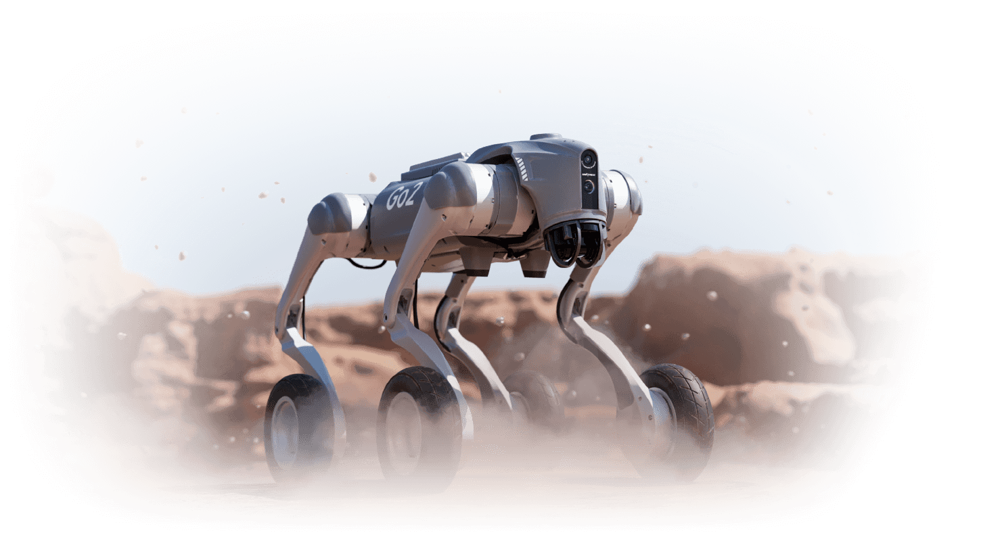

# Unitree Go2-W U1–U5: wheeled hardware, startup and SDK status


[**View Unitree Go2W U1 on OpenELAB**](https://openelab.io/products/unitree-go2w-u1-wheeled-robotic) — SKU `Unitree-Go2W-U1`\
[**View Unitree Go2W U2 on OpenELAB**](https://openelab.io/products/unitree-go2w-u2-wheeled-robotic) — SKU `Unitree-Go2W-U2`\
[**View Unitree Go2W U3 on OpenELAB**](https://openelab.io/products/unitree-go2w-u3-wheeled-robotic) — SKU `Unitree-Go2W-U3`\
[**View Unitree Go2W U4 on OpenELAB**](https://openelab.io/products/unitree-go2w-u4-wheeled-robotic) — SKU `Unitree-Go2W-U4`\
[**View Unitree Go2W U5 on OpenELAB**](https://openelab.io/products/unitree-go2w-u5-wheeled-robotic) — SKU `Unitree-Go2W-U5`

**Model:** Unitree Go2-W wheeled quadruped · **Options:** five distinct store packages, each with one catalog variant; package-specific engineering configurations require the delivered bill of materials. Prices, availability and shipping are on the store pages.


## Product overview <a href="#product-overview" id="product-overview"></a>

Unitree Go2-W combines twelve leg joints with four wheel drives and 7-inch pneumatic tires. This guide separates the current manufacturer platform specification from OpenELAB's U1–U5 package names, interprets the exact **Go2-W User Manual V1.1**, and provides an app-status first result plus a conditional read-only SDK checkpoint. The 16-page Go2-W manual is accessible and was reviewed with original-image checks of its interface and startup figures. Its hardware revision and several inconsistent specifications still require comparison with the delivered unit; the leg-only Go2 manuals are not substitutes. [Official platform](https://www.unitree.com/go2-w/), [Go2-W V1.1 manual](https://marketing.unitree.com/article/en/Go2-W/User_Manual.html)



_Original Unitree product image, linked from its Go2-W page. It illustrates the platform, not a connector pinout or the contents of every U1–U5 package; image rights remain with the source._

### What do U1, U2, U3, U4 and U5 mean? <a href="#what-do-u1-u2-u3-u4-and-u5-mean" id="what-do-u1-u2-u3-u4-and-u5-mean"></a>

| OpenELAB package | Verified listing identity | What can be concluded from the listing                                             | What remains unresolved                                                                         |
| ---------------- | ------------------------- | ---------------------------------------------------------------------------------- | ----------------------------------------------------------------------------------------------- |
| U1               | `Unitree-Go2W-U1`         | Go2-W robot listing; optional Orin NX expansion mentioned                          | Exact compute, sensors, charger, controller revision and expansion contents                     |
| U2               | `Unitree-Go2W-U2`         | Separate Go2-W robot listing                                                       | No independently established U2-specific hardware difference from U1/U3                         |
| U3               | `Unitree-Go2W-U3`         | Separate Go2-W robot listing                                                       | No independently established U3-specific sensor or compute upgrade                              |
| U4               | `Unitree-Go2W-U4`         | Separate Go2-W robot listing                                                       | No independently established U4-specific navigation entitlement or compute upgrade              |
| U5               | `Unitree-Go2W-U5`         | Store describes a stabilized visible-light/thermal payload and excludes the D1 arm | Payload manufacturer/model, calibration, API, electrical interface, mounting and delivered mass |

These identities were matched to actual catalog product and variant records and observed OpenELAB search links on 24 November 2026. The current Unitree platform page has one Go2-W parameter table, not five U-number tables. A higher U number is therefore not proof of a particular GPU, sensor, autonomous behavior or SDK feature. U5's payload description is store evidence; it is not a reviewed manufacturer payload manual. See the five purchasing links above for exact listing scope.

For the leg-only Air/Pro/EDU comparison, use the separate **Unitree Go2 Air, Pro and EDU guide** in this series. Do not load a Go2 configuration merely because a library path contains `go2`.

## Applications <a href="#applications" id="applications"></a>

Go2-W is suitable for supervised mobile-robot research, teaching wheel-and-leg kinematics, and logging robot status on an appropriately commissioned platform. Optional compute can support perception development after its exact software image, power budget and mechanical mounting are verified. Unitree explicitly lists secondary development for Go2-W. [Platform capabilities](https://www.unitree.com/go2-w/)

Navigation, route following and payload transport are integration projects: a demonstration video does not establish localization accuracy, braking distance or unattended deployment suitability. Thermal work on U5 additionally needs the payload's own radiometric calibration and software documentation. Go2-W V1.1 p. 2 requires 5–35 °C, dry non-dusty conditions, traction, line-of-sight control and at least 2 m clearance. It explicitly says the robot is not waterproof or dustproof. Do not infer an ingress or functional-safety rating from the outdoor product image. No tire pressure or service torque was established. [Exact Go2-W safety page](https://marketing.unitree.com/article/en/Go2-W/User_Manual.html)

## Specifications <a href="#specifications" id="specifications"></a>

The values below are manufacturer-reported platform values, not measurements of an OpenELAB package. Dimensions retain the source's order because the page does not label axes. [Unitree Go2-W parameter table and footnotes](https://www.unitree.com/go2-w/)

| Parameter                  | Current Go2-W platform value                                                                         | Integration meaning                                                                                                              |
| -------------------------- | ---------------------------------------------------------------------------------------------------- | -------------------------------------------------------------------------------------------------------------------------------- |
| Standing envelope          | 70 × 43 × 50 cm                                                                                      | Confirm mounting and clearance against the actual payload and robot                                                              |
| Mass with battery          | About 18 kg                                                                                          | Added compute/gimbal/arm mass is not included by inference                                                                       |
| Electrical voltage         | 33.6 V                                                                                               | A platform voltage entry, not a third-party supply specification or connector pinout                                             |
| Payload                    | Approximately 8 kg; maximum approximately 12 kg                                                      | No load position, duty cycle or dynamic derating curve supplied                                                                  |
| Speed                      | 0–2.5 m/s                                                                                            | Not a safe initial test speed or braking guarantee                                                                               |
| Maximum climb/drop height  | Less than 70 cm                                                                                      | A capability claim, not a first-use obstacle procedure                                                                           |
| Maximum climb angle        | 35°                                                                                                  | Terrain/load conditions unspecified                                                                                              |
| Main compute               | 8-core high-performance CPU                                                                          | CPU model, RAM, storage and image version not specified                                                                          |
| Actuation                  | 16 motors in the table                                                                               | SDK mapping resolves twelve leg joints plus four wheel drives                                                                    |
| Maximum joint torque       | About 45 N·m for the largest motor                                                                   | Unitree says actual maxima differ across the 16 motors; not a continuous rating for every joint                                  |
| Tires                      | 7-inch pneumatic                                                                                     | Pressure, replacement procedure and fastener torque not established                                                              |
| Perception                 | Super-wide-angle 3D LiDAR; HD wide-angle camera                                                      | V1.1 describes L2; delivered model, frame rate, calibration and point-cloud interface require confirmation                       |
| Connectivity               | Product page lists Wi-Fi 6, 4G, Bluetooth                                                            | 4G conflicts with V1.1 p. 3 capability cells; confirm exact firmware/region, provisioning and carrier support                    |
| Included platform features | Product page lists manual controller, app support, front light, voice, OTA and secondary development | Voice/avoidance/tracking capability conflicts are recorded below; exact firmware/region and accessory revision must be confirmed |
| Compute expansion          | Multiple options, including Orin NX                                                                  | Optional; no fixed TOPS or image inferred                                                                                        |
| Battery                    | Long-endurance, 15,000 mAh                                                                           | Exact part number, chemistry and management limits require the battery documentation                                             |
| Endurance                  | 1.5–3 h                                                                                              | Conditions and package payload change endurance                                                                                  |
| Charger                    | Fast charger, 33.6 V / 9 A                                                                           | Confirm actual battery/charger pairing before charging                                                                           |

### Store claims that require reconciliation <a href="#store-claims-that-require-reconciliation" id="store-claims-that-require-reconciliation"></a>

| Claim found in OpenELAB listings                                                               | Current official evidence                                                                                         | Engineering decision                                                                                                              |
| ---------------------------------------------------------------------------------------------- | ----------------------------------------------------------------------------------------------------------------- | --------------------------------------------------------------------------------------------------------------------------------- |
| U1 standing 70 × 31 × 40 cm; 2–4 h endurance                                                   | Go2-W table says 70 × 43 × 50 cm and 1.5–3 h                                                                      | Use current platform table for preliminary planning; obtain exact U1 revision confirmation before fit/runtime commitments         |
| U2–U4 45° slope, 23 cm stairs and 1.5 m standing jump                                          | Current page gives 35° and a separate less-than-70 cm climb/drop entry; no matching stair/jump specification read | Do not convert these into operating limits or attempt them                                                                        |
| U1 −20 to 55 °C, about 5 h charging, L1 identity/FOV                                           | Not established in the reviewed current Go2-W table                                                               | V1.1 p. 2 specifies 5–35 °C robot use; charging procedure remains unresolved for the exact pack. Do not import Go2 battery limits |
| U5 gimbal 0.01° accuracy; 640 × 512 thermal imager; 8–14 µm; gain-dependent temperature limits | Store lists these, but no exact OEM payload manual was read                                                       | Treat as procurement claims pending payload identity and calibration evidence                                                     |

### Manufacturer sources also disagree: retain the revision boundary <a href="#manufacturer-sources-also-disagree-retain-the-revision-boundary" id="manufacturer-sources-also-disagree-retain-the-revision-boundary"></a>

The Go2-W V1.1 manual describes **L2 at 360° × 96°**, and its revision-history entry says L1 was replaced by L2. Its printed date for V1.1 is **4 June 2016**, preceding its V1.0 entry of 18 December 2024; the original image confirms this inconsistency. The filename's 2026 directory is not authority to silently correct the printed date. Identify the manual by V1.1 and its preserved source, and verify the delivered LiDAR before selecting L1/L2 software. [V1.1 pp. 3, 16](https://marketing.unitree.com/article/en/Go2-W/User_Manual.html)

| Topic              | Source discrepancy                                                                                                                                                                                              | Consequence                                                                                                                                                                |
| ------------------ | --------------------------------------------------------------------------------------------------------------------------------------------------------------------------------------------------------------- | -------------------------------------------------------------------------------------------------------------------------------------------------------------------------- |
| Speed              | Platform table 0–2.5 m/s; manual p. 3 says 2 m/s; manual p. 14 says 3.5 m/s and includes an Air exception                                                                                                       | No reconciled operating maximum for the purchased package; do not test a headline maximum                                                                                  |
| Slopes / steps     | Platform 35° / less than 70 cm climb/drop; manual p. 14 gives 40°, 16 cm advice and an 18 cm caution, including Air text                                                                                        | Different claims cannot form a safe stair/slope procedure; first check stays on level ground                                                                               |
| Endurance          | Platform 1.5–3 h; manual p. 14 says 1–2 h for alternating unloaded standing/walking                                                                                                                             | Record workload and actual battery; do not promise either figure                                                                                                           |
| Feature capability | V1.1 p. 3 has hollow Go2 W cells for intelligent avoidance, 4G image transmission, ISS and voice; p. 4 nevertheless describes built-in 4G/eSIM and p. 11 Chinese voice; current product page lists 4G and voice | Confirm the delivered firmware, region and enabled features before using 4G, voice, tracking or avoidance. Do not infer support or absence from a single inconsistent cell |
| Compute            | Product page allows multiple expansion choices; manual p. 4 calls Orin NX 16GB / 100 TOPS standard, while p. 5's 16GB-headed table says 8GB memory                                                              | Confirm module/carrier/RAM and image; do not promise 16GB, 100 TOPS or a particular JetPack for every U package                                                            |

These are source conflicts, not measured defects. The Air exceptions in the Go2-W cautions are retained as evidence of a scope problem rather than accepted as Go2-W limits.

## Hardware and connections <a href="#hardware-and-connections" id="hardware-and-connections"></a>

### Identify, inspect and place the robot <a href="#identify-inspect-and-place-the-robot" id="identify-inspect-and-place-the-robot"></a>

Record the robot label and serial, U-package contents, battery/charger labels, remote model, installed LiDAR, expansion dock and payload. Confirm that the delivered platform is Go2-W. Inspect tires, feet, wheel assemblies and cables for damage or interference while powered off. The manual prohibits lifting the powered robot and side rolling with back-mounted accessories. Keep hands clear of joint pinch points. [Go2-W V1.1 pp. 2, 7, 14](https://marketing.unitree.com/article/en/Go2-W/User_Manual.html)

V1.1 p. 7 shows the pack entering from the side with its power switch upward; align it without forcing and confirm the latch click. Page 8 shows the **wheeled** startup posture: abdominal support flat, body horizontal, lower legs retracted and wheel feet placed on the level surface without the body trapping the legs. Use that exact drawing; the leg-only Go2 illustration is not the reference. Startup can raise the body automatically, so keep the wheel/joint motion envelope clear. Confirm the operator's stop method for the delivered controller/app before powering. [Original Go2-W startup figure, p. 8](https://doc-cdn.unitree.com/static/2026/6/4/0e82698010004c808b3d16654431bb64_2481x3509.png)

### Rear-panel connections and expansion dock <a href="#rear-panel-connections-and-expansion-dock" id="rear-panel-connections-and-expansion-dock"></a>

The following comes from original-image review of **Go2-W V1.1 pp. 4–6**. It is not transferred from consumer Go2. Compare the delivered panel and dock to those drawings before connection. [Exact manual](https://marketing.unitree.com/article/en/Go2-W/User_Manual.html)

| Robot rear-panel interface | Verified role and boundary                                                                                                                                                                                                    |
| -------------------------- | ----------------------------------------------------------------------------------------------------------------------------------------------------------------------------------------------------------------------------- |
| Power output               | 28.8 V DC output to the Orin NX 8/16GB dock's BAT input; not a robot supply input. Current limit, polarity drawing and mating harness specification remain unverified                                                         |
| RJ45 Ethernet              | Connection to user PC or Orin NX dock. No PoE or default address/credential implied                                                                                                                                           |
| SBUS                       | As viewed in the original p. 5 panel figure, left-to-right `NC/GND/SBUS`; explicitly **no power output**. Signal voltage, inversion, timing and channel mapping not supplied; no custom receiver wiring procedure established |

The dock figure identifies the following numbered ports. Its **16–60 V BAT input** rating belongs to the expansion dock, not to the Go2-W robot. Do not connect that range to the robot itself or connect both BAT inputs without the approved harness arrangement. [Original dock figure, p. 6](https://doc-cdn.unitree.com/static/2026/6/4/fa574f08f2874cc0a5468f2571f8a8c4_2482x3509.png)

| Dock figure label | Source-described function                     | Integration boundary                                                             |
| ----------------- | --------------------------------------------- | -------------------------------------------------------------------------------- |
| `[1]`             | `GH1.25-4PIN` 100M Ethernet / small servo arm | Four-pin signal mapping not supplied                                             |
| `[2]`             | M8 aviation connector / radar                 | No pin assignments or electrical levels established                              |
| `[3]`, `[4]`      | 16–60 V BAT inputs / Go2-W or small servo arm | Input polarity and shared-power arrangement require approved cable documentation |
| `[5]`             | RJ45 Gigabit Ethernet / robot                 | Distinguish from the user-side port                                              |
| `[6]`             | USB 3.2 Type-C / depth camera                 | Camera model, driver and calibration remain configuration-specific               |
| `[7]`             | Printed `RORCE-RECOVERY` service label        | Identifier preserved as printed; no recovery/flash sequence established          |
| `[8]`             | Type-A 5 V / 1 A user port                    | Port rating, not a total dock budget                                             |
| `[9]`             | 12 V / 3 A user output                        | Do not infer mating polarity from appearance                                     |
| `[10]`            | 5 V / 3 A user output                         | Combined power/fuse limits not supplied                                          |
| `[11]`            | RJ45 Gigabit Ethernet / user expansion        | Requires exact network provisioning                                              |
| `[12]`            | Full-featured Type-C / display                | Do not infer supported display modes or power delivery                           |

V1.1 p. 5's compute table lists Ampere GPU/Arm CPU, accelerators, external NVMe and H.265 encode/decode capabilities with a 10–25 W power-consumption entry. Its 16GB heading versus 8GB memory conflict prevents using it as a delivered module specification. Those entries are module-level claims, not guaranteed application throughput or a whole-carrier power budget. Obtain the exact module/carrier label, BSP/JetPack image, thermal configuration and storage BOM first.

### Battery, charging and maintenance boundaries <a href="#battery-charging-and-maintenance-boundaries" id="battery-charging-and-maintenance-boundaries"></a>

The platform page specifies a 15,000 mAh pack and 33.6 V / 9 A charger; the exact Go2-W manual confirms installation and startup/shutdown posture, but does not provide a separate charging/storage/protection table. Match the supplied pack and charger labels to an explicitly applicable battery manual before charging. Do not apply BT2-05/BT2-06 limits, LED codes, cutoff thresholds, storage temperatures or forced-off sequences from the leg-only Go2 battery manual without explicit Go2-W applicability.

V1.1 p. 12 requires low-down/prone/damping before power-off and removal of the pack for long storage. The page's normal sequence is short power press then a hold of 2 s; the figure caption reverses the press wording, so use the prose and confirm the supplied pack instruction before operation. Battery charging, custom power cables, tire service and unspecified fastener work remain outside this first result. No tire pressure, wheel service torque or total expansion-current budget was verified.

## Software and development resources <a href="#software-and-development-resources" id="software-and-development-resources"></a>

### Exact SDK scope and wheel differences <a href="#exact-sdk-scope-and-wheel-differences" id="exact-sdk-scope-and-wheel-differences"></a>

The reviewed Python repository contains explicit `example/go2w/` high- and low-level examples. This is actual Go2-W source evidence, stronger than inferring compatibility from a repository title. The snapshot is `814556d15970dd2ecf1c9984e845ca02ab07e206`, reviewed 24 November 2026. Its README and setup metadata list Python ≥3.8, `cyclonedds == 0.10.2`, NumPy and OpenCV; the package version is 1.0.1 with a BSD-3-Clause root license; it does not provide an exact Go2-W firmware compatibility range. [Pinned SDK README](https://github.com/unitreerobotics/unitree_sdk2_python/blob/814556d15970dd2ecf1c9984e845ca02ab07e206/README.md)

| Resource                     | Verified scope                                                                         | Limit                                                                                                                                                                                  |
| ---------------------------- | -------------------------------------------------------------------------------------- | -------------------------------------------------------------------------------------------------------------------------------------------------------------------------------------- |
| Python Go2-W examples        | Explicit wheel-platform high- and low-level files                                      | Examples contain active controls; do not execute them for first communication                                                                                                          |
| `unitree_go.msg.dds_`        | Go2-W example imports `LowState_`, `LowCmd_` and `SportModeState_` from this namespace | Shared message namespace does not make Go2 and Go2-W motor indexing equivalent                                                                                                         |
| `unitree_sdk2` C++           | README prebuild reference: Ubuntu 20.04 LTS, aarch64/x86\_64, GCC 9.4.0                | Architecture-specific prebuilt core libraries; building wrappers/examples does not establish a fully source-rebuildable control core or purchased-firmware support; no build performed |
| Developer quick-start portal | Linked by SDK README                                                                   | Inaccessible in this review; IP address, interface provisioning and firmware requirements not read                                                                                     |
| Firmware/OTA                 | Platform page lists OTA                                                                | No reviewed Go2-W recovery image, rollback package or flashing procedure                                                                                                               |

The exact wheel identifiers at the pinned Python source are `FR_w = 12`, `FL_w = 13`, `RR_w = 14`, `RL_w = 15`; leg motor indices are front-right 0–2, front-left 3–5, rear-right 6–8 and rear-left 9–11. These are SDK array indices, not connector pins or independent bus addresses. The leg-only Go2 map stops at 11. [Go2-W constants](https://github.com/unitreerobotics/unitree_sdk2_python/blob/814556d15970dd2ecf1c9984e845ca02ab07e206/example/go2w/low_level/unitree_legged_const.py)

The Go2-W high-level file imports `SportClient` from the `go2` package; this is an observed implementation reuse, not a reason to copy all Go2 motion functions. Its menu includes a `get_state` entry but the reviewed dispatch does not implement a corresponding `id == 7` branch. Its other branches can issue motion or recovery commands. Use a subscriber-only status check instead. [Reviewed Go2-W high-level source](https://github.com/unitreerobotics/unitree_sdk2_python/blob/814556d15970dd2ecf1c9984e845ca02ab07e206/example/go2w/high_level/go2w_sport_client.py)

Repository code availability does not establish the license of proprietary robot firmware, payload software or a commercial deployment. Retain the repository's license with redistributed code and review the delivered vendor terms. An accessible repository is not proof that firmware recovery or calibration tools are public.

## Getting started <a href="#getting-started" id="getting-started"></a>

### First working result: Go2-W app identity and normal startup <a href="#first-working-result-go2-w-app-identity-and-normal-startup" id="first-working-result-go2-w-app-identity-and-normal-startup"></a>

Prerequisites are an identified Go2-W whose delivered configuration matches V1.1's startup arrangement, an approved already charged battery, Unitree Go app/account, and an operator trained in the delivered controller/app's stop action. The manual gives a binding menu but no full handheld button table; do not assume the consumer Go2 remote stop combination. Confirm that method from the supplied controller instructions before power. Use a dry level area with traction, 5–35 °C, at least 2 m clearance, and clear wheel/joint motion space. This is an automatic-startup observation, not a motion-free test. [Go2-W V1.1 pp. 2, 7–11](https://marketing.unitree.com/article/en/Go2-W/User_Manual.html)

1. With the pack off, check labels, latch it switch-up and set the exact wheeled horizontal posture shown on p. 8. Do not lift or reposition after power-on.
2. Confirm the supplied battery's instruction agrees with the Go2-W manual. Its prose specifies one short press followed by a hold of at least 2 s. If pack instructions differ or the part cannot be identified, stop and obtain the revision-specific instruction.
3. Observe startup from outside the motion envelope. Page 8 describes green flashing, then steady green after approximately two minutes with the body horizontal. Abnormal posture, rolling, slipping or fault lights are failure criteria; do not command a gait to correct them.
4. Install **Unitree Go** from the [official download hub](https://www.unitree.com/app/go2/). Sign in, enable Bluetooth/app permissions, keep the phone nearby, choose **Home → Add robot**, select the unit matched to the physical label and enter the robot information. A discovery name beginning `Go2_` alone does not prove wheeled identity.
5. Choose the manual's AP/hotspot path or a known router Wi-Fi path. In AP mode connect the phone's Wi-Fi settings to the robot hotspot established in the binding flow, then return to the app. For router mode use the intended router credentials. Do not reuse screenshot SSIDs, remote codes or invented passwords.
6. Confirm the intended robot's connected state, battery/status and camera view when available, and record app/robot firmware, LiDAR label and module/payload BOM. Complete the built-in tutorial before later manual motion; do not activate autonomous routes, recovery, calibration or wheel tests as part of this result.

**Expected result:** the intended Go2-W is bound to the authorized account with a live connection and normal steady-green startup state. In Go2-W V1.1 p. 4, green means powered on; unlike the consumer Go2 table it does **not** establish avoidance-enabled status. Camera reception verifies that path only, not LiDAR decoding or wheel calibration. No such result was observed on hardware here.

**If this check fails:** safely power down using the matched instructions, then distinguish startup-posture, app-permission, AP/router and hardware-fault causes below. Do not unbind someone else's account or use blind calibration. To finish a normal session, use the trained low-down action on level ground, confirm prone/damping, then follow V1.1 p. 12's power sequence and confirm lights out before handling/storage. Cutting power while standing can cause a fall.

### Prerequisites for the separate developer checkpoint <a href="#prerequisites-for-the-separate-developer-checkpoint" id="prerequisites-for-the-separate-developer-checkpoint"></a>

The following subscription is only for an **already commissioned Go2-W** with confirmed firmware/SDK pairing and a provisioned host network. V1.1 establishes the physical RJ45 interface but not the exact IP/subnet, DDS transport provisioning or firmware/API version range. Obtain those supplied instructions first. Use an existing verified Python environment at the pinned commit; no installation/build, ROS setup, device communication or firmware update was performed here.

### First working result: bounded status subscription <a href="#first-working-result-bounded-status-subscription" id="first-working-result-bounded-status-subscription"></a>

1. In the supplier-approved stationary setup, confirm that the app/controller identifies Go2-W and displays battery/status without initiating a gait, follow mode, navigation or recovery motion. Preserve the label, firmware and network settings in the commissioning record.
2. Select the actual Linux interface attached to the provisioned robot network. In the command below, replace `ROBOT_INTERFACE` with that exact name; it is a placeholder, not an interface or IP to copy.
3. Save the following original example as `read_go2w_status.py`. It uses the topic/type pair in the reviewed Go2-W source and the official subscriber API. It reads at most one `LowState_` sample within ten seconds. It has no command publisher or motion client.

```python
import sys
from unitree_sdk2py.core.channel import ChannelFactoryInitialize, ChannelSubscriber
from unitree_sdk2py.idl.unitree_go.msg.dds_ import LowState_

if len(sys.argv) != 2:
    raise SystemExit("Usage: python3 read_go2w_status.py ROBOT_INTERFACE")
ChannelFactoryInitialize(0, sys.argv[1])
sub = ChannelSubscriber("rt/lowstate", LowState_)
sub.Init()
try:
    msg = sub.Read(10.0)
    if msg is None:
        raise SystemExit("No Go2-W state in 10 seconds; stop and check provisioning.")
    if len(msg.motor_state) < 16:
        raise SystemExit("State has fewer than 16 motor slots; verify type/firmware.")
    print("tick:", msg.tick)
    print("power_v:", msg.power_v, "power_a:", msg.power_a)
    for name, index in (("FR_w", 12), ("FL_w", 13), ("RR_w", 14), ("RL_w", 15)):
        print(name, "q:", msg.motor_state[index].q, "dq:", msg.motor_state[index].dq)
finally:
    sub.Close()
```

```bash
python3 read_go2w_status.py ROBOT_INTERFACE
```

4. Compare the sample with the app battery/status and the known stationary state. A decodable packet and a 16-slot array do not prove correct joint calibration, wheel direction or package identity. Take a second bounded sample only if necessary to confirm that `tick` advances. Preserve actual output and firmware/SDK/interface records without publishing serials or credentials.

**Expected result:** one decoded low-state sample containing `tick`, `power_v`, `power_a` and four wheel slots; then the subscriber closes. No motion command is sent. This is expected behavior from source inspection, not observed robot output. The firmware-to-message contract and wheel field units/signs must still be confirmed for the delivered unit. The IDL has 20 motor slots; capacity does not prove 20 physical joints or that wheel calibration is correct. [Go2-W topic/type usage](https://github.com/unitreerobotics/unitree_sdk2_python/blob/814556d15970dd2ecf1c9984e845ca02ab07e206/example/go2w/low_level/go2w_stand_example.py), [subscriber API](https://github.com/unitreerobotics/unitree_sdk2_python/blob/814556d15970dd2ecf1c9984e845ca02ab07e206/unitree_sdk2py/core/channel.py)

**If this check fails:** close the subscriber. Verify the exact platform and firmware, then SDK snapshot/type, selected physical network interface and supplier-defined network configuration. An app connection is not proof that DDS traffic reaches the development host. Do not release the motion service, run a stand example or change robot firmware to make status appear.

## Troubleshooting and FAQs <a href="#troubleshooting-and-faqs" id="troubleshooting-and-faqs"></a>

### What do Go2-W lights and startup faults mean? <a href="#what-do-go2-w-lights-and-startup-faults-mean" id="what-do-go2-w-lights-and-startup-faults-mean"></a>

V1.1 p. 4 maps flashing green to boot, steady green to powered-on, slow blue to motor/IMU calibration, slow yellow to low battery with possible automatic crouch within ten minutes, slow red to system/boot/hardware abnormality, fast red to failed motor/IMU calibration and steady white to the lamp. End a low-battery session safely at the warning; ten minutes is not a guaranteed reserve. Do not transfer consumer Go2's steady blue/yellow/purple mode meanings to this table. [Exact Go2-W indicator page](https://marketing.unitree.com/article/en/Go2-W/User_Manual.html)

For a slow-red failure to stand, V1.1 p. 13 first directs checking startup placement and restarting; power down before repositioning. If it persists, preserve the app alarm and obtain support. For abnormal posture or repeated falls, the manual says the robot is factory calibrated and to consult Unitree before joint/IMU recalibration. Its menu **Settings → Data → Machine Dog → imu Information → Calibration** is a location reference, not a command to recalibrate a normal unit. For a stopped LiDAR, inspect the app alarm and obstruction from a safe state; do not touch a powered scanner even though the manual mentions nudging it.

### Why will the app or handheld not connect? <a href="#why-will-the-app-or-handheld-not-connect" id="why-will-the-app-or-handheld-not-connect"></a>

Check phone Bluetooth and Unitree Go permission, then the selected connection path: AP requires the robot's actual hotspot; router Wi-Fi requires the intended network/external connection; 4G requires an available supported data service. V1.1 p. 11 gives **Settings → Remote Control Settings**, switch on remote control and enter the **actual** controller code. The screenshot code is not universal. The supplied controller revision determines its link LEDs and stop controls.

For an authorized ownership transfer, p. 10 gives **Home → Settings → Robot Settings → Switch Connection → Unbind**; it removes app control and allows rebinding. Do not use unbinding as a casual reset, and seek official assistance for a lost account. Offline voice is described on p. 11 as Chinese; the manual's phone-app English route does not establish an offline English voice API.

### Why are wheels missing or mapped as leg motors? <a href="#why-are-wheels-missing-or-mapped-as-leg-motors" id="why-are-wheels-missing-or-mapped-as-leg-motors"></a>

Confirm the robot is Go2-W and the application uses the wheel-specific constants. The leg-only map covers 0–11; Go2-W adds 12–15. Then check the exact firmware/type contract and topic before interpreting values. Array length alone cannot distinguish unused slots from active motors. Stop before commanding a wheel with a leg control policy. [Pinned wheel map](https://github.com/unitreerobotics/unitree_sdk2_python/blob/814556d15970dd2ecf1c9984e845ca02ab07e206/example/go2w/low_level/unitree_legged_const.py)

### Why does selecting `get_state` in the high-level example do nothing? <a href="#why-does-selecting-get_state-in-the-high-level-example-do-nothing" id="why-does-selecting-get_state-in-the-high-level-example-do-nothing"></a>

The reviewed `go2w_sport_client.py` lists that menu option without an implemented dispatch branch. This is a source-level observation, not a robot failure. Use the bounded subscriber above after provisioning is verified. Do not select `recovery`, `stand_up` or `move` as a diagnostic substitute.

### Why does the app connect but DDS times out? <a href="#why-does-the-app-connect-but-dds-times-out" id="why-does-the-app-connect-but-dds-times-out"></a>

First compare the SDK's selected interface with the supplied robot network instructions; then check domain 0 and the exact `unitree_go` type against the firmware. Have the network administrator check DDS discovery/multicast permissions if applicable to that configuration. Keep firewall and routing changes specific to supplier instructions; no global disablement or guessed address is part of this guide.

### Is a Go2 Air/Pro battery, remote or manual interchangeable? <a href="#is-a-go2-airpro-battery-remote-or-manual-interchangeable" id="is-a-go2-airpro-battery-remote-or-manual-interchangeable"></a>

Interchangeability was not established. Go2-W V1.1 now supplies its own startup, interfaces and binding procedure; use those. Similar voltage or a shared app/library name is insufficient to transfer battery protections, charging, handheld button mappings or wheel stop behavior. Require exact Go2-W/part-number applicability for the supplied battery and controller manuals.

### Can the robot recover or roll back firmware through SDK2? <a href="#can-the-robot-recover-or-roll-back-firmware-through-sdk2" id="can-the-robot-recover-or-roll-back-firmware-through-sdk2"></a>

No supported Go2-W firmware recovery procedure was verified. The dock drawing labels a service recovery control, but a label is not a procedure. `RecoveryStand()` is a motion API, not firmware recovery. OTA presence does not establish a supported downgrade, bootloader image, recalibration procedure or factory reset. If an update or boot fails, retain the displayed error, firmware versions and supplier-approved diagnostic logs, then use the exact model's authorized recovery procedure. Do not flash a Go2 image or attempt undocumented service credentials.

### Can U5 thermal readings be used directly for inspection decisions? <a href="#can-u5-thermal-readings-be-used-directly-for-inspection-decisions" id="can-u5-thermal-readings-be-used-directly-for-inspection-decisions"></a>

The store lists a thermal payload, but no reviewed payload manual establishes emissivity handling, radiometric output, accuracy conditions or calibration traceability. Identify the actual imager/gimbal and obtain its calibration and SDK documentation first. The U5 listing explicitly excludes the D1 arm; do not infer its compatibility from general platform expansion images.

## Downloads and technical documents <a href="#downloads-and-technical-documents" id="downloads-and-technical-documents"></a>

| Resource                                                                | Purpose and exact scope                                                                                | Official link and access state                                                                                                                                                                                                                                                                                                                                         |
| ----------------------------------------------------------------------- | ------------------------------------------------------------------------------------------------------ | ---------------------------------------------------------------------------------------------------------------------------------------------------------------------------------------------------------------------------------------------------------------------------------------------------------------------------------------------------------------------- |
| Go2-W product page                                                      | Current platform specifications and original image                                                     | [Read manufacturer page](https://www.unitree.com/go2-w/)                                                                                                                                                                                                                                                                                                               |
| Go2-W User Manual V1.1                                                  | 16 original page images; model-specific startup, interfaces, binding, diagnostics and revision history | [Read exact manual](https://marketing.unitree.com/article/en/Go2-W/User_Manual.html), OCR-assisted and critical figures visually checked                                                                                                                                                                                                                               |
| Python SDK snapshot                                                     | Dependencies and interface model; README paths may lag repository layout                               | [Pinned README](https://github.com/unitreerobotics/unitree_sdk2_python/blob/814556d15970dd2ecf1c9984e845ca02ab07e206/README.md), source read                                                                                                                                                                                                                           |
| Go2-W high-level example                                                | Inspect implemented commands and menu limits                                                           | [Exact source](https://github.com/unitreerobotics/unitree_sdk2_python/blob/814556d15970dd2ecf1c9984e845ca02ab07e206/example/go2w/high_level/go2w_sport_client.py), read; contains active controls                                                                                                                                                                      |
| Go2-W low-level example and motor constants                             | Verify actual topic/type and wheel indices                                                             | [Low-level source](https://github.com/unitreerobotics/unitree_sdk2_python/blob/814556d15970dd2ecf1c9984e845ca02ab07e206/example/go2w/low_level/go2w_stand_example.py), [constants](https://github.com/unitreerobotics/unitree_sdk2_python/blob/814556d15970dd2ecf1c9984e845ca02ab07e206/example/go2w/low_level/unitree_legged_const.py); read, not a first-run command |
| Channel implementation                                                  | Subscriber initialization, read timeout and close semantics                                            | [Pinned API source](https://github.com/unitreerobotics/unitree_sdk2_python/blob/814556d15970dd2ecf1c9984e845ca02ab07e206/unitree_sdk2py/core/channel.py), read                                                                                                                                                                                                         |
| Developer network quick start                                           | Provisioning and device network setup                                                                  | [Official portal](https://support.unitree.com/home/en/developer/Quick_start), inaccessible; contents not reviewed                                                                                                                                                                                                                                                      |
| Exact battery and handheld manuals for the delivered Go2-W parts        | Charging, storage, protection limits and controller-specific stop buttons                              | Go2-W V1.1 covers robot operation and binding; separate part-specific battery/remote applicability remains unverified                                                                                                                                                                                                                                                  |
| Go2-W complete electrical schematic, firmware recovery, CAD/calibration | External integration and service                                                                       | V1.1 pp. 4–6 provide original interface/dock drawings; complete pin assignments, polarity/current budget, CAD and recovery procedure remain unverified                                                                                                                                                                                                                 |
| U1–U5 package and U5 payload manuals                                    | Delivered package differences and payload interfaces                                                   | No exact OEM package manual read; required before payload operation                                                                                                                                                                                                                                                                                                    |

The 16-page Go2-W manual is indexed below with original engineering paraphrases. The four consumer Go2 manuals do not establish additional Go2-W battery/remote applicability. No full transcript or manual facsimile is republished.

### Go2-W User Manual V1.1: complete source-page index <a href="#go2-w-user-manual-v11-complete-source-page-index" id="go2-w-user-manual-v11-complete-source-page-index"></a>

Original Unitree source: [Go2-W User Manual V1.1](https://marketing.unitree.com/article/en/Go2-W/User_Manual.html). Page links open the OEM originals; summaries below are original engineering interpretation, not a transcript.

| Source page | Section and engineering use                                                                                                                                            | Original                                                                                                |
| ----------- | ---------------------------------------------------------------------------------------------------------------------------------------------------------------------- | ------------------------------------------------------------------------------------------------------- |
| 1           | **Cover / version:** Establish the exact wheeled V1.1 source independently from leg-only Go2 manuals.                                                                  | [OEM p. 1](https://doc-cdn.unitree.com/static/2026/6/4/1169ac28163c4866a738fdd1bc0407ea_2482x3509.png)  |
| 2           | **Safety / wheel traction / environment:** Dry 5–35 °C use, 2 m clearance, line of sight and suitable traction; no powered lifting or back-loaded rolls.               | [OEM p. 2](https://doc-cdn.unitree.com/static/2026/6/4/794e4a5e9f684474885eb2069e7ca3b3_2481x3509.png)  |
| 3           | **Architecture / L2 / parts / edition matrix:** Sixteen-DOF wheel platform, L2 revision and expansion hardware; identify delivered sensors and compute.                | [OEM p. 3](https://doc-cdn.unitree.com/static/2026/6/4/6bb51e66fdf24244b8030e20a907bb0c_2481x3509.png)  |
| 4           | **Status / app / development / rear panel:** Go2-W green means powered on; rear 28.8 V output and RJ45 roles differ from a supply input.                               | [OEM p. 4](https://doc-cdn.unitree.com/static/2026/6/4/f158c894ab594bbe92177155fd942cf1_2481x3509.png)  |
| 5           | **Ethernet / SBUS / compute table:** Panel-view SBUS is NC/GND/SBUS with no power; 16GB heading versus 8GB memory is unresolved.                                       | [OEM p. 5](https://doc-cdn.unitree.com/static/2026/6/4/74b6a5b34bec4a9398b0c9e0fd5ce50d_2481x3509.png)  |
| 6           | **Expansion dock figure:** Keep dock input ratings and accessory outputs separate from robot power; connector pin details remain incomplete.                           | [OEM p. 6](https://doc-cdn.unitree.com/static/2026/6/4/fa574f08f2874cc0a5468f2571f8a8c4_2482x3509.png)  |
| 7           | **Inspection / pack insertion:** Use powered-off label checks, side insertion switch-up and latch confirmation.                                                        | [OEM p. 7](https://doc-cdn.unitree.com/static/2026/6/4/cd5d9e8cf23942bba8cac6cefe1517d6_2482x3509.png)  |
| 8           | **Wheeled posture / startup:** Use original wheel-contact and belly-pad figure; prose specifies short press then hold at least 2 s.                                    | [OEM p. 8](https://doc-cdn.unitree.com/static/2026/6/4/0e82698010004c808b3d16654431bb64_2481x3509.png)  |
| 9           | **App binding / Bluetooth / AP or router:** Match the physical robot and intended network; screenshot names are not defaults.                                          | [OEM p. 9](https://doc-cdn.unitree.com/static/2026/6/4/5adf9e9eb4b946a28fd6cabb1011d8e2_2481x3509.png)  |
| 10          | **Unbinding / permissions / lost account:** Owner-authorized unbinding changes app control; permissions and official account support precede resets.                   | [OEM p. 10](https://doc-cdn.unitree.com/static/2026/6/4/0d95b30a10af40ffa469b9572813cff7_2481x3509.png) |
| 11          | **App / voice / handheld pairing:** Complete tutorial; offline speech is Chinese and remote binding uses Settings → Remote Control Settings.                           | [OEM p. 11](https://doc-cdn.unitree.com/static/2026/6/4/df1804d7545947b5bf4d99657e3c8b10_2481x3509.png) |
| 12          | **Low-down / power-off / storage:** Confirm prone/damping before power removal; resolve reversed figure-caption wording against supplied instructions.                 | [OEM p. 12](https://doc-cdn.unitree.com/static/2026/6/4/c823e11d3cd74cfdb0d5793054b5cab1_2482x3509.png) |
| 13          | **Startup / network / posture / scanner faults:** Check placement and connection route first; consult support before recalibration, avoid powered scanner handling.    | [OEM p. 13](https://doc-cdn.unitree.com/static/2026/6/4/d2122e4739804663a268e3cea0b9120a_2482x3509.png) |
| 14          | **Cautions / terrain / wear / performance conflicts:** Air remnants and conflicting speed/slope/step text prevent treating these as reconciled Go2-W operating maxima. | [OEM p. 14](https://doc-cdn.unitree.com/static/2026/6/4/4c971bf7059a491e83c1e44828615c31_2481x3508.png) |
| 15          | **Disclaimer / service boundaries:** Preserve OEM use/service restrictions and original terms without inventing certification or warranty.                             | [OEM p. 15](https://doc-cdn.unitree.com/static/2026/6/4/30c024eeb0a640d888b82851f7638719_2481x3508.png) |
| 16          | **Revision history / L1 to L2:** History explicitly changes L1 to L2 but prints 2016 for V1.1 before a 2024 V1.0; retain the date conflict.                            | [OEM p. 16](https://doc-cdn.unitree.com/static/2026/6/4/94166fc39c4d47c0934ff296ae254809_2481x3508.png) |

## References and validation <a href="#references-and-validation" id="references-and-validation"></a>

* Unitree, [Go2-W product page](https://www.unitree.com/go2-w/): current public platform table, footnotes and original image; reviewed 24 November 2026, no revision identifier on the page.
* Unitree, [Go2-W User Manual V1.1](https://marketing.unitree.com/article/en/Go2-W/User_Manual.html): all 16 page images reviewed with OCR assistance; pp. 4–6, 8 and 16 original figures/tables visually checked. The printed revision date and compute/performance contradictions are retained explicitly.
* Unitree Robotics, [Python SDK](https://github.com/unitreerobotics/unitree_sdk2_python/tree/814556d15970dd2ecf1c9984e845ca02ab07e206): reviewed README, subscriber implementation, message definition, Go2-W examples and motor map at the pinned commit.
* OpenELAB U1–U5 catalog and observed product links in the first callout: identity and package claims only; not substitutes for OEM electrical or motion documentation.

**Documentation reviewed:** current product page, all 16 Go2-W V1.1 manual pages and pinned software sources. Draft limits remain for the delivered U-package/BOM, conflicting source performance/compute entries, exact battery and handheld instructions, connector polarity/current limits, firmware/network pairing and firmware recovery. These are narrower than the now-filled operating-manual gap.

**Software execution:** SDK installation, compilation, DDS communication and ROS were not run. Any saved syntax/static checks validate only the original example's structure.

**Hardware validation:** not run. No power, charging, motion, wheel direction, calibration, payload, firmware update or recovery was tested. No GitBook publication was performed.

**Related documentation:** [Unitree robot and development directory](./).
