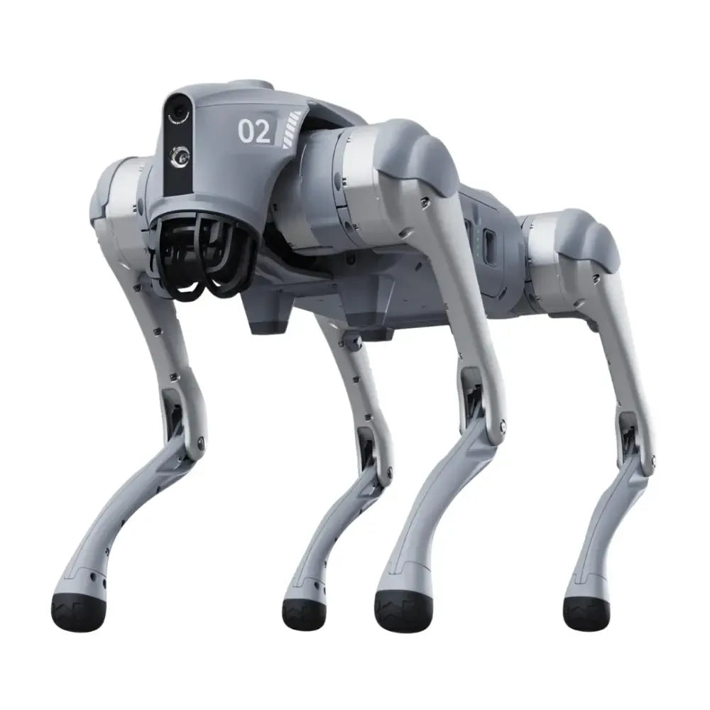

# Unitree Go2 Air, Pro and EDU: model selection, startup and development limits


[**View Unitree Go2 Air on OpenELAB**](https://openelab.io/products/unitree-go2-air) — robot option `GO2 Air`, SKU `Unitree-Go2-Air`\
[**View the GO2 Controller option on OpenELAB**](https://openelab.io/products/unitree-go2-air) — accessory option `GO2 Controller`, SKU `Unitree-Go2-AirC`; select this exact option on the Air listing. It is not another robot.\
[**View Unitree Go2 Pro on OpenELAB**](https://openelab.io/products/unitree-go2-pro-quadruped-robot) — SKU `Unitree-Go2-Pro`

**Models:** Unitree Go2 Air / Pro / EDU, leg-only quadrupeds. **Go2 EDU:** manufacturer reference only; no exact OpenELAB product/SKU match was found in the audited catalog. No purchasing URL or SKU is inferred for EDU. Verify the delivered battery, controller and LiDAR revision before using a procedure.


## Product overview <a href="#product-overview" id="product-overview"></a>

Unitree Go2 is a twelve-joint electric quadruped. Air and Pro provide app/controller operation and graphical programming; official secondary development is an EDU capability, not an entitlement established for Air or Pro. This guide explains model selection, battery and controller differences, stationary app checks and an EDU-only route to reading status. It treats Go2-W as separate wheel-legged hardware. [Current Go2 comparison](https://www.unitree.com/go2/), [Go2 User Manual V4.3](https://marketing.unitree.com/article/en/Go2/User_Manual.html), pp. 3–5.



_Original product image from the verified OpenELAB Go2 Pro catalog record. Rights remain with the source; the image is not evidence of an EDU compute module, battery model or LiDAR revision._

### Which edition supports development? <a href="#which-edition-supports-development" id="which-edition-supports-development"></a>

| Capability                                                   | Go2 Air                             | Go2 Pro                 | Go2 EDU                                                                       |
| ------------------------------------------------------------ | ----------------------------------- | ----------------------- | ----------------------------------------------------------------------------- |
| App, basic actions, Wi-Fi 6/Bluetooth, graphical programming | Listed                              | Listed                  | Listed                                                                        |
| Official secondary development                               | Not listed as supported             | Not listed as supported | Supported; delivered firmware and interface details still required            |
| Wireless vector tracking / ISS 2.0, voice, 4G with GPS       | Not supported in edition comparison | Listed                  | Listed                                                                        |
| Foot-end force sensors                                       | Not listed                          | Not listed              | Listed                                                                        |
| Depth camera                                                 | Not listed                          | Not listed              | Listed in manufacturer comparison; check delivered model                      |
| Additional high-performance compute                          | Not listed                          | Not listed              | Multiple options, including Orin; exact module/BOM is configuration-dependent |
| Handheld controller                                          | Optional                            | Optional                | Listed as included in platform table                                          |
| Auto-retracting carry strap                                  | Not listed                          | Pro-specific            | Not listed                                                                    |

Source: [current manufacturer comparison](https://www.unitree.com/go2/) and V4.3 pp. 4–5. The manual's drawing labels a high-compute module as EDU standard, while its function table describes an optional Orin module. Do not infer a particular Jetson, TOPS value, depth camera or carrier image from the EDU name. The current page also shows Go2 X with a partial secondary-development symbol; X has no matched OpenELAB SKU in this scope and is not silently treated as EDU.

## Applications <a href="#applications" id="applications"></a>

Air is suited to learning app/remote operation within its documented gait limits. Pro adds the documented companion-following and interaction features. EDU provides the manufacturer-supported basis for robotics research using state telemetry, perception integration and custom control, subject to the exact supplied firmware, development entitlement and sensor BOM. [Edition table](https://www.unitree.com/go2/)

A first engineering task is identifying the unit and observing a stable connection. Autonomous routes, advanced gaits, loaded operation and joint-level control come later. V4.3 states that obstacle avoidance acts in the forward direction; a wide LiDAR field of view does not establish rearward or sideways collision protection. The user manual requires line-of-sight supervision, suitable traction and at least 2 m clearance from people, water and obstacles. It specifies dry, non-dusty conditions and 5–35 °C robot operation; marketing footage on rough terrain does not override those instructions. [User manual](https://marketing.unitree.com/article/en/Go2/User_Manual.html), pp. 2, 5, 15–16.

## Specifications <a href="#specifications" id="specifications"></a>

### Robot platform and edition differences <a href="#robot-platform-and-edition-differences" id="robot-platform-and-edition-differences"></a>

These are manufacturer-reported values, not bench measurements. Preserve the dimension order supplied by Unitree; the current table does not explicitly label axes. [Go2 parameter table and footnotes](https://www.unitree.com/go2/)

| Parameter                       | Go2 Air                                                  | Go2 Pro                                         | Go2 EDU                                                   |
| ------------------------------- | -------------------------------------------------------- | ----------------------------------------------- | --------------------------------------------------------- |
| Standing dimensions             | 70 × 31 × 40 cm                                          | Same                                            | Same                                                      |
| Crouching dimensions            | 76 × 31 × 20 cm                                          | Same                                            | Same                                                      |
| Mass including battery          | About 15 kg                                              | About 15 kg                                     | About 15 kg; actual compute/payload configuration matters |
| Construction                    | Aluminum alloy and high-strength engineering plastic     | Same                                            | Same                                                      |
| Platform voltage entry          | 28–33.6 V                                                | Same                                            | Same; not an external-supply authorization                |
| Working maximum power           | About 3,000 W                                            | Same                                            | Same; not a continuous accessory output rating            |
| Payload                         | Approximately 7 kg; maximum approximately 10 kg          | Approximately 8 kg; maximum approximately 10 kg | Approximately 8 kg; maximum approximately 12 kg           |
| Speed in current table          | 0–2.5 m/s                                                | 0–3.5 m/s                                       | 0–3.7 m/s; maximum approximately 5 m/s laboratory claim   |
| Climb/drop height               | About 15 cm                                              | About 16 cm                                     | About 16 cm                                               |
| Maximum climb angle             | 30°                                                      | 40°                                             | 40°                                                       |
| Motors / degrees of freedom     | 12 / 12                                                  | 12 / 12                                         | 12 / 12                                                   |
| Largest-joint maximum torque    | No numerical Air value in current edition table          | About 45 N·m                                    | About 45 N·m                                              |
| Mechanical motion range         | Body −48 to +48°; thigh −200 to +90°; shank −156 to −48° | Same                                            | Same                                                      |
| Standard platform battery entry | 8,000 mAh                                                | 8,000 mAh                                       | 15,000 mAh long-endurance                                 |
| Platform endurance entry        | About 1–2 h                                              | About 1–2 h                                     | About 2–4 h                                               |
| Platform charger entry          | 33.6 V / 3.5 A standard                                  | Same                                            | 33.6 V / 9 A fast                                         |

The 45 N·m figure is the largest joint motor's maximum, not every joint's continuous capability. Mechanical angular ranges are not safe commanded trajectories, calibrated zeroes or collision-free limits. V4.3 pp. 15–16 further restrict routine terrain use; the laboratory 5 m/s claim is not an initial operating speed.

### LiDAR and configuration revision gate <a href="#lidar-and-configuration-revision-gate" id="lidar-and-configuration-revision-gate"></a>

| Read source                                             | Actual statement                                              | Consequence                                                                               |
| ------------------------------------------------------- | ------------------------------------------------------------- | ----------------------------------------------------------------------------------------- |
| Current Go2 manufacturer page and User Manual V4.3 p. 3 | L2, 360° × 96°; page states minimum detection distance 0.05 m | Describes that source revision, not every shipped Air/Pro/EDU                             |
| OpenELAB Air listing                                    | L1, 360° × 90°, minimum 0.05 m                                | Evidence of a different listed sensor configuration; verify the supplied sensor label/BOM |
| OpenELAB Pro listing                                    | Describes L1/L2 depending on regional version                 | Exact delivered revision is unresolved                                                    |

Do not load an L2 decoder or use L2 geometry solely because a new manual describes it. Record the LiDAR part number, firmware and driver/protocol revision from the actual unit. No exact-unit point-cloud format, extrinsic calibration or timestamp contract was established in this review. Air's storefront also mentions follow/4G capabilities that the manufacturer edition table excludes; use the explicit Air edition limits until an exact revision document resolves the discrepancy.

### Go2 batteries and chargers: part numbers matter <a href="#go2-batteries-and-chargers-part-numbers-matter" id="go2-batteries-and-chargers-part-numbers-matter"></a>

The current battery manual is **V1.1**, revision history dated **27 May 2026**. The following values were checked against its original p. 3 table. [Go2 battery and charger manual](https://marketing.unitree.com/article/en/Go2/Battery_Charger.html)

| Parameter                            | BT2-05 standard      | BT2-06 long-endurance |
| ------------------------------------ | -------------------- | --------------------- |
| Case dimensions                      | 120 × 80 × 182 mm    | Same                  |
| Rated voltage                        | 29.6 V DC            | 28.8 V DC             |
| Limited charge voltage               | 33.6 V DC            | 33.6 V DC             |
| Rated capacity / energy              | 8,000 mAh / 236.8 Wh | 15,000 mAh / 432 Wh   |
| Battery-manual running-time entry    | 1–2 h                | 3–5 h                 |
| Standard-charger charging-time entry | 2 h                  | 4 h                   |
| Fast-charger charging-time entry     | 0.8 h                | 1.5 h                 |

Unitree says BMS reserves and operating conditions can make usable capacity 5–10% below nominal. The BT2-06 battery table's 3–5 h and the robot page's EDU 2–4 h are different source-level claims with no common test conditions supplied; neither guarantees loaded application runtime.

**Electrical discrepancy requiring label confirmation:** the battery manual p. 3 gives the standard charger's output as **34.0 V / 3.5 A / 119.0 W**, while both packs' limited charge voltage is **33.6 V** and the robot page calls the standard charger **33.6 V / 3.5 A**. The fast-charger table gives 33.6 V / 9 A / 302.4 W. Do not average these values, select a third-party charger or set a bench supply from this guide. Confirm the delivered Unitree charger/pack part numbers and approved pairing before charging. Both manual charger columns show 100–240 V AC, 50/60 Hz input, but the actual charger's nameplate remains the required check.

### Portal editions, development entitlement and revision conflicts <a href="#portal-editions-development-entitlement-and-revision-conflicts" id="portal-editions-development-entitlement-and-revision-conflicts"></a>

The active [About Go2 comparison](https://doc-cdn.unitree.com/6/28/en/6_28_en) includes AIR, PRO, X and EDU. The verified retail SKUs in the first callout remain Air/Pro options; **Go2 X and Go2 EDU are manufacturer references here, with no additional verified OpenELAB SKU**. Go2 X is not Xdog, Go2-W or an alias for EDU. The active table calls X’s development support “basic,” but the electrical warning reserves all extended interfaces to EDU and the FAQ says development is EDU or above. Those statements do not establish a purchasable X development entitlement, open API set or delivered interface. Confirm exact rights and hardware with Unitree before using any developer path. Air/Pro remain explicitly closed to secondary development. [About](https://doc-cdn.unitree.com/6/28/en/6_28_en), [FAQ](https://doc-cdn.unitree.com/6/60/en/6_60_en)

The active portal table gives twelve joints, 70 × 31 × 40 cm standing and 76 × 31 × 20 cm lying dimensions. It labels approximately 15 kg **with** battery, while a later table in the same article labels about 15 kg **excluding** battery. Keep that mass conflict rather than adding an assumed battery weight. Its 28–33.6 V and approximately 3000 W headlines describe the robot, not charger output settings, continuous power or accessory connector limits. Maximum approximately 45 Nm is the largest joint’s figure, not every joint’s rating.

| Portal comparison       | AIR               | PRO               | X / EDU manufacturer references                 |
| ----------------------- | ----------------- | ----------------- | ----------------------------------------------- |
| Advertised load / limit | About 7 / 10 kg   | About 8 / 10 kg   | About 8 / 12 kg                                 |
| Speed headline          | 0–2.5 m/s         | 0–3.5 m/s         | 0–3.7 m/s, approximate 5 m/s limit              |
| Step / slope            | About 15 cm / 30° | About 16 cm / 40° | About 16 cm / 40°                               |
| Foot force sensors      | Not marked fitted | Not marked fitted | X not marked; EDU marked fitted                 |
| Battery in active table | 8000 mAh          | 8000 mAh          | X 8000 mAh; EDU 15000 mAh                       |
| Charger in active table | 33.6 V/3.5 A      | 33.6 V/3.5 A      | X same; EDU 33.6 V/9 A                          |
| Dock/compute            | Not supported     | Not supported     | X no dock listed; EDU optional Orin 40–100 TOPS |

These are conditional manufacturer descriptions, not simultaneous validated load/speed/terrain limits. The active table marks charging-pile support for X/EDU and not Air/Pro; an older alternate table remains inside an HTML comment and must not override the visible comparison. Battery BT2-05 is described as 8000 mAh/236.8 Wh, nominal 29.6 V, and BT2-06 as 15000 mAh/432 Wh, nominal 28.8 V. Both have a 33.6 V charge-limit table, but the separate manual/charger conflict above remains. EDU endurance is 2–4 h in the comparison versus BT2-06’s 3–5 h later in the same article; neither is a guarantee. Use the exact approved pack/charger pairing.

The head sensor is L2 in About, with 360° × 96° FOV, 12 V component supply and 905 nm wavelength. The older [LiDAR Application](https://doc-cdn.unitree.com/6/38/en/6_38_en) instead explains L1, 360° × 90°, 21600 range samples/s and a 250 Hz IMU claim. Those are different sensor references. They do not prove the fitted model, motor scan rate, stream rate or a shared electrical harness. About’s camera description gives 15-fps 720p/1080p modes, while the FAQ/app describes up to 720p60/1080p30 and the multimedia article specifies 720p15. Retain these mode/revision differences before promising a camera stream. [About](https://doc-cdn.unitree.com/6/28/en/6_28_en), [FAQ](https://doc-cdn.unitree.com/6/60/en/6_60_en), [Multimedia](https://doc-cdn.unitree.com/6/53/en/6_53_en)

Optional accessories include Nano/NX compute, MID-360/XT16 navigation LiDAR, D435i, screen controller, two-camera/light/megaphone payloads and two distinct arm variants. The D1 table describes about 2.37 kg and 24 V/2.5 A (5 A maximum), while D1-550 is about 3.15 kg, 24 V/10 A (15–48 V), 240 W and a 500 g payload including gripper. Do not apply D1 power or load assumptions to D1-550, or label either a D1-T teleoperation kit. Legal/warranty periods in the comparison are historical source terms; use the actual purchase terms and original warranty brochure rather than a cloned policy.

## Hardware and connections <a href="#hardware-and-connections" id="hardware-and-connections"></a>

### Identify, inspect and place the robot <a href="#identify-inspect-and-place-the-robot" id="identify-inspect-and-place-the-robot"></a>

Check the robot serial and edition, battery label, original charger, controller model, installed LiDAR and optional EDU modules against the packing list. Unpack while powered off; the manual allows lifting with the strap for unpacking but explicitly prohibits lifting a powered robot. Inspect feet, joints, cameras, LiDAR and connectors for damage or contamination; foot pads are consumables. External accessories change the envelope and collision risk, and the manual prohibits side rolling with back-mounted equipment. [User manual](https://marketing.unitree.com/article/en/Go2/User_Manual.html), pp. 2, 6–8, 15–16.

The powered-off Go2 battery installs from the side with its switch facing upward. Align the keyed pack, insert without force and confirm the latch click. For startup, the abdominal support pad rests flat on a level surface, the body is horizontal, lower legs are retracted, and the feet/joints are placed as in the original figure so the body does not trap the legs. Do not substitute a standing or suspended startup arrangement. [Battery installation and startup figure](https://marketing.unitree.com/article/en/Go2/User_Manual.html), pp. 7–8; [original p. 8 diagram](https://doc-cdn.unitree.com/static/2026/6/4/2505a082c2ad442ba5078f45c771dfe1_2482x3509.png).

A battery physical drawing identifies its charge and discharge interfaces but does not publish the contacts' electrical pinout. No verified expansion pinout, GPIO logic levels, accessory-current budget, mounting torque or third-party supply procedure was available. Do not infer them from case photographs, an RJ45-shaped socket or the platform's 3,000 W maximum power entry.

### Battery use, charging and storage <a href="#battery-use-charging-and-storage" id="battery-use-charging-and-storage"></a>

| Topic                            | Supported Go2-specific guidance and limit                                                                                                   | Manual location                                                                        |
| -------------------------------- | ------------------------------------------------------------------------------------------------------------------------------------------- | -------------------------------------------------------------------------------------- |
| Live handling                    | Switch pack off before insertion/removal; no hot swapping                                                                                   | Battery pp. 4, 8                                                                       |
| Low energy                       | Stop use promptly below 40%; do not rely on BMS cutoff to finish a session                                                                  | Battery p. 8                                                                           |
| Charging preparation             | Remove pack from robot, switch it off, allow it to cool to room temperature, use the approved Unitree charger and confirm nameplate/pairing | Battery pp. 5–6, 9                                                                     |
| Charging environment             | Supervise in a ventilated dry area on a noncombustible surface; recommended ambient 5–40 °C                                                 | Battery p. 9                                                                           |
| Battery versus robot temperature | Battery manual gives −15 to 55 °C battery use; robot manual gives 5–35 °C robot use                                                         | Battery p. 8; robot p. 2; battery range does not expand robot rating                   |
| Protection thresholds            | Manual reports charging-temperature protection outside 0–50 °C, charge-current protection above 15 A and output cutoff at 24 V              | Battery p. 4; protection limits are not operating targets or external charger settings |
| Load detection                   | Pack cannot normally turn on outside robot and turns off if removed                                                                         | Battery p. 4; not permission to remove a live pack                                     |
| Storage                          | Remove pack, keep dry; preferred storage 22–28 °C; do not store above 40 °C                                                                 | Battery pp. 9–10                                                                       |
| Long storage                     | Above 65%, idle 10 days triggers self-discharge toward 65%; periodic check, recharge to 70% if below 30%                                    | Battery pp. 3, 10                                                                      |
| Shipping / end of life           | Manual describes approximately 65% for transport and battery recycling; damaged packs require specialist handling                           | Battery pp. 7, 10; obtain carrier-specific current instructions before shipping        |

A damaged, swollen, wet or severely impacted pack is not a candidate for a charge/retry cycle. Do not open, puncture, short contacts or attempt to defeat protections. The manual's disposal section discusses discharge, but this guide does not direct a user to discharge a damaged pack; arrange approved battery service/recycling.

### Distinguish the controllers before charging or reading LEDs <a href="#distinguish-the-controllers-before-charging-or-reading-leds" id="distinguish-the-controllers-before-charging-or-reading-leds"></a>

The handheld manual **V2.3** covers **R3** and older **R1** remotes. It says R3 superseded R1 starting December 2024 but either may be shipped. This remote named R1 is not the Unitree R1 humanoid robot. The `Unitree-Go2-AirC` store option does not establish which remote revision is delivered. [Handheld manual](https://marketing.unitree.com/article/en/Go2/Handheld_Remote_Control.html), pp. 2–6, 11–13.

| Controller       | Electrical / battery table       | Power and charging differences                                                     |
| ---------------- | -------------------------------- | ---------------------------------------------------------------------------------- |
| R3 handheld      | 5 V; 700 mA; 780 mAh; about 5 h  | USB-C; manual recommends 5 V / 2 A source, controller off; full-charge LEDs all on |
| R1 handheld      | 5 V; 2 A; 2,500 mAh; about 4.5 h | USB-C; 5 V / 2 A recommended source, controller off; full-charge LEDs all off      |
| Companion remote | 5 V; 600 mA; 520 mAh; about 5 h  | USB-C; manual recommends 5 V / 1 A source; full-charge LEDs all off                |

The handheld remotes use a short power press followed by a hold longer than 2 s; the companion turns on with one short press and off with a hold longer than 2 s. Do not confuse the remotes' USB supply with the robot battery's charger. The handheld's over-100 m and companion's over-15 m manual distance claims are open-environment figures; the current robot page's over-30 m ISS claim describes another source context and does not guarantee a working range through walls.

### EDU electrical interfaces and payload mounting <a href="#edu-electrical-interfaces-and-payload-mounting" id="edu-electrical-interfaces-and-payload-mounting"></a>

The [electrical warning](https://doc-cdn.unitree.com/6/28/en/6_28_en) is explicit: Air and Pro do **not** support the extended SBUS, DC output or Ethernet interfaces. A connector shape, shared family photograph or public SDK cannot grant those functions. The documented EDU rear supply is **28.8 V output**, not a charger input. RJ45 connects the developer PC/dock. SBUS is shown NC/GND/SBUS in the illustrated left-to-right view and provides no power. Signal levels, mating orientation and revision-specific harness polarity still need the exact delivered drawing.

The [Payload chapter](https://doc-cdn.unitree.com/6/47/en/6_47_en) describes the dock’s connections separately:

| Connection              | Source role                                                                                                              |
| ----------------------- | ------------------------------------------------------------------------------------------------------------------------ |
| Two XT30U-F inputs      | 16–45 V continuous, peak 60 V; dock supply and external arm feed. Not arbitrary 60 V operating permission.               |
| Accessory power outputs | One 12 V/3 A and one 5 V/3 A output. The complete shared power budget is not established.                                |
| Two standard RJ45       | One robot-side and one external-user Gigabit link.                                                                       |
| M8 Ethernet/power       | Radar-specific link including 12 V/2 A output. Obtain the matching pinout/cable.                                         |
| USB Type-A              | Host only, USB3.2 Gen2, up to 10 Gbps and 5 V/1 A.                                                                       |
| DP Type-C               | USB2.0 host or DP1.4 alternate mode, 5 V/3 A.                                                                            |
| Other Type-C            | USB3.2 Gen2, 5 V/2 A; connector shape alone does not identify role.                                                      |
| GH1.25 four-pin         | Labeled Gigabit in one table but 100 Mbit/s in the About/arm connection descriptions. Match the actual carrier revision. |

About’s broad 16–60 V dock range conflicts with Payload’s 16–45 V/60 V peak statement. The dock input must not be confused with a low-voltage output or robot power input. The [original dock drawing](https://doc-cdn.unitree.com/static/2024/5/14/7ca51de5cdc34b63bd6ff3a7ec74216b_1814x396.png) is an attributed reference; ratings above come from its read tables, not inferred contact polarity.

Payload’s fixture workflow removes the back cover, routes the body power/Ethernet cables in the dock groove, secures that illustrated dock with **M3×50**, then refits the cover. Its D435i sequence routes the Type-C cable through the support **before** fastening the camera/plates, uses the illustrated M3 screws, washers and two plates, selects among four height/angle positions, and fixes the assembly to the head before connecting dock USB. A trapped connector must be freed by removing the fixture fastener rather than pulling the cable. These dimensions belong to those fixtures; no universal screw engagement or tightening torque is established.

MID-360 and XT16 mounting use the matching bracket and M8 radar harness. The small arm uses rail nuts and illustrated M4×10 screws, with separate power and GH Ethernet connections. Confirm the exact arm power feed: the source calls it the dock input interface, not a generic 12 V accessory output. Inspect hardware powered off, obtain the delivered load/mounting drawing, and maintain strain relief and ventilation. No installation or wiring was performed here. [Payload installation](https://doc-cdn.unitree.com/6/47/en/6_47_en)

### Body coordinates and joint map <a href="#body-coordinates-and-joint-map" id="body-coordinates-and-joint-map"></a>

The body frame is x forward, y left, z up. [Motion Application](https://doc-cdn.unitree.com/6/33/en/6_33_en) describes nominal 0.33 m standing height and 0.09 m foot lift, with left-front foot xy approximately (0.19257, 0.135) m in its reference posture. These are source reference geometry, not measured calibration.

Leg arrays are FR 0–2, FL 3–5, RR 6–8 and RL 9–11, each hip/thigh/calf. Go2 has no wheel indices in this map; slots 12–19 in a twenty-slot message are spare capacity. Hip rotates about x; thigh/calf about y under the right-hand rule. The nominal zero-pose diagram is not physically reachable at calf zero: the stated calf range is −156° to −48°. About gives hip ±48°, front thigh −200° to +90° and rear thigh −260° to +30°. These limits do not validate a target trajectory or replace a calibrated joint/controller model. [About coordinates](https://doc-cdn.unitree.com/6/28/en/6_28_en)

## Software and development resources <a href="#software-and-development-resources" id="software-and-development-resources"></a>

### Consumer operation and EDU development are separate paths <a href="#consumer-operation-and-edu-development-are-separate-paths" id="consumer-operation-and-edu-development-are-separate-paths"></a>

For Air/Pro, use the **Unitree Go** app from the [official Go2 download page](https://www.unitree.com/app/go2/) and its built-in tutorial. Graphical programming does not establish low-level SDK access. The app workflow in V4.3 pp. 9–11 includes account binding, Bluetooth discovery, AP or router Wi-Fi connection and optional handheld binding. Menu labels can vary with app release; record the actual version before troubleshooting.

For an entitled EDU, the reviewed Python SDK snapshot is **`814556d15970dd2ecf1c9984e845ca02ab07e206`**, package metadata version **1.0.1**, **BSD-3-Clause**. Its declared dependencies are Python ≥3.8, `cyclonedds == 0.10.2`, NumPy and OpenCV. The SDK's Go2 low-state reader and actual Go2 examples use `unitree_go.msg.dds_`, not the G1 `unitree_hg` message family. [Pinned setup metadata](https://github.com/unitreerobotics/unitree_sdk2_python/blob/814556d15970dd2ecf1c9984e845ca02ab07e206/setup.py), [license](https://github.com/unitreerobotics/unitree_sdk2_python/blob/814556d15970dd2ecf1c9984e845ca02ab07e206/LICENSE), [read-only source](https://github.com/unitreerobotics/unitree_sdk2_python/blob/814556d15970dd2ecf1c9984e845ca02ab07e206/unitree_sdk2py/test/lowlevel/read_lowstate.py).

The C++ SDK2 README snapshot `b7fec6020eb93d4c059a6edf19905e12a75a8d3d` names Ubuntu 20.04 LTS, aarch64/x86\_64 and GCC 9.4.0 as its prebuild environment. Its core includes architecture-specific prebuilt libraries; a wrapper/example build is not evidence of a fully source-rebuildable control stack. This does not prove native macOS support or compatibility with any EDU firmware. All 53 actual Go2 portal article bodies are now read through official CDN sources below. They establish documented network roles, version boundaries and compute recovery resources; delivered firmware/IDL pairing and exact physical integration still require confirmation. SDK installation/build and ROS setup are outside this guide's performed validation. [Pinned C++ README](https://github.com/unitreerobotics/unitree_sdk2/blob/b7fec6020eb93d4c059a6edf19905e12a75a8d3d/README.md)

### Which examples are safe to treat as status readers? <a href="#which-examples-are-safe-to-treat-as-status-readers" id="which-examples-are-safe-to-treat-as-status-readers"></a>

The inspected `unitree_sdk2py/test/lowlevel/read_lowstate.py` creates a subscriber for `rt/lowstate` and prints front-right hip, IMU and power fields. By contrast, `example/go2/low_level/go2_stand_example.py` publishes `rt/lowcmd`, calls `StandDown()` / `ReleaseMode()` and changes joint targets. The README's older `lowlevel_control.py` wording appears under both status and active motor instructions. Never infer read-only behavior from a filename or heading. [Actual stand source](https://github.com/unitreerobotics/unitree_sdk2_python/blob/814556d15970dd2ecf1c9984e845ca02ab07e206/example/go2/low_level/go2_stand_example.py)

Go2 leg SDK indices are `FR_0..FR_2 = 0..2`, `FL_0..FL_2 = 3..5`, `RR_0..RR_2 = 6..8`, `RL_0..RL_2 = 9..11`. They are message-array positions, not connector pins. The `LowState_` type allocates **20** motor slots; only twelve leg indices are established by this Go2 map. Slots do not prove extra physical actuators. Go2-W adds explicit wheel identifiers 12–15 in its separate map. [Go2 constants](https://github.com/unitreerobotics/unitree_sdk2_python/blob/814556d15970dd2ecf1c9984e845ca02ab07e206/example/go2/low_level/unitree_legged_const.py)

### Developer setup, DDS lifecycle and RPC contracts <a href="#developer-setup-dds-lifecycle-and-rpc-contracts" id="developer-setup-dds-lifecycle-and-rpc-contracts"></a>

The [Go2 Quick Start](https://doc-cdn.unitree.com/6/45/en/6_45_en) targets an external Ubuntu 20.04/22.04 PC, not Air/Pro, Mac/Windows or the robot’s internal computer. Robot Ethernet endpoint is **192.168.123.161**; **192.168.123.222** is an example separate host on that subnet, not a robot address. The ROS chapter uses `.99` as another example host. Select the actual connected interface. App Wi-Fi/4G connectivity and a successful reachability check do not prove developer DDS availability. The FAQ’s wired-development restriction concerns the robot SDK path; optional dock Wi-Fi/remote desktop is a different connection. [FAQ](https://doc-cdn.unitree.com/6/60/en/6_60_en), [SLAM application](https://doc-cdn.unitree.com/6/39/en/6_39_en)

The tutorial lists CMake, C++/build tools, yaml-cpp, Eigen, Boost and fmt, deferring future changes to the repository README. It separates SDK installation into a default or selected prefix from building example targets. File names/screenshots can lag the source pin. No dependencies were installed and no SDK was built or run here. Match the pinned repository, architecture-specific library, interpreter ABI, delivered firmware and service versions before a later qualified session; a successful build would not establish control permission or wiring compatibility.

The [SDK concepts](https://doc-cdn.unitree.com/6/29/en/6_29_en), [DDS application](https://doc-cdn.unitree.com/6/34/en/6_34_en) and [DDS services](https://doc-cdn.unitree.com/6/50/en/6_50_en) distinguish continuous typed publish/subscribe from DDS-based request/response. RPC request/response identity correlates messages; functional clients package those requests, rather than providing a second independent transport. Use exact topic/type pairs. Initialize ChannelFactory before channels, call publisher `InitChannel` before `Write`, and initialize a subscriber with its receive callback. `CloseChannel` releases that host channel; factory `Release` is a separate lifecycle step, neither disconnecting motor power nor cancelling a previously accepted robot action.

At SDK2 **b7fec6020eb93d4c059a6edf19905e12a75a8d3d**, [ChannelFactory](https://github.com/unitreerobotics/unitree_sdk2/blob/b7fec6020eb93d4c059a6edf19905e12a75a8d3d/include/unitree/robot/channel/channel_factory.hpp) has the two-argument `Init(domainId, interface)` overload, plus file/JSON-map overloads. The portal’s third `enableSharedMemory` argument is absent at this pin. A copied subscriber paragraph names `CreateSendChannel`; actual [ChannelSubscriber](https://github.com/unitreerobotics/unitree_sdk2/blob/b7fec6020eb93d4c059a6edf19905e12a75a8d3d/include/unitree/robot/channel/channel_subscriber.hpp) uses **CreateRecvChannel**. Do not compile a three-argument initializer or a send-channel subscriber from the copied text.

Callbacks should copy a consistent sample and return promptly. Queues can reduce callback blocking but accumulate old messages; bound processing and queue age. `GetLastDataAvailableTime` gives receive availability (−1 before initialization), not a sensor timestamp or physical clock synchronization. Retain local monotonic receipt time, advancing sequence/tick and actual model/firmware provenance. An unchanged joint position is compatible with fresh stationary feedback; repeatedly reading a cached object is not a new measurement.

Client `Init` registers APIs. For the **floating-point overload**, `SetTimeout(float)` is expressed in seconds: use an explicit literal such as **`SetTimeout(2.0f)`**. The pinned [ClientBase](https://github.com/unitreerobotics/unitree_sdk2/blob/b7fec6020eb93d4c059a6edf19905e12a75a8d3d/include/unitree/robot/client/client_base.hpp) separately declares `SetTimeout(int64_t)` with internal timing units; its 1-second default is represented by 1,000,000. An integer argument must not be assumed to mean seconds. `WaitLeaseApplied` applies only when leases are enabled and can block; it is not proof of motion ownership or an independent stop. Record the client `GetApiVersion` and server API version separately: pinned [Client](https://github.com/unitreerobotics/unitree_sdk2/blob/b7fec6020eb93d4c059a6edf19905e12a75a8d3d/include/unitree/robot/client/client.hpp) returns `GetServerApiVersion()` **by value**, unlike the portal reference-return sketch.

| Common RPC code | Meaning in the DDS chapter                                                                       |
| --------------- | ------------------------------------------------------------------------------------------------ |
| 3001            | Unknown error.                                                                                   |
| 3102–3106       | Send error, API unregistered, timeout, request/response mismatch, invalid response respectively. |
| 3107            | Invalid client lease.                                                                            |
| 3201            | Server response-send error, described as not returned to the client.                             |
| 3202–3205       | Internal server error, API not implemented, invalid parameter, rejected request respectively.    |
| 3206 / 3207     | Invalid server lease / lease already exists.                                                     |

Check every return against the API’s success contract; positive codes can be errors. A timeout cannot prove that a state-changing request was never applied. These RPC codes differ from hardware fault masks and from V2 motion-state values. [DDS/RPC contract](https://doc-cdn.unitree.com/6/50/en/6_50_en)

### Firmware threshold and exclusive controller ownership <a href="#firmware-threshold-and-exclusive-controller-ownership" id="firmware-threshold-and-exclusive-controller-ownership"></a>

Three source boundaries disagree at **exactly 1.1.6**. [Quick Start](https://doc-cdn.unitree.com/6/45/en/6_45_en) labels `mcf` for **>1.1.6**; [RobotStateClient](https://doc-cdn.unitree.com/6/76/en/6_76_en), [MotionSwitcher](https://doc-cdn.unitree.com/6/261/en/6_261_en) and [Motion V2.0](https://doc-cdn.unitree.com/6/814/en/6_814_en) use **≥1.1.6**; the odometry introduction routes **≤1.1.6** to its old AI reference. Record the actual delivered software and service list/mode instead of deciding the exact boundary from one table. Older normal/AI/advanced controllers and V2 must not be combined into a single release-independent API recipe.

The [RobotStateClient chapter](https://doc-cdn.unitree.com/6/76/en/6_76_en) and pinned [header](https://github.com/unitreerobotics/unitree_sdk2/blob/b7fec6020eb93d4c059a6edf19905e12a75a8d3d/include/unitree/robot/go2/robot_state/robot_state_client.hpp) describe `ServiceList(vector<ServiceState>&)` and `ServiceSwitch(name, swit, status_out)`. A successful function returns zero and fills the output; it does not return the list directly. Requested **swit 1 on / 0 off** differs from reported **status 0 on / 1 off**. Error 5201 is switching failure; 5202 is a protected service. `SetReportFreq(interval,duration)` controls service reporting in seconds, not motor-loop frequency. Copied spaces in names such as `sport_ mode` are not valid identifiers to assume; use the actual returned names.

The [MotionSwitcher chapter](https://doc-cdn.unitree.com/6/261/en/6_261_en) exposes `CheckMode(form,name)`, `SelectMode`, `ReleaseMode`, `SetSilent` and `GetSilent`. Form `0` is standard legged and `1` wheel-foot; mode labels are version-dependent. **Silent mode persists after reboot** and suppresses default motion startup. Selecting, releasing or changing silence is an active session/system change; only observation belongs to the first result. Error 7001 means bad parameters, 7002 busy, and 7004–7009 mean unsupported mode/internal execution/detection/switch/release/custom-configuration errors respectively. There is no documented 7003 in that list.

The pinned [MotionSwitcher interface](https://github.com/unitreerobotics/unitree_sdk2/blob/b7fec6020eb93d4c059a6edf19905e12a75a8d3d/include/unitree/robot/b2/motion_switcher/motion_switcher_client.hpp) is under namespace/path `b2` even when used by Go2 examples; that is interface reuse, not B2 hardware identity. A failed query or missing service cannot mean ownership has been safely released. Low-level examples take over control; receive-only state subscriptions do **not** require release or disabling native motion. Establish exactly one command owner and a manufacturer-approved transition/recovery plan before any later motor publishing.

### Service families and SDK resources <a href="#service-families-and-sdk-resources" id="service-families-and-sdk-resources"></a>

The [Robot Dog Application overview](https://doc-cdn.unitree.com/6/31/en/6_31_en) organizes the platform into basic motor/battery/IMU state and command services, high-level motion, photography/streaming, network configuration, LiDAR cloud/maps, SLAM mapping/localization/navigation and UWB tag positioning. The [basic-service application](https://doc-cdn.unitree.com/6/32/en/6_32_en) explains the resident data path: state is passed to the motion controller, whose output drives motors/battery controls. That pipeline is why a receive-only state observation differs from replacing the native controller. The UWB overview's centimetre-scale in-body-plane positioning is a manufacturer claim, not measured accuracy or absolute localization.

The [service-interface overview](https://doc-cdn.unitree.com/6/48/en/6_48_en) assigns continuous medium/high-rate data to typed subscription/publication and lower-rate queries/function changes to request/response, with separate UDP/GStreamer image transport. SDK2 wraps the request path; those categories do not guarantee a particular frequency, QoS, installed module or development right. The [Obtain SDK chapter](https://doc-cdn.unitree.com/6/43/en/6_43_en) links SDK2 plus distinct dock/no-dock STEP models and Go2 URDF. Download availability does not validate an archive's mechanical dimensions, license or firmware compatibility. The original links are retained below.

### Versioned high-level motion interfaces <a href="#versioned-high-level-motion-interfaces" id="versioned-high-level-motion-interfaces"></a>

The [Motion V2.0 notice](https://doc-cdn.unitree.com/6/814/en/6_814_en), dated 12 May 2025, targets **Go2 EDU software ≥1.1.6**. The [legacy sports](https://doc-cdn.unitree.com/6/55/en/6_55_en) and [legacy AI](https://doc-cdn.unitree.com/6/219/en/6_219_en) chapters explicitly target **<1.1.6**. Public source availability is not an Air/Pro or unverified Go2 X entitlement. The following is an engineering reference, not a motion test sequence.

The [motion application](https://doc-cdn.unitree.com/6/33/en/6_33_en) separates damping, standing lock, balanced standing, locomotion, special actions and protection. Damping is called a highest-priority soft stop, but can let a load collapse and is not rated power isolation. Standing lock differs from terrain-adaptive balance. Motion normally needs the correct balanced/active state; special actions can suspend other commands until completion. Recovery deliberately moves the robot and is not software/firmware recovery. Exact permissible transitions must match the controller revision.

| V2 interface group                                         | Documented functional contract                                                                                                                                                                                             |
| ---------------------------------------------------------- | -------------------------------------------------------------------------------------------------------------------------------------------------------------------------------------------------------------------------- |
| `Damp`, `StopMove`                                         | Damping request versus stopping motion/resetting most motion parameters. Neither is physical isolation.                                                                                                                    |
| `StandUp`, `StandDown`, `BalanceStand`                     | Standing/crouching lock versus balanced posture; default standing reference 0.33 m. The source warns prolonged locking can overheat motors.                                                                                |
| `RecoveryStand`                                            | Active transition from fallen/crouched state to balanced standing; normal/V2 description can invoke it even if not fallen.                                                                                                 |
| `Euler(roll,pitch,yaw)`                                    | Relative body posture, source z-y-x rotation convention; roll/pitch ±0.75 rad, yaw ±0.6 rad.                                                                                                                               |
| `Move(vx,vy,vyaw)`                                         | Body-frame velocities: vx −2.5 to +3.8 m/s, vy ±1 m/s, yaw rate ±4 rad/s in the source envelope. Commands are not filtered by the motion controller and the latest is held for about one second.                           |
| `Sit`, `RiseSit`                                           | Sit and return to balanced standing; sequence special actions only after the previous action completes.                                                                                                                    |
| `SpeedLevel`                                               | −1 slow, 0 normal, 1 fast; not a guarantee of achieved ground speed.                                                                                                                                                       |
| `Hello`, `Stretch`, `Content`, `Heart`, `Scrape`, `Dance1` | Greeting/stretch/expressive movements, not passive API checks.                                                                                                                                                             |
| `Pose(bool)`                                               | Select/exit a pose.                                                                                                                                                                                                        |
| `FrontFlip`, `FrontJump`, `FrontPounce`                    | Distinct active maneuvers with clearance, load and wear implications; not commissioning prerequisites.                                                                                                                     |
| `SwitchJoystick(bool)`                                     | Changes whether native joystick input is accepted; disabling it removes an intervention path.                                                                                                                              |
| `FreeBound`, `FreeJump`, `FreeAvoid`                       | True selects the corresponding bound/jump/avoidance mode; false returns to agile mode. Avoidance can also move the body while stationary.                                                                                  |
| `WalkUpright`, `CrossStep`                                 | Select/exit modes with explicit overheating/fall warnings.                                                                                                                                                                 |
| `ClassicWalk`, `StaticWalk`, `TrotRun`, `EconomicGait`     | Classic terrain-adaptive walking, regular walking, regular running, endurance modes respectively. Regular running’s source 3.7 m/s headline is not rough-terrain permission. The four-hour endurance claim is conditional. |
| `AutoRecoverSet` / `AutoRecoverGet`                        | Changes/queries automatic recovery. The source recommends disabling automatic recovery with mounted payloads because violent recovery can damage them.                                                                     |
| `SwitchAvoidMode`                                          | Changes front-stationary/rear avoidance behavior; the chapter discourages general use. It is not simply an “avoidance enabled” getter.                                                                                     |

These method declarations are compared with the pinned [SportClient header](https://github.com/unitreerobotics/unitree_sdk2/blob/b7fec6020eb93d4c059a6edf19905e12a75a8d3d/include/unitree/robot/go2/sport/sport_client.hpp), not presented as proof of a delivered firmware pair. Smooth and bound commands in the application, confirm actual status and handle failures. A final zero/StopMove request cannot be guaranteed over a broken link. The one-second hold is not an independent stop system. V2 errors are 4101 trajectory point-count error, 4201 action timeout, 4205 uninitialized state machine, 4206 unsuitable starting posture and 3104 DDS timeout; they are not the motion-state enumeration below.

### High-level state: schema and enum meanings change <a href="#high-level-state-schema-and-enum-meanings-change" id="high-level-state-schema-and-enum-meanings-change"></a>

Subscribe to `rt/sportmodestate` or the matched lower-frequency topic with `unitree_go::msg::dds_::SportModeState_`. The legacy prose typo `rt/portmodestate` is contradicted by its actual code. Preserve timestamps, IMU, pose, body height, velocity/yaw rate and actual schema. IMU quaternion order is **w,x,y,z**, not the xyzw JSON navigation convention. Callback period/sleep values do not establish a measured stream rate. [V2 state](https://doc-cdn.unitree.com/6/814/en/6_814_en), [legacy state](https://doc-cdn.unitree.com/6/55/en/6_55_en)

In V2, the chapter **repurposes `error_code` as a motion-state identifier**, whereas the old sketch labels it an error. Do not trigger a generic fault response simply because this V2 field is nonzero:

| V2 value                   | State meaning                                    |
| -------------------------- | ------------------------------------------------ |
| 100                        | Agile.                                           |
| 1001 / 1002 / 1004 or 2006 | Damping / standing lock / crouch.                |
| 1006 / 1007 / 1008 / 1009  | Expressive actions / sit / front jump / pounce.  |
| 1013 / 1015 / 1016 / 1017  | Balanced stand / regular walk / run / endurance. |
| 1091                       | Pose.                                            |
| 2007 / 2008 / 2009 / 2010  | Dodge / bound / jump-run / classic.              |
| 2011 / 2012 / 2013 / 2014  | Handstand / front flip / back flip / left flip.  |
| 2016 / 2017 / 2019         | Cross-step / upright / towing.                   |

Legacy messages separately use `mode` values idle 0, balance 1, pose 2, locomotion 3, lie 5, lock 6, damping 7, recovery 8, sit 10 and front flip/jump/pounce 11–13, with reserved gaps. Their gait values are idle 0, trot 1, run 2, stairs 3, reverse stairs 4 and adjust 9. Their progress, foot-lift, obstacle ranges, four force channels, body-frame foot position/speed arrays and ten tracked path points belong to that documented schema; they must not overwrite V2 meanings. Retain unknown enums and verify actual firmware rather than auto-detecting generation from a plausible number.

### Legacy normal and AI contracts without a false compile recipe <a href="#legacy-normal-and-ai-contracts-without-a-false-compile-recipe" id="legacy-normal-and-ai-contracts-without-a-false-compile-recipe"></a>

The old normal service additionally documents `SwitchGait(0..4)`, relative `BodyHeight` (−0.18..+0.03 m from 0.33 m), relative `FootRaiseHeight` (−0.06..+0.03 m from 0.09 m), `ContinuousGait`, `Wallow`, `TrajectoryFollow` and string-map `GetState`. Continuous gait can keep stepping at zero commanded velocity. `GetState` keys cover state, body/foot height, speed, gait, joystick, dance, continuous and economic gait. Thirty **command trajectory points** are distinct from ten feedback path points. Each PathPoint contains relative time, x/y/yaw and vx/vy/yaw rate in the specified odometry reference. [Legacy sports](https://doc-cdn.unitree.com/6/55/en/6_55_en)

Legacy normal motion also includes `Dance2()` as its second active dance, distinct from `Dance1()`. Its `GetState` sketch names `state`, `bodyHeight`, `footRaiseHeight`, `speedLevel`, `gait`, `joystick`, `dance` and `economicGait`, while rendering the continuous-gait key as “continuous gait”; do not invent a corrected key for an absent pinned API. [Legacy normal contract](https://doc-cdn.unitree.com/6/55/en/6_55_en)

The legacy AI chapter first requires AI mode. It gives a 0.32 m standing reference, slower Move bounds (x ±0.6 m/s, y ±0.4 m/s, yaw ±0.8 rad/s), and recovery only from the overturned state. `MoveToPos` is odometry-frame positioning; `SwitchMoveMode(true)` retains the last Move command continuously, while false restores the described one-second expiry. It also describes continuous stepping, trajectories, handstand, flips, agile/bound/jump/avoid/stair/upright/cross-step selections. `FreeWalk()` selects agile; `HandStand(bool)` enables/exits front-leg standing; `WalkStair(bool)` enters stairs or returns to agile. `LeftFlip()` and `BackFlip()` are stationary-start single maneuvers that return to agile. These are historical mode contracts, not a merged V2 behavior. [Legacy AI](https://doc-cdn.unitree.com/6/219/en/6_219_en)

Several old wrappers, including BodyHeight, FootRaiseHeight, SwitchGait, TrajectoryFollow, GetState, MoveToPos, SwitchMoveMode, ContinuousGait, Wallow and WalkStair, are **absent from the selected pinned SportClient declaration**. The pin still contains an old trajectory source calling an absent method, but its [CMake target is commented out](https://github.com/unitreerobotics/unitree_sdk2/blob/b7fec6020eb93d4c059a6edf19905e12a75a8d3d/example/go2/CMakeLists.txt). A remaining example file is not a build/support guarantee. Legacy AI snippets also use the wrong SportClient namespace and no-argument factory initialization, which can select a configuration-file overload. Do not publish those fragments as a working recipe for this pin. [Pinned trajectory source](https://github.com/unitreerobotics/unitree_sdk2/blob/b7fec6020eb93d4c059a6edf19905e12a75a8d3d/example/go2/go2_trajectory_follow.cpp)

### Avoidance is a separate controller path <a href="#avoidance-is-a-separate-controller-path" id="avoidance-is-a-separate-controller-path"></a>

The [ObstaclesAvoidClient chapter](https://doc-cdn.unitree.com/6/74/en/6_74_en) and [pinned header](https://github.com/unitreerobotics/unitree_sdk2/blob/b7fec6020eb93d4c059a6edf19905e12a75a8d3d/include/unitree/robot/go2/obstacles_avoid/obstacles_avoid_client.hpp) provide `SwitchSet/Get`, `UseRemoteCommandFromApi`, Move, incremental-position and absolute-position requests. API speed/position control requires taking the remote-command source through `UseRemoteCommandFromApi(true)`; that is an ownership change. Source Move limits are x ±1.5 m/s, y ±1 m/s and yaw ±1.57 rad/s; incremental targets are x/y ±2 m and yaw ±1.57 rad. Absolute targets use its world/odometry reference, not GPS.

The example enables avoidance, takes command ownership, sends movement and later disables both in an infinite loop. Its counter is not an exact five-second control schedule, return codes are ignored, and it has no explicit successful stop/arrival verification. Do not use disabling avoidance as a cleanup/stop substitute. The app may stop for a wide obstacle and bypass a narrow one, but a detected obstacle is not a complete protective field or a navigation guarantee.

### Low-level messages and freshness <a href="#low-level-messages-and-freshness" id="low-level-messages-and-freshness"></a>

The host subscribes to **`rt/lowstate`** and publishes **`rt/lowcmd`**. The [Basic Services chapter](https://doc-cdn.unitree.com/6/52/en/6_52_en) incorrectly reverses those roles in two prose sentences; the message intent and source code establish the direction. A DDS message is not a standalone actuator serial packet. Go2 uses only twelve leg indices in the twenty-slot motor arrays; capacity is not permission to command eight additional joints or four Go2-W wheels.

`LowCmd` carries FE EF verification bytes, motor commands, BMS/GPIO controls and CRC. `MotorCmd` has mode, q/dq/torque and position/velocity gains; FOC 1 versus standby 0 is an active drive choice. The BMS off byte `0xA5` requests battery shutdown. The article assigns GPIO bit 0 set/clear to autocharge disable/enable and bit 1 to motor-power disable/enable. LED/fan/wireless command fields are described as internally controlled or unused. None is needed for state reception.

| Low-state group | Interpretation from the read chapter                                                                                                                                                                                                                                               |
| --------------- | ---------------------------------------------------------------------------------------------------------------------------------------------------------------------------------------------------------------------------------------------------------------------------------- |
| Motor           | Mode, q/dq/ddq, estimated torque, temperature, lost counter and two reserve words. `reserve[0]` is the described fault mask and `[1]` communication frequency. q\_raw/dq\_raw/ddq\_raw exist in the Go2 sketch but are described as unused; not an independent calibrated encoder. |
| IMU             | wxyz quaternion, xyz angular velocity and acceleration, roll/pitch/yaw and temperature. Repeated-index and “switch” labels in the sketch are textual errors.                                                                                                                       |
| Battery         | Hardware/software version, status/SOC, signed current, cycles, battery NTC pair, MCU/MOS NTC pair and 15 cell-voltage slots. Array capacity does not imply fifteen installed cells. Source positive battery current is charging, negative discharging.                             |
| Battery status  | 0 safe, 1 wake-up, 6 precharge, 7 charge, 8 discharge, 9 self-discharge, 11 alarm, 12 reset-alarm, 13 recovery. The excerpt’s status declaration is malformed; do not compile it as an IDL.                                                                                        |
| Body            | FR/FL/RR/RL foot forces, tick described as a 1 ms counter, forty raw remote bytes, winder current, board/charging temperatures and power voltage/current. Tick is not an absolute timestamp. Foot force can drift.                                                                 |
| Fans            | Three RPM channels plus blocked-rotation bits in the fourth word.                                                                                                                                                                                                                  |

Pinned [Go2 LowState](https://github.com/unitreerobotics/unitree_sdk2/blob/b7fec6020eb93d4c059a6edf19905e12a75a8d3d/include/unitree/idl/go2/LowState_.hpp), [MotorState](https://github.com/unitreerobotics/unitree_sdk2/blob/b7fec6020eb93d4c059a6edf19905e12a75a8d3d/include/unitree/idl/go2/MotorState_.hpp) and [BmsState](https://github.com/unitreerobotics/unitree_sdk2/blob/b7fec6020eb93d4c059a6edf19905e12a75a8d3d/include/unitree/idl/go2/BmsState_.hpp) retain unsigned temperature/NTC bytes while the ROS article lists several as signed. Preserve raw bytes and that version/schema conflict; neither a 255°C interpretation nor blindly casting every field to int8 is established. Those **Go2** raw-position declarations must not be transplanted into an HG humanoid schema. Reserved version/serial fields are not a proven hardware-identification service.

### Fault sources and complete motor masks <a href="#fault-sources-and-complete-motor-masks" id="fault-sources-and-complete-motor-masks"></a>

The [fault overview](https://doc-cdn.unitree.com/6/41/en/6_41_en) distinguishes system hardware/software faults, behavioral refusals due to occupied/unsuitable state, and app/binding/network failures. [Fault Services](https://doc-cdn.unitree.com/6/56/en/6_56_en) aggregates faults through WebRTC into `rt/errorlist`, a String JSON payload with rows `[timestamp, source, mask]`. Preserve the complete source/mask and timestamp without inventing a clock unit. An absent aggregate or stale zero mask does not prove health; compare source topics and receipt age.

| Source / field                                             | Documented bits                                                                                                                                                                 |
| ---------------------------------------------------------- | ------------------------------------------------------------------------------------------------------------------------------------------------------------------------------- |
| 100, low-state bit\_flag                                   | 0x40 MCU, 0x80 motor, 0x10 battery communication faults; 0x02 distribution/power fault. Remote 0x20 and command-timeout 0x01 are marked abandoned/obsolete in this fault table. |
| 200, fan word 3                                            | 0x01 left-rear blockage (marked abandoned), 0x02 right-rear, 0x04 front.                                                                                                        |
| `300 + motor_index` for the twelve legs, motor reserve\[0] | 0x01 overcurrent, 0x02 overvoltage, 0x04 driver hot, 0x08 undervoltage, 0x10 winding hot, 0x20 encoder fault, 0x100 communication interrupted.                                  |
| 400, `rt/utlidar/lidar_state`                              | 0x01 abnormal rotation speed, 0x02 cloud abnormality, 0x04 serial abnormality.                                                                                                  |
| 500, `rt/uwbstate`                                         | 0x01 UWB serial-open error, 0x02 missing/abnormal robot-state acquisition; the table says either can prevent UWB data.                                                          |

The older Basic Services comments additionally assign bit\_flag 0x04 as **1 not charging / 0 charging**. Retain the documented generation rather than silently treating obsolete flags as current. Unknown bits remain unknown. A mask of 6 asserts **both overvoltage and driver overheating**, not error enum 6. [Motor-error example](https://doc-cdn.unitree.com/6/198/en/6_198_en)

That example quotes protection thresholds above 45 V, below 11 V, driver/case above 90°C and winding above 140°C. They are protection examples, **not normal robot supply or ambient operating limits** and not interchangeable with standalone GO-M8010-6 serial faults. Its reserve\[0] label says 0–255 despite documenting bit 8 (0x100); retain the wider actual mask. Its lost-count prose exceeds the pinned uint32 range; use the actual type rather than a decimal display claim. A logger iterating twenty slots does not discover twenty motors.

The illustrative logger lacks a complete synchronized/fresh-sample gate, and its C++ initializer spelling is not a verified compile result. Resolve the physical cause, retain logs and use the exact manufacturer recovery procedure rather than repeatedly restarting or clearing faults. A motor fault, a nonzero RPC return and V2 motion-state `error_code` are three different concepts. A last stop request cannot be guaranteed over a failed link.

### UWB state and remote-data contracts <a href="#uwb-state-and-remote-data-contracts" id="uwb-state-and-remote-data-contracts"></a>

[UWB Services](https://doc-cdn.unitree.com/6/54/en/6_54_en) publishes `rt/uwbstate` with `UwbState_`: version/channel, mode, azimuth `orientation_est`, elevation **`pitch_est`**, distance in metres **`distance_est`**, tag-direction yaw, tag/body roll-pitch-yaw, two joystick values, error/buttons and app-enable status. One prose bullet repeats `distance_est` for elevation; the declared `pitch_est` field resolves that typo. Angles are radians and position is spherical relative to the base station, not an absolute global pose. The joystick positive directions are up and left. Mode 0 is joystick, 1/2 slow/fast follow, 3 stand-up, 4 lie, 5 damp, 6 roll, 7 trigger action and 8 stand. These values describe that UWB module, not SportModeState. The app’s UWB switch topic changes companion behavior; it is not a passive status query.

[Get Remote Control Status](https://doc-cdn.unitree.com/6/73/en/6_73_en) instead uses normalized `rt/wirelesscontroller` floats lx/ly/rx/ry (−1..1) and a 16-bit key mask. Its source bit order is R1, L1, start, select, R2, L2, F1, F2, A, B, X, Y, up, right, down, left from bit 0 to 15. It is not the raw forty-byte low-state block. Prefer explicit bit masks in portable parsers rather than assuming compiler bitfield packing.

The advanced gamepad example distinguishes a held button from press/release edges, applies a dead zone and exponential smoothing, and copies incoming data under a mutex before a timed step. Source defaults are smoothing 0.03/dead-zone 0.01, while the worked example uses 0.2/0.5 and a 40 ms step. Those are illustrative sampling-dependent values, not universal tuning. Repeated steps over a cached held button are not new radio packets; track receipt age and message sequence, including initial/reconnected state, before allowing an edge to trigger a control transition. The article’s change-only output behavior is another reason that silent console output is not a certified remote-loss stop.

### Go2 camera, LiDAR and VUI services <a href="#go2-camera-lidar-and-vui-services" id="go2-camera-lidar-and-vui-services"></a>

The following services are documented in the Go2 developer articles. Use the confirmed EDU hardware, sensor and firmware configuration; a service description does not open Air/Pro development interfaces.

**VUI:** [Volume and Lighting](https://doc-cdn.unitree.com/6/75/en/6_75_en) documents `SetBrightness`/`GetBrightness` and `SetVolume`/`GetVolume`, values 0–10 and error 100 for invalid parameters. Getters are requests; setters change output. Pinned [VuiClient](https://github.com/unitreerobotics/unitree_sdk2/blob/b7fec6020eb93d4c059a6edf19905e12a75a8d3d/include/unitree/robot/go2/vui/vui_client.hpp) also declares switch get/set methods. A declared method does not resolve the delivered lighting/service configuration or establish an exact firmware pair. Check return zero before using an output parameter; do not run a cycling example as a passive query.

**Camera:** [Multimedia Services](https://doc-cdn.unitree.com/6/53/en/6_53_en) separates an RPC JPEG sample from a continuous H264 stream. `VideoClient::GetImageSample(vector<uint8_t>&)` returns encoded image bytes, not a decoded pixel array; the pinned [VideoClient](https://github.com/unitreerobotics/unitree_sdk2/blob/b7fec6020eb93d4c059a6edf19905e12a75a8d3d/include/unitree/robot/go2/video/video_client.hpp) declares that method. The source’s JPEG loop saves files every three seconds. Bound capture/storage, inspect the returned status and decode result, and avoid writing stale previous bytes after a failed request.

The documented receive path is multicast **230.1.1.1, UDP 1720**, RTP/H264 depayload → H264 parse/decode → color conversion → display or OpenCV appsink. Use the actual robot-connected multicast interface. Although the introduction says “directed UDP,” that address and pipeline describe multicast. The article reports **1280 × 720 at 15 Hz**, with 100° horizontal/56° vertical view, unlike the About page’s broader camera-capability claims. Treat these as source-specific modes, not a verified 60-fps development stream.

A GStreamer-enabled OpenCV backend is necessary for the shown `CAP_GSTREAMER` pipeline. The source illustrates an OpenCV 4.1.1 build and GStreamer base/good/bad/ugly/libav and display plugins; these are historical build choices, not a mandate to install that old revision or every plugin on a delivered system. Confirm GStreamer in the existing OpenCV build information and test the negotiated format in a later reviewed environment. The sample can drop buffered frames with appsink settings; the application must still bound queue age, check `read()` success, reject empty frames and close resources on exit. The chapter does not establish a sensor-clock timestamp for each decoded frame. No streaming program, package installation or camera request was executed here.

**LiDAR:** [LiDAR Services](https://doc-cdn.unitree.com/6/51/en/6_51_en) documents the following DDS contracts; the `rt/` prefix is removed in its ROS-facing examples:

| Topic                         | Type / interpretation                                                                                                                                               |
| ----------------------------- | ------------------------------------------------------------------------------------------------------------------------------------------------------------------- |
| `rt/utlidar/cloud`            | `sensor_msgs::msg::dds_::PointCloud2_`, raw cloud in `utlidar_lidar`.                                                                                               |
| `rt/utlidar/cloud_deskewed`   | Deskewed cloud in `odom`. The article has spelling/spacing typos elsewhere; this spelling appears in its visualization section. Confirm the actual published topic. |
| `rt/utlidar/height_map_array` | `unitree_go::msg::dds_::HeightMap_`: timestamp/frame, resolution, width/height, xy origin and float heights.                                                        |
| `rt/utlidar/range_info`       | `geometry_msgs::msg::dds_::PointStamped_`; x/y/z mean **front/left/right ranges**, not a Cartesian point position.                                                  |
| `rt/utlidar/switch`           | Publish `std_msgs::msg::dds_::String_` with `ON` or `OFF`; changes LiDAR operation and rotation. Not a receive-only diagnostic.                                     |

Parse PointCloud2 using its field descriptors/offsets/types, endianness, `point_step`, `row_step`, dimensions and data size; do not assume packed xyz floats. Unordered clouds normally use height 1, but width alone is not a universal point count. Check frame/timestamp and the dense/invalid-point indication before transforming. Deskew uses motion-state/IMU/odometry and the article says its reference time is the last point in a frame; the misspelled `rt/portmodestate` sentence is not a topic name to copy. `odom` is not a geodetic or drift-free global reference.

For a height map, cell `(ix,iy)` uses `data[ix + width*iy]` at xy `(origin_x + ix*resolution, origin_y + iy*resolution)`. The example reserves **1.0e9** for an empty cell; do not treat that as a real obstacle height. Validate dimensions, exact data length, finite positive resolution and finite coordinates, and skip invalid/empty cells. The map depends on the manufacturer motion program’s odometry; disabling that program for a custom controller can stop height-map publication. This is a dependency, not a reason to leave competing command owners active. Old height-map example code uses `DdsEasyModel`; it is not presented here as a current pinned ChannelSubscriber compile recipe.

For visualization, raw cloud needs the LiDAR frame; the deskewed cloud/map use `odom`. Increasing RViz decay time accumulates old points for display and does not improve sensor freshness or prove avoidance. An obstacle-distance message has three directional values and cannot represent every overhang, drop-off or moving object. Perception availability and motion-avoidance permission remain distinct.

### White-headlight example and its session effects <a href="#white-headlight-example-and-its-session-effects" id="white-headlight-example-and-its-session-effects"></a>

The [Light Control case](https://doc-cdn.unitree.com/6/64/en/6_64_en) controls the white head LED through `VuiClient`, separately from colored status indications. `SetBrightness(level)` accepts 0–10 and returns a status; `GetBrightness(int&)` fills the output only on success. The actual case takes the selected NIC, initializes the factory and client with a **float** one-second timeout, then loops brightness 0 through 10 with one-second sleeps around set/get. Thus a full iteration is about two seconds plus RPC time, and the program changes the light repeatedly until stopped. Its `unitree_go2_sdk` introductory label differs from its actual SDK2 path. Printing a getter output after a failed call is not a valid observation; handle every status and establish the desired final setting instead of treating this infinite setting-cycle example as a passive connection test. [VUI contract](https://doc-cdn.unitree.com/6/75/en/6_75_en)

### EDU dock SLAM: scope, configuration and frames <a href="#edu-dock-slam-scope-configuration-and-frames" id="edu-dock-slam-scope-configuration-and-frames"></a>

The [SLAM application](https://doc-cdn.unitree.com/6/39/en/6_39_en) and [SLAM/Navigation interface](https://doc-cdn.unitree.com/6/111/en/6_111_en) target EDU with an expansion dock and officially purchased MID-360/XT16. The interface chapter limits its intended use to **static, feature-rich, flat indoor areas smaller than 25 × 25 m** and describes education/research use. This is not a claim of unattended industrial navigation. It prohibits radar hot-plugging and requires a matched dock-module update plus robot software **≥1.1.7** for its latest package. Installing an arbitrary latest SDK cannot establish that complete pair.

The robot supplies motion information; the dock runs mapping/localization/navigation. Network roles in that chapter are robot **192.168.123.161**, dock **192.168.123.18**, LiDAR **192.168.123.20**, and a separate nonconflicting host. DDS interface settings in the dock’s `cyclonedds.xml` must match its actual dock-network interface. The article warns its supplied SLAM/driver/keyDemo binaries conflict with initialized ROS/ROS2 environments, even though another diagnostic step uses ROS2 topic listing. Keep those tool environments separate; do not merge them into an untested launch recipe.

The source’s **Go2 mount** extrinsics relative to the body IMU are MID-360 translation (0.1870, 0, 0.0803) m with a +13° y rotation, versus XT16 (0.1710, 0, 0.0908) m without relative rotation. These are fixture-specific reference transforms, not a calibration for another bracket or Go2-W. The configuration has separate Go2/Go2\_W `T_Dog2lidar` entries. `lidar_type` and `lidar_ysn` must match the actual radar/robot; obtain unknown YSN from Unitree rather than inventing it.

Mapping requires valid odometry/IMU and point clouds before motion. The application describes saving a PCD map, then loading it for localization and supplying an initial pose near the mapping origin. An empty initial visualization can simply mean no valid initial pose was supplied. Localization output/TF and the chosen map must agree before any navigation request. Topological route displays and gait/speed constraints on edges describe one application workflow; they do not make an arbitrary direct-pose request a certified collision-free route.

### SLAM requests, topics and completion evidence <a href="#slam-requests-topics-and-completion-evidence" id="slam-requests-topics-and-completion-evidence"></a>

The documented service is **`slam_operate`**, version **`1.0.0.1`**. Requests use a JSON `data` object; common replies contain `succeed`, `errorCode`, `info` and `data`. Check both RPC outcome and application fields. A request reply is not navigation arrival. Source JSON snippets contain comments/missing commas, so they are explanatory sketches rather than ready-to-send JSON. [Service contract](https://doc-cdn.unitree.com/6/111/en/6_111_en)

| API ID      | Function and input content                                                                                                                      |
| ----------- | ----------------------------------------------------------------------------------------------------------------------------------------------- |
| 1801        | Start mapping with fixed `slam_type: "indoor"`.                                                                                                 |
| 1802        | End mapping and save to the selected `address` PCD path on the dock. Review paths and existing files first.                                     |
| 1804        | Initialize localization with xyz, quaternion q\_x/q\_y/q\_z/q\_w and the PCD address. Navigation JSON uses **xyzw**, unlike low-state IMU wxyz. |
| 1102        | Navigate to targetPose, obstacle `mode` and speed. Mode 1 stops for obstacles; 0 requests bypass. This autonomously moves the robot.            |
| 1201 / 1202 | Pause / resume navigation; not power isolation.                                                                                                 |
| 1901        | Close SLAM; a service lifecycle change, not an independent motor stop.                                                                          |

The direct navigation target must be within **10 m** of the current position, with straight-line motion described by the source. Go2 speed is 0.2–1.0 m/s; the chapter separately gives Go2-W 0.2–1.5 m/s, not a transferable Go2 limit. For bypass it requires a navigable width at least 0.8 m and obstacle width no more than 0.5 m; field-of-view limits mean obstacles should be at least 20 cm high. Those restrictions leave important low-object/drop-off/visibility limits and do not guarantee avoidance.

| DDS topic                           | Type / use                                                       |
| ----------------------------------- | ---------------------------------------------------------------- |
| `rt/unitree/slam_mapping/points`    | PointCloud2 mapping cloud.                                       |
| `rt/unitree/slam_mapping/odom`      | Odometry mapping pose.                                           |
| `rt/unitree/slam_relocation/points` | PointCloud2 localization cloud.                                  |
| `rt/unitree/slam_relocation/odom`   | Odometry localization pose.                                      |
| `rt/slam_info`                      | String JSON: robot\_data, pos\_info/mapping\_info or ctrl\_info. |
| `rt/slam_key_info`                  | String JSON: task\_result completion feedback.                   |

`robot_data` includes motor temperatures/errors, battery current **mA**, voltage **mV**, percentage and temperature, CPU temperature/utilization/memory/frequency (MHz); motion/gait fields are marked temporarily unavailable. Position records include currentPose and map name/path; control records include target/start poses, state-machine pause/planning/direction flags, velocities, obstacle state/time and progress. `task_result` identifies the target and `is_arrived`. Preserve sec/nanosec and receipt age across these records. A true `succeed` at request time is not `is_arrived`, and missing feedback is not a successful task.

The supplied service/driver/keyDemo launch path is active. The tutorial requests MAXN power mode and large socket buffers, and includes broad permission changes; those are image-specific modifications, not required first-result actions. Review targeted permissions and actual resource limits rather than reproducing recursive world-write commands. It discourages competing heavy processes such as RViz on the dock, describes thermal throttling/localization failures and recommends no more than about 30 minutes continuous operation until the CPU cools. Disabling native avoidance for this controller is also an explicit ownership/protection change, not a harmless display setting. No launch, update, navigation or configuration edit occurred here.

### Two different return-charge mechanisms <a href="#two-different-return-charge-mechanisms" id="two-different-return-charge-mechanisms"></a>

[Payload](https://doc-cdn.unitree.com/6/47/en/6_47_en) describes a polarized charging board/nameplate assembly. The robot’s head must face the marker/nameplate direction; reversed placement is prohibited. Use the approved fast charger/pack, clean dry electrodes, a flat indoor pad and routed cables. The source’s LED patterns distinguish steady complete, 500 ms charging flash, a repeating three-fast-flash protection pattern and breathing idle. Do not infer charge success from a robot merely lying on the pad.

Its **L1 marker** return-charge workflow is an app 3D-mapping feature whose SDK is described as forthcoming: begin mapping on the pad; without the positioning board it returns only to the mapping start and does not complete docking. Keep the pad powered/correctly oriented, away from narrow passages (source says at least 1 m) and clutter, and keep L1 clean. The linked tutorial video was not watched. This is not the same service as the separately documented camera-marker recharge below.

The [Aruco Recharge chapter](https://doc-cdn.unitree.com/6/298/en/6_298_en) says **Go2 with NX dock** in its applicability note, uses the front camera and also lists a separately named Go2-W archive. The latter is a resource label, not blanket Go2-W hardware/firmware qualification. Approach the stationary marker facing it, within **1.5 m**. The exact marker family token is **`36h11`**, with a **0.1075 m black square**, about 1 cm white border, matte rigid flat printing and specified x-left/y-down orientation. “Aruco” in the service title does not permit an arbitrary dictionary/tag. If the measured black size differs, the source’s `aruco_size` configuration must match it. Keep other markers out of view; nighttime use needs separate illumination rather than the head indicator.

The program receives String command **`aruco_start`** on ROS `/aruco_cmd` (or the matched DDS representation), then autonomously adjusts and moves onto the pad. `/aruco_state` **`aruco_arrive`** means the pad posture was reached, **`aruco_success`** follows roughly ten seconds of detected charging, and **`aruco_failed`** follows up to three unsuccessful attempts. Failed attempts can stand and retry; clear the area and stop/review the node after failure rather than looping requests. The chapter describes CSV logs and binary-library troubleshooting, not a cancellation API or an independent stop guarantee.

Its program names vary between aruco\_charge and aruco\_recharge. The dependency remedy is to match the supplied SDK/middleware libraries and link locations to the binary. Do not copy its global DDS-symlink/static-library deletion commands into a general environment: inspect the exact manufacturer package/ABI in an isolated reviewed plan. No archive was opened or program executed. Marker calibration, delivered camera and charging hardware remain prerequisites even when a request can be published.

### Leg/IMU odometry versus visual odometry <a href="#legimu-odometry-versus-visual-odometry" id="legimu-odometry-versus-visual-odometry"></a>

The [Odometer chapter](https://doc-cdn.unitree.com/6/72/en/6_72_en) first describes leg/IMU-fused pose in high-level state. Its version routing uses >1.1.6 versus ≤1.1.6, adding to the threshold conflict above. That pose is not automatically a global map or camera pose.

Its separate visual reference is Orin NX, Ubuntu 20.04/ROS1 Noetic and D435i **IR1 global-shutter** imagery feeding SVO. It recommends feature-rich scenes beyond about 1 m and avoiding fast-changing/very close views. Increasing matching thresholds trades rejection/dropout against matching quality; no universal tuning or tracking success is established.

The source enables IR1/IR2 at **640 × 480, 90 fps**, verifies `/camera/infra1/image_rect_raw` and its actual frequency, and turns the camera’s emitter off for the illustrated workflow. Its SVO configuration selects a monocular pipeline, feature/keyframe counts, camera topic/calibration and an initialization rotation. A comment mentions 752-pixel width while the concrete camera calibration says 640; do not combine them or reuse sample intrinsics/identity T\_B\_C as calibration for another camera/mount. The “stereo” label does not override `pipeline_is_stereo: False`.

The documented sequence starts ROS1, camera publication and the configured SVO workspace/launch, then inspects `/svo/pose_cam/0` and its RViz trajectory. This is a **camera pose** under that estimator’s conventions, not a verified body transform, ground-truth position or navigation arrival. The third-party SVO repository, calibration files and running system were not independently built or tested here. Keep its ROS1 environment separate from the SLAM binaries’ documented environment restrictions.

### Optional D1/D1-550 and D1-T interfaces <a href="#optional-d1d1-550-and-d1-t-interfaces" id="optional-d1d1-550-and-d1-t-interfaces"></a>

The [D1 Mechanical Arm chapter](https://doc-cdn.unitree.com/6/109/en/6_109_en) starts with a D1 service description but its detailed specification is **D1-550**, about 3152 g, 550 mm reach excluding gripper/670 mm including it, six axes plus gripper and 500 g rated load including the gripper. It lists 24 V/10 A (15–48 V), 240 W, Ethernet and Type-C debugging, an integrated controller and a 10 Hz control cycle. Its example joint torques are not the Go2 leg joint ratings. The older 2.37 kg D1 in About/Payload is a different hardware/power reference. **D1-T is a two-arm teleoperation kit**, not either single arm’s alternate name or proof of inclusion with a Go2 SKU.

The service uses `unitree_arm::msg::dds_::ArmString_` with JSON in **`data_`**, command topic **`rt/arm_Command`** and feedback **`rt/arm_Feedback`**. Commands contain seq, address, funcode and optional data. Caller-generated seq correlates replies; unsolicited reports use fixed seq 10. IP addresses alone do not select one DDS arm when multiple arms share a topic/domain.

| Address / funcode | Documented function                                                                                                           |
| ----------------- | ----------------------------------------------------------------------------------------------------------------------------- |
| 1 / 1             | One joint: id, angle, delay\_ms (source says temporarily 0).                                                                  |
| 1 / 2             | All joints: angle0 through angle6, mode 0 small smoothing at 10 Hz or mode 1 trajectory smoothing.                            |
| 1 / 4, 5          | Single/all-joint enable or force release; source table says 0 release, 1 enable. Releasing can drop a load.                   |
| 1 / 6             | Motor power switch, 0 off / 1 on; a network request is not independent emergency isolation.                                   |
| 1 / 7             | Return to zero; **moves the arm**, not a status query.                                                                        |
| 2 / 1             | Report seven joint angles, described as 10 Hz.                                                                                |
| 2 / 3             | Enable/power/error status. The source unusually defines **error\_status 1 normal / 0 abnormal**; do not invert it by habit.   |
| 2 / 4             | Per-motor online/status values, 1 normal / 0 faulty in the table.                                                             |
| 3 / 1, 2          | Receipt `recv_status` versus execution `exec_status`, 1 success / 0 failure. Receipt is not execution or physical completion. |

The article has malformed JSON, `code` versus `funcode`, capitalization/spacing errors, a prose mode range **0–80000** conflicting with binary enable descriptions, and topic-prefix differences in its angle-reader example. Preserve those revision/schema gaps instead of presenting a normalized all-joint command as confirmed. Angle examples use degree-like values such as 60; they do not establish the radian contract of R1-7a or Go2 leg commands. The sample SDK/archive was listed, not opened or built, so exact native types/topic pairing remain matched-package prerequisites.

Its D1-T explanation uses an acquisition arm with handheld grip and an execution arm. Both default to `.123.100`; one is changed to a nonconflicting address such as `.99` with only the intended arm connected. That is a persistent network change, not the read-only first result. Separate direct NIC binding can isolate links; on a shared LAN the article instead changes **all related command, feedback and internal topics** consistently across three arm driver units. Renaming only the command or changing only IP is insufficient.

The described driver modification stops/disables four `marm_*` services, edits/rebuilds their source, then reenables/restarts them. Stop is temporary; disable persists after reboot. The acquisition path stops the factory program before its data-acquisition program takes ownership; the execution arm retains its appropriate controller. The chapter includes spelling mistakes in a service/status command, time-skew build advice and an effect video whose full source is said unavailable, alongside a separate basic-demo ZIP. None is a verified install/control recipe. Do not use zeroing or an enable/torque-release command to test network discovery.

The [separate D1-T guide](https://wiki.openelab.io/robotics/unitree/unitree-d1-t) retains the kit identity. The source also lists a D1 SDK, grip/gripless simulation assets, STEP files, D1-550 URDF and gripper files. Gripless simulation fixes the gripper instead of modeling opening/closing; that distinction does not prove a real controller’s joint count or calibration. All archive targets remain listed resources with their original rights; no vendor arm code, teleoperation, driver rebuild or physical actuation was run.

## Getting started <a href="#getting-started" id="getting-started"></a>

### Prerequisites and stop conditions <a href="#prerequisites-and-stop-conditions" id="prerequisites-and-stop-conditions"></a>

For the consumer checkpoint, use an identified Air/Pro, approved charged Go2 battery and an available Unitree Go account/phone with Bluetooth permissions. Read the original startup posture and stop controls first. Clear a dry, level area with adequate traction, 5–35 °C ambient and at least 2 m clearance. Power-on can make the robot stand automatically; this is not a motion-free electrical test. Do not lift or reposition it while powered. A trained operator must know the matched app/controller stop action. [V4.3 pp. 2, 7–11](https://marketing.unitree.com/article/en/Go2/User_Manual.html)

Before using a handheld remote, identify R1/R3 and the correct button layout. V2.3 p. 9 maps **hold `L2` + click `B`** to damping/emergency stop and **hold `L2` + click `A`** to stand-lock/low-down. Damping is an operating mode, not electrical isolation or a guarantee that the robot remains upright. Keep hands clear of joints and do not practice a shutdown while someone supports a powered leg. [Original R3 control table](https://doc-cdn.unitree.com/static/2025/12/22/dd0126329a594c34a36b936565dffe17_2481x3509.png)

### First working result for Air/Pro: correct app identity and status <a href="#first-working-result-for-airpro-correct-app-identity-and-status" id="first-working-result-for-airpro-correct-app-identity-and-status"></a>

1. With the battery off, inspect and install it switch-up until latched. Place the robot in the original flat startup posture described above; inspect leg clearance and keep the operator outside the motion envelope.
2. **Resolve the supplied pack's power-button instruction before starting.** V4.3 p. 8 says short press then hold at least 2 s; BT2 battery manual V1.1 p. 5 says short press then hold more than 3 s. For a confirmed BT2-05/BT2-06 with V1.1 applicable, its documented longer-than-3 s hold also exceeds the robot manual's minimum, but record and confirm the supplied revision; do not repeatedly power-cycle to investigate an unidentified pack. If the pack/manual cannot be matched, stop here.
3. Observe startup from a safe distance. V4.3 p. 8 describes flashing green during boot and steady green, with body horizontal, after approximately 2 minutes. Abnormal posture, slipping, persistent slow red or fast red is a failure checkpoint, not a prompt to command a gait.
4. Install Unitree Go from the official page, complete account sign-in, enable phone Bluetooth and app Bluetooth permissions, and keep the phone close for discovery. In the manual's flow choose **Home → Add robot**, select the unit matching your label, and enter its name/information. Do not select a neighboring robot merely because it appears in the list.
5. Select the documented AP/hotspot path for the first local connection or a known router Wi-Fi path. For AP, connect the phone's Wi-Fi settings to the robot hotspot established by that flow; for router mode, use the intended router SSID/password. Return to the app and complete binding. No default password or fixed IP is inferred from the manual screenshots.
6. Read the connected identity, battery/status and available camera view without selecting a gait, side-follow, autonomous route or calibration. Preserve app version, robot firmware, edition, battery model and LiDAR label. Complete the in-app tutorial before any later manual motion.

**Expected result:** the intended Air/Pro is bound to the authorized account, the app connection is live, and startup/status is normal. A live camera view is an additional check when that app/firmware exposes it; it does not validate LiDAR decoding or obstacle detection. No success was observed on hardware during this documentation work. [V4.3 pp. 8–11](https://marketing.unitree.com/article/en/Go2/User_Manual.html)

**If this check fails:** use the status-light and connection diagnostics below. Do not calibrate a normal robot, unbind someone else's unit, bypass account ownership or run SDK examples on Air/Pro.

To finish a normal session, use the trained app/remote low-down action while on a stable level surface; confirm the prone/damping state before switching off. V4.3 p. 13 warns that removing power while standing can cause a hard fall. Match the supplied battery's short-press/hold instruction as above, confirm lights go out, then remove the pack if storing. Forced battery shutdown is not a normal stop method.

### EDU-only first developer result: one bounded low-state sample <a href="#edu-only-first-developer-result-one-bounded-low-state-sample" id="edu-only-first-developer-result-one-bounded-low-state-sample"></a>

This conditional path requires an already commissioned **Go2 EDU** with explicit development entitlement, an approved firmware/SDK pairing and supplier-provisioned host network. It does not apply to the Air/Pro SKUs above. The actual portal chapters below now establish documented network roles and service boundaries. Exact delivered EDU configuration and installed firmware/IDL remain prerequisites; this receive-only path does not use credentials or release control services.

In an existing verified Python environment at the pinned SDK commit, save this original example as `read_go2_edu_status.py`. Replace `ROBOT_INTERFACE` with the actual provisioned Linux interface name when invoking it. The source-level API is supported by the official reader and channel implementation; hardware compatibility is still conditional.

```python
import sys
from unitree_sdk2py.core.channel import ChannelFactoryInitialize, ChannelSubscriber
from unitree_sdk2py.idl.unitree_go.msg.dds_ import LowState_

if len(sys.argv) != 2:
    raise SystemExit("Usage: python3 read_go2_edu_status.py ROBOT_INTERFACE")
ChannelFactoryInitialize(0, sys.argv[1])
sub = ChannelSubscriber("rt/lowstate", LowState_)
sub.Init()
try:
    msg = sub.Read(10.0)
    if msg is None:
        raise SystemExit("No Go2 EDU state in 10 seconds; check approved network/firmware.")
    if len(msg.motor_state) < 12:
        raise SystemExit("Insufficient motor slots; verify type and firmware.")
    print("tick:", msg.tick)
    print("power_v:", msg.power_v, "power_a:", msg.power_a)
    print("FR_0 q:", msg.motor_state[0].q, "dq:", msg.motor_state[0].dq)
    print("IMU:", msg.imu_state)
finally:
    sub.Close()
```

```bash
python3 read_go2_edu_status.py ROBOT_INTERFACE
```

**Expected result:** at most one decoded `LowState_` sample within ten seconds, followed by subscriber closure. Check the selected robot's app/label and preserve the real output; the sample's fields alone do not establish identity, force-sensor calibration or actuator safety. Field names are printed as defined by the IDL; do not infer a physical unit or sign convention without the exact firmware protocol reference. This example has no low-command publisher, sport client or motion-switcher calls. [Official status reader](https://github.com/unitreerobotics/unitree_sdk2_python/blob/814556d15970dd2ecf1c9984e845ca02ab07e206/unitree_sdk2py/test/lowlevel/read_lowstate.py), [channel implementation](https://github.com/unitreerobotics/unitree_sdk2_python/blob/814556d15970dd2ecf1c9984e845ca02ab07e206/unitree_sdk2py/core/channel.py).

On timeout, close the reader and check exact edition, SDK snapshot, supplied firmware, message family, selected interface and the approved network's DDS discovery policy. An app link is not proof of DDS reachability. Do not call `ReleaseMode()`, disable the sport service or flash firmware as a connectivity experiment.

### Binding, cloud paths and network configuration <a href="#binding-cloud-paths-and-network-configuration" id="binding-cloud-paths-and-network-configuration"></a>

The [architecture chapter](https://doc-cdn.unitree.com/6/30/en/6_30_en) separates BLE setup/security, app WebRTC video/control, MQTT cloud signaling/fault/OTA traffic, internal DDS and EDU developer DDS/ROS2; GST is a separate image path. Unitree says cloud connection follows user authorization and describes relayed or peer-to-peer WebRTC. These are manufacturer architecture statements, not an independent privacy/security audit or a guarantee that an offline app connection proves Internet access.

The [binding article](https://doc-cdn.unitree.com/6/42/en/6_42_en) uses Unitree Go on Android/iOS: sign in, add the intended powered robot over Bluetooth, check identity, then select AP or router Wi-Fi. AP creates/selects a robot hotspot and eight-digit password; the phone joins it and completes the app prompt. For a previously bound robot, the same settings are reached through robot settings. STA instead joins an existing router. In the [network chapter](https://doc-cdn.unitree.com/6/36/en/6_36_en), AP and STA are mutually exclusive and the last configuration is reused after reboot. STA Internet is preferred over automatic 4G fallback; the IoT cellular path can restrict destinations and depends on the fitted region/carrier. The app displays card/traffic information. None of that enables Air/Pro’s EDU Ethernet interface.

The [image app](https://doc-cdn.unitree.com/6/35/en/6_35_en) starts video acquisition when entering its video page. Camera and LiDAR voxel views can be selected by their thumbnail or a sideways gesture; double-tap changes first/third-person voxel perspective. Photo capture saves an image in the app. A visualization or photograph is not evidence of a calibrated obstacle map or a fresh developer stream. Service-status switches are active service changes; sensor display does not require disabling the motion controller.

### Distinguish companion, handheld and screen remotes <a href="#distinguish-companion-handheld-and-screen-remotes" id="distinguish-companion-handheld-and-screen-remotes"></a>

The [UWB application](https://doc-cdn.unitree.com/6/37/en/6_37_en) concerns the companion tag/base-station system, not the dual-hand controller. Its source procedure places the tag on the right waist with antenna up, the person to the robot’s left and headings aligned. Follow behavior is motion, so it is excluded from this guide’s initial app/state result.

| Companion-tag control            | Meaning in this article                                                                                                                                                         |
| -------------------------------- | ------------------------------------------------------------------------------------------------------------------------------------------------------------------------------- |
| Power short / hold >2 s          | Power on / off.                                                                                                                                                                 |
| P twice                          | Cycles damping, lying and standing; can move the robot.                                                                                                                         |
| P held about 1 s when overturned | Recovery stand.                                                                                                                                                                 |
| M once / twice                   | Once exits companion; twice selects slow following up to 1.5 m/s, then twice again fast following up to 3 m/s.                                                                  |
| L1 once / twice                  | Counterclockwise / clockwise orientation adjustment. The single-press angle is missing; only the double-press clockwise example says about 5.7°. Do not fill the missing value. |
| L2 twice / once                  | Avoidance on / off respectively.                                                                                                                                                |

Other described ways to exit companion are moving its joystick, turning it off or placing it horizontally. Do not assume these are independent emergency isolation. The robot’s retained color priority is companion purple before endurance yellow before avoidance-off blue; use actual app state, not a color alone. The [Remote Controller record](https://doc-cdn.unitree.com/6/1094/en/6_1094_en) contains a sticker PDF resource, not a full new controller manual; the already indexed manufacturer controller manuals remain the operating references.

The [screen-controller chapter](https://doc-cdn.unitree.com/6/165/en/6_165_en) describes short press then hold ≥2 s power-on, green link indication and right-wheel/START unlock after the robot stands. Reset a three-position switch after its function to avoid a retained selection. It describes SIYI FPV cameras at **192.168.144.25/.26**, smart-load connection after about 30 s with floating controls for broadcast/alarms, TTS, recording and lighting, and a thermal gimbal at **.29** with app version ≥2.5.15.691 and swipe control. These are payload-network examples, distinct from robot DDS’s 192.168.123 subnet; image presence does not validate thermal calibration.

Reserved screen-network examples are `.144.11` air unit, `.12` ground unit, `.20` remote, `.23` three-in-one and `.25/.26/.29` camera/gimbal. Avoid address collisions. The article’s diagnostics include turning off the screen remote’s low-battery mode if it disrupts operation and restarting/reconnecting its smart-load app when no floating control appears. They do not authorize firmware changes or make every screen remote/payload equivalent. Record the supplied model before applying any button mapping.

The network chapter's operator path for data-card information is **Home → Settings → Mobile Network**. For an already bound robot, Wi-Fi mode/name/password are changed through **Settings → Robot Settings**; an unbound robot enters connection-mode selection during Add Device/binding. AP means connecting the phone to the newly configured robot hotspot and returning to the app; STA means entering the intended external access-point credentials. Read the app's execution feedback and reconnect through the selected path. Changing mode disables the other Wi-Fi mode, and the last configuration is reused at restart. Automatic 4G fallback may restrict reachable domain names to limit data usage; it is not unrestricted developer internet or an alternative to the documented wired SDK connection. [Network application](https://doc-cdn.unitree.com/6/36/en/6_36_en)

### A bounded first result: identity, state and an offline diagnostic capture <a href="#a-bounded-first-result-identity-state-and-an-offline-diagnostic-capture" id="a-bounded-first-result-identity-state-and-an-offline-diagnostic-capture"></a>

Begin with the operator/manual checks above and the exact delivered edition. The Air controller option is an accessory, not an EDU upgrade. Record robot serial, leg-only Go2 identity, battery/charger labels, sensor revision, app/controller versions, control-software version, SDK commit, message schema and owner-approved network. Confirm the operator's documented stop and support procedure before a live observation. No service release, Debug mode or actuator publisher is required simply to receive state. [Quick Start](https://doc-cdn.unitree.com/6/45/en/6_45_en), [service ownership](https://doc-cdn.unitree.com/6/76/en/6_76_en), [Motion Switcher](https://doc-cdn.unitree.com/6/261/en/6_261_en)

For an already commissioned EDU, retain the bounded status-only subscriber above as the first device observation. Select the actual Ethernet NIC and unused developer-host address on the documented subnet; the robot endpoint is not the host address. A valid first result is **fresh, changing, correctly typed state from the intended robot**, with receive-time/tick recorded and no command publication. Ping alone, one zero-filled object, a successful subscription constructor or a stale RViz display does not meet that check. Keep the C++/Python SDK and generated IDL at the reviewed commits; newer services and older examples are not interchangeable. Check the installed `mcf` service at the exact 1.1.6 boundary rather than selecting the more permissive sentence from conflicting articles. [Quick Start](https://doc-cdn.unitree.com/6/45/en/6_45_en), [RobotStateClient](https://doc-cdn.unitree.com/6/76/en/6_76_en), [DDS](https://doc-cdn.unitree.com/6/50/en/6_50_en)

The following complete **original offline** exercise teaches three interpretation checks without importing Unitree code, opening DDS or touching a robot. Save it as `go2_state_offline.py` and run `python3 go2_state_offline.py` on an ordinary Python 3 host. The hand-created input has 20 message slots but only 12 Go2 leg joints; mask 6 contains two motor faults; the **V2 sport field** value 1001 is a damping mode, not the individual motor mask or an RPC error. The capture envelope and its 0.25-second age threshold are example application choices, not a Unitree wire format or certified watchdog. A real capture adapter must separately preserve exact firmware/schema, source identity, actual receive timing and every error namespace. [Go2 joint/messages](https://doc-cdn.unitree.com/6/28/en/6_28_en), [basic services](https://doc-cdn.unitree.com/6/52/en/6_52_en), [V2 mode codes](https://doc-cdn.unitree.com/6/814/en/6_814_en), [motor bits](https://doc-cdn.unitree.com/6/198/en/6_198_en)

```python
"""Original offline Go2 capture exercise; imports no robot SDK and opens no socket."""
import math


def inspect_capture(capture, now):
    if capture.get("model") != "Go2" or capture.get("motion_schema") != "V2":
        raise ValueError("Identify Go2 and the versioned V2 motion schema first")
    age = now - capture["received_monotonic"]
    if not math.isfinite(age) or not 0 <= age <= 0.25:
        raise ValueError("Capture is stale or has an invalid receive timestamp")
    motors = capture["motor_state"]
    if len(motors) != 20:
        raise ValueError("Expected the selected Go2 20-slot message capacity")
    active = motors[:12]  # Go2 leg map; Go2-W wheel slots are a different scope.
    for motor in active:
        if not all(math.isfinite(motor[k]) for k in ("q", "dq", "tau_est")):
            raise ValueError("Non-finite active joint feedback")
    # Only these bits are decoded in this small exercise; retain all other bits.
    names = {1: "overcurrent", 2: "overvoltage", 4: "driver_hot"}
    errors = []
    for index, motor in enumerate(active):
        mask = motor["reserve0"]
        if type(mask) is not int or not 0 <= mask <= 0xffffffff:
            raise ValueError("Expected an unsigned 32-bit motor mask")
        if mask:
            errors.append({"joint": index, "mask": mask,
                           "labels": [name for bit, name in names.items() if mask & bit],
                           "unclassified_bits": mask & ~7})
    return {"joint_count": 12, "message_capacity": 20,
            "v2_mode_code": capture["sport_error_code"],
            "v2_mode": "damping" if capture["sport_error_code"] == 1001 else "see V2 table",
            "motor_errors": errors,
            "conclusion": "diagnostic capture only; no motion authorization"}


if __name__ == "__main__":
    sample = {"model": "Go2", "motion_schema": "V2", "received_monotonic": 10.0,
              "sport_error_code": 1001,
              "motor_state": [{"q": 0.0, "dq": 0.0, "tau_est": 0.0,
                               "reserve0": 6 if i == 0 else 0} for i in range(20)]}
    print(inspect_capture(sample, now=10.1))
```

Expected synthetic result: `joint_count: 12`, `message_capacity: 20`, mode `damping`, and joint 0 mask 6 with both `overvoltage` and `driver_hot`. The conclusion always says **diagnostic capture only; no motion authorization**. This is not a motor self-test: its decoder deliberately leaves other mask bits unclassified, and it does not inspect BMS, system faults, the physical stop chain or control ownership. An application must reject wrong model/schema, stale receive timing and non-finite active feedback before attempting further interpretation. The published state subscriber's unchanged finite lifetime remains the separate, conditional first-device workflow.

If no fresh state arrives, stop at observation: verify selected robot/edition, link/address/NIC, DDS domain, multicast/firewall policy and matching generated type with the owner. Do not disable `sport`, release a control owner, run a stand example or power-cycle repeatedly to make a read-only sample print. If a timeout occurs during a previously active request, first establish the actual controller state; timeout is not cancellation. Physical motor, battery or sensor faults stay within the manual's supplier/authorized-service boundary. [DDS errors](https://doc-cdn.unitree.com/6/50/en/6_50_en), [debug specification](https://doc-cdn.unitree.com/6/58/en/6_58_en), [FAQ](https://doc-cdn.unitree.com/6/60/en/6_60_en)

## Troubleshooting and FAQs <a href="#troubleshooting-and-faqs" id="troubleshooting-and-faqs"></a>

### What do the Go2 head lights mean? <a href="#what-do-the-go2-head-lights-mean" id="what-do-the-go2-head-lights-mean"></a>

The following paraphrases V4.3 p. 4; lights can have mode priority, so use the app's state alongside them.

| Indication        | Manual meaning                                               | First diagnostic action                                                              |
| ----------------- | ------------------------------------------------------------ | ------------------------------------------------------------------------------------ |
| Flashing green    | Boot in progress                                             | Wait for the documented startup checkpoint without touching the unit                 |
| Steady green      | Powered on, default avoidance enabled                        | Confirm app identity/status before further work                                      |
| Steady blue       | Avoidance disabled                                           | Do not assume perception protection remains enabled                                  |
| Steady yellow     | Endurance/range mode                                         | Distinguish from flashing low-battery yellow                                         |
| Steady purple     | Companion mode                                               | Check control ownership; app and companion cannot control simultaneously             |
| Slow blue flash   | Motor/IMU calibration in progress                            | Do not interrupt or invent a calibration procedure                                   |
| Slow yellow flash | Low battery; manual says automatic crouch within ten minutes | End operation safely now, not at the ten-minute boundary                             |
| Slow red flash    | Boot/system/hardware abnormality                             | Power down safely, check original startup posture; persistent fault requires support |
| Fast red flash    | Motor/IMU calibration failed                                 | Preserve error/status and consult support; no repeated blind calibration             |
| Steady white      | Head illumination                                            | Not a standalone fault clearance                                                     |

The indicated priority is companion purple above endurance yellow above avoidance-off blue; a purple light does not prove avoidance is on. [Original indicator table](https://doc-cdn.unitree.com/static/2026/6/4/73171cb89cb14acbbad83773e3c379c9_2481x3509.png)

### The robot does not stand after boot, or its posture is abnormal <a href="#the-robot-does-not-stand-after-boot-or-its-posture-is-abnormal" id="the-robot-does-not-stand-after-boot-or-its-posture-is-abnormal"></a>

For slow-red startup failure, V4.3 p. 14 first directs checking the startup placement and rebooting after correct placement. Power down before repositioning. If the fault persists, record the app alarm and contact Unitree support. For abnormal posture/falls after restart, the manual says to consult technical support before joint calibration; factory-calibrated normal units should not be recalibrated. It identifies **Settings → Data → Machine Dog → imu Information → Calibration**, but that menu location is not authorization to start calibration without the exact support procedure and safe setup.

### The app cannot discover, connect to or control Go2 <a href="#the-app-cannot-discover-connect-to-or-control-go2" id="the-app-cannot-discover-connect-to-or-control-go2"></a>

Check Bluetooth and app permission first, then distinguish the paths: AP requires the phone on the robot's own hotspot; router Wi-Fi requires the intended network and external connectivity; 4G requires a supported edition/region and active data service. The manual's account-binding path is **Home → Settings → Robot Settings → Switch Connection → Unbind** for the authorized account owner. Unbinding removes app control and permits another binding; it is not a casual connectivity reset. Lost binding accounts require official support. If connected but control is unavailable, first exit companion-follow mode and turn the companion remote off. [V4.3 pp. 9–10, 14](https://marketing.unitree.com/article/en/Go2/User_Manual.html)

### The handheld connects differently or its charging lights seem wrong <a href="#the-handheld-connects-differently-or-its-charging-lights-seem-wrong" id="the-handheld-connects-differently-or-its-charging-lights-seem-wrong"></a>

Identify R3 versus R1. Bind through **Settings → Data → Remote Control**, enable its switch and enter the actual controller's code; the manual screenshot's code is illustrative, not a universal ID. R3 uses its right DL indicator to confirm its data link; the R1 section describes the left-side signal lights. Full charging is all-on for R3 and all-off for R1. R3 may shut off after ten minutes without a robot/phone connection or input. [Handheld V2.3 pp. 6–7, 10, 12–13](https://marketing.unitree.com/article/en/Go2/Handheld_Remote_Control.html)

For genuine joystick-centering trouble, the manual's handheld calibration sequence is: do not touch the sticks; press/release F1 and F3 together; after the periodic beeps begin, move both sticks through their full travel/rotations until beeping stops; press F3 to apply. Perform controller calibration only in a setup that cannot command the robot inadvertently. This is remote-stick calibration, not robot joint/IMU calibration. R3 feedback options use triple F3 to choose sound/vibration and triple F1 to toggle feedback; holding F1 during shutdown saves that feedback choice. [Handheld pp. 4–5, 12](https://marketing.unitree.com/article/en/Go2/Handheld_Remote_Control.html)

### How does the companion remote differ from the handheld? <a href="#how-does-the-companion-remote-differ-from-the-handheld" id="how-does-the-companion-remote-differ-from-the-handheld"></a>

The companion is a wearable ISS controller, unavailable as an Air feature in the robot edition table. The manual places it on the right side of the user's belt while the user stands to the robot's left facing the same direction; its table lists a 0.2–1.2 m carrying height. `M` once exits follow into joystick mode; double `M` starts slow follow, and another double press in slow mode requests fast follow. Published maxima are 1.5 and 3.0 m/s, not recommended first-test speeds. Joystick input also exits follow; placing the remote horizontally or powering it off is described as another exit. [Companion V1.0 pp. 2, 4–6](https://marketing.unitree.com/article/en/Go2/Companion_Remote_Control.html)

`L2` twice enables avoidance; once disables it. `P` twice cycles prone/damped/standing, and a held `P` requests recovery from a rollover. `L1` changes heading in 0.1 rad increments by the documented single/double press. These are active controls; they are not part of the first-status workflow, and rollover/recovery must not be attempted with mounted back accessories. The app and companion must not issue control simultaneously. Maintain line of sight and avoid relying on automatic following or forward avoidance as a safety system.

### The battery will not charge, or a protection light flashes <a href="#the-battery-will-not-charge-or-a-protection-light-flashes" id="the-battery-will-not-charge-or-a-protection-light-flashes"></a>

First confirm actual battery and charger labels, approved pairing, powered-off removed pack, dry intact contacts and room-temperature cooling. Compare the **original** V1.1 pp. 4–7 LED tables; solid, off, flash color and flash frequency matter. The protection table distinguishes temperature, voltage, overcurrent/short circuit, host-readable detailed faults and firmware-update mode. Do not guess the LED-to-fault mapping from OCR, bypass protection or retry a damaged pack. The battery's normal full-charge LEDs go out; this is different from R3 remote full-charge LEDs. [Battery manual](https://marketing.unitree.com/article/en/Go2/Battery_Charger.html)

### LiDAR stops or the SDK produces no data <a href="#lidar-stops-or-the-sdk-produces-no-data" id="lidar-stops-or-the-sdk-produces-no-data"></a>

Stop motion and record the exact sensor identity and app alarm before checking obstruction or compatibility. V4.3 pp. 14–15 describes automatic resumption after an external force is removed, restart and escalation. Although its text mentions manually nudging the scanner, this guide does not instruct touching a powered scanner: use a model-specific safe service procedure. L1/L2 labels, driver revision, firmware, frame definition and extrinsics must match before a point cloud can be accepted. A video connection does not validate a LiDAR stream.

### What firmware update and recovery is supported? <a href="#what-firmware-update-and-recovery-is-supported" id="what-firmware-update-and-recovery-is-supported"></a>

OTA is listed, and the user manual recommends current firmware, but the accessible sources do not establish an exact current firmware number, upgrade compatibility matrix, offline image, downgrade path, bootloader recovery or factory-reset sequence. Record app/robot/controller/battery firmware first, obtain the exact model's approved update instructions and do not update to diagnose an unexplained fault. Battery firmware-update LEDs are not a flashing tutorial. A battery forced-off hold longer than 15 s is documented in V1.1 p. 5, but it can remove power abruptly and is not the normal stop or a demonstrated recovery method. No firmware flashing was performed.

### Active example defects and model-specific development boundaries <a href="#active-example-defects-and-model-specific-development-boundaries" id="active-example-defects-and-model-specific-development-boundaries"></a>

The [customer application](https://doc-cdn.unitree.com/6/46/en/6_46_en) is not a working first-run recipe for the selected pin. It mixes `unitree_go2_sdk` and SDK2 paths, declares target **`app`** but runs **`app_height`** without the required interface argument, ignores motion returns and omits an explicit final stop. The wall-time timer includes recovery/sit/rise delays, so it does not measure three seconds of walking; a sleep also does not renew a one-second Move command. Its extra posture fragment is one scoped block, not a repeating control loop. Waiting for a lease with a default lease-disabled client does not establish ownership. Keep these defects visible rather than presenting the upstream sequence as fixed or tested.

The [high-level example](https://doc-cdn.unitree.com/6/66/en/6_66_en) selects TEST\_MODE and begins active behavior after a one-second wait. A fixed delay is not proof of fresh feedback. Its local trajectory is rotated/translated by the initially sampled yaw/position into the starting odometry reference; a missing/stale initial sample corrupts that transform. Thirty future points and their relative times are commands, not a route verified by perception. One-shot flags prevent repeatedly requesting some special actions but do not confirm completion. Several legacy calls used by that article are absent from the pinned header, as explained above. `Ctrl-C` or a final neutral-Euler call cannot guarantee stopping after network loss.

The [basic motion article](https://doc-cdn.unitree.com/6/65/en/6_65_en) migrates a legacy `UNITREE_LEGGED_SDK` structure to SDK2 DDS with functions such as `lowCmd2Dds` and `dds2LowState`. Their purpose is semantic conversion, not wire-layout identity. Its table contains reversed descriptions and a motor-command/state naming error; do not copy those into a serializer. The example captures initial joint positions, interpolates toward a midpoint and then oscillates the front-right calf. Capture and interpolation intervals overlap, and the shown timing does not validate feedback arrival, finite values, initialized targets or interpolation clamping. Mode 1 with zero gains is still a control packet. The checksum is calculated on its selected raw command representation before conversion; that is not generic DDS CDR, HG humanoid or actuator RS485 CRC coverage.

The [deployment framework](https://doc-cdn.unitree.com/6/85/en/6_85_en) separates receive, controller and send work. RobotInterface stores twelve-joint state/commands and projected gravity; a user controller provides LoadParam, Reset, GetInput, Calculate and GetLog. The main wrapper loads parameters/log paths, initializes DDS and starts a remote-controlled state machine. This is an active control framework, not a logger.

Its three states are damping, standing and user control. R2 enters/raises standing gain, R1 reduces it, A selects user control only from standing with `pd_ratio >0.95`, and L2+B requests damping. `pd_ratio` is clamped between 0 and 1 and scales gains; it is not a direct body-height command. The narrative says damping at startup, but the shown state constructor starts **STAND** at ratio 0.1. Explicitly verify initialization before any adaptation. Damping’s sample zero stiffness/positive velocity damping can release a gravity-loaded robot; the article’s numeric gains are not safe universal defaults.

The controller’s standing path still calculates user logic with send=false. The control path checks projected-gravity z>0 (its beyond-90° criterion) after the user step; that alone does not catch stale reception, bad quaternion, overtemperature, bad targets, loss of remote or missed deadlines. Receive/send mutexes help snapshot consistency but are not a freshness policy. A recurrent sender can keep publishing an old command if controller work stalls. The reported mean/min/max of 100 controller computation samples is not measured end-to-end latency or proof of deterministic 500 Hz. No framework, controller, state change or motion was executed here.

The [RL article](https://doc-cdn.unitree.com/6/77/en/6_77_en) describes a historical Isaac Gym Preview 4 workflow: CUDA-capable RTX GPU with more than 8 GB memory, Ubuntu 18/20, driver 525, Python 3.8, PyTorch 1.10/cu113, NumPy 1.23.5 and rsl\_rl v1.0.2. It points to unitree\_rl\_gym, local path adjustments and Go2 train/play task selection, with a 1500-session example and headless display option. These are source-specific training references, not current dependency recommendations or a validated sim-to-real policy. The linked repositories, policies and demonstration video were not executed or independently audited. A training window or playback does not establish motor-order/sign/scaling, real-time control, stop behavior or robot deployment readiness.

The [Application Development introduction](https://doc-cdn.unitree.com/6/44/en/6_44_en) is a roadmap for receiving **EDU-Go2**, setting up the environment and creating an application, not evidence that those stages were run on a delivered robot. The [Case reference introduction](https://doc-cdn.unitree.com/6/59/en/6_59_en) only introduces the example collection; the actual source cases' contracts and defects are analyzed here individually. Neither introductory record grants Air/Pro developer rights or establishes example correctness.

### ROS2 and Python environment reference <a href="#ros2-and-python-environment-reference" id="ros2-and-python-environment-reference"></a>

The [ROS2 chapter](https://doc-cdn.unitree.com/6/112/en/6_112_en) names Ubuntu 20.04/Foxy and 22.04/Humble, examples developed for Foxy, CycloneDDS 0.10.2, `rmw_cyclonedds_cpp`, generated DDS-IDL support and `unitree_go`/`unitree_api` message packages. Its middleware build occurs in a terminal without sourced ROS, followed by ROS-sourced message/workspace build. Its environment chooses the actual interface through `CYCLONEDDS_URI` and middleware through `RMW_IMPLEMENTATION`. A loopback setup tests local communication only. These historical branch-based instructions were read, not installed or executed; do not treat a moving branch as a pinned release.

ROS-side `/sportmodestate` or `/lf/sportmodestate`, `/lowstate` or `/lf/lowstate`, `/wirelesscontroller` and `/utlidar/cloud` are observations. `/api/sport/request` publishes motion RPC requests and `/lowcmd` publishes motor/BMS/GPIO commands. The source’s sentence saying a sender “subscribes” is a direction error. The ROS sketch retains old motion/gait enums; firmware-specific V2 state decoding still applies. Raw LiDAR visualization uses its actual `utlidar_lidar` frame, while deskewed/map data use odometry. Topic discovery and rendering do not establish calibrated transforms or collision avoidance.

The worked ROS sport controller walks after about a second; the low-level controller moves leg joints. The generic [DDS case](https://doc-cdn.unitree.com/6/62/en/6_62_en) publishes custom HelloWorld data and demonstrates subscriber close/reopen, then separately loops movement requests. Those examples are not the bounded receive-only checkpoint. Closing and reopening a subscriber does not cancel active robot commands.

The [Python chapter](https://doc-cdn.unitree.com/6/201/en/6_201_en) names Python ≥3.8, CycloneDDS 0.10.2, NumPy and OpenCV. A missing CycloneDDS build/install path is diagnosed by matching that middleware installation and `CYCLONEDDS_HOME`/prefix to the wrapper environment, not by importing unrelated packages. Its editable-install and SDK motion examples were not executed. The high-level menu contains duplicate/misaligned entries; the low-level example is active despite surrounding state-acquisition discussion. Camera examples need a graphical backend; avoidance-switch and VUI examples cycle settings. Source path/label inspection must precede any execution decision.

### Development FAQ: preserve source boundaries <a href="#development-faq-preserve-source-boundaries" id="development-faq-preserve-source-boundaries"></a>

The [FAQ](https://doc-cdn.unitree.com/6/60/en/6_60_en) says Go2 must start in its normal initial ground posture and does **not** support powering on while suspended. That differs from suspending legs later for a specifically qualified low-level experiment; do not combine the two into a hanging-startup procedure. The initial app/state result above includes no such experiment.

For permissions, missing CMake/compiler, OpenCV headers or OpenBLAS libraries, identify the exact executable/interpreter, build configuration, include/library path and CPU/ABI first. The FAQ’s global header symlink, broad dependency-install list and `sudo` suggestions are not a universal repair or reason to execute a motion example with elevated privileges. Fix the narrowly identified environment defect in a reviewed development environment. No install/build/import repair was performed here.

The FAQ’s 500 Hz low/high-level claims are source headlines, not measured host throughput. Camera claims in that FAQ differ from About and the actual multimedia stream; keep negotiated stream resolution/rate separate. Foot-force drift must be considered when interpreting force data; a force field alone is not calibrated contact or payload measurement.

The dock’s headless NoMachine note assumes a supplied local setup script. It is a remote-desktop reference, not a verified public remote-access deployment or permission to expose the robot network. Use exact firmware/module diagnostics and the manufacturer support channel for persistent faults. Main robot firmware rollback, encoder calibration and model-specific repair are not established merely by the dock image/update documentation above.

### Dock display, module packages and computer recovery <a href="#dock-display-module-packages-and-computer-recovery" id="dock-display-module-packages-and-computer-recovery"></a>

The [dock chapter](https://doc-cdn.unitree.com/6/110/en/6_110_en) describes Nano 8 GB/40-TOPS and NX 16 GB/100-TOPS options, not a universal EDU bill of materials. Its NX memory row says 8 GB despite the 16 GB heading. Confirm the installed module, image and power mode; do not resolve that contradiction by a SKU assumption. Its typical power table (Nano 7–15 W, NX 10–25 W) is not the complete carrier/accessory supply budget.

The dock’s example IP is **192.168.123.18**, not robot `.161`. Its DP-capable Type-C port connects a display through an illustrated HDMI adapter (CM475 is a source example). Maintain cooling. The chapter publishes factory login details with inconsistent username capitalization; obtain the delivered credentials through the exact supplied instructions. None was used here.

The described web module updater lets a user choose/upload a manufacturer ZIP, select/start its update, delete an uploaded file and roll back the **previous module-service version**. It says factory reset is not supported there. That is not robot motion-firmware rollback or a guarantee of recovering a corrupt dock system. Match module image, robot version, sensor and YSN before any service update.

| Listed module release   | Source description and direct resource                                                                                                        |
| ----------------------- | --------------------------------------------------------------------------------------------------------------------------------------------- |
| 6 June 2025             | [Odometer service package](https://firmware-cdn.unitree.com/tool/GO2_SLAM20250606.zip).                                                       |
| 2 September 2025, Go2   | [SLAM package](https://oss-global-cdn.unitree.com/static/9bb18494ff4545259103c2ace4440dca.zip): relocalization fixes and YSN verification.    |
| 2 September 2025, Go2-W | [Separate wheeled package](https://oss-global-cdn.unitree.com/static/ed80622f2fad4cfdb2e91558eb77eb18.zip), not a Go2 interchangeable binary. |
| 1 April 2026, Go2       | [MID360s-adapted SLAM package](https://oss-global-cdn.unitree.com/static/2e44af167ebe4e6a89d35cdeae4705d5.zip).                               |
| 1 April 2026, Go2-W     | [Separate MID360s wheeled package](https://oss-global-cdn.unitree.com/static/733c1dd4422147f184be6cda92db5b4f.zip).                           |

These links were observed in the read chapter; archives were not opened, installed or validated. The adaptation label does not prove a different LiDAR can reuse an old extrinsic or calibration.

Two persistent carrier repairs are documented. For Type-C power failure after `rc.local` removal, the chapter inspects the `PP.06` GPIO enable state; value 1 directs investigation toward hardware, while its software remedy restores a boot service and writes GPIO/register configuration. This is board-specific service work, not a generic USB driver fix. For a Type-A port enumerating as USB2, it links a [device-tree updater archive](https://doc-cdn.unitree.com/static/2025/10/10/b8afa4618f5f479db1bc94e2c3c166f7.zip), with a March 2023 tree and September 2025 target shown. The script/image was not inspected or executed; do not run it on an unmatched carrier or overwrite working boot configuration as a first diagnostic.

The documented computer-backup process physically removes the dock NVMe, attaches it to a separate host reader, positively identifies its block device and stores a compressed whole-device image on the host. Recovery writes the selected complete image to the identified replacement/original NVMe. Formatting or writing the wrong device destroys data. Confirm model/image and target identity under a reviewed service plan before that destructive operation; no raw formatting/write command is supplied as a first-run task. The source mentions at least 300 GB space and transfers of 4–5 hours, not a measured guarantee. It also mentions Rufus as an alternative image writer.

The latest named NX image is **`go2_nx_Jetpack5.1.1_20250930.img.bz2`**, with an [observed official-linked download](https://drive.google.com/file/d/1BiBXlZwAiVGgNjyPKO9qP4BiOARJrASJ/view?usp=drive_link). A matching Nano filename is written but no latest Nano URL is provided. [Historical NX](https://drive.google.com/file/d/13Zwgvn_ZaG_njdk1GnlSZrXRDCubmyom/view?usp=sharing) and [historical Nano](https://drive.google.com/file/d/1mKN-z8uD8PUpNbrH3MIodV-nLPNK5_fy/view?usp=sharing) links are distinct; do not relabel them as current. The source’s CUDA/non-CUDA notes do not establish the contents of every latest image. Drive recovery restores a computer image, not robot firmware, joint calibration or optional-payload identity. No package/image download, hardware disassembly, backup, restore, repair or firmware action was performed for this guide.

## Downloads and technical documents <a href="#downloads-and-technical-documents" id="downloads-and-technical-documents"></a>

| Resource                     | Purpose / scope                                                            | Source and read state                                                                                                                             |
| ---------------------------- | -------------------------------------------------------------------------- | ------------------------------------------------------------------------------------------------------------------------------------------------- |
| Go2 product page             | Current Air/Pro/X/EDU comparison; not a delivered BOM                      | [Official page](https://www.unitree.com/go2/), read                                                                                               |
| Go2 app/download hub         | Official Unitree Go app and the four observed manuals below                | [Official download page](https://www.unitree.com/app/go2/), read                                                                                  |
| Go2 User Manual V4.3         | 17 original page images; safety, assembly, binding, operation, diagnostics | [Original manual](https://marketing.unitree.com/article/en/Go2/User_Manual.html), OCR-assisted review plus critical visual checks                 |
| Go2 Battery and Charger V1.1 | 10 images; BT2-05/BT2-06, charging, protection, care; revision 27 May 2026 | [Original manual](https://marketing.unitree.com/article/en/Go2/Battery_Charger.html), OCR-assisted review plus critical visual checks             |
| Go2 Handheld Remote V2.3     | 16 images; R3 and older R1, distinct charging indicators                   | [Original manual](https://marketing.unitree.com/article/en/Go2/Handheld_Remote_Control.html), OCR-assisted review plus control-table visual check |
| Go2 Companion Remote V1.0    | 6 images; wearable controls, charging, follow limits                       | [Original manual](https://marketing.unitree.com/article/en/Go2/Companion_Remote_Control.html), OCR-assisted review                                |
| EDU SDK2 Python              | Actual status reader, IDL, dependencies and source license                 | [Pinned SDK tree](https://github.com/unitreerobotics/unitree_sdk2_python/tree/814556d15970dd2ecf1c9984e845ca02ab07e206), relevant source read     |
| SDK2 C++                     | Supported reference build environment                                      | [Pinned README](https://github.com/unitreerobotics/unitree_sdk2/blob/b7fec6020eb93d4c059a6edf19905e12a75a8d3d/README.md), read; not built         |

The portal expansion adds documented EDU network commissioning, service/API version boundaries, STEP/URDF and compute-image resources, sensor topics and model-specific recovery limits. Exact-unit pin polarity, installed firmware/IDL, calibration and linked archive contents are not established. All 53 Go2 actual article bodies were read; this is not a claim to all 628 support articles or unwatched media.

### Complete source-page and functional coverage index <a href="#complete-source-page-and-functional-coverage-index" id="complete-source-page-and-functional-coverage-index"></a>

The index below accounts for all **49 observed page images** in the four official English manuals, including cover and policy pages. Each link opens the original Unitree page image, preserving diagrams and graphical tables. The guide supplies original engineering interpretation; it does not republish full manual text or facsimiles. Page numbers are source sequence positions, including the cover. OCR is a private reading aid, not an authoritative transcript. The reviewed manual scope is Go2, not Go2-W.

### Go2 User Manual V4.3: complete source-page index <a href="#go2-user-manual-v43-complete-source-page-index" id="go2-user-manual-v43-complete-source-page-index"></a>

Original Unitree source: [Go2 User Manual V4.3](https://marketing.unitree.com/article/en/Go2/User_Manual.html). Page links open the OEM originals; summaries below are original engineering interpretation, not a transcript.

| Source page | Section and engineering use                                                                                                                         | Original                                                                                                |
| ----------- | --------------------------------------------------------------------------------------------------------------------------------------------------- | ------------------------------------------------------------------------------------------------------- |
| 1           | **Cover / version:** Establish V4.3 as the reviewed revision; the edition does not identify the delivered sensor.                                   | [OEM p. 1](https://doc-cdn.unitree.com/static/2026/6/4/c772b4b89a874987a60250e9633e054c_2482x3509.png)  |
| 2           | **Safety / environment:** Use dry 5–35 °C conditions, line of sight, traction and clearance; never lift a powered robot.                            | [OEM p. 2](https://doc-cdn.unitree.com/static/2026/6/4/60864762e25a43ac88c4db26d0e69d28_2482x3509.png)  |
| 3           | **Identity / parts:** Twelve-joint architecture, named parts and L2 revision; verify the delivered L1/L2 BOM.                                       | [OEM p. 3](https://doc-cdn.unitree.com/static/2026/6/4/504662926dfb4857961471c23a5f579c_2481x3509.png)  |
| 4           | **Edition matrix / status lights:** Separate Air/Pro/EDU entitlements and read flash patterns as well as colors.                                    | [OEM p. 4](https://doc-cdn.unitree.com/static/2026/6/4/73171cb89cb14acbbad83773e3c379c9_2481x3509.png)  |
| 5           | **Avoidance / following / voice / carry strap:** Forward avoidance is limited; Air lacks ISS/voice/4G and the retracting strap is Pro-specific.     | [OEM p. 5](https://doc-cdn.unitree.com/static/2026/6/4/b5a864e44edd45bab1aa14624de80d7d_2481x3509.png)  |
| 6           | **Case / unpacking / packing:** Remove accessories systematically while off; match the received contents and illustrated packing posture.           | [OEM p. 6](https://doc-cdn.unitree.com/static/2026/6/4/5d4453cafc1140cb863ddee4e662dcdf_2481x3509.png)  |
| 7           | **Inspection / battery installation:** Inspect genuine parts and sensors; insert the off pack switch-up without force until latched.                | [OEM p. 7](https://doc-cdn.unitree.com/static/2026/6/4/809b528b366c4e1781265180ac0e52fe_2482x3509.png)  |
| 8           | **Horizontal posture / startup:** Use the belly-pad and retracted-leg figure; reconcile pack timing before the automatic standing sequence.         | [OEM p. 8](https://doc-cdn.unitree.com/static/2026/6/4/2505a082c2ad442ba5078f45c771dfe1_2482x3509.png)  |
| 9           | **App account / Bluetooth / AP or router:** Bind the label-matched robot and select the intended local network; screenshot names are examples.      | [OEM p. 9](https://doc-cdn.unitree.com/static/2026/6/4/ccbffccb6eab4d19bc7a2666f816a322_2481x3509.png)  |
| 10          | **Unbinding / permissions:** Unbinding removes app control and changes ownership access; use permission checks first.                               | [OEM p. 10](https://doc-cdn.unitree.com/static/2026/6/4/d43ca4827b8845548c9b62ab2f6409e6_2481x3509.png) |
| 11          | **App / voice / handheld:** Complete training, distinguish app speech from offline voice, and bind the actual handheld code.                        | [OEM p. 11](https://doc-cdn.unitree.com/static/2026/6/4/6fb4a5c8295c4ef4a32a5fcda1f2dfc0_2481x3509.png) |
| 12          | **Companion controls:** Separate joystick, slow/fast follow, avoidance switching and exit actions; keep active controls outside first status check. | [OEM p. 12](https://doc-cdn.unitree.com/static/2026/6/4/db9eb437b5d74561b953e8c2ae13df2e_2481x3509.png) |
| 13          | **Normal shutdown / storage:** Low down before off to avoid a fall; only handle after shutdown and prepare the next startup posture.                | [OEM p. 13](https://doc-cdn.unitree.com/static/2026/6/4/3c6acd311f2a48a0ad0027eb64f5484f_2482x3509.png) |
| 14          | **Faults / connection / calibration / LiDAR:** Check posture and connection path first; factory calibration should not be repeated without support. | [OEM p. 14](https://doc-cdn.unitree.com/static/2026/6/4/6710735a7e3640f8ad31cb179a49619c_2481x3508.png) |
| 15          | **Terrain / endurance / foot wear:** Loaded or crouched operation changes endurance; respect edition terrain limits and inspect consumable feet.    | [OEM p. 15](https://doc-cdn.unitree.com/static/2026/6/4/34f0f6d192bd4041839f1b86a52ec1c1_2481x3508.png) |
| 16          | **Terrain cautions / disclaimer:** Keep hands clear of joints and retain OEM restrictions on unsuitable conditions and modification.                | [OEM p. 16](https://doc-cdn.unitree.com/static/2026/6/4/c6a002b241cb407e8cdab0813529b3de_2481x3508.png) |
| 17          | **Disclaimer continuation:** Retain original terms and regional rights in the source; no new warranty promise is made here.                         | [OEM p. 17](https://doc-cdn.unitree.com/static/2026/6/4/c5f7f68ad6d541539f34b44cd85da856_2481x3508.png) |

### Go2 Battery and Charger V1.1: complete source-page index <a href="#go2-battery-and-charger-v11-complete-source-page-index" id="go2-battery-and-charger-v11-complete-source-page-index"></a>

Original Unitree source: [Go2 Battery and Charger V1.1](https://marketing.unitree.com/article/en/Go2/Battery_Charger.html). Page links open the OEM originals; summaries below are original engineering interpretation, not a transcript.

| Source page | Section and engineering use                                                                                                                                                                | Original                                                                                                 |
| ----------- | ------------------------------------------------------------------------------------------------------------------------------------------------------------------------------------------ | -------------------------------------------------------------------------------------------------------- |
| 1           | **Cover / version:** Use V1.1 for BT2 revision comparison, not as a Go2-W applicability declaration.                                                                                       | [OEM p. 1](https://doc-cdn.unitree.com/static/2026/5/27/4de74bd4189540c09dde8c956f15f41c_2481x3508.png)  |
| 2           | **Battery / charger anatomy:** Distinguish BT2-05/BT2-06, keyed pack, latch, charge and discharge interfaces; drawings are not pinouts.                                                    | [OEM p. 2](https://doc-cdn.unitree.com/static/2026/5/27/37b8dbe7332d41b0adb680ccea86ed94_2481x3508.png)  |
| 3           | **Ratings / times / BMS:** Keep nominal capacity, usable reserve and runtime separate; flag 34.0 V versus 33.6 V standard-charger discrepancy.                                             | [OEM p. 3](https://doc-cdn.unitree.com/static/2026/5/27/9bb7e8b52a284d99b7b6d1aaae72a677_2481x3508.png)  |
| 4           | **Protections / off-state LED levels:** Protection thresholds are not operating targets; load detection does not authorize hot removal.                                                    | [OEM p. 4](https://doc-cdn.unitree.com/static/2026/5/27/1893107ce96746db957c0b343ecaf75c_2481x3508.png)  |
| 5           | **Discharge LEDs / power / force-off / charging:** Pack hold exceeds 3 s, unlike robot-manual minimum; forced-off is not a normal stop.                                                    | [OEM p. 5](https://doc-cdn.unitree.com/static/2026/5/27/4dd3d798208b4f1889152b6e2c20b5df_2482x3508.png)  |
| 6           | **Charging connection / completion LEDs:** Remove and cool the off pack; full-charge LEDs off differ from the R3 remote.                                                                   | [OEM p. 6](https://doc-cdn.unitree.com/static/2026/5/27/1894c1ad413546ecb9978d629d366ff3_2482x3508.png)  |
| 7           | **Protection indicators / transport discharge:** Use original blink diagrams to identify the fault category; do not bypass protection or infer a firmware procedure.                       | [OEM p. 7](https://doc-cdn.unitree.com/static/2026/5/27/965859af41f64b8a90e39d77d9125693_2481x3508.png)  |
| 8           | **Use safety / damage / temperature:** Stop promptly below 40%; damaged or impacted packs need approved service and must not be punctured or shorted.                                      | [OEM p. 8](https://doc-cdn.unitree.com/static/2026/5/27/dcd8fa07ddd541aca3d9d7f9af8bd848_2481x3508.png)  |
| 9           | **Charging / storage environment:** Supervise approved charging after cooling; separate charge, use and preferred storage temperatures.                                                    | [OEM p. 9](https://doc-cdn.unitree.com/static/2026/5/27/c1e0f0c0c6514876914d9ea53df44af4_2481x3508.png)  |
| 10          | **Storage / maintenance / disposal / revision:** Check stored charge periodically; keep damaged packs out of normal discharge/retry workflows; revision history dates V1.1 to 27 May 2026. | [OEM p. 10](https://doc-cdn.unitree.com/static/2026/5/27/58afa443c406466c86293f7a6c88d391_2481x3508.png) |

### Go2 Companion Remote V1.0: complete source-page index <a href="#go2-companion-remote-v10-complete-source-page-index" id="go2-companion-remote-v10-complete-source-page-index"></a>

Original Unitree source: [Go2 Companion Remote V1.0](https://marketing.unitree.com/article/en/Go2/Companion_Remote_Control.html). Page links open the OEM originals; summaries below are original engineering interpretation, not a transcript.

| Source page | Section and engineering use                                                                                                                                  | Original                                                                                               |
| ----------- | ------------------------------------------------------------------------------------------------------------------------------------------------------------ | ------------------------------------------------------------------------------------------------------ |
| 1           | **Cover / version:** Identify the wearable companion manual independently of handheld R1/R3.                                                                 | [OEM p. 1](https://doc-cdn.unitree.com/static/2024/6/5/e380f8e11ada45959a46ca9074ce189a_2482x3508.png) |
| 2           | **Anatomy / electrical / radio / wearing height:** Use the 5 V USB-C requirements and published wearing range; wireless figures are open-environment claims. | [OEM p. 2](https://doc-cdn.unitree.com/static/2024/6/5/f4021edafcf44146a1cabe3bff3fd8f4_2482x3508.png) |
| 3           | **Power / USB charging / LEDs:** One short press starts it; the documented 5 V / 1 A source differs from handheld recommendations.                           | [OEM p. 3](https://doc-cdn.unitree.com/static/2024/6/5/65e38b5602b3470b88229227d92a2db4_2481x3508.png) |
| 4           | **Buttons / joystick / mutual exclusion:** P/M/L1/L2 have distinct active actions; app and companion cannot control together.                                | [OEM p. 4](https://doc-cdn.unitree.com/static/2024/6/5/b53ad192ddb943c4a1f73286234c28b1_2481x3508.png) |
| 5           | **Wearing / follow sequence / exits:** Wear on the right while standing to the robot left, use slow/fast modes only after training and know the exits.       | [OEM p. 5](https://doc-cdn.unitree.com/static/2024/6/5/e342ab90811c4193b3b3f731d8e517d4_2481x3508.png) |
| 6           | **Following precautions:** Maintain line of sight and clearance, check wearing geometry and avoid treating tracking as a safety system.                      | [OEM p. 6](https://doc-cdn.unitree.com/static/2024/6/5/e71f1fb7ff9246a89c8cf53f12b1cdc4_2481x3508.png) |

### Go2 Handheld Remote V2.3: complete source-page index <a href="#go2-handheld-remote-v23-complete-source-page-index" id="go2-handheld-remote-v23-complete-source-page-index"></a>

Original Unitree source: [Go2 Handheld Remote V2.3](https://marketing.unitree.com/article/en/Go2/Handheld_Remote_Control.html). Page links open the OEM originals; summaries below are original engineering interpretation, not a transcript.

| Source page | Section and engineering use                                                                                                                                   | Original                                                                                                  |
| ----------- | ------------------------------------------------------------------------------------------------------------------------------------------------------------- | --------------------------------------------------------------------------------------------------------- |
| 1           | **Cover / version:** Identify V2.3 as a two-revision handheld guide.                                                                                          | [OEM p. 1](https://doc-cdn.unitree.com/static/2025/12/22/ae008aa5a69d46ac999d09537edd62c3_2482x3509.png)  |
| 2           | **R3 transition / anatomy:** Either R1 or R3 may ship; physical revision controls which instructions apply.                                                   | [OEM p. 2](https://doc-cdn.unitree.com/static/2025/12/22/0685c1e8163844f18e1c47e8d88e591e_2481x3509.png)  |
| 3           | **R3 labels / ratings / stick storage:** Different battery/current figures require R3-specific identification; fit removable sticks before use.               | [OEM p. 3](https://doc-cdn.unitree.com/static/2025/12/22/6e5a22294baa47418f78cdb9f1149a24_2481x3509.png)  |
| 4           | **R3 stick fitting / calibration / power:** Keep sticks untouched until calibration starts, then apply with F3; this is not joint calibration.                | [OEM p. 4](https://doc-cdn.unitree.com/static/2025/12/22/64caf961a7be422dbeeb647b0a55ff13_2481x3509.png)  |
| 5           | **R3 feedback settings:** Triple F3 chooses sound/vibration; triple F1 toggles feedback and F1-held shutdown saves it.                                        | [OEM p. 5](https://doc-cdn.unitree.com/static/2025/12/22/39d9612083634643839374a280c0b081_2481x3509.png)  |
| 6           | **R3 charging / binding:** Use off-state USB charging and the actual controller code; full LEDs on is R3-specific.                                            | [OEM p. 6](https://doc-cdn.unitree.com/static/2025/12/22/c3e3f73f439842ed8972580c28803702_2482x3509.png)  |
| 7           | **R3 data-link / standing controls:** Check right-side DL link and distinguish body/posture axes before any control.                                          | [OEM p. 7](https://doc-cdn.unitree.com/static/2025/12/22/e13626fc12904d79a361ed2036cb69a4_2482x3509.png)  |
| 8           | **R3 walking controls:** Translation and turning axes differ from standing behavior; walls degrade the radio link.                                            | [OEM p. 8](https://doc-cdn.unitree.com/static/2025/12/22/d245e9b316104e7298c7bf7475101e72_2481x3509.png)  |
| 9           | **R3 mode / stop / reference axes:** L2+B is damping, L2+A low-down; advanced motions have Air restrictions and are outside first result.                     | [OEM p. 9](https://doc-cdn.unitree.com/static/2025/12/22/dd0126329a594c34a36b936565dffe17_2481x3509.png)  |
| 10          | **R3 actions / avoidance / feedback / idle-off:** Special actions and avoidance switches are active controls; disconnected idle-off is not a fault by itself. | [OEM p. 10](https://doc-cdn.unitree.com/static/2025/12/22/410b6772e4e14c13be178d0526f750fc_2481x3509.png) |
| 11          | **R1 anatomy / ratings:** Older R1 has its own 5 V / 2 A and 2500 mAh entries; do not confuse with the R1 humanoid.                                           | [OEM p. 11](https://doc-cdn.unitree.com/static/2025/12/22/13292dcca3cd4a01a557a1e5de1e4aa3_2481x3509.png) |
| 12          | **R1 calibration / power / charging:** R1 full-charge LEDs go off; follow the illustrated calibration and charging instructions for that revision.            | [OEM p. 12](https://doc-cdn.unitree.com/static/2025/12/22/11e3b8bc35ac4e84963c920a5296e042_2482x3509.png) |
| 13          | **R1 binding / standing controls:** Confirm left-side link signals and actual remote ID before posture control.                                               | [OEM p. 13](https://doc-cdn.unitree.com/static/2025/12/22/5dadabfcf6f54a5ca1c9b87c6ef67ac0_2482x3509.png) |
| 14          | **R1 walking axes:** Use the older controller drawing for translation, pitch and yaw; do not infer axes from case shape.                                      | [OEM p. 14](https://doc-cdn.unitree.com/static/2025/12/22/9c28f59a0def481296e804fa60310c88_2481x3508.png) |
| 15          | **R1 mode / stop table:** Preserve source mode/stop mapping and Air exclusions; no active control is run here.                                                | [OEM p. 15](https://doc-cdn.unitree.com/static/2025/12/22/2060616189a8404599e134e0570ad6f6_2481x3508.png) |
| 16          | **R1 action / avoidance table:** Use original mapping for advanced gestures and switches only after training and configuration checks.                        | [OEM p. 16](https://doc-cdn.unitree.com/static/2025/12/22/27e7d854aaaa4f85adf0bb53f2ff2671_2481x3508.png) |

### Additional official model resources and selected figures <a href="#additional-official-model-resources-and-selected-figures" id="additional-official-model-resources-and-selected-figures"></a>

The [SDK/model article](https://doc-cdn.unitree.com/6/43/en/6_43_en) is the source for model resources; use its actual versioned links, not a filename inferred for another robot. [Go2 STEP without dock](https://oss-global-cdn.unitree.com/static/GO2%E7%AE%80%E5%8C%96-%E4%B8%8D%E5%B8%A6%E6%8B%93%E5%B1%95%E5%9D%9E-0912.zip), [STEP with dock](https://oss-global-cdn.unitree.com/static/GO2%E7%AE%80%E5%8C%96-%E5%B8%A6%E6%8B%93%E5%B1%95%E5%9D%9E-0911.7z), and [Go2 URDF](https://github.com/unitreerobotics/unitree_ros/tree/master/robots/go2_description) are distinct resources. Each source chapter retains its original support, package and image links; archive contents were not executed or qualified.

* [EDU electrical-interface diagram](https://doc-cdn.unitree.com/static/2024/2/19/b24fbf6ab5ec4604bd0110464da2a848_7261x2328.png), Unitree: connector roles and 28.8 V label, not a polarity/pinout inferred from appearance.
* [Recharge pad arrangement](https://doc-cdn.unitree.com/static/2023/12/27/be13bbf6711841a0b1373019d9c7c072_2424x1303.png), Unitree: pad, marker and adapter placement; it is not a printable calibrated marker.
* [Source marker image](https://doc-cdn.unitree.com/static/2024/9/27/bb5127f5b2da4bb2a6a0b2e5be71798b_200x200.png), Unitree: linked for identification. Print scale, board geometry and family must match the recharge article and delivered software; the small preview does not certify them.

These selected attributed links complement original English explanations. They do not republish a complete image manual. Manual/photos/resource rights remain separate from SDK source licenses.

### Go2 complete portal source coverage <a href="#go2-complete-portal-source-coverage" id="go2-complete-portal-source-coverage"></a>

All 53 actual article bodies below were read. The functional explanations above retain source-specific version, units and control effects; linked archives and videos are resources, not verified contents or performed procedures.

| Source article                                                                          | Functional coverage                                                                                                                                                     |
| --------------------------------------------------------------------------------------- | ----------------------------------------------------------------------------------------------------------------------------------------------------------------------- |
| [About Go2](https://doc-cdn.unitree.com/6/28/en/6_28_en)                                | Edition limits, accessory table, battery, sensor and capability conflicts; see **Portal editions, development entitlement and revision conflicts**.                     |
| [Remote Controller](https://doc-cdn.unitree.com/6/1094/en/6_1094_en)                    | Remote states, terrain use, physical companion controls and operation limits; see **Binding, cloud paths and network configuration**.                                   |
| [SDK Concepts](https://doc-cdn.unitree.com/6/29/en/6_29_en)                             | SDK development categories and interface architecture; see **Developer setup, DDS lifecycle and RPC contracts**.                                                        |
| [Architecture Description](https://doc-cdn.unitree.com/6/30/en/6_30_en)                 | Cloud/BLE/WebRTC, DDS/RPC, PC and network ownership; see **Developer setup, DDS lifecycle and RPC contracts**.                                                          |
| [Robot Dog Application](https://doc-cdn.unitree.com/6/31/en/6_31_en)                    | DDS service families: basic/motion/image/network/LiDAR/SLAM/UWB and capability conditions; see **Developer setup, DDS lifecycle and RPC contracts**.                    |
| [Basic Application](https://doc-cdn.unitree.com/6/32/en/6_32_en)                        | Basic state-to-motion-controller-to-motor/battery command data path; see **Developer setup, DDS lifecycle and RPC contracts**.                                          |
| [Motion Application](https://doc-cdn.unitree.com/6/33/en/6_33_en)                       | Motion mode selection, versioned capability and controller preconditions; see **Versioned high-level motion interfaces**.                                               |
| [DDS Application](https://doc-cdn.unitree.com/6/34/en/6_34_en)                          | DDS application transport and typed state versus active command separation; see **Developer setup, DDS lifecycle and RPC contracts**.                                   |
| [Image Application](https://doc-cdn.unitree.com/6/35/en/6_35_en)                        | App video versus JPEG RPC and multicast image paths; see **Go2 camera, LiDAR and VUI services**.                                                                        |
| [Network Application](https://doc-cdn.unitree.com/6/36/en/6_36_en)                      | AP/STA/4G selection and host versus robot addresses; see **Binding, cloud paths and network configuration**.                                                            |
| [UWB Application](https://doc-cdn.unitree.com/6/37/en/6_37_en)                          | UWB tag orientation, follow states, speed and exit behavior; see **Binding, cloud paths and network configuration**.                                                    |
| [LiDAR Application](https://doc-cdn.unitree.com/6/38/en/6_38_en)                        | Cloud, height-map and obstacle views versus source data; see **Go2 camera, LiDAR and VUI services**.                                                                    |
| [SLAM Application](https://doc-cdn.unitree.com/6/39/en/6_39_en)                         | Mapping, positioning and route workflow with operational boundaries; see **EDU dock SLAM: scope, configuration and frames**.                                            |
| [FAULTS](https://doc-cdn.unitree.com/6/41/en/6_41_en)                                   | System, behavior and app fault categories; see **Low-level messages and freshness**.                                                                                    |
| [Application Development](https://doc-cdn.unitree.com/6/44/en/6_44_en)                  | Development-category navigation; linked case functions individually explained; see **Active example defects and model-specific development boundaries**.                |
| [Obtain SDK](https://doc-cdn.unitree.com/6/43/en/6_43_en)                               | Actual SDK source and platform/build prerequisites; see **Developer setup, DDS lifecycle and RPC contracts**.                                                           |
| [Quick Start](https://doc-cdn.unitree.com/6/45/en/6_45_en)                              | External Ubuntu Ethernet setup and strict versus inclusive mcf threshold; see **Developer setup, DDS lifecycle and RPC contracts**.                                     |
| [Creating Customer Application](https://doc-cdn.unitree.com/6/46/en/6_46_en)            | Customer example target/path defects, ignored returns, missing stop and wall-time effects; see **Active example defects and model-specific development boundaries**.    |
| [App Binding](https://doc-cdn.unitree.com/6/42/en/6_42_en)                              | Account identity, Bluetooth, AP and router provisioning; see **Binding, cloud paths and network configuration**.                                                        |
| [Payload](https://doc-cdn.unitree.com/6/47/en/6_47_en)                                  | Mounting order, supply/data ports, sensors and arm wiring; see **EDU electrical interfaces and payload mounting**.                                                      |
| [Expansion Dock Configuration](https://doc-cdn.unitree.com/6/110/en/6_110_en)           | Compute variants, web service update, USB repair, NVMe backup/restore and resources; see **Dock display, module packages and computer recovery**.                       |
| [TouchScreen RC Supporting Instructions](https://doc-cdn.unitree.com/6/165/en/6_165_en) | Screen remote, gimbal, payload addresses and source-version limits; see **Binding, cloud paths and network configuration**.                                             |
| [Software Interface Services](https://doc-cdn.unitree.com/6/48/en/6_48_en)              | Service organization, read/write authority and source-specific contracts; see **Developer setup, DDS lifecycle and RPC contracts**.                                     |
| [Motion Services Interface V2.0](https://doc-cdn.unitree.com/6/814/en/6_814_en)         | All V2 motion functions, ranges, state codes, heat limits and version boundary; see **Versioned high-level motion interfaces**.                                         |
| [DDS Services Interface](https://doc-cdn.unitree.com/6/50/en/6_50_en)                   | DDS lifecycle, RPC results/leases/units, two-argument pinned Init and header mismatches; see **Developer setup, DDS lifecycle and RPC contracts**.                      |
| [Avoidance Services Interface](https://doc-cdn.unitree.com/6/74/en/6_74_en)             | Avoidance switch, ownership, remote command source and positional/rate commands; see **Versioned high-level motion interfaces**.                                        |
| [VuiClient Interface](https://doc-cdn.unitree.com/6/75/en/6_75_en)                      | VUI get/set brightness/volume/switch ranges and errors; see **Go2 camera, LiDAR and VUI services**.                                                                     |
| [RobotStateClient Interface](https://doc-cdn.unitree.com/6/76/en/6_76_en)               | ServiceList, opposite request/output switch conventions, reporting and protected errors; see **Developer setup, DDS lifecycle and RPC contracts**.                      |
| [Motion Switcher Service Interface](https://doc-cdn.unitree.com/6/261/en/6_261_en)      | Motion form/mode selection, release and persistent silent state; see **Developer setup, DDS lifecycle and RPC contracts**.                                              |
| [Sports Services Interface](https://doc-cdn.unitree.com/6/55/en/6_55_en)                | Legacy mode/gait, trajectory contract and absent pinned methods; see **Versioned high-level motion interfaces**.                                                        |
| [AI motion Services interface](https://doc-cdn.unitree.com/6/219/en/6_219_en)           | AI mode/state functions, movement duration, terrain/avoidance and version-specific ranges; see **Versioned high-level motion interfaces**.                              |
| [Basic Services Interface](https://doc-cdn.unitree.com/6/52/en/6_52_en)                 | Every low-state/command group, 20-slot capacity, GPIO/BMS effects and pin-type conflicts; see **Low-level messages and freshness**.                                     |
| [LiDAR Services Interface](https://doc-cdn.unitree.com/6/51/en/6_51_en)                 | Cloud/map/range/switch topics, frames, indexing, invalid cells and dependencies; see **Go2 camera, LiDAR and VUI services**.                                            |
| [Multimedia Services Interface](https://doc-cdn.unitree.com/6/53/en/6_53_en)            | JPEG RPC, RTP/H264 multicast, backend/decode and freshness limits; see **Go2 camera, LiDAR and VUI services**.                                                          |
| [UWB Services Interface](https://doc-cdn.unitree.com/6/54/en/6_54_en)                   | Spherical UWB state, units, duplicate-field typo, mode and enable behavior; see **Low-level messages and freshness**.                                                   |
| [Fault Services Interface](https://doc-cdn.unitree.com/6/56/en/6_56_en)                 | Fault aggregation, all documented source masks and obsolete flag distinctions; see **Low-level messages and freshness**.                                                |
| [SLAM and Navigation Services Interface](https://doc-cdn.unitree.com/6/111/en/6_111_en) | Seven SLAM APIs, six DDS output topics, JSON fields, frames, extrinsics and map/navigation limits; see **EDU dock SLAM: scope, configuration and frames**.              |
| [Aruco Recharge Service Interface](https://doc-cdn.unitree.com/6/298/en/6_298_en)       | Recharge marker geometry, topic commands/state, bounded retry and package mismatches; see **EDU dock SLAM: scope, configuration and frames**.                           |
| [Odometer Services Interface](https://doc-cdn.unitree.com/6/72/en/6_72_en)              | Leg/IMU versus visual odometry, OS/camera scope, frames and calibration/example defects; see **EDU dock SLAM: scope, configuration and frames**.                        |
| [D1 Mechanical Arm Services Interface](https://doc-cdn.unitree.com/6/109/en/6_109_en)   | D1-550 JSON protocol, feedback, power/enable/zero effects, D1-T isolation and archive boundaries; see **Optional D1/D1-550 and D1-T interfaces**.                       |
| [ROS2 Services Interface](https://doc-cdn.unitree.com/6/112/en/6_112_en)                | ROS OS/middleware/build order, state/command topics, enum and signedness conflicts; see **ROS2 and Python environment reference**.                                      |
| [Python Services Interface](https://doc-cdn.unitree.com/6/201/en/6_201_en)              | Python dependencies, Cyclone selection and active example categories; see **ROS2 and Python environment reference**.                                                    |
| [Case reference](https://doc-cdn.unitree.com/6/59/en/6_59_en)                           | Case-reference introduction; all linked high/low/deployment/remote/RL examples treated; see **Active example defects and model-specific development boundaries**.       |
| [DDS Communication](https://doc-cdn.unitree.com/6/62/en/6_62_en)                        | Custom HelloWorld receive/reopen versus robot control and cancellation; see **ROS2 and Python environment reference**.                                                  |
| [High Motion Control](https://doc-cdn.unitree.com/6/66/en/6_66_en)                      | High-level state timing, local/world trajectory transform and flag-versus-completion; see **Active example defects and model-specific development boundaries**.         |
| [Basic Motion Control](https://doc-cdn.unitree.com/6/65/en/6_65_en)                     | Low-level active phases, initial-state capture, ownership, raw-memory CRC and command limits; see **Active example defects and model-specific development boundaries**. |
| [Deployment Framework](https://doc-cdn.unitree.com/6/85/en/6_85_en)                     | Deployment workers, actual initial state, button transitions, stale send and timing effects; see **Active example defects and model-specific development boundaries**.  |
| [Light Control](https://doc-cdn.unitree.com/6/64/en/6_64_en)                            | Light-control example and same versioned VUI brightness service; see **Go2 camera, LiDAR and VUI services**.                                                            |
| [Get Remote Control Status](https://doc-cdn.unitree.com/6/73/en/6_73_en)                | Normalized remote bit order, edges, dead-zone/filter examples and receipt freshness; see **Low-level messages and freshness**.                                          |
| [RL Control Routine](https://doc-cdn.unitree.com/6/77/en/6_77_en)                       | Historical Isaac Gym/rsl\_rl train/play dependencies and unaudited policy deployment; see **Active example defects and model-specific development boundaries**.         |
| [Exapmle of motor errors](https://doc-cdn.unitree.com/6/198/en/6_198_en)                | Complete motor mask, protection thresholds, type/range defects and diagnostic example; see **Low-level messages and freshness**.                                        |
| [Debugging Specification](https://doc-cdn.unitree.com/6/58/en/6_58_en)                  | External-PC connection figure only; no undisclosed diagnostic or recovery recipe; see **A bounded first result: identity, state and an offline diagnostic capture**.    |
| [FAQ](https://doc-cdn.unitree.com/6/60/en/6_60_en)                                      | Ground startup versus suspended development, dependencies, sensors, NoMachine and recovery limits; see **ROS2 and Python environment reference**.                       |

## References and validation <a href="#references-and-validation" id="references-and-validation"></a>

* Unitree, [Go2 product comparison](https://www.unitree.com/go2/), reviewed 24 November 2026; current public page has no hardware revision identifier.
* Unitree, [Go2 User Manual V4.3](https://marketing.unitree.com/article/en/Go2/User_Manual.html), 17 source images. Visual checks covered environment limits, edition symbols/indicators and startup placement/timing; all pages were read with OCR assistance.
* Unitree, [Go2 Battery and Charger V1.1](https://marketing.unitree.com/article/en/Go2/Battery_Charger.html), 10 source images, revision history dated 27 May 2026. Critical table and power-button entries were checked against originals.
* Unitree, [Handheld V2.3](https://marketing.unitree.com/article/en/Go2/Handheld_Remote_Control.html), 16 source images; [Companion V1.0](https://marketing.unitree.com/article/en/Go2/Companion_Remote_Control.html), 6 source images. Both revisions are distinct from the robot edition and each other.
* Unitree Robotics, [Python SDK pinned commit](https://github.com/unitreerobotics/unitree_sdk2_python/tree/814556d15970dd2ecf1c9984e845ca02ab07e206), actual source/IDL/dependencies/license reviewed; firmware pairing remains unverified.
* OpenELAB catalog and observed product search results, 24 November 2026: Air, controller accessory and Pro matched; EDU and X unlisted in the audited catalog. Store identity does not override exact OEM hardware limits.

**Documentation reviewed:** accessible official material, all 49 manual page images and all 53 actual Go2 portal article bodies indexed with functional coverage below. Material gaps remain in delivered LiDAR/compute identity, the charger discrepancy, button-timing revisions, EDU commissioning and firmware recovery. Those affected procedures remain draft and gated as stated alongside them.

**Software execution:** no SDK installation, vendor build, ROS or DDS/hardware connection run. Original example syntax/static or mock checks, if recorded, test only local structure and control flow.

**Hardware validation:** not run. No battery charging, power-on, motion, calibration, flashing, recovery or physical verification was performed. The parent-observed published body is the preservation baseline for this replacement. No CMS write, live device test or independent live-page readback was performed by this author.

**Related documentation:** [Unitree robot and development directory](./).

**Related documentation:** [Unitree model and development directory](./).
