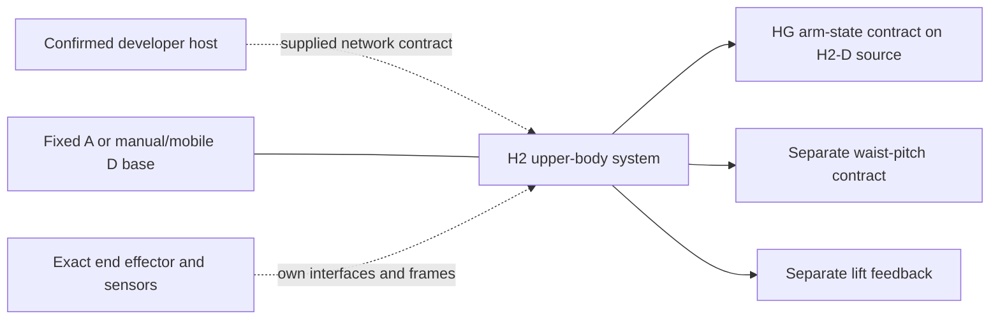

# Unitree H2-A and H2-D: Fixed and Mobile Manipulation Guide


**Unitree H2-A / H2-D — manufacturer family reference.** No exact OpenELAB SKU, product URL or package option for these upper-body systems is established in the reviewed catalog. Use the [official H2-A / H2-D configuration comparison](https://www.unitree.com/H2-D/) to distinguish the variants.


## Product overview <a href="#product-overview" id="product-overview"></a>

The Unitree H2 upper-body family combines two seven-joint arms with a head and torso on either a fixed base or a lifting-column chassis. **H2-A Standard is fixed; H2-D Standard is manual-move; H2-D Flagship is powered mobile.** These are separate configurations from the H2 biped and H2-X. Their support, lift, power and base interfaces cannot be commissioned from a biped gait example. [Official portfolio and specifications](https://www.unitree.com/H2-D/)

H2-D Standard has a two-DoF column described as vertical lift plus yaw, while Flagship has a one-DoF lift column plus two chassis DoF. H2-A instead has a three-axis waist and no column/chassis DoF in the table. “Standard” therefore does not mean the same motion arrangement as Flagship with a smaller battery. [P](https://www.unitree.com/H2-D/)

[View Unitree's H2 family portfolio illustration](https://www.unitree.com/images/8ef7b975939246028e20eca17f6bfbe2_1840x1214.png). Manufacturer imagery is a configuration reference, not a bolt pattern, clearance drawing or proof of a tested production cell.

## Applications <a href="#applications" id="applications"></a>

The manufacturer presents industrial handling/assembly, research and teaching, commercial services and embodied-AI data collection. A fixed H2-A can support a stationary manipulation experiment; H2-D adds height adjustment and, on Flagship, powered base movement. Selection should follow the required workspace and documented load envelope, not the visual similarity to a humanoid. [P](https://www.unitree.com/H2-D/)

The page's 0–2 m workspace and approximately 0.6 m arm reach excluding hands describe reach capability. They do not guarantee access to every point with a load, collision avoidance around people or safety certification. The page says some functions are under development. For dataset collection, retain base, column, torso, camera and tool transforms with timestamps; the necessary frame and synchronization contracts must come from the delivered system. [P](https://www.unitree.com/H2-D/)

## Specifications <a href="#specifications" id="specifications"></a>

| Parameter                          | H2-A Standard                                      | H2-D Standard                                 | H2-D Flagship                                                                                    |
| ---------------------------------- | -------------------------------------------------- | --------------------------------------------- | ------------------------------------------------------------------------------------------------ |
| Base type                          | Fixed                                              | Manual-move chassis                           | Powered mobile chassis                                                                           |
| Overall dimensions                 | 780 × 444 × 200 mm                                 | Min 1200 × 560 × 605; max 1700 × 560 × 605 mm | Min 1200 × 576 × 633; max 1700 × 576 × 633 mm                                                    |
| Weight, table labeled with battery | 33.5 kg                                            | Approximately 148 kg                          | Approximately 120 kg                                                                             |
| Total DoF excluding tools          | 19                                                 | 19                                            | 20                                                                                               |
| Arm DoF per arm                    | 7                                                  | 7                                             | 7                                                                                                |
| Waist / head DoF                   | 3 / 2                                              | 1 / 2                                         | 1 / 2                                                                                            |
| Column / chassis DoF               | Not listed / not listed                            | 2 / not listed                                | 1 / 2                                                                                            |
| Waist motion                       | Yaw ±155°, pitch +25°/−30°, roll ±30°              | Pitch 0–115°                                  | Pitch 0–115°                                                                                     |
| Lift speed / travel                | Not listed                                         | Up to 200 mm/s / 0.36 m                       | Up to 200 mm/s / 0.46 m                                                                          |
| Reach excluding dexterous hands    | Approximately 0.6 m                                | Approximately 0.6 m                           | Approximately 0.6 m                                                                              |
| Maximum arm-joint torque           | 120 N·m                                            | 120 N·m                                       | 120 N·m                                                                                          |
| Payload per arm                    | Rated approximately 7 kg; peak approximately 15 kg | Same published values                         | Same published values                                                                            |
| Chassis movement                   | Not listed                                         | Table describes ±90° in-place Z-axis rotation | Up to 1.5 m/s, differential drive, 360° in-place rotation; approximately 0.75 m turning diameter |
| Chassis sensors                    | Not listed                                         | Not listed                                    | One LiDAR, one depth camera, two physical collision sensors, two ultrasonic sensors              |

These are manufacturer-reported values from the current product page, accessed November 24, 2026. A joint-torque maximum is not a wrist-force rating. Peak payload is separate from rated payload, and the footnote says load depends greatly on arm extension. No peak duration, dynamic load curve, tool allowance or continuous all-posture envelope is established. Standard's column yaw/Z-axis-rotation entry does not prove powered ground travel. The page's broader “omnidirectional mobility” wording must not override the specific Flagship differential-drive specification. [P](https://www.unitree.com/H2-D/)

The material table names aerospace-grade aluminum, titanium alloy and high-strength engineering plastics, without an environmental or corrosion-resistance rating. [P](https://www.unitree.com/H2-D/)

All three list industrial crossed-roller output bearings, low-inertia inner-rotor PMSM joints, air cooling, an Intel Core i5 PC1 for platform capabilities and a Core i7 PC2 for custom development. Processor generation, RAM, disk image and real-time architecture are unspecified. Additional high-compute modules are described as configurable, including Thor; that is not a guaranteed included accelerator or performance mode. [P](https://www.unitree.com/H2-D/)

Each version lists a wide-field binocular head camera, two HD wrist cameras, a microphone array and high-power speaker, Wi-Fi 6 and Bluetooth 5.2. Optional end effectors are two-finger grippers and three- or five-finger hands. Controller, OTA and secondary development are marked supported. Camera models, field of view, stream formats, calibrated force-feedback interfaces and hand-controller compatibility are not specified by this page. The warranty table says 12 months; the applicable original terms and purchase agreement govern service details. [P](https://www.unitree.com/H2-D/)

### Battery and endurance entries require exact configuration matching <a href="#battery-and-endurance-entries-require-exact-configuration-matching" id="battery-and-endurance-entries-require-exact-configuration-matching"></a>

| Configuration | Published power entry                              | Published endurance                                          | Unresolved boundary                                                                 |
| ------------- | -------------------------------------------------- | ------------------------------------------------------------ | ----------------------------------------------------------------------------------- |
| H2-A          | Quick-release battery: `75.6 V / 15 Ah (972 Wh)`   | Approximately 8 h depending on conditions; direct power 24/7 | Arithmetic inconsistency: 75.6 × 15 = 1134 Wh, not 972 Wh                           |
| H2-D Standard | Quick-release base battery: 48 V / 18 Ah, 864 Wh   | Direct power 24/7                                            | Charger, input connector and external-power operating procedure not given           |
| H2-D Flagship | Quick-release base battery: 48 V / 30 Ah, 1.44 kWh | Approximately 5 h; replaceable battery / auto charging       | Dock compatibility, swap sequence, charging interlocks and supply details not given |

Keep the H2-A source discrepancy visible rather than silently correcting the voltage, capacity or energy to fit. Obtain the exact supplied pack and charger labels and manual. These nominal entries are not charging-voltage settings, accessory-output ratings or permission to substitute a supply. Endurance and direct-power statements are claims dependent on operating conditions, not a verified uninterrupted-service guarantee. [P](https://www.unitree.com/H2-D/)

## Hardware and connections <a href="#hardware-and-connections" id="hardware-and-connections"></a>

### Mechanical support and operating zones <a href="#mechanical-support-and-operating-zones" id="mechanical-support-and-operating-zones"></a>

Design H2-A mounting from its exact engineering drawing and load data. The 780 × 444 × 200 mm envelope supplies neither hole centers nor reaction moments, engagement depth or tightening torque. H2-D's 120–148 kg published masses require an approved handling/repositioning method; do not lift it by a wrist or camera support. The chassis footprint is not the full arm/tool swept volume. [P](https://www.unitree.com/H2-D/)

For H2-D, account for the column travel, waist pitch, possible column yaw and changing center of gravity. Secure the station using the approved restraint for its actual base. Establish the mechanical support and tool-retention arrangements that remain effective during loss of power. For a mobile Flagship, confirm the physical stop, drive inhibit and brake/isolation behavior before any developer connection. The product page itself supplies no exact emergency-stop or power-off sequence. The H2D portal remote table below adds brake/mode controls and links the original manuals; those controls are not a complete isolation sequence, and H2 biped shortcuts are not a substitute.

### Power and communication boundaries <a href="#power-and-communication-boundaries" id="power-and-communication-boundaries"></a>

Identify PC1, PC2, optional compute, tools and batteries separately. Use the supplied matched electrical system only after reading its exact instructions. The reviewed page does not establish input current, inrush, DC polarity, logic level, connector orientation, earth bonding, accessory budget or hot-swap behavior. Keep unidentified ports disconnected; Ethernet-looking connectors do not establish PoE or a specific robot subnet. [P](https://www.unitree.com/H2-D/)

A camera, LiDAR, ultrasonic sensor or collision sensor listed on a product sheet is not automatically a public ROS topic or a certified protective device. Record the delivered model, interface and frame contract. The marketing page alone supplies no full-system TF tree or synchronization-accuracy contract. The portal below adds exact model-resource links and H2-D environmental limits; those do not independently establish H2-A equivalence, calibrated transforms or an IP rating. Do not transfer those values from an H2 biped or another Unitree chassis.



This is an original integration diagram, not manufacturer wiring.

### H2-D portal hardware, computers and revision boundaries <a href="#h2-d-portal-hardware-computers-and-revision-boundaries" id="h2-d-portal-hardware-computers-and-revision-boundaries"></a>

The H2D **About H2D** article, updated November 24, 2026, explicitly covers Standard and Flagship. It calls Standard a fixed chassis with lift and column yaw; the marketing page calls it manual-move. Both distinguish it from Flagship's powered differential drive. Its battery table gives Flagship **48 V / 29.4 Ah**, compared with the product page's rounded 30 Ah. Use the delivered pack label, not a guessed interchangeability rule. This D-specific article does not establish H2-A's connector or control map. [About H2D](https://doc-cdn.unitree.com/41/1670/en/41_1670_en)

The article references the H2 upper-body [numbered rear-interface drawing](https://doc-cdn.unitree.com/static/2026/1/23/1f2d5c85696742fc941a1ea93f6486a8_2698x1749.png). Its computer routing changes with optional PC3/PC4:

| Port                         | Published role                                                        | Routing / boundary                                                                                                           |
| ---------------------------- | --------------------------------------------------------------------- | ---------------------------------------------------------------------------------------------------------------------------- |
| `[1]` GXT30(2)-M             | `VBAT+485`                                                            | Battery output and RS-485 to PC2; exact H2-D output voltage/current is not actually resolved by the article's promised table |
| `[2]`, `[11]` GXT30(2)-M     | `24V+CAN`, 24 V / 10 A output                                         | PC2 CAN; not a charging input                                                                                                |
| `[3]` Type-C                 | USB 3.0 host, DP 1.4, PD 3.0                                          | PC2 only                                                                                                                     |
| `[4]`, `[5]` Type-C          | USB 3.0 host, 5 V / 2 A without optional unit; expanded DP/PD with it | `[4]` moves to PC3 when installed; `[5]` to PC4                                                                              |
| `[6]` GMSL                   | Video input                                                           | Available with PC3, connected only to PC3                                                                                    |
| `[7]` Type-C                 | USB 3.0 host, 5 V / 2 A                                               | PC2 only                                                                                                                     |
| `[8]`, `[9]` Type-C          | USB 3.0 host, 5 V / 2 A                                               | PC2 normally; `[8]` moves to PC3, `[9]` to PC4 when fitted                                                                   |
| `[10]` GXT30(2)-M            | `12V+485`, 12 V / 10 A output                                         | PC2 RS-485                                                                                                                   |
| `[12]` RJ45                  | Gigabit Ethernet                                                      | `192.168.123.x` network                                                                                                      |
| `[13]`, `[14]` board-to-wire | Hand interfaces                                                       | Standard: 24 V / 10 A + RS-485 to PC2 + USB 2.0 to PC1; optional: 24 V / 10 A + 100 Mbps Ethernet on the `.123.x` network    |
| `[15]` RJ45                  | Gigabit Ethernet                                                      | `192.168.124.x` network                                                                                                      |

Match the labeled drawing and delivered optional-computer configuration. These entries do not establish every pin's polarity, aggregate current budget, bus termination or mating harness; do not infer them from a port photograph. In particular, no G1 shoulder-board rail or H2-A battery voltage is substituted for H2-D `VBAT+485`. [About H2D](https://doc-cdn.unitree.com/41/1670/en/41_1670_en)

PC1 is the private platform/motion-control computer. PC2 is the developer computer, with optional PC3/PC4. The portal identifies these H2-reference configurations while explicitly making shipment details conditional:

| Role         | CPU / memory / storage reference                                                                | Network and access scope                          |
| ------------ | ----------------------------------------------------------------------------------------------- | ------------------------------------------------- |
| PC1          | Intel Core i5, 10 cores/12 threads, up to 4.40 GHz, 8 GB LPDDR5-5200, ≥500 GB                   | Not open for external development                 |
| PC2          | Intel Core i7, 10 cores/12 threads, up to 4.70/4.80 GHz, 16/32 GB LPDDR5-5200, ≥500 GB          | `192.168.123.162` / `192.168.124.162`             |
| Optional PC3 | Jetson Thor T5000, 14-core Arm Neoverse-V3AE up to 2.6 GHz; 128 GB LPDDR5X, 273 GB/s, NVMe 2 TB | `.123.163` / `.124.163`; reference power 40–130 W |
| Optional PC4 | Jetson Orin NX 16 GB, eight-core Cortex-A78AE up to 2 GHz; 102.4 GB/s, NVMe 2 TB                | `.123.164` / `.124.164`; reference power 10–25 W  |

The Intel reference table also lists 12 MB cache, Iris Xe eligibility, 1.20 GHz maximum graphics, 64-bit instructions and OpenGL 4.6/OpenCL 3.0/DirectX 12.1 feature entries. Those are reference-platform features, not proof of installed drivers or a Windows development path. PC3's advertised 2070 TFLOPS uses **FP4-sparse** conditions and cannot be equated directly to PC4's 100 TOPS. PC3 lists a Blackwell GPU with 2560 cores, fifth-generation Tensor Cores and PVA v3; PC4 lists Ampere 1024 cores/32 Tensor Cores and PVA v2. Codec capabilities and power modes are module-specific, not measured application throughput. [About H2D](https://doc-cdn.unitree.com/41/1670/en/41_1670_en)

The portal gives initial PC2 user `unitree`, password `Unitree0408`, with early images possibly `Unitree#24226`; PC3/PC4 use `unitree` / `123`. These are published image defaults, not a credential guarantee for a changed system. Its quick-development ping target `.123.161` is distinct from developer PC2 `.162`, and G1D's `.163` chassis default must **not** be imported into H2D, where `.163` is listed for PC3. [About H2D](https://doc-cdn.unitree.com/41/1670/en/41_1670_en); [quick development](https://doc-cdn.unitree.com/41/1681/en/41_1681_en)

For mounting, the article references a curved H2 back surface and directs users to the actual 3D model rather than projecting hole positions onto a flat drawing. It identifies **12 × M8** onboard-computer mounting holes on Flagship's chassis, but supplies no tightening torque or engagement depth. [Mounting reference](https://doc-cdn.unitree.com/41/1670/en/41_1670_en)

### H2-D joint limits and tool boundary <a href="#h2-d-joint-limits-and-tool-boundary" id="h2-d-joint-limits-and-tool-boundary"></a>

The joint-control article labels `15–30` as **H2 reference numbers**, preserving gaps. The about article calls reference `14` `WAIST_PITCH` at 0–2 rad, while the pinned arm example marks `0–14` invalid and a separate waist interface exists. Treat this as a reference-number/control-route discrepancy; do not command the body-array slot to determine the mechanism. Standard's yaw-column route is not supplied by the pitch example. [Joint control](https://doc-cdn.unitree.com/41/1685/en/41_1685_en); [About H2D](https://doc-cdn.unitree.com/41/1670/en/41_1670_en)

| H2 reference numbers | Joint                      | Portal reference limits, rad      |
| -------------------- | -------------------------- | --------------------------------- |
| `15`, `22`           | Shoulder pitch             | −2.6179939 to 1.8325957           |
| `16` / `23`          | Left / right shoulder roll | −0.517 to 2.494 / −2.494 to 0.517 |
| `17`, `24`           | Shoulder yaw               | ±2.6179939                        |
| `18`, `25`           | Elbow pitch                | −0.986111 to 3.0717795            |
| `19`, `26`           | Forearm/wrist roll         | ±2.6179939                        |
| `20`, `27`           | Forearm/wrist pitch        | ±0.576                            |
| `21`, `28`           | Forearm/wrist yaw          | ±1.2217305                        |
| `29`                 | Neck pitch                 | −0.5236 to 0.83775                |
| `30`                 | Neck yaw                   | ±1.7453                           |

These are not a collision-free operating envelope or H2-A limits. The hand is separate. [Joint control](https://doc-cdn.unitree.com/41/1685/en/41_1685_en)

The portal's illustrated **Dex1-1** is a 550 g, 143 × 78 × 67 mm gripper with 90 mm stroke and 80 mm jaws. Width depends on opening: 78 mm half-open, 120 mm fully open and 124.5 mm across extended side rails when fully closed. It lists 24–64 V (24/48 V recommended), high-speed RS-485 at 6 Mbps and 1000 Hz communication control, 0.03 A quiescent and 3.5 A peak line current. Adjustable grip is 5–120 N and speed 50–375 mm/s, with 0.1 mm fingertip resolution and 0.24 s minimum full-stroke closure. These figures were obtained under different voltage/control conditions; do not combine them into a simultaneously guaranteed operating point. [Tool reference](https://doc-cdn.unitree.com/41/1670/en/41_1670_en)

Its conformal 20 kg and friction 5 kg grasp claims describe different test geometries, not H2-D arm payload. The motor table lists 5 N·m peak, 27 rad/s at 64 V, 1:25 reduction, 15-bit absolute encoder and −20–60°C environment. Feedback is angle, velocity, torque and temperature; command categories add stiffness/damping. Advanced gripper variants add a 1080p 30/60 FPS camera with H/V/D FOV 118°/87°/140°. None establishes the fitted option or the upper body's continuous load envelope. [Tool reference](https://doc-cdn.unitree.com/41/1670/en/41_1670_en)

### Flagship chassis and charging reference <a href="#flagship-chassis-and-charging-reference" id="flagship-chassis-and-charging-reference"></a>

The H2D portal separately specifies a 620 × 576 × 243 mm, 80 kg chassis; **100 kg rated** and **150 kg maximum on flat concrete** are base payload figures, not tool or arm loads. It lists 1.5 m/s maximum travel, 10° slope, 2 cm vertical threshold and 4 cm gap at rated payload, 70 cm minimum passage, two 6.5-inch servo drives (1.27 N·m) and four 75 mm double-row casters. Tall assembled-system stability still requires its own assessment. [About H2D](https://doc-cdn.unitree.com/41/1670/en/41_1670_en)

LiDAR ranges are 0.05–30 m at 90% reflectivity and 0.05–10 m at 10%; depth detection is 0.3–3.5 m dependent on lighting, with H/V FOV 75°±3°/51°±3°. It lists two ultrasonic sensors to 50 cm and two safety edges with minimum sensing force 10 N. Mapping is up to 500 × 500 m at 5 cm resolution, configurable down to 2 cm. The page describes point-to-point accuracy as typical average ±2 cm / typical maximum ±4 cm **at 5 cm map resolution**; these are not tested safety clearances or guaranteed performance in every environment. [About H2D](https://doc-cdn.unitree.com/41/1670/en/41_1670_en)

The chassis has an integrated user power/Ethernet/communications connector, power button, emergency stop, brake-release button and emergency charging interface. Match the supplied harness and stop procedure. Its environment table is 0–40°C operating, −25–55°C transport/storage, 20–90% RH, altitude ≤2000 m and noise ≤60 dB; the article does not turn those into an ingress-protection certification. [About H2D](https://doc-cdn.unitree.com/41/1670/en/41_1670_en)

For the 48 V / 29.4 Ah chassis battery, the portal gives approximately 3.5 h automatic and 2.5 h manual charging, and 80% capacity after 2000 full cycles as a reported lifecycle point. Dock dimensions are 360 × 150 × 320 mm; dock input 100–240 V AC, 50/60 Hz, 5 A maximum and output DC 48 V / 10 A. The separate manual charger lists 100–240 V AC, 50/60 Hz, 10 A input and **51.1 V / 15 A output**. These are two identified charging systems, not interchangeable settings for an adjustable supply. The exact supplied battery/charger manual still governs physical use. [Charging reference](https://doc-cdn.unitree.com/41/1670/en/41_1670_en)

Chassis indications include blue steady running, one-sided blue blinking turns, green blinking charging/steady full, yellow blinking reverse or brake release, white blinking blockage/steady boot, and steady red fault or emergency stop. Interpret the event context and physical controls; a shared color does not identify the fault by itself. [Indicators](https://doc-cdn.unitree.com/41/1670/en/41_1670_en)

## Software and development resources <a href="#software-and-development-resources" id="software-and-development-resources"></a>

### Dedicated H2-D sources and their limits <a href="#dedicated-h2-d-sources-and-their-limits" id="dedicated-h2-d-sources-and-their-limits"></a>

The pinned SDK2 commit `b7fec6020eb93d4c059a6edf19905e12a75a8d3d` declares four H2-D CMake targets. They provide useful source-level contracts, but all are active examples. They do not establish an H2-A-specific joint map or compatibility with every Standard/Flagship firmware. [H2 CMake targets](https://github.com/unitreerobotics/unitree_sdk2/blob/b7fec6020eb93d4c059a6edf19905e12a75a8d3d/example/h2/CMakeLists.txt)

| Source                                                                                                                                                              | Contract and behavior                                                                                                                                  |
| ------------------------------------------------------------------------------------------------------------------------------------------------------------------- | ------------------------------------------------------------------------------------------------------------------------------------------------------ |
| [`h2d_arm_example`](https://github.com/unitreerobotics/unitree_sdk2/blob/b7fec6020eb93d4c059a6edf19905e12a75a8d3d/example/h2/h2d/h2d_arm_example.cpp)               | Subscribes HG `LowState_` on `rt/lowstate` and torso IMU on `rt/secondary_imu`; creates `rt/lowcmd` publisher and swings shoulder pitch after remote A |
| [`h2d_waist_example`](https://github.com/unitreerobotics/unitree_sdk2/blob/b7fec6020eb93d4c059a6edf19905e12a75a8d3d/example/h2/h2d/h2d_waist_example.cpp)           | Reads HG `MotorState_` on `rt/waistpitchstate`; sends `MotorCmd_` to `rt/waistpitchcmd` with changing targets                                          |
| [`h2d_height_control`](https://github.com/unitreerobotics/unitree_sdk2/blob/b7fec6020eb93d4c059a6edf19905e12a75a8d3d/example/h2/h2d/h2d_height_control.cpp)         | Reads `geometry_msgs::msg::dds_::Point32_` on `rt/hispeed_state`, taking `.y()` as height in metres; commands column velocity in its feedback loop     |
| [`h2d_agv_client_example`](https://github.com/unitreerobotics/unitree_sdk2/blob/b7fec6020eb93d4c059a6edf19905e12a75a8d3d/example/h2/h2d/h2d_agv_client_example.cpp) | Uses `unitree::robot::g1::AgvClient` and cyclically commands drive and lift                                                                            |

The H2-D arm source's 29-slot working map marks **all indices `0–14` invalid** for this example. Its valid arm indices are left `15–21` and right `22–28`: shoulder pitch, roll, yaw; elbow; wrist roll, pitch, yaw, in that order. A waist pitch physically exists, but the arm example does not map it into the first fifteen slots; a separate waist topic exists. Do not turn an invalid slot into an axis from a product DoF count. The HG state type has 35 reserved motor entries, not 35 fitted joints. [ARM](https://github.com/unitreerobotics/unitree_sdk2/blob/b7fec6020eb93d4c059a6edf19905e12a75a8d3d/example/h2/h2d/h2d_arm_example.cpp); [HG](https://github.com/unitreerobotics/unitree_sdk2/blob/b7fec6020eb93d4c059a6edf19905e12a75a8d3d/include/unitree/idl/hg/LowState_.hpp)

H2-A has three waist axes and no D column. The reviewed sources do not establish its fixed-base mapping. For H2-A, stop at the identity/configuration checkpoint until its supplied interface documentation resolves the map, power and ownership contracts. [P](https://www.unitree.com/H2-D/); [ARM](https://github.com/unitreerobotics/unitree_sdk2/blob/b7fec6020eb93d4c059a6edf19905e12a75a8d3d/example/h2/h2d/h2d_arm_example.cpp)

### Shared AGV header is not proof of identical lift scaling <a href="#shared-agv-header-is-not-proof-of-identical-lift-scaling" id="shared-agv-header-is-not-proof-of-identical-lift-scaling"></a>

The `g1::AgvClient` used by the H2-D source exposes `Move(vx, vy, vyaw)` and `HeightAdjust(vz)`. Service `agv` uses version `1.0.0.1`, with IDs `1001` and `1002`. The header defines `vx` in m/s, yaw in rad/s and lateral `vy` as unsupported/ignored. `HeightAdjust` is normalized velocity −1 to +1, **not metres**. The wrapper serializes inputs without the shown methods enforcing a clamp. [CLIENT](https://github.com/unitreerobotics/unitree_sdk2/blob/b7fec6020eb93d4c059a6edf19905e12a75a8d3d/include/unitree/robot/g1/agv/g1_agv_client.hpp); [API](https://github.com/unitreerobotics/unitree_sdk2/blob/b7fec6020eb93d4c059a6edf19905e12a75a8d3d/include/unitree/robot/g1/agv/g1_agv_api.hpp)

Its header describes ±1.5 m/s drive, ±0.6 rad/s yaw and a 76.5 mm/s lift mapping. The **H2 product page says up to 200 mm/s lift**. H2-D's use of this shared client does not resolve that scaling difference. Obtain firmware-specific scaling and endpoints before active lift control; do not substitute the product maximum into a guessed conversion. [P](https://www.unitree.com/H2-D/); [CLIENT](https://github.com/unitreerobotics/unitree_sdk2/blob/b7fec6020eb93d4c059a6edf19905e12a75a8d3d/include/unitree/robot/g1/agv/g1_agv_client.hpp); [HEIGHT](https://github.com/unitreerobotics/unitree_sdk2/blob/b7fec6020eb93d4c059a6edf19905e12a75a8d3d/example/h2/h2d/h2d_height_control.cpp)

The height example uses a target in metres, a 50 ms loop, ±0.8 normalized clamp and a 500 ms stale-feedback check after reception begins. It attempts `HeightAdjust(0)` on exit/error. Initial waiting has no finite timeout except interruption; the 1 mm error tolerance and 20-cycle arrival criterion are program constants, not measured positioning accuracy. A successful API call is not verified standstill. [HEIGHT](https://github.com/unitreerobotics/unitree_sdk2/blob/b7fec6020eb93d4c059a6edf19905e12a75a8d3d/example/h2/h2d/h2d_height_control.cpp)

For host preparation, SDK2 documents Ubuntu 20.04, aarch64/x86\_64 and GCC 9.4.0; its root CMake project uses C++17. The reviewed Python package is 1.0.1 with Python ≥3.8 and CycloneDDS 0.10.2, NumPy and OpenCV dependencies. These shared SDK sources are BSD-3-Clause. Neither the ROS 2 README nor the Python HG type establishes a complete H2-A/D firmware/support matrix. Use the [common SDK2 state guide](unitree-sdk2-state-development.md) and [ROS 2 guide](unitree-ros2-integration.md) for shared concepts, then require the delivered system's contract. [SDK](https://github.com/unitreerobotics/unitree_sdk2/blob/b7fec6020eb93d4c059a6edf19905e12a75a8d3d/README.md); [PY](https://github.com/unitreerobotics/unitree_sdk2_python/blob/814556d15970dd2ecf1c9984e845ca02ab07e206/README.md); [PYSETUP](https://github.com/unitreerobotics/unitree_sdk2_python/blob/814556d15970dd2ecf1c9984e845ca02ab07e206/setup.py); [LICENSE](https://github.com/unitreerobotics/unitree_sdk2/blob/b7fec6020eb93d4c059a6edf19905e12a75a8d3d/LICENSE); [ROS](https://github.com/unitreerobotics/unitree_ros2/blob/668d1ec5a05d1c38d3306bdca7d59f2ba3581a88/README.md)

### Portal H2-D development and remote-control route <a href="#portal-h2-d-development-and-remote-control-route" id="portal-h2-d-development-and-remote-control-route"></a>

The H2D portal explicitly states that the SDK reuses H2 interfaces **without bipedal high-level locomotion**. PC1 runs official services; PC2 is the developer role. Ubuntu 20.04 is recommended, with macOS/Windows SDK development unsupported by that article. The robot-facing network is `192.168.123.x`, host `.99` recommended and `.222` used as an example. Its onboard `.161` ping does not change the PC2 `.162` address given in About H2D. The documented CMake build/install and example build have not been executed here. [Get SDK](https://doc-cdn.unitree.com/41/1680/en/41_1680_en); [quick development](https://doc-cdn.unitree.com/41/1681/en/41_1681_en)

The quick-development text calls H2D effectively debug-only, whereas the remote table still names `L2` held plus `R2` tapped as entering Debug Mode. Preserve that route/version distinction; do not borrow H2 biped standing/gait transitions or assume a shortcut is required to receive state. The arm example moves shoulders and is not the receive-only program. [Quick development](https://doc-cdn.unitree.com/41/1681/en/41_1681_en); [remote guide](https://doc-cdn.unitree.com/41/1676/en/41_1676_en)

| Remote input, H2D article             | Documented function and boundary                                                                                                                                  |
| ------------------------------------- | ----------------------------------------------------------------------------------------------------------------------------------------------------------------- |
| Left-stick forward/back or horizontal | Forward/back travel or yaw, on the applicable mobile base                                                                                                         |
| Right-stick forward/back              | Raise/lower column                                                                                                                                                |
| `R2+UP` / `R2+DOWN`                   | Four speed levels, lowest at startup                                                                                                                              |
| `L1+B`                                | Engage/release chassis emergency brake; a toggle, not a one-way safe state                                                                                        |
| `L1+A`                                | Data Collection Mode versus Standard Mode; in collection mode `xr_teleoperate` consumes joystick data, and without that system the remote does not move the robot |
| `L1+Y`, held 3 s                      | Joystick Pitch Mode: right-stick horizontal commands waist pitch                                                                                                  |
| `L1+X`                                | Exit Joystick Pitch Mode                                                                                                                                          |
| `L1+L2`, then tap `X`                 | Clears the chassis map; destructive to map state, not a generic restart/connectivity action                                                                       |

Do not enable joystick waist-pitch control while an upper-level waist controller is active: the source specifically warns that overlapping commands can make the pitch angle jump. Diagnose which mode and owner are active before trying another controller. [Remote guide](https://doc-cdn.unitree.com/41/1676/en/41_1676_en)

The dedicated pitch topic uses `MotorCmd_` / `MotorState_` on `rt/waistpitchcmd` / `rt/waistpitchstate`. The separate chassis/column article explicitly reuses the G1D `AgvClient`, with powered chassis movement only for Flagship. It identifies `rt/hispeed_state` `Point32_.y()` as height and `.z()` as velocity. That differs from R1-A-D's height-on-`.z()` millimetre contract. The G1 shared header's normalized lift scaling and H2D's 200 mm/s headline remain a firmware-specific discrepancy, not permission to rescale by guess. [Waist](https://doc-cdn.unitree.com/41/1686/en/41_1686_en); [chassis/column](https://doc-cdn.unitree.com/41/1688/en/41_1688_en)

### Audio and lighting service version <a href="#audio-and-lighting-service-version" id="audio-and-lighting-service-version"></a>

H2D's audio article specifies an 8 Ω, 10 W speaker (12 W peak), four microphones with 30 mm spacing, and an RGB strip. It requires `vui_service >= 2.3.0.1` and `vui >= 2.0.0.3`. The listed `AudioClient` operations are `TtsMaker`, `GetVolume`, `SetVolume`, `PlayStream` and `PlayStop`; its example additionally invokes `LedControl` through the G1 header/namespace. Confirm the delivered SDK/service symbol pairing rather than assuming identical hardware from the reused class name. [Audio interfaces](https://doc-cdn.unitree.com/41/1689/en/41_1689_en)

`TtsMaker(text,speaker_id)` uses role `0` Chinese or `1` English, without mixed-language requests. Volume is 0–100. Streaming uses mono 16 kHz, 16-bit PCM; keeping `stream_id` continues the cache, changing it interrupts the prior stream. `PlayStop(app_name)` stops playback for the application, not motion. The example raises volume, speaks, changes lights and starts a recording thread, so it is not a read-only service check. [Audio interfaces](https://doc-cdn.unitree.com/41/1689/en/41_1689_en)

ASR is non-streaming/offline by default, and some semantic fields remain in development. `rt/audio_msg`, `std_msgs::msg::dds_::String_`, carries `index`, `timestamp`, `text`, `angle` 0–180, `speaker_id`, `sense`, `confidence`, `language`, `is_final`; playback uses `play_state` 0/1. Enabled microphones also output denoised mono 16 kHz / 16-bit audio to multicast `239.168.123.161:5555`. Audio timestamps require their own clock interpretation; no synchronized motor/audio dataset was tested here. [Audio interfaces](https://doc-cdn.unitree.com/41/1689/en/41_1689_en)

### Stereo acquisition: raw camera specifications versus transmitted images <a href="#stereo-acquisition-raw-camera-specifications-versus-transmitted-images" id="stereo-acquisition-raw-camera-specifications-versus-transmitted-images"></a>

The About article references H2/H2-EDU head hardware: two global-shutter sensors on PC1 MIPI four-lane, 2064 × 1552 at 30 FPS, 12-bit RAW, 60 mm baseline, H/V FOV 156°/116°, F2.0, 1.53 mm focal length and 0.15 m–infinity depth of field focused at 0.4 m. Its camera temperature reference is −20–60°C. These are H2-reference sensor figures, not the H2-D chassis environment or the resolution of every compressed stream. [Camera reference](https://doc-cdn.unitree.com/41/1670/en/41_1670_en)

The H2D acquisition article instructs operators to disable `video_hub` before enabling **Stereo Patch PC1**, because the services can conflict. That stereo service is not configured to start automatically; absent service controls require matching software/support, not forced package replacement. The receiving host default is `.123.170`. Configuration at `http://192.168.123.161:9080/` changes the **destination** host address; its command-line `/set?ip=...` route is a setting mutation, even though it uses HTTP GET. Restart the streaming service after changing the destination. Do not conflate this `.161` endpoint with PC2 login. [Stereo acquisition](https://doc-cdn.unitree.com/41/1690/en/41_1690_en)

| H2D transmitted stream             | Receive contract                                                                                          |
| ---------------------------------- | --------------------------------------------------------------------------------------------------------- |
| Source stereo RGB, not undistorted | UDP `5002`, H.264 RTP, payload `96`, 90 kHz clock; 1920 × 1080 at 15 FPS                                  |
| Left RGB                           | UDP `5004`, H.264 RTP; 544 × 448 at 10 FPS                                                                |
| Right RGB                          | UDP `5006`, H.264 RTP; 544 × 448 at 10 FPS                                                                |
| Depth                              | Start the matching `unitree-dep-img` receiver against `.161`; local `/dev/video-dep`, 544 × 448 at 10 FPS |

The source provides GStreamer depayload/decode/view pipelines and `fakesink -v` inspection for resolution/frame rate, then V4L2/FFplay depth inspection. Its reference depth viewer uses 16-bit values and divides by 1000 for metres; zero/invalid samples and camera calibration still need treatment before metric measurement. Stream resolution is not evidence of aligned or synchronized RGB/depth. [Stereo acquisition](https://doc-cdn.unitree.com/41/1690/en/41_1690_en)

The article links `unitree-dep-img_1.0.0_all.deb`, an **amd64** `v4l-utils_1.22.1-2build1` package and a `v4l2loopback-dkms_0.12.7-2ubuntu2~22.04.1` package, with reboot after installation. Those architecture/distribution-specific artifacts must match the receiving host; they are not a Jetson install recipe. Its broad firewall-disable command is not needed as a default first step: identify the chosen receiving interface/ports and use the site's approved network policy. No package or viewer from the article was executed here. [Stereo acquisition](https://doc-cdn.unitree.com/41/1690/en/41_1690_en)

### H2D REST chassis reference and recovery scope <a href="#h2d-rest-chassis-reference-and-recovery-scope" id="h2d-rest-chassis-reference-and-recovery-scope"></a>

H2D's [API v1.1.0 article](https://doc-cdn.unitree.com/41/1706/en/41_1706_en) is identical to the G1D reference apart from the chassis applicability sentence. The [resource, operation and schema index in the G1-D guide](unitree-g1-d-mobile-manipulator.md#rest-chassis-reference-capabilities-resources-and-schemas) therefore serves both retrieved copies. It covers system health/power/network, SLAM/maps/localization/docks, artifacts/POIs/boundaries, motion actions/results, firmware/sensors/apps, multi-floor/elevator resources and optional industry/delivery task schemas. Those optional API resources do not establish installed plugins, elevator integration or shelf/cargo hardware.

The copy has malformed identifiers such as `/api/c or e/...`; do not turn them into a compile/run recipe through silent correction. Identify the delivered chassis address, API version, capabilities and valid paths first. In particular, the G1D `.163` chassis address cannot be imported here because H2D's computer table uses `.163` for optional PC3. Action completion, failure reason and map/frame validity must be assessed separately from HTTP success. Restoring a map, clearing a health flag or changing a sensor mask is not a repair for a physical fault. [H2D API](https://doc-cdn.unitree.com/41/1706/en/41_1706_en)

The available H2D articles identify physical emergency-stop and brake-release controls, as well as the remote brake toggle and data/waist mode interactions. They do not yet provide a fully reviewed, image-by-image upper-body shutdown and battery-replacement procedure in this guide. Use the matched original manuals and trained operator's procedure; a software loop exit or a successful zero-velocity call is not an independently verified all-domain stop.

## Getting started <a href="#getting-started" id="getting-started"></a>

### First identify the configuration; receive arm state only where confirmed <a href="#first-identify-the-configuration-receive-arm-state-only-where-confirmed" id="first-identify-the-configuration-receive-arm-state-only-where-confirmed"></a>

1. With the system isolated under its supplied procedure, record H2-A, H2-D Standard or H2-D Flagship, serial/revision, fitted tool, PCs, optional compute, batteries and charger labels. Keep the H2-A voltage/capacity/energy discrepancy unresolved until the exact pack is identified.
2. Obtain the exact mounting, power, stop/isolation and developer-network instructions. Establish the fixed mounting or base restraint. Do not commission power or motion from this product-reference page.
3. For **H2-A**, complete the configuration record and stop here until its fixed-base message/map contract is available. For **H2-D**, additionally confirm HG `LowState_` on `rt/lowstate` and the arm mapping against the delivered firmware.
4. On the already prepared host for a secured H2-D, save the original receive-only program below as `read_upper_body_state.py`. Set `ROBOT_IFACE` to the supplied host interface and use `python3 read_upper_body_state.py h2d "$ROBOT_IFACE"` only after that confirmation.
5. End the receive check after three distinct ticks or its bounded window. On failure, diagnose communication while retaining the normal controller. Do not run the waist, arm, lift or AGV demo to force a successful first result.

```python
"""Original receive-only example; exact firmware and physical setup must be confirmed."""
import argparse
import math
import time

from unitree_sdk2py.core.channel import ChannelFactoryInitialize, ChannelSubscriber
from unitree_sdk2py.idl.unitree_hg.msg.dds_ import LowState_

parser = argparse.ArgumentParser()
parser.add_argument("profile", choices=("g1d", "h2d", "r1-a5", "r1-a7"))
parser.add_argument("interface", help="Confirmed robot-facing host interface")
args = parser.parse_args()
ChannelFactoryInitialize(0, args.interface)
reader = ChannelSubscriber("rt/lowstate", LowState_)
reader.Init()
seen = set()
deadline = time.monotonic() + 10.0
try:
    while time.monotonic() < deadline and len(seen) < 3:
        state = reader.Read(1)
        if state is None:
            continue
        motor = state.motor_state[15]  # Left shoulder pitch in these inspected examples
        if not all(math.isfinite(v) for v in (motor.q, motor.dq, motor.tau_est)):
            raise SystemExit("Non-finite shoulder state; stop and investigate")
        if state.tick in seen:
            continue
        seen.add(state.tick)
        print(f"{args.profile} tick={state.tick} mode_machine={state.mode_machine} "
              f"shoulder_slot=15 q={motor.q:.5f} dq={motor.dq:.5f} "
              f"tau_est={motor.tau_est:.5f} motorstate={motor.motorstate}")
finally:
    reader.Close()
if len(seen) != 3:
    raise SystemExit("Fewer than three distinct ticks in the receive window; no control attempted")
```

**Expected result:** for the confirmed H2-D contract, up to three lines labeled `h2d` with distinct ticks, received mode identifier, finite slot-15 shoulder values and its raw motor-state code. This is expected output, not a recorded run. The receive window is about ten seconds plus at most the final one-second read. The profile is an operator choice, not automatic model detection. Nonzero faults require the unit's exact definitions. The program creates no publisher and does not release controller ownership. [ARM](https://github.com/unitreerobotics/unitree_sdk2/blob/b7fec6020eb93d4c059a6edf19905e12a75a8d3d/example/h2/h2d/h2d_arm_example.cpp); [CHANNEL](https://github.com/unitreerobotics/unitree_sdk2_python/blob/814556d15970dd2ecf1c9984e845ca02ab07e206/unitree_sdk2py/core/channel.py); [PYHG](https://github.com/unitreerobotics/unitree_sdk2_python/blob/814556d15970dd2ecf1c9984e845ca02ab07e206/unitree_sdk2py/idl/unitree_hg/msg/dds_/_LowState_.py)

For H2-A, the first result is the completed identity/configuration record and explicit interface gaps, not a live state sample. For H2-D, decoded values do not prove CRC validation, calibration, synchronized or control-safe freshness, tool force, camera alignment, waist/column health or chassis stopping. Repeated-tick filtering alone does not prove freshness. `tau_est` is estimated joint feedback. The HG top-level message does not expose Go2's `power_v`/`power_a`; pack health needs its own documented interface. [HG](https://github.com/unitreerobotics/unitree_sdk2/blob/b7fec6020eb93d4c059a6edf19905e12a75a8d3d/include/unitree/idl/hg/LowState_.hpp); [PYHG](https://github.com/unitreerobotics/unitree_sdk2_python/blob/814556d15970dd2ecf1c9984e845ca02ab07e206/unitree_sdk2py/idl/unitree_hg/msg/dds_/_LowState_.py)

## Troubleshooting and FAQs <a href="#troubleshooting-and-faqs" id="troubleshooting-and-faqs"></a>

### Arm state is missing, stale or inconsistent <a href="#arm-state-is-missing-stale-or-inconsistent" id="arm-state-is-missing-stale-or-inconsistent"></a>

Check the actual variant, firmware and map before link, route, selected host interface, middleware and DDS type/topic. Preserve the raw fault code and logs. A network ping is not proof of DDS compatibility. Do not start a command publisher, disable services or reflash firmware to repair a passive receive problem. If state is non-finite or inconsistent with the identified system, stop before custom control. [ARM](https://github.com/unitreerobotics/unitree_sdk2/blob/b7fec6020eb93d4c059a6edf19905e12a75a8d3d/example/h2/h2d/h2d_arm_example.cpp); [CHANNEL](https://github.com/unitreerobotics/unitree_sdk2_python/blob/814556d15970dd2ecf1c9984e845ca02ab07e206/unitree_sdk2py/core/channel.py)

### Does H2-D Standard drive or rotate like Flagship? <a href="#does-h2-d-standard-drive-or-rotate-like-flagship" id="does-h2-d-standard-drive-or-rotate-like-flagship"></a>

The source describes Standard as manual-move with a lift/yaw column and a Z-axis-rotation entry. Powered differential drive, speed and chassis sensor inventory are specified for Flagship. Do not equate the Standard's rotation entry with autonomous ground travel, and do not use the AGV demo as a capability probe. [P](https://www.unitree.com/H2-D/)

### Why do the lift speed values disagree? <a href="#why-do-the-lift-speed-values-disagree" id="why-do-the-lift-speed-values-disagree"></a>

The product page gives up to 200 mm/s; the shared header describes normalized input scaled to 76.5 mm/s. Those are different source claims. Confirm the exact H2-D firmware mapping, travel limits and feedback reference rather than choosing the larger number or treating normalized input as m/s. [P](https://www.unitree.com/H2-D/); [CLIENT](https://github.com/unitreerobotics/unitree_sdk2/blob/b7fec6020eb93d4c059a6edf19905e12a75a8d3d/include/unitree/robot/g1/agv/g1_agv_client.hpp); [HEIGHT](https://github.com/unitreerobotics/unitree_sdk2/blob/b7fec6020eb93d4c059a6edf19905e12a75a8d3d/example/h2/h2d/h2d_height_control.cpp)

### What happens when control or the remote link is lost? <a href="#what-happens-when-control-or-the-remote-link-is-lost" id="what-happens-when-control-or-the-remote-link-is-lost"></a>

The retrieved product and example sources do not establish a complete stop, brake, gravity-support or isolation procedure for each variant. Clear the workspace and have the trained operator use the supplied, verified physical stop/isolation arrangement. Exiting the arm loop with remote A or killing a process is not a verified all-domain stop; a zero-velocity API call also depends on communications and controller behavior. Secure the mechanism before diagnosing ownership or restoring a known configuration. Do not transfer H2 biped remote shortcuts or power-button timing. [ARM](https://github.com/unitreerobotics/unitree_sdk2/blob/b7fec6020eb93d4c059a6edf19905e12a75a8d3d/example/h2/h2d/h2d_arm_example.cpp); [HEIGHT](https://github.com/unitreerobotics/unitree_sdk2/blob/b7fec6020eb93d4c059a6edf19905e12a75a8d3d/example/h2/h2d/h2d_height_control.cpp)

### Can peak payload, auto charging or OTA be used as a production guarantee? <a href="#can-peak-payload-auto-charging-or-ota-be-used-as-a-production-guarantee" id="can-peak-payload-auto-charging-or-ota-be-used-as-a-production-guarantee"></a>

The peak and rated payloads are distinct, posture-dependent figures. Auto charging is a Flagship feature entry, without a retrieved dock/interlock procedure. OTA support lacks a supplied release/rollback package in this review. Obtain the exact documents and validate the intended use; none is a basis for unattended physical deployment. Routine service intervals, joint lubrication, calibration and fastener torques are also not established here. [P](https://www.unitree.com/H2-D/)

## Downloads and technical documents <a href="#downloads-and-technical-documents" id="downloads-and-technical-documents"></a>

| Resource                                                                                                                                                                                                                                                                                                                                                                                                                                                                                                                                                                                 | What was actually read                                                                                       |
| ---------------------------------------------------------------------------------------------------------------------------------------------------------------------------------------------------------------------------------------------------------------------------------------------------------------------------------------------------------------------------------------------------------------------------------------------------------------------------------------------------------------------------------------------------------------------------------------- | ------------------------------------------------------------------------------------------------------------ |
| [Official H2-A / H2-D page](https://www.unitree.com/H2-D/)                                                                                                                                                                                                                                                                                                                                                                                                                                                                                                                               | All three configuration columns, applications, mechanism/perception/compute/power specifications and caveats |
| [H2 portfolio image](https://www.unitree.com/images/8ef7b975939246028e20eca17f6bfbe2_1840x1214.png)                                                                                                                                                                                                                                                                                                                                                                                                                                                                                      | Observed official illustration link; not an engineering drawing                                              |
| [H2-D arm](https://github.com/unitreerobotics/unitree_sdk2/blob/b7fec6020eb93d4c059a6edf19905e12a75a8d3d/example/h2/h2d/h2d_arm_example.cpp), [waist](https://github.com/unitreerobotics/unitree_sdk2/blob/b7fec6020eb93d4c059a6edf19905e12a75a8d3d/example/h2/h2d/h2d_waist_example.cpp), [height](https://github.com/unitreerobotics/unitree_sdk2/blob/b7fec6020eb93d4c059a6edf19905e12a75a8d3d/example/h2/h2d/h2d_height_control.cpp), [AGV](https://github.com/unitreerobotics/unitree_sdk2/blob/b7fec6020eb93d4c059a6edf19905e12a75a8d3d/example/h2/h2d/h2d_agv_client_example.cpp) | Active example contracts and limitations                                                                     |
| [Shared AGV client](https://github.com/unitreerobotics/unitree_sdk2/blob/b7fec6020eb93d4c059a6edf19905e12a75a8d3d/include/unitree/robot/g1/agv/g1_agv_client.hpp) and [API](https://github.com/unitreerobotics/unitree_sdk2/blob/b7fec6020eb93d4c059a6edf19905e12a75a8d3d/include/unitree/robot/g1/agv/g1_agv_api.hpp)                                                                                                                                                                                                                                                                   | Units, version, service and method serialization                                                             |
| [HG state schema](https://github.com/unitreerobotics/unitree_sdk2/blob/b7fec6020eb93d4c059a6edf19905e12a75a8d3d/include/unitree/idl/hg/LowState_.hpp)                                                                                                                                                                                                                                                                                                                                                                                                                                    | Message capacity and fields                                                                                  |
| [Official document center](https://support.unitree.com/main/en)                                                                                                                                                                                                                                                                                                                                                                                                                                                                                                                          | Entry point; exact H2D articles are cited below, with linked-manual image review still separate              |

The 14 supplied H2D portal records now provide dedicated remote, control, connector, stereo, API and resource content. Linked graphical Chinese manuals, model archives and videos are not claimed semantically reviewed. Exact H2-A integration and full-system isolation/wiring remain separate gaps.

### Exact portal-linked H2D resources <a href="#exact-portal-linked-h2d-resources" id="exact-portal-linked-h2d-resources"></a>

| Original resource                                                                                                                                                                                                                                                                                  | Scope / access boundary                                                                |
| -------------------------------------------------------------------------------------------------------------------------------------------------------------------------------------------------------------------------------------------------------------------------------------------------- | -------------------------------------------------------------------------------------- |
| [H2-D Product Manual V1.0](https://marketing.unitree.com/article/zh/H2-D/User_Manual.html)                                                                                                                                                                                                         | Portal links the Chinese original; image pages not semantically reviewed in this batch |
| [Battery & Charger V1.0](https://marketing.unitree.com/article/zh/H2-D/Battery_Charger.html) / [Remote V1.0](https://marketing.unitree.com/article/zh/H2-D/Remote_Control.html)                                                                                                                    | Exact H2-D sources, not H2 biped substitutions                                         |
| [Unboxing/power-on video](https://oss-global-cdn.unitree.com/static/480a936001ae4712a3a75d98c8f3147b.mp4) / [battery replacement video](https://oss-global-cdn.unitree.com/static/bc4be68a2c9f45d4b067bd7bb10f59fa.mp4)                                                                            | Linked demonstrations, not watched or tested here                                      |
| [Standard STEP](https://oss-global-cdn.unitree.com/static/5db78c2196f9416ebfa3577d49c3c4ea.zip) / [Flagship STEP](https://oss-global-cdn.unitree.com/static/aefdbd3e1e4345e1a7071de36b1fbfe8.zip)                                                                                                  | Different observed mechanical resources; archive contents not inspected                |
| [Flagship URDF](https://oss-global-cdn.unitree.com/static/cbd8b16896e64d8092265f539c53b635.zip)                                                                                                                                                                                                    | Model resource identified; no build, simulation or model-vs-unit validation            |
| [Depth package 1](https://oss-global-cdn.unitree.com/static/c3e5ea046de8449fb863091f7d51f575.zip), [package 2](https://oss-global-cdn.unitree.com/static/0f51036d036940ddac2854c77a31a649.zip), [loopback package](https://oss-global-cdn.unitree.com/static/230b3d964f8249239844611622902de3.zip) | Host-specific receiving dependencies; not installed                                    |
| [Depth viewer archive](https://oss-global-cdn.unitree.com/static/eedfb0b8067448f3999cfbb3b19bf15e.zip)                                                                                                                                                                                             | Reference visualization, not calibrated accuracy evidence                              |

These resource links were actually read in [basic instructions](https://doc-cdn.unitree.com/41/1675/en/41_1675_en), [Get SDK](https://doc-cdn.unitree.com/41/1680/en/41_1680_en) and [stereo acquisition](https://doc-cdn.unitree.com/41/1690/en/41_1690_en). Linked assets are distinct from the reviewed article text. H2-A-specific operating/pinout/map documentation remains a separate gap.

## References and validation <a href="#references-and-validation" id="references-and-validation"></a>

Reviewed November 24, 2026: the complete official product body and cited pinned source contracts. The guide is original English synthesis with source-specific conflicts retained. SDK examples were read, never imported, compiled or executed. No ROS, robot, battery, charging, navigation, emergency-stop or motion test occurred.

The 14 supplied H2D portal records, including empty category nodes, were functionally reviewed as indexed below. Other spaces, linked manual images/videos and all firmware/hardware behavior are not claimed validated. Exact delivered-unit and fixed H2-A gaps keep commissioning readiness draft.

**Related documentation:** [Unitree model and development directory](./).
