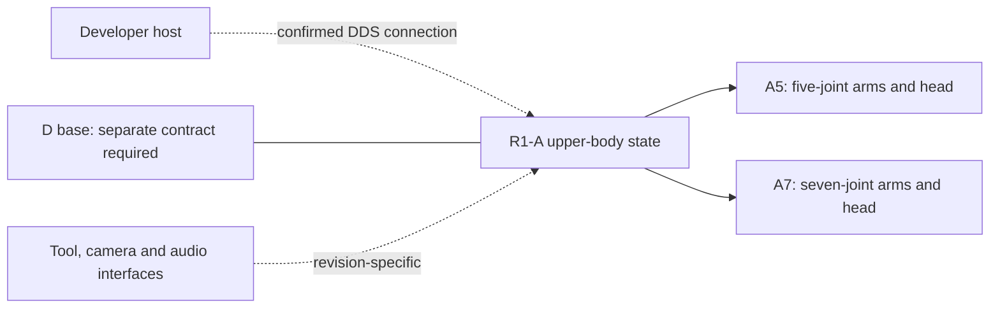

# Unitree R1-A5, A7 and D Variants: Dual-Arm Development Guide


**Unitree R1-A / R1-A-D — manufacturer family reference.** Exact configurations are **R1-A5, R1-A7, R1-A5-D and R1-A7-D**. No exact OpenELAB product URL, SKU or option for these upper-body systems is established in the reviewed catalog. See the [official four-variant comparison](https://www.unitree.com/R1-D/).


## Product overview <a href="#product-overview" id="product-overview"></a>

Unitree's navigation label **R1-A / R1-A-D** covers four dual-arm upper-body configurations. `A5` has five joints per arm, `A7` seven; the `-D` versions add the mobile-base configuration. The non-D versions are fixed-base units. They are distinct from the R1 AIR, R1 retail and R1 EDU bipeds, and from the standalone R1-7A arm. Neither a biped development entitlement nor a single-arm SDK identifies this system. [Official portfolio and table](https://www.unitree.com/R1-D/)

The manufacturer marks secondary development **YES** for all four upper-body configurations. This differs from the biped's retail/EDU distinction. It does not establish one shared motor map, navigation stack or power interface for all four. [P](https://www.unitree.com/R1-D/)

[View Unitree's R1 upper-body application illustration](https://www.unitree.com/images/db599ca3bc2347fa85f10c26cbb3f8eb_2700x1440.jpg). It shows the intended manipulation setting; it does not establish included tooling, fixture dimensions or measured performance.

### R1-A5/A7 manual revision and applicability <a href="#r1-a5a7-manual-revision-and-applicability" id="r1-a5a7-manual-revision-and-applicability"></a>

The English **R1-A5/A7 User Manual V1.1** covers the fixed upper-body systems. Its revision history dates V1.1 to **July 1, 2026**, recording changed button/key logic; V1.0 is June 9, 2026. Page numbers below refer to the printed pages: cover 0 through revision history 31, comprising 32 scanned pages. The manual's fixed-unit battery access, transport case and remote illustrations do not establish the corresponding procedures for R1-A5-D/A7-D mobile bases. Match the delivered remote, power arrangement and firmware before applying a control sequence. [R1-A5/A7 User Manual V1.1, printed pp. 0–1, 31](https://marketing.unitree.com/article/en/R1_A5A7/User_Manual.html)

The manual overview's 13–31 DoF range describes selectable family configurations; its comparison table specifies **15/19 DoF with grippers** for fixed A5/A7. Neither is a state-array length. The parts illustration distinguishes the A7 wrist joints from the simpler A5 wrist and identifies the head camera/visual module, shoulder/elbow, waist and battery location. Use it for component orientation, then use the exact SDK motor map below for indexing. [R1-A5/A7 User Manual V1.1, printed pp. 4–6](https://marketing.unitree.com/article/en/R1_A5A7/User_Manual.html)

## Applications <a href="#applications" id="applications"></a>

The product page presents visual, voice and manipulation interactions, open underlying/arm/audio/lighting/vision interfaces and quickly exchanged end actuators. Appropriate development directions include fixed-station perception/manipulation studies, interaction prototypes and documented mobile-manipulation experiments on a D configuration. The source does not define a certified collaborative workspace or a complete navigation commissioning procedure. [P](https://www.unitree.com/R1-D/)

Select five versus seven arm joints according to the required wrist orientation and reachable task poses, then verify the actual kinematic model. Two additional joints do not by themselves guarantee a task's reachability or accuracy under load. Moving a base changes the world-to-robot transform; changing a tool changes the tool frame and load model. Preserve both with any training or evaluation dataset.

## Specifications <a href="#specifications" id="specifications"></a>

| Parameter                   | R1-A5                                           | R1-A7                                           | R1-A5-D                                               | R1-A7-D                   |
| --------------------------- | ----------------------------------------------- | ----------------------------------------------- | ----------------------------------------------------- | ------------------------- |
| Mounting configuration      | Fixed base                                      | Fixed base                                      | Mobile base                                           | Mobile base               |
| Arm DoF per arm             | 5                                               | 7                                               | 5                                                     | 7                         |
| Total DoF, **with gripper** | 15                                              | 19                                              | 18                                                    | 22                        |
| Waist / head DoF            | 1 / 2                                           | 1 / 2                                           | 1 / 2                                                 | 1 / 2                     |
| Chassis DoF entry           | Not listed                                      | Not listed                                      | 3                                                     | 3                         |
| Overall dimensions          | 700 × 357 × 190 mm                              | 835 × 357 × 190 mm                              | Retracted 683 × 520 × 440; raised 1600 × 520 × 440 mm | Same published dimensions |
| Weight                      | Approximately 11 kg, with external power supply | Approximately 13 kg, with external power supply | Approximately 30 kg                                   | Approximately 32 kg       |
| Upper arm + forearm length  | 420 mm                                          | 555 mm                                          | 420 mm                                                | 555 mm                    |
| Waist yaw                   | ±150°                                           | ±150°                                           | ±35°                                                  | ±35°                      |
| Head yaw / pitch            | ±115° / ±36°                                    | Same                                            | Same                                                  | Same                      |
| Shoulder maximum torque     | 60 N·m                                          | 60 N·m                                          | 60 N·m                                                | 60 N·m                    |
| Camera configuration        | Binocular; wrist camera optional                | Same                                            | Chassis LiDAR + binocular; wrist camera optional      | Same                      |

Source: current official specification table, accessed November 24, 2026. The total includes the gripper, unlike the G1-A/D and H2-A/D totals that exclude the end effector. Do not compare the totals without their definitions. The source's general 15–31 DoF headline includes end-effector variation; it is not a fifth table configuration or a DDS array length. The marketing three-chassis-DoF entry alone does not identify the drive/lift protocol; the D-specific portal below supplies its two-wheel-plus-lift decomposition and separate normalized interface. [P](https://www.unitree.com/R1-D/)

### Payload and precision claims need operating conditions <a href="#payload-and-precision-claims-need-operating-conditions" id="payload-and-precision-claims-need-operating-conditions"></a>

The same page says **2–4 kg** in its prominent arm-load statement and **3–5 kg** in the specification table, with a footnote that payload varies greatly by arm extension. These statements are unresolved rather than a single all-posture rating. Obtain a configuration-specific load envelope, including tool mass and center of gravity, before planning motion or choosing an object. Do not average the ranges or select the larger value. [P](https://www.unitree.com/R1-D/)

The page also advertises ±0.1 mm end-clamp accuracy without a retrieved test method, reference frame, load, reach, repeatability definition or thermal conditions. It is a manufacturer claim with unspecified conditions, not a verified sustained whole-system accuracy or a camera-calibration result. Likewise, maximum shoulder torque is not a tool-force limit. [P](https://www.unitree.com/R1-D/)

### Compute, perception, power and accessories <a href="#compute-perception-power-and-accessories" id="compute-perception-power-and-accessories"></a>

All four list an eight-core body CPU and an eight-core head CPU with 10 TOPS head-module compute, four-microphone array, two 3 W speakers, Wi-Fi 6, Bluetooth 5.2, hollow/internal wiring, dual arm encoders and local air cooling. The page names optional compute modules such as Orin in a 40–100 TOPS range; that is not an exact included module, power mode or model-inference benchmark. [P](https://www.unitree.com/R1-D/)

The binocular section gives horizontal/vertical fields of view of 146°/124°, 60 mm eye spacing and RGB `1280×720@30Hz`. It additionally prints `544×448@10Hz` without a clear stream label in the retrieved text. The portal below identifies that mode as depth and supplies service/configuration endpoints and calibration-file retrieval, with explicit version gates. Metric accuracy and cross-stream synchronization remain unverified; its RGB row also conflicts with the marketing resolution. [P](https://www.unitree.com/R1-D/)

Power is described as external supply or lithium-ion battery, with a charger included and approximately 1.5 h battery runtime across the table. That marketing table alone supplies no complete electrical contract; the portal port/power sections below add configuration-specific ratings and sequences without establishing hot-swap permission or a complete charger/polarity schematic. Optional end effectors include two-finger grippers and three- or five-finger hands. OTA, secondary development and a 12-month warranty summary are listed; exact release/service conditions require their original documents and the purchase agreement. [P](https://www.unitree.com/R1-D/)

### Fixed-system manual specifications and unresolved differences <a href="#fixed-system-manual-specifications-and-unresolved-differences" id="fixed-system-manual-specifications-and-unresolved-differences"></a>

V1.1 confirms fixed A5/A7 dimensions of 700 × 357 × 190 mm / 835 × 357 × 190 mm, approximately 11/13 kg **with external power supply**, 420/555 mm arm lengths, one waist and two head joints, ±150° waist yaw, ±115° head yaw and ±36° head pitch. It lists the 60 N·m shoulder maximum, optional two-/three-/five-finger tools, external or battery operation, approximately 1.5 h battery operation, OTA and secondary development. These remain manufacturer specifications, not load-cycle or endurance measurements. [R1-A5/A7 User Manual V1.1, printed pp. 5–7](https://marketing.unitree.com/article/en/R1_A5A7/User_Manual.html)

The manual describes arm payload as **2–4 kg** and **±0.1 mm end-effector repeatability** in its overview. Keep that wording separate from the product page's 3–5 kg table and accuracy language: no retrieved method resolves the load/posture/thermal conditions or establishes that accuracy and repeatability mean the same thing. The fixed-unit table and its mass qualifier also do not supersede the separate D-base figures. [R1-A5/A7 User Manual V1.1, printed pp. 4–7](https://marketing.unitree.com/article/en/R1_A5A7/User_Manual.html)

The manual camera table reports RGB **1270 × 720 at 30 Hz** and depth **544 × 448 at 10 Hz**; the sensor appendix repeats 1270 × 720. The product/streaming sources elsewhere on this page use 1280 in some rows. Retain the actual negotiated stream width rather than silently correcting either source. The table describes a 13-million-pixel sensor, global shutter, HDR, 850/940 nm enhanced response, external exposure and multi-sensor synchronization, auto-exposure/gain, LED strobe and window adjustment. It lists 15.5× analog / 16× digital gain and dynamic range 66 dB in normal mode, over 100 dB in HDR mode. These sensor capabilities do not establish that an exported stream exposes every mode, that images are rectified or that cross-sensor clocks are synchronized. No register-programming recipe is inferred from its ambiguous interface-label row. [R1-A5/A7 User Manual V1.1, printed pp. 7, 29](https://marketing.unitree.com/article/en/R1_A5A7/User_Manual.html)

The camera field-of-view drawing identifies horizontal 146° and vertical 124°. Its installation-angle graphic is a reference illustration, not a complete calibrated transform between camera, head and tool. Preserve the delivered calibration and frame definitions when combining vision and arm state. [R1-A5/A7 User Manual V1.1, printed p. 8](https://marketing.unitree.com/article/en/R1_A5A7/User_Manual.html)

## Hardware and connections <a href="#hardware-and-connections" id="hardware-and-connections"></a>

### Fixed and mobile support differ <a href="#fixed-and-mobile-support-differ" id="fixed-and-mobile-support-differ"></a>

The non-D units require an engineered fixed mount; the marketing dimensions and illustration alone do not provide the mounting contract. The portal drawing below supplies hole centers; screw engagement, torque and reaction-load limits remain separate requirements. The D versions require an approved base restraint and handling method appropriate to their mass and raised/retracted configuration. A chassis DoF count is not a brake specification. Do not infer a travel speed, obstacle envelope or mounting scheme from the R1 biped or G1-D Flagship. [P](https://www.unitree.com/R1-D/)

The ±35° D waist range is substantially narrower than the fixed versions' ±150°. Keep that difference in the delivered kinematic/limit configuration before any trajectory planning. Account for both arms, tools, pinch regions, camera cables and any held object. Establish approved mechanical support for gravity-loaded axes and tool retention during power loss. Do not assume terminating the host process preserves support.

### Identify every power and data connector <a href="#identify-every-power-and-data-connector" id="identify-every-power-and-data-connector"></a>

Record the supplied adapter/battery/charger, body computer, head module, hand controller and any chassis battery/drive controller separately. Obtain exact instructions before power, charging or pack removal. The power section's “external or battery” description does not authorize a bench supply, another family's charger or live swapping. A connector's appearance does not establish its voltage or communications role. [P](https://www.unitree.com/R1-D/)

The product lists hollow/internal wiring, dual arm encoders, local air cooling, crossed-roller plus deep-groove bearings and low-inertia inner-rotor PMSM joints. Those features do not establish backlash, absolute calibration retention or accessible bus wiring. It specifies a four-microphone array and two 3 W speakers, body eight-core compute and head eight-core compute plus 10 TOPS. Optional high-compute modules include Orin configurations advertised at 40–100 TOPS; neither inclusion nor sustained application throughput follows from that range. The marketing table lists a charger without ratings and approximately 1.5 h runtime across all four columns. The portal below adds fixed-system power routes and port ratings, and different D runtime/mass figures. Keep these source scopes separate and obtain the matched charger and full D isolation instructions. [P](https://www.unitree.com/R1-D/)

For the binocular module, the page advertises RGB and depth interfaces, 146° horizontal / 124° vertical field of view and 60 mm eye spacing. It labels RGB as 1280 × 720 at 30 Hz and lists a second 544 × 448 at 10 Hz mode whose adjacent format label is blank in the retrieved page. The portal below identifies a 544 × 448 depth mode, while retaining an RGB-resolution discrepancy. Do not assume pixel alignment, synchronization or metric accuracy from either table. [P](https://www.unitree.com/R1-D/)

Before planning perception work, identify the delivered camera model, stream endpoints, intrinsics, extrinsics, frame convention and timestamp source. Chassis LiDAR presence on D does not prove compatibility with a particular unilidar driver, ROS topic or protective-stop function. No complete wiring diagram, TF tree, environmental/IP limits, CAD or stop circuit is established in the reviewed product page. [P](https://www.unitree.com/R1-D/)



This is an original contract-separation diagram, not a manufacturer wiring drawing.

### Portal fixed-base mounting, power ports and source discrepancies <a href="#portal-fixed-base-mounting-power-ports-and-source-discrepancies" id="portal-fixed-base-mounting-power-ports-and-source-discrepancies"></a>

The fixed R1-A portal documents a **150 × 150 × 10 mm base plate**, M8 mounting hardware selected for the substrate, and an [original mounting figure](https://doc-cdn.unitree.com/static/2026/9/8/2c8d340095a146a8951aeb2cdc30bd14_896x713.png) showing Ø8.2 holes, 120 mm outer hole-center spacing and 40 mm intermediate spacing. The figure was checked visually; use the original drawing for the full pattern and orientation, not just those selected dimensions. The source does not establish fastener torque, embedment or a complete structural load rating. [About R1-A](https://doc-cdn.unitree.com/31/1357/en/31_1357_en)

For chest mounting holes, the article describes a **mechanical modification**, not a plug-in accessory: remove the two front neck fixings, two rear shoulder fixings and four side waist fixings; work from inside the front panel with a 3.3 mm drill and M4 tap along the existing threads. Its teaching video is a separate asset. This description is not authorization to drill an assembled or powered robot; confirm the delivered panel, disassembly/support procedure and fixture design first. The D article repeats this chest-hole method, while the M8 base-plate reference belongs to the fixed system. [Fixed mounting](https://doc-cdn.unitree.com/31/1357/en/31_1357_en); [D mounting](https://doc-cdn.unitree.com/37/1597/en/37_1597_en)

Both about articles show the same [numbered upper-body interface figure](https://doc-cdn.unitree.com/static/2026/1/8/5babe175427948c880f80e8325ff089f_894x1164.png):

| Number        | Portal designation | Published function                                       |
| ------------- | ------------------ | -------------------------------------------------------- |
| `1`, `8`      | Reserved buttons   | NC; do not invent an emergency-stop function             |
| `2`, `5`, `6` | Deleted/removed    | NC, even though openings appear in the reference drawing |
| `3`           | XT30UPB-F, `24V`   | 24 V / 3 A output                                        |
| `4`           | XT30UPB-F, `36V`   | 36 V / 5 A output/input                                  |
| `7`           | RJ45               | 1000BASE-T Ethernet                                      |

The fixed Quick Start separately recommends an external **36 V / 6 A supply** and illustrates the rear input. A supply's available current is not current forced into a port; the port's published 5 A rating and the recommended adapter capacity remain distinct quantities. Use the supplied/approved adapter and exact harness; the diagram alone does not establish polarity, total accessory budget or permission to run 6 A through a 5 A-rated path. Do not connect a charger to the 24 V output. [Fixed about](https://doc-cdn.unitree.com/31/1357/en/31_1357_en); [fixed power routes](https://doc-cdn.unitree.com/31/1456/en/31_1456_en)

A developer backpack can be fitted; the documented developer computer is `.123.164`, initial user `unitree`, password `123`. It is the allowed development computer, not permission to replace private platform services. The quick-development article's `.123.161` ping target is a different onboard endpoint. It recommends host `.123.99` and illustrates `.123.222`; bind the actual wired host interface, rather than copying the screenshot's interface name. [Fixed architecture](https://doc-cdn.unitree.com/31/1465/en/31_1465_en); [D architecture](https://doc-cdn.unitree.com/37/1693/en/37_1693_en)

### D base hardware and configuration differences <a href="#d-base-hardware-and-configuration-differences" id="d-base-hardware-and-configuration-differences"></a>

The D portal identifies **two powered wheel axes plus one lift**, rather than leaving the three chassis DoF uninterpreted. Its [base drawing](https://doc-cdn.unitree.com/static/2026/10/29/0d2de33151fc4aed92edd8b323e5b51f_3047x982.jpg) separately labels the emergency-stop button, manual-push button, battery and charging electrodes. The about article says emergency stop inhibits motion until released; manual mode enables pushing and disables remote control. The chassis/lift article says these two states are **not exposed on DDS**, with emergency stop red flashing and free-push green flashing. These base indicators are separate from chest mode colors. Never infer a clear emergency stop from a clean lift-alarm word. [About R1-A-D](https://doc-cdn.unitree.com/37/1597/en/37_1597_en); [chassis/lift](https://doc-cdn.unitree.com/37/1701/en/37_1701_en)

The D portal's table differs materially from the product page: approximately **43 kg for A5-D / 45 kg for A7-D**, and approximately **2.5 h** battery runtime, versus marketing 30/32 kg and 1.5 h. The about table also misprints low gear as 1.5 m/s; the detailed chassis article gives low/medium/high caps of **0.5/1.0/1.5 m/s**. Preserve the discrepancy and verify the delivered base/software before sizing handling equipment or interpreting gear feedback. [About R1-A-D](https://doc-cdn.unitree.com/37/1597/en/37_1597_en); [chassis/lift](https://doc-cdn.unitree.com/37/1701/en/37_1701_en)

The fixed about article likewise has an A7 arm-length row of 420 mm versus marketing 555 mm, an additional approximately 1 h battery row beside 1.5 h, and an early table using `R1 Air` / `R1 Basic & R1-EDU` labels. Those labels do not rename these upper-body robots to biped editions. Use A5/A7 identity, order BOM and exact revision drawings; do not silently reconcile the inconsistent rows. [About R1-A](https://doc-cdn.unitree.com/31/1357/en/31_1357_en)

The D model-download article distinguishes Smart/L2 and Flagship/MID360 configurations for both arm types. Its fourth column heading repeats “Smart,” but the LiDAR row and linked archive label identify the MID360/Flagship option. This is a resource-table inconsistency, not a newly invented SKU. Record the fitted LiDAR and matching model archive instead of choosing solely from a broad `-D` name. [D development kit](https://doc-cdn.unitree.com/37/1694/en/37_1694_en)

### Full joint names, tool slots and reference limits <a href="#full-joint-names-tool-slots-and-reference-limits" id="full-joint-names-tool-slots-and-reference-limits"></a>

The portal confirms fixed waist yaw at HG slot `13`; D additionally uses left/right wheel slots `0/1` and lift slot `12`. The C++ wrist examples intentionally control only arm/head subsets, so those local arrays must not be treated as the whole robot. The D basic-services page identifies `mode_machine` **10 for R1-A5-D and 11 for R1-A7-D**. The fixed basic-services page instead retains 23/29/27-DoF comments that are inconsistent with this family; they are not accepted as fixed A5/A7 mode IDs. [Fixed joints](https://doc-cdn.unitree.com/31/1470/en/31_1470_en); [D joints](https://doc-cdn.unitree.com/37/1708/en/37_1708_en); [D basic services](https://doc-cdn.unitree.com/37/1698/en/37_1698_en)

| Slot(s) / joint                       | Fixed A5/A7 portal reference, rad     | D portal reference, rad |
| ------------------------------------- | ------------------------------------- | ----------------------- |
| `13`, waist yaw                       | ±2.618                                | ±0.6109                 |
| `15`, `22`, shoulder pitch            | −3.1416 to 2.0944                     | Same                    |
| `16` / `23`, left/right shoulder roll | −0.2269 to 2.4784 / −2.4784 to 0.2269 | Same                    |
| `17`, `24`, shoulder yaw              | ±1.9199                               | Same                    |
| `18`, `25`, elbow                     | −0.9757 to 2.1850                     | Same                    |
| `19`, `26`, wrist roll                | ±1.9199                               | ±2.0944                 |
| `20`, `27`, wrist pitch, A7 only      | ±1.614429558                          | ±0.7854                 |
| `21`, `28`, wrist yaw, A7 only        | ±1.614429558                          | ±1.5708                 |
| `29`, head pitch                      | ±0.6283                               | Same                    |
| `30`, head yaw                        | ±2.0071                               | Same                    |

These source-reference ranges do not certify a safe swept volume or control gains. A5 lacks the A7 pitch/yaw wrist axes. Slots `31/32` are left hand four-finger/group and thumb for Dex2/5, with `33/34` the right equivalents; for Dex1-1, `31/33` are gripper open/close. Select the actual peripheral in Unitree Explore and restart as the source directs. Dex2/5 supports **torque control only** in this article. Do not apply those grouped slots to the separate seven-motor Dex3-1 protocol. [Fixed joints](https://doc-cdn.unitree.com/31/1470/en/31_1470_en); [D joints](https://doc-cdn.unitree.com/37/1708/en/37_1708_en)

The about pages' Dex3-1 reference lists 12–58 V, seven active DoF (thumb 3/index 2/middle 2), nine sensor arrays, 10–2500 g sensing range and thumb/index/middle angle intervals. It is a tool-specific reference, not a package promise or an increase in arm payload. Establish hand/body/table clearance before changing damping or diagnostic posture; the portal specifically recommends a lifting frame for hand-equipped development. [Fixed about](https://doc-cdn.unitree.com/31/1357/en/31_1357_en); [operational guidance](https://doc-cdn.unitree.com/31/1455/en/31_1455_en)

### Camera hardware and stream-specification conflicts <a href="#camera-hardware-and-stream-specification-conflicts" id="camera-hardware-and-stream-specification-conflicts"></a>

The portal about pages identify head binocular depth cameras, 60 mm baseline and up-to 146°/124° H/V FOV. They label depth as **544 × 448 at 10 Hz**, resolving the otherwise unlabeled second marketing mode; however, their RGB row says **1270 × 720 at 30 Hz**, versus 1280 × 720 in marketing and the streaming article. Do not normalize that typo/discrepancy into a tested resolution. The “13 megapixel” sensor entry is another hardware-level statement, not the delivered stream size. [Fixed about](https://doc-cdn.unitree.com/31/1357/en/31_1357_en); [D about](https://doc-cdn.unitree.com/37/1597/en/37_1597_en)

Sensor feature entries include global exposure/shutter, HDR, NIR enhancement at 850/940 nm, external exposure/multisensor-sync capability, automatic exposure/gain, LED strobe, windowing and analog/digital gains up to 15.5×/16×. The table quotes 66 dB normal and >100 dB HDR dynamic range. Capability does not establish a configured trigger, calibrated baseline or synchronized dataset. The D table's `1PC` programming label differs from the fixed page's I²C; do not invent a public camera bus from that label. [Camera references](https://doc-cdn.unitree.com/37/1597/en/37_1597_en)

### Manual mounting, battery access and matched charging equipment <a href="#manual-mounting-battery-access-and-matched-charging-equipment" id="manual-mounting-battery-access-and-matched-charging-equipment"></a>

V1.1 repeats the chest-panel mounting-hole preparation described in the portal: two front neck fixings, two rear shoulder fixings and four side-waist fixings precede the inside-panel 3.3 mm drilling / M4 tapping operation. This is an invasive mechanical preparation requiring the correct revision and an approved disassembly/support plan; it is not part of a first state-reader check. The front/rear dimensioned drawings must be used with the supplied panel and fixture. The manual does not supply screw engagement, tightening torque or allowable fixture reaction loads. Do not infer those from hole spacing. [R1-A5/A7 User Manual V1.1, printed p. 5](https://marketing.unitree.com/article/en/R1_A5A7/User_Manual.html) Unitree's [original front/rear mounting and fixed-body comparison figure](https://doc-cdn.unitree.com/static/2026/7/1/fd5e33fb11024122b75b0804c2b13e17_2481x3509.png) is the attributed source reference; the teaching video remains separately linked and was not watched.

For the fixed-unit battery route, the manual shows raising/supporting the left arm for access and engaging the pack until its latch clicks; removal uses the two pack latches after shutdown. Keep fingers away from shoulder and elbow pinch regions. Battery removal is not electrical isolation if the external input is still connected. [R1-A5/A7 User Manual V1.1, printed pp. 9, 12, 19–20](https://marketing.unitree.com/article/en/R1_A5A7/User_Manual.html)

V1.1 distinguishes two arrangements: a **removed, switched-off pack on its dedicated charger**, and the approved rear/base external input on the robot. Its dedicated charger instructions specify the matched official charger, AC 100–240 V at 50/60 Hz, AC connection before the battery, and cooling a hot pack to room temperature before charging. Check the actual supplied charger's nameplate. The robot external-input recommendation is **36 V / 6 A**; with no pack it supplies the robot, while the rear-input route can charge a fitted pack below operating voltage. The portal's separate 36 V / 5 A port row remains a separate rating, not permission to substitute a bench supply, exceed a path rating or hot-swap. [R1-A5/A7 User Manual V1.1, printed pp. 9–11](https://marketing.unitree.com/article/en/R1_A5A7/User_Manual.html)

Charging indications belong to different devices:

| Device / V1.1 route                              | Charging indication                                                             | Full indication and action                                                   |
| ------------------------------------------------ | ------------------------------------------------------------------------------- | ---------------------------------------------------------------------------- |
| Removed robot battery, pack off, matched charger | Pack LEDs flash at 1 Hz to indicate charge state                                | **All pack indicators off**; disconnect charger and pack                     |
| Remote, switched off, USB-C                      | Power indicators flash at 1 Hz; manual recommends a compliant 5 V / 2 A charger | **All remote indicators on**; do not apply the pack's all-off interpretation |

The remote drawing groups charge into quarter-capacity bands (0–25, 25–50, 50–75, 75–100%). Those remote bands are not a robot battery stop threshold. The manual notes that shipping/storage self-discharge can cause a low initial pack reading. Use the battery condition and operating stop instructions below, rather than interpreting an unexplained absence of lights as proof of a healthy fully charged pack. [R1-A5/A7 User Manual V1.1, printed pp. 8–10](https://marketing.unitree.com/article/en/R1_A5A7/User_Manual.html)

## Software and development resources <a href="#software-and-development-resources" id="software-and-development-resources"></a>

### The A5 and A7 mappings are explicitly different <a href="#the-a5-and-a7-mappings-are-explicitly-different" id="the-a5-and-a7-mappings-are-explicitly-different"></a>

Pinned SDK2 commit `b7fec6020eb93d4c059a6edf19905e12a75a8d3d` declares `r1_A5_wrist_swing_example` and `r1_A7_wrist_swing_example`. Both read HG `LowState_` on `rt/lowstate` and torso `IMUState_` on `rt/secondary_imu`. They **also call `MotionSwitcherClient::ReleaseMode()` as needed, create a command publisher and start active control threads**. They interpolate arms/head toward zero, then swing wrists/head. They are not passive readers or a harmless way to test connectivity. [A5 source](https://github.com/unitreerobotics/unitree_sdk2/blob/b7fec6020eb93d4c059a6edf19905e12a75a8d3d/example/r1/low_level/r1_A5_wrist_swing_example.cpp); [A7 source](https://github.com/unitreerobotics/unitree_sdk2/blob/b7fec6020eb93d4c059a6edf19905e12a75a8d3d/example/r1/low_level/r1_A7_wrist_swing_example.cpp); [R1 CMake targets](https://github.com/unitreerobotics/unitree_sdk2/blob/b7fec6020eb93d4c059a6edf19905e12a75a8d3d/example/r1/CMakeLists.txt)

| Named axis                        | A5 HG slot     | A7 HG slot     |
| --------------------------------- | -------------- | -------------- |
| Left shoulder pitch / roll / yaw  | `15 / 16 / 17` | `15 / 16 / 17` |
| Left elbow / wrist roll           | `18 / 19`      | `18 / 19`      |
| Left wrist pitch / yaw            | Not in A5 map  | `20 / 21`      |
| Right shoulder pitch / roll / yaw | `22 / 23 / 24` | `22 / 23 / 24` |
| Right elbow / wrist roll          | `25 / 26`      | `25 / 26`      |
| Right wrist pitch / yaw           | Not in A5 map  | `27 / 28`      |
| Head pitch / yaw                  | `29 / 30`      | `29 / 30`      |

The A5 source packs **12 local array entries** and maps them to HG slots `15–19`, `22–26`, `29–30`. A7 packs **16 local entries** mapped to `15–30`. For example, A5's local right-shoulder-pitch index `5` maps to **HG `22`**, not HG `5`. Its local head indices `10/11` map to HG `29/30`; the A7 local indices differ. Neither map includes the product table's waist, grippers or chassis as a complete system map. [A5](https://github.com/unitreerobotics/unitree_sdk2/blob/b7fec6020eb93d4c059a6edf19905e12a75a8d3d/example/r1/low_level/r1_A5_wrist_swing_example.cpp); [A7](https://github.com/unitreerobotics/unitree_sdk2/blob/b7fec6020eb93d4c059a6edf19905e12a75a8d3d/example/r1/low_level/r1_A7_wrist_swing_example.cpp)

The HG message has 35 reserved motor entries. That capacity and the product totals are different concepts. These source files establish A5/A7 arm/head subsets. The dedicated D portal below now supplies its body, wheel, lift and waist maps and normalized chassis interface; that contract is distinct from G1's `AgvClient` and still requires delivered-firmware/type matching. [HG](https://github.com/unitreerobotics/unitree_sdk2/blob/b7fec6020eb93d4c059a6edf19905e12a75a8d3d/include/unitree/idl/hg/LowState_.hpp); [A5](https://github.com/unitreerobotics/unitree_sdk2/blob/b7fec6020eb93d4c059a6edf19905e12a75a8d3d/example/r1/low_level/r1_A5_wrist_swing_example.cpp); [A7](https://github.com/unitreerobotics/unitree_sdk2/blob/b7fec6020eb93d4c059a6edf19905e12a75a8d3d/example/r1/low_level/r1_A7_wrist_swing_example.cpp)

### Host and middleware scope <a href="#host-and-middleware-scope" id="host-and-middleware-scope"></a>

SDK2's host reference documents Ubuntu 20.04, aarch64/x86\_64 and GCC 9.4.0. Its CMake project uses C++17 and an architecture-specific library. The reviewed Python package is `unitree_sdk2py` 1.0.1, Python ≥3.8 with `cyclonedds==0.10.2`, NumPy and OpenCV. The SDKs are BSD-3-Clause. Python HG compatibility here is source-level decoder evidence, not a manufacturer-tested four-variant firmware matrix. [SDK](https://github.com/unitreerobotics/unitree_sdk2/blob/b7fec6020eb93d4c059a6edf19905e12a75a8d3d/README.md); [PYSETUP](https://github.com/unitreerobotics/unitree_sdk2_python/blob/814556d15970dd2ecf1c9984e845ca02ab07e206/setup.py); [LICENSE](https://github.com/unitreerobotics/unitree_sdk2/blob/b7fec6020eb93d4c059a6edf19905e12a75a8d3d/LICENSE); [PYLICENSE](https://github.com/unitreerobotics/unitree_sdk2_python/blob/814556d15970dd2ecf1c9984e845ca02ab07e206/LICENSE)

Use the [SDK2 state-development guide](unitree-sdk2-state-development.md) and [ROS 2 integration guide](unitree-ros2-integration.md) for common host concepts. The reviewed ROS 2 README's named state/control examples do not establish an R1-A-D navigation, wheel or lift contract. A standalone `r1-7a_sdk` resource is for a separately named arm, not automatic evidence for this dual-arm system. Do not install or run a similarly named package as a capability probe. [ROS](https://github.com/unitreerobotics/unitree_ros2/blob/668d1ec5a05d1c38d3306bdca7d59f2ba3581a88/README.md); [P](https://www.unitree.com/R1-D/)

### Portal SDK architecture and actual source-version boundaries <a href="#portal-sdk-architecture-and-actual-source-version-boundaries" id="portal-sdk-architecture-and-actual-source-version-boundaries"></a>

Both upper-body spaces describe continuous DDS publish/subscribe traffic and lower-frequency request/response APIs, with functional clients wrapping requests. Replies are broadcast and matched through request identity/UUID. BLE supports network setup/authentication; WebRTC carries app video, audio, state and control; MQTT supports platform status, OTA and signaling; HTTP supports account/device binding; STUN/TURN assists peer connectivity or relay. The architecture article says cloud connection follows user authorization. This is the manufacturer's architecture description, not an independent privacy/security audit or permission for this guide to send telemetry. [Fixed architecture](https://doc-cdn.unitree.com/31/1465/en/31_1465_en); [D architecture](https://doc-cdn.unitree.com/37/1693/en/37_1693_en)

The DDS articles cover factory initialization, send/receive channels, publisher `Write`, subscriber callback/queue/close/last-receive-time, client timeout, API versions and leases. A nonzero callback queue can keep lengthy processing off the DDS callback thread. They describe last-data time as monotonic since startup, in microseconds, with `−1` before initialization. Do not compare it directly to wall-clock timestamps. [Fixed DDS](https://doc-cdn.unitree.com/31/1474/en/31_1474_en); [D DDS](https://doc-cdn.unitree.com/37/1697/en/37_1697_en)

There are version inconsistencies: the portal lists a three-argument `ChannelFactory::Init` with shared-memory control, but the pinned SDK2 header supports only the two-argument domain/interface form. The portal sketches `GetServerApiVersion()` as `const std::string&`; pinned `client.hpp` returns `std::string` by value. One subscriber paragraph incorrectly names `CreateSendChannel`; the actual receive path is `CreateRecvChannel`. Use the actual pinned signatures and receive-channel implementation; none is converted into a three-argument compile recipe here. Likewise, inconsistent `rt/lf/...` captions do not establish actual rates. [Portal DDS](https://doc-cdn.unitree.com/31/1474/en/31_1474_en); [pinned channel implementation](https://github.com/unitreerobotics/unitree_sdk2/blob/b7fec6020eb93d4c059a6edf19905e12a75a8d3d/include/unitree/robot/channel/channel_factory.hpp); [pinned client API](https://github.com/unitreerobotics/unitree_sdk2/blob/b7fec6020eb93d4c059a6edf19905e12a75a8d3d/include/unitree/robot/client/client.hpp)

The basic-services sketches omit the pinned HG state's `version[2]` and show additional raw motor fields that are absent in the pinned Python motor declaration. Identical type names do **not** resolve a serialization-layout mismatch. Match firmware/generated types before using the passive program; never edit a decoder by adding/removing fields until plausible numbers appear. The state stream, hand messages and battery topic are separate. [Fixed basic services](https://doc-cdn.unitree.com/31/1475/en/31_1475_en); [D basic services](https://doc-cdn.unitree.com/37/1698/en/37_1698_en); [pinned HG type](https://github.com/unitreerobotics/unitree_sdk2_python/blob/814556d15970dd2ecf1c9984e845ca02ab07e206/unitree_sdk2py/idl/unitree_hg/msg/dds_/_LowState_.py)

The portal identifies `rt/lowstate` / `LowState_`, `rt/lowcmd` / `LowCmd_`, Dex3 hand command/state pairs under `rt/dex3/left` and `/right`, `rt/lf/bmsstate` / `BmsState_`, mainboard feedback and torso IMU. Its odometry/group captions contain reused G1/Go2 labels, so a listed topic is not an automatically accepted model-specific odometry decoder. Motor state fields include `q` rad, `dq` rad/s, `ddq` rad/s², `tau_est`, two temperatures, terminal `vol`, sensors and status bits. Command fields include enable mode, position/velocity, feed-forward torque, stiffness and damping. These describe active control semantics; the passive program does not construct them. [Basic services](https://doc-cdn.unitree.com/31/1475/en/31_1475_en); [DDS topic list](https://doc-cdn.unitree.com/31/1474/en/31_1474_en)

The fixed portal's C++ and Python A5/A7 wrist routines release the built-in motion mode, then write arm/head commands; their local mappings match the inspected pinned arm/head maps. The D article's routines omit that release loop, despite importing or sharing related symbols, and still actively move arms/head. This is a **route-specific ownership difference**, not a reason to add `ReleaseMode()` to passive reception. Both code paths are source references, never executed here. [Fixed joint examples](https://doc-cdn.unitree.com/31/1470/en/31_1470_en); [D joint examples](https://doc-cdn.unitree.com/37/1708/en/37_1708_en)

Quick development recommends Ubuntu 20.04 and says macOS/Windows development is unsupported for that route. Its CMake build/install sequence and example directory are documented actions, not completed tests. The ROS 2 routine lists Ubuntu 20.04/Foxy and 22.04/Humble, notes its examples were developed under Foxy, uses CycloneDDS 0.10.2 and `rmw_cyclonedds_cpp`, and warns about sourcing ROS while building CycloneDDS. It also retains generic `unitree_go` setup text. Resolve HG packages and exact distribution/version through the common guide rather than mechanically substituting distro names or Go2 messages. [Fixed quick development](https://doc-cdn.unitree.com/31/1467/en/31_1467_en); [D quick development](https://doc-cdn.unitree.com/37/1695/en/37_1695_en); [ROS routine](https://doc-cdn.unitree.com/31/1479/en/31_1479_en)

The `TopicHelloWorld` DDS routine illustrates one-second publishing and a subscriber close/reinitialize lifecycle. Its synthetic message does not validate a real robot's HG layout, firmware or safe motion. Use it only as the documented middleware teaching example, outside the first robot-state contract. [DDS routine](https://doc-cdn.unitree.com/31/1480/en/31_1480_en)

### R1-A-D chassis and lift: normalized commands, measured feedback <a href="#r1-a-d-chassis-and-lift-normalized-commands-measured-feedback" id="r1-a-d-chassis-and-lift-normalized-commands-measured-feedback"></a>

The D-specific chapter now establishes a separate mobile interface. Do **not** import G1/H2 `AgvClient` units or topics:

| Topic / type                                            | Direction      | Contract                                                                                                     |
| ------------------------------------------------------- | -------------- | ------------------------------------------------------------------------------------------------------------ |
| `rt/cmd_vel`, `geometry_msgs::msg::dds_::Twist_`        | Host command   | `linear.x` forward/back, `linear.z` lift, `angular.z` yaw; all normalized −1 to +1; other components ignored |
| `rt/state_vel`, same `Twist_`                           | 50 Hz feedback | Measured wheel/lift velocities transformed and normalized; not an unscaled copy of the command               |
| `rt/height_state`, `geometry_msgs::msg::dds_::Point32_` | 50 Hz feedback | `x=y=0`; `z` is lift height in **mm**                                                                        |
| `rt/height_alarm`, `unitree_go::msg::dds_::Error_`      | 50 Hz feedback | `source=200`; lift-only alarm bitmask                                                                        |

The detailed chapter gives low/medium/high longitudinal caps **0.5 / 1.0 / 1.5 m/s**, yaw cap **1.2 rad/s**, lift cap **0.08 m/s**. It describes input clamping to ±1 and gear/cap scaling. It also contains an overspeed example claiming `1.5 × 1.5 = 2.25 m/s`; that conflicts with its stated clamp. The supported instruction remains **send normalized values only**, while the exact firmware's clamp behavior needs confirmation. No physical-unit motion recipe is inferred from that inconsistent example. [Chassis and uprights](https://doc-cdn.unitree.com/37/1701/en/37_1701_en)

Slew-rate figures are longitudinal acceleration/deceleration **0.6/2.5 m/s²**, yaw **3.5/4.0 rad/s²**, lift **0.15/0.25 m/s²**. The chapter says input becomes absent/zero after **600 ms** without a publisher. Those controller figures do not prove a measured stopping distance, brake engagement or all-domain emergency behavior. In particular, height commands and steering share the Twist message, so a program must not accidentally retain a nonzero component while intending to update only another. [Chassis and uprights](https://doc-cdn.unitree.com/37/1701/en/37_1701_en)

Feedback derives from motor `dq` slots `0/1` (wheels) and `12` (column), differential-drive kinematics and column radius approximately **0.003820 m/rad**. It is normalized by the current gear/cap and then clamped/deadbanded. Published deadbands are **0.005** linear/lift and **0.02** yaw; the chapter suggests movement indications `|nx|>0.01` and `|wz|>0.025`. A zero published value below the deadband is not proof of absolute standstill. A gear change changes the normalization scale. [Chassis and uprights](https://doc-cdn.unitree.com/37/1701/en/37_1701_en)

Lift zero is **5 mm above the mechanical lower limit**, upward positive, full stroke **850 mm**, with soft limits approximately **0–840 mm**. Conversion is `height_mm = column_q_rad × kColumnRadius_m × 1000`. The source says unhomed or non-finite feedback produces `z=0`; zero can also coincide with the defined origin, so it cannot alone classify homing or motion safety. Its additional `z!=0` trust check is conservative and rejects that zero-origin case; preserve that ambiguity rather than declaring every zero faulty or valid. [Chassis and uprights](https://doc-cdn.unitree.com/37/1701/en/37_1701_en)

| Height alarm bit / mask | Meaning and integration consequence                                                           |
| ----------------------- | --------------------------------------------------------------------------------------------- |
| `0`, `0x01`, `NotHomed` | Unhomed/unreliable position; degraded control lacks normal soft-limit protection              |
| `1`, `0x02`, `Lower`    | At/below lower soft limit                                                                     |
| `2`, `0x04`, `Upper`    | At/above upper soft limit                                                                     |
| `3`, `0x08`, `Stall`    | Degraded-control same-direction stall lock; stop the affected control attempt and investigate |

The source says lower/upper bits are mutually exclusive and stall appears with the unhomed condition. Require a current, continuous stream with `source==200`, interpret bit 0 and the height jointly, and inspect low-level motor faults separately. Chassis emergency stop and free-push mode are not on this DDS alarm topic. This is not a homing or alarm-clearing procedure. [Chassis and uprights](https://doc-cdn.unitree.com/37/1701/en/37_1701_en)

### Voice assistant and local audio playback <a href="#voice-assistant-and-local-audio-playback" id="voice-assistant-and-local-audio-playback"></a>

The fixed voice-assistant article requires `chat go >= 1.9.2.75`; the D article requires **`>=1.9.5.21`**. Their network-backed GPT conversation is separate from offline ASR/TTS service APIs. `L1+L2` changes wake-up versus press-to-talk mode, or use **Device → Data → Audio → Voice Assistant**. Wake phrase is `Hello Robot`; silence for 15 s ends that conversation. Hold `L2+Select` to record/recognize in noisy conditions and release to finish; `L1+Select` interrupts. Blue/green breathing feedback describes listening/received voice stages, not a hardware emergency stop. [Fixed voice](https://doc-cdn.unitree.com/31/1458/en/31_1458_en); [D voice](https://doc-cdn.unitree.com/37/1703/en/37_1703_en)

For poor recognition, first inspect microphone activity/mode and try the documented front-facing position within about 1 m; speaker playback can interfere, so wait or interrupt it before retrying. A network-dependent answer can be delayed even when offline wake-up works. The article's broad privacy assertions are not independently validated here; distinguish local recording, online model requests and user-authorized cloud services. Do not use voice-driven actions during a passive hardware check. [Voice instructions](https://doc-cdn.unitree.com/31/1458/en/31_1458_en)

The fixed **Audio Playback** article places imported/self-recorded audio in **Unitree Explore → go → More Functions → Player**. Requirements are Android/iOS app ≥1.6.1, `Vui Service >=2.2.0.9`, `Webrtc Bridge >=1.0.0.2`, `Audio Hub >=1.0.0.1`. Imported files are WAV, 16 kHz, mono, at most 10 MB and at most 3 minutes. Recommended synthesis-provider/voice examples are optional content-production choices, not required robot SDK dependencies; a source suggestion to maximize synthesis volume is not a safe default speaker setting. [Audio playback](https://doc-cdn.unitree.com/31/1459/en/31_1459_en)

The fixed Vui API article instead requires `Vui_Service >=2.2.0.0` and `Vui Module >=2.0.0.3`. It lists offline ASR, TTS, volume 0–100, RGB channels 0–255 with calls over 200 ms apart, PCM streaming at mono 16 kHz/16-bit, stream-ID cache semantics and application-scoped playback stop. Its intro says Chinese-only TTS, while the role table documents `0` Chinese and `1` English; keep that service/version discrepancy rather than promising English on every image. [Vui services](https://doc-cdn.unitree.com/31/1476/en/31_1476_en)

`rt/audio_msg` / `String_` carries ASR `index`, `timestamp`, `text`, `angle` 0–180, `speaker_id`, `sense`, `confidence`, `language`, `is_final`, or playback `play_state` 0/1. The example also captures denoised microphone PCM at multicast `239.168.123.161:5555`, using mono 16 kHz / 16-bit audio and a five-second recording buffer; microphone activation and receiving interface must match the installed service. The API/demo is active audio/lighting behavior, not a passive communications probe. The article reports two 8 Ω / 3 W speakers (5 W peak) and four microphones at 20 mm spacing. These are local-service hardware figures, distinct from a network GPT entitlement. [Vui services](https://doc-cdn.unitree.com/31/1476/en/31_1476_en)

### Stereo service modes, calibration and video sources <a href="#stereo-service-modes-calibration-and-video-sources" id="stereo-service-modes-calibration-and-video-sources"></a>

The fixed SDK Overview says GST streaming is unsupported, while its later video article supplies version-gated stereo services and also refers to R1 EDU in its introduction. Treat it as the **R1-A space's service reference**, requiring delivery/version confirmation, not unconditional support on every A/D device. The D index does not independently include this video article. [SDK Overview](https://doc-cdn.unitree.com/31/1464/en/31_1464_en); [video service](https://doc-cdn.unitree.com/31/1477/en/31_1477_en)

The video article first requires `Patch >=1.0.1.17`, `Stereo patch PC1 >=0.4.0.1` and `System patch PC4 >=2.0.0.0`. In the app's Service Status, stop conflicting `video_hub`, then start Stereo Patch PC1; it is not auto-started. The reference viewing route uses the attached display or NX's NoMachine session. Its H.264 RTP stream contracts use payload `96`, clock `90000`:

| R1 video mode                        | UDP port / local representation                                | Published output                             |
| ------------------------------------ | -------------------------------------------------------------- | -------------------------------------------- |
| Combined `img`                       | `5001`                                                         | 1280 × 720                                   |
| Left RGB                             | `5002`                                                         | 544 × 448                                    |
| Right RGB                            | `5003`                                                         | 544 × 448                                    |
| Depth receiver                       | `unitree_depth_start` / `unitree_depth_stop`; `/dev/video-dep` | 544 × 448 at 10 Hz                           |
| Later original left/right image mode | `5004` / `5005`, **JPEG RTP**, not H.264                       | Configure actual resolution/frame rate first |

These R1 ports differ from H2-D's `5002/5004/5006` H.264 ports and G1-D Teleimager. Use the corresponding depayloader/decoder and inspect negotiated width/height/frame rate; changing a port number alone is not adaptation. [Video service](https://doc-cdn.unitree.com/31/1477/en/31_1477_en)

Resolution/rate configuration requires the article's `R1 Stereo Patch X5 >=0.0.0.17`, `R1 Stereo Patch PC1 >=0.0.1.42` and `Stereo Patch PC1 >=0.4.0.3`. On the matching NX-side route, `http://192.168.123.161:9080` provides configuration, save and synchronization to the camera, with changes effective after a power cycle. Calibration download requires **Stereo Patch PC1 ≥0.4.0.4**, yielding `cam_param.txt`. A service-setting mutation or power cycle is outside the receive-only motor check. [Video configuration/calibration](https://doc-cdn.unitree.com/31/1477/en/31_1477_en)

The reference viewer reads unsigned 16-bit depth, treats `0` and `65535` as invalid, and divides by **1000** for displayed metres. It supports color-map changes, range normalization and saving color/raw frames. Those display operations do not calibrate depth, establish RGB alignment or synchronize with motor state; retain the real frame format, calibration file and timestamps with any dataset. No supplied visualization code was executed here. [Video service](https://doc-cdn.unitree.com/31/1477/en/31_1477_en)

### Manual factory interfaces and sensor disclosure <a href="#manual-factory-interfaces-and-sensor-disclosure" id="manual-factory-interfaces-and-sensor-disclosure"></a>

The fixed-unit appendix describes these **factory-default** interfaces; it is not a blanket firewall, authentication or delivered-image guarantee:

| Interface              | Documented purpose / service                           | Integration consequence                                                                                                                 |
| ---------------------- | ------------------------------------------------------ | --------------------------------------------------------------------------------------------------------------------------------------- |
| WLAN                   | HTTP on **port 9991**, signaling for WebRTC            | Distinct from DDS and the stereo configuration endpoint on port 9080; do not invent a URL path or authenticated API from the port alone |
| BLE                    | One-to-one app/robot connection for WLAN configuration | Bluetooth permission and the actual binding account matter during setup                                                                 |
| LoRaWAN (manual label) | One-to-one remote/robot control link                   | Not evidence of an arbitrary third-party LoRaWAN gateway or exposed remote-control protocol                                             |

The sensor appendix describes microphone voice-command capture with a manufacturer-listed 5 m circular range and head-camera delivery to mobile applications at 1270 × 720. This does not guarantee intelligibility at 5 m in noise, confidentiality, safety-zone sensing or a particular SDK stream. Recording, network and assistant behavior must be checked on the installed image. [R1-A5/A7 User Manual V1.1, printed pp. 28–29](https://marketing.unitree.com/article/en/R1_A5A7/User_Manual.html)

## Getting started <a href="#getting-started" id="getting-started"></a>

### Portal power routes and supported posture: fixed A5/A7 <a href="#portal-power-routes-and-supported-posture-fixed-a5a7" id="portal-power-routes-and-supported-posture-fixed-a5a7"></a>

The fixed Quick Start documents three distinct power routes. These apply to **R1-A5/A7 fixed upper bodies**, not automatically to the D base. Secure the mount/support, keep hands and tools clear of the downward arm sweep, and have the exact adapter/battery and original instructions available before physical operation. The portal recommends suspension on a protective bracket during secondary development, especially with dexterous hands. [Operational guidance](https://doc-cdn.unitree.com/31/1455/en/31_1455_en); [fixed Quick Start](https://doc-cdn.unitree.com/31/1456/en/31_1456_en)

| Fixed-system route                 | Documented startup                                                                                                                                     | Documented shutdown distinction                                                                                                                              |
| ---------------------------------- | ------------------------------------------------------------------------------------------------------------------------------------------------------ | ------------------------------------------------------------------------------------------------------------------------------------------------------------ |
| Battery only                       | Lift/support the left arm to access the pack; latch the battery fully; short press about 1 s, then hold the power button over 2 s                      | Enter damping with `L2+B`, protect naturally hanging hands, short press then hold over 2 s to switch off; lift/support left arm before removing the off pack |
| External power only                | Approved 36 V / 6 A supply at rear/base input; connecting rear power starts the robot automatically                                                    | Enter damping, support hands/arms, disconnect external input; no local battery means no battery-related feedback                                             |
| External power with battery fitted | Connecting the approved rear input starts the robot; the article says it can charge the fitted battery when its voltage is below the operating voltage | Enter damping; disconnect external input **and then** power the battery off with short press/hold over 2 s; only then remove the pack                        |

In the dual-source route, unplugging the external adapter is not complete isolation while the battery remains on. The article's purple chest indication and startup announcement indicate its startup state, not a successful motion/calibration test. Do not exchange a live battery or assume that the same sequence governs a different revision. [Fixed Quick Start](https://doc-cdn.unitree.com/31/1456/en/31_1456_en)

Fixed R1-A is described as debug-mode by default. When fixed and in damping, `L2+A` invokes a **moving diagnostic posture**; it is not required for a subscriber. `L2+B` returns/toggles damping versus zero torque in the remote guide. Do not press the toggle repeatedly assuming each press makes the mechanism safer: confirm the announced mode and chest indication. Damping still allows gravity-related arm movement and is not physical support or a certified power isolation. [Fixed remote](https://doc-cdn.unitree.com/31/1457/en/31_1457_en)

### D-base startup, physical controls and remaining shutdown gap <a href="#d-base-startup-physical-controls-and-remaining-shutdown-gap" id="d-base-startup-physical-controls-and-remaining-shutdown-gap"></a>

The D Quick Start requires flat, smooth or only slightly uneven ground, excluding complex or obstacle-dense terrain. It describes latching the battery in the **base**, short pressing about 1 s then holding over 2 s, and starting the remote with short press then hold over 2 s. A steady remote `DL` light indicates its connection. Startup is zero-torque; `L2+B` selects damping and `L2+A` raises the arms into the diagnostic posture. These are moving state transitions, not prerequisites for receiving data. [D Quick Start](https://doc-cdn.unitree.com/37/1600/en/37_1600_en)

The same article permits the matched charger at the chassis charging port during work to supply the system and charge the battery. That is a **D-specific documented arrangement**, not permission to use the fixed rear-input procedure, another family's charger or an arbitrary supply. The retrieved D Quick Start does not give a complete supported shutdown/battery-removal sequence; obtain that sequence for the supplied base before power-off or pack service. The physical emergency-stop/manual-push controls documented in the about article remain separate from remote damping and from lift alarms. [D Quick Start](https://doc-cdn.unitree.com/37/1600/en/37_1600_en); [D controls](https://doc-cdn.unitree.com/37/1597/en/37_1597_en)

### Chest mode indications and raw remote data <a href="#chest-mode-indications-and-raw-remote-data" id="chest-mode-indications-and-raw-remote-data"></a>

The fixed and D remote articles use cyan breathing for startup, purple solid zero-torque, orange solid damping, dark blue solid standby, red solid fault, blue breathing recording and green breathing a received voice command after wake-up. These are **chest** indications; D base emergency-stop/free-push indications are a different light/status system. [Fixed remote](https://doc-cdn.unitree.com/31/1457/en/31_1457_en); [D remote](https://doc-cdn.unitree.com/37/1702/en/37_1702_en)

The 40-byte `wireless_remote` payload contains a two-byte header, 16-bit button union, floats in the order `lx`, `rx`, `ry`, `L2`, `ly`, then 16 idle bytes. The documented bit order is `R1`, `L1`, `start`, `select`, `R2`, `L2`, `F1`, `F2`, `A`, `B`, `X`, `Y`, `up`, `right`, `down`, `left`. Stick ranges are −1 to +1. Preserve packing and byte-order assumptions for the actual compiler/decoder. The article's conversion snippet uses a Go2 type even though this family's state contract is HG; it is not a reason to change the HG decoder. [Fixed remote data](https://doc-cdn.unitree.com/31/1472/en/31_1472_en); [D remote data](https://doc-cdn.unitree.com/37/1709/en/37_1709_en)

### Fixed R1-A5/A7 manual preflight and startup observations <a href="#fixed-r1-a5a7-manual-preflight-and-startup-observations" id="fixed-r1-a5a7-manual-preflight-and-startup-observations"></a>

V1.1 sets an operating environment of **0–40 °C** and says the system is **neither waterproof nor dustproof**. Use a dry, clean area, avoid wet/humid conditions and loose gravel, and maintain at least **2 m** from obstacles, complex terrain, crowds and water. That clearance is the manual's minimum operating guidance, not a certified protective separation or a complete arm/tool risk assessment. Keep visual contact and avoid radio interference. Operators must be adults, attentive and unimpaired, know the stop controls, and keep children and bystanders outside the workspace. [R1-A5/A7 User Manual V1.1, printed pp. 3, 12, 25](https://marketing.unitree.com/article/en/R1_A5A7/User_Manual.html)

Before startup, inspect authentic supplied components, pack/adapter condition and seating, joint/cable clearances, mounted tools, foreign material and the remote. Record the installed firmware and approved update/support path: the manual's recommendation to use current firmware is not a recipe for an unplanned upgrade or factory reset. Establish support for arms and tooling before a zero-torque or damping transition. The manual explicitly warns that high-level remote and API commands can both execute and conflict, whereas **remote commands are ineffective during low-level control**. Do not assume a remote shortcut remains an independent stop after transferring ownership. [R1-A5/A7 User Manual V1.1, printed pp. 3, 12](https://marketing.unitree.com/article/en/R1_A5A7/User_Manual.html)

For a prepared **fixed battery-only** configuration, the documented battery startup sequence is a short press of about 1 s followed by a hold over 2 s. A steady purple chest light and the startup-complete voice announcement are the reported startup observations. Start the matched remote with short press then hold over 2 s; steady `DL` indicates its connection. The external-input route can **boot automatically** when the approved adapter is connected and powered; leave the motion envelope clear before energizing it. `L2+B` changes damping/zero-torque state, so identify the current indication instead of treating repeated presses as a one-way safe action. These are documented physical operations, not steps executed during preparation of this guide. [R1-A5/A7 User Manual V1.1, printed pp. 12–13, 18](https://marketing.unitree.com/article/en/R1_A5A7/User_Manual.html)

If the **last robot battery indicator flashes**, the manual says to stop use promptly, shut down and remove the off pack for charging using the correct route. It gives no numeric SOC threshold for this instruction; do not replace it with the remote's 25% band or a BMS undervoltage cutoff. Long standby still consumes power and requires supported/suspended damping so low-battery power loss cannot drop the mechanism. [R1-A5/A7 User Manual V1.1, printed pp. 3, 24](https://marketing.unitree.com/article/en/R1_A5A7/User_Manual.html)

### Unitree Explore app, account transfer and remote binding <a href="#unitree-explore-app-account-transfer-and-remote-binding" id="unitree-explore-app-account-transfer-and-remote-binding"></a>

For fixed A5/A7 V1.1, install Unitree Explore through the official manual/app resource, register or sign in, choose **Add Robot** and the actual device, enable Bluetooth and allow its permission. Select AP direct connection or Wi-Fi mode. AP mode connects the phone to the robot hotspot; Wi-Fi mode uses the target router's network name and password, with the phone first on that network so the app can recognize it. The success screen identifies the connected robot. Screenshots contain example identifiers and reused H1/“robot dog” labels; none is the identity or credential for a delivered R1-A. [R1-A5/A7 User Manual V1.1, printed pp. 13–17](https://marketing.unitree.com/article/en/R1_A5A7/User_Manual.html)

The Wi-Fi screen's Internet remote connection option supports public-network access and software updating; it is not a prerequisite for a local passive DDS check. Changing connectivity, enabling remote access or updating software is a separate setup decision. **GO** opens the app's first-person operating interface; it is an active-control entry point, not a read-only health certification. [R1-A5/A7 User Manual V1.1, printed pp. 16–18](https://marketing.unitree.com/article/en/R1_A5A7/User_Manual.html)

To transfer an already bound robot, the manual uses **Settings → Robot Settings → Unbind**, after which another account can bind it. If the original account is unavailable, it directs the user to Unitree support rather than supplying an account-bypass procedure. For a replacement remote, use **Settings → Robot Settings → Remote Controller Settings**, enter the case-insensitive ID from the white rear sticker, and select Modify/Change. The illustrated binding step brings the remote near the chest and holds a key until six beeps; however, the actual text spells that key **`ELECT`**, while the remote drawing labels **`SELECT`**. Confirm the correct physical key for the supplied remote with its matching instructions/support before the hold; this guide does not silently turn the discrepancy into a universal binding command. Steady `DL` is the reported binding-success indication. [R1-A5/A7 User Manual V1.1, printed pp. 14–15, 17, 21–22](https://marketing.unitree.com/article/en/R1_A5A7/User_Manual.html)

### V1.1 remote stop, restart and shutdown distinctions <a href="#v11-remote-stop-restart-and-shutdown-distinctions" id="v11-remote-stop-restart-and-shutdown-distinctions"></a>

The manual explicitly permits old and new remote revisions, so inspect the delivered hardware. Its emergency-button figure labels the button as belonging to the **new-version remote**. These statements are manufacturer-described behavior; they do not establish an independently certified stop circuit or safe electrical isolation. Unitree's [V1.1 emergency-button location and battery-removal illustration](https://doc-cdn.unitree.com/static/2026/7/1/996c94561e644fbc896cfda07043b0ca_2481x3508.png) is the original reference. [R1-A5/A7 User Manual V1.1, printed pp. 18–20](https://marketing.unitree.com/article/en/R1_A5A7/User_Manual.html)

| Fixed-unit V1.1 event                                            | Source action / expected behavior                                                                                        | Recovery / boundary                                                                                                                                                    |
| ---------------------------------------------------------------- | ------------------------------------------------------------------------------------------------------------------------ | ---------------------------------------------------------------------------------------------------------------------------------------------------------------------- |
| Soft emergency stop under the documented remote-controlled route | Short `L2+B`; damping allows both arms to lower slowly                                                                   | Not power-off; guard the downward sweep and support tools. In low-level mode the manual says remote commands fail                                                      |
| Resume after that soft stop                                      | `L2+A` commands position mode / diagnostic posture, then normal use after returning to the initial pose                  | This deliberately moves the arms. Resolve the cause and clear the workspace before using it; unnecessary for receiving state                                           |
| Hard stop on the **new-version remote**                          | Its physical emergency button makes the joints lose power according to the manual                                        | Power restart is required; wait **at least 3 s after pressing the button** before restart. This is a minimum delay, not permission to restart into an unresolved fault |
| Normal battery-only shutdown                                     | `L2+B`, allow/support lowering, short battery press then hold over 2 s; lift/support the left arm to remove the off pack | Keep hands out of joints; follow the dual-source sequence above if external power is also fitted                                                                       |
| Normal external-only shutdown, **no battery**                    | `L2+B`, wait until all joints have lowered and fully stopped, then cut external power                                    | An attached battery changes the isolation route; do not assume unplugging external power shuts that case down                                                          |

V1.1's debugging chapter gives **two context-specific routes**: a fixed, secured unit already in damping uses `L2+A` to enter a diagnostic pose; a **suspended** unit already in damping first holds `L2+R2` for debug mode, then `L2+A` enters the position/diagnostic pose. Preserve that distinction alongside the portal's default-debug description. Neither is a passive connectivity check or a universal shortcut for a D base. [R1-A5/A7 User Manual V1.1, printed pp. 19–20, 22–23](https://marketing.unitree.com/article/en/R1_A5A7/User_Manual.html)

The V1.1 chest table agrees with the portal colors: cyan breathing = boot; steady purple = zero torque; steady orange = damping; steady dark blue = standby; steady red = fault; blue breathing = recording; green breathing = received voice command after wake-up. Check the actual motion/support condition as well as the light. Do not confuse a chest indication with the D base's separate physical emergency-stop/free-push indicators. [R1-A5/A7 User Manual V1.1, printed p. 22](https://marketing.unitree.com/article/en/R1_A5A7/User_Manual.html)

### First configuration record, then a confirmed receive-only arm check <a href="#first-configuration-record-then-a-confirmed-receive-only-arm-check" id="first-configuration-record-then-a-confirmed-receive-only-arm-check"></a>

1. Record the exact nameplate: R1-A5, R1-A7, R1-A5-D or R1-A7-D, plus serial, revision, fitted tool, head/body compute, battery/adapter and firmware. Confirm the five- versus seven-joint wrist configuration and the fixed versus mobile support arrangement.
2. Obtain the exact supply, mounting, stop/isolation, controller-ownership and developer-network instructions. Secure the system under that procedure. Use the configuration-specific portal power/posture routes below with the original supplied instructions; no physical power or pack-exchange test was performed here.
3. Confirm the arm/head HG message contract and slot map for the installed firmware. A D unit additionally needs confirmation of its upper-body contract; the D name alone does not verify it. Keep chassis and waist commands outside this first result.
4. On the prepared host, save the original sample below as `read_upper_body_state.py`. Set `ROBOT_IFACE` to the confirmed robot-facing host interface. Use `python3 read_upper_body_state.py r1-a5 "$ROBOT_IFACE"` for a confirmed A5 upper-body contract, or profile `r1-a7` for A7. A D operator may use the corresponding arm profile only after its upper-body contract is independently confirmed; that does not test the base.
5. Receive three distinct ticks within the bounded window, then close the reader. Do not use the wrist-swing program or `ReleaseMode()` to obtain the first state result.

```python
"""Original receive-only example; exact firmware and physical setup must be confirmed."""
import argparse
import math
import time

from unitree_sdk2py.core.channel import ChannelFactoryInitialize, ChannelSubscriber
from unitree_sdk2py.idl.unitree_hg.msg.dds_ import LowState_

parser = argparse.ArgumentParser()
parser.add_argument("profile", choices=("g1d", "h2d", "r1-a5", "r1-a7"))
parser.add_argument("interface", help="Confirmed robot-facing host interface")
args = parser.parse_args()
ChannelFactoryInitialize(0, args.interface)
reader = ChannelSubscriber("rt/lowstate", LowState_)
reader.Init()
seen = set()
deadline = time.monotonic() + 10.0
try:
    while time.monotonic() < deadline and len(seen) < 3:
        state = reader.Read(1)
        if state is None:
            continue
        motor = state.motor_state[15]  # Left shoulder pitch in these inspected examples
        if not all(math.isfinite(v) for v in (motor.q, motor.dq, motor.tau_est)):
            raise SystemExit("Non-finite shoulder state; stop and investigate")
        if state.tick in seen:
            continue
        seen.add(state.tick)
        print(f"{args.profile} tick={state.tick} mode_machine={state.mode_machine} "
              f"shoulder_slot=15 q={motor.q:.5f} dq={motor.dq:.5f} "
              f"tau_est={motor.tau_est:.5f} motorstate={motor.motorstate}")
finally:
    reader.Close()
if len(seen) != 3:
    raise SystemExit("Fewer than three distinct ticks in the receive window; no control attempted")
```

**Expected result:** up to three lines with the chosen arm profile, distinct ticks, received mode identifier and finite values for HG slot `15`, left shoulder pitch in both inspected maps. The raw `motorstate` code is printed for comparison with the exact firmware's fault definitions. This is expected output, not an observed test. The profile does not detect the actual hardware. Receiving lasts about ten seconds plus at most the final one-second read; failure exits without sending a control command. [A5](https://github.com/unitreerobotics/unitree_sdk2/blob/b7fec6020eb93d4c059a6edf19905e12a75a8d3d/example/r1/low_level/r1_A5_wrist_swing_example.cpp); [A7](https://github.com/unitreerobotics/unitree_sdk2/blob/b7fec6020eb93d4c059a6edf19905e12a75a8d3d/example/r1/low_level/r1_A7_wrist_swing_example.cpp); [CHANNEL](https://github.com/unitreerobotics/unitree_sdk2_python/blob/814556d15970dd2ecf1c9984e845ca02ab07e206/unitree_sdk2py/core/channel.py); [PYHG](https://github.com/unitreerobotics/unitree_sdk2_python/blob/814556d15970dd2ecf1c9984e845ca02ab07e206/unitree_sdk2py/idl/unitree_hg/msg/dds_/_LowState_.py)

The sample's finite checks and distinct ticks do not certify CRC, clock synchronization, calibration or freshness suitable for a control loop. Estimated joint torque is not calibrated tool force. A received arm state does not establish chassis braking, waist limits, tool retention, battery health or camera alignment. The HG type lacks Go2's top-level power-voltage/current fields. Do not decode it as Go2 state. [HG](https://github.com/unitreerobotics/unitree_sdk2/blob/b7fec6020eb93d4c059a6edf19905e12a75a8d3d/include/unitree/idl/hg/LowState_.hpp); [PYHG](https://github.com/unitreerobotics/unitree_sdk2_python/blob/814556d15970dd2ecf1c9984e845ca02ab07e206/unitree_sdk2py/idl/unitree_hg/msg/dds_/_LowState_.py)

## Troubleshooting and FAQs <a href="#troubleshooting-and-faqs" id="troubleshooting-and-faqs"></a>

### A5 values appear under the wrong joint names <a href="#a5-values-appear-under-the-wrong-joint-names" id="a5-values-appear-under-the-wrong-joint-names"></a>

Distinguish the sample's packed local index from the HG message slot. Check the exact A5 map before optional wrist axes, then match the installed firmware. A5 does not use A7's `20/21` and `27/28` wrist pitch/yaw slots in its arm/head map. Do not fill missing axes with zeros and present them as measurements, or probe them with commands. [A5](https://github.com/unitreerobotics/unitree_sdk2/blob/b7fec6020eb93d4c059a6edf19905e12a75a8d3d/example/r1/low_level/r1_A5_wrist_swing_example.cpp); [A7](https://github.com/unitreerobotics/unitree_sdk2/blob/b7fec6020eb93d4c059a6edf19905e12a75a8d3d/example/r1/low_level/r1_A7_wrist_swing_example.cpp)

### No state arrives, or the decoder fails <a href="#no-state-arrives-or-the-decoder-fails" id="no-state-arrives-or-the-decoder-fails"></a>

Verify upper-body identity/firmware and the documented developer connection, then host interface, routing, middleware, HG type and `rt/lowstate`. Keep the built-in controller in its approved state. A ping or Wi-Fi association does not prove DDS compatibility. Do not release controller ownership, launch a wrist-swing example or update firmware as a passive-data repair. Retain the logs and supplied versions for support. [CHANNEL](https://github.com/unitreerobotics/unitree_sdk2_python/blob/814556d15970dd2ecf1c9984e845ca02ab07e206/unitree_sdk2py/core/channel.py); [A5](https://github.com/unitreerobotics/unitree_sdk2/blob/b7fec6020eb93d4c059a6edf19905e12a75a8d3d/example/r1/low_level/r1_A5_wrist_swing_example.cpp); [A7](https://github.com/unitreerobotics/unitree_sdk2/blob/b7fec6020eb93d4c059a6edf19905e12a75a8d3d/example/r1/low_level/r1_A7_wrist_swing_example.cpp)

### Is the D base controlled by the same example? <a href="#is-the-d-base-controlled-by-the-same-example" id="is-the-d-base-controlled-by-the-same-example"></a>

The A5/A7 wrist programs expose arm/head subsets and active commands. The D-specific portal chapter below separately identifies wheel slots `0/1`, lift `12`, normalized Twist commands, 50 Hz feedback and millimetre height state. It does not make the wrist example a complete base controller or establish a full navigation/TF stack. G1/H2 AGV units are not transferred. [P](https://www.unitree.com/R1-D/); [A5](https://github.com/unitreerobotics/unitree_sdk2/blob/b7fec6020eb93d4c059a6edf19905e12a75a8d3d/example/r1/low_level/r1_A5_wrist_swing_example.cpp); [A7](https://github.com/unitreerobotics/unitree_sdk2/blob/b7fec6020eb93d4c059a6edf19905e12a75a8d3d/example/r1/low_level/r1_A7_wrist_swing_example.cpp)

### A program exits or the remote link is lost <a href="#a-program-exits-or-the-remote-link-is-lost" id="a-program-exits-or-the-remote-link-is-lost"></a>

Keep people out of the swept area and have the trained operator use the verified stop/isolation method for the delivered variant. The portal now documents fixed-system damping/power routes and D physical stop/manual-push controls. It still does not establish a complete independently tested four-variant hard-stop circuit or full D shutdown/isolation sequence. `Ctrl+C`, an API return or stopping a publisher is not proof of physical standstill or gravity support. Secure the mechanism before investigating ownership, retaining logs and restoring the known configuration. Do not catch a moving arm or substitute R1 biped remote shortcuts.

### Can the page's battery, accuracy or payload headline be treated as an acceptance test? <a href="#can-the-pages-battery-accuracy-or-payload-headline-be-treated-as-an-acceptance-test" id="can-the-pages-battery-accuracy-or-payload-headline-be-treated-as-an-acceptance-test"></a>

The approximately 1.5 h runtime is not a battery-health check; supply and charge details are missing. Payload figures disagree, and ±0.1 mm lacks retrieved test conditions. Define acceptance criteria from the delivered revision's data and task conditions. The source does not establish routine lubrication, recalibration, service intervals, fastener torques or a firmware rollback procedure. OTA presence is not an instruction to update an unidentified system. [P](https://www.unitree.com/R1-D/)

### DDS/RPC errors, motor status and battery alarms <a href="#ddsrpc-errors-motor-status-and-battery-alarms" id="ddsrpc-errors-motor-status-and-battery-alarms"></a>

For a missing or malformed response, separate transport/API failure from a motor fault. The DDS service articles list `3001` unknown, `3102` request-send failure, `3103` unregistered API, `3104` timeout, `3105` request/response mismatch, `3106` invalid response, `3107` invalid lease; server-side `3201` response-send failure is not returned to the client, while `3202` internal error, `3203` unimplemented API, `3204` bad parameters, `3205` rejected request, `3206` invalid lease and `3207` existing lease require distinct diagnosis. The default RPC timeout is described as one second, configurable by `SetTimeout` in seconds; `WaitLeaseApplied` can block where leasing is enabled. None establishes physical standstill. [DDS service errors](https://doc-cdn.unitree.com/31/1474/en/31_1474_en); [D DDS](https://doc-cdn.unitree.com/37/1697/en/37_1697_en)

The system-status lookup preserves separate masks: `0x1` command error; `0x2` lower feedback timeout; `0x4` IMU timeout; `0x8` motor timeout; `0x10` battery timeout; `0x20` remote timeout; `0x40` battery-model mismatch; `0x80` soft-start; `0x100` motor state; `0x1000` soft emergency stop; `0x2000` serial-number; `0x4000` upper-model; `0x8000` lower-model; `0x10000` USB; `0x40000` pelvis/secondary-IMU timeout; `0x80000` motherboard battery-undervoltage and `0x100000` motherboard motor-undervoltage. The translated current/limit flags `0x200`, `0x400`, `0x800` require confirmation as noted below; no meaning is invented for absent bits. [Fault definitions](https://doc-cdn.unitree.com/31/1683/en/31_1683_en)

Read motor/system status as **bitmasks**, not a single enumerated error number. Preserve the raw unsigned value and active bit positions. The fault article groups system bits into command/feedback/IMU/motor/battery/remote timeouts, model/serial/authentication issues, soft-start, USB, soft emergency stop and undervoltage/protection states. In particular `0x1000` is its system soft-stop flag; it is not the same namespace as motor `0x1000`. Some `0x200/0x400/0x800` system descriptions contain inconsistent current/voltage or low/high-limit translations, so they are not used here to invent a clearing operation. [Fault definitions](https://doc-cdn.unitree.com/31/1683/en/31_1683_en)

| Motor mask                      | Source-defined fault family                                                                                                                   |
| ------------------------------- | --------------------------------------------------------------------------------------------------------------------------------------------- |
| `0x1`                           | Overcurrent                                                                                                                                   |
| `0x2`, `0x4`, `0x8`             | Transient overvoltage, an ambiguously translated sustained “overpressure” entry, and transient undervoltage; confirm the delivered definition |
| `0x10`, `0x20`, `0x40`          | Chip temperature, MOS temperature extremes, MOS-temperature anomaly                                                                           |
| `0x80`, `0x100`, `0x200`        | Shell temperature extremes/anomaly and winding over-temperature                                                                               |
| `0x400`, `0x800`, `0x1000`      | Rotor encoder 1, rotor encoder 2 and output-encoder faults                                                                                    |
| `0x2000`, `0x4000`              | Calibration/BOOT data and abnormal reset                                                                                                      |
| `0x8000`, `0x10000`             | Motor lock/master authentication and chip validation                                                                                          |
| `0x20000`, `0x40000`, `0x80000` | Calibration-mode warning, communication validation and driver-version issue                                                                   |
| `0x40000000`, `0x80000000`      | Motor-side PC-connection timeout and PC-interpreted motor-disconnection timeout                                                               |

These flags call for securing the mechanism and investigating the matching hardware/software cause, not clearing bits repeatedly, recalibrating without authorization or bypassing protections. The source has duplicate rows; duplicates are not additional fault categories. [Fault definitions](https://doc-cdn.unitree.com/31/1683/en/31_1683_en)

The fixed basic-services article defines a separate `BmsState_` with 40 cell voltages, `bmsvoltage[3]` (first entries battery/pack voltage in **mV**), signed current in **mA**, SOC/SOH 0–100, 12 temperatures, cycle count and `bmsstate[5]`. This is not embedded battery data in the pinned HG `LowState_`; the DDS topic list supplies `rt/lf/bmsstate`. Use the matching generated BMS type rather than extending the motor-state decoder. Fixed external-power-only operation can legitimately lack local battery data. [Basic services](https://doc-cdn.unitree.com/31/1475/en/31_1475_en); [DDS topic list](https://doc-cdn.unitree.com/31/1474/en/31_1474_en)

The alarm word is `bmsstate[2]`; `[0]` identifies pack type and `[4]` the valid series count, with `[1]/[3]` undefined in the fault article. Alarm bits are: 0 cell overvoltage, 1 cell undervoltage, 2 dead cell, 3/4 total over/undervoltage, 5/6 charge overcurrent, 7/8 discharge overcurrent, 9/10 charge/discharge short circuit, 11 MOS over-temperature, 12/13 battery high/low temperature, 14 balancing/PCB temperature, 15 open cell, 16 imbalance, 17 MOS drive, 18 chip-system, 19 analog-sensing deviation and 20 parallel-connection fault; 21–31 are reserved. The source gives cell protection thresholds >4.25 V, <2.9 V and <2.5 V for the first three faults. Those are **alarm/protection thresholds**, not charge settings or recommended discharge targets. Do not ignore a battery fault because the motor-state sample looks plausible. [Fault definitions](https://doc-cdn.unitree.com/31/1683/en/31_1683_en)

For D lift problems, inspect the separate `height_alarm` stream and source ID, current homing/limit/stall bits and raw motor faults. Emergency stop and free-push must be checked physically or through their documented indicators. A lift-only alarm value of zero cannot declare the whole robot healthy. Resume only after the original cause, support and controller ownership are understood; neither power cycling nor an unsupported homing command is prescribed as a universal recovery. [D chassis/lift](https://doc-cdn.unitree.com/37/1701/en/37_1701_en)

### Fixed-unit manual abnormal conditions and supported recovery <a href="#fixed-unit-manual-abnormal-conditions-and-supported-recovery" id="fixed-unit-manual-abnormal-conditions-and-supported-recovery"></a>

For R1-A5/A7 V1.1, an unsuccessful power-on self-check leads back to the pre-power inspection. Look for mechanical obstruction, damaged/poorly seated power components and the exact source/status indication before another attempt; a repeated failure calls for Unitree support at **support@unitree.cc**. The manual describes automatic braking/self-protection after loss of balance only with the **official Unitree motion-control program**. It is not evidence that a custom low-level controller or every fixed mounting failure receives that protection, and the chapter supplies no universal fall-reset command. [R1-A5/A7 User Manual V1.1, printed p. 24](https://marketing.unitree.com/article/en/R1_A5A7/User_Manual.html)

For an app connection failure, first distinguish AP from router Wi-Fi. In AP mode, verify the phone has joined the robot's hotspot, keep the phone near the robot, and check that a configured hotspot name has no spaces or special characters. The manual suggests restarting the app and robot after those checks. Secure and shut down the actual configuration correctly before a robot restart. In Wi-Fi mode it asks the user to check normal network/external connectivity; this troubleshooting line does not make the Internet mandatory for all local DDS traffic. Preserve the binding account and local-network settings when diagnosing. [R1-A5/A7 User Manual V1.1, printed p. 24](https://marketing.unitree.com/article/en/R1_A5A7/User_Manual.html)

If phone/remote depletion prevents the documented standby action, V1.1 calls a **short battery press followed by a hold over 2 s** a forced shutdown, **only after positioning the robot flat with at least 2 m clearance**. The next page warns of collapse without protection and pinching while lifting. Do not reach into powered joints, catch a falling arm or treat this fallback as a controlled emergency-stop system. Obtain a supported handling/isolation plan if it cannot be safely positioned or if external power remains connected; this battery-specific paragraph does not resolve dual-source isolation or the D-base shutdown gap. Extended standby instead requires supported suspension and damping (`L2+B` in the documented remote route), not waiting for low-battery collapse. [R1-A5/A7 User Manual V1.1, printed pp. 24–25](https://marketing.unitree.com/article/en/R1_A5A7/User_Manual.html)

### Fixed-unit cleaning, inspection, battery storage and transport <a href="#fixed-unit-cleaning-inspection-battery-storage-and-transport" id="fixed-unit-cleaning-inspection-battery-storage-and-transport"></a>

V1.1 requires power-off before wiping with a clean, dry, soft cloth, with particular attention to camera cleanliness. Store the robot cool and dry, away from sunlight/rain; the body is not waterproof or dustproof. Keep the work area clear during motion and hands away from neck, shoulder and other joint gaps. Inspection does not authorize disassembly, applying an unverified torque or manually forcing a powered joint. [R1-A5/A7 User Manual V1.1, printed pp. 25–26](https://marketing.unitree.com/article/en/R1_A5A7/User_Manual.html)

| Inspection state            | Manual checks, reorganized by practical purpose                                                                                                                                                                                      |
| --------------------------- | ------------------------------------------------------------------------------------------------------------------------------------------------------------------------------------------------------------------------------------ |
| Off / before and after work | Body cleanliness, deformation/cracks, clean camera lens, intact joints/connections, secure connecting screws and pack retention, unobstructed fan intake/exhaust                                                                     |
| Off / battery and remote    | Clean/undeformed pack interface, securely retained undamaged pack; reject visibly damaged packs; centered unobstructed sticks and keys that do not stick                                                                             |
| Prepared powered check      | Sufficient robot/remote charge, normal remote behavior under the approved operating procedure, fan running without scraping noise; this active functional check is outside the passive state program                                 |
| Long-term pack storage      | Check charge regularly; if below **30%**, recharge to **70%** before continuing storage. Do not store above **40 °C**, overcharge or charge in excessive cold/heat; the manual supplies no numerical charging-temperature range here |

Stop use and arrange service for cracks, damaged pack housings, sticking controls, blocked cooling or abnormal fan noise rather than proceeding with an experiment. The maintenance table contains reused “foot end” language; it is not evidence that the fixed upper body has biped feet or that a mobile base shares this checklist in full. [R1-A5/A7 User Manual V1.1, printed pp. 25–26](https://marketing.unitree.com/article/en/R1_A5A7/User_Manual.html)

For the supplied **fixed-unit** transport case, V1.1 describes laying the robot flat, supporting it at the waist, placing it gently in the case, keeping the arms at its sides with wrists oriented upright, and fitting the chest cushion to restrain the arms. The [original fixed-body case-placement drawing](https://doc-cdn.unitree.com/static/2026/7/1/0183306f0d284cd8b455487c757dab94_2482x3508.png) shows the intended arrangement. As an engineering handling prerequisite, complete the appropriate power isolation and support plan before packing; do not use this fixed-body case layout as a lifting or transport plan for the D chassis. [R1-A5/A7 User Manual V1.1, printed p. 20](https://marketing.unitree.com/article/en/R1_A5A7/User_Manual.html)

### Warranty, modification and radio-document references <a href="#warranty-modification-and-radio-document-references" id="warranty-modification-and-radio-document-references"></a>

The manual's warranty table names **12 months for R1-A5 and R1-A7**, subject to the original terms and purchase/service arrangements. Its disclaimer, warranty description and appearance-modification conditions remain in the [original manual, printed pp. 2, 27–28](https://marketing.unitree.com/article/en/R1_A5A7/User_Manual.html); this guide does not reproduce the full legal text or issue a new warranty. In practical integration terms, preserve microphones, camera optics, speaker openings, cooling paths and joint/transmission clearances. Paint or stickers are not permission to obstruct these functions, disassemble the body or substitute internal parts. Confirm the service consequences before any mechanical/electrical modification.

The original **printed pp. 29–31** contain Industry Canada / ICES-003, FCC Part 15, RF exposure and regional radio statements, including a **20 cm antenna separation** statement and band-specific indoor restrictions. That radio separation is not the robot's 2 m motion-clearance instruction. The source identifies 5150–5250 MHz indoor restriction in its Canadian section and 5150–5350 MHz indoor use in the stated EU/EFTA/Turkey scope. Use the supplied regional labeling and original document for compliance decisions; a wiki summary does not certify legality in another region or authorize transmitter settings. For interference the manual lists antenna/location changes, greater receiver separation, a different supply circuit and qualified radio support. No radio power setting was changed here. [R1-A5/A7 User Manual V1.1, printed pp. 29–31](https://marketing.unitree.com/article/en/R1_A5A7/User_Manual.html)

## Downloads and technical documents <a href="#downloads-and-technical-documents" id="downloads-and-technical-documents"></a>

| Resource                                                                                                                                                                                                                                                                                                                                                                                                                                                                              | Scope                                                                                     |
| ------------------------------------------------------------------------------------------------------------------------------------------------------------------------------------------------------------------------------------------------------------------------------------------------------------------------------------------------------------------------------------------------------------------------------------------------------------------------------------- | ----------------------------------------------------------------------------------------- |
| [Official R1 upper-body page](https://www.unitree.com/R1-D/)                                                                                                                                                                                                                                                                                                                                                                                                                          | Four explicit configurations; mechanics, vision, audio, compute, power and source caveats |
| [Official application image](https://www.unitree.com/images/db599ca3bc2347fa85f10c26cbb3f8eb_2700x1440.jpg)                                                                                                                                                                                                                                                                                                                                                                           | Manufacturer illustration, not a dimensional drawing or included-tool guarantee           |
| [A5 source](https://github.com/unitreerobotics/unitree_sdk2/blob/b7fec6020eb93d4c059a6edf19905e12a75a8d3d/example/r1/low_level/r1_A5_wrist_swing_example.cpp) / [A7 source](https://github.com/unitreerobotics/unitree_sdk2/blob/b7fec6020eb93d4c059a6edf19905e12a75a8d3d/example/r1/low_level/r1_A7_wrist_swing_example.cpp)                                                                                                                                                         | Distinct non-contiguous arm/head maps and active ownership/control behavior               |
| [R1 target declarations](https://github.com/unitreerobotics/unitree_sdk2/blob/b7fec6020eb93d4c059a6edf19905e12a75a8d3d/example/r1/CMakeLists.txt) / [SDK host README](https://github.com/unitreerobotics/unitree_sdk2/blob/b7fec6020eb93d4c059a6edf19905e12a75a8d3d/README.md)                                                                                                                                                                                                        | Declared source targets and host requirements, not executed build results                 |
| [HG state](https://github.com/unitreerobotics/unitree_sdk2/blob/b7fec6020eb93d4c059a6edf19905e12a75a8d3d/include/unitree/idl/hg/LowState_.hpp) / [Python type](https://github.com/unitreerobotics/unitree_sdk2_python/blob/814556d15970dd2ecf1c9984e845ca02ab07e206/unitree_sdk2py/idl/unitree_hg/msg/dds_/_LowState_.py) / [Python channel API](https://github.com/unitreerobotics/unitree_sdk2_python/blob/814556d15970dd2ecf1c9984e845ca02ab07e206/unitree_sdk2py/core/channel.py) | Message and receive-only API contracts                                                    |
| [Official document center](https://support.unitree.com/main/en)                                                                                                                                                                                                                                                                                                                                                                                                                       | Entry point for exact operating, D-base, mounting and power instructions                  |

The fixed/D portal articles below now provide configuration-specific operation, ports, mechanical resources and the D chassis/lift interface. Linked videos, archives, full charger/isolation instructions and firmware recovery remain separately bounded; their existence is not denied.

### Portal-linked models, diagrams and demonstrations <a href="#portal-linked-models-diagrams-and-demonstrations" id="portal-linked-models-diagrams-and-demonstrations"></a>

| Resource                                                                                                                                                                                                                              | Exact scope / review boundary                                                              |
| ------------------------------------------------------------------------------------------------------------------------------------------------------------------------------------------------------------------------------------- | ------------------------------------------------------------------------------------------ |
| [Fixed base-plate drawing](https://doc-cdn.unitree.com/static/2026/9/8/2c8d340095a146a8951aeb2cdc30bd14_896x713.png)                                                                                                                  | Original mounting geometry, visually inspected; no fastener torque inferred                |
| [Upper-body port drawing](https://doc-cdn.unitree.com/static/2026/1/8/5babe175427948c880f80e8325ff089f_894x1164.png) / [D base controls](https://doc-cdn.unitree.com/static/2026/10/29/0d2de33151fc4aed92edd8b323e5b51f_3047x982.jpg) | Numbered ports and separate physical controls; visually inspected                          |
| [Fixed A5 STEP](https://oss-global-cdn.unitree.com/static/269a4ee5f644443baf48106db68e9a86.zip) / [fixed A7 STEP](https://oss-global-cdn.unitree.com/static/361bb193481647f986d3e11ad2145119.zip)                                     | Exact observed mechanical archive links; contents not inspected                            |
| [A5 URDF](https://github.com/unitreerobotics/unitree_ros/tree/master/robots/r1_a5_description) / [A7 URDF](https://github.com/unitreerobotics/unitree_ros/tree/master/robots/r1_a7_description)                                       | Separate model resources; no simulation/build or installed-model equivalence claimed       |
| [A5-D Smart STEP](https://oss-global-cdn.unitree.com/static/b41e587681d84974b02ab8e5f7255a51.zip) / [A5-D Flagship STEP](https://oss-global-cdn.unitree.com/static/01df86e552b44fa0b0f9d54b914229db.zip)                              | L2 versus MID360 resource configurations                                                   |
| [A7-D Smart STEP](https://oss-global-cdn.unitree.com/static/ff58aa56448f4c3bac36866521ce6c64.zip) / [A7-D Flagship STEP](https://oss-global-cdn.unitree.com/static/ef1161fe4ac14c739d31b651b499c714.zip)                              | Preserve linked labels despite the repeated Smart column heading                           |
| [D URDF](https://github.com/unitreerobotics/unitree_ros/tree/master/robots/r1d_description)                                                                                                                                           | D base/upper-body model resource; no executable validation                                 |
| [D remote sticker](https://oss-global-cdn.unitree.com/static/40370811656e46eab5251907d37ca9d5.pdf)                                                                                                                                    | Original control-label resource; PDF contents not separately reviewed                      |
| [Mounting-hole teaching video](https://doc-cdn.unitree.com/static/2026/4/23/ce9db434d2b6440a8bdd34931c9149f2.mp4) / [A5 hand-installation video](https://doc-cdn.unitree.com/static/2026/5/21/1bd02ac795d3437bb5f37fbb21faead9.mp4)   | Video-only article content; linked, not watched, so no unseen procedural steps are claimed |
| [Fixed SDK/model download article](https://doc-cdn.unitree.com/31/1466/en/31_1466_en) / [D SDK/model article](https://doc-cdn.unitree.com/37/1694/en/37_1694_en)                                                                      | Actual resource provenance and configuration labels                                        |
| [Stereo service/configuration/calibration](https://doc-cdn.unitree.com/31/1477/en/31_1477_en)                                                                                                                                         | Firmware gates, streams and `cam_param.txt` path; runtime not tested                       |

The empty category articles in the fixed and D indexes organize these resources but contain no additional instructions. Linked videos, model archives, third-party services and graphical files remain separate review boundaries. No complete copyrighted manual transcript or source-code republication is supplied here.

### R1-A5/A7 V1.1 manual chapter guide <a href="#r1-a5a7-v11-manual-chapter-guide" id="r1-a5a7-v11-manual-chapter-guide"></a>

Read the [original English R1-A5/A7 User Manual V1.1](https://marketing.unitree.com/article/en/R1_A5A7/User_Manual.html) alongside the fixed-unit interpretation above. The manual has 32 scanned pages, printed 0–31. The table locates its functional content without republishing full-page facsimiles or an OCR transcript.

| Original printed pages / chapter                                | Guide interpretation / boundary                                                                                                                                                                                                                                                                                     |
| --------------------------------------------------------------- | ------------------------------------------------------------------------------------------------------------------------------------------------------------------------------------------------------------------------------------------------------------------------------------------------------------------- |
| 0–2: cover, contents, disclaimer                                | [Revision and fixed-unit scope](unitree-r1-a5-a7-mobile-upper-body.md#r1-a5a7-manual-revision-and-applicability); legal terms stay with the original                                                                                                                                                                |
| 3: safety                                                       | [Preflight and startup](unitree-r1-a5-a7-mobile-upper-body.md#fixed-r1-a5a7-manual-preflight-and-startup-observations), including controller conflict and low-battery action                                                                                                                                        |
| 4–8: overview, parts, mounting, comparison, camera              | [Specifications](unitree-r1-a5-a7-mobile-upper-body.md#fixed-system-manual-specifications-and-unresolved-differences) and [mounting](unitree-r1-a5-a7-mobile-upper-body.md#manual-mounting-battery-access-and-matched-charging-equipment)                                                                           |
| 9–11: robot/remote charging and external input                  | [Separate charging equipment and LED meanings](unitree-r1-a5-a7-mobile-upper-body.md#manual-mounting-battery-access-and-matched-charging-equipment)                                                                                                                                                                 |
| 12–13: environment, precheck, power-on                          | [Fixed-unit preflight/startup observations](unitree-r1-a5-a7-mobile-upper-body.md#fixed-r1-a5a7-manual-preflight-and-startup-observations)                                                                                                                                                                          |
| 13–17: app, AP/router Wi-Fi, account binding                    | [App and binding workflow](unitree-r1-a5-a7-mobile-upper-body.md#unitree-explore-app-account-transfer-and-remote-binding)                                                                                                                                                                                           |
| 18–20: app/remote operation, soft/hard stop, power-off, packing | [Stop/restart distinctions](unitree-r1-a5-a7-mobile-upper-body.md#v11-remote-stop-restart-and-shutdown-distinctions) and [transport](unitree-r1-a5-a7-mobile-upper-body.md#fixed-unit-cleaning-inspection-battery-storage-and-transport)                                                                            |
| 21–23: remote binding, chest lights, debugging                  | [Binding ambiguity](unitree-r1-a5-a7-mobile-upper-body.md#unitree-explore-app-account-transfer-and-remote-binding) and [revision-specific controls](unitree-r1-a5-a7-mobile-upper-body.md#v11-remote-stop-restart-and-shutdown-distinctions)                                                                        |
| 23: EDU backpack, dexterous-hand and radar installation         | Three **QR/video referrals only**, not full written installation instructions; no video procedure was reviewed or inferred. Confirm the installed kit; the separate [observed hand-installation video](https://doc-cdn.unitree.com/static/2026/5/21/1bd02ac795d3437bb5f37fbb21faead9.mp4) remains linked, unwatched |
| 24–26: abnormalities, precautions, maintenance                  | [Recovery](unitree-r1-a5-a7-mobile-upper-body.md#fixed-unit-manual-abnormal-conditions-and-supported-recovery) and [inspection/storage](unitree-r1-a5-a7-mobile-upper-body.md#fixed-unit-cleaning-inspection-battery-storage-and-transport)                                                                         |
| 27–28: warranty and appearance modification                     | [Service/modification reference](unitree-r1-a5-a7-mobile-upper-body.md#warranty-modification-and-radio-document-references); complete terms in original                                                                                                                                                             |
| 28–29: factory interfaces and environment sensors               | [Interface/sensor disclosure](unitree-r1-a5-a7-mobile-upper-body.md#manual-factory-interfaces-and-sensor-disclosure)                                                                                                                                                                                                |
| 29–31: IC, FCC, RF exposure, revision history                   | [Regional-document references](unitree-r1-a5-a7-mobile-upper-body.md#warranty-modification-and-radio-document-references); no independent compliance test                                                                                                                                                           |

## References and validation <a href="#references-and-validation" id="references-and-validation"></a>

Reviewed November 24, 2026: the complete official product body and four-column specifications, A5/A7 example source and cited pinned common contracts. This is original English synthesis. No source SDK program was imported, compiled, installed or run; no ROS, hardware, charging, brake or motion test occurred.

The 26 supplied fixed R1-A and 17 D-space records, including empty categories and video-only nodes, were reviewed with the explicit source/asset boundaries below. This is not all Unitree portal coverage. Commissioning remains dependent on the delivered revision, matched generated types, physical support and complete isolation instructions.

The **32-page R1-A5/A7 V1.1 manual** was additionally read in full using its original scan pages, with private OCR as a navigation aid and visual inspection of all pages, especially control diagrams, specification/maintenance tables and revision history. This does not mean its QR-linked videos were watched. The manual adds fixed-unit maintenance, charging, app, stop/recovery and transport instructions; it does not close the D-base isolation gap, resolve conflicting specifications or validate supplied-unit safety behavior. [R1-A5/A7 User Manual V1.1, printed pp. 0–31](https://marketing.unitree.com/article/en/R1_A5A7/User_Manual.html)

**Related documentation:** [Unitree model and development directory](./).

**Related documentation:** [Unitree model and development directory](./).
