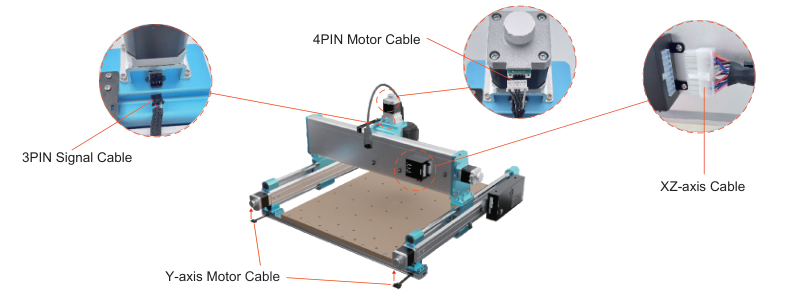

# Genmitsu 4040-PRO MAX: assembly, GRBL checks and first dry run


[**View Genmitsu 4040-PRO MAX CNC Router on OpenELAB**](https://openelab.io/products/genmitsu-4040-pro-max-cnc-router)

**Model:** 4040-PRO MAX with 710W compact router · **SKU:** `101-60-4040PM-E` · **Scope:** original 400 × 400mm machine; identify regional mains, control-box and accessory revisions before assembly or operation.


## Product overview <a href="#product-overview" id="product-overview"></a>

### Model and revision <a href="#genmitsu-4040-pro-max-cnc-router-engineering-guide" id="genmitsu-4040-pro-max-cnc-router-engineering-guide"></a>

The Genmitsu 4040-PRO MAX is a screw-driven desktop CNC router with a 400 × 400 × 78mm nominal work envelope and a separate 710W AC compact router. The controller’s **24V DC supply and the AC router are different power domains**. Establish communication, settings, direction and stop behavior before a supervised dry run; a software pause must not be assumed to stop an independently powered cutter. [Official resource center](https://docs.sainsmart.com/article/mh831nmx5x-4040-pro-max), [manufacturer manual](https://genmitsu.s3.dualstack.us-east-1.amazonaws.com/101-60-4040PM/Genmitsu_4040_PRO_MAX_User_Manual_V2_0_EN_DE_JP_2607.pdf)

[Genmitsu manufacturer directory](./) · [PROVerXL 4030 V2 guide](proverxl-4030-v2.md)

## Applications <a href="#recommended-use-cases" id="recommended-use-cases"></a>

Use the machine for wood/plastic engraving, panels, signs, jigs and supported light machining after material/tool-specific validation. Assess rigidity, runout, tool stickout, workholding, dust/chip extraction and actual dimensional results before repeating production jobs. Aluminum capability depends on a suitable cutter, conservative engagement, chip evacuation and fixture stiffness; spindle wattage is not a cutting recipe.

### Project records and application ideas <a href="#project-references-and-application-ideas" id="project-references-and-application-ideas"></a>

A useful development workflow is CAD → CAM → controller-compatible G-code → sender → supervised coupon → measured result. Keep the CAD/CAM version, postprocessor, units, material, tool diameter, spindle setting, feed and depth with each repeatable job. Optional laser/rotary systems require separate hardware, controls and a suitable operating arrangement.

## Specifications <a href="#key-specifications" id="key-specifications"></a>

| Parameter              | Current V2.0 June 2026 manual                                  | Integration condition                                                   |
| ---------------------- | -------------------------------------------------------------- | ----------------------------------------------------------------------- |
| Work envelope          | 400 × 400 × 78mm                                               | Tool, clamp, stock and spoilboard dimensions reduce usable clearance    |
| Overall dimensions     | 660 × 666 × 390mm                                              | Add cable, dust-hose and operating space                                |
| Frame/motion           | Aluminum, screw-driven                                         | Square the frame and check free travel before powered motion            |
| Lead screw             | T10 ACME, 2mm pitch, 4mm lead                                  | Pitch and travel per revolution are different quantities                |
| Control compatibility  | GRBL 1.1h; 32-bit reference MCU                                | Read actual build information before firmware changes                   |
| Maximum speed          | 2,000mm/min                                                    | A capability limit, not a recommended cutting feed                      |
| Axis motors            | 1.68A, 0.45N·m reference; NEMA17 form factor in earlier manual | Do not transfer 4030 V2 NEMA23/current settings                         |
| Router                 | 710W AC compact router                                         | Separate supply and speed/control behavior from the 24V controller      |
| Controller supply      | 24V/5A output; AC110/230V switch-select supply reference       | Match the supplied regional hardware and selector before applying mains |
| Router mount           | 65mm clamp, with separate 52mm retaining ring                  | Mechanical fit does not establish electrical/laser compatibility        |
| Toolholding references | Supplied ER11 1/8-inch and 4mm collets                         | Match actual tool shank and inspect collet seating/runout               |
| Host workflow          | USB serial; Candle or UGS                                      | Use the correct port and 115200 reference connection                    |

Source: [V2.0 cover and printed p.4 specifications, pp.5–8 inventory](https://genmitsu.s3.dualstack.us-east-1.amazonaws.com/101-60-4040PM/Genmitsu_4040_PRO_MAX_User_Manual_V2_0_EN_DE_JP_2607.pdf#page=6). The current resource-linked manual is **V2.0 June 2026**. The older July-2024 filename says V1.0 while its cover says V1.1 June 2024; match the received revision and keep that older file only as a historical reference.

The live resource page also gives **673 × 665 × 366mm** for its 4040 extension comparison. That differs from the full-kit manual dimensions; do not average them or fabricate a case from the comparison row. Use the correct revision’s dimensional drawing and measure the received assembly before enclosure work. The full-kit manual’s 24V/5A supply replaces the older summary’s unverified 24V/4A statement.

## Hardware and connections <a href="#hardware-architecture" id="hardware-architecture"></a>

### Assembly sequence and independent checks <a href="#frame-and-motion" id="frame-and-motion"></a>

| Stage                         | What to establish before continuing                                                                     | Manual printed pages |
| ----------------------------- | ------------------------------------------------------------------------------------------------------- | -------------------- |
| Feet and base/spoilboard      | Correct front/rear profiles; install locating dowels and leave required screws loose until alignment    | 9–11                 |
| Dual Y assemblies             | Match left/right labels; secure base and align both sliders to their rear mounts                        | 12–13                |
| X supports and XZ module      | Use the specified screw lengths, locating dowels and seating notches; tighten in the illustrated order  | 14–16                |
| Cable holder and router mount | Correct bracket position and 65mm clamp; finish fasteners after positioning the router                  | 17–19                |
| Signal/motor wiring           | Match the labelled 3-pin signal, 4-pin motor, XZ and the Y-axis motor harness                           | 20                   |
| Cable retention               | Leave travel slack; route and secure the router cord using the specified holder/tie locations           | 21–22                |
| Collet and cutter             | Seat the correct collet in its nut, verify shank engagement and use the paired holding/tightening tools | 23–24                |
| Workholding                   | Assemble the original MDF clamp kit for the stock; confirm complete toolpath clearance                  | 25–26                |
| Optional retaining ring       | Separate installation option; the laser is not supplied by fitting the ring                             | 27–28                |

These checkpoints are an engineering interpretation of the [illustrated assembly manual](https://genmitsu.s3.dualstack.us-east-1.amazonaws.com/101-60-4040PM/Genmitsu_4040_PRO_MAX_User_Manual_V2_0_EN_DE_JP_2607.pdf). Keep power disconnected during assembly, tool changes and wiring. Do not use a longer screw because it appears to fit a hole.

### Wiring and power domains <a href="#controller-and-io" id="controller-and-io"></a>

The manufacturer identifies the black **3-pin signal cable** for the Z-limit board and the white **4-pin motor cable** for the Z motor. The current manual identifies the XZ connection on the left Y module; the older assembly drawing additionally labels both Y-motor paths. Match the actual factory harness and do not disconnect integrated wiring unnecessarily. Seat latches fully and keep harnesses clear through the entire intended travel. Use the original connector drawing, not an inferred pin order from wire colors. [Wiring illustration, V2.0 printed p.20](https://genmitsu.s3.dualstack.us-east-1.amazonaws.com/101-60-4040PM/Genmitsu_4040_PRO_MAX_User_Manual_V2_0_EN_DE_JP_2607.pdf#page=22)



Manufacturer illustration cropped from the older V1.1 June 2024 manual, printed p.18; use the current V2.0 wiring page and received harness for the actual revision. The image identifies cable functions rather than a custom connector pinout.

Do not power the 710W AC router from the controller’s 24V output. Check both supplied mains cords, ratings and any voltage selector against the received regional option. Keep the emergency stop reachable, verify what it actually disconnects, and retain a separate accessible method of isolating the router where required by the actual configuration. The setup guide’s emergency stop and limit switches are not proof of a certified overall safety system.

GRBL feed hold stops/decelerates motion but does not normally disable spindle/coolant. A sender’s pause, soft reset, software spindle command and physical power isolation are separate functions. Verify the actual control path with the cutter disabled before relying on any of them. [GRBL real-time command behavior](https://github.com/gnea/grbl/wiki/Grbl-v1.1-Commands#grbl-v11-realtime-commands)

### Toolholding, surfaces and extraction <a href="#router-collet-and-tooling" id="router-collet-and-tooling"></a>

Inspect the collet, nut and shank for debris/damage. V2.0 printed pp.23–24 show seating the collet into its nut before tightening, then the separate collet-release procedure; do not clamp an unmatched shank by force. Keep cutter projection appropriate to the job and check the cutter’s own speed rating. Verify squareness, spoilboard flatness and clamping on the assembled machine before expecting shallow engraving or two-sided operations to align.

Use the machine indoors on a stable bench, supervise operation and keep hands clear of moving tools. Provide eye protection and material-appropriate ventilation/extraction; changing materials changes dust/fume and workholding requirements. Do not disassemble mains supplies as a routine diagnostic. The manufacturer also specifies indoor use, an adult operator or knowledgeable adult supervision, and avoiding extension cords/power strips for this high-current setup; follow the received supply requirements. The optional aluminum hybrid spoilboard uses slider nuts in its slots, while the original MDF platform uses embedded nuts—do not interchange their workholding assumptions.

## Software and development resources <a href="#software-and-toolchain-workflow" id="software-and-toolchain-workflow"></a>

The official model directory provides CH341/CH340 driver guidance, UGS for Windows/macOS/Linux, optional Candle/GRBLControl for Windows, sample files, probe/limit documentation, extension guides and CAD/CAM training. Installing a serial driver is different from installing firmware. Keep the supplied application archive intact and identify the actual device instead of selecting an example COM port. [Resource center software section](https://docs.sainsmart.com/article/mh831nmx5x-4040-pro-max#cnc-controller-software-installation)

Use a GRBL-compatible CAM postprocessor for the actual controller. Confirm units, absolute/incremental moves, work coordinate system, retract height, spindle commands and tool-length/probe conventions. Paid CAD/CAM products and cloud tools can require licenses/accounts; no device SDK is needed for the normal sender workflow. Archive the original controller settings before adjustment or restore.

## Getting started <a href="#setup-checklist" id="setup-checklist"></a>

### 1. Read identity and settings without motion

Prerequisites: assembled/inspected stock machine, router physically disabled, correct supplies, clear axes, accessible stop and a known USB data cable. Use an appropriate PC/sender and the matched manual.

1. Record the received machine, control board, router and supply labels. Verify the supply selector where fitted before applying mains.
2. Connect USB and identify the new serial device. Install the manufacturer-linked driver only if needed; close other applications using that port.
3. Open Candle or UGS at the manual’s **115200 baud** reference. Record the banner and send these queries one at a time:

```
$I
$$
$G
$#
$N
?
```

4. Save build identity, settings, modal state, offsets/probe state, startup blocks and machine status. These queries do not command motion; do not append `=`, `$H`, `$X`, reset-to-defaults or a job file as an automatic next step.
5. Compare configured travel and controller identity with the actual machine. Keep a dated copy before any subsequent tuning.

**Expected result:** coherent controller/build and state responses with stationary axes and no spindle operation. The manual’s connection procedure is on V2.0 printed pp.29–31; [GRBL query definitions](https://github.com/gnea/grbl/wiki/Grbl-v1.1-Commands) explain the response types. A readable USB port without a GRBL response is not a completed controller check.

### 2. Validate direction, limits and coordinate conventions

After wiring, clearance and the stop path are verified, use the sender’s smallest deliberate jog increment to check one axis at a time. State millimeters/inches explicitly. Establish actual switch/direction behavior before the matched homing sequence; do not home an unidentified or obstructed mechanism.

Distinguish machine home from work zero. The sender’s ZeroXY/ZeroZ controls set a work reference; they do not prove correct machine-coordinate origin or fixture alignment. Inspect the full CAM preview before placing the cutter near the stock. Keep clamps, probe and cable slack outside both cutting and rapid paths.

### 3. Probe using the measured plate and matched sender

The manual’s probe page includes different example offsets (**14mm** versus **12.35mm**) and explanatory text that does not exactly match the displayed macro. These are not the actual thickness of every supplied plate. Measure the plate, confirm contact changes the probe input, and check units, relative/absolute mode, downward travel, feed, retract and work-offset convention before using the sender’s probe function. [Probe reference, V2.0 printed pp.34–36](https://genmitsu.s3.dualstack.us-east-1.amazonaws.com/101-60-4040PM/Genmitsu_4040_PRO_MAX_User_Manual_V2_0_EN_DE_JP_2607.pdf#page=36)

Do not copy a long downward stroke or a sample `G92` value into a new setup unchanged. Remove the probe and clip before spindle operation. Use the [model-linked Z-probe guide](https://docs.sainsmart.com/article/yhgowhcb8x-what-is-a-z-probe-how-do-i-use-it) for its supported workflow and the offline-controller manual when that separate device is used.

### 4. Air-cut first, then measure a supported coupon <a href="#best-practices" id="best-practices"></a>

Generate a simple job using the correct GRBL postprocessor and known stock/tool dimensions. Inspect its units, toolpath bounds, rapid moves, origin, safe height and clamping. With the router disabled and the entire path clear above stock/fixtures, run a supervised air cut. Stop at unexpected movement or state.

Only after that check should you select material/tool-specific cutting parameters and make a shallow coupon. Measure dimensions and finish, then record the actual feed, router setting, depth, stepover, tool projection and workholding. The maximum travel speed, router power and an advertised accuracy number do not replace that process record.

### 5. Extensions, XZ upgrades and rotary/laser options <a href="#limitations-and-things-to-verify" id="limitations-and-things-to-verify"></a>

The model resource center distinguishes a **Y-axis extension** from the **4040-PRO MAX 60 X-axis extension**. Match the actual mechanical kit, limit arrangement, travel configuration and CAM envelope. A 4040-PRO XZ upgrade is also a separate installation: its manual shows removing the older assembly, aligning supports, locating the new module, rewiring and mounting a suitable compact router. It states a router is separately required for that upgrade kit; do not interpret that as the full 710W machine’s box contents. [XZ upgrade manual](https://genmitsu.s3.us-east-1.amazonaws.com/101-60-4040PM/Genmitsu_4040-PRO_MAX_XZ_Axis_Module_User_Manual_V1.0_EN_DE_JP_2407.pdf)

The linked [rotary-axis directory](https://docs.sainsmart.com/article/c27cun7uuq-4-th-axis-rotary-machining-guide) says its documented support is for 4040 Pro and does not establish every other machine’s compatibility. Verify MAX controller/mechanical compatibility before treating it as a plug-in fourth simultaneous axis. Laser installation likewise needs the correct module, wiring, control configuration and suitable enclosure/operating precautions; a 52mm ring alone establishes none of those.

## Troubleshooting and FAQs <a href="#troubleshooting-checklist" id="troubleshooting-checklist"></a>

| Symptom                          | Ordered diagnosis and recovery                                                                                                                    |
| -------------------------------- | ------------------------------------------------------------------------------------------------------------------------------------------------- |
| No port or sender response       | USB data cable, actual port, required CH34x driver, 115200 setting and exclusive ownership; record the controller banner                          |
| Preview blank while serial works | Check the manual’s OpenGL2.0-capable graphics requirement before changing controller firmware                                                     |
| Z limit behaves incorrectly      | Stop motion and isolate power; inspect the correct 3-pin signal/4-pin motor connections and the model’s diagnostic bulletin                       |
| Unexpected grounding/limit fault | Use the official control-box bulletin with competent service; do not interpret DC-ground isolation advice as removing protective mains earth      |
| Probe wrong or overtravels       | Stop; verify real plate thickness, contact input, macro values, modes and remaining travel before any retry                                       |
| Dimensions or origin wrong       | Compare CAD/CAM units, work offset, cutter diameter, home/reference and mechanical alignment before editing calibration                           |
| Chatter or burned material       | Check tool projection/condition, clamping, chip evacuation, router setting and CAM engagement; a higher spindle setting is not a universal remedy |
| Pause leaves the router spinning | Feed hold and router isolation differ; use the previously verified physical stop method                                                           |
| Job alarms after an extension    | Compare actual kit, configured travel, limits, origin and full toolpath; do not disable limits to force the file through                          |
| USB reset during cutting         | First isolate vibration/connector retention, cable routing, supply and interference under the exact configuration; keep error logs                |

The [electrical control-box bulletin](https://cdn.shopify.com/s/files/1/1978/9859/files/4040-Pro_Electrical_Control_Box_Grounding_Troublesh.pdf?v=1736407157) describes unintended DC-connector/case and Y-limit-board contact paths. It is a fault-specific service document, not a general instruction to modify protective grounding. Source troubleshooting and the exact GRBL code are preferable to repeatedly unlocking a faulty machine.

### Frequently asked questions <a href="#faq" id="faq"></a>

#### What software can I use with the Genmitsu 4040-PRO MAX? <a href="#what-software-can-i-use-with-the-genmitsu-4040-pro-max" id="what-software-can-i-use-with-the-genmitsu-4040-pro-max"></a>

Candle or UGS sends GRBL jobs over USB. CAD/CAM tools generate the file using a controller-compatible postprocessor; their project files are not directly executable G-code. Follow the model directory’s platform-specific downloads.

#### Can the 4040-PRO MAX cut aluminum? <a href="#can-the-4040-pro-max-cut-aluminum" id="can-the-4040-pro-max-cut-aluminum"></a>

Treat aluminum as a separately validated machining process. Tool geometry, rigidity, workholding, chip removal and conservative engagement determine the result; 710W is a power rating, not a feed/depth prescription.

#### What is the working area? <a href="#what-is-the-working-area" id="what-is-the-working-area"></a>

The V2.0 manual specifies 400 × 400 × 78mm nominal travel. Actual stock/tool/fixture clearance and configured travel must be checked on the received machine before a full-size job.

#### Does it include limit switches and a Z-probe? <a href="#does-it-include-limit-switches-and-a-z-probe" id="does-it-include-limit-switches-and-a-z-probe"></a>

The V2.0 full-kit inventory lists X/Y limit switches and a Z-probe kit; its assembly describes the Z-limit connection. Verify the received option and every input before homing or probing. Probe thickness must be measured.

#### Is the offline controller included? <a href="#is-the-offline-controller-included" id="is-the-offline-controller-included"></a>

An offline-controller manual is linked as an accessory resource. It is not proof that the separate controller is included in SKU `101-60-4040PM-E`; check the purchased option and delivered box.

#### Where should I start if I am new to CNC? <a href="#where-should-i-start-if-i-am-new-to-cnc" id="where-should-i-start-if-i-am-new-to-cnc"></a>

Complete assembly and electrical inspection, save the non-moving USB inventory, validate stop/direction/coordinates, then perform a supervised air cut before a shallow measured coupon. Keep the original manual open for its diagrams and exact kit fasteners.

These answers use the [V2.0 manual](https://genmitsu.s3.dualstack.us-east-1.amazonaws.com/101-60-4040PM/Genmitsu_4040_PRO_MAX_User_Manual_V2_0_EN_DE_JP_2607.pdf) and [model resource directory](https://docs.sainsmart.com/article/mh831nmx5x-4040-pro-max).

## Downloads and technical documents <a href="#official-resources-and-downloads" id="official-resources-and-downloads"></a>

### Full-kit manual map

| Printed pages | Contents and interpretation                                                                                |
| ------------- | ---------------------------------------------------------------------------------------------------------- |
| 1–4           | Resource support, operating restrictions, manufacturer UK-market compliance declaration and specifications |
| 5–8           | Inventory, regional power/ER11 collet/probe items and overall dimensions                                   |
| 9–16          | Base, MDF spoilboard with protective EVA plugs, Y alignment, support blocks and X locating pins            |
| 17–22         | Cable holder, router clamp, labelled wiring and cord retention                                             |
| 23–28         | Collet installation/release, MDF versus aluminum-hybrid workholding and optional ring/laser mount          |
| 29–31         | USB driver, serial device and Candle 115200 configuration                                                  |
| 32–33         | Sender controls, OpenGL2.0 preview, work-zero/job example and factory settings                             |
| 34–36         | Probe setup; actual plate thickness and macro validation remain essential                                  |

The [complete multilingual manual](https://genmitsu.s3.dualstack.us-east-1.amazonaws.com/101-60-4040PM/Genmitsu_4040_PRO_MAX_User_Manual_V2_0_EN_DE_JP_2607.pdf) retains the original diagrams. The [XZ-module manual](https://genmitsu.s3.us-east-1.amazonaws.com/101-60-4040PM/Genmitsu_4040-PRO_MAX_XZ_Axis_Module_User_Manual_V1.0_EN_DE_JP_2407.pdf) is a different document/kit, not a substitute for the full-machine manual.

### Revision and compliance references

The current manual adds a UK-market compliance page and aluminum-hybrid spoilboard workholding. Its compliance page names the UK Electrical Equipment (Safety) and EMC regulations and the designated safety/EMC standards; this is the manufacturer’s statement, not independent certification of an integrated CNC cell. Keep the complete declaration with the received product and assess the actual installation separately. [V2.0 printed p.3](https://genmitsu.s3.dualstack.us-east-1.amazonaws.com/101-60-4040PM/Genmitsu_4040_PRO_MAX_User_Manual_V2_0_EN_DE_JP_2607.pdf#page=5)

The [older V1.1 June 2024 full-kit manual](https://genmitsu.s3.us-east-1.amazonaws.com/101-60-4040PM/Genmitsu_4040-PRO_MAX_User_Manual_V1.0_EN_DE_JP_2407.pdf) remains useful for matching earlier harness/assembly revisions. The newer guide’s protective EVA plugs in the rear frame must remain in place to prevent fasteners/locating pins damaging wiring. Neither a new cover date nor this wiki authorizes replacing a control board’s firmware.

### Complete observed model-resource index

These are the technical resources linked by the [4040-PRO MAX resource center](https://docs.sainsmart.com/article/mh831nmx5x-4040-pro-max), with each purpose retained. An indexed archive, video, paid course or accessory guide is not claimed fully downloaded, watched, purchased or hardware-tested. Confirm the stated accessory/model scope before applying shared tutorials.

| Official resource                                                                                                                                                                                                  | Purpose / directory section |
| ------------------------------------------------------------------------------------------------------------------------------------------------------------------------------------------------------------------ | --------------------------- |
| [4040-PRO MAX User Manual](https://genmitsu.s3.dualstack.us-east-1.amazonaws.com/101-60-4040PM/Genmitsu_4040_PRO_MAX_User_Manual_V2_0_EN_DE_JP_2607.pdf)                                                           | Assembly                    |
| [XZ Axis Module of 4040-PRO MAX User Manual](https://genmitsu.s3.us-east-1.amazonaws.com/101-60-4040PM/Genmitsu_4040-PRO_MAX_XZ_Axis_Module_User_Manual_V1.0_EN_DE_JP_2407.pdf)                                    | Assembly                    |
| [Laser Module Installation Guide](https://youtu.be/ASlsZhGsSjo)                                                                                                                                                    | Assembly                    |
| [4040-PRO Extension Kit Installation Guide](https://docs.sainsmart.com/article/k4my1v1sb1-xy-axis-extension-kit-assembly-guide-for-4040-pro)                                                                       | Assembly                    |
| [4040-PRO MAX 60 X-Axis Extension Kit Installation Guide](https://genmitsu.s3.us-east-1.amazonaws.com/101-60-4040PM/Genmitsu_4040-PRO_MAX_XZ_Axis_Extension_Module_User_Manual_V1.0_EN_DE_JP_2503.pdf)             | Assembly                    |
| [CH341SER Driver (For Windows)](https://genmitsu.s3.us-east-1.amazonaws.com/CH341SER/CH341SER_202205.ZIP)                                                                                                          | Driver                      |
| [CH341 Installation Guide](https://genmitsu.s3.us-east-1.amazonaws.com/CH341SER/How_to_Install_CH340_Drivers.pdf)                                                                                                  | Driver                      |
| [Click here to download UGS](https://winder.github.io/ugs_website/download/)                                                                                                                                       | Controller software         |
| [https://winder.github.io/ugs\_website](https://winder.github.io/ugs_website/)                                                                                                                                     | Controller software         |
| [How to Install Candle/GRBLControl for Windows](https://docs.sainsmart.com/article/7c20d7zaw3-how-to-install-candle-grblcontrol-for-windows)                                                                       | Controller software         |
| [GRBLControl/Candle 1.17 (For Windows)](http://s3.amazonaws.com/s3.image.smart/download/101-60-3018PROVER/Grblcontrol\(Candle_1.1.7%20\).zip)                                                                      | Controller software         |
| [Guide on How to Set Up & Use Candle for Multiple Operations](https://sainsmart.helpdocs.io/article/bj9o96wcbc-how-to-set-up-use-candle-for-multiple-operations)                                                   | Machine Operation           |
| [What is a Z-Probe & How to Use It](https://docs.sainsmart.com/article/yhgowhcb8x-what-is-a-z-probe-how-do-i-use-it)                                                                                               | Machine Operation           |
| [How to Use Limit Switches to Maintain Positional Accuracy Between CNC Operations](https://docs.sainsmart.com/article/bi9jhbfgjf-how-to-use-limit-switches-to-maintain-positional-accuracy-between-cnc-operations) | Machine Operation           |
| [CNC Bit Selection Buyers Guide](https://cdn.shopify.com/s/files/1/1978/9859/files/CNC_Buying_Guide_V1.3-202104.pdf?v=1617328766\&fbclid=IwAR2bibDTEYEiikvm3YVwNM1IItrrD6o5_o4NNVDjmULWdYT9_saRV5dfkow)            | Machine Operation           |
| [4 Axis Rotary Module Quick Start Guide](https://docs.sainsmart.com/article/c27cun7uuq-4-th-axis-rotary-machining-guide)                                                                                           | Machine Operation           |
| [Offline Controller User Manual](https://genmitsu.s3.us-east-1.amazonaws.com/101-63-CTL4040/Genmitsu_4040_PRO_Offline_Controller_User_Guide.pdf)                                                                   | Machine Operation           |
| [Test file for 4axis module](https://genmitsu.s3.us-east-1.amazonaws.com/101-63-CTL4040/offline-control-4axis-test-file.zip)                                                                                       | Machine Operation           |
| [Electrical Control Box Grounding Troubleshooting](https://cdn.shopify.com/s/files/1/1978/9859/files/4040-Pro_Electrical_Control_Box_Grounding_Troublesh.pdf?v=1736407157)                                         | Troubleshooting             |
| [GRBL Error Code List & Meaning](https://docs.sainsmart.com/article/dm4jbd5jce-grbl-error-codes)                                                                                                                   | Troubleshooting             |
| [Gcode Sample](http://s3.amazonaws.com/s3.image.smart/download/101-60-3018PROVER/Gcode.zip)                                                                                                                        | Troubleshooting             |
| [CNC Router Trouble Shooting](https://docs.sainsmart.com/article/vhoiliz03s-3018-pro-cnc-router-trouble-shooting)                                                                                                  | Troubleshooting             |
| [Quick-Start Guide](https://sainsmart.helpdocs.io/article/j3nxnaoejh-fusion-360-quick-start-guide-for-3018-pro-prover-cnc-s)                                                                                       | Other CAD/CAM Software      |
| [Understanding Roughing & Finishing Passes](https://sainsmart.helpdocs.io/article/awrxnhbk59-fusion-360-guide-to-understanding-roughing-finishing-passes)                                                          | Other CAD/CAM Software      |
| [How to Use Carveco Maker with your Genmitsu CNC](https://docs.sainsmart.com/article/n2s80bz2j5-how-to-use-carveco-maker-with-your-sain-smart-prover-xl-prover-or-genmitsu-machine)                                | Other CAD/CAM Software      |
| [Training & Tutorial Videos](https://carveco.com/support/training/)                                                                                                                                                | Other CAD/CAM Software      |
| [Link to Purchas 12 month subscription](https://www.sainsmart.com/products/carveco-maker-12-month-subscription?_pos=2&_sid=810517027&_ss=r)                                                                        | Other CAD/CAM Software      |
| [Link to Website](https://easel.inventables.com/)                                                                                                                                                                  | Other CAD/CAM Software      |
| [Desktop version is available on SainSmart.com](https://www.sainsmart.com/products/vectric-vcarve-desktop)                                                                                                         | Other CAD/CAM Software      |
| [V-carve desktop training video](https://www.vectric.com/support/tutorials/vcarve-desktop)                                                                                                                         | Other CAD/CAM Software      |
| [\[User Story\] PROVerXL 4030 V2 CNC router Work with Vectric Aspire](https://hardwarepoint.net/2024/06/vectric-aspire/)                                                                                           | Other CAD/CAM Software      |
| [Full Contents of 4040 USB](https://genmitsu.s3.dualstack.us-east-1.amazonaws.com/101-60-4040PM/Genmitsu_4040PRO_Max_Resources_2511.zip)                                                                           | Misc. Download Links        |

## References and validation <a href="#source-notes" id="source-notes"></a>

Reviewed **24 November 2026** against the model resource center, current V2.0 June 2026 full-kit manual (all English pages, OCR plus critical illustration review), older V1.1 June 2024 reference, V1.0 July2024 XZ manual, relevant wiring/probe illustrations, control-box bulletin, rotary scope and GRBL command semantics. The OpenELAB SKU was matched to the active product listing. This guide adds an original non-moving inventory, staged coordinate/probe/dry-run workflow and explicit accessory/power distinctions.

No controller connection, software installation, settings query, probing, axis motion, router operation, laser, firmware update or hardware test was performed. Software/hardware execution is **not run**. Expected results are on-machine checkpoints; actual workholding and cutting performance require a documented trial on the received setup.
