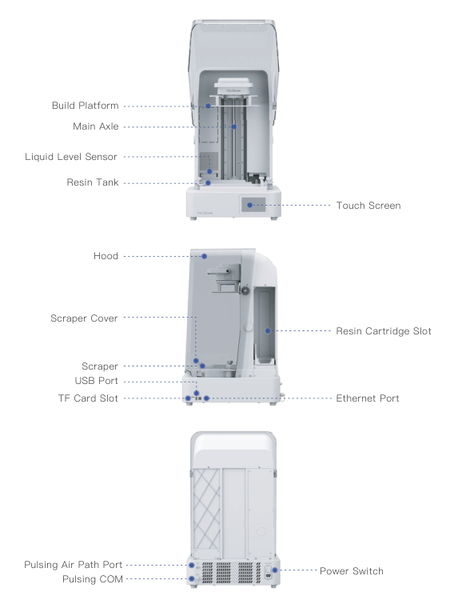

# HeyGears Reflex 2 Pro and RS Turbo: model-specific setup and Blueprint workflow


[**View HeyGears UltraCraft Reflex 2 Pro on OpenELAB**](https://openelab.io/products/heygears-ultracraft-reflex-2-pro)

**Model:** Reflex 2 Pro · **SKU:** `11030301147`

[**View HeyGears UltraCraft Reflex RS Turbo on OpenELAB**](https://openelab.io/products/ultracraft-reflex-rs-turbo-3dprinter?variant=44847677898950)

**Model:** Reflex RS Turbo, printer without a separate wash/cure bundle · **SKU:** `11030301140`


## Product overview 

The **Reflex 2 Pro** and **Reflex RS Turbo** are different LCD/MSLA resin printers using Blueprint Studio for model preparation, slicing and task management. Choose the exact printer, material, tank and accessory configuration before generating a job. A shared software interface does not make their light engines, resin support, unpacking instructions or replacement parts interchangeable. [Reflex 2 Pro](https://store.heygears.com/products/reflex-2-pro-3d-printer), [RS Turbo](https://store.heygears.com/products/ultracraft-reflex-rs-turbo-3d-printer)

[HeyGears manufacturer directory](./) · [PAT10 transparent-resin workflow](ultraprint-pat10-transparent-resin.md)

## Applications

Use the 2 Pro's taller build space for larger prototypes and supported small-batch production. Use the RS Turbo for detailed models, miniatures, housings and smaller fixtures with an appropriate resin/profile. Compare the complete build envelope, material performance after curing, support access, drainage and post-processing capacity before buying based on pixel size.

For engineering parts, define acceptance dimensions, loading direction, surface finish, temperature and aging requirements before printing. Pixel pitch, axis repeatability and printed-part accuracy are different quantities. Production claims and example photos are manufacturer demonstrations, not measurements of your part or evidence of medical/food-contact suitability.

## Specifications

| Parameter                | Reflex 2 Pro                                             | Reflex RS Turbo                                   |
| ------------------------ | -------------------------------------------------------- | ------------------------------------------------- |
| Technology / screen      | LCD/MSLA; 10.7-inch Amber Screen Pro                     | LCD/MSLA; 10.3-inch 8K Amber Screen               |
| Nominal build volume     | 230 × 144 × 350mm                                        | 222 × 122 × 228mm                                 |
| Native XY pixel          | 40µm                                                     | 29.7µm                                            |
| Listed accuracy          | ±20µm in current specification                           | ±15µm in current specification                    |
| Layer thickness          | 20–250µm                                                 | 30–100µm                                          |
| Optical reference        | Marketing specification: 385+nm; OEM quickstart: 393nm   | 405nm                                             |
| Z-axis                   | C5-grade reference; closed-loop FOC drive                | C5-grade reference                                |
| Resin temperature system | Scraper-assisted heating                                 | Do not assume the 2 Pro heating scraper is fitted |
| Overall dimensions       | 430 × 445 × 715mm                                        | 380 × 360 × 584mm                                 |
| Listed mass              | 29.7kg current brochure/store; 28kg older OEM quickstart | 20kg                                              |
| Rated power              | 750W                                                     | 180W                                              |
| Listed AC supply         | 100–240V, 50/60Hz                                        | 100–240V, 50/60Hz at the supplied power system    |
| Connectivity             | USB, Wi-Fi, LAN                                          | USB, Wi-Fi                                        |
| Languages listed         | English, Simplified Chinese                              | English, Simplified Chinese, Japanese             |

Sources: [2 Pro manufacturer brochure, p.6](https://static3-uswest2.heygears.com/market/catalogue/en/pdf/Reflex%202%20Pro_EN.pdf#page=6), [2 Pro current specification](https://store.heygears.com/products/reflex-2-pro-3d-printer), [RS Turbo current specification](https://store.heygears.com/products/ultracraft-reflex-rs-turbo-3d-printer). Keep the mass and optical references with their source versions; do not average them or derive third-party resin compatibility from wavelength alone. Verify the received nameplate and power adapter before connection. The older **Reflex RS** quickstart specifies a **24V/7.5A printer input**, illustrating why an AC rating and the printer-side DC connector are not interchangeable instructions.

### What the 2 Pro's feature numbers mean

| Manufacturer feature                               | Stated condition and engineering interpretation                                                                                          |
| -------------------------------------------------- | ---------------------------------------------------------------------------------------------------------------------------------------- |
| 1,032 individually controlled light zones          | Exposure zoning is distinct from LCD pixels; nested geometry and material still require validation                                       |
| 1,032 collimating lenses and 480,000 microlenses   | Optical construction, not an independently measured resolution claim                                                                     |
| 10% transmission; up to 35W/m² light intensity     | Lab comparison uses a conventional 5%-transmission LCD baseline; not a universal exposure setting                                        |
| 6,000+ hours screen reference                      | Lab contrast/transmission remained within 10% deviation; life/warranty terms depend on the actual purchase and operating conditions      |
| 40kg pressure / 10,000 cycles                      | Manufacturer test used a 5 × 5mm surface-pressure model; not a permitted load to place on the screen                                     |
| 86,020 calibration zones; ≥94% light uniformity    | Brochure's ≤0.05mm printed deviation relates to XY test models ≤20mm, 95% confidence; it is not the same test as the ±20µm specification |
| FOC / C5 positioning                               | Lab reports 99.9% of movement errors within ±2µm under an 80kg load; not a safe payload specification                                    |
| Resin heating 10→22°C in 6 minutes, ±1°C reference | Lab used PAP10; different resin, ambient and tank contents can change conditioning time                                                  |
| Ultrasonic level detection ±0.5mm                  | Supports refill management; verify refill lid and matching cartridge installation                                                        |
| 0.01N force sensitivity / 0.15mm residue detection | Automatic monitoring does not replace checking a failed print or damaged film                                                            |
| 0.15° floating platform / up to 240µm gap leveling | Does not correct incorrect assembly, loose fixtures or an incompatible tank                                                              |

All figures are attributed to [HeyGears' brochure, pp.2–5](https://static3-uswest2.heygears.com/market/catalogue/en/pdf/Reflex%202%20Pro_EN.pdf). The RS Turbo's advertised 33% speed improvement uses its previous-generation comparison and Dynamic Motion Algorithm 3.0; compare actual slice estimates for the same geometry, resin and finish target rather than promising that improvement for every job. [RS Turbo feature reference](https://store.heygears.com/products/ultracraft-reflex-rs-turbo-3d-printer)

## Hardware and connections 

Reflex 2 Pro component locations from HeyGears OEM quickstart V1.0, p.2; diagram is model-specific and establishes no custom electrical pinout.

### Workstation, resin handling and model-specific unpacking

Use a stable, level bench with hood clearance, accessible power isolation, ventilation and a separate resin-handling/post-processing area. The OEM quickstarts specify 18–25°C and <50% relative humidity. Protect the machine and cartridges from direct sunlight, dust and heat; isolate liquid contamination from electronics and mains equipment. Follow the exact resin and cleaning-agent SDS for protective equipment and disposal.

**Reflex 2 Pro V1.0 quickstart:** inspect the printer, raise the hood, remove the shipping filler, connect the provided cord, then switch on and complete the on-screen installation. Install the resin-refill lid before inserting a cartridge. The supplied heating scraper and its cover belong to this configuration. [OEM-authored quickstart, pp.2–4, filed for model REFLEX02PRO](https://fccid.io/2BARH-REFLEX02PRO/User-Manual/User-Manual-8735798.pdf)

**Reflex RS Turbo:** use the instructions delivered for that exact model. The publicly available older **Reflex RS** quickstart instead says to power on and wait for the main axle to rise **before** removing its filler. That sequence is documented here as an important model difference, **not an instruction to apply the RS procedure to RS Turbo**. Stop if the delivered Turbo instructions and fitted shipping restraints are unclear; do not move or force an obstructed axis. [Older RS quickstart, p.3](https://ultra-static.oss-cn-shenzhen.aliyuncs.com/2.0/test/static/20250526/Quick%20Start%20of%20Reflex%20RS1748236956558.pdf#page=3)

### Ports, accessories and light exposure

The 2 Pro component drawing identifies USB, TF-card slot, Ethernet, resin-cartridge slot, heating-scraper assembly, ultrasonic level sensor, pulsing air path and Pulsing COM. An accessory connector is not a documented general-purpose UART/CAN/robot-control port. No public electrical pinout or supported printer SDK was established in this review; do not inject external voltages or reverse-engineer a connector as part of initial setup.

The 2 Pro OEM quickstart classifies its LED system as **Risk Group 3** and requires appropriate shielding. Keep the hood closed during printing, avoid direct UV viewing and use the exact equipment procedure for exposure tests. The printer is intended for professional users. Plastic hood/touchscreen parts should not remain contaminated with resin or alcohol. [OEM component and caution pages](https://fccid.io/2BARH-REFLEX02PRO/User-Manual/User-Manual-8735798.pdf)

The 2 Pro lists GreenPrint purification and Pulsing Release Module 2 interfaces. Match the exact module, tank and firmware before fitting an accessory. A filter or purification module does not by itself establish adequate ventilation or safe solvent handling. Wash and cure devices, cartridges, glaze and release modules are separately scoped items; verify the ordered bundle.

## Software and development resources 

### Blueprint Studio installation and host selection

Use the current **general-availability** installer from [HeyGears' software center](https://www.heygears.com/store/software). The page also offers release-candidate packages; these are separate choices. Record the installed BPS version, printer firmware, selected material/profile and tank type with each job. A hardware firmware update is a deliberate change after backup and release review, not a cure for every connection failure.

| Platform          | Published minimum                                                               | Published recommendation                                                     |
| ----------------- | ------------------------------------------------------------------------------- | ---------------------------------------------------------------------------- |
| Windows           | 16GB RAM; Intel i5 10th generation or AMD Ryzen 7 3000 series; Windows 10 v1703 | 32GB; i7 12th generation or Ryzen 9 5000 series; GTX1080Ti; Windows 10 v1903 |
| Apple Silicon Mac | M1, 8GB, macOS Monterey 12                                                      | M2 Pro, 16GB, Ventura 13                                                     |
| Intel Mac         | i5 5th generation, 16GB, Monterey 12                                            | i5 7th generation, 16GB, Ventura 13                                          |

These are the software center's current published references, not a reason to downgrade a supported computer. Confirm the installer's current OS/architecture requirements. Network access is used for cloud storage, remote access, scheduling and transfers. Keep confidential models within the organization's approved upload/account arrangements. No software installation or login was performed in this review.

### Material/profile selection and Open Material Mode

The current 2 Pro page broadly lists Reflex-series materials; verify the **exact resin and available profile**. The RS Turbo page names PARP10, PAS10, PAWW10, PAP10, PAWR10, PAF10 and PAWW20 in its compatibility information. PAT10's own product page lists Reflex, Reflex Turbo, Reflex 2 and Reflex 2 Pro, so **do not infer a validated PAT10/RS Turbo profile** merely because both products appear in a transparent-solution campaign.

The [Open Material Mode page](https://store.heygears.com/pages/open-material-mode) explicitly lists **Reflex/Reflex Turbo and RS/RS Turbo**, for experienced users working with compatible 405nm photopolymers. It does not establish the same feature for the 2 Pro. In supported BPS versions: create a project → choose **Open Material** → at **Slice**, open **Print Process Editor**. Light intensity, exposure and dimensional compensation require a controlled calibration process; changing several at once makes diagnosis difficult. Start with the supported vendor profile for a first print.

The same page describes an Advanced Mode beta dated November 20 alongside “coming soon” text. A calendar date or marketing announcement does not prove that a particular installed release/account has the feature. Confirm actual release notes and UI availability before documenting an advanced workflow.

## Getting started

### First result: an inspected, model-matched slice file

This first result checks the preparation workflow without moving a printer or exposing resin.

1. Read the delivered nameplate/manual and record model, serial, firmware and accessories. Select a resin explicitly supported for that printer and the actual standard/pulsing tank.
2. Install the matching stable BPS package. Create/sign into the intended account after reviewing its privacy terms. To bind a printer, use **Add new device**, enter its serial from the rear label or **Settings → About Device**, and verify the displayed model. Do not bind another operator's device.
3. Open **BP-Slicer**, create a new project and select the exact printer, material, layer/profile and tank. Import a small original coupon containing a measurable wall, hole and support-access feature.
4. Inspect model scale/units, orientation, drainage and accessible support removal. Use **Layout → Auto Layout** or deliberate manual placement; then generate supports. The older BPS guide distinguishes cylinder supports for smaller/simple models and truss supports for larger/complex models. Inspect and edit supports rather than assuming automatic output is correct.
5. At **Slice**, generate the file. Open **View Slicing File** and inspect representative layers, support starts, closed cavities, part bounds and material/printer identity. Record the BPS/profile versions and an original model revision.
6. Save/download the slice from **Library** and retain a project/recipe record. For a connected, correctly bound printer, send the intended file and verify the destination; sending is separate from starting a physical print. The OEM guide also documents downloaded slice transfer by USB where supported.

**Expected result:** a reviewed slice file for the intended model/material/tank, with no unsupported geometry outside the build area and an identifiable version record. Successful import or a plausible time estimate alone is insufficient. The original procedure above expands the [13-page Blueprint Studio quickstart](https://ultra-static.oss-cn-shenzhen.aliyuncs.com/2.0/test/static/20230919/QuickStart%20Guide%20for%20Blueprint%20Studio1695113851591.pdf); UI labels can change between releases.

### From slice to measured coupon

7. Complete the exact printer's installation, platform/tank and material preparation steps. Inspect for cured debris, damaged film, leakage, loose fixtures and correct refill assembly. Use the material's actual wash/cure instructions before loading resin.
8. Confirm the job identity on the printer touchscreen, close the hood and start only after the work area is prepared. Monitor the initial process and stop at abnormal sound, movement, failed release or leakage rather than repeatedly restarting.
9. After completion, follow the material/device-specific draining, removal, washing, drying and curing procedure. Do not substitute “water washable” instructions from PAWW resin for a different formulation.
10. Measure the fully processed coupon and log dimensions, supports, orientation, finish, resin batch, ambient conditions and post-processing recipe. Change one factor for the next trial. Use **Tasks** for status/history and preserve the original slice with the actual result.

No exposure, wash duration or cure duration is prescribed here without the exact material/equipment process. These steps have been source-reviewed; no physical print was run.

## Troubleshooting and FAQs 

| Symptom                                      | Diagnosis and supported next step                                                                                                                                             |
| -------------------------------------------- | ----------------------------------------------------------------------------------------------------------------------------------------------------------------------------- |
| Printer absent/offline                       | Confirm model/serial binding, power, intended network and BPS/account state; use the printer's displayed status before attempting OTA                                         |
| Slice cannot be sent                         | Check selected destination, account permissions, online state and file completion; distinguish upload progress from printer receipt                                           |
| Material or tank option absent               | Check actual model support and BPS/firmware versions; do not select a similar material to bypass the missing option                                                           |
| Prints detach or deform                      | Inspect support/orientation, clean intact film, correct platform/tank assembly, resin conditioning and matched profile before changing exposures                              |
| Haze or poor transparency                    | Separate surface roughness, retained liquid, cleaning/drying, cure and coating effects; use a fully processed coupon and [PAT10 guide](ultraprint-pat10-transparent-resin.md) |
| Resin on the projection screen               | Stop the job; a breached release film may have leaked. Isolate/clean using the exact OEM procedure; avoid scraping an optical surface or exposing UV with the hood open       |
| Unexpected axis obstruction during unpacking | Stop; verify the model-specific restraint-removal order. The 2 Pro and older RS instructions differ                                                                           |
| Advertised accuracy not achieved             | Compare the actual feature, measurement method, resin, orientation, cure and source test conditions; pixel pitch is not a complete tolerance guarantee                        |
| Need a third-party integration API           | No supported public printer SDK/pinout was verified. BPS remote functions do not establish a public API contract                                                              |

### Release-film maintenance

For **2 Pro V1.0**, the OEM sequence is to remove the resin cartridge, scraper and tank; remove residual resin safely; then remove the film-frame screws from the tank bottom with the supplied wrench. Fit the correct replacement film, secure diagonally before the remaining screws, and check that the frame is level with the tank frame before reinstalling tank/scraper. The quickstart supplies no universal screw torque or tension frequency; do not invent one. [OEM quickstart, p.4](https://fccid.io/2BARH-REFLEX02PRO/User-Manual/User-Manual-8735798.pdf#page=4)

Match RS Turbo replacement parts and service instructions separately. The older RS manual describes tank-side bolts and a different assembly; it is not proof that a 2 Pro film, scraper or tank fits. After any failed print, recover debris and inspect the film before the next job. Keep hood/touchscreen contamination brief and follow the specified cleaning method; prolonged resin/alcohol contact can damage these plastics.

## Downloads and technical documents

| Source                                                                                                                                                                   | Coverage / scope                                                                                                                      |
| ------------------------------------------------------------------------------------------------------------------------------------------------------------------------ | ------------------------------------------------------------------------------------------------------------------------------------- |
| [Reflex 2 Pro official brochure](https://static3-uswest2.heygears.com/market/catalogue/en/pdf/Reflex%202%20Pro_EN.pdf)                                                   | Six pages: optical engine, screen test conditions, Z motion, heating/refill/detection, supported material examples and specifications |
| [Reflex 2 Pro OEM quickstart V1.0](https://fccid.io/2BARH-REFLEX02PRO/User-Manual/User-Manual-8735798.pdf)                                                               | OEM-authored four-page filing copy: components, installation, operation, film replacement and cautions; older 28kg/393nm reference    |
| [Reflex 2 Pro current product information](https://store.heygears.com/products/reflex-2-pro-3d-printer)                                                                  | Current features, compatible accessories, package and specification                                                                   |
| [Reflex RS Turbo current product information](https://store.heygears.com/products/ultracraft-reflex-rs-turbo-3d-printer)                                                 | Turbo specifications, material list, features and model FAQ                                                                           |
| [Older Reflex RS quickstart](https://ultra-static.oss-cn-shenzhen.aliyuncs.com/2.0/test/static/20250526/Quick%20Start%20of%20Reflex%20RS1748236956558.pdf)               | Related RS only; model-specific unpacking/input differences must not be silently transferred                                          |
| [Blueprint Studio quickstart](https://ultra-static.oss-cn-shenzhen.aliyuncs.com/2.0/test/static/20230919/QuickStart%20Guide%20for%20Blueprint%20Studio1695113851591.pdf) | All 13 pages: registration, binding, project/import, layout/support/slice, library/USB transfer and tasks                             |
| [Stable/RC software downloads and platform requirements](https://www.heygears.com/store/software)                                                                        | Select OS/architecture and intended release channel; not a source-code SDK                                                            |
| [Support and video directory](https://www.heygears.com/store/support)                                                                                                    | Installation videos, FAQ and device quickstarts; videos indexed, not claimed watched                                                  |
| [Open Material Mode](https://store.heygears.com/pages/open-material-mode)                                                                                                | Actual supported models, UI entry points and advanced-feature status                                                                  |
| [Transparent solution overview](https://store.heygears.com/pages/transparent-solutions)                                                                                  | Material/design/printing/finishing/inspection workflow; individual coating processes require their own documents                      |
| [Manufacturer wiki](https://wiki.heygears.com/)                                                                                                                          | Deeper operating/maintenance resources; access was denied for several pages during this review                                        |

## References and validation 

Reviewed **24 November 2026**. The accessible manufacturer store/support/software pages, full six-page 2 Pro brochure, four-page OEM-authored 2 Pro quickstart, four-page older RS quickstart and all 13 BPS quickstart pages were read. OCR was used where PDF text was encoded or image-only; the 2 Pro component drawing was visually checked. Existing canonical page identity and useful references are retained.

Several official wiki pages returned HTTP403. A current standalone **RS Turbo-specific** installation/service manual, complete material recipes, public electrical pinout and public printer SDK were not verified; the affected operations remain bounded rather than borrowed from a related model. This page does not claim complete coverage of inaccessible pages. No BPS installation, account/device binding, firmware update, slicing execution, printing, washing or curing was performed.
