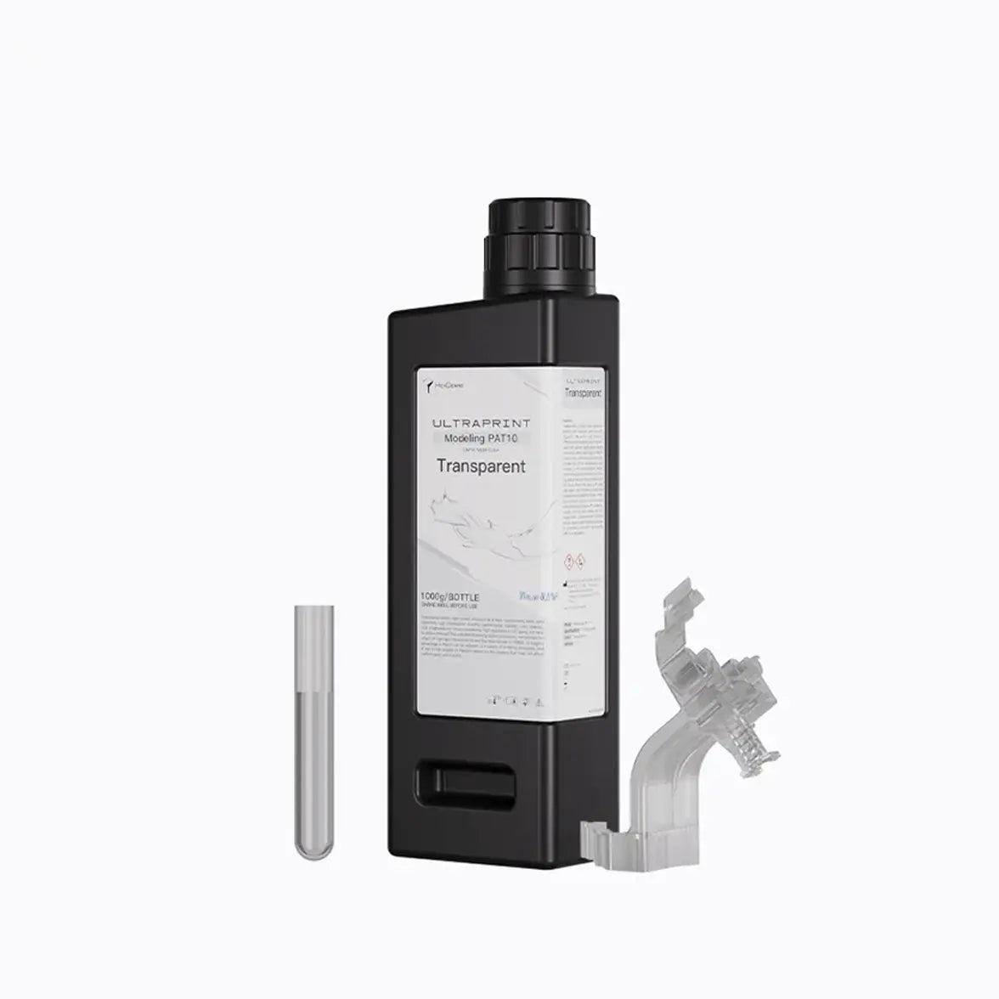

# HeyGears PAT10 transparent resin: profile, process records and clear-part inspection


[**View HeyGears UltraPrint-Modeling PAT10 Transparent Resin on OpenELAB**](https://openelab.io/products/pat10-transparent-resin?variant=44204336382150)

**Material:** PAT10, transparent, 1000g bottle · **Current store SKU:** `HeyGears-MA005001` · **Historical list SKU:** `Hg-MA005001`. The product/model matches; the historical SKU alias has not been independently confirmed. Match the bottle label and order option before use.


## Product overview <a href="#product-and-scope" id="product-and-scope"></a>

**PAT10 is a transparent modeling photopolymer whose finished properties depend on the printer profile and complete wash, dry, cure and finishing process.** This material guide helps establish a traceable recipe and inspection coupon. It is not an electronics firmware/SDK guide. The manufacturer lists Reflex, Reflex Turbo, Reflex 2 and Reflex 2 Pro compatibility; its current product page does not establish a validated RS Turbo profile. [Manufacturer product information](https://store.heygears.com/products/ultraprint-modeling-pat10-transparent-resin)

[HeyGears directory](./) · [Reflex printer comparison and Blueprint workflow](reflex-2-pro-and-rs-turbo.md)



Manufacturer PAT10 bottle and transparent-part illustration; appearance is not an optical or safety test result.

## Applications

Consider PAT10 for transparent display models, visual prototypes, model accessories and consumer-electronics housings where a measured clear-part finish is needed. Define thickness, viewing wavelength, haze, tint, dimensional fit and aging environment before interpreting “acrylic-like” appearance. A transparent printed coupon is not automatically an optical lens, pressure vessel, medical device or food-contact part.

The manufacturer advertises long-term indoor color stability and skin-safe printed wearables. Those statements do not establish the safety of **uncured liquid**, every cure/coating recipe or a specific regulated end use. Obtain the applicable test report and process conditions for the finished article before making such a claim.

## Specifications

| Manufacturer-reported property      | Reference and limitation                                                                                                          |
| ----------------------------------- | --------------------------------------------------------------------------------------------------------------------------------- |
| Appearance / package                | Transparent resin; 1000g bottle in the reviewed option                                                                            |
| Light transmittance                 | 88.5% headline; other page graphics round to 88%; retain thickness/wavelength/surface conditions with any measurement             |
| Haze                                | 5.4% headline; not an acceptance criterion for every geometry or finish                                                           |
| Impact / elongation                 | Page reports up to 31J/m and 25% elongation at break; test/cure conditions must accompany structural design use                   |
| Forming-accuracy claim              | Up to ±16µm in marketing material; not guaranteed tolerance for arbitrary parts                                                   |
| Aging claim                         | Stable color across eight years of indoor use, manufacturer statement; outdoor/heat/chemical exposure is a separate qualification |
| Supported printers on material page | Reflex, Reflex Turbo, Reflex 2 and Reflex 2 Pro; verify the current selectable PAT10 profile                                      |
| Surface finishing                   | Clear, matte, tinted and internal-texture examples; coatings and dyes have independent process/safety requirements                |

Source: [PAT10 manufacturer page](https://store.heygears.com/products/ultraprint-modeling-pat10-transparent-resin). A separately dated mechanical TDS and exact test-standard/conditioning package were not retrieved. Do not fill missing values from a different resin or combine reseller numbers into an invented current datasheet.

## Hardware and connections <a href="#hardware-and-technical-documents" id="hardware-and-technical-documents"></a>

### Bottle, printer and workstation identity

Before opening, record the bottle's full material name, batch, expiry, storage history and container condition. Match the selected BPS material to that bottle and the printer/tank configuration. A changed OpenELAB SKU prefix does not establish a formulation change, and a similar bottle name is not proof of equivalence.

Use a dedicated, ventilated resin workstation with containment and compatible tools. Keep bottles away from light and heat. Separate uncured handling, washing, dry/clean work and final inspection so a cured part is not contaminated by the liquid-handling area. Follow the current local-language SDS supplied for the batch; retain cleaning-agent and coating SDS separately.

### SDS: principal handling facts

The reviewed **EU SDS v3.0, PAT2023032101-03-EU, revised 2 January 2025** identifies skin/eye irritation, sensitization and respiratory irritation. Use chemical-resistant gloves, protective clothing and suitable eye protection with ventilation. Prevent environmental release; keep containers closed, cool and dry, away from heat, acids, alkalis and oxidizers. For spills, contain with inert absorbent and keep material out of drains. Skin exposure: remove contaminated clothing and wash. Eyes: rinse immediately for at least 15 minutes; obtain medical advice as directed. Ingestion/inhalation require the SDS's first-aid response and professional advice. Waste and residue-containing bottles follow local disposal requirements.

| Liquid reference at 25°C | SDS value                                     |
| ------------------------ | --------------------------------------------- |
| Density                  | 1.0–1.5g/cm³                                  |
| Dynamic viscosity        | 500–1300mPa·s                                 |
| Flash point              | 130°C; not a permitted processing temperature |

Transport classification is not a health-safety certificate. The SDS reports no product chemical-safety assessment and several unavailable toxicological/ecological values. [Complete nine-page manufacturer SDS](https://wiki.heygears.com/materials/22-ultraprint-modeling_pat10_23032101-03-eu.pdf)

## Software and development resources <a href="#development-software-and-recovery" id="development-software-and-recovery"></a>

Use [Blueprint Studio](https://www.heygears.com/store/software) with a **supported PAT10 profile** for the exact printer and tank. The printer's nominal wavelength alone is insufficient. Record software/firmware, material/profile revision, layer height, orientation, supports and tank type. Do not copy another resin's exposure or cure cycle because both are transparent.

The manufacturer's [transparent-solution overview](https://store.heygears.com/pages/transparent-solutions) divides the work into design/preparation, printing and post-processing/quality control. It links detailed design, sanding, dyeing, spraying and clear-coating guidance. Those deeper wiki pages were not fully accessible in this review. Their existence does not establish a verified numerical wash/cure recipe or authorize substituting unrelated equipment.

## Getting started

### First result: a complete material recipe record

This initial procedure needs no exposure or resin handling and can reveal a missing process before a print is started.

1. Record the purchased bottle identity and confirm the current store option against the order. Resolve the historical SKU alias with the order/bottle record if needed.
2. Collect the applicable PAT10 SDS, printer instructions and **PAT10-specific** wash/dry/cure guidance for the actual equipment. If any required step is missing, keep physical printing on hold while completing the record.
3. In a supported BPS version, confirm the intended printer and PAT10 material/tank profile are selectable. Record versions and the actual displayed profile; do not select a different resin to make the project proceed.
4. Design a small original coupon with representative thickness, hole/fit feature, viewing area and reachable support marks. Define dimensional and appearance acceptance criteria before slicing.
5. Inspect orientation, trapped cavities, drainage and support access. Save the model/project revision and a reviewed slice file for that exact printer/material/tank. Review representative layers rather than relying only on the rendered solid.
6. Complete a recipe record like the one below. Every physical-process value must come from the applicable material/equipment instruction or a documented qualification trial.

```
Material / batch / expiry:
Printer model / serial / firmware:
BPS version / PAT10 profile / tank:
Coupon revision / orientation / layer height:
Wash equipment / solution / cycle / bath condition:
Drying method / endpoint:
Cure equipment / program / temperature / duration:
Support removal / sanding / coating process:
Inspection thickness / lighting / instrument / acceptance:
Measured result / photos / disposition:
```

**Expected result:** an identified, reviewable recipe and coupon design with no unknown mandatory wash/cure step. A downloadable slice file alone is not evidence that the material process is ready. This record is an original engineering aid, not a claim that the printer or resin was tested here.

### From coupon to repeatable transparent part

7. Prepare the matched printer, tank and material using their instructions. Check for debris, film damage, contamination and storage/conditioning issues before loading.
8. Print only after the preparation and containment checks. Use the actual material-specific draining, washing, drying, support-removal and curing sequence; do not improvise a generic UV duration.
9. Inspect the fully processed coupon at a recorded thickness and surface condition. Measure fit features separately from optical appearance. Compare against a retained reference and photograph under consistent lighting/background.
10. Change one factor at a time for improvement. Distinguish geometry/orientation effects, liquid residue, drying, cure state, surface roughness and coating. Repeat the accepted recipe before scaling to a large transparent part.

No numeric post-processing cycle is asserted because the exact applicable PAT10 process/equipment document was not fully verified. Manufacturer marketing values do not replace that record.

### Design and finish decisions

Use the original coupon to compare a uniform viewing wall with a thicker feature, a supported face with an unsupported face, and the intended final coating. Design drainage and access so liquid can be removed and the internal surface can be inspected. Avoid an internal cavity that cannot be cleaned merely to hide supports.

The manufacturer demonstrates clear, matte, tinted-clear, tinted-matte and internal-crystallization finishes, with ClearG115 gloss glaze as a separate finishing product. A coating changes the final material system: review its own compatibility, cure and exposure requirements. Do not treat a resin SDS as a coating/dye/solvent instruction, or introduce a spray process without the correct equipment and controls. [Official finish overview](https://store.heygears.com/pages/transparent-solutions)

## Troubleshooting and FAQs <a href="#faqs" id="faqs"></a>

| Observation                                      | Separate these causes before changing the profile                                                                                         |
| ------------------------------------------------ | ----------------------------------------------------------------------------------------------------------------------------------------- |
| Cloudy or milky surface                          | Retained liquid, wash contamination, incomplete drying, surface roughness, cure and coating; compare a process-matched coupon             |
| Clear outside, cloudy cavity                     | Inspect drainage, cleaning access and trapped residue; improve geometry instead of simply extending exposure                              |
| Yellowing                                        | Record exposure/heat history and cure/coating condition; indoor-aging claims do not establish outdoor performance                         |
| Weak or cracked part                             | Check batch, cure, layer orientation, notch geometry and cleaning/coating exposure; obtain the dated mechanical TDS before structural use |
| Wrong dimensions                                 | Inspect units, scale, orientation, support distortion and post-process shrinkage; do not derive global compensation from one feature      |
| PAT10 absent in BPS                              | Confirm exact printer and profile support. The current material page does not establish RS Turbo compatibility                            |
| Bottle SKU differs from old list                 | Match material, quantity, bottle/order and current variant; historical alias remains an audit item                                        |
| Need lens-grade optics or certified skin contact | Obtain the relevant finished-process test evidence; appearance or a broad manufacturer claim is insufficient                              |

**Is PAT10 water washable?** Do not transfer PAWW-series cleaning instructions to PAT10. Use the applicable PAT10 process.

**Can another printer use it through Open Material Mode?** That feature and a compatible nominal wavelength do not establish a qualified PAT10 process. Check supported model/material documentation and perform a controlled qualification where permitted.

**Can curing or a coating make every printed part safe?** Final use depends on the exact formulation, complete process, exposure and test evidence. The liquid's SDS and a printed-article claim answer different questions.

## Downloads and technical documents

| Resource                                                                                                                  | Purpose and actual review status                                                                                              |
| ------------------------------------------------------------------------------------------------------------------------- | ----------------------------------------------------------------------------------------------------------------------------- |
| [PAT10 manufacturer product information](https://store.heygears.com/products/ultraprint-modeling-pat10-transparent-resin) | Read: package, compatible models, optical/mechanical headline claims and finish examples                                      |
| [PAT10 EU SDS v3.0](https://wiki.heygears.com/materials/22-ultraprint-modeling_pat10_23032101-03-eu.pdf)                  | All nine pages of extracted manufacturer text reviewed through the available cached source; direct fresh download returned403 |
| [Transparent-solution overview](https://store.heygears.com/pages/transparent-solutions)                                   | Read: design/printing/finishing/inspection stages and resource navigation                                                     |
| [Complete transparent workflow](https://wiki.heygears.com/en/Reflex/application_solution/Transparent_Solution)            | Official linked deeper guide; full page access denied, numerical recipes not treated as verified                              |
| [Standardized sanding guide](https://wiki.heygears.com/en/Reflex/application_solution/StandardizedSandingGuideline)       | Official linked process; not fully read/validated for this batch                                                              |
| [Blueprint Studio downloads](https://www.heygears.com/store/software)                                                     | Read: stable/RC channels and host requirements; no public material SDK is needed                                              |
| [Printer support and device guides](https://www.heygears.com/store/support)                                               | Readable support index; select actual printer and post-processing equipment                                                   |

The separate dated PAT10 TDS, full model/equipment-specific processing SOP and finished-article certification were not retrieved. Keep those as specific outstanding resources rather than inventing values or claiming complete access to the official wiki.

## References and validation <a href="#sources-and-validation" id="sources-and-validation"></a>

Reviewed **24 November 2026**. Current manufacturer product/support/software and transparent-solution pages were read, as was the available cached nine-page PAT10 EU SDS text. The store now exposes SKU `HeyGears-MA005001` at the existing PAT10 product; the original `Hg-MA005001` alias remains unconfirmed. The old summary's `MA002363A` mapping is superseded by this observed current option, without claiming that historical code was proved equivalent.

Source review and recipe design do not establish tested material performance. No BPS execution, physical printing, washing, curing, coating, optical measurement or skin-contact evaluation was performed. The linked originals retain information and illustrations beyond the accessible material summarized here; inaccessible SOP content is explicitly outside verified coverage.
